# Hậu huấn luyện mô hình

Bảy chương trước chủ yếu cải thiện Agent thông qua ngữ cảnh, công cụ và cơ chế vận hành. Chương này chuyển sang tham số của mô hình: làm sao để mô hình hiểu nhiệm vụ ổn định hơn, dùng công cụ, xử lý phản hồi và chọn hành động phù hợp trong những tình huống mới? Các năng lực này có thể được xây dựng dần qua huấn luyện. Tập nhiệm vụ, bộ kiểm chứng (verifier) và môi trường mô phỏng ở Chương 7 cũng nhờ đó trở thành nguồn dữ liệu và phản hồi cho huấn luyện.

Muốn lập phương án huấn luyện, trước hết phải chẩn đoán vấn đề của mô hình. Mô hình đọc không hiểu tài liệu của lĩnh vực đích thì cần bổ sung năng lực ngôn ngữ và kiến thức lĩnh vực; hiểu được nhiệm vụ nhưng luôn sinh sai tham số công cụ thì cần học cách dùng giao diện và các bước thao tác qua trình diễn; thỉnh thoảng làm được nhưng thường đi vào đường vòng kém hiệu quả thì có thể dùng phần thưởng để tăng xác suất của chiến lược hiệu quả. Mỗi loại vấn đề ứng với một loại dữ liệu, hàm mục tiêu và quy trình huấn luyện khác nhau.

Việc phát triển năng lực của mô hình hiện đại thường gồm bốn khâu: **tiền huấn luyện (pre-training)** xây nền tảng ngôn ngữ và kiến thức tổng quát, **Mid-training** tiếp tục học trên phân phối đích, **tinh chỉnh có giám sát (SFT)** học cách trả lời và hành động từ trình diễn, **học tăng cường (RL)** tối ưu chiến lược qua phản hồi của nhiệm vụ. Chương này giải thích trước cách bốn khâu vận hành, rồi dùng các tình huống toán học, điều hướng, gọi công cụ và robot để bàn cách kết hợp chúng.

Tác giả đặc biệt quan tâm hai câu hỏi. Thứ nhất, học từ trình diễn và học từ phần thưởng ảnh hưởng thế nào đến khả năng khái quát hóa. Trong các thí nghiệm đối chứng GeneralPoints và V-IRL, một lượng trình diễn SFT có hạn dễ khiến mô hình ghi nhớ khuôn mẫu huấn luyện, còn RL khái quát hóa tốt hơn khi điều kiện nhiệm vụ thay đổi. Các phần sau sẽ giải thích những khác biệt này qua dữ liệu huấn luyện, mục tiêu tối ưu và phân phối kiểm thử. Thứ hai, hiệu quả huấn luyện phụ thuộc vào dữ liệu và môi trường ra sao. Nhận định kỹ thuật của tác giả là: **dữ liệu và môi trường quan trọng hơn thuật toán.** Khi đã nắm cơ chế cơ bản của các thuật toán như PPO, GRPO, nên dồn phần lớn công sức vào độ phủ của kho ngữ liệu, chất lượng trình diễn, phản hồi của môi trường và thiết kế phần thưởng. Với nhiều nhiệm vụ, khi năng lực nền và dữ liệu trình diễn đã đủ, chỉ cần SFT là đạt yêu cầu ứng dụng.

> **Hướng dẫn đọc**
>
> Nếu mới tiếp xúc với huấn luyện, bạn có thể đọc chương này cùng một câu hỏi: một Agent chăm sóc khách hàng luôn tra được đơn hàng nhưng thường dùng sai tham số công cụ, nhóm phát triển cần loại tài liệu huấn luyện nào? Hãy đọc trước phần “toàn cảnh bốn giai đoạn” và “Khi nào chọn Mid-training, SFT hay RL”, viết ra một mẫu trình diễn mà bạn sẽ thu thập, rồi dùng ba tình huống lỗi ở cuối chương để kiểm tra phán đoán của mình. Bạn đọc đã có kinh nghiệm huấn luyện có thể đi theo một mạch khác: bắt đầu từ tổng hợp dữ liệu, tự tính tay một lần lợi thế trong nhóm của GRPO, rồi kiểm tra xem phần thưởng của nhiệm vụ nhiều lượt sẽ khuyến khích những hành động nào. Hai mục về RL cổ điển và nền tảng tiền huấn luyện có thể tra lại khi gặp các khái niệm như hành động, chiến lược hay hàm mất mát.

## Từ tiền huấn luyện đến RL: toàn cảnh bốn giai đoạn

Lấy một đoạn hội thoại chăm sóc khách hàng làm tài liệu, ta có thể cho mô hình dự đoán token tiếp theo, có thể đánh dấu những lời gọi công cụ đáng bắt chước, cũng có thể để mô hình tự xử lý đơn hàng rồi chấm điểm theo kết quả. Cùng là điều chỉnh tham số, nhưng mô hình học được gì lại tùy vào ai sinh ra câu trả lời, vị trí nào được tính vào hàm mất mát và đầu ra được đánh giá ra sao. Bảng 8-1 đặt tài liệu và mục tiêu của bốn kiểu huấn luyện cạnh nhau.

Bảng 8-1 Bốn khâu phát triển năng lực của mô hình

| Giai đoạn | Tài liệu huấn luyện | Mục tiêu tối ưu chính | Tác dụng chính | Yếu tố quyết định chi phí tài nguyên |
| --- | --- | --- | --- | --- |
| Tiền huấn luyện | Văn bản, mã nguồn và dữ liệu đa phương thức quy mô lớn | Mô hình ngôn ngữ tự hồi quy dự đoán token tiếp theo | Xây nền tảng ngôn ngữ, kiến thức và suy luận | Quy mô mô hình, số token huấn luyện và hiệu quả hệ thống |
| Mid-training | Ngữ liệu thuộc ngôn ngữ, lĩnh vực, mã nguồn hoặc ngữ cảnh dài đích, trộn thêm ngữ liệu tổng quát để giữ năng lực cũ | Tiếp tục mô hình hóa ngôn ngữ, thường giám sát lượng lớn token văn bản | Bổ sung kiến thức và năng lực nền trong phân phối đích | Quy mô dữ liệu, độ dài chuỗi, cách cập nhật tham số |
| SFT | Đầu vào kèm câu trả lời, lời gọi công cụ hoặc trajectory hoàn chỉnh mong muốn | Tăng xác suất có điều kiện của đầu ra trình diễn | Học nội dung nhiệm vụ, tuân thủ chỉ dẫn, định dạng và quy trình hành động | Số lượng trình diễn, độ dài đầu ra, số epoch |
| RL | Nhiệm vụ, câu trả lời hoặc trajectory do chiến lược sinh ra, phần thưởng | Tăng phần thưởng tích lũy kỳ vọng | Tối ưu ra quyết định, khám phá và tận dụng phản hồi | Số rollout, độ dài sinh, chi phí môi trường và chấm điểm |

### Tiền huấn luyện: học quy luật văn bản từ token tiếp theo

Cho trước phần văn bản phía trước, mô hình ngôn ngữ tự hồi quy gán một xác suất cho mỗi token trong bộ từ vựng. Khi đầu vào là “Thủ đô của Trung Quốc là”, ký tự hoặc mảnh từ thực sự xuất hiện tiếp theo trong văn bản huấn luyện chính là mục tiêu giám sát. Cách chia token do bộ tách từ (tokenizer) quyết định; “Bắc Kinh” có thể ứng với một hoặc nhiều token.

Huấn luyện dùng **hàm mất mát (Loss)** để đo xác suất mà mô hình gán cho token thực sự đứng sau: xác suất càng thấp, mất mát log âm càng lớn. Sau đó tính gradient của mất mát theo tham số, rồi để bộ tối ưu cập nhật trọng số. Gradient cho biết những thay đổi tham số nào sẽ ảnh hưởng đến mất mát; tốc độ học (learning rate) cùng bộ tối ưu quyết định bước này điều chỉnh ra sao. Quan hệ từ pháp, ngữ pháp, sự kiện và suy luận trong khối văn bản khổng lồ đi vào tham số mô hình qua chính việc dự đoán lặp đi lặp lại này.

Để hiểu các giai đoạn huấn luyện sau, điều then chốt là nhớ rằng mô hình xuất ra một **phân phối xác suất có điều kiện**. Huấn luyện thay đổi phân phối này, khiến một số cách viết tiếp hoặc hành động dễ xuất hiện hơn trong tình huống tương ứng. Khi sinh, mô hình chọn token theo quy tắc giải mã và dần ghép thành câu trả lời.

Văn bản tiền huấn luyện chứa hỏi đáp, bài viết, mã nguồn và đủ loại mảnh vụn; mục tiêu viết tiếp cũng thay đổi theo ngữ cảnh. Một mô hình nền nhận được câu hỏi có thể sinh câu trả lời, nhưng cũng có thể viết tiếp thành một câu hỏi khác. Muốn nó tuân theo chỉ dẫn của người dùng một cách ổn định, cần cung cấp thêm tài liệu huấn luyện tương ứng.

Muốn thấy trực quan “học dự đoán” nghĩa là gì, chỉ cần nhìn một vị trí. Giả sử câu huấn luyện là “Ga cuối của chuyến tàu này là Thượng Hải”, và bộ tách từ mã hóa “Thượng Hải” thành một token. Sau “ga cuối là”, xác suất mô hình gán cho “Thượng Hải” tăng từ 0,25 lên 0,5, nên log-likelihood âm ở vị trí này giảm từ khoảng 1,39 xuống 0,69 (logarit tự nhiên). Lần cập nhật này chỉ dùng từ thực sự đứng sau trong văn bản. Muốn biết vé của người dùng đã đặt được chưa thì phải tra trạng thái đơn hàng, và từ tiếp theo trong văn bản huấn luyện không thể cung cấp phản hồi đó.

### Mid-training: tiếp tục học trên phân phối đích

Giả sử mô hình tổng quát ít tiếp xúc với tài liệu chuyên ngành tiếng Hàn hoặc giao thức nội bộ của doanh nghiệp; khi đó có thể tiếp tục mô hình hóa ngôn ngữ trên ngữ liệu liên quan, tăng cơ hội để mô hình học ngôn ngữ đích, thuật ngữ chuyên môn, khuôn mẫu mã nguồn và quan hệ trong văn bản dài. Trộn ngữ liệu tổng quát vào ngữ liệu lĩnh vực giúp mô hình tiếp tục làm tốt những việc vốn giỏi. Kiểu huấn luyện này thường được gọi là **Mid-training** hoặc tiền huấn luyện tiếp tục (Continued Pre-training, CPT); tiền huấn luyện thích ứng lĩnh vực (DAPT) và tiền huấn luyện thích ứng nhiệm vụ (TAPT) làm rõ thêm phạm vi lựa chọn ngữ liệu.

Mid-training thường cho một lượng lớn token trong tài liệu, mã nguồn và phép suy diễn tham gia tính mất mát. Một khái niệm có thể xuất hiện lặp lại trong định nghĩa, ví dụ, phép suy diễn và nhiều tài liệu khác nhau, nhờ đó mô hình học được nhiều mối liên hệ và cách dùng. SFT thì thường tổ chức các nội dung này thành đầu vào và đầu ra mong muốn, tập trung giám sát câu trả lời hoặc hành động mà nhiệm vụ đòi hỏi. Một ít cặp hỏi đáp chỉ phủ vài cách hỏi và cách trả lời; dù mô hình đã nhớ các sự kiện trong đó, khi đổi cách hỏi hoặc cần kết hợp nhiều khái niệm, nó vẫn có thể không gọi ra được kiến thức này. Đây chính là lý do kiến thức lĩnh vực quy mô lớn cần độ phủ ngữ liệu phong phú hơn.

Khi chọn, trước hết hãy xem quy mô và cách cập nhật của kiến thức: ngữ liệu lĩnh vực quy mô lớn hợp với huấn luyện tiếp; tư liệu cần truy xuất theo nguồn và cập nhật thường xuyên hợp với RAG; khi đã có nhiệm vụ rõ ràng và câu trả lời chất lượng cao, có thể dùng SFT để học cách sử dụng kiến thức đó. Các cách này cũng có thể kết hợp, mỗi cách lo một phần: năng lực nền, kiến thức bên ngoài và yêu cầu về hành vi.

### SFT: học cách trả lời và hành động từ trình diễn

**Tinh chỉnh có giám sát (Supervised Fine-Tuning, SFT)** tổ chức đầu vào của người dùng và đầu ra mong muốn thành mẫu huấn luyện, để mô hình tăng xác suất có điều kiện của từng token trong đầu ra trình diễn. Với mô hình ngôn ngữ tự hồi quy, SFT vẫn dùng mục tiêu log-likelihood âm, chỉ có điều tài liệu huấn luyện thể hiện yêu cầu nhiệm vụ tập trung hơn.

Chẳng hạn, một mẫu trình diễn gọi công cụ gồm truy vấn của người dùng, định nghĩa công cụ và lời gọi mong muốn. Mô hình đọc ngữ cảnh phía trước, học xem tiếp theo nên chọn công cụ nào, điền tham số nào và trả lời ra sao sau khi kết quả trả về. Trình diễn nhiều lượt còn có thể chứa các bước hỏi lại cho rõ, kiểm tra, khôi phục và kết thúc nhiệm vụ.

Đọc một mẫu trình diễn tra cứu đơn hàng, ta có thể khoanh ra hai đoạn mà khi triển khai trợ lý phải tự sinh: tên công cụ và tham số khi phát truy vấn, và câu trả lời sau khi nhận được đơn hàng. Khi tính mất mát, chỉ token của hai đoạn này được chấm điểm; cách làm này gọi là **loss masking (che mất mát)**. Chỉ dẫn hệ thống, câu hỏi của người dùng và đơn hàng do công cụ trả về vẫn là ngữ cảnh, quyết định mô hình nên trả lời thế nào. Nếu đánh dấu cả nội dung đơn hàng là đầu ra của trợ lý, ta sẽ dạy mô hình tự viết tiếp những thông tin lẽ ra do hệ thống đơn hàng cung cấp.

Hiệu quả của SFT đến từ trình diễn dày đặc trên từng token. Với những bài toán có định dạng ổn định và phạm vi nhiệm vụ rõ ràng, vài nghìn mẫu chất lượng cao có thể đã đủ để mô hình học được hành vi cần thiết; nhiệm vụ phức tạp thì cần độ phủ phong phú hơn. Mô hình vừa học kiến thức trong trình diễn, vừa học cách diễn đạt, định dạng và thói quen thao tác. Khi dữ liệu quá đơn điệu, một số quan hệ bề mặt cũng có thể bị củng cố theo.

> **Huấn luyện hiệu quả về tham số: LoRA**
>
> Tinh chỉnh toàn bộ tham số phải lưu gradient và trạng thái bộ tối ưu cho rất nhiều trọng số. LoRA (Low-Rank Adaptation, thích ứng hạng thấp) đóng băng ma trận gốc $W$ và biểu diễn phần cập nhật bằng tích của hai ma trận nhỏ hơn: $W'=W+\gamma BA$. Trong đó hạng (rank) kiểm soát dung lượng của phần cập nhật, $\gamma$ kiểm soát hệ số tỷ lệ; số tham số huấn luyện được phụ thuộc vào rank, các lớp được chọn và cấu trúc mô hình. LoRA dùng được cho cả SFT lẫn RL, và cho phép cùng một mô hình nền nạp nhiều adapter. Tác giả thường dùng LoRA để dựng đường cơ sở hậu huấn luyện trước, so sánh dữ liệu và phương án huấn luyện với chi phí bộ nhớ GPU và lưu trữ thấp hơn; khi dung lượng adapter không đủ mới tăng rank hoặc so sánh với huấn luyện toàn bộ tham số.
>
> Thí nghiệm “LoRA Without Regret” đưa ra vài gợi ý cấu hình hữu ích: đưa các trọng số chính như MLP vào phạm vi thích ứng, tăng rank dần để kiểm tra dung lượng có đủ không, và tìm learning rate riêng cho LoRA. Trong các phép thử đó, learning rate phù hợp cho LoRA vào khoảng mười lần so với tinh chỉnh toàn bộ tham số, và RL vẫn đạt kết quả tốt với rank khá thấp.[^ch8-1] Trong thực tế có thể lấy rank 64–256 cho SFT và rank 8–32 cho RL làm khoảng ứng viên, rồi so sánh cùng các rank thấp hơn.

### Sắp xếp SFT và RL theo điểm xuất phát của mô hình

RL dùng phần thưởng để đánh giá câu trả lời hoặc trajectory do chính mô hình sinh ra. Quá trình cho chiến lược chạy từ một điểm xuất phát cho trước đến khi kết thúc và thu được một trajectory gọi là một lần **rollout**. Huấn luyện có nhận được phản hồi hữu ích hay không phụ thuộc vào giao thức đầu ra và phân phối năng lực hiện tại.

Trước hết hãy kiểm tra **giao thức đầu ra**. Nếu mô hình thường sinh JSON không phân tích được, verifier có thể ghi nhận đó là lỗi định dạng, nhưng phản hồi như vậy khó phân biệt các mức năng lực nhiệm vụ. Sau khi dùng trình diễn SFT để ổn định các trường, lời gọi công cụ và quy trình cơ bản, phần thưởng mới phản ánh được nhiều hơn chất lượng nội dung hoặc hành động. Đây là một công dụng phổ biến của “SFT trước, RL sau”.

Tiếp theo hãy kiểm tra **xác suất lấy mẫu được hành vi thành công**. Trong điều kiện gần với huấn luyện, đo Pass@1 và Pass@k trên các nhiệm vụ để dành riêng. Giả sử mỗi lần làm cùng một bài, xác suất thành công là $p$ và các lần lấy mẫu xấp xỉ độc lập, thì xác suất thành công ít nhất một lần trong $k$ lần là:

$$
\operatorname{Pass@}k=1-(1-p)^k
$$

Nếu Pass@1 thấp nhưng tỷ lệ thành công tăng rõ khi tăng $k$, chiến lược hiện tại đã có khả năng sinh ra đường đi thành công. RL, lấy mẫu loại bỏ (rejection sampling) hoặc chưng cất có thể khai thác các đường đi này để tăng xác suất xuất hiện của chúng. Nếu với ngân sách và độ phủ nhiệm vụ hợp lý mà vẫn hiếm khi thành công, thì nên phân tích trước xem mô hình thiếu kiến thức, định dạng hay năng lực cục bộ ở bước nào.

Lấy phần thưởng nhị phân ở điểm cuối làm ví dụ: khi cả một nhóm rollout đều được 0 điểm, lợi thế tương đối trong nhóm của GRPO cũng bằng 0, và chỉ nhìn phần thưởng của nhóm này thì không phân biệt được lần thử nào tốt hơn. Ước lượng giá trị, khám phá và các ràng buộc khác trong PPO có thể vẫn tạo ra cập nhật, nhưng nếu liên tục thiếu mẫu thành công thì việc học nhiệm vụ vẫn rất khó. Với giả định xấp xỉ rằng các lần thử độc lập và xác suất thành công cố định, trung bình cần $1/p$ lần thử mới có lần thành công đầu tiên; khi xác suất thành công rất nhỏ, chi phí lấy mẫu tăng nhanh. Vì vậy, tác giả thường bổ sung trình diễn, kiến thức nền hoặc phản hồi trung gian đạt tới được trước, để tăng cơ hội lấy mẫu ra tín hiệu hữu ích, rồi mới tăng số rollout.

Có thể bổ sung huấn luyện theo nguồn gốc vấn đề: thiếu độ phủ về ngôn ngữ, sự kiện và khuôn mẫu mã nguồn thì thêm ngữ liệu tương ứng; giao diện và quy trình cơ bản chưa ổn định thì cung cấp trình diễn SFT; đã làm được các bước cục bộ thì thiết kế phần thưởng từng phần có thể kiểm chứng, hoặc học theo giáo trình (curriculum learning). Mô hình đã có điểm xuất phát khá mạnh cũng có thể đi thẳng vào RL. DeepSeek-R1-Zero minh họa con đường này; DeepSeek-R1 thì kết hợp thêm dữ liệu khởi động nguội (cold-start) và các giai đoạn huấn luyện khác để cải thiện cách trình bày suy luận, độ dễ đọc và tính nhất quán ngôn ngữ. Thí nghiệm GeneralPoints ở phần sau sẽ cho thấy một kiểu điểm xuất phát khác, cần ổn định định dạng trước.

### SFT và RL: hai loại tín hiệu huấn luyện tác động đến hành vi ra sao

SFT đối chiếu với đầu ra trình diễn, còn RL đánh giá hành vi sinh ra theo phần thưởng. GeneralPoints cung cấp một phép đối chứng cụ thể: trình diễn có hạn tính các lá J, Q, K là 10, và mô hình có thể học thuộc ánh xạ cố định này; khi kiểm thử đổi giá trị của lá bài, ta sẽ kiểm tra được mô hình có thực sự tính theo quy tắc hiện hành hay không.

Bảng 8-2 So sánh cơ chế huấn luyện của SFT và RL

| Khía cạnh | SFT | RL |
| --- | --- | --- |
| Mục tiêu tối ưu trực tiếp | Tăng xác suất có điều kiện của đầu ra trình diễn | Tăng phần thưởng kỳ vọng của chiến lược |
| Nguồn giám sát | Token trong câu trả lời hoặc hành động được chỉ định | Trajectory của chiến lược hiện tại hoặc chiến lược có sẵn, cùng phản hồi của chúng |
| Dạng dữ liệu | Mẫu đầu vào–đầu ra, trình diễn nhiều lượt | Nhiệm vụ, trạng thái, hành động, phần thưởng và điều kiện kết thúc |
| Công việc kỹ thuật chính | Xây dựng và sàng lọc trình diễn, cấu hình vị trí tính mất mát | Sinh rollout, chạy môi trường, chấm điểm và cập nhật chiến lược |
| Điều kiện để khái quát hóa | Độ phủ của trình diễn, năng lực nền, cường độ huấn luyện | Phân phối nhiệm vụ, thiết kế phần thưởng, khám phá và độ ổn định của tối ưu |
| Đặc điểm tài nguyên | Có thể dùng lại trực tiếp trình diễn ngoại tuyến | Sinh trực tuyến và chạy môi trường có thể chiếm phần lớn chi phí |
| Điểm xuất phát phù hợp | Có trình diễn chất lượng cao, cần xây dựng hành vi nhiệm vụ | Mô hình đã đưa ra được câu trả lời hoặc hành động hữu ích, và có thể tính phần thưởng theo kết quả |

Cũng có thể hiểu hai mục tiêu này qua phân phối xác suất. Nếu trình diễn có nhiều cách viết đúng, huấn luyện cực đại hóa likelihood sẽ đẩy mô hình phủ hết chúng, xu hướng thường được gọi là **mass-covering (phủ khối)**. RL thì phân phối lại xác suất theo phần thưởng; với chênh lệch phần thưởng và điều kiện chính quy hóa tương ứng, xác suất có thể tập trung vào một vài khuôn mẫu phần thưởng cao, biểu hiện thành **mode-seeking (tìm đỉnh)**. Cuối cùng giữ lại được bao nhiêu sự đa dạng còn chịu ảnh hưởng của dữ liệu, ràng buộc KL, chính quy hóa entropy và thiết lập lấy mẫu.

**Hậu huấn luyện cũng ảnh hưởng đến thời điểm hành động.** Nếu trình diễn lặp đi lặp lại cảnh “đọc rộng khắp kho mã rồi mới sửa”, mô hình sẽ học thứ tự khám phá đó; nếu phản hồi liên tục ghi nhận tổ hợp định vị nhanh, sửa và kiểm thử, hành vi tương ứng sẽ được củng cố. Thời điểm mô hình chuyển từ đọc sang sửa thể hiện sự cân nhắc giữa hai loại lợi ích: đọc thêm một tệp tăng được bao nhiêu chắc chắn, và sửa mã trước rồi chạy kiểm thử thì thu được bao nhiêu phản hồi hữu ích. Chương 7 đã quan sát thấy khác biệt này trong cùng một Coding Harness: có mô hình đọc rất nhiều tệp rồi mới bắt tay vào làm, có mô hình bắt đầu sửa từ rất sớm.

Tương tác trực tuyến còn mang lại ba loại cơ hội học.

- **Thử những cách làm không có trong trình diễn.** Mô hình có thể kết hợp kiến thức sẵn có để đề xuất đường đi mới, rồi để môi trường kiểm tra kết quả. Tình huống robot trong SimpleVLA-RL chứa những chiến lược hành động nằm ngoài trình diễn; phần sau sẽ dựa vào nhiệm vụ cụ thể để giải thích khám phá tạo ra hành vi hữu ích như thế nào.
- **Tận dụng đặc điểm kiểm chứng dễ hơn sinh.** Đáp án toán học, kiểm thử mã và chứng minh hình thức có thể được verifier tương ứng kiểm tra. Mô hình có thể tự giải bài, viết mã hoặc đưa ra chứng minh, rồi nhận phần thưởng theo kết quả kiểm chứng. Verifier bao quát những điều kiện nào cũng quyết định mô hình sẽ tối ưu theo hướng hành vi nào.
- **Học trên những trạng thái mà chiến lược thực sự đi tới.** Khi lệch khỏi trình diễn, mô hình sẽ rơi vào trạng thái mới và các hành động tiếp theo cũng thay đổi theo; hiện tượng này gọi là **dịch chuyển hiệp biến (covariate shift)**. Dưới các giả định tương ứng của học bắt chước chuỗi cổ điển, cận trên của sai số có thể tăng theo $T^2$ với độ dài trajectory $T$; còn nếu tổng hợp dữ liệu trực tuyến để phủ các trạng thái mà chiến lược ghé qua, cận trên của sai số có thể cải thiện thành tăng tuyến tính theo $T$. On-Policy Distillation ở phần sau sẽ tận dụng ngữ cảnh do chiến lược hiện tại sinh ra, rồi nối thêm giám sát dày đặc của mô hình thầy.

Từ đó, quy trình huấn luyện có thể triển khai từng bước: trước hết xây dựng năng lực dùng được và giao thức hành vi, sau đó dùng vòng lặp sinh, kiểm chứng và cập nhật để nâng cao kết quả. Hai mục tiếp theo về RL cổ điển và nền tảng tiền huấn luyện bổ sung kiến thức nền; bạn cũng có thể chuyển thẳng đến mục Mid-training để tiếp tục bàn về việc chọn dữ liệu cụ thể.

## Từ RL Agent cổ điển đến Agent hiện đại `[Đọc tùy chọn]`

### Tương tác giữa Agent và môi trường

Học tăng cường nghiên cứu cách chọn hành động dựa trên thông tin hiện có để phần thưởng tích lũy dài hạn cao hơn. Lấy cờ vua làm ví dụ: chiến lược chọn một nước đi, môi trường cập nhật bàn cờ; khi ván cờ kết thúc mới trao phần thưởng theo thắng thua. Những hành động ban đầu tuy không được điểm ngay nhưng có thể ảnh hưởng đến kết quả cuối cùng.

Hình 8-1 dùng một trò chơi truy tìm kho báu giản lược để minh họa quan hệ giữa hành động, quan sát và phần thưởng. Người chơi đi từ đại sảnh sang phía đông, trò chơi báo đã đến nhà kho, phần thưởng của bước này là 0. Tiếp đó người chơi nhặt chìa khóa đỏ và được 5 điểm thưởng. Chương trình trò chơi biết trạng thái của cả thế giới, còn người chơi thấy được bao nhiêu thì tùy luật chơi. Nếu quan sát cho biết trạng thái đầy đủ, ta gọi là quan sát được hoàn toàn; nếu chỉ thấy một phần, người chơi thường phải nhớ những gì đã thấy và đã làm trước đó mới quyết định được bước tiếp theo.

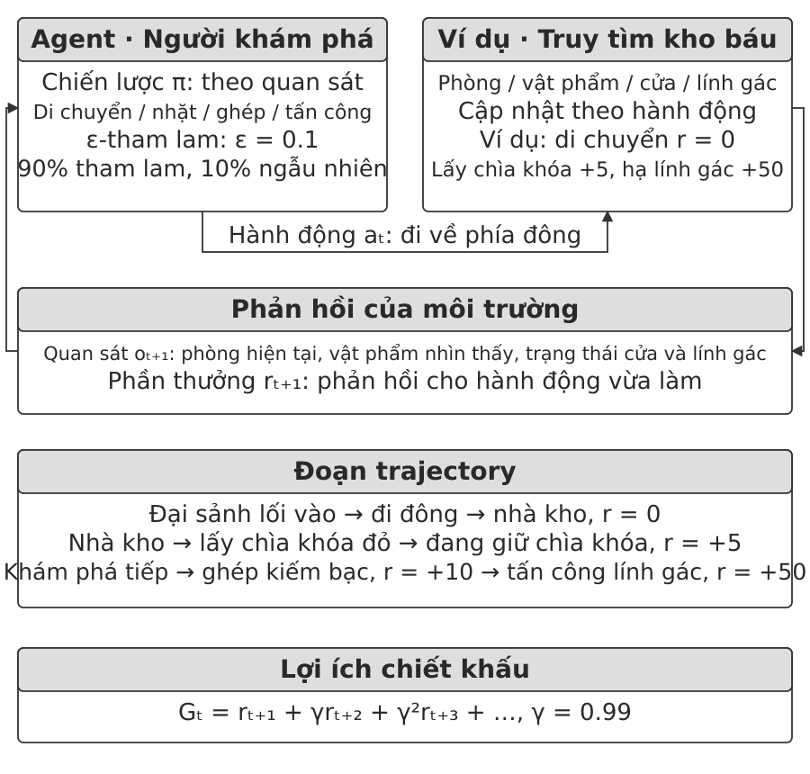

Tương tác liên tục tạo thành **trajectory (quỹ đạo)**, gồm quan sát, hành động, phần thưởng và thông tin kết thúc ở mỗi bước; khi hệ thống huấn luyện lấy được trạng thái môi trường, có thể ghi lại cả trạng thái. Chiến lược quyết định hành động ra sao, còn **hàm giá trị (Value Function)** ước lượng: xuất phát từ trạng thái hiện tại và tiếp tục theo một chiến lược nào đó thì kỳ vọng nhận được bao nhiêu lợi ích tương lai.

Ranh giới giữa Agent và môi trường do phạm vi hệ thống được chọn khi mô hình hóa quyết định. Mô hình và Harness mà cuốn sách bàn đến nằm trong Agent; giao diện công cụ nối chúng với ứng dụng, thiết bị và dịch vụ bên ngoài. Chẳng hạn, yêu cầu sửa tệp do Agent đưa ra, hệ thống tệp thực hiện việc ghi, rồi công cụ trả kết quả thực thi về cho Agent.

Trong quá trình học, cần phân bổ cơ hội giữa **khám phá và khai thác (Exploration–Exploitation)**. Khám phá cho chiến lược tiếp xúc với những hành động còn lạ, khai thác thì chọn hành động hiện được ước lượng là tốt hơn. Với nhiệm vụ có phần thưởng trễ, còn phải xác định những bước ban đầu nào đã góp phần tạo ra kết quả cuối cùng; đó là bài toán phân bổ tín dụng (credit assignment) sẽ bàn ở phần sau.

Để hiểu một phương pháp RL, có thể kiểm tra trước năm thành phần:

- **Không gian hành động**: được phép xuất ra những gì. Cờ dùng các nước đi rời rạc, điều khiển robot có thể dùng mục tiêu khớp liên tục; hành động còn có thể bị ràng buộc bởi trạng thái, giới hạn vật lý và quyền hạn.
- **Chiến lược (policy)**: quy tắc chọn hành động dựa trên trạng thái, quan sát hoặc lịch sử. Nó có thể là một cái bảng, cũng có thể là mạng nơ-ron.
- **Tín hiệu phần thưởng**: mục tiêu huấn luyện được thể hiện qua những phản hồi nào. Phần thưởng mỗi bước góp phần tạo nên lợi ích dài hạn, và chiến lược có thể chấp nhận cái giá trước mắt vì lợi ích tương lai.
- **Hàm giá trị**: ước lượng lợi ích về sau, dùng để so sánh hành động hoặc xây dựng tín hiệu cập nhật chiến lược. Thuật toán cụ thể quyết định có học tường minh hàm này hay không.
- **Mô hình môi trường**: dự đoán trạng thái, quan sát hoặc phần thưởng sau một hành động. Phương pháp dựa trên mô hình dùng mô hình môi trường đã biết hoặc học được để lập kế hoạch; phương pháp không dùng mô hình học chiến lược hoặc giá trị trực tiếp từ dữ liệu tương tác.

Bảng 8-3 chọn ra môi trường, hành động và mục tiêu trong số các khái niệm này để so sánh vài hệ thống quen thuộc. Khi đọc hai dòng đầu, có thể hiểu “giữ thăng bằng” và “diện tích làm sạch” là những mục tiêu ta có thể chọn khi mô hình hóa nhiệm vụ.

Bảng 8-3 So sánh các yếu tố then chốt của những hệ thống Agent khác nhau

| Loại Agent | Môi trường bên ngoài | Biểu diễn hành động | Ví dụ phần thưởng hoặc mục tiêu |
| --- | --- | --- | --- |
| Linh dương con mới sinh | Địa hình, trọng lực và động lực học cơ thể | Điều khiển cơ bắp liên tục | Giữ thăng bằng, tránh ngã |
| Robot hút bụi | Căn phòng, mặt sàn và trạm sạc | Di chuyển, quét dọn, về sạc và tham số điều khiển | Diện tích làm sạch, điện năng và cái giá của va chạm |
| Agent cờ vua | Bàn cờ, đối thủ và luật tính giờ | Nước đi hợp lệ ở trạng thái hiện tại | Thắng +1, thua −1, hòa 0 |
| Agent chăm sóc khách hàng | Người dùng, cơ sở dữ liệu nghiệp vụ và giao diện dịch vụ | Văn bản trả lời, truy vấn và lời gọi nghiệp vụ | Giải quyết vấn đề, tuân thủ quy trình, thời gian xử lý |
| Agent trợ lý lập trình | Nguồn yêu cầu, kho mã và môi trường thực thi | Tìm kiếm, sửa, chạy và trả lời | Kết quả kiểm thử, hoàn thành nhiệm vụ, hồi quy và chi phí |

Biểu diễn hành động của các hệ thống này khác nhau. Cờ thường chọn từng hành động rời rạc một, robot xuất ra lượng điều khiển liên tục với số chiều xác định, còn LLM sinh chuỗi token trước rồi để giao diện phân tích thành câu trả lời hoặc lời gọi công cụ. Tính toán bên trong cũng có thể đưa vào mô hình hóa chiến lược, ghi nhận tách biệt với việc thực thi công cụ làm thay đổi thực sự trạng thái bên ngoài.

### Hai cách biểu diễn hành động: thiết lập RL cổ điển và chiến lược độ dài thay đổi của LLM

**Quá trình quyết định Markov (Markov Decision Process, MDP)** dùng trạng thái, hành động, chuyển trạng thái và phần thưởng để mô tả bài toán ra quyết định. Tính Markov đòi hỏi: biết trạng thái và hành động hiện tại thì dự đoán trạng thái và phần thưởng kế tiếp không cần dựa thêm vào lịch sử; mọi thông tin trong lịch sử liên quan đến dự đoán đã nằm trong trạng thái hiện tại. Trong Hình 8-2, nếu chỉ ghi lại căn phòng người chơi đang đứng thì sẽ gặp rắc rối: dù hai lần đi đến cùng một cánh cửa, mở được cửa hay không còn tùy vào việc người chơi đã có chìa khóa chưa.

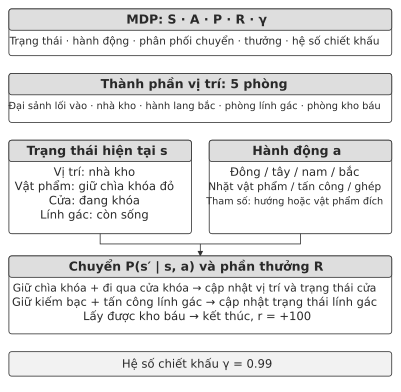

Cờ vua là một ví dụ về thiết kế trạng thái. Ngoài vị trí quân cờ, còn phải ghi lại lượt của bên nào, quyền nhập thành, quyền bắt tốt qua đường, cùng thông tin cần để xét luật năm mươi nước và thế cờ lặp lại. Đưa những nội dung này vào trạng thái rồi mới xét được luật theo trạng thái hiện tại. Nếu Agent chỉ thấy được một phần trong đó, nó cần dùng lịch sử để bù thông tin, hoặc dùng cách mô hình hóa quan sát được một phần.

MDP chứa được hành động rời rạc, liên tục lẫn hành động tổ hợp. Cờ vây có 361 giao điểm trên bàn, còn phải tính đến nước bỏ lượt và tính hợp lệ; trò chơi Atari thường chỉ có vài thao tác rời rạc; lượng điều khiển của robot thì do khớp, tay kẹp và ràng buộc vật lý định nghĩa. Khi số trạng thái và số hành động đều nhỏ, có thể lưu giá trị trực tiếp vào bảng. Khi quy mô lớn, xấp xỉ hàm, tối ưu chiến lược và tìm kiếm là những cách xử lý khác nhau.

**Q-learning dạng bảng: cập nhật giá trị hành động bằng phản hồi một bước.** $Q(s,a)$ ước lượng lợi ích sau khi thực hiện hành động $a$ ở trạng thái $s$. Giá trị hành động tối ưu thỏa mãn phương trình tối ưu Bellman:

$$
Q^*(s,a)=\mathbb E\left[r+\gamma\max_{a'}Q^*(s',a')\mid s,a\right]
$$

Trong đó $r$ là phần thưởng của bước này, $s'$ là trạng thái kế tiếp, $\gamma$ là hệ số chiết khấu. Với nhiệm vụ liên tục thường lấy $0\leq\gamma<1$; nhiệm vụ có điểm kết thúc rõ và lợi ích hữu hạn cũng có thể lấy bằng 1. Hệ số chiết khấu càng lớn thì phần thưởng ở xa càng giữ được nhiều trọng số. Lợi ích tính từ thời điểm hiện tại là $G_t=\sum_{k\geq0}\gamma^k r_{t+k+1}$.

Sau một lần tương tác thu được $r$ và $s'$, Q-learning cập nhật theo công thức:

$$
Q(s,a)\leftarrow Q(s,a)+\alpha\left[r+\gamma\max_{a'}Q(s',a')-Q(s,a)\right]
$$

$\alpha$ là learning rate; phần trong ngoặc vuông là hiệu giữa “phần thưởng một bước cộng giá trị về sau đã chiết khấu” và ước lượng hiện tại. Khi nhiệm vụ đến trạng thái kết thúc, giá trị về sau lấy bằng 0. Hãy thử một lần trong trò chơi đi kèm: tắt nhiễu ngẫu nhiên, đi từ lối vào sang phía đông, rồi nhặt chìa khóa đỏ trong nhà kho. Nhặt chìa khóa được thưởng 5 điểm, mỗi bước đi bị trừ 0,5 điểm, nên $r$ của hành động này là 4.5. Giả sử ước lượng cũ của ô “nhặt chìa khóa trong nhà kho” là 0,25, và giá trị Q lớn nhất trong các hành động khả dụng sau khi có chìa khóa là 0.63. Lấy $\gamma=0.99$, $\alpha=0.2$, mục tiêu một bước là $4.5+0.99\times0.63=5.1237$. Ước lượng cũ tiến về mục tiêu này một phần năm khoảng cách, cập nhật thành 1.22474. Cách dùng phản hồi một bước thực tế để sửa ước lượng như vậy gọi là **học chênh lệch thời gian (Temporal-Difference Learning, TD)**.

Đặt các giá trị Q của mọi hành động ở một trạng thái cạnh nhau, ta chọn được hành động hiện được ước lượng tốt nhất. Hình 8-3 vẽ chiến lược này trên một lưới giản lược. Con số trong mỗi ô là giá trị trạng thái đã chuẩn hóa. Hãy lấy tay che các con số, chỉ nhìn mũi tên: bạn có đi được từ góc trên bên trái đến kho báu không?

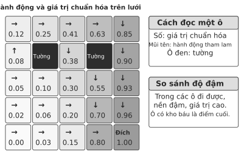

Lần khám phá tiếp theo có thể đổi hướng mũi tên. Hình 8-4 tách nhỏ phép tính nhặt chìa khóa đỏ vừa rồi: phần thưởng của bước này làm thay đổi ước lượng của ô “nhặt chìa khóa trong nhà kho”, còn giá trị Q của các trạng thái khác trong bảng phải đợi lượt cập nhật của riêng chúng.

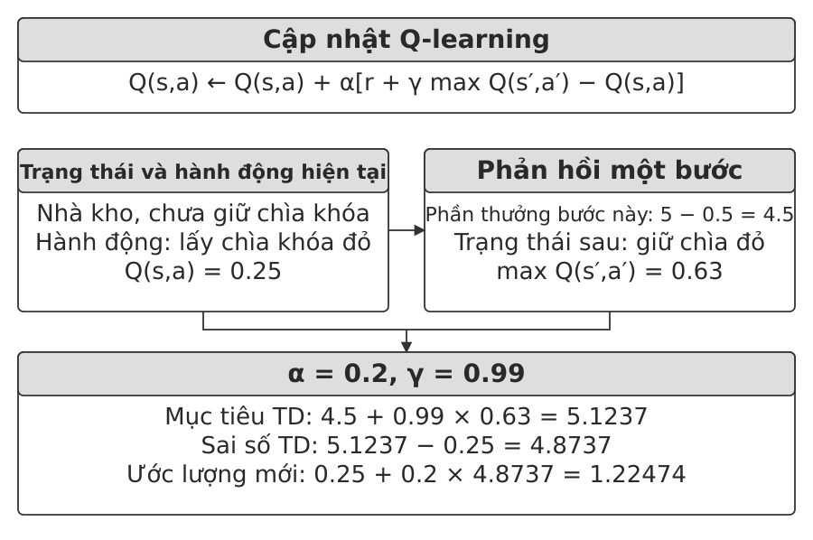

Chiến lược hành vi của Q-learning có thể chứa khám phá ngẫu nhiên, trong khi mục tiêu cập nhật dùng giá trị hành động lớn nhất ở trạng thái kế tiếp, vì vậy nó thuộc loại học **off-policy (ngoài chiến lược)**.

> **Thí nghiệm 8-1 ★: Q-learning trong trò chơi truy tìm kho báu**
>
> Trò chơi truy tìm kho báu chứa các quy tắc ẩn như chìa khóa và cửa, hiệu ứng vũ khí và ghép vật phẩm. Muốn qua màn phải hoàn thành nhiều bước theo thứ tự, đường đi tối ưu dài 11 bước; các hành động then chốt và chiến thắng mới có phần thưởng, các bước còn lại ít phản hồi.
>
> Lần huấn luyện truy tìm kho báu này dùng learning rate 0,2, hệ số chiết khấu 0,99, tỷ lệ khám phá ε giảm dần từ 1,0 xuống 0.1. Q-learning dạng bảng dùng khám phá ε-tham lam: mỗi bước, với xác suất ε thì chọn ngẫu nhiên một hành động khả dụng, các lần còn lại chọn một trong những hành động có giá trị Q lớn nhất hiện tại. Ghi lại tỷ lệ thắng, số trạng thái đã ghé và số bước qua màn ở từng giai đoạn.
>
> Khi đọc nhật ký huấn luyện và đánh giá của thí nghiệm này, hãy tách hai câu hỏi: trong lúc huấn luyện, chiến lược có khám phá ngẫu nhiên lần đầu tìm thấy kho báu khi nào? Sau khi huấn luyện xong, cố định bảng Q và hành động theo chiến lược tham lam thì có qua màn ổn định không? Câu đầu phản ánh cách mô hình phát hiện đường đi, câu sau kiểm tra xem nó có chọn hành động theo giá trị đã học được không.
>
> Trong một lần huấn luyện trước đây, 1000 ván đầu chưa qua màn, bảng Q có 124 trạng thái; đến 5000 ván vẫn chưa thắng ổn định, số trạng thái là 133; trong khoảng 7000–8000 ván, tỷ lệ thắng tăng từ 34% lên 96%; đến 10000 ván đạt 100%, bảng Q có 145 trạng thái và tìm ra đường đi 11 bước.
>
> Vì sao giai đoạn đầu mãi không tiến triển, rồi về sau tỷ lệ thắng lại tăng rất nhanh? Khám phá tìm ra các hành động và đường đi then chốt trước, những lượt ghé sau đó mới lan truyền dần lợi ích ở điểm cuối về các trạng thái phía trước. Cả lần mô phỏng nhỏ này chỉ mất khoảng 10 giây, nên gánh được một lượng lớn tương tác lặp lại.
>
> Khi phân tích, hãy ghi đồng thời thời gian tính toán và số lần tương tác. Trong trò chơi, một hành động rất rẻ; đổi sang trình duyệt, điện thoại hay thiết bị vật lý thì một lần tương tác còn kéo theo thời gian chờ, chi phí và thay đổi trạng thái. Cái bảng lại gắn với một cách mã hóa trạng thái cụ thể; khi luật chơi hoặc bản đồ thay đổi, phải kiểm tra lại xem các giá trị đã có còn dùng được không. Thí nghiệm tiếp theo sẽ so sánh xem kiến thức tiền huấn luyện thay đổi điểm xuất phát của khám phá như thế nào.

**LLM đã tiền huấn luyện: dùng ngôn ngữ để biểu diễn tính toán và hành động.**

LLM có thể sinh một đoạn tính toán trung gian trước khi gọi công cụ, cũng có thể xuất thẳng lời gọi. Cả hai đều được biểu diễn bằng chuỗi token nhưng tác dụng khác nhau: tính toán trung gian thay đổi ngữ cảnh mà mô hình dùng được về sau, còn lời gọi công cụ sau khi thực thi sẽ thay đổi hoặc đọc môi trường bên ngoài. Khi huấn luyện, có thể ghi lại các đầu ra này theo giao thức, rồi đánh giá chúng dựa trên kết quả nhiệm vụ và chi phí tính toán. “Nghĩ bao lâu, nghĩ gì, khi nào gọi công cụ” nhờ đó trở thành những lựa chọn mà cùng một chiến lược có thể học; AdaptThink ở phần sau xoay quanh chính ngân sách suy luận.

Chuỗi có độ dài thay đổi mở ra một không gian tổ hợp lớn hơn. Mô hình có thể viết truy vấn, chương trình, tham số JSON và suy diễn nhiều bước, còn độ dài chuỗi bị giới hạn bởi ngân sách và ngữ cảnh. Tiền huấn luyện cung cấp điểm xuất phát cho việc tìm kiếm: tài liệu toán thường chứa phân tích điều kiện và tính toán, mã nguồn và thảo luận thường chứa định vị, sửa và kiểm chứng. Mô hình có thể mượn các cấu trúc này để sinh đường đi ứng viên, rồi điều chỉnh theo phản hồi của môi trường. Kiến thức sẵn có khiến những tổ hợp hành động hữu ích dễ được lấy mẫu ngay từ đầu, giảm nhu cầu thử sai mù quáng trong vô số đường đi không liên quan.

Chẳng hạn, “đổi một khoản ngoại tệ sang đô la Mỹ” cần lấy tỷ giá rồi tính toán. Tiền huấn luyện giúp mô hình dễ sinh ra các bước có liên quan như vậy; hậu huấn luyện thì có thể dựa vào nguồn tỷ giá, kết quả tính và ràng buộc nhiệm vụ để điều chỉnh tiếp xác suất của các đường đi. Ở đây kiến thức ngôn ngữ cung cấp chiến lược ban đầu, phần thưởng cung cấp phản hồi của nhiệm vụ.

Hình 8-5 so sánh hai thiết lập trong mục này: Q-learning dạng bảng xuất phát từ cách mã hóa trạng thái và quy tắc khám phá được chỉ định, còn LLM Agent xuất phát từ chiến lược ngôn ngữ đã tiền huấn luyện và dùng ngữ cảnh để tổ chức quan sát công cụ cùng kinh nghiệm lịch sử.

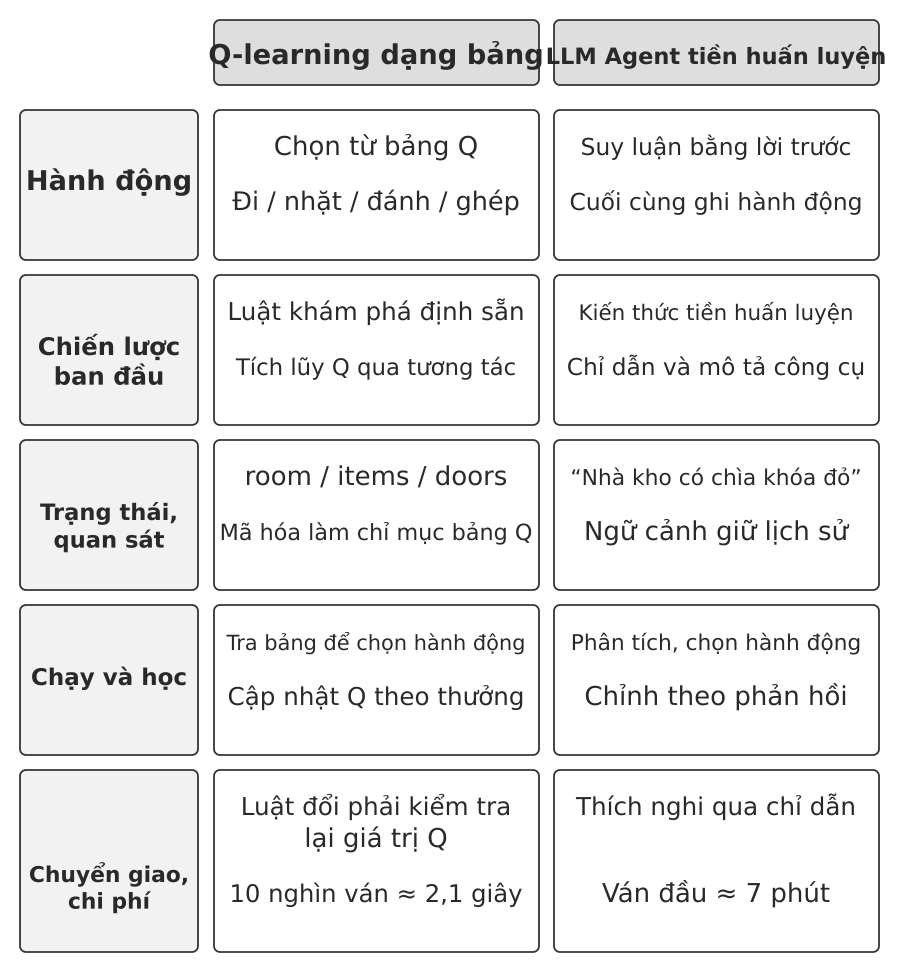

Tiền huấn luyện còn giúp mô hình hiểu được chỉ dẫn mới và điều chỉnh hành vi nhiệm vụ từ một ít trình diễn. Công cụ nối đầu ra ngôn ngữ với tìm kiếm, thực thi mã và thao tác nghiệp vụ. Khi thiết kế loại Agent này, vừa phải xác định giao diện công cụ và quyền thực thi, vừa phải xây dựng phản hồi cho kết quả nhiệm vụ, chi phí vận hành và các quá trình then chốt.

Muốn mô hình điều khiển cánh tay robot thì áp “dự đoán token tiếp theo” vào hành động bằng cách nào? OpenVLA dùng khoảng 970 nghìn trình diễn robot thực tế. Lấy một bước trong trình diễn: đầu vào là hình ảnh camera lúc đó cùng chỉ dẫn nhiệm vụ, mục tiêu huấn luyện là hành động mà người trình diễn thực hiện tiếp theo. Ví dụ, cánh tay robot dịch theo phương ngang bao nhiêu vốn là một giá trị liên tục. OpenVLA chia mỗi chiều hành động thành 256 mức và dùng một token để biểu thị giá trị rơi vào mức nào. Như vậy mô hình có thể dự đoán lần lượt từng token hành động, và chỉ tính mất mát ở những vị trí đó.[^ch8-21]

Ví dụ này cũng cho một cách phân biệt nhân bản hành vi (behavior cloning) với học tăng cường: xem tín hiệu nào khiến mô hình cập nhật. OpenVLA học từ bản ghi trình diễn, xác suất mô hình gán cho token hành động trình diễn càng cao thì mất mát càng thấp; đây là tinh chỉnh có giám sát. Đến SimpleVLA-RL ở Thí nghiệm 8-13, chiến lược thực sự thử hành động trong môi trường rồi điều chỉnh lựa chọn về sau theo phần thưởng nhiệm vụ.

> **Từ thuật toán, môi trường đến tri thức tiên nghiệm**
>
> Trong bài “The Second Half”, Yao Shunyu nhìn lại sự phát triển của RL qua ba yếu tố: thuật toán, môi trường và tri thức tiên nghiệm (prior).[^ch8-2] Dựa vào đó, tác giả tóm tắt sự dịch chuyển trọng tâm thành ba giai đoạn: 2015–2016 tập trung cải tiến thuật toán, 2016–2018 coi trọng hơn việc xây dựng môi trường, từ 2018 trở đi dần nhận ra giá trị của tri thức tiên nghiệm từ tiền huấn luyện. Gym cung cấp giao diện môi trường thống nhất, Universe và World of Bits khám phá nhiệm vụ trên máy tính và trang web, các dự án như Dota 2 cho thấy năng lực huấn luyện trong môi trường phức tạp. Sau đó, GPT-2, GPT-3 cho thấy kiến thức và năng lực diễn đạt tích lũy được qua tiền huấn luyện ngôn ngữ, và các hệ thống như WebGPT, ChatGPT tiếp tục tận dụng điểm xuất phát này. Tri thức tiên nghiệm mà nhiệm vụ cần có thể thu được trước qua mô hình hóa ngôn ngữ, rồi giao cho RL tối ưu hành vi cụ thể.
>
> Tác giả đồng tình với thứ tự ưu tiên kỹ thuật ở đây: **tri thức tiên nghiệm, môi trường, thuật toán**. Trước tiên kiểm tra mô hình đã có những kiến thức và năng lực nào, sau đó xây dựng môi trường và phản hồi phù hợp, cuối cùng chọn phương pháp tối ưu tương xứng. Hình 8-6 sắp xếp theo thứ tự xuất hiện của các trọng tâm nghiên cứu; khi làm dự án thì có thể đi ngược lại, bắt đầu từ năng lực sẵn có.
>
> 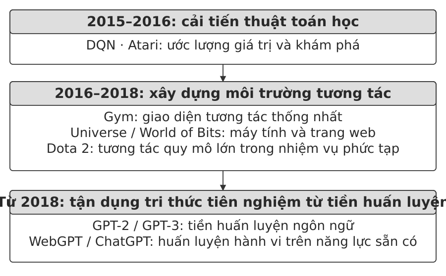

> **Thí nghiệm 8-2 ★★: So sánh RL truyền thống và LLM Agent**
>
> So sánh Q-learning dạng bảng với LLM Agent trong cùng trò chơi truy tìm kho báu. Cấu hình LLM dùng Kimi K3 và duy trì tối đa 50 mục kinh nghiệm trong ngữ cảnh. Ở mỗi bước, cả hai đều chọn một trong các hành động khả dụng do môi trường đưa ra. Đi theo hai nhánh trong Hình 8-7, có thể thấy bảng Q và mô hình ngôn ngữ lần lượt đưa ra lựa chọn này như thế nào.
>
> 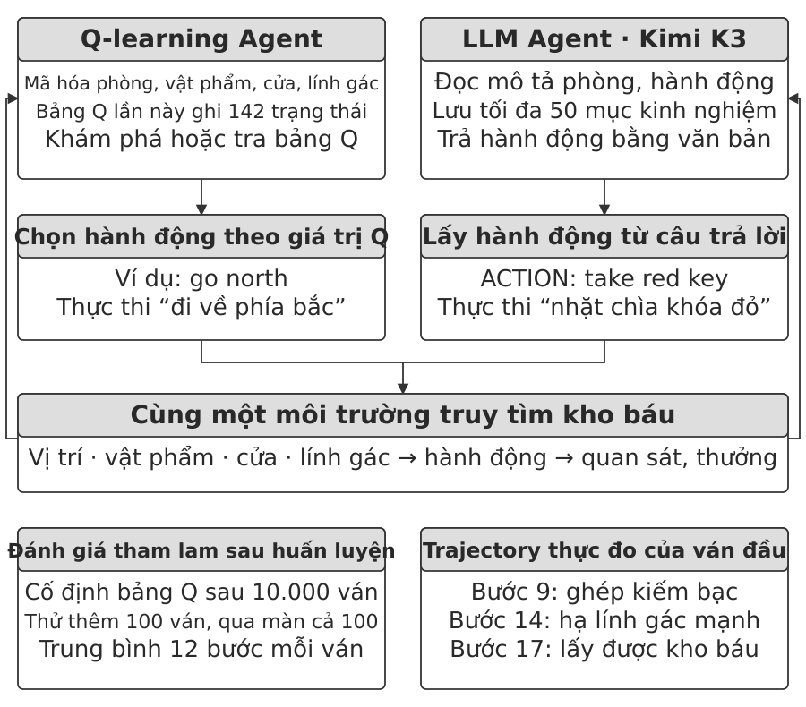
>
> Trong nhật ký chạy Kimi K3 đi kèm, ván đầu tiên Agent dùng 17 bước. Nó nhặt thanh kiếm gỉ trước, phát hiện cửa bắc bị khóa, chuyển sang nhà kho lấy chìa khóa đỏ và pha lê ma thuật, đến bước 9 thì ghép kiếm với pha lê thành kiếm bạc. Ở bước 12 khi thử dùng chìa khóa, môi trường báo “sẽ tự động dùng khi cần”; đến bước 13 đi về phía bắc, cửa mới thực sự mở. Bước 14 dùng kiếm bạc hạ gục lính gác xong, nó lại thử dùng kiếm thêm một lần, và môi trường báo lúc này không dùng được. Bước 17 lấy được kho báu. Khi đọc nhật ký này, bạn có thể che dòng tiếp theo, dựa vào phản hồi hiện tại để đoán xem bước nào còn cần thiết.
>
> Đối chiếu từng hành động với quan sát tại thời điểm đó, có thể phân tích mô hình đã dùng kiến thức sẵn có như “chìa khóa mở cửa”, “vũ khí đối phó lính gác” ra sao, và phản hồi của công cụ thay đổi kế hoạch tiếp theo thế nào. Phương án dạng bảng thì tích lũy các quan hệ này qua những lượt ghé cặp trạng thái–hành động.
>
> Trong lần đối chứng này, Q-learning huấn luyện 10000 ván mất 2,12 giây, sau đó đánh giá riêng 100 ván bằng chiến lược tham lam, qua màn toàn bộ với trung bình 12 bước. Kimi gọi mô hình 17 lần trong một ván, mất 6 phút 56 giây. Từ đó tác giả áp dụng một nguyên tắc lựa chọn: khi mô phỏng rẻ và lặp lại được với số lượng lớn, có thể tận dụng triệt để khả năng khám phá của RL truyền thống; khi mỗi lần tương tác đều tốn thời gian chờ, chi phí hoặc thao tác thực tế, hãy ưu tiên chiến lược tận dụng được kiến thức sẵn có để nâng giá trị của mỗi lần tương tác.

Hai thí nghiệm này nối chương với các phương pháp kỹ thuật ở phần trước: ngữ cảnh có thể tổ chức kinh nghiệm trong một lần chạy, bộ nhớ ngoài có thể lưu kinh nghiệm xuyên nhiệm vụ, còn hậu huấn luyện thay đổi chiến lược thông qua cập nhật tham số. Phần tiếp theo bổ sung quy trình cơ bản của tiền huấn luyện ngôn ngữ và thị giác, rồi mới bàn về dữ liệu huấn luyện và phương pháp tối ưu cụ thể.

## Nền tảng tiền huấn luyện mô hình `[Đọc tùy chọn]`

Tiền huấn luyện xây dựng biểu diễn ban đầu và phân phối sinh của mô hình; các giai đoạn huấn luyện sau tiếp tục điều chỉnh tham số trên điểm xuất phát này. Muốn hiểu điểm xuất phát đó, có thể quan sát trước một mô hình ngôn ngữ nhỏ học từ văn bản ra sao, rồi xem nó tiếp nhận đầu vào thị giác như thế nào.

Văn bản trước hết đi qua bước **tách token (Tokenization)** để chuyển thành các token rời rạc. Chẳng hạn, “tôi thích lập trình” có thể được minh họa thành ba đơn vị “tôi”, “thích”, “lập trình”, còn cách chia thực tế do bộ tách từ quyết định. Huấn luyện lấy các token phía trước làm ngữ cảnh để dự đoán token tiếp theo, tính mất mát và cập nhật tham số. Trong Hình 8-8, hãy che câu huấn luyện đến chữ “môi trường”, đoán từ tiếp theo là gì, rồi mới mở nguyên văn. Dịch vị trí này lùi về sau một bước là có bài dự đoán tiếp theo.

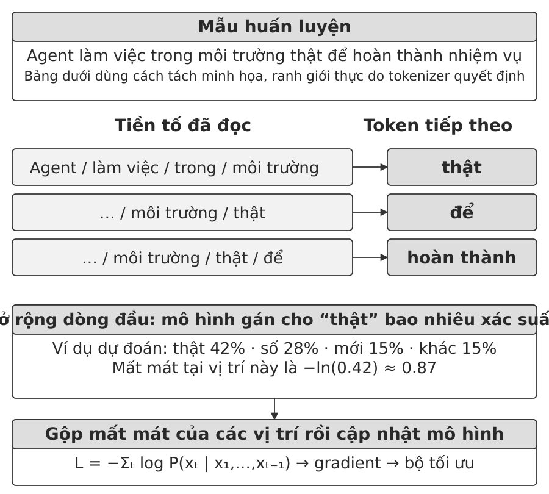

Sau mô hình hóa ngôn ngữ cơ bản, có thể thêm trình diễn chỉ dẫn để huấn luyện định dạng trả lời và hành vi nhiệm vụ; cũng có thể dùng dữ liệu sở thích, qua các phương pháp như DPO, để tăng xác suất của những câu trả lời được ưa chuộng hơn.

> **Thí nghiệm 8-3 ★★: Huấn luyện LLM từ đầu – sức mạnh của cải tiến thuật toán**
>
> Lấy MiniMind 2 khoảng một trăm triệu tham số làm ví dụ, hoàn thành tiền huấn luyện, SFT và tối ưu sở thích trên GPU phổ thông. So sánh cấu hình cơ sở với cấu hình thêm QK Norm và bộ tối ưu Muon, quan sát tốc độ giảm mất mát, thời gian cần để đạt chất lượng mục tiêu và kết quả sinh. Bản tổng hợp đi kèm ghi nhận tốc độ hội tụ tăng khoảng 3 lần; toàn bộ quá trình huấn luyện mất khoảng 14 giờ, chi phí khoảng 34 đô la Mỹ.
>
> QK Norm điều chỉnh thang giá trị của query và key trong attention, còn Muon thay đổi cách cập nhật tối ưu cho các tham số tương ứng.
>
> Quan sát cùng một bộ câu hỏi qua từng giai đoạn: mô hình tiền huấn luyện đã trả lời được những câu như “ngọn núi cao nhất thế giới”; sau SFT, khả năng tuân thủ chỉ dẫn và tổ chức đầu ra được cải thiện; tối ưu sở thích tiếp tục ảnh hưởng đến câu trả lời về sự kiện và cách diễn đạt.

> **Thí nghiệm 8-4 ★★: Tự huấn luyện VLM**
>
> Hình 8-9 minh họa cách nối “bộ mã hóa thị giác – lớp chiếu – mô hình ngôn ngữ”. Bộ mã hóa thị giác như CLIP trích xuất đặc trưng ảnh, lớp chiếu chuyển đặc trưng sang số chiều và dạng biểu diễn mà đầu vào của mô hình ngôn ngữ cần, mô hình ngôn ngữ kết hợp các đầu vào này để sinh mô tả hoặc câu trả lời.
>
> 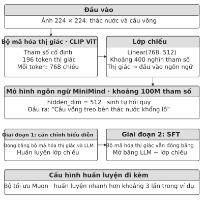
>
> Giai đoạn một đóng băng bộ mã hóa thị giác và LLM, chỉ huấn luyện lớp chiếu mới thêm vào để đặc trưng ảnh tham gia được vào dự đoán ngôn ngữ; giai đoạn hai mở băng LLM theo cấu hình và làm SFT với dữ liệu ảnh–mô tả hoặc hỏi đáp chất lượng cao. Quan sát riêng sự thay đổi ở nhận diện đối tượng, mô tả chi tiết, phán đoán quan hệ và năng lực ngôn ngữ.
>
> Kiến trúc này tái sử dụng các mô hình thị giác và ngôn ngữ có sẵn, tập trung huấn luyện mô-đun nối liên phương thức trước, là phương án đáng thử trước tiên khi ngân sách có hạn. Đóng băng trọng số giảm số trạng thái phải huấn luyện, sau đó mới mở băng các mô-đun tương ứng theo nhu cầu nhiệm vụ. Khi mô tả sai, trước hết hãy kiểm tra thông tin về đối tượng đã vào biểu diễn thị giác chưa; nếu thông tin đã có mà mô hình vẫn không dùng được, cần tập trung kiểm tra năng lực biểu đạt của lớp chiếu, dữ liệu căn chỉnh và giám sát sinh ngôn ngữ. Đổi tiếp đầu ra thành biểu diễn hành động và căn chỉnh với giao diện điều khiển, ta sẽ đến kiến trúc VLA ở Chương 6.

Hai thí nghiệm lần lượt cho thấy cấu hình tối ưu và cách nối liên phương thức ảnh hưởng đến huấn luyện ra sao. Khi ngân sách eo hẹp, tác giả khuyên trước hết hãy so sánh lợi ích mà cải tiến thuật toán và kiến trúc mang lại, rồi mới quyết định có tăng quy mô mô hình hay không. Khi mô hình có sẵn bước vào ngôn ngữ mới hoặc lĩnh vực mới, cũng có thể tiếp tục học từ trọng số tiền huấn luyện; mục sau bàn cách chọn dữ liệu cho kiểu huấn luyện này.

## Mid-training: bổ sung kiến thức và năng lực nền

Trong chương này, **Mid-training** chỉ việc tiếp tục một giai đoạn huấn luyện mô hình ngôn ngữ trên mô hình có sẵn, xoay quanh phân phối đích. Lượng lớn token trong tài liệu, mã nguồn hoặc phép suy diễn tham gia giám sát, và khi huấn luyện có thể trộn ngữ liệu của lĩnh vực đích với ngữ liệu tổng quát. Các nghiên cứu DAPT/TAPT cho thấy tiền huấn luyện tiếp tục trên ngữ liệu liên quan đến lĩnh vực hoặc nhiệm vụ giúp ích cho nhiệm vụ hạ nguồn.[^ch8-30]

Việc chọn dữ liệu xuất phát từ hai loại khoảng trống. Một là độ phủ kiến thức và ngôn ngữ, chẳng hạn mô hình ít tiếp xúc với giao thức doanh nghiệp, thuật ngữ của ngôn ngữ đích hoặc một kho mã cụ thể; hai là năng lực nền mà nhiệm vụ cần, chẳng hạn theo dõi trạng thái trong ngữ cảnh dài, tổng hợp quan hệ xuyên tài liệu hoặc hoàn thành một phép suy diễn mã nguồn khá dài. Trước tiên hãy phân loại lỗi thành vấn đề về hiểu, kiến thức, định dạng hay hành động, rồi mới xác định tài liệu cần bổ sung.

Sau khi mất mát trên văn bản lĩnh vực giảm, còn phải kiểm tra mô hình có dùng được kiến thức đã học trong nhiệm vụ thực tế không. Thứ tự giữa huấn luyện tiếp và huấn luyện chỉ dẫn, cách tổ chức hỏi đáp và hình thức tài liệu đều ảnh hưởng đến việc vận dụng kiến thức.[^ch8-31] Với nhiệm vụ lĩnh vực mà năng lực nền còn yếu rõ rệt, tác giả khuyên trước hết dùng ngữ liệu lĩnh vực để tăng độ phủ, rồi dùng trình diễn SFT dạy mô hình dùng các thông tin này trong nhiệm vụ; khi mô hình đôi lúc làm đúng nhưng tỷ lệ thành công còn thấp mới đầu tư vào RL.

### Xây dựng dữ liệu Mid-training như thế nào

**Bước một, định vị tài liệu cần thiết từ phân phối lỗi.** Đánh giá riêng theo chủ đề, ngôn ngữ, loại tài liệu, khuôn mẫu mã nguồn và độ dài ngữ cảnh, kết hợp Pass@1, Pass@k và các mẫu lỗi để xác định mô hình thiếu lời giải dùng được trong những điều kiện nào. Vấn đề định dạng tham số có thể giao cho trình diễn giao diện xử lý, còn khoảng trống về khái niệm và quan hệ trong lĩnh vực thì cần ngữ liệu tương ứng.

**Bước hai, tổ chức ngữ liệu mật độ cao.** Tài liệu gốc cung cấp thuật ngữ và quan hệ sự kiện, kho mã cung cấp cấu trúc mô-đun và phụ thuộc, phép suy diễn kiểu giáo trình và diễn giải tổng hợp trải các bước ẩn ra, còn mẫu xuyên tài liệu nối các thông tin rời rạc với nhau. Sau khi lọc chất lượng, khử trùng lặp và cách ly tập đánh giá, mới xây dựng chuỗi huấn luyện.

**Bước ba, trộn dữ liệu theo năng lực mục tiêu.** Văn bản dài tự nhiên có thể lấy từ sách, tài liệu và kho mã; với truy xuất, suy luận nhiều bước nhảy, tuân thủ chỉ dẫn, tổng hợp và thống kê, có thể thêm dữ liệu nhiệm vụ kèm suy diễn; với Agent, có thể thêm trajectory về lập kế hoạch, chọn công cụ, xây dựng tham số, theo dõi trạng thái và khôi phục lỗi. Các tài liệu này có thể lấy từ bộ dữ liệu có sẵn hoặc do mô hình thầy sinh ra, và được sàng lọc theo yêu cầu về nội dung và hành vi trước khi đưa vào huấn luyện.

**Bước bốn, để mô hình tiếp tục luyện những nhiệm vụ vốn đã làm được.** Một nhóm mẫu giữ nguyên văn bản ngắn, ngữ liệu tổng quát và các đề bài cũ; nhóm còn lại đặt cùng nhiệm vụ đó vào ngữ cảnh dài hơn, dời vị trí của thông tin then chốt và thêm yếu tố gây nhiễu. Khi phối hai nhóm tài liệu này, có thể tham khảo phân phối của dữ liệu huấn luyện ban đầu, cũng có thể dùng ngữ liệu công khai như FineWeb-2 để thử vài tỷ lệ phối, rồi điều chỉnh theo kết quả đánh giá.

**Bước năm, dùng nhiều chỉ số để quyết định tiếp tục hay dừng.** Ghi lại đồng thời mất mát huấn luyện, nhiệm vụ lĩnh vực để dành riêng, năng lực tổng quát, khả năng tuân thủ chỉ dẫn vốn có và tỷ lệ thành công của nhiệm vụ đích. Khi điểm lĩnh vực tăng mà năng lực tổng quát giảm, hãy so sánh tỷ lệ trộn, learning rate và lượng huấn luyện; khi mất mát giảm mà nhiệm vụ đích đứng yên, hãy kiểm tra xem tài liệu huấn luyện có dạy được mô hình làm loại nhiệm vụ này không, và có cần bổ sung trình diễn vận dụng kiến thức trong nhiệm vụ thực tế hay không.

Giả sử mô hình tìm được một mã đơn hàng chỉ định trong một nhật ký đơn hàng rất dài. Nếu đổi câu hỏi thành “khách hàng nào đặt nhiều lần rồi hủy tất cả”, nó còn phải gom đủ các đơn của cùng một khách hàng và khớp từng đơn với bản ghi hủy. Hai câu hỏi có thể dùng cùng một nhật ký nhưng kiểm tra những năng lực khác nhau. RULER dùng nhiệm vụ tổng hợp để kiểm soát tách biệt độ dài đầu vào và độ khó nhiệm vụ, đo riêng truy xuất một mục, theo dõi nhiều bước nhảy và tổng hợp. Các tác giả đã đánh giá 17 mô hình; nhiều mô hình gần như đạt điểm tối đa ở truy xuất đơn giản, nhưng khi đầu vào dài ra, kết quả tổng hợp giảm rõ rệt.[^ch8-ruler]

Muốn xem khác biệt này có xuất hiện trên tài liệu thực tế không, có thể dùng thêm các đề nhiều tài liệu, hội thoại dài hoặc kho mã của LongBench v2. Muốn kiểm tra riêng xem mô hình có nhớ được các yêu cầu như định dạng đầu ra hay không, có thể lấy những chỉ dẫn kiểm chứng được trong IFEval rồi đặt vào các vị trí khác nhau trong một tài liệu dài hơn. Khi so sánh hai mô hình, vị trí chỉ dẫn và nội dung gây nhiễu mà cả hai thấy phải giống nhau, và cần ghi rõ đây là phép thử tự xây dựng. Cuối cùng mới dùng nhiệm vụ Agent đầu-cuối để kiểm tra các năng lực này có phối hợp được với nhau không. Khi thiết kế tập đánh giá, có thể lần lượt kiểm tra các khía cạnh dưới đây.[^ch8-longbench]

[^ch8-ruler]: Hsieh và cộng sự, RULER, 2024.
[^ch8-longbench]: Bai và cộng sự, LongBench v2, ACL 2025. Bài báo đưa ra sáu loại nhiệm vụ, tổng cộng 503 câu trắc nghiệm.

- **Vị trí và truy xuất**: một hay nhiều thông tin then chốt, nằm ở đầu, giữa hay cuối, có tìm ra được không.
- **Quan hệ và suy luận**: theo dõi quan hệ xuyên đoạn văn, xuyên tài liệu, giải quyết mâu thuẫn và kết hợp bằng chứng.
- **Tổng hợp và thống kê**: đếm, nhóm, sắp xếp, so sánh và khái quát xu hướng trong bảng và nhật ký dài.
- **Tuân thủ chỉ dẫn**: nhiều yêu cầu, xử lý xung đột, điều kiện quy trình và định dạng đầu ra.
- **Suy luận chuỗi dài**: chuỗi phụ thuộc dài trong nhiệm vụ toán, logic và mã nguồn.
- **Hành vi cơ bản của Agent**: phân rã nhiệm vụ, chọn công cụ, sinh tham số, giữ trạng thái và khôi phục khi thất bại.

Suy luận dài và gọi công cụ nhiều lượt liên tục kéo dài ngữ cảnh, trong khi các chỉ dẫn, sự kiện và trạng thái nhiệm vụ từ trước vẫn phải tham gia vào quyết định về sau. Nếu mô hình không tìm được thông tin hoặc không giữ được ràng buộc trong văn bản dài, Agent tầm xa khó vận hành tin cậy. Trước khi tăng ngân sách huấn luyện, nên dùng cấu hình quy mô nhỏ để so sánh tỷ lệ phối dữ liệu và lượng huấn luyện. Với những sự kiện cập nhật thường xuyên và đòi hỏi trích nguồn, tác giả ưu tiên RAG; với kiến thức lĩnh vực quy mô lớn ổn định và năng lực nền, mới cân nhắc huấn luyện tiếp để ghi vào tham số.

> **Thí nghiệm 8-5 ★★: Tiền huấn luyện tiếp tục để học ngôn ngữ mới**
>
> Xuất phát từ Mistral 7B v0.3, dùng các tài liệu như Wikipedia tiếng Hàn để nâng năng lực tiếng Hàn. Huấn luyện trước với hỗn hợp khoảng 80% tiếng Hàn, 20% tiếng Anh, rồi làm SFT bằng dữ liệu chỉ dẫn tiếng Hàn, quan sát riêng sự thay đổi ở mô hình hóa ngôn ngữ và hành vi hội thoại.
>
> Dữ liệu tiếng Hàn tăng độ phủ cho ngôn ngữ đích, dữ liệu tiếng Anh dùng để giữ năng lực vốn có. Mọi giai đoạn đều kiểm thử bằng cùng một loạt câu hỏi tiếng Hàn và tiếng Anh không tham gia huấn luyện. Trong kết quả đi kèm, điểm đánh giá mù ở giai đoạn cuối của tiếng Hàn được cải thiện, còn năng lực tiếng Anh có giảm; điều này chỉ ra hướng cụ thể cho vòng sau: trộn thêm tài liệu tiếng Anh hoặc giảm cường độ cập nhật.
>
> Ghi riêng ngôn ngữ đích, ngôn ngữ vốn có và chất lượng sự kiện thì đánh giá được lợi ích lẫn cái giá; đến giai đoạn SFT lại kiểm tra mô hình có tổ chức câu trả lời theo chỉ dẫn tiếng Hàn được không. Như vậy có thể quan sát riêng tác dụng của tiền huấn luyện tiếp tục và tinh chỉnh chỉ dẫn.

## SFT (tinh chỉnh có giám sát)

Ngữ liệu lĩnh vực giúp mô hình gặp một giao diện nào đó thêm vài lần, nhưng muốn dạy nó sửa tham số sau khi gọi thất bại, có thể trình diễn trực tiếp một lần. SFT cho trước đầu vào nhiệm vụ và huấn luyện mô hình sinh từng token của câu trả lời hoặc hành động trong trình diễn. Khi xem Hình 8-10, hãy nghĩ rõ mình định dạy hành vi nào trước, rồi mới quyết định thu thập trình diễn ra sao. Sự kiện, giọng điệu và định dạng đầu ra trong trình diễn cũng sẽ đi vào huấn luyện cùng lúc.

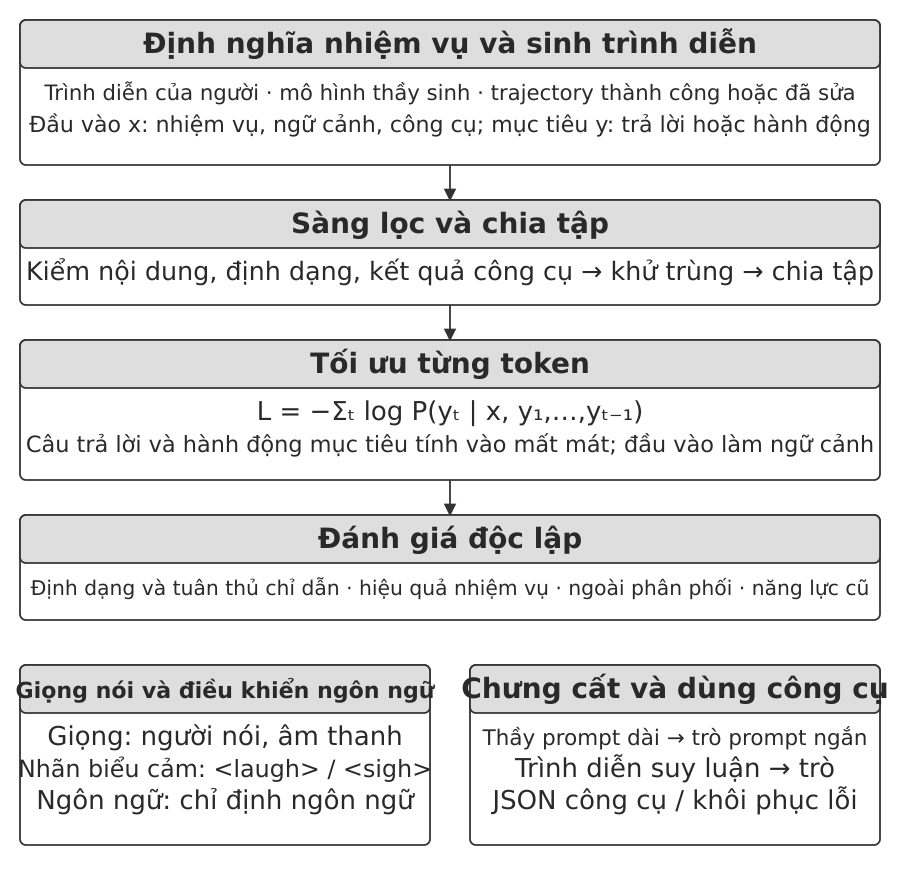

Dữ liệu thường đến từ ba nguồn: chuyên gia con người định nghĩa hành vi then chốt và ranh giới, mô hình thầy viết trình diễn theo lô, verifier sàng lọc đầu ra hợp lệ từ các mẫu do mô hình sinh. Ba nguồn có thể dùng kết hợp. Chẳng hạn, trước hết chuyên gia viết một ít trình diễn gọi công cụ, sau đó để mô hình thầy thay đổi điều kiện nhiệm vụ mà sinh thêm mẫu, cuối cùng kiểm tra tham số, kết quả thực thi và ràng buộc nghiệp vụ.

**Một công dụng của SFT là dạy cho mô hình những cách làm vốn phải viết đi viết lại trong prompt và Skill.** Lấy việc chấm điểm bộ nhớ ở Chương 7 làm ví dụ: giả sử sổ tay chấm điểm cùng các tiền lệ dài tới mười nghìn token. Mô hình thầy dựa vào sổ tay đầy đủ để chấm một loạt câu trả lời, trình diễn cách xử lý những trường hợp như trùng tên người, đảo ngược quan hệ hoặc thiếu bằng chứng. Khi huấn luyện mô hình trò, đầu vào chỉ giữ tên ngắn của các tiêu chí chấm, tài liệu lịch sử của lần đó và câu trả lời cần chấm, đầu ra mục tiêu là mức điểm mà mô hình thầy chọn. Khi đưa vào vận hành chỉ cần cung cấp prompt ngắn và tài liệu của lần đó, mỗi lần suy luận tiết kiệm được mười nghìn token chỉ dẫn cố định kia. Với Skill được gọi lặp đi lặp lại, cũng có thể dùng cách tương tự để trình diễn khi nào cần tra tài liệu, chọn công cụ ra sao, rồi chưng cất các bước ổn định này vào mô hình.

Chuẩn bị dữ liệu phải bắt đầu bằng việc xác định phân phối nhiệm vụ, schema đầu ra và cách nghiệm thu. Trình diễn qua được kiểm tra rồi mới khử trùng lặp, điều chỉnh tỷ lệ các loại mẫu và chia tập dữ liệu. Số lượng mẫu và phạm vi phủ phải được thiết kế cùng nhau: lặp lại một kiểu hỏi hàng nghìn lần sẽ củng cố đi củng cố lại cùng một khuôn mẫu; xây dựng biến thể xoay quanh các điều kiện then chốt mới giúp mô hình chọn hành vi phù hợp với những đầu vào khác nhau. Tác giả thường trau chuốt trước một lô trình diễn phủ các tình huống then chốt, rồi mới mở rộng quy mô. SFT học đầu ra mục tiêu từng token một, nên sự kiện sai, bước thừa và thói quen thao tác không phù hợp cũng theo đó đi vào tham số.

> **Thí nghiệm 8-6 ★★★: SFT giọng nói – từ sao chép giọng đến mô hình hóa cận ngôn ngữ `[Thí nghiệm mở rộng]`**
>
> Lấy Orpheus và Sesame CSM làm ví dụ, so sánh cách điều kiện người nói, ngữ cảnh hội thoại và nhãn biểu cảm tham gia vào sinh giọng nói. Orpheus biểu diễn giọng nói thành token, có thể dùng cặp đoạn văn bản–giọng nói tham chiếu để sinh âm sắc tương ứng, và cũng cung cấp các nhãn biểu cảm như `<laugh>`, `<sigh>`. Sesame CSM thì nhận văn bản, định danh người nói và các đoạn âm thanh có sẵn để sinh phần giọng nói tiếp theo.[^ch8-speech-conditioning]
>
> Khi xây dựng mẫu huấn luyện, ghi riêng văn bản, người nói, âm thanh và điều kiện biểu cảm; dùng tài liệu nhiều câu của cùng một người nói để học tính nhất quán, dùng tiếng cười, tiếng thở dài và khoảng ngừng trong nhiều ngữ cảnh để học biểu cảm. So sánh đầu ra khi không có tham chiếu, có tham chiếu và có chỉ định điều kiện biểu cảm, rồi chấm điểm theo độ chính xác, độ tự nhiên, cảm xúc và âm sắc.
>
> Dữ liệu cần phủ đủ tổ hợp người nói, kiểu câu và cảm xúc. Khi có quá ít người nói, đầu ra có thể ngả về một âm sắc duy nhất; khi một nhãn luôn gắn với cùng một đoạn âm thanh, có thể xuất hiện cách biểu cảm lặp lại, máy móc.

> **Thí nghiệm 8-7 ★★★: Suy nghĩ đa ngôn ngữ – sinh quá trình suy luận bằng ngôn ngữ được chỉ định `[Thí nghiệm mở rộng]`**
>
> Làm SFT cho gpt-oss-20b, dùng chỉ dẫn để chỉ định ngôn ngữ của quá trình suy luận. Chẳng hạn, `reasoning language: German` yêu cầu sinh văn bản suy luận bằng tiếng Đức. Mẫu huấn luyện gồm tiếng Anh, tiếng Tây Ban Nha, tiếng Pháp và các ngôn ngữ khác, còn tiếng Trung được để dành cho giai đoạn kiểm thử.
>
> Trong tình huống đi kèm, sau huấn luyện, khi chỉ định Chinese, mô hình sinh được quá trình suy luận bằng tiếng Trung. Có thể so sánh thêm ba kết quả: có tuân theo yêu cầu ngôn ngữ không, đáp án cuối có đúng không, và độ dài sinh cùng thời gian chạy thay đổi ra sao. Nền tảng đa ngôn ngữ từ tiền huấn luyện và cách điều khiển học được qua SFT cùng tạo nên biểu hiện xuyên ngôn ngữ này; đối chứng giữa các ngôn ngữ và mô hình nền khác nhau giúp phân tích tiếp vai trò của từng yếu tố.

> **Thí nghiệm 8-8 ★★: Chưng cất prompt – tái tạo năng lực dùng được với chi phí nhỏ hơn**
>
> Một nghiệp vụ ổn định có thể phụ thuộc vào system prompt dài hàng nghìn token, và mô hình thầy còn sinh ra suy luận khá dài. Chưng cất prompt trước hết để mô hình thầy tạo đầu ra chất lượng cao trong điều kiện đầy đủ, rồi ghép “đầu vào người dùng – câu trả lời cuối cùng” thành dữ liệu SFT cho mô hình trò. Mô hình trò dùng prompt ngắn hơn và trả lời trực tiếp theo cấu hình mục tiêu.
>
> Mở mẫu huấn luyện đầu tiên là thấy: mô hình thầy Kimi K3 đọc một đoạn văn bản tiếng Ả Rập có xen chữ Latinh, giải thích căn cứ phán đoán, cuối cùng đưa ra mã ngôn ngữ `ar`. Trình diễn giao cho mô hình trò SmolLM2-135M-Instruct chỉ có nguyên văn và `ar`. Trên cùng một bộ 80 bản ghi kiểm thử, phía thầy trung bình mỗi yêu cầu đọc vào khoảng 386 token, phía trò khoảng 97. Hai con số này được đếm theo bộ tách từ của từng mô hình.
>
> Bản ghi đối chứng nhận diện ngôn ngữ đi kèm có thể dùng để tách “trả lời đúng” khỏi “đầu ra đúng định dạng”. Mô hình thầy sinh trình diễn trên 160 mẫu huấn luyện, và trả lời đúng toàn bộ 80 bản ghi kiểm thử. Mô hình trò chưa tinh chỉnh khi kiểm thử không có đầu ra nào được bộ chấm phân tích được, điểm bằng không; sau tinh chỉnh, cả 80 đều phân tích được, 76 nhãn đúng. Điểm không của đường cơ sở tự nó không phân biệt được “không nhận ra ngôn ngữ” với “nhận ra nhưng không trả lời đúng định dạng”. Bộ kiểm thử này gồm 75 đoạn văn bản khác nhau, giữa huấn luyện và kiểm thử không có văn bản nào trùng khớp hoàn toàn.
>
> Khi xây dựng dữ liệu còn phải giữ lại những điều kiện mà mô hình trò cần để hoàn thành nhiệm vụ. Khi mô hình thầy dựa vào kết quả công cụ mới nhất, có thể đưa kết quả tương ứng vào làm đầu vào của trò, hoặc tiếp tục giữ giao diện công cụ; khi mô hình thầy có lỗi hệ thống, thì lọc bằng kiểm chứng độc lập.
>
> Khi quy tắc sản phẩm ổn định, phân phối đầu vào rõ ràng và chi phí gọi cao, tác giả khuyên ưu tiên đánh giá chưng cất prompt, nén prompt và suy luận phải xử lý lặp đi lặp lại vào tham số. Khi sản phẩm còn đang thăm dò, yêu cầu nhiệm vụ thay đổi thường xuyên, hãy giữ prompt chỉnh sửa được và suy luận tường minh để dễ thử nghiệm nhanh và định vị lỗi.

> **Thí nghiệm 8-9 ★★★: Chưng cất chuỗi suy nghĩ (Chain of Thought, CoT)**
>
> Chưng cất CoT lấy văn bản suy luận do mô hình thầy cung cấp cùng đáp án cuối làm giám sát, để mô hình trò học quá trình phân rã, tính toán, kiểm tra và sửa chữa. DeepSeek-R1 chưng cất sang các dòng Qwen, Llama là ví dụ tiêu biểu của phương pháp này. Với những nhóm muốn có mô hình tự chủ kiểm soát được mà vẫn muốn hạn chế đầu tư huấn luyện, tác giả khuyên ưu tiên con đường này. Mô hình thầy mạnh hơn rõ rệt so với trò trên nhiệm vụ đích thì mới có điều kiện cung cấp trình diễn có giá trị; có thể chọn trước trong số các mô hình trọng số mở cho lấy được đầu ra suy luận đầy đủ, rồi so sánh khoảng cách năng lực với mô hình trò và chất lượng dữ liệu. Khi giao diện chỉ cung cấp bản tóm tắt suy luận, thông tin dùng được cho chưng cất quá trình cũng giảm theo.
>
> Bước một, để mô hình thầy đưa ra vài cách giải cho cùng một bài. Bài toán thì đối chiếu đáp án trước, bài lập trình thì chạy kiểm thử, chỉ giữ những lời giải qua được kiểm tra; cách sàng lọc này gọi là **lấy mẫu loại bỏ (Rejection Sampling)**. Dùng các lời giải được lọc ra để tinh chỉnh có giám sát thì gọi là **tinh chỉnh bằng lấy mẫu loại bỏ (Rejection Sampling Fine-Tuning, RFT)**. Nếu mô hình trò còn phải học quá trình suy luận, cần tiếp tục đối chiếu các bước trung gian, loại bỏ những trình diễn suy diễn sai mà tình cờ ra đáp án đúng.
>
> Với nhiệm vụ có verifier đáng tin cậy, tác giả khuyên dựng đường cơ sở RFT trước: sinh, sàng lọc và SFT là đủ thành một quy trình huấn luyện, không phải cài đặt tối ưu chiến lược trực tuyến và ước lượng giá trị, rồi dựa vào đó đánh giá khoản đầu tư thêm cho RL có xứng đáng không.
>
> Bước hai, huấn luyện mô hình trò. Tổ chức “câu hỏi → văn bản suy luận + đáp án cuối” theo định dạng hội thoại của mô hình đã chọn; khi dùng các ranh giới như `<think>` và `</think>`, cần xác định rõ token nào tham gia tính mất mát. Có thể bắt đầu với mô hình trò cỡ 7B, so sánh các cấu hình dùng trajectory đầy đủ, trajectory rút gọn và chỉ giám sát câu trả lời cuối.
>
> Bước ba, xem mô hình trò học được gì. Thí nghiệm đi kèm cho Kimi K3 giải 24 bài toán AIME, giữ lại 23 trajectory suy luận giải đúng để tinh chỉnh Qwen2.5-1.5B-Instruct. Làm lại cùng bộ bài, mô hình trò từ đúng 1 bài lên đúng 2 bài, còn mô hình thầy đúng 23 bài. Sau huấn luyện, mô hình trò thỉnh thoảng cũng quay lại tính kiểm tra, nhưng kiểm định ghép cặp theo từng bài không cho thấy độ chính xác tăng một cách đáng tin cậy ($p=1.0$).

> **Thực hành khi viết sách: quá trình phát triển thí nghiệm chưng cất**
>
> Ban đầu tác giả dùng Codex chạy trên GPT-5.6-Sol để cài đặt thí nghiệm chưng cất, gặp từ chối thì chuyển sang Claude Code chạy trên Claude Opus 5, cũng không tiếp tục được. Sau đó dùng Kimi K3 để hoàn thành mã và chạy thí nghiệm.

Cả bốn tình huống đều dùng học có giám sát, nhưng học những nội dung khác nhau: âm sắc và điều kiện biểu cảm trong giọng nói, điều khiển ngôn ngữ trong suy luận đa ngôn ngữ, cách trả lời trực tiếp trong chưng cất prompt, và quá trình giải bài trong chưng cất CoT.

## Tổng hợp dữ liệu SFT: từ trình diễn đến trajectory huấn luyện được

Muốn làm ra một loạt bài huấn luyện từ một khiếu nại thực tế, thông tin nào có thể thay, quan hệ nào bắt buộc giữ lại? Từ trajectory sản xuất, rút ra ý định người dùng, trạng thái ban đầu, công cụ khả dụng, ràng buộc nghiệp vụ và các lỗi thường gặp, rồi tổ chức thành mẫu nhiệm vụ (template). Danh tính, đơn hàng, tệp và thông tin xác thực phải được thay thế; nếu vấn đề gốc liên quan đến hai đơn hàng giống nhau, khi sinh thực thể cũng phải giữ quan hệ cần phân biệt này. Đặt thực thể vào môi trường có thể đặt lại để chạy thì mới biết bài mới có thực sự giữ được điểm khó ban đầu không.

Một quy trình hoàn chỉnh là: **tình huống sản xuất → mẫu nhiệm vụ → thực thể tổng hợp → nhiều trajectory ứng viên → kiểm chứng nhiệm vụ và trajectory → dữ liệu huấn luyện**. Trong đó hai loại kiểm chứng lo hai việc khác nhau: kiểm chứng nhiệm vụ kiểm tra điều kiện có đủ không, mục tiêu có hoàn thành được không, kết quả tham chiếu có đúng không; kiểm chứng trajectory thì đối chiếu từng trajectory về trạng thái lúc kết thúc nhiệm vụ, thứ tự gọi công cụ và việc quá trình thực thi có tuân thủ ràng buộc nghiệp vụ không.

Điều kiện thực thi được thì dùng kiểm thử, assertion trên cơ sở dữ liệu hoặc kiểm tra chênh lệch trạng thái; chất lượng giao tiếp mở thì dùng Rubric và mô hình chấm, kèm hiệu chỉnh bằng lấy mẫu thủ công. Kết hợp thêm sơ đồ kỹ năng, môi trường thực thi được và verifier độc lập, có thể mở rộng độ phủ nhiệm vụ một cách có kế hoạch.[^ch8-12][^ch8-17][^ch8-18][^ch8-19][^ch8-20]

Trình diễn đạt chuẩn có thể là trajectory hoàn thành suôn sẻ, cũng có thể là toàn bộ quá trình có chẩn đoán và sửa chữa. Với hành động sai trong đó, cần xác định rõ vai trò của nó trong mẫu và chọn vị trí tính mất mát theo mục tiêu huấn luyện. Bản ghi thất bại còn dùng được để xây dựng cặp sở thích, phát hiện khoảng trống về độ phủ và sinh nhiệm vụ khôi phục. Khi chuyển sang RL, chiến lược hiện tại sẽ lấy mẫu lại trajectory và dùng phản hồi của môi trường để cập nhật.

Tập huấn luyện và tập đánh giá được cách ly theo mục tiêu: đánh giá cùng phân phối có thể cách ly thực thể cụ thể, đánh giá chuyển giao thì cách ly thêm mẫu nhiệm vụ, nhóm khách hàng hoặc khoảng thời gian. Khi khử trùng lặp, cần kiểm tra trùng lặp gần đúng ở cả đầu vào lẫn lời giải; đáp án tham chiếu, kiểm thử ẩn và thông tin chỉ dùng để chấm được giữ ở phía kiểm chứng theo giao thức nhiệm vụ.

Tinh chỉnh xong rồi, liệu có kiểm tra ngược được tài liệu huấn luyện từ trọng số không? Lấy mô hình suy luận công khai s1 làm ví dụ. Theo đúng cách tách từ và xử lý văn bản lúc huấn luyện, chuyển các mẫu công khai thành mã token rồi khử trùng lặp, ta được một danh sách. Sau đó so từng dòng ma trận embedding đầu vào trước và sau tinh chỉnh, ghi lại những token nào có vector thay đổi. Khi tác giả kiểm tra, 16.573 mã trong hai danh sách khớp nhau từng cái một. Phép kiểm tra này cần tìm đúng mô hình nền và bộ tách từ, ghép system prompt và cắt mẫu dài theo cấu hình huấn luyện; còn phải xác nhận huấn luyện thực sự cập nhật embedding đầu vào, và embedding đầu vào tách biệt với trọng số lớp đầu ra. Chẳng hạn, khi chỉ huấn luyện LoRA ở các lớp attention, embedding đầu vào giữ nguyên, không thể dựa vào đó liệt kê các token đã dùng.[^ch8-token-provenance]

Ba token đủ để thấy ranh giới của bằng chứng. Giả sử hai mẫu công khai sau khi tách từ lần lượt là `[10, 20]` và `[20, 30]`, khử trùng lặp được `{10, 20, 30}`. Giờ thêm một mẫu `[30, 10]` rồi tính lại, tập hợp vẫn y hệt. Dù khi kiểm tra mọi mã đều khớp, vẫn không thể dựa vào đó kết luận mẫu thứ ba có được dùng hay không, cũng không loại trừ được việc một câu đánh giá nào đó lẫn vào tập huấn luyện.

[^ch8-token-provenance]: Dự án training-forensics của Li Bojie ghi lại tập token và điều kiện tiền xử lý của s1 cùng các mô hình khác, đồng thời bàn về ảnh hưởng của việc chia sẻ trọng số embedding và của LoRA đối với phương pháp so sánh này.

Lấy tình huống “kết thúc quá sớm” ở Chương 7 làm ví dụ: cắt tiền tố tại thời điểm chuẩn bị tuyên bố hoàn thành, ghi lời tuyên bố hoàn thành chưa kiểm chứng là `rejected`, còn hành vi tiếp tục kiểm tra các mục tiêu còn lại, chạy kiểm thử liên quan rồi mới trả lời là `chosen`. Cặp sở thích có thể dùng cho DPO; những hành vi tiếp tục đã qua kiểm chứng trong đó cũng có thể dùng riêng làm trình diễn SFT.

Các thí nghiệm về ngoặc kép cong tiếng Trung và chuỗi ký tự đặc biệt ở phần sau minh họa thêm cách xác định mục tiêu giám sát. Nhiệm vụ ngoặc kép cong tiếng Trung xuất phát từ phạm vi trong tài liệu, yêu cầu sửa phần văn bản chính đích và bảo vệ mã, trích dẫn và JSON; nhiệm vụ chuỗi đặc biệt thì yêu cầu `old_string` giữ nhất quán đến từng byte trong tham số công cụ. Cái trước kiểm tra phạm vi chỉnh sửa và cú pháp tài liệu, cái sau kiểm tra sao chép chính xác và khớp với công cụ thực tế. Cùng một quy trình quy nguyên lỗi có thể dẫn ra những mục tiêu huấn luyện khác nhau.

## Khi nào chọn Mid-training, SFT hay RL

Nếu mô hình còn viết sai cả định dạng đầu vào của công cụ, giờ để nó thử sai liên tục thì bao nhiêu lời gọi thực sự chạy được? Có thể lần theo Hình 8-11 để tìm bước nó bị mắc trước, rồi theo Bảng 8-4 chọn tài liệu huấn luyện và cách phản hồi.

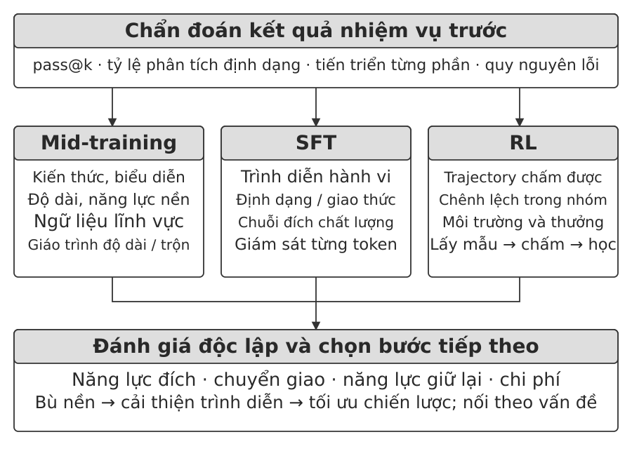

Bảng 8-4 Tiêu chí lựa chọn giữa Mid-training, SFT và RL

| Hiện tượng quan sát được | Ưu tiên kiểm tra | Phương pháp ứng viên | Trọng tâm đánh giá tiếp theo |
| --- | --- | --- | --- |
| Ngôn ngữ, khái niệm hoặc thao tác cơ bản của lĩnh vực còn yếu, lấy mẫu nhiều lần vẫn ít tiến triển | Độ phủ ngữ liệu và năng lực nền | Mid-training; sự kiện truy xuất được thì kết hợp RAG | Nhiệm vụ lĩnh vực, tập kiểm thử năng lực tổng quát và trajectory đúng một phần |
| Nội dung dùng được, nhưng định dạng, tham số hoặc quy trình cố định không ổn định | Trình diễn, giao diện và ràng buộc | SFT, giải mã có ràng buộc hoặc kiểm tra công cụ | Phân tích thành công, kết quả nhiệm vụ và hành vi khôi phục |
| Thỉnh thoảng hoàn thành được nhiệm vụ, nhưng tỷ lệ thành công thấp hoặc hay đi đường vòng | Chất lượng phần thưởng, khám phá và phân phối nhiệm vụ | RL | Lợi ích nhiệm vụ, chênh lệch phần thưởng, khái quát hóa độc lập và chi phí |
| Có dữ liệu trình diễn hoặc sở thích, môi trường tương tác chưa dựng | Độ phủ dữ liệu ngoại tuyến và cách kiểm chứng | SFT, RFT, tối ưu sở thích ngoại tuyến | Chất lượng đường cơ sở, độ lệch dữ liệu và lợi ích của việc xây môi trường |

Có thể tiến hành theo bốn bước. Trước tiên, dựng đường cơ sở cho phương án gồm prompt, ngữ cảnh, công cụ và ràng buộc. Khi các phương pháp này đã đáp ứng yêu cầu nhiệm vụ, tác giả ưu tiên giữ phương án bên ngoài chỉnh sửa được, giảm chi phí bảo trì cho huấn luyện, triển khai và kiểm thử hồi quy. Sự kiện động được cung cấp qua truy xuất và quản lý phiên bản; những phán đoán ngầm, khuôn mẫu cảm nhận và hành vi ổn định cần học đi học lại mới cân nhắc cải thiện qua huấn luyện tham số.

Bước hai, quan sát thành công, tiến triển từng phần, kết quả phân tích và các loại lỗi trên nhiệm vụ để dành riêng. Khi cấu hình lấy mẫu đã cố định, Pass@1 và Pass@k cho thấy chiến lược hiện tại đã có đường đi tận dụng được chưa; trajectory thất bại giúp phân biệt thiếu kiến thức, thiếu phản hồi và lỗi quy trình.

Bước ba, cung cấp trình diễn cho những hành vi cần học. JSON schema, gọi công cụ, dùng thuật ngữ, hỏi lại cho rõ và khôi phục đều có thể viết thành mẫu SFT, còn kiến thức cần thiết thì cung cấp qua ngữ liệu và ngữ cảnh nhiệm vụ tương ứng.

Bước bốn, đánh giá điều kiện phản hồi của RL. Khi sinh được ứng viên chấm điểm được, phần thưởng có độ phân biệt, môi trường cho phép đủ lượt tương tác, có thể so sánh lợi ích của tối ưu chiến lược; khi phần thưởng quá thưa, hãy cân nhắc trước giáo trình, phần thưởng từng phần hoặc một chiến lược ban đầu phù hợp hơn.

Kết quả đánh giá ở mỗi bước quyết định đầu tư tiếp theo: nhiệm vụ có định dạng rõ ràng có thể triển khai ngay sau SFT, điểm xuất phát mạnh có thể làm RL trực tiếp, và sau khi huấn luyện tiếp trên lĩnh vực vẫn có thể tái sử dụng năng lực chỉ dẫn sẵn có. Phần dưới đây dùng nhiệm vụ một lượt để quan sát cụ thể khác biệt hành vi do học từ trình diễn và học từ phần thưởng tạo ra.

Quay lại bài toán đơn hàng trong hướng dẫn đọc. Đưa thẳng cùng một đoạn mô tả công cụ thực tế cho mô hình, quan sát xem nó có viết đúng tham số không. Nếu các trường trong mô tả đã thay đổi, hãy cập nhật trước phần mô tả tra cứu được lúc chạy. Nếu nghĩa của trường đã rõ mà mô hình cứ điền văn bản của người dùng vào chỗ mã đơn hàng, có thể cung cấp trình diễn SFT gồm truy vấn, hỏi lại cho rõ và điền tham số đúng. Nếu nó đôi khi đã làm trọn được việc, mà các thứ tự truy vấn khác nhau dẫn đến tỷ lệ thành công và chi phí khác nhau, thì đã đủ điều kiện để so sánh nhiều trajectory của chiến lược.

## Học tăng cường một lượt: đối chứng ghi nhớ và khái quát hóa

Nhiệm vụ một lượt bắt đầu từ một lần nhập và kết thúc khi mô hình nộp câu trả lời và nhận phần thưởng. Mô hình vẫn có thể suy luận nhiều bước khi sinh câu trả lời, và hệ thống huấn luyện cũng có thể cho nó thử đi thử lại cùng một bài. Giới hạn tương tác vào một lần trả lời giúp ta dễ quan sát phương pháp huấn luyện thay đổi hành vi mô hình ra sao. Dưới đây, trước hết dùng AdaptThink để minh họa cách mô hình học phân bổ ngân sách suy luận, rồi dùng GeneralPoints để so sánh SFT và RL khi quy tắc và diện mạo thị giác thay đổi.

Hiểu trước cách thuật toán RL dùng phần thưởng để cập nhật mô hình thì sẽ đọc được quá trình huấn luyện trong các thí nghiệm phía sau. Phần lớn huấn luyện RL trong chương này dựa trên **policy gradient (gradient chiến lược)**. Lấy việc lấy mẫu nhiều lần cho cùng một câu hỏi làm ví dụ: cho mô hình sinh vài câu trả lời, rồi so phần thưởng của từng câu với một đường cơ sở. Câu trả lời tốt hơn đường cơ sở nhận tín hiệu dương, huấn luyện sẽ tăng xác suất sinh ra nó; câu trả lời kém hơn nhận tín hiệu âm, xác suất sinh giảm theo.

Để tránh một lần cập nhật kéo lệch mô hình, thuật toán phổ biến **PPO** cắt bỏ phần lợi ích dôi ra trong mục tiêu thay thế (surrogate objective) khi tỷ số xác suất vượt khỏi một khoảng chỉ định; biên độ cập nhật thực tế còn phụ thuộc vào learning rate và số vòng cập nhật. “PPO có mạng giá trị” ở phần sau sẽ học một ước lượng giá trị, dùng nó làm đường cơ sở so sánh để tính lợi thế (advantage) của hành động ở mỗi bước. **GRPO** so sánh trực tiếp nhiều câu trả lời cho cùng một câu hỏi, dùng phần thưởng trong nhóm để dựng đường cơ sở, nhờ đó không cần huấn luyện riêng một mạng giá trị.

Đoạn mã giả kiểu Python dưới đây xâu chuỗi lấy mẫu, phần thưởng, lợi thế và cập nhật tham số, giúp hiểu thông tin được truyền qua từng bước ra sao. Huấn luyện thực tế còn phải cấu hình song song hóa lấy mẫu, chính quy hóa KL và bộ tối ưu.

```python
for prompt in batch:
    group = [rollout(policy, env.reset(prompt)) for _ in range(G)]
    rewards = [verify(trajectory) for trajectory in group]
    advantages = normalize_within_group(rewards)       # GRPO baseline
    update(policy, group, advantages)
```

PPO dùng một lô trajectory dài ngắn khác nhau để cập nhật chiến lược như thế nào? Trước hết, trong từng trajectory, tính lợi ích chiết khấu của mỗi bước từ cuối lên đầu. Trajectory kết thúc thì dừng cộng dồn, để không tính lẫn phần thưởng của bài tiếp theo. Sau đó gom mọi hành động mà mô hình thực sự chọn trong tất cả trajectory, tính mất mát trung bình của lô hành động này. Dưới đây viết ra một lần cập nhật, lược bỏ tối ưu nhiều vòng theo minibatch.[^ch8-ppo-method]

```python
states, actions, returns = [], [], []
for trajectory in rollouts:
    states.extend(trajectory.states)       # trạng thái trước mỗi lần chọn hành động
    actions.extend(trajectory.actions)     # tương ứng từng mục với trạng thái
    returns.extend(discounted_returns(trajectory.rewards))

returns = tensor(returns)
values = value_model(states)
advantages = returns - stop_gradient(values)
ratio = exp(policy.log_prob(actions, given=states)
            - old_policy.log_prob(actions, given=states))
policy_loss = -mean(min(
    ratio * advantages,
    clip(ratio, 1 - epsilon, 1 + epsilon) * advantages
))
value_loss = mean((values - returns) ** 2)
update(policy, value_model, policy_loss + value_coef * value_loss)
```

Chữ “tương đối” trong GRPO đến từ nhiều câu trả lời cho cùng một câu hỏi; còn PPO ở đây dùng mạng giá trị để ước lượng lợi ích kỳ vọng của từng trạng thái. `old_policy` là chiến lược được đóng băng khi sinh lô trajectory này. Giả sử lợi thế của hành động ở một bước là 1, và chiến lược hiện tại gán cho nó xác suất bằng 1,4 lần lúc lấy mẫu; lấy `epsilon = 0.2`, đóng góp của số hạng này trong mục tiêu thay thế là `min(1.4, 1.2) = 1.2`. Tiếp tục tăng xác suất của hành động này không còn đem lại lợi ích thêm từ số hạng đó.

Nếu lợi thế là −1 thì chiều ngược lại. Khi tỷ số xác suất đã giảm xuống 0,6, thay vào cùng dòng mã được `min(-0.6, -0.8) = -0.8`, tiếp tục ép xác suất xuống cũng không được thêm lợi ích. Ngược lại, nếu hành động kém này lại trở nên phổ biến hơn, tỷ số xác suất tăng lên 1,4, lấy giá trị nhỏ hơn được `min(-1.4, -1.2) = -1.4`, tăng xác suất của nó vẫn phải trả giá.

> **Thí nghiệm 8-10 ★★: AdaptThink – học “khi nào không cần nghĩ”**
>
> Mô hình suy luận thường dùng quá trình suy luận khá dài để giải bài. Với câu hỏi đơn giản, trả lời thẳng sẽ tiết kiệm chi phí sinh. AdaptThink cung cấp cho mô hình hai chế độ Thinking và NoThinking: ở các mô hình hỗ trợ giao thức này, NoThinking kết thúc đoạn suy luận bằng `<think></think>` rồi sinh đáp án ngay. Mục tiêu huấn luyện là để mô hình chọn ngân sách suy luận phù hợp theo nhiệm vụ.
>
> Phương pháp gồm hai thành phần cốt lõi. **Mục tiêu tối ưu có ràng buộc** khuyến khích mô hình tăng tỷ lệ dùng NoThinking, đồng thời giữ hiệu năng trả lời tổng thể; **lấy mẫu theo trọng số quan trọng (importance sampling)** điều chỉnh tỷ lệ lấy mẫu của hai chế độ, rồi dùng trọng số để hiệu chỉnh chênh lệch giữa phân phối lấy mẫu và mục tiêu tối ưu. Mô hình ban đầu thường thiên về Thinking, nên phải chủ động tăng mẫu NoThinking thì huấn luyện mới có tín hiệu so sánh hai chế độ. Vấn đề khởi động nguội ở đây cụ thể là thiếu mẫu NoThinking ở đầu quá trình huấn luyện.
>
> Thí nghiệm của sách dùng 8 GPU H100 80GB. Huấn luyện đến bước 300, độ chính xác MATH500 từ 81,00% thành 81,80%, độ dài phản hồi trung bình giảm từ khoảng 4.911 token xuống 1.577 token; độ chính xác GSM8K tăng từ 79,68% lên 81,88%, độ dài phản hồi giảm từ khoảng 1.025 token xuống 477 token; AIME mean@16 từ 31,46% thành 31,04%, độ dài phản hồi giảm từ khoảng 12.120 token xuống 6.402 token. Độ dài phản hồi của ba nhóm lần lượt giảm khoảng 68%, 53% và 47%.
>
> Tỷ lệ NoThinking trên ba bộ dữ liệu lần lượt là 83,80%, 84,15% và 56,25%. Mô hình giữ nhiều tính toán suy luận hơn trên AIME, còn trên MATH500 và GSM8K thì thường trả lời thẳng. AIME2024 lấy mẫu 16 lần mỗi bài, mean@16 thống kê độ chính xác trung bình của 16 lần trả lời đó. Đến bước 300, câu trả lời trung bình ngắn đi gần một nửa, còn độ chính xác giảm khoảng 0,42 điểm phần trăm.
>
> Bước 300 là một lần kiểm định giữa chừng. Nhóm dự định huấn luyện 3.140 bước, nhưng lần chạy sau đó bị dừng bất thường, bản ghi kiểm định cuối cùng dừng ở bước 410. Lúc này độ chính xác trung bình trên AIME2024 là 31,88%, câu trả lời trung bình khoảng 5.874 token.
>
> AdaptThink có thể phối hợp với chưng cất prompt: chưng cất ghi các chỉ dẫn và khuôn mẫu giải bài dùng lặp lại vào tham số, AdaptThink học tiếp xem mỗi nhiệm vụ nên phân bổ bao nhiêu tính toán suy luận. Cả hai cùng ảnh hưởng đến chất lượng câu trả lời, độ trễ và chi phí.

> **Thí nghiệm 8-11 ★★: GeneralPoints – đối chứng “ghi nhớ và khái quát hóa” của RL một lượt**
>
> Chu và cộng sự dùng GeneralPoints, một trò chơi bài tương tự “tính 24”, để kiểm tra năng lực khái quát hóa của mô hình[^ch8-3]. Bốn con số trên bốn lá bài, mỗi số dùng một lần, dùng cộng trừ nhân chia để ra 24. Nếu mô hình đã học được cách giải, khi đổi quy tắc tính lá bài hoặc đổi chất bài, nó còn tính đúng không? Hình 8-12 đưa ra hai dạng đề: GP-L cho thẳng văn bản, GP-VL thì mô hình phải tự đọc lá bài.
>
> 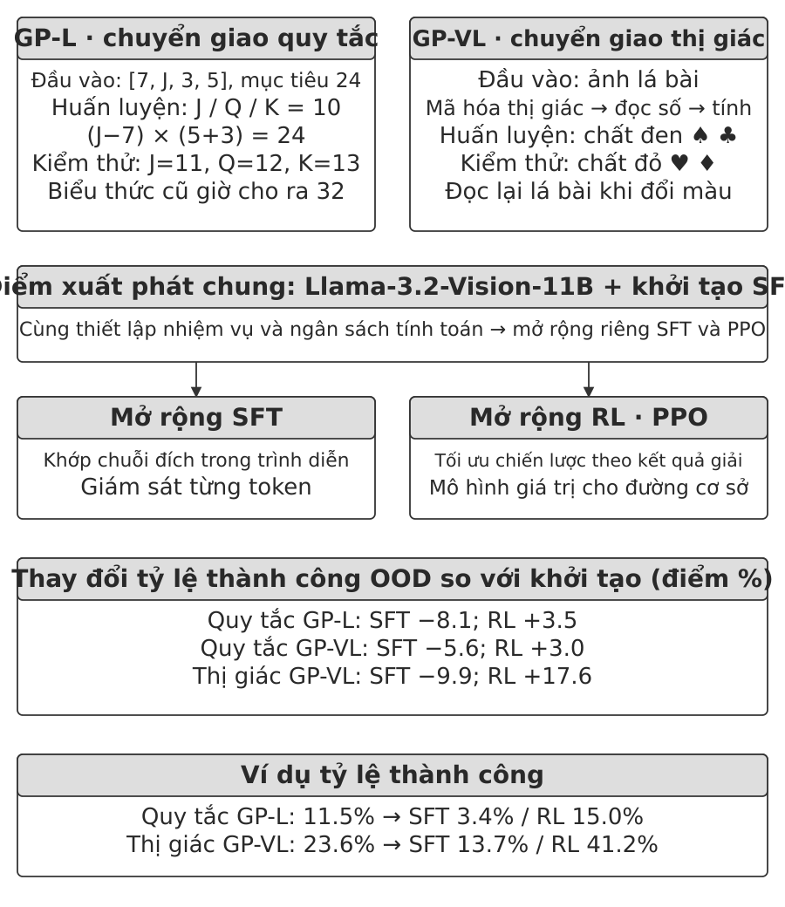
>
> **Biến thể quy tắc**: khi huấn luyện, J/Q/K đều tính là 10; khi kiểm thử lần lượt tính là 11/12/13. Vì thế tập kiểm thử chứa những tổ hợp số chưa gặp khi huấn luyện, kiểm tra được mô hình có dùng 11, 12, 13 để tính theo quy tắc mới không. **Biến thể thị giác**: huấn luyện dùng chất đen (♠♣), kiểm thử dùng chất đỏ (♥♦), kiểm tra mô hình có thích nghi với thay đổi diện mạo lá bài không.
>
> Thí nghiệm xuất phát từ Llama-3.2-Vision-11B, trước hết dùng SFT xây năng lực tuân thủ chỉ dẫn cơ bản, rồi tách thành hai nhánh huấn luyện: tiếp tục SFT và RL, so sánh dưới cùng ngân sách tính toán. Nhánh RL dùng PPO có mạng giá trị. Cả hai nhánh đều huấn luyện với quy tắc J/Q/K=10, sau đó đánh giá trên tập kiểm thử trong phân phối (ID) và ngoài phân phối (OOD).
>
> Lấy `[7, J, 3, 5]` làm ví dụ: khi J=10 có thể dùng `(J−7)×(5+3)=24`; đổi J thành 11 thì biểu thức này cho 32, phải đổi thành `(11−5)×(7−3)=24`. Vì vậy cùng một bộ bài đòi hỏi mô hình đọc quy tắc hiện hành và tổ chức lại phép tính.
>
> Hai phương pháp huấn luyện khác biệt rõ rệt trong kiểm thử ngoài phân phối. **OOD quy tắc**: trên GP-L, tỷ lệ thành công của RL tăng từ 11,5% lên 15,0%, thêm 3,5 điểm phần trăm; SFT giảm từ 11,5% xuống 3,4%, mất 8,1 điểm phần trăm. Trên GP-VL, RL tăng 3,0 điểm phần trăm, SFT giảm 5,6 điểm phần trăm. **OOD thị giác**: trên GP-VL, RL tăng từ 23,6% lên 41,2%, thêm 17,6 điểm phần trăm; SFT giảm từ 23,6% xuống 13,7%, mất 9,9 điểm phần trăm.
>
> Kiểm tra thêm kết quả nhận diện lá bài, có thể liên hệ kết quả giải bài cuối cùng với cảm nhận thị giác: độ chính xác nhận diện của nhánh RL tăng cùng tỷ lệ thành công nhiệm vụ, còn của nhánh SFT thì giảm. Nghiên cứu gắn khác biệt này với mục tiêu huấn luyện: khớp từng token có thể củng cố khuôn mẫu văn bản trong trình diễn, còn phần thưởng theo kết quả liên tục buộc mô hình đọc đúng lá bài và tính xong. Độ chính xác cảm nhận cung cấp một chỉ số trung gian để phân tích cơ chế này.
>
> Lý do làm SFT trước cũng có thể hiểu qua định dạng đầu ra. Mô hình nền Llama-3.2-Vision-11B trong thí nghiệm không sinh được đầu ra có cấu trúc theo yêu cầu một cách ổn định, verifier không dựa vào đó tính được phần thưởng nhiệm vụ, nên các lần thử RL đầu-cuối trực tiếp đều thất bại. SFT dựng trước đầu ra phân tích được, chấm được, thì RL sau đó mới tận dụng được phản hồi của nhiệm vụ. Còn DeepSeek-R1-Zero nói ở phần trước khởi đầu bằng một mô hình nền vốn đã sinh được câu trả lời chấm được, nên đi thẳng vào RL.
>
> Mô hình học được bao nhiêu từ phản hồi của verifier? Hình 10 của bài báo so sánh riêng nhiệm vụ bài thuần văn bản (GP-L). Các nhà nghiên cứu đặt 1, 3, 5, 10 vòng kiểm chứng, huấn luyện và đánh giá riêng từng mô hình RL. Dưới cùng ngân sách tính toán huấn luyện, nhóm cho phép 10 lần kiểm chứng có tỷ lệ thành công trên quy tắc mới tăng 5,99 điểm phần trăm so với điểm xuất phát huấn luyện của chính nhóm đó, còn nhóm chỉ kiểm chứng 1 lần tăng 0,48 điểm phần trăm.
>
> Vì sao dưới sự dịch chuyển phân phối trong thí nghiệm này, hiệu năng của SFT giảm còn RL tốt hơn? Một giải thích khớp với quan sát là: dữ liệu SFT có hạn đã củng cố khuôn mẫu cố định “gặp J/Q/K thì coi là 10”; khi kiểm thử J=11, mô hình vẫn tính theo 10. Nhánh RL hướng kết quả thì nhiều khả năng củng cố chiến lược “tính lại cho đến khi ra đáp án đúng”, nên vẫn áp dụng được khi J thành 11.
>
> Thay đổi quy tắc và thay đổi chất bài trong GeneralPoints cho phép ta quan sát riêng xem mô hình có học được cách tính theo điều kiện mới không, và có đọc đúng đầu vào thị giác mới không. Với mô hình, dữ liệu huấn luyện và ngân sách kiểm thử ở đây, nhánh tiếp tục SFT thụt lùi trong kiểm thử ngoài phân phối, còn nhánh nối tiếp bằng RL thì tiến bộ. Nếu muốn áp kết luận này vào nhiệm vụ của mình, hãy hỏi trước: mô hình trò đã nắm định dạng đầu ra chưa? Phép thử mới rốt cuộc đổi quy tắc, đổi diện mạo đầu vào, hay đổi cả hai? Làm đối chứng tách riêng thì mới biết nên bổ sung trình diễn, cải thiện cảm nhận hay tăng khám phá có phản hồi kết quả.

## Thuật toán RL: từ 16 lần rollout đến một lần cập nhật tham số

**GRPO (Group Relative Policy Optimization)** do DeepSeek đề xuất, dựng tín hiệu học từ kết quả tương đối của nhiều lần thử trên cùng một câu hỏi. Lấy một nhiệm vụ sửa mã kiểu SWE-bench làm ví dụ: tệp `parser.py` của một dự án Python gây ra `IndexError` khi đầu vào rỗng, Agent cần sửa phần cài đặt và giữ nguyên tệp kiểm thử. Một vòng lặp huấn luyện có thể chia làm bốn bước.

**Bước một: để mô hình chiến lược thử lặp lại.** Mô hình chiến lược chính là mô hình ngôn ngữ đang được huấn luyện. Hệ thống đặt cùng mã ban đầu và mô tả vấn đề vào 16 sandbox cách ly, để mô hình độc lập làm nhiệm vụ 16 lần. Mỗi lần bắt đầu từ đọc mã, qua sửa, kiểm thử, cho đến khi nộp kết quả; cả trajectory tương tác này gọi là một lần **rollout**. Lấy mẫu ngẫu nhiên khiến cùng một điểm xuất phát sinh ra những đường đi khác nhau: có lần bổ sung kiểm tra biên, có lần chỉ bắt ngoại lệ, có lần sửa nhầm tệp, cũng có lần định sửa cả kiểm thử.

**Bước hai: tính phần thưởng.** Sau mỗi rollout, verifier áp bản vá trong một môi trường sạch và chạy kiểm thử. Giả sử trong 16 lần thử có 4 lần qua toàn bộ kiểm thử và không sửa tệp kiểm thử, 12 lần còn lại thất bại; khi đó 4 trajectory qua được nhận phần thưởng 1, 12 trajectory còn lại nhận 0. Hình 8-13 đặt kết quả chấm của 16 trajectory này vào cùng một bảng. Nhiệm vụ mã kiểu này có thể tính phần thưởng trực tiếp bằng kiểm thử và quy tắc. Với những mục tiêu khó viết thành kiểm thử như độ dễ đọc, chất lượng giải thích, có thể kết hợp thêm đánh giá của con người hoặc mô hình phần thưởng.

**Bước ba: tính lợi thế tương đối.** Phần thưởng chỉ nói một trajectory thành công hay thất bại, còn **lợi thế tương đối** cho biết nó tốt đến mức nào so với các lần thử khác trong cùng nhóm. Tỷ lệ thành công trung bình của nhóm này là 4/16: 4 trajectory qua kiểm thử cao hơn trung bình nhóm, nhận lợi thế dương; 12 trajectory thất bại thấp hơn trung bình, nhận lợi thế âm. Nếu chuẩn hóa theo độ lệch chuẩn trong nhóm, trung bình phần thưởng là 0,25, độ lệch chuẩn khoảng 0,433, lợi thế của trajectory thành công khoảng 1,73, của trajectory thất bại khoảng −0.58. GRPO dựng tín hiệu học bằng kiểu so sánh trong nhóm như vậy. Nếu 16 phần thưởng giống hệt nhau, trừ trung bình nhóm thì mọi trajectory đều bằng không. Cộng một hằng số ổn định rất nhỏ vào mẫu số là tránh được chia cho không; nhưng sau chuẩn hóa, phần thưởng kết quả của nhóm này vẫn không chỉ ra được huấn luyện nên nghiêng về trajectory nào. Lúc đó có thể kiểm tra xem ràng buộc đường đi, phần thưởng quá trình hoặc tiến triển từng phần có phân biệt được các trajectory trong nhóm không. Chẳng hạn, trong hai lần thử đều chưa sửa xong mã, chỉ một lần qua được kiểm thử biên vốn đang thất bại. Chỉ cần kết quả trung gian này kiểm chứng độc lập được, ta có thêm một manh mối có thể dùng để học.

**Bước bốn: cập nhật chiến lược bằng hạ gradient.** Chương trình huấn luyện chuyển lợi thế tương đối thành mất mát huấn luyện, tính gradient, rồi để bộ tối ưu (như AdamW, Muon) thực hiện hạ gradient, tăng xác suất của những lựa chọn mà mô hình đưa ra trong trajectory có lợi thế dương, giảm xác suất của các lựa chọn trong trajectory có lợi thế âm. Huấn luyện điều chỉnh đi điều chỉnh lại xác suất của những lựa chọn này trên rất nhiều nhiệm vụ và rollout. Khi tối ưu dần phát huy tác dụng, gặp lỗi tương tự thì “tái hiện vấn đề trước, kiểm tra điều kiện biên, sửa cài đặt và chạy kiểm thử” sẽ dễ xuất hiện hơn, còn “che giấu ngoại lệ, sửa kiểm thử, nộp mà không kiểm chứng” sẽ ít xuất hiện hơn.

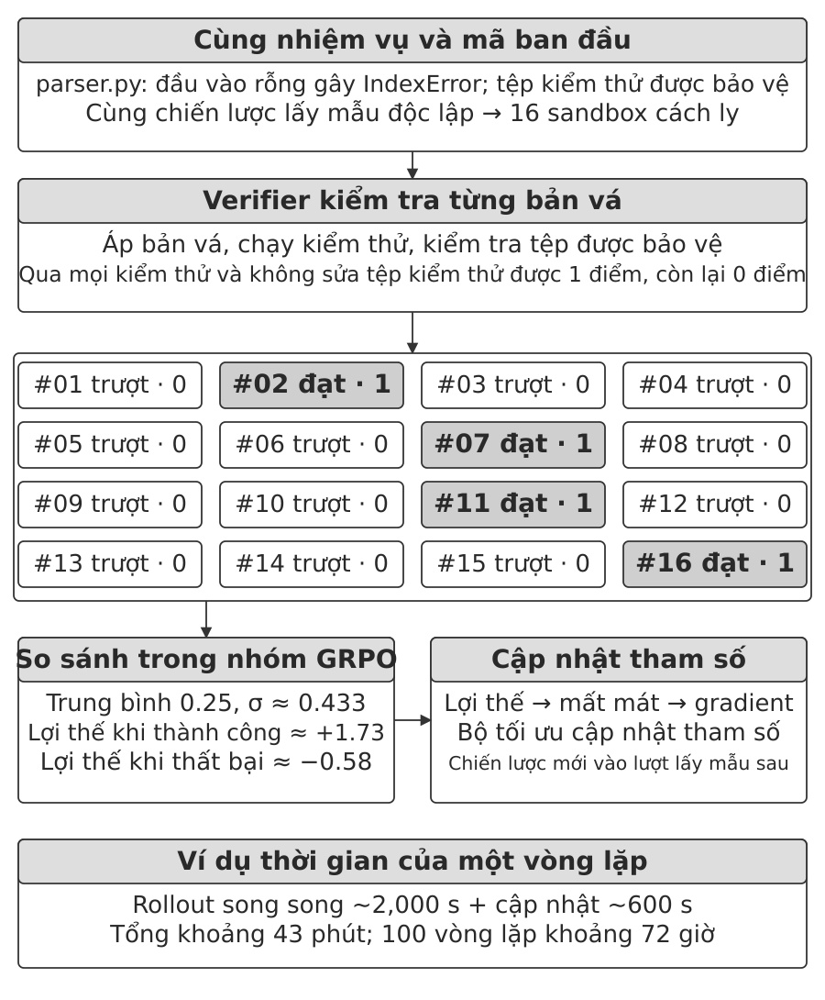

Trong Hình 8-13, cùng một bài lấy mẫu 16 lần thì tính là mấy **vòng lặp huấn luyện (step)**? Theo cách đếm của mục này, 16 rollout đó thuộc cùng một lô. Vòng thứ $k$ dùng chiến lược hiện tại để lấy mẫu, tính phần thưởng, lợi thế và gradient, cập nhật chiến lược một lần; đến vòng $k+1$ mới dùng tham số mới để lấy mẫu lại. Huấn luyện 100 steps nghĩa là làm khoảng 100 vòng lặp như vậy.

Từ đó có thể ước tính thời gian huấn luyện. Một nhiệm vụ phức tạp có thể gồm hàng chục lượt gọi công cụ; khi huấn luyện đồng bộ phải đợi cả lô có kết quả, trajectory chậm nhất trong 16 trajectory song song quyết định khi nào giai đoạn lấy mẫu kết thúc. Giả sử nó mất khoảng 2.000 giây, tính gradient và cập nhật bộ tối ưu mất thêm 600 giây, thì một step cần khoảng $2{,}000+600=2{,}600$ giây, tức 43 phút. Huấn luyện liên tục 100 steps với cùng thời lượng như vậy mất khoảng 72 giờ.

PPO và GRPO đều theo vòng khép kín này, khác nhau chủ yếu ở “so với cái gì”. GRPO so sánh trực tiếp nhiều rollout của cùng một câu hỏi, không cần mô hình giá trị bổ sung; PPO huấn luyện một mô hình giá trị để ước lượng ở mỗi bước của trajectory “thường làm tốt được đến đâu”, rồi xét hành động hiện tại có tốt hơn kỳ vọng đó không, từ đó cung cấp đường cơ sở cần cho phân bổ tín dụng theo từng bước. Cả hai đều dùng các cơ chế như cắt mục tiêu thay thế để kìm những bước cập nhật quá lớn. DPO thì khác: nó học trực tiếp các cặp sở thích “câu trả lời tốt hơn – câu trả lời kém hơn” thu thập sẵn từ trước, không để chiến lược hiện tại sinh trực tuyến nhóm rollout này.

Các tình huống trong chương dùng những công thức huấn luyện khác nhau: AdaptThink dùng mục tiêu ràng buộc tự định nghĩa; GeneralPoints, V-IRL và ReTool dùng PPO, trong đó mô hình giá trị của hai trường hợp đầu tham gia ước lượng lợi thế; SimpleVLA-RL và RLVP dùng GRPO.

Giả sử hai bài A và B mỗi bài thử bốn lần, bài A đúng hết, bài B sai hết. Bốn phần thưởng của bài A đều là 1, của bài B đều là 0. Trừ trung bình trong nhóm, lợi thế của cả hai nhóm đều thành 0. Nhưng nếu còn sức tính để thử thêm vài lần, dồn vào bài nào thì nhiều hy vọng thu được mẫu huấn luyện hữu ích hơn?

Never Give Up đưa lựa chọn này vào quá trình lấy mẫu. Bài A đúng hết thì bỏ qua nhóm đó; bài B sai hết thì với một xác suất nhất định sẽ lấy thêm một nhóm. Giả sử nhóm thứ hai cuối cùng có một lần đúng, khi huấn luyện sẽ gộp tám câu trả lời của cả hai nhóm: một lời giải đúng và bảy lời giải sai, cùng một bài giờ đã có phần thưởng cao thấp khác nhau. Lấy mẫu bất đồng bộ cho các bài khác tiến triển bình thường, không phải đợi bài B có kết quả.[^ch8-ngu]

[^ch8-ngu]: Michael Noukhovitch và cộng sự, *Learning to Solve Hard Problems in RL for LLMs by Never Giving Up*, 2026. Phần lấy mẫu bổ sung trong bài dùng cho huấn luyện; những bài đã làm đúng vẫn có thể được rút lại trong các lượt huấn luyện sau.

### Vì sao RL cho LLM thường ưu tiên On-Policy

**Online (trực tuyến)** và **On-policy (theo chiến lược hiện hành)** mô tả hai khía cạnh khác nhau. Huấn luyện trực tuyến liên tục tương tác với môi trường và sinh dữ liệu trong khi chạy; huấn luyện on-policy quan tâm đến nguồn gốc dữ liệu, đòi hỏi chiến lược hành vi $\mu$ sinh ra trajectory phải trùng hoặc đủ gần với chiến lược cần tối ưu $\pi_\theta$. Cụm máy bất đồng bộ có thể lấy mẫu trực tuyến liên tục, nhưng nếu worker tụt lại vài checkpoint, dữ liệu trả về sẽ mang độ cũ của chiến lược, tạo thành thành phần off-policy.

Tác giả khuyên trước hết dùng huấn luyện gần với on-policy để dựng đường cơ sở ổn định, rồi mới đưa vào lấy mẫu bất đồng bộ hoặc tái sử dụng dữ liệu cũ để tăng thông lượng. Các công thức PPO/GRPO trong chương này thường lấy mẫu bằng chiến lược mới nhất ở đầu mỗi step. Sau đó PPO cập nhật nhiều vòng minibatch trên cùng một lô dữ liệu, và chiến lược hiện tại dần lệch khỏi `old_policy` đã sinh ra dữ liệu. Tỷ số xác suất đo sự thay đổi này, còn mục tiêu cắt kìm những bước cập nhật quá lớn.

Mục tiêu của policy gradient gắn với phần thưởng kỳ vọng dưới chiến lược hiện tại $\pi_\theta$. Khi dùng dữ liệu lấy mẫu từ chiến lược hành vi $\mu$, có thể tính tỷ số xác suất hành động tại cùng một trạng thái trước, rồi dựa vào đó dựng hiệu chỉnh trọng số quan trọng:

$$
\rho_t=\frac{\pi_\theta(a_t\mid s_t)}{\mu(a_t\mid s_t)}
=\exp\left(\log\pi_\theta(a_t\mid s_t)-\log\mu(a_t\mid s_t)\right).
$$

Giả sử sau cùng một đoạn tiền tố, chiến lược lấy mẫu chọn một token nào đó với xác suất 0,2, còn chiến lược hiện tại gán cho nó xác suất 0,3; khi đó tỷ số xác suất của bước này là 1.5. Token này xuất hiện ít hơn mức cần trong mẫu cũ, nên khi ước lượng theo chiến lược hiện tại, trọng số của loại mẫu này được nâng lên tương ứng. Nếu lấy mẫu và huấn luyện dùng cùng một chiến lược, trước khi cập nhật tham số, tỷ số xác suất ở mọi bước đều bằng 1.

Tái sử dụng trajectory cũ cho phép lấy mẫu và huấn luyện chạy bất đồng bộ, tăng thông lượng. Nhưng hai chiến lược càng cách xa nhau, một số ít mẫu càng dễ nhận trọng số rất lớn. Khi đánh lại trọng số cho cả trajectory, tỷ số xác suất của các bước còn phải nhân dồn với nhau. PPO cắt bớt một phần lợi ích dôi ra trong mục tiêu thay thế của từng hành động, làm yếu tác động của tỷ số xác suất cực đoan; còn những trạng thái mà mẫu cũ chưa từng đi tới thì chỉ lấy mẫu mới mới thấy được. Đây cũng là lý do tác giả nghiêng về dùng trajectory mới.[^ch8-32]

#### Chênh lệch số học giữa huấn luyện và suy luận

RL quy mô lớn cho LLM thường lấy mẫu bằng các engine suy luận như vLLM, SGLang, rồi dùng các hệ thống huấn luyện như FSDP, Megatron để tính log xác suất và gradient. Dù hai phía nạp cùng trọng số, chúng vẫn có thể tính ra log xác suất hơi khác nhau cho cùng một token do khác biệt về độ chính xác dấu phẩy động, thứ tự rút gọn (reduction), song song tensor, kích thước lô, KV Cache và kernel hợp nhất. Khi đó, tham số chưa cập nhật mà $\rho_t$ đã lệch khỏi 1, giữa huấn luyện và lấy mẫu xuất hiện chênh lệch chiến lược ở tầng số học. Thí nghiệm có kiểm soát cho thấy chênh lệch rất nhỏ ở cấp token cũng có thể làm sụp đổ quá trình huấn luyện.[^ch8-33]

Phân phối lấy mẫu vừa thay đổi, thì dù phần thưởng của hai hành động hoàn toàn như nhau, policy gradient ngây thơ vẫn có thể nghiêng về một trong hai. Giả sử khi lấy mẫu, A và B mỗi bên có một nửa cơ hội, nhưng lúc huấn luyện xác suất mô hình chọn A đã thành 0.8. Với logit điều khiển A, khi chọn A, gradient của log xác suất là $1-0.8=0.2$; khi chọn B thì là $0-0.8=-0.8$. Nếu cả hai hành động đều được 1 điểm, lấy trung bình theo xác suất lúc lấy mẫu thì gradient là $-0.3$. Hai lựa chọn rõ ràng cùng điểm, vậy mà bước cập nhật lại ép xác suất của A xuống.

Score centering lấy gradient của log xác suất tại cùng một tiền tố trừ đi trung bình của nó dưới phân phối lấy mẫu. Trong ví dụ trên, trừ đi $-0.3$ thì hai số hạng lần lượt thành $0.5$ và $-0.5$, phần thưởng như nhau tạo ra bước cập nhật trung bình đúng bằng không. GRPO ở trên trừ trung bình cho phần thưởng của một nhóm câu trả lời; ở đây thứ được đưa về trung tâm là gradient.[^ch8-sc]

[^ch8-sc]: Martin Marek, Max Ryabinin, *Score Centering Stabilizes Off-policy Reinforcement Learning*, 2026. Khi chiến lược lấy mẫu tụt lại quá xa, cũng có thể dùng chính quy hóa KL để ràng buộc khoảng cách giữa chiến lược huấn luyện và chiến lược hành vi (arXiv:2611.21791).

Sai số số học giữa phía huấn luyện và phía lấy mẫu còn khuếch đại dọc theo chuỗi dài: **sai số log xác suất → lệch tỷ số xác suất → tích lũy qua tiền tố dài → thay đổi việc cắt và trọng số lợi thế → thay đổi gradient và số mẫu hiệu dụng**. Chẳng hạn, nếu tỷ số log xác suất của 4.000 token đều mang độ lệch $10^{-3}$ cùng chiều, tỷ số xác suất cấp trajectory tính ra sẽ bằng $e^{4000\times0.001}=e^4\approx54.6$ lần giá trị thật.

Thay đổi xác suất ở giai đoạn đầu còn có thể đổi kết quả lấy mẫu, khiến các trạng thái sau phát triển theo một đường đi khác. Những tín hiệu quan sát được trong huấn luyện gồm đỉnh nhọn ở tỷ số trọng số quan trọng, tỷ lệ bị cắt tăng, gradient hoặc độ dài phản hồi đột biến, và phần thưởng cùng entropy giảm. Khi kích thước lô làm thay đổi quá trình rút gọn, kết quả số học của cùng một đầu vào cũng có thể thay đổi, tức là tính bất biến theo lô (batch invariance) bị phá vỡ. Các nghiên cứu liên quan đã quan sát được hiệu ứng off-policy ngầm phát sinh từ đây, và cải thiện độ ổn định bằng cách căn chỉnh tính toán giữa lấy mẫu và huấn luyện, hoặc hiệu chỉnh tường minh chênh lệch chiến lược.[^ch8-34]

Vì vậy, tác giả đưa tính nhất quán số học giữa lấy mẫu và huấn luyện vào danh sách kiểm tra cốt lõi trước khi khởi động huấn luyện, và giám sát liên tục cùng với đường cong phần thưởng. Có thể xử lý theo bốn bước “đo chênh lệch – căn chỉnh cấu hình – hiệu chỉnh độ lệch – kiểm soát độ cũ”:

- **Trước mọi lần cập nhật tham số**, dùng cùng một lô trajectory để so log xác suất token do phía lấy mẫu (sampler) và phía huấn luyện (trainer) đưa ra, giám sát trung bình, phân vị, giá trị lớn nhất, KL xấp xỉ và tỷ lệ bị cắt của $\rho_t$; đây là unit test on-policy trực tiếp nhất.
- Khi đồng bộ trọng số, căn chỉnh luôn adapter LoRA, bộ tách từ, mẫu hội thoại, phiên bản mô hình và cấu hình mã hóa vị trí. Rollout nên lưu log xác suất mà chiến lược lấy mẫu đưa ra lúc sinh, để sau đó tính tỷ số xác suất.
- Căn chỉnh hết mức có thể độ chính xác, bố cục song song và các kernel tính toán then chốt giữa lấy mẫu và huấn luyện; nếu không làm được, hãy coi rõ chênh lệch đó là off-policy, áp dụng hiệu chỉnh trọng số quan trọng, giám sát số mẫu hiệu dụng, và kết hợp tỷ lệ bị cắt để đánh giá hiệu quả hiệu chỉnh.
- Kịp thời lấy mẫu lại bằng chiến lược đã cập nhật, giới hạn số vòng cập nhật trên mỗi lô dữ liệu, cũng như số checkpoint mà lấy mẫu bất đồng bộ được phép tụt lại so với huấn luyện.

## Môi trường RL: từ đánh giá đến mô phỏng

Huấn luyện RL cho Agent cần thực hiện nhiệm vụ lặp đi lặp lại. Một lần sửa mã có thể thử lại trong bản sao cách ly, nhưng một lần thanh toán thì làm thay đổi trạng thái của tài khoản thật. Môi trường huấn luyện phải cung cấp trạng thái ban đầu có thể đặt lại, bản sao nhiệm vụ chạy song song được và kết quả kiểm chứng được, để mô hình khám phá các đường đi khác nhau trong điều kiện có kiểm soát. Chương 7 đã giới thiệu môi trường đánh giá; khi dùng cho huấn luyện, còn phải tính đến việc chạy trong thời gian dài, tác dụng phụ của hành động và chi phí của lượng tương tác khổng lồ. Tác giả thường phân bổ nhân lực và ngân sách cho việc xây môi trường trước, rồi mới sắp xếp huấn luyện quy mô lớn. Hiện thực hóa phản hồi thật, đặt lại trạng thái và cách ly song song thường tốn nguồn lực kỹ thuật hơn việc tích hợp PPO hay GRPO, và chi phí xây môi trường có thể vượt cả chi phí huấn luyện.

### Môi trường: sân tập của mô hình

Môi trường cập nhật trạng thái theo hành động và trả quan sát mới về cho mô hình. Khi xây môi trường, có thể bắt đầu từ ba câu hỏi.

- **Tương tác có gần với bối cảnh triển khai không?** Trình mô phỏng chăm sóc khách hàng cần bao quát các tình huống người dùng bổ sung thông tin, thay đổi yêu cầu và diễn đạt mơ hồ; trình mô phỏng công cụ cần trả về những lỗi và độ trễ thường gặp trong sản xuất. Mô hình học cách ứng phó vấn đề thực tế qua các phản hồi này. Phản hồi quá đơn điệu sẽ khiến chiến lược dựa dẫm vào những lối mòn cố định trong mô phỏng.
- **Nhiệm vụ có thử lại và chạy song song ổn định được không?** Mỗi rollout cần trạng thái đơn hàng, tệp hoặc tài khoản độc lập, và dọn dẹp, khôi phục được sau khi kết thúc. Sandbox trình thông dịch mã của ReTool và sandbox MCP của AWorld đều đảm nhận vai trò này. Với API thật có giới hạn tốc độ, chi phí hoặc tác dụng phụ khi ghi, có thể dùng tài khoản sandbox, dữ liệu phát lại hoặc giao diện mô phỏng tùy theo nhu cầu nhiệm vụ.
- **Kết quả được phán định thế nào?** Trạng thái môi trường là căn cứ quan trọng để tính phần thưởng. Chẳng hạn, nhiệm vụ hoàn tiền có thể kiểm tra số tiền, trạng thái đơn hàng và điều kiện ủy quyền; nhiệm vụ mã có thể chạy kiểm thử. Phần sau sẽ bàn riêng về thiết kế phần thưởng.

**Trước khi bắt tay vào chỉnh thuật toán, tác giả khuyên hãy kiểm tra: môi trường mô phỏng đã đủ gần với nhiệm vụ thực tế chưa? Điều này quan trọng hơn chuyện chọn PPO hay GRPO.** Độ trung thực, khả năng đặt lại và năng lực kiểm chứng cùng quyết định mô hình học được gì từ tương tác. Dùng một ít nhiệm vụ để chạy thông ba khâu này trước, rồi mới mở rộng quy mô huấn luyện, thường dễ định vị vấn đề hơn.

### Dùng mô hình để mô phỏng công cụ và môi trường

Kết quả tìm kiếm, hội thoại của người dùng và trạng thái nghiệp vụ phức tạp đều có thể tổng hợp nhờ mô hình. Trình mô phỏng bằng mô hình nhận hành động của Agent và sinh phản hồi cho bước tiếp theo, giảm sự phụ thuộc vào dịch vụ bên ngoài thời gian thực. Cách làm này có thể mở rộng từ một công cụ đơn lẻ đến cả môi trường nhiệm vụ.

**Tầng thứ nhất: tổng hợp giá trị trả về của công cụ.** ZeroSearch[^ch8-13] cho LLM đóng vai công cụ tìm kiếm: mô hình trò gửi truy vấn, trình mô phỏng sinh kết quả truy xuất. Nhờ vậy huấn luyện bớt phụ thuộc vào chi phí, giới hạn tốc độ và sự dao động kết quả của API tìm kiếm thật. Nó còn sắp xếp theo kiểu giáo trình: giai đoạn đầu trả về tài liệu chất lượng cao, liên quan chặt, sau đó tăng dần nhiễu để mô hình trò luyện cách rút thông tin hữu ích từ tài liệu không hoàn hảo. Mô hình trong nghiên cứu sau khi huấn luyện xong trong môi trường tìm kiếm mô phỏng, khi nối với công cụ tìm kiếm thật vẫn đạt kết quả tốt.

**Tầng thứ hai: mô phỏng chuyển trạng thái của môi trường.** DreamGym[^ch8-14] chưng cất động lực học của môi trường vào một mô hình kinh nghiệm có khả năng suy luận. Mô hình đọc trạng thái hiện tại và hành động của Agent, suy ra trạng thái và phản hồi kế tiếp, sinh hàng loạt trajectory tương tác cho RL trực tuyến, nhờ đó giảm số lần truy cập môi trường thật. Nhiệm vụ chăm sóc khách hàng và bán hàng còn có thể để LLM đóng vai người dùng, mô phỏng việc hỏi vặn, bổ sung thông tin và thay đổi yêu cầu. Dòng τ-bench dùng trình mô phỏng người dùng; khung tương tác tương tự cũng có thể dùng cho huấn luyện, lần lượt đảm nhận nhiệm vụ luyện tập và đánh giá.

Trình mô phỏng bằng mô hình cũng cần hiệu chỉnh. Nếu trình mô phỏng chăm sóc khách hàng luôn hiểu chính xác các câu hỏi mơ hồ, chiến lược sẽ thiếu cơ hội luyện hỏi lại cho rõ; nếu trình mô phỏng tìm kiếm luôn trả về đúng tài liệu, chiến lược sẽ thiếu kinh nghiệm nhận diện nhiễu. Huấn luyện còn có thể củng cố những hành vi lợi dụng lỗ hổng chấm điểm của trình mô phỏng. Tác giả khuyên dùng cách kết hợp: để mô phỏng bằng mô hình gánh phần lớn tương tác, định kỳ dùng nhiệm vụ trong môi trường thật kiểm tra kết quả của chiến lược, rồi đưa những chênh lệch phát hiện được trở lại trình mô phỏng. Như vậy hình thành một quá trình lặp “tương tác tổng hợp – đánh giá nhiệm vụ thật – sửa trình mô phỏng”.

Làm sao biết trình mô phỏng thực sự dạy được cách dùng công cụ? Có thể làm một phép thử nhỏ: trên cùng một đơn hàng ban đầu, tra trước, rồi gửi sửa đổi, rồi tra lại, kiểm tra xem các trường đơn hàng trả về có thay đổi như mong đợi theo hành động không. Sau đó đặt lại môi trường, xác nhận đọc lại được giá trị gốc. Một môi trường chỉ biết sinh một câu “đã sửa” nghe hợp lý mà không tra ra được thay đổi ở lượt sau sẽ thưởng cho chiến lược khéo nói, dù nó chưa bao giờ thay đổi đơn hàng.

### Môi trường, phân phối nhiệm vụ và cách ly đánh giá

Môi trường huấn luyện quyết định mô hình có thể trải qua những gì. Trạng thái đặt lại được hỗ trợ thử lại, bản sao cách ly hỗ trợ chạy song song, trạng thái và quy tắc kiểm chứng rõ ràng hỗ trợ tái hiện và tính điểm. Nhiệm vụ có thể dùng lại phương pháp tổng hợp dữ liệu ở phần trước: từ nhật ký nghiệp vụ thật rút ra bản thiết kế nhiệm vụ, loại bỏ thông tin danh tính, rồi sinh nhân vật, đơn hàng, tệp và trạng thái ban đầu hư cấu.

Huấn luyện và đánh giá có thể dùng chung bộ sinh nhiệm vụ và mã kiểm chứng, nhưng các nhiệm vụ cụ thể phải chia thành những tập độc lập. Tham khảo thiết kế môi trường của SWE-Gym, τ²-bench và AndroidWorld[^ch8-28], kiểm thử nghiệm thu, trạng thái ẩn cần cho chấm điểm và lời giải tham chiếu được giữ ở phía verifier, còn Agent lấy quan sát qua giao diện mà nhiệm vụ quy ước. Trước khi mở rộng lấy mẫu, hãy dùng một ít rollout kiểm tra xem nhiệm vụ có hoàn thành được không, verifier có phân biệt được kết quả hợp lệ và không hợp lệ không. Phát hiện sớm độ lệch chấm điểm giúp giảm cơ hội để chiến lược lợi dụng lỗ hổng kiểm chứng.

Vì vậy, thứ tự của kỹ thuật môi trường nên là: **bản thiết kế nhiệm vụ → môi trường đặt lại được → kiểm chứng kết quả → cách ly huấn luyện/đánh giá → hiệu chỉnh bằng tương tác thật**. Phần tổng hợp dữ liệu ở trên sàng lọc trajectory hợp lệ từ các môi trường này để tạo trình diễn SFT. Khi bước vào RL, chiến lược hiện tại tiếp tục thử sai trong môi trường, khám phá những đường đi nằm ngoài trình diễn.

Kiểm chứng cũng phải được tính vào ngân sách thông lượng. Lean kernel, trình chạy kiểm thử và thực thi trong container đều tiêu tốn CPU và bộ nhớ. Khi tốc độ sinh của GPU vượt tốc độ kiểm chứng, nhiệm vụ sẽ ùn lại trong hàng đợi kiểm chứng. Lúc đó cần tăng số worker của verifier, rút ngắn độ trễ kiểm chứng, hoặc điều chỉnh tỷ lệ tài nguyên giữa sinh và kiểm chứng[^ch8-9].

## Từ một lượt đến nhiều lượt: bối cảnh nhiệm vụ và phân bổ tín dụng

### Thách thức cốt lõi của nhiệm vụ nhiều lượt

Bên trái Hình 8-14 là bài tính 24. Mô hình có thể tính nhẩm nhiều bước trong câu trả lời, nhưng các bước ấy đều dùng bốn lá bài cho sẵn trong đề, giữa chừng không có quan sát mới nào từ môi trường. Bên phải là điều hướng theo cảnh phố. Đến ngã tư chọn rẽ trái rồi mới thấy được con phố bên kia. Bước tiếp theo đi thế nào phải dựa vào biển chỉ đường trước mắt mà phán đoán lại. ReAct đã giảng ở Chương 1 và Chương 4 tổ chức được kiểu tương tác này: mô hình chọn hành động, công cụ hoặc môi trường thực thi, quan sát mới đi vào lượt quyết định tiếp theo.

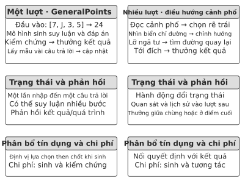

Trong Hình 8-15, Agent bỏ lỡ ngã tư ở bước 3, đến bước 4 phát hiện đi lệch thì quay đầu, bước 5 tới đích. Phần thưởng ở điểm cuối khẳng định cả chuyến điều hướng, nhưng không phân biệt việc đi sai đường với việc kịp thời quay đầu. Lần sau gặp ngã tư này, ta muốn nó đi đúng ngay; lỡ lại đi sai thì vẫn nên khuyến khích nó quay đầu. Trong huấn luyện phải ước lượng tác dụng của từng bước trước đó đối với lợi ích cuối cùng; bài toán này gọi là **phân bổ tín dụng (Credit Assignment)**. Ước lượng giá trị và lợi thế có thể tận dụng lợi ích về sau; khi kiểm tra được hành động trung gian một cách tin cậy, còn có thể thêm phần thưởng quá trình. Bước 4 quay đầu được 0 điểm trong phần thưởng quá trình, nhưng vẫn giúp đi tới đích. Khi ước lượng giá trị của bước này, cũng phải tính cả lợi ích về sau.

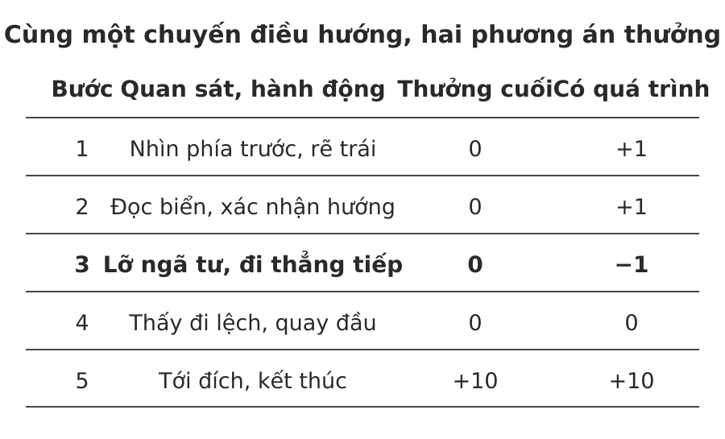

Vấn đề tương tự cũng xảy ra trong cuộc gọi chăm sóc khách hàng. Chẳng hạn, người dùng đánh giá tốt ở lượt 10. Lượt 2 hỏi rõ khoản phí bị tranh chấp là khoản nào, lượt 7 giải thích chi phí, cả hai bước đều có thể có ích. Chỉ dựa vào lời khen cuối cùng thì chưa phân biệt được mỗi bước góp bao nhiêu. Hai thí nghiệm dưới đây lần lượt bàn về trường hợp người huấn luyện kiểm tra được từng hành động điều hướng, và trường hợp chỉ có thể dựa vào kết quả nhiệm vụ để biết robot có thành công hay không.

> **Thí nghiệm 8-12 ★★★: V-IRL-VL – điều hướng thị giác nhiều lượt**
>
> Trong V-IRL[^ch8-24], Agent phải dựa vào cảnh phố trước mắt để tìm đến đích từng bước một. Huấn luyện dùng các tuyến đường ở New York, kiểm thử chuyển sang thành phố khác, vừa đổi cách nói khi chỉ đường, vừa đổi cảnh phố trong hình. Trong cả hai loại kiểm thử ngoài phân phối là thay đổi quy tắc và thay đổi thị giác, RL đều tốt hơn rõ rệt so với SFT. Thí nghiệm dùng PPO có mạng giá trị. Mỗi bước đi đều có phản hồi giúp phân biệt những quyết định nào trên một tuyến đường dài đáng giữ lại.

> **Thí nghiệm 8-13 ★★★: SimpleVLA-RL – khám phá mở với phần thưởng kết quả `[Thí nghiệm mở rộng]`**
>
> SimpleVLA-RL dùng phần thưởng kết quả thành công/thất bại trên các nhiệm vụ robot LIBERO. Mỗi nhiệm vụ dùng một trajectory trình diễn để khởi động nguội bằng SFT, sau đó dùng RL nâng tỷ lệ thành công từ 17,3% lên 91,7%, và sinh ra động tác “đẩy-cắt” không có trong trình diễn. Đặt kết quả này cạnh bài điều hướng cảnh phố: nếu phán định tin cậy được bước nào giữa chừng đi sai, có thể phản hồi ngay tại chỗ để tăng tốc học. Nếu còn chưa biết có những cách nào để hoàn thành nhiệm vụ, thì thưởng theo kết quả trước sẽ chừa chỗ cho mô hình thử đường đi khác. Viết thứ tự động tác trong trình diễn của con người thành yêu cầu phần thưởng quá sớm có thể kéo điểm của những chiến lược mới như “đẩy-cắt” xuống.

### Gọi công cụ: học sử dụng năng lực bên ngoài qua tương tác

Sau khi nối với công cụ bên ngoài, mô hình có thể chọn tìm kiếm, chạy mã, sửa tệp, truy vấn cơ sở dữ liệu, hoặc kết hợp nhiều API theo nhu cầu nhiệm vụ. Harness lo kiểm tra và điều phối lời gọi, công cụ thực thi trong môi trường và trả về quan sát. Hình 8-16 tách việc ra quyết định trong một nhiệm vụ khỏi việc huấn luyện sau khi nhiệm vụ kết thúc. Theo mũi tên bên phải, kết quả công cụ quay về nhiệm vụ hiện tại, mô hình dùng nó để quyết định bước tiếp theo. Đọc xuống dưới, sau khi nhiệm vụ kết thúc, chương trình huấn luyện mới dùng cả trajectory để tính phần thưởng, cập nhật tham số, và lượt lấy mẫu sau dùng chiến lược mới. Khi một nhiệm vụ phải gọi nhiều công cụ liên tiếp, kết quả trả về của lần trước sẽ ảnh hưởng đến tham số của lần gọi sau.

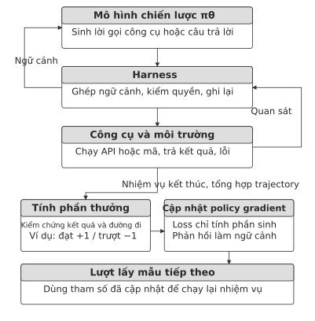

Search-R1[^ch8-25] huấn luyện mô hình quyết định khi nào tìm kiếm, gửi truy vấn gì, và kết hợp kết quả để suy luận tiếp. ReTool đưa trình thông dịch mã vào cùng kiểu vòng lặp đó, mô hình học sắp xếp việc chạy mã, hiểu giá trị trả về và sửa theo thông báo lỗi. AWorld-train mở rộng sang sandbox nhiều công cụ MCP, mô hình phải chọn công cụ, xử lý phụ thuộc giữa các lời gọi, còn hệ thống huấn luyện phải đặt lại được môi trường và phát lại được trajectory.

Trajectory công cụ cần phân biệt token do mô hình sinh với token do môi trường trả về. Khi tính mất mát chiến lược, chỉ những hành động do mô hình sinh như suy luận, tham số lời gọi và câu trả lời mới được tính vào mất mát, còn các vị trí ứng với phản hồi của môi trường bị che đi. Phản hồi vẫn tham gia tính toán về sau với vai trò ngữ cảnh, giúp mô hình phán đoán bước tiếp theo nên làm gì. Chẳng hạn, trình thông dịch trả về một lỗi; thứ mà huấn luyện muốn củng cố là cách mô hình sửa mã ngay sau đó. Nếu tính cả văn bản lỗi vào mất mát chiến lược, bước cập nhật sẽ lẫn mục tiêu “sinh đầu ra của môi trường”, lệch khỏi những quyết định mà mô hình thực sự chịu trách nhiệm.

> **Thí nghiệm 8-14 ★★★: ReTool – trình thông dịch mã hỗ trợ giải toán**
>
> Hình 8-17 dùng một phương trình bậc hai để minh họa suy luận văn bản, sinh mã và phản hồi của trình thông dịch đan xen nhau như thế nào.
>
> 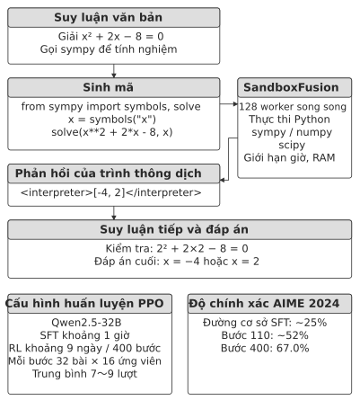
>
> Sau giai đoạn khởi động bằng SFT, ReTool huấn luyện PPO với suy nghĩ văn bản, thực thi mã và phản hồi của trình thông dịch đan xen nhau. Mô hình dần học được khi nào đáng chạy mã, và gặp lỗi thì nên sửa ra sao. Ở đây dùng dữ liệu huấn luyện DAPO-Math-17k, còn chiến lược vẫn được cập nhật bằng PPO tiêu chuẩn[^ch8-26][^ch8-27].
>
> Sau huấn luyện, độ chính xác trả lời của mô hình trên AIME 2024 tăng từ khoảng 25% lên 67,0%. So với RL thuần văn bản, phản hồi từ mã giúp mô hình học tính toán chính xác và sửa lỗi nhanh hơn.

> **Thí nghiệm 8-15 ★★★: AWorld-train – học dùng công cụ trong sandbox**
>
> Đi một vòng theo nửa trên của Hình 8-18: mô hình nhận kết quả của một lần gọi công cụ và còn có thể thử tiếp. Rồi đi một vòng theo nửa dưới: lô nhiệm vụ này đã kết thúc, chương trình huấn luyện lấy các trajectory kèm phần thưởng, cập nhật tham số, và lô nhiệm vụ sau mới dùng chiến lược mới.
>
> 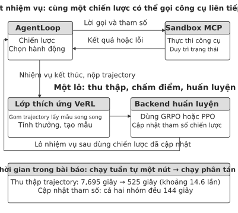
>
> Môi trường GAIA có 26 máy chủ MCP, 126 hàm công cụ, có thể dùng Playwright thao tác trang web, trích nội dung từ PDF, Word và slide, chuyển âm thanh thành văn bản, nhận dạng chữ, hoặc chạy mã trong sandbox E2B. Công cụ Excel cung cấp 29 thao tác, gồm cả công thức, biểu đồ và bảng tổng hợp (pivot); phần truy xuất kiến thức còn truy cập được Wikipedia, arXiv và Wayback. Sau khi đặt lại sandbox, có thể thử lại từ cùng một trạng thái, cũng có thể phát lại trajectory trước đó.
>
> Thời gian trong hình lấy từ phép đối chứng thu thập dữ liệu của bài báo. Thí nghiệm đi kèm còn đưa ra một cấu hình huấn luyện cho mô hình 4B: Qwen3-4B-Thinking-2507, 8 GPU A100, giới hạn ngữ cảnh 131K, tối đa 32 lượt tương tác, kích thước lô 32, mỗi bài lấy mẫu 16 trajectory, cập nhật bằng GRPO, learning rate 1e−6.

Công cụ đã trả kết quả, chương trình huấn luyện nên thưởng cho bước nào? Một lần gọi thành công chỉ cho biết công cụ thực thi thành công. Muốn biết bước này có đẩy nhiệm vụ tiến lên không, còn phải dùng verifier kiểm tra thay đổi mà nó gây ra, rồi mới quyết định thưởng gì cho mô hình.

## Thiết kế phần thưởng: biến mục tiêu nhiệm vụ thành tín hiệu học

Hãy hình dung hai trajectory hoàn tiền cuối cùng trả lại cùng một số tiền, nhưng một trong hai đã bỏ qua bước xác minh danh tính bắt buộc. Nếu chỉ đọc số dư cuối cùng, chúng sẽ nhận cùng một điểm. Để biến toàn bộ yêu cầu mà người dùng ủy thác thành tín hiệu học, trước hết hãy xác định ai xác minh được kết quả, bước nào lấy được bằng chứng, cần truyền thông tin gì về cho mô hình, rồi kiểm tra xem các ràng buộc về quyền hạn và quy trình trên đường đi có kiểm chứng riêng được không.

### Phần thưởng đến từ đâu: quy tắc, sở thích con người và đánh giá của mô hình

Với nhiệm vụ phán định tự động được, tác giả ưu tiên **học tăng cường với phần thưởng kiểm chứng được (RLVR)**, viết thẳng yêu cầu nghiệm thu thành chương trình. Bài toán thì đối chiếu đáp án, nhiệm vụ mã thì chạy kiểm thử, nhiệm vụ hoàn tiền thì kiểm tra số tiền và trạng thái đơn hàng trong cơ sở dữ liệu. Đạt ghi 1, không đạt ghi 0, là có phần thưởng kết quả đơn giản nhất. Quy tắc rõ ràng, chạy tái hiện được, nên dễ định vị chênh lệch chấm điểm; còn phạm vi bao quát của verifier quyết định huấn luyện rốt cuộc đang tối ưu những yêu cầu nào.

**Học tăng cường từ phản hồi của con người (RLHF)** biến sở thích của con người thành tín hiệu huấn luyện. InstructGPT[^ch8-4] trước hết thu thập các so sánh của con người giữa các câu trả lời, huấn luyện mô hình phần thưởng, rồi dùng PPO để tối ưu chiến lược. Mô hình phần thưởng học sở thích trong một lượng mẫu hữu hạn, nên liên tục chạy theo điểm số cao hơn của mô hình có thể khuếch đại độ lệch của nó[^ch8-5]. Trong huấn luyện thường thêm chính quy hóa KL so với mô hình tham chiếu SFT để kiểm soát độ trôi của chiến lược. DPO[^ch8-6] thì dùng trực tiếp các cặp sở thích “câu trả lời tốt hơn – câu trả lời kém hơn” để tối ưu chiến lược, bỏ qua bước huấn luyện riêng mô hình phần thưởng.

Với nhiệm vụ mở, có thể để mô hình đưa ra lý do đánh giá và điểm số. Bản chẩn đoán do **mô hình phần thưởng sinh (GRM)** tạo ra còn dùng được để sàng lọc trình diễn, dựng cặp sở thích hoặc hướng dẫn sửa đổi sau đó. DeepSeek-GRM[^ch8-23] sinh nguyên tắc đánh giá theo nhiệm vụ, rồi dựa vào đó đưa ra phê bình và chấm điểm; nó cải thiện hành vi đánh giá qua RL trực tuyến, và dùng nhiều lần lấy mẫu cùng mô hình phần thưởng phụ trợ để tổng hợp phán đoán.

Khoảng cách giữa chỉ số đánh giá và mục tiêu nhiệm vụ cũng ảnh hưởng đến hành vi của mô hình. **Reward hacking** chỉ việc chiến lược lợi dụng khiếm khuyết trong quy tắc chấm hoặc trong cách cài đặt để đạt điểm cao. Ở Agent tầm xa còn có một hiện tượng gọi là **reward seeking**: mô hình hành động theo cách chấm điểm mà nó tự suy đoán, chẳng hạn tự chọn một phép kiểm tra dễ qua, kiểm tra qua rồi thì kết thúc nhiệm vụ[^ch8-29]. Ví dụ này nhắc ta rằng điều kiện nghiệm thu phải xuất phát từ mục tiêu của người dùng và bao quát sản phẩm bàn giao thật; chỉ kiểm tra những chỉ số do mô hình tự chọn thì dễ bỏ sót các yêu cầu chưa hoàn thành.

Khi thiết kế phần thưởng cho nhiệm vụ hoàn tiền, hãy cho hai trajectory do người viết đi qua verifier trước. A tra rõ đơn hàng, gọi giao diện hoàn tiền, nhắc lại biên nhận cho người dùng; B chỉ nói “đã hoàn tiền xong”. Nếu hai bên được cùng điểm, hãy kiểm tra trước xem bộ chấm rốt cuộc đọc câu trả lời cuối, biên nhận của giao diện hay trạng thái đơn hàng. Phản ví dụ rất nhỏ này đủ để phơi bày vấn đề của chỉ số đại diện, đỡ phải trả giá bằng cả một lượt huấn luyện mới phát hiện mô hình đã học được cách báo tin vui sớm.

### Khi nào trao phần thưởng: kết quả và quá trình

**Phần thưởng kết quả** đánh giá kết quả nhiệm vụ sau khi một episode kết thúc; khi dùng mô hình để đánh giá kết quả, loại mô hình này gọi là **ORM (Outcome Reward Model)**. Phần thưởng thành công/thất bại của SimpleVLA-RL để chiến lược khám phá các chuỗi hành động khác nhau xoay quanh mục tiêu cuối cùng. Tín hiệu như vậy dễ định nghĩa, nhưng khi một trajectory dài thất bại, mô hình còn phải thử thêm nhiều lần mới phân biệt được hành động nào dẫn đến thất bại. Đây là một lý do phản hồi thưa ảnh hưởng đến hiệu quả sử dụng mẫu[^ch8-8].

Lấy việc Coding Agent kết thúc quá sớm làm ví dụ: sau khi mô hình gửi tuyên bố hoàn thành, Harness chạy bộ kiểm thử nghiệm thu được bảo vệ trong một không gian làm việc cách ly. Kiểm thử đọc tệp và trạng thái môi trường thật, qua thì thưởng dương, không qua thì thưởng âm. Như vậy, tuyên bố hoàn thành sẽ kích hoạt kiểm chứng bên ngoài, và kết quả nhiệm vụ do sản phẩm bàn giao quyết định. Khi đánh giá, chuẩn bị riêng hai nhóm nhiệm vụ: một nhóm vẫn còn việc phải làm, dùng để đo tỷ lệ kết thúc quá sớm; nhóm kia đã hoàn thành, dùng để kiểm tra mô hình có biết kết thúc kịp thời không.

**Phần thưởng quá trình** cung cấp phản hồi ở các bước trung gian, chẳng hạn đánh giá việc xác minh danh tính, chọn tham số, hành động điều hướng hoặc bước suy luận. Mô hình dùng để đánh giá quá trình gọi là **PRM (Process Reward Model)**. Bài “Let's Verify Step by Step” của OpenAI[^ch8-7] nghiên cứu kiểm chứng từng bước trong suy luận toán học. Tín hiệu quá trình giúp mô hình định vị lỗi, nhưng cũng làm tăng chi phí gán nhãn và kiểm chứng. Nếu coi một thứ tự giải nào đó là đường đi đúng duy nhất, nó còn kéo phần thưởng của các chiến lược hợp lệ khác xuống. Vì thế tác giả chỉ thêm tín hiệu quá trình cho những sự kiện trung gian thực sự kiểm chứng được, để mô hình tiếp tục khám phá nhiều lời giải hợp lệ. V-IRL-VL (Thí nghiệm 8-12) dùng phản hồi điều hướng từng bước, SimpleVLA-RL (Thí nghiệm 8-13) dùng phần thưởng ở điểm cuối, cho thấy hai kiểu nhiệm vụ lựa chọn độ mịn phản hồi khác nhau.

Trong thực tế có thể dựng đường cơ sở phần thưởng kết quả trước, rồi thêm tín hiệu quá trình cho các sự kiện trung gian như hoàn tất xác minh danh tính, qua kiểm thử. Nhiệm vụ nhiều lượt có độ dài hữu hạn có thể lấy hệ số chiết khấu $\gamma=1$, để phần thưởng điểm cuối giữ nguyên trọng số khi lan truyền ngược lên trước. PPO dùng ước lượng giá trị và tính lợi thế để gắn phản hồi với hành động ở từng bước; còn GRPO, vốn dùng lợi thế cấp trajectory, thường áp cùng một trọng số lợi thế cho mất mát chiến lược của mọi token được sinh trong trajectory đó.

### Phần thưởng cần chứa bao nhiêu thông tin: vô hướng, vector và chẩn đoán dạng sinh

Thời điểm xuất hiện của phần thưởng quyết định mật độ phản hồi; nội dung của phần thưởng quyết định hình thức biểu diễn. Một số vô hướng tóm tắt kết quả tổng thể; dạng bán vô hướng “lý do ngắn + điểm” bổ sung căn cứ chấm; vector biểu diễn riêng các chiều như độ chính xác, độ đầy đủ, chi phí; chẩn đoán dạng sinh thì nói cụ thể vấn đề và hướng sửa, cũng có thể tổng hợp qua nhiều lần lấy mẫu.

- Khi có đáp án xác định hoặc kiểm thử nghiệm thu, có thể bắt đầu từ số vô hướng nhị phân.
- Khi có nhiều mục tiêu chất lượng, có thể chấm riêng từng mục, rồi đặt trọng số hoặc ràng buộc theo yêu cầu nghiệp vụ.
- Khi đánh giá cần diễn giải theo ngữ cảnh, có thể sinh chẩn đoán, và hiệu chỉnh bằng kiểm chứng sự kiện cùng kiểm tra thủ công ngẫu nhiên.

Chẳng hạn, một nhiệm vụ chăm sóc khách hàng có thể ghi đồng thời tình trạng giải quyết, số lượt hội thoại và việc xác minh danh tính đã hoàn tất chưa. Ba chiều này lần lượt ứng với hiệu quả, chi phí và yêu cầu quy trình. Trước khi dùng chúng cho huấn luyện, cần kiểm tra điểm chấm có ổn định không, và chúng có phân biệt được hành vi của các trajectory trong cùng nhóm không. Tác giả thường bắt đầu từ một vài chỉ số đáng tin cậy, kiểm chứng từng cái rồi mới thêm chiều. Mỗi tiêu chí chấm chưa được kiểm chứng đều có thể khiến mô hình tối ưu theo một chỉ số đại diện mới mà không cải thiện nhiệm vụ thật.

### Ràng buộc đường đi và RLVP

Trong quá trình hoàn thành nhiệm vụ còn có thể có những yêu cầu hành vi độc lập: liên hệ người dùng trong giờ làm việc, hoàn tất xác minh danh tính, giữ nguyên các tệp được bảo vệ. RLVP (Reinforcement Learning with Verified Penalty)[^ch8-9] kết hợp phần thưởng kết quả với hình phạt đường đi kiểm chứng được, theo nguyên tắc **thưởng kết quả, phạt đường đi**. Quy tắc đường đi được kích hoạt bởi những hành động quan sát được trong môi trường, còn độ đầy đủ của sản phẩm bàn giao vẫn do phần nghiệm thu nhiệm vụ kiểm tra.

Hai lần sửa đều qua nghiệm thu, nhưng một lần đã ghi đè thẳng lên tệp lẽ ra phải đọc trước. Kiểm tra nhật ký công cụ là định vị được hành động vi phạm này; còn muốn đánh giá mỗi bước trước đó góp bao nhiêu vào thành công cuối cùng thì khó hơn nhiều. Cách đơn giản nhất là chấm cho cả trajectory một điểm $R=O+\beta\Phi$: $O$ là điểm nhiệm vụ, $\Phi$ tổng hợp điểm trừ do vi phạm hoặc tiến triển kiểm chứng được, $\beta$ quyết định trọng số tương đối giữa hai phần. Cách này phân biệt được hai lần sửa, nhưng mọi hành động trong cùng một trajectory đều nhận cùng một tín hiệu.

Nếu biết vi phạm xảy ra ở lượt nào, có thể dành phần điểm trừ riêng cho lượt đó. Xem hai trajectory kiểm thử trong phần cài đặt đi kèm: A hoàn thành nhiệm vụ nhưng vi phạm ở lượt hai; B không hoàn thành nhiệm vụ, nhưng cả hai lượt đều tuân thủ. Điểm kết quả của hai trajectory lần lượt là 1 và 0, trừ trung bình nhóm được +0,5 và −0.5. Mỗi trajectory có hai lượt hành động, mỗi lượt chiếm 10 token hành động. Theo cấu hình `c2` trong phần cài đặt, hai loại tín hiệu được tính riêng:

```python
outcome_weight = (1 - 0.5) / 40  # tín hiệu kết quả chia đều cho cả 40 token hành động của lô
penalty_weight = -0.3 / 10       # điểm trừ vi phạm chỉ chia cho 10 token hành động ở lượt hai của A
first_turn = outcome_weight
second_turn = outcome_weight + penalty_weight
```

Ở lượt một của A, mỗi token hành động nhận trọng số +0,0125; ở lượt hai là −0.0175. Nhờ đó, hai hành động trong cùng một lần sửa thành công có thể nhận tín hiệu huấn luyện ngược chiều nhau. Trọng số như vậy đi vào mất mát chiến lược, rồi bộ tối ưu mới dựa vào đó cập nhật tham số. Đổi sang nhiệm vụ chăm sóc khách hàng, chỉ cần nhật ký công cụ định vị được lượt nào đã bỏ qua kiểm tra ủy quyền, cũng có thể phân bổ điểm trừ theo cách tương tự.

Tác dụng của tín hiệu đường đi có thể hiểu qua chênh lệch trong nhóm. Nếu các trajectory trong một nhóm GRPO có cùng phần thưởng kết quả, lợi thế tính từ phần thưởng đó bằng không; nếu số lần vi phạm trong nhóm khác nhau, hình phạt đường đi sẽ cung cấp căn cứ so sánh mới. Phần thưởng tiến triển từng phần cũng theo cùng điều kiện: mô hình ít nhất phải lấy mẫu được những mức tiến triển khác nhau thì mới tạo ra tác dụng phân biệt.

Khi thiết kế phần thưởng đường đi, có thể theo bốn quy tắc: phạt những hành động vi phạm rõ ràng; giữ phần thưởng kết quả nhiệm vụ; cung cấp đường đi tuân thủ đạt tới được cho hành vi bị ràng buộc; dùng quy tắc kiểm chứng chạy lặp lại được. Chẳng hạn, phạt riêng từng thao tác sẽ khuyến khích mô hình đứng yên tại chỗ; giữ phần thưởng thành công của nhiệm vụ mới đồng thời thúc nó hoàn thành công việc. Khi mô hình nền khó sinh ra đường đi tuân thủ, có thể dùng một ít trình diễn để dựng điểm xuất phát trước, rồi qua huấn luyện giảm dần sự phụ thuộc vào việc định hình đường đi.

> **Thí nghiệm 8-16 ★★★: RLVP – thưởng kết quả, phạt đường đi**
>
> Thí nghiệm thêm phần thưởng kết quả $O$ và tín hiệu đường đi $\Phi$ vào GRPO, và so sánh với phần thưởng thuần kết quả. Trên nhiệm vụ đại diện của TerminalBench, số lần vi phạm giảm từ 3,71 xuống 0,66, tỷ lệ thành công gần như giữ nguyên; trên nhiệm vụ đại diện của miniF2F, sau khi thêm phần thưởng tiến triển từng phần đạt tới được, số vòng lặp cần để đạt tỷ lệ thành công 0,9 giảm từ 7,0 xuống 4.4.
>
> Nhiệm vụ sửa phần mềm còn cho thấy vai trò của khả năng đạt tới của tín hiệu: khi mọi rollout đều không qua được kiểm thử nào, phần thưởng tiến triển tính theo số kiểm thử qua luôn bằng nhau, không tăng được chênh lệch trong nhóm.

Số lần vi phạm trung bình giảm xuống 0,66 cho thấy mô hình chọn đường đi tuân thủ thường xuyên hơn, nhưng thỉnh thoảng vẫn vi phạm. Với những giới hạn bắt buộc phải tuân thủ, khi thực thi công cụ vẫn phải kiểm tra quyền hạn.

## Chưng cất: nâng cao hiệu quả sử dụng mẫu

Một lần rollout của Agent thường gồm nhiều lượt sinh của mô hình và thực thi công cụ. Nâng cao **hiệu quả sử dụng mẫu (sample efficiency)** nghĩa là đạt kết quả mục tiêu với ít lượt tương tác môi trường hơn. Số bước huấn luyện, thời gian GPU và lượng gọi môi trường phản ánh những loại chi phí khác nhau, cần xem xét cùng nhiệm vụ. Chẳng hạn, trong tình huống ReTool của chương này, huấn luyện SFT mất khoảng 1 giờ, còn RL mất khoảng 9 ngày; phần lớn tài nguyên bị chiếm bởi việc lấy mẫu và thực thi công cụ lặp đi lặp lại.

Khi dùng phần thưởng ở điểm cuối, cả một trajectory có thể chỉ nhận được một điểm thành bại. Giả sử công cụ nghiệp vụ đã nhắc “cần bốn số cuối thẻ tín dụng” mà Agent bỏ sót thông tin này, cuối cùng nhận phần thưởng 0. Huấn luyện còn phải phân biệt qua nhiều lần thử xem thất bại rốt cuộc do thiếu trường, sai tham số công cụ hay do thao tác sai về sau. Nếu mô hình thầy có thể giám sát từng bước trên chính trajectory này, cùng một lần tương tác môi trường sẽ tạo ra tín hiệu học mịn hơn.

### Chưng cất on-policy: để một lần rollout tạo ra giám sát dày đặc

**Chưng cất on-policy (On-Policy Distillation)** để mô hình trò sinh trajectory, còn mô hình thầy giám sát trên chính tiền tố mà trò thực sự sinh ra. Nghiên cứu năm 2025 của Thinking Machines Lab đã trình bày có hệ thống cách huấn luyện này[^ch8-10]. Để hiểu ba loại phương pháp, có thể tách riêng hai câu hỏi “ai tạo ra trạng thái huấn luyện” và “ai cung cấp tín hiệu học”:

| Phương pháp | Trajectory hoặc trạng thái do ai tạo ra | Tín hiệu học chính |
| --- | --- | --- |
| SFT / chưng cất off-policy | Trình diễn của con người hoặc mô hình thầy | Giám sát từng token của đáp án mục tiêu |
| On-policy RL | Mô hình trò hiện tại | Phần thưởng kết quả hoặc quá trình |
| On-policy Distillation | Mô hình trò hiện tại | Đánh giá xác suất từng token của mô hình thầy trên tiền tố của trò |

Chẳng hạn, trình diễn của mô hình thầy luôn tra đơn hàng trước rồi mới yêu cầu hoàn tiền, nhưng mô hình trò có thể gửi yêu cầu hoàn tiền trước và nhận lỗi “thiếu mã đơn hàng”. Chưng cất on-policy để mô hình thầy đánh giá đúng trạng thái mà trò đã đi tới, hướng dẫn nó tra bổ sung thông tin ra sao. Nhờ vậy, huấn luyện bao quát được cả lỗi của chính mô hình trò lẫn đường khôi phục.

Một cách cài đặt là cực tiểu hóa KL ngược giữa trò và thầy trên tiền tố do trò sinh ra:

$$
D_{\mathrm{KL}}(\pi_\theta\Vert\pi_T)
=\mathbb{E}_{a\sim\pi_\theta(\cdot\mid h)}
\left[\log\pi_\theta(a\mid h)-\log\pi_T(a\mid h)\right],
$$

Trong đó $h$ là tiền tố hiện tại, $a$ là token tiếp theo, $\pi_\theta$ và $\pi_T$ lần lượt là phân phối của trò và thầy. Token mà thầy cho là phù hợp hơn sẽ nhận tín hiệu huấn luyện có lợi hơn. Khi cài đặt, có thể so sánh toàn bộ phân phối, cũng có thể hỏi log xác suất của thầy cho các token mà trò đã lấy mẫu, để dựng tín hiệu tối ưu cho từng token.

Lấy “tra API trước, rồi phân tích giá trị trả về” làm ví dụ: giả sử ở một vị trí, hai ứng viên “tra” và “gọi” mỗi cái ứng với một token, thầy gán cho chúng xác suất lần lượt 80% và 15%, các ứng viên khác cộng lại 5%. Như vậy đã có căn cứ lựa chọn mịn hơn nhiều so với kết quả thành bại cuối cùng. Nếu một trajectory chứa $T$ token do mô hình sinh, có thể thu được giám sát ở khoảng $T$ vị trí; nội dung công cụ trả về vẫn dùng làm ngữ cảnh và bị che trong mất mát chiến lược.

Dưới đây biểu diễn quá trình này ở dạng căn chỉnh toàn bộ phân phối:

```python
trajectory = rollout(student, task)
loss = 0
for prefix in model_generated_positions(trajectory):
    target = stop_gradient(teacher.distribution(prefix))
    loss += KL(student.distribution(prefix), target)
update_student(loss)
```

Mô hình trò lo khám phá, mô hình thầy giám sát ở nhiều vị trí, chi phí tăng thêm chủ yếu đến từ suy luận của thầy. Khi tương tác môi trường đắt đỏ mà thầy lại hướng dẫn trò một cách đáng tin cậy, tác giả ưu tiên so sánh chưng cất on-policy, để mỗi lần gọi môi trường tạo ra nhiều tín hiệu học hữu ích hơn. Với mô hình trò còn yếu về ngôn ngữ đích, kiến thức lĩnh vực hoặc hành động cơ bản, có thể dùng Mid-training và huấn luyện bằng trình diễn để dựng điểm xuất phát hiệu quả trước, rồi mới bước vào chưng cất on-policy.

Tính nhất quán giữa lấy mẫu và huấn luyện ở đây cũng quan trọng: engine lấy mẫu sinh trajectory theo chiến lược $\mu$, engine huấn luyện tính mất mát theo $\pi_\theta$, và chênh lệch giữa hai bên sẽ làm thay đổi phân phối trạng thái huấn luyện.

Phép đối chứng trên nhiệm vụ toán học của Thinking Machines Lab cho thấy hiệu quả huấn luyện tăng khoảng một bậc độ lớn. Với Agent nhiều lượt, có thể dùng lại cách so sánh này, đồng thời ghi tỷ lệ thành công nhiệm vụ, lượng gọi môi trường và chi phí tính toán của mô hình thầy. Những trạng thái mà mô hình trò gặp trong môi trường và việc thầy có đưa ra được phản hồi đáng tin cậy hay không cùng quyết định lợi ích.

Tác giả và cộng sự cũng từng so sánh DPO, bốn công thức RL và chưng cất on-policy trên nhiệm vụ “cảm nhận thời gian”[^ch8-11]. Các công thức trước đó lần lượt gặp phải phần thưởng thưa, lệch mục tiêu, hình dạng rollout không khớp và sụp đổ chiến lược. Sau khi chuyển sang dùng mô hình thầy Qwen3-32B đóng băng, căn chỉnh từng token trên chính các trajectory nhiều lượt của mô hình trò, huấn luyện hội tụ êm, tỷ lệ vượt qua ở bốn điều kiện cao hơn đường cơ sở SFT cùng nguồn 23–47 điểm phần trăm. Trải nghiệm này khiến tác giả coi trọng hơn mật độ tín hiệu mà mỗi lần tương tác mang lại. Khi mọi quyết định trung gian trong cùng một lần tương tác đều tham gia học, giá trị của các trajectory sẵn có được khai thác đầy đủ hơn.

Nếu thầy dạy toán giỏi suy luận, thầy dạy lập trình giỏi sửa chương trình, làm sao để một học trò học được sở trường của cả hai? Chưng cất on-policy nhiều thầy (MOPD) giữ nguyên quy trình huấn luyện ở trên, chỉ thay mô hình thầy cố định bằng mô hình thầy được chọn theo lĩnh vực của đề bài. Khi mô hình trò làm bài lập trình, dù viết được nửa chừng thì đi đường vòng, nó vẫn đưa tiền tố đã viết cho thầy lập trình để lấy phân phối xác suất cho bước tiếp theo; đến lượt bài toán thì thầy toán hướng dẫn trong quá trình giải của trò. Mỗi lĩnh vực có thể huấn luyện thầy độc lập trước, rồi cố định tham số của thầy ở giai đoạn chưng cất. Khi triển khai chỉ cần chạy một mô hình trò.[^ch8-mopd]

Ở đây có hai điều kiện thực tế. Thứ nhất, muốn tính KL từng token theo công thức trên, phải lấy được xác suất của thầy căn chỉnh được trên tiền tố mà trò đưa ra. Nếu trong tay chỉ có vài lời giải hoàn chỉnh do thầy viết sẵn, có thể dùng để làm SFT, nhưng không đủ để tính mất mát này. Thứ hai, khi nghiệm thu phải tách riêng kết quả của từng lĩnh vực. Khi điểm toán của trò tăng mà điểm lập trình giảm, một con số trung bình tổng tăng lên rất dễ che lấp sự thụt lùi của phần sau.

[^ch8-mopd]: Wenhan Ma và cộng sự, *MOPD: Multi-Teacher On-Policy Distillation for Capability Integration in LLM Post-Training*, 2026. Bài báo dùng các mô hình thầy huấn luyện theo lĩnh vực, chưng cất trên chính trajectory của mô hình trò.

### Tự chưng cất on-policy: dựng mô hình thầy bằng ngữ cảnh bổ sung

Nếu nhóm chỉ có một mô hình giỏi lĩnh vực của mình, ai sẽ làm thầy? Có thể giao cùng một bài cho nó hai lần. Lần đầu chỉ đưa câu hỏi của người dùng như điều kiện triển khai; lần hai đưa thêm đáp án chuẩn, trình diễn của chuyên gia hoặc tài liệu lĩnh vực. Phần thông tin dôi ra ở lần trả lời thứ hai có thể dùng để hướng dẫn mô hình trò trong điều kiện của lần đầu.

**Tự chưng cất on-policy (On-Policy Self-Distillation, OPSD)**[^ch8-15] để cùng một mô hình đảm nhận hai vai: vai học trò chỉ thấy đầu vào nhiệm vụ, còn vai thầy thấy thêm đáp án chuẩn hoặc lời giải đã kiểm chứng. Sau khi trò sinh trajectory, thầy kết hợp các thông tin đặc quyền này để đánh giá từng tiền tố, rồi truyền giám sát trở lại cho trò.

Chẳng hạn, mô hình trò đang giải một bài toán, còn mô hình thầy đã biết đáp án đúng. Thầy có thể dựa vào đó đánh giá hướng suy luận hiện tại của trò, còn trò học cách cải thiện phần sinh của mình khi chỉ có đề bài. Mã giả dưới đây cho thấy vị trí của ngữ cảnh bổ sung và của việc cô lập gradient:

```python
trajectory = rollout(model, task_without_answer)
loss = 0
for prefix in model_generated_positions(trajectory):
    privileged_prefix = add_verified_answer(prefix)
    target = stop_gradient(model.distribution(privileged_prefix))
    loss += KL(model.distribution(prefix), target)
update(model, loss)
```

Thông tin đặc quyền chỉ đi vào nhánh thầy lúc huấn luyện, còn đầu vào của trò và đầu vào đánh giá giữ nguyên như khi triển khai. Có thể lần theo mã giả để kiểm tra hai luồng thông tin: đáp án chuẩn chỉ đi vào dòng dựng tiền tố của thầy, nên khi triển khai trò không thấy nó; đầu ra của thầy đi qua xử lý dừng gradient, nên ở bước này chỉ nhánh trò cập nhật tham số theo chênh lệch giữa hai phân phối. Ở vòng sau, khi dùng mô hình đã cập nhật, phán đoán của thầy cũng có thể thay đổi theo. Như vậy, cùng một mô hình có thể tận dụng thông tin đầy đủ hơn ở phía huấn luyện để giám sát chính phần sinh thực tế của mình.

Thông tin đặc quyền cũng có thể đến từ trình diễn của con người hoặc tài liệu lĩnh vực đã qua sàng lọc. Khi chọn, cần kiểm tra xem nó có cải thiện phán đoán của thầy không: thầy có thông tin rồi càng nhận ra lỗi của trò thì tín hiệu chưng cất càng hữu ích. Trong quá trình huấn luyện còn phải dùng các mẫu để dành trước cho kiểm thử để kiểm tra năng lực vốn có và phong cách sinh; các nghiên cứu như Purified OPSD dùng thêm ràng buộc chính quy hóa để giúp mô hình giữ phong cách suy luận ban đầu[^ch8-16].

## Từ tình huống lỗi đến hậu huấn luyện

Chương 7 đã sắp xếp các vấn đề trong sản xuất thành nhiệm vụ tái hiện được, quy nguyên lỗi và tiêu chuẩn đánh giá. Những tài liệu này cũng dùng được cho hậu huấn luyện: nhiệm vụ hoàn chỉnh cung cấp môi trường tương tác, tiền tố trajectory trước khi xảy ra lỗi cung cấp ngữ cảnh ra quyết định, còn verifier lo kiểm tra hành vi mới sinh. Bảng 8-5 liệt kê quan hệ tương ứng giữa chúng và các phương pháp huấn luyện.

Bảng 8-5 Tài liệu đánh giá ở Chương 7 và cách dùng cho hậu huấn luyện

| Tài liệu từ Chương 7 | Cách dùng cho huấn luyện ở Chương 8 |
| --- | --- |
| Nhiệm vụ đầu-cuối và verifier | Nhiệm vụ lấy mẫu cho RL, phần thưởng kiểm chứng được, kho nhiệm vụ cho lấy mẫu loại bỏ |
| Tiền tố trajectory và hành vi tiếp theo | Cặp sở thích DPO, trình diễn quyết định cho SFT, đầu vào của mô hình thầy trong chưng cất on-policy |
| Vị trí thất bại và loại lỗi | Nhãn đánh giá quá trình, quy tắc phạt đường đi kiểm chứng được |
| Điểm từng mục Rubric và đáp án chuẩn do con người gán nhãn | Phần thưởng đa chiều, huấn luyện và hiệu chỉnh mô hình phần thưởng dạng sinh |

Tiền tố lịch sử có thể làm điểm xuất phát cho nhiệm vụ nối tiếp. Khi dùng cho chưng cất on-policy, trước hết để mô hình trò hiện tại sinh tiếp từ điểm này, rồi để thầy đánh giá tiền tố mà trò thực sự tạo ra; khi cần thực thi công cụ, khôi phục đồng thời trạng thái môi trường tương ứng. Như vậy, phần đánh giá quyết định cục bộ ở Chương 7 được nối vào quy trình lấy mẫu và huấn luyện của chương này.

Nhiệm vụ dùng để huấn luyện phải tách khỏi nhiệm vụ đánh giá để dành riêng. Hai bên có thể dùng chung giao diện và logic kiểm chứng, nhưng mỗi bên dùng các thực thể nhiệm vụ độc lập; khi cần khảo sát khả năng khái quát hóa xuyên nhiệm vụ, còn có thể chia theo mẫu nhiệm vụ hoặc loại nghiệp vụ. Dưới đây dùng ba ví dụ để minh họa cách thực hiện bước chuyển đổi này.

### Tình huống 1: Coding Agent kết thúc quá sớm

Agent chưa chạy kiểm thử đã tuyên bố hoàn thành, mới sửa xong hai trong ba yêu cầu đã nộp, hoặc gặp vài lần thất bại đã bỏ cuộc, đều thuộc dạng kết thúc quá sớm. Trong sản xuất có thể thu thập các tình huống này từ việc người dùng sửa lại, bấm không thích và rà soát trajectory. Chẳng hạn, khi người dùng chỉ ra “bạn chưa chạy kiểm thử”, có thể lần theo trajectory để kiểm tra trạng thái nhiệm vụ lúc đó, các bằng chứng kiểm chứng đã có và lời tuyên bố hoàn thành của mô hình.

Khi phân tích nguyên nhân, trước hết dừng trajectory ở đúng khoảnh khắc mô hình sắp nói “làm xong rồi”, rồi nhìn ngược lên xem nó có đọc sót yêu cầu, sửa sai mã không. Từ đó có hai loại tài liệu huấn luyện: nhiệm vụ hoàn chỉnh dùng để huấn luyện mô hình hoàn thành công việc, tiền tố quyết định dùng để huấn luyện nó dựa vào bằng chứng mà chọn tiếp tục hay kết thúc.

**Nhiệm vụ hoàn chỉnh có thể nối với phần thưởng kết quả.** Khi mô hình nộp kết quả, chạy bộ kiểm thử nghiệm thu được bảo vệ, qua thì +1, không qua thì −1. Kiểm thử bao quát sản phẩm bàn giao thật; mô hình có thể nhận phản hồi qua việc phát triển và kiểm thử bình thường, còn nghiệm thu cuối cùng do môi trường huấn luyện thực hiện.

**Tiền tố quyết định có thể dùng để dựng cặp sở thích.** Trong cùng một ngữ cảnh, mẫu không được ưa (`rejected`) là lời tuyên bố hoàn thành thiếu bằng chứng, mẫu được ưa (`chosen`) thì tiếp tục chạy các kiểm thử cần thiết, đối chiếu những yêu cầu còn thiếu và hoàn thành phần việc còn lại. Có thể để mô hình thầy viết vài cách làm tiếp theo, rồi dùng verifier lọc ra những cách phù hợp làm trình diễn. Khi thiếu mẫu, thay đổi loại nhiệm vụ, mục kiểm chứng còn thiếu và câu chữ tuyên bố hoàn thành để mở rộng thành vài trăm cặp sở thích. Sau đó làm DPO bằng LoRA, trộn thêm một lượng nhiệm vụ tổng quát vừa phải để giữ độ phủ hành vi.

**Đánh giá kiểm tra đồng thời nhiệm vụ chưa xong và nhiệm vụ đã xong.** Một nhóm nhiệm vụ mới làm được một phần, dùng để quan sát mô hình có làm tiếp không; nhóm kia đã xong xuôi, xem nó có biết kết thúc kịp thời không. Đồng thời kiểm tra ngẫu nhiên việc gọi công cụ tổng quát và các nhiệm vụ khác, quan sát xem huấn luyện có định hướng có ảnh hưởng đến năng lực sẵn có không. Nếu chỉ giảm tỷ lệ kết thúc quá sớm, mô hình có thể lần nào cũng chọn kiểm chứng tiếp, đến cả công việc đã hoàn thành cũng chần chừ không chịu kết thúc. Lúc đó, trên nhóm nhiệm vụ đã xong xuôi sẽ thấy những lời gọi công cụ và thời gian chờ thừa thãi.

> **Thí nghiệm 8-17 ★★: Từ tình huống lỗi “kết thúc quá sớm” đến khắc phục bằng DPO**
>
> Thí nghiệm nối “quy nguyên lỗi – tiền tố quyết định – cặp sở thích – huấn luyện LoRA – đánh giá trên tập để dành” thành một quy trình, dùng mô hình 7B để huấn luyện.
>
> Dữ liệu gồm 24 tình huống lỗi sát thực tế, bao quát bốn loại: chưa chạy kiểm thử đã tuyên bố hoàn thành, nhiều mục tiêu chỉ xong một phần, chưa thỏa điều kiện nghiệm thu, gặp lỗi thì bỏ cuộc; đồng thời có biến thể gian lận phần thưởng bằng cách xóa kiểm thử thất bại. Ngoài ra để dành 12 bài vẫn còn việc phải làm và 8 bài đã làm xong, chỉ dùng cho đánh giá.
>
> Xem trước một bài để dành. Consumer của hàng đợi tin nhắn bị mất tin nhắn sau khi mất kết nối rồi kết nối lại; trợ lý đã sửa mã kết nối lại, công cụ chỉ báo “tệp đã được sửa”. Lúc này nên tuyên bố đã sửa xong, hay kiểm chứng tiếp? Thí nghiệm cho sẵn hai câu trả lời ứng viên, so sánh xem mô hình chấm câu nào cao hơn. Trước huấn luyện, trong 12 nhiệm vụ chưa xong mô hình chọn đúng 3 (25,0%); sau huấn luyện chọn đúng 11 (91,7%). Với 8 nhiệm vụ thực sự đã xong, trước và sau huấn luyện đều chọn đúng cả 8.
>
> Bỏ các câu trả lời ứng viên đi, để mô hình tự viết bước tiếp theo, thì kết quả khác hẳn. Theo quy tắc phân loại văn bản của thí nghiệm, số trường hợp tuyên bố hoàn thành quá sớm ở nhiệm vụ chưa xong giảm từ 1/12 xuống 0/12; nhưng số trường hợp kết thúc rõ ràng ở nhiệm vụ đã xong cũng giảm từ 6/8 xuống 0/8. Chỉ nhìn nhóm thứ nhất thì rất dễ tưởng vấn đề đã được khắc phục. Nhóm thứ hai lại nhắc ta rằng mô hình nhận ra lúc nào nên dừng khi có sẵn hai câu trả lời, nhưng khi tự viết câu trả lời vẫn có thể cứ một mực đòi kiểm tra thêm. Quay lại ví dụ mất tin nhắn, còn phải để trợ lý thực sự chạy một lần kiểm thử mất kết nối rồi kết nối lại, kiểm tra sau khi kết nối lại có nhận được tin nhắn không. Nói “kiểm chứng tiếp” và có trong tay kết quả kiểm chứng là hai bước khác nhau.

### Tình huống 2: Dấu ngoặc kép tiếng Trung

“Đổi dấu ngoặc kép thẳng trong bài viết tiếng Trung thành ngoặc kép cong” đòi hỏi xác định phạm vi chỉnh sửa trước. Trích dẫn trong ngôn ngữ tự nhiên tiếng Trung có thể dùng `“”`, trích dẫn lồng nhau xử lý theo quy tắc dấu câu tiếng Trung; còn dấu ngoặc kép trong nguyên văn tiếng Anh, chuỗi ký tự literal, JSON, đường dẫn và định danh đều đảm nhận chức năng cú pháp riêng. Mục tiêu huấn luyện là để mô hình nhận diện các phạm vi này và chỉnh sửa tối thiểu.

Có thể viết quy tắc thành Skill trước, rồi dựa vào đó sinh văn bản đầu vào và văn bản đích. Mẫu dương gồm đoạn văn tiếng Trung, trích dẫn lồng nhau và chú thích tiếng Trung; mẫu cần bảo vệ gồm trích dẫn tiếng Anh, literal chuỗi và ký tự, JSON, mã nội dòng và khối mã. Với chú thích tiếng Trung trong mã, cần nhận diện đồng thời ranh giới chú thích và phạm vi trích dẫn; những đoạn không xác định được phạm vi thì giữ nguyên văn. Phải kết hợp các trường hợp này trong cùng một tài liệu thì mới luyện được việc phán đoán phạm vi như khi chỉnh sửa thật.

> **Thí nghiệm 8-18 ★★: SFT ngoặc kép cong tiếng Trung có nhận biết phạm vi**
>
> Thí nghiệm dùng Qwen3-8B, làm LoRA SFT với bf16, huấn luyện 2 epoch, tổng cộng 256 lần cập nhật. Mục tiêu huấn luyện là chuyển đổi trích dẫn trong ngôn ngữ tự nhiên tiếng Trung, đồng thời giữ nguyên dấu ngoặc kép cú pháp trong mã và dữ liệu có cấu trúc.
>
> Dữ liệu được tổ hợp theo 16 loại đoạn, 10 thể loại bài viết và 9 ngôn ngữ lập trình, sinh ra 1.024 mẫu huấn luyện, 256 mẫu để dành và 256 mẫu biên. Mỗi mẫu lưu nguyên văn và văn bản đích, bao quát các trích dẫn cần chuyển, các chuỗi cần bảo vệ và những trường hợp hai loại lồng vào nhau.
>
> Sau huấn luyện, tỷ lệ khớp chính xác trên tập để dành là 96,9%, trên tập biên là 97,7%, tỷ lệ giữ nguyên vùng được bảo vệ là 100%.
>
> Cùng một bộ quy tắc phạm vi được dùng để sinh nhãn và kiểm tra đầu ra. Mô hình học phán đoán phạm vi chỉnh sửa, còn bộ phân tích cú pháp và kiểm tra cú pháp lo kiểm chứng cấu trúc tài liệu sau khi sửa. Nhờ vậy có thể kiểm tra riêng chất lượng chỉnh sửa văn bản và tính đúng đắn của định dạng.

### Tình huống 3: Sửa tệp hay thất bại

Chương 5 đã giới thiệu những công cụ kiểu `edit_file(path, old_string, new_string)`. Mô hình phải chép nguyên văn vào `old_string`, rồi công cụ mới khớp chính xác. Chỉ cần khoảng trắng, xuống dòng, dấu gạch chéo ngược hay ký tự Unicode có khác biệt là có thể khớp thất bại.

Trước tiên hãy so sánh từng đoạn dọc theo chuỗi truyền thông tin: **byte gốc của tệp → công cụ trả về → Harness tuần tự hóa → ngữ cảnh của mô hình → đầu ra token của mô hình → chuỗi đã giải mã → phân tích tham số lời gọi → công cụ so khớp**. Khâu đọc làm thay đổi byte thì sửa công cụ; thoát ký tự (escape) hoặc lắp ghép ngữ cảnh làm thay đổi nội dung thì sửa Harness; mã hóa rồi giải mã mà bị thay đổi thì kiểm tra tokenizer. Nếu đầu vào của mô hình vẫn nguyên vẹn mà khác biệt xuất hiện đầu tiên ở chỗ mô hình sinh, có thể dùng tình huống này để hậu huấn luyện năng lực sao chép chính xác.

Dữ liệu huấn luyện có thể gồm ba loại nhiệm vụ: nhắc lại nguyên văn nội dung được chỉ định; chọn ra mục trùng khớp hoàn toàn trong nhiều chuỗi giống nhau, dài bằng nhau; viết nguyên văn vào trường `old_string` của lời gọi công cụ. Mẫu được thêm khoảng trắng, xuống dòng thật, gạch chéo ngược và các cách biểu diễn Unicode khác nhau, bao quát những vị trí dễ sai trong chỉnh sửa thực tế.

> **Thí nghiệm 8-19 ★★: SFT sao chép chính xác chuỗi ký tự đặc biệt**
>
> Thí nghiệm lấy Qwen3-8B làm mô hình nền, dùng bf16 LoRA huấn luyện 2 epoch, loại prompt khỏi phần tính mất mát. Bài nhắc lại trực tiếp dùng chuỗi đích làm trình diễn, bài tham số công cụ dùng JSON hoàn chỉnh chỉ chứa `old_string` làm trình diễn, kể cả tên trường, dấu ngoặc kép và dấu ngoặc đều được tính vào giám sát từng token. Thí nghiệm còn kiểm thử riêng tính nhất quán mã hóa–giải mã của tokenizer.
>
> Tỷ lệ khớp chính xác từng byte của mô hình trên tập để dành tăng từ 37,5% lên 78,9%, trên tập biên độc lập là 80,1%; vị trí byte bất đồng đầu tiên trung bình của hai tập lần lượt là 54,0 và 54.2. Ngoài ra dùng 512 đầu dò gồm cả tập để dành và tập biên để so sánh ba tokenizer, trong đó Qwen3 và Qwen2.5 đều có tỷ lệ khứ hồi không mất mát là 80,1%.
>
> Sau tinh chỉnh trả lời đúng thêm 106 bài, vậy những bài vốn đã đúng có còn đúng cả không? Đặt hai bản trả lời của cùng một bài cạnh nhau thì thấy có 107 bài từ sai thành đúng, và cũng có một bài từ đúng thành sai. Bài đầu tiên của tập để dành yêu cầu nộp lại một đối tượng JSON. Mô hình nền chép đúng `old_string` nhưng nộp thừa các trường như đường dẫn tệp; sau tinh chỉnh chỉ nộp đúng trường mà đề yêu cầu nên mới được điểm. Bài bị thụt lùi (`eval-095`) yêu cầu nhắc lại nguyên văn hai dòng văn bản, câu trả lời sau tinh chỉnh nối hai dòng làm một, bỏ sót ký tự xuống dòng ở giữa.

Hãy viết mỗi tình huống trong ba tình huống này thành một thẻ chẩn đoán: giữ lại đầu vào mà mô hình thực sự nhìn thấy trước khi thất bại, viết ra ít nhất một hành động chấp nhận được, rồi viết thêm một đối chứng “bề ngoài giống nhưng không nên làm theo”. Chẳng hạn, khi chỉnh sửa có xung đột thì nên đọc lại tệp, còn khi tệp không đổi và thay đổi đã được kiểm chứng thì được phép kết thúc. Dùng trường hợp trước để huấn luyện, rồi nghiệm thu bằng các nhiệm vụ cùng loại và nhiệm vụ đối chứng chưa từng tham gia huấn luyện, thì mới kiểm tra được mô hình học được phán đoán có điều kiện, hay gặp gì cũng làm thêm một bước.

## Những điểm then chốt trong thực hành hậu huấn luyện

Phương án hậu huấn luyện phải xuất phát từ vấn đề cần giải quyết. Thiếu kiến thức lĩnh vực, giao thức đầu ra không ổn định, chọn hành động chưa tốt, mỗi loại cần dữ liệu và phản hồi khác nhau. Tác giả coi trọng chất lượng của dữ liệu và môi trường hơn: chúng quyết định mô hình tiếp xúc với những vấn đề nào, nhận được tín hiệu gì, rồi thuật toán huấn luyện mới chuyển tín hiệu đó thành cập nhật tham số.

Khi đưa vào dự án, có thể kiểm tra theo thứ tự dưới đây.

1. **Xác định nơi lưu kiến thức và năng lực.** Ngữ liệu lĩnh vực ổn định có thể dùng cho Mid-training, trình diễn có thể dạy mô hình cách trả lời và hành động; những sự kiện cần cập nhật kịp thời, cần trích dẫn, kiểm soát quyền hoặc cần xóa thì hợp với việc quản lý qua RAG.
2. **Kiểm tra đầu ra có chấm điểm được không.** Đo tỷ lệ phân tích JSON thành công, độ đầy đủ của tham số và tỷ lệ gọi công cụ thành công trên một ít nhiệm vụ. Khi lỗi định dạng xảy ra thường xuyên, hãy cải thiện bằng SFT hoặc giải mã có ràng buộc trước, rồi mới mở rộng lấy mẫu RL.
3. **Kiểm tra độ dài ngữ cảnh hiệu dụng.** Mô hình nhận được 128K token rồi vẫn phải kiểm tra xem ở độ dài này nó có truy xuất, suy luận và lập kế hoạch được không. Tác giả thường dùng ma trận “năng lực × độ dài” để nghiệm thu từng nấc, rồi mới mở rộng cửa sổ, đồng thời trộn mẫu ngắn và dữ liệu của các giai đoạn trước để giữ năng lực tầm ngắn.
4. **Kiểm tra xác suất lấy mẫu được trajectory hợp lệ.** Quan sát kết hợp `pass@k`, tiến triển từng phần và chênh lệch phần thưởng trong nhóm. Khi mẫu thành công cực ít, có thể dùng Mid-training, SFT, chưng cất hoặc nhiệm vụ theo giáo trình để dựng điểm xuất phát tốt hơn; phần thưởng từng phần phải ứng với những tiến triển mà chiến lược hiện tại đạt tới được.
5. **Để phần thưởng bao quát mục tiêu nhiệm vụ.** Nếu chỉ chấm theo độ dài câu trả lời, mô hình có thể thêm nội dung dài dòng. Hãy cụ thể hóa yêu cầu nghiệm thu thành kiểm thử, kiểm tra trạng thái và tiêu chuẩn đánh giá đã hiệu chỉnh, rồi kiểm tra chất lượng thực tế của các trajectory điểm cao.
6. **Hiệu chỉnh phản hồi của môi trường.** So sánh cách người dùng diễn đạt, lỗi công cụ và thay đổi trạng thái giữa mô phỏng và triển khai, bổ sung các chênh lệch vào nhiệm vụ huấn luyện. Chi phí xây môi trường ổn định cũng phải được tính vào ngân sách huấn luyện.
7. **Dùng nhiệm vụ để dành để theo dõi khái quát hóa và quên.** Quan sát đồng thời năng lực mục tiêu và năng lực tổng quát vốn có. Khi chỉ số huấn luyện tiếp tục cải thiện mà kết quả trên tập để dành giảm, hãy điều chỉnh tỷ lệ phối dữ liệu, số epoch hoặc chính quy hóa, và chọn checkpoint dựa trên kết quả kiểm định.
8. **Quan sát ước lượng giá trị và khám phá.** Sai số giá trị của PPO ảnh hưởng đến việc tính lợi thế; nhiệt độ lấy mẫu và tính ngẫu nhiên ảnh hưởng đến độ đa dạng của đường đi ứng viên. Xem cùng lúc dao động phần thưởng, sai số giá trị, entropy đầu ra và chênh lệch trajectory giúp chẩn đoán vì sao huấn luyện chững lại.
9. **Đo tính nhất quán số học giữa lấy mẫu và huấn luyện.** Trước khi cập nhật, so sánh log probability của hai phía, giám sát tỷ số xác suất, KL xấp xỉ, tỷ lệ bị cắt và độ cũ của chiến lược, đồng thời căn chỉnh trọng số, mẫu hội thoại và cấu hình tính toán.
10. **Ước tính chi phí theo cả chuỗi.** Chi phí RL gồm sinh của mô hình, thực thi công cụ, kiểm chứng, cập nhật tham số và thời gian chờ. Phép đối chiếu thời gian của ReTool cho thấy lấy mẫu có thể kéo dài chu kỳ huấn luyện rất nhiều. Nếu SFT đã đạt kết quả mục tiêu, có thể ưu tiên dồn tài nguyên cho bổ sung dữ liệu và đánh giá triển khai.
11. **Kiểm tra chất lượng giám sát của từng loại dữ liệu.** Liên hệ sai trong ngữ liệu Mid-training, nhiễu trong trình diễn SFT, độ lệch của verifier RL đều đi vào tín hiệu huấn luyện. Hãy kiểm tra ngẫu nhiên một lô nhỏ dữ liệu và trajectory trước, rồi mới mở rộng quy mô.

Các phép kiểm tra này có thể ghép thành một lần huấn luyện thử chi phí thấp: một ít ngữ liệu lĩnh vực để kiểm tra lợi ích kiến thức và mức quên, một ít trình diễn để kiểm tra hành vi có học được không, một lô rollout nhỏ để kiểm tra chênh lệch phần thưởng và chi phí vận hành. Lần huấn luyện thử cho ra căn cứ đầu tư cho bước tiếp theo.

**Hậu huấn luyện còn có thể phối hợp với RAG và học trong ngữ cảnh.** Giả sử bạn đang làm trợ lý chuyển khoản. Có thể cho mô hình xem vài đoạn hội thoại mẫu trước, để nó thử giải thích rõ quy trình phê duyệt cho người dùng; ví dụ càng nhiều thì thời gian và chi phí đọc vào mỗi lần cũng có thể càng cao. Chính sách thay đổi thì truy xuất điều khoản hiện hành từ kho tri thức, khi trả lời kèm nguồn. Đến bước gửi lệnh chuyển khoản, dù hạn mức phê duyệt nhiều năm không đổi, vẫn nên để chương trình đối chiếu số tiền và ủy quyền. Quyết định dùng cách nào, ngoài việc xem thông tin bao lâu thay đổi một lần, còn phải xem căn cứ phán đoán có viết được thành quy tắc không. Giọng điệu tự nhiên hay hình thái trong ảnh y khoa rất khó liệt kê đầy đủ bằng quy tắc, và muốn học những khuôn mẫu như vậy thường phải nhờ huấn luyện tham số.

Một hệ thống có thể dùng ngữ cảnh để kiểm chứng chiến lược trước, dùng RAG cung cấp bằng chứng, dùng chương trình thực thi ràng buộc cứng, rồi qua Mid-training, SFT và RL để cải thiện năng lực mô hình. Khi mô hình đã đạt mục tiêu, còn có thể dùng chưng cất để chuyển hành vi sang mô hình nhỏ hơn, giảm chi phí triển khai.

Làm sao nghiệm thu được việc “mô hình đã học được cách phán đoán từ phản hồi”? Trong bài nói ở Porto, tác giả đã xếp việc để mô hình liên tục học phán đoán trong trọng số mà vẫn giữ năng lực cũ vào loại vấn đề còn bỏ ngỏ. Nhớ được số dư sau khi người dùng sửa lại là kiểm tra trí nhớ sự kiện. Muốn xem mô hình đã học được cách phán đoán chưa, có thể đổi bối cảnh rồi hỏi lại.

Chẳng hạn, tài liệu huấn luyện có tình huống người dùng đi công tác chấp nhận vé máy bay hơi vượt ngân sách. Khi kiểm thử, đổi thành một khách sạn lạ và một số tiền mới, một bài giữ ràng buộc thời gian phải kịp dự họp, bài kia nói rõ điều kiện là kỳ nghỉ gia đình và ngân sách eo hẹp. Cả hai bài đều đưa ra các phương án thay thế có sẵn lúc đó, và ghi trước những hành động và lời giải thích nào được chấp nhận. Nếu ở cả hai bài mô hình đều nâng giá, hoặc đều hỏi lại, thì đó là dấu hiệu nó có thể chỉ nhớ hành động bề mặt. Sau đó phát lại những nhiệm vụ mà phiên bản cũ đã làm tốt, chẳng hạn tuân thủ nghiêm ngặt hạn mức chi phí được thanh toán mà người dùng đã quy định rõ.

## Tóm tắt chương

Gặp một bài mô hình làm sai, trước hết hãy để nó thử thêm vài lần, xem thất bại ở đâu. Sau khi lấy mẫu hợp lý mà `pass@k` vẫn gần bằng không, có thể kiểm tra trước xem kiến thức lĩnh vực hay năng lực nền có thiếu không, rồi mới quyết định có dùng Mid-training để bổ sung ngữ liệu hay không. Nếu đọc tài liệu dài không trọn, hãy tăng độ dài huấn luyện từng nấc, và dùng nhiệm vụ ngắn để kiểm tra năng lực vốn có. Mô hình thỉnh thoảng trả lời đúng nhưng hay viết tham số công cụ thành định dạng không phân tích được thì nên dùng trình diễn SFT trước. Đợi đến khi nó sinh được nhiều trajectory thực thi được, và phần thưởng phân được cao thấp, RL mới có cơ hội tăng xác suất chiến lược tốt được chọn.

**Tác giả ưu tiên đầu tư vào dữ liệu và môi trường.** Trong các thí nghiệm chuyển giao quy tắc và thị giác của GeneralPoints, mô hình SFT huấn luyện với lượng trình diễn có hạn dễ quá khớp, còn nhánh RL làm tốt hơn trên nhiệm vụ ngoài phân phối. Đổi một lô trình diễn khác hay đổi cách kiểm chứng thì phép so sánh này phải làm lại. Đến các nhiệm vụ nhiều lượt như ReTool, V-IRL và SimpleVLA-RL, còn phải quyết định những sự kiện nào trong thực thi công cụ, điều hướng hay điều khiển động tác đáng được phản hồi. Khi môi trường thật quá đắt, có thể mô phỏng giá trị trả về của công cụ và chuyển trạng thái, nhưng phải quay về nhiệm vụ thật để kiểm tra xem mô hình có học cách lợi dụng độ lệch của trình mô phỏng không. Có những nhiệm vụ chỉ cần bổ sung đủ kiến thức nền và trình diễn là đã đạt yêu cầu bàn giao.

**Tác giả cho rằng nút thắt chính của Agent RL hiện nay là hiệu quả sử dụng mẫu và tính nhất quán phân phối.** Một lần tương tác với công cụ đã tốn kém như vậy, liệu có học được nhiều hơn từ nó không? Chưng cất on-policy để mô hình thầy hướng dẫn từng token ngay tại vị trí mà trò thực sự đi tới; RLVP thì dùng các sự kiện trung gian kiểm tra được để bổ sung cho phần thưởng điểm cuối. Mặt khác, nếu chiến lược dùng để lấy mẫu đã tụt hậu so với phiên bản huấn luyện, hoặc phía lấy mẫu và phía huấn luyện tính ra xác suất khác nhau rõ rệt cho cùng một đoạn đầu ra, thì phải kiểm tra chênh lệch này trước, rồi mới diễn giải đường cong phần thưởng.

Kết thúc quá sớm, sửa sai phạm vi chỉnh sửa và không sao chép chính xác được chuỗi ký tự đều có thể lần từ một lần thất bại đến các mẫu huấn luyện cụ thể. Sửa xong bài này rồi, còn phải dùng mẫu độc lập và những nhiệm vụ vốn làm đúng để kiểm chứng hồi quy. Gặp lô thất bại tiếp theo, những cái nào đáng huấn luyện lại mô hình, những cái nào chỉ cần cập nhật kiến thức, chỉ dẫn hay chương trình? Đó chính là lựa chọn mà chương sau sẽ giải quyết.

[^ch8-ppo-method]: Schulman và cộng sự, *Proximal Policy Optimization Algorithms*, 2017, arXiv:1707.06347.

[^ch8-1]: Schulman, John and Thinking Machines Lab, “LoRA Without Regret”, 2025.
[^ch8-2]: Yao Shunyu, “The Second Half”, ngày 10 tháng 4 năm 2025.
[^ch8-3]: Chu, Tianzhe et al., “SFT Memorizes, RL Generalizes: A Comparative Study of Foundation Model Post-training”, 2025. arXiv:2501.17161.
[^ch8-4]: Ouyang, Long et al., “Training Language Models to Follow Instructions with Human Feedback”, OpenAI, 2022.
[^ch8-5]: Gao, Leo, John Schulman, and Jacob Hilton, “Scaling Laws for Reward Model Overoptimization”, OpenAI, 2023.
[^ch8-6]: Rafailov, Rafael et al., “Direct Preference Optimization: Your Language Model is Secretly a Reward Model”, 2023.
[^ch8-7]: Lightman, Hunter et al., “Let's Verify Step by Step”, OpenAI, 2023.
[^ch8-8]: Silver, David and Richard S. Sutton, “Welcome to the Era of Experience”, 2025.
[^ch8-9]: Li, Bojie, and Noah Shi, “RLVP: Penalize the Path, Reward the Outcome”, 2026. arXiv:2607.07435.
[^ch8-10]: Thinking Machines Lab, “On-Policy Distillation”, 2025.
[^ch8-11]: Li, Bojie, and Noah Shi, “Agents That Sense Physical Time: Urgency, Persistence, and Vigilance as Missing Controls for LLM Agents”, 2026.
[^ch8-12]: Kulikov, Ilia, et al. *Autodata: An Agentic Data Scientist to Create High Quality Synthetic Data.* arXiv:2606.25996, 2026.
[^ch8-13]: Sun, Hao, et al. “ZeroSearch: Incentivize the Search Capability of LLMs without Searching”, 2025. arXiv:2505.04588.
[^ch8-14]: “DreamGym: Scaling Agent Learning via Experience Synthesis”, 2025. arXiv:2511.03773.
[^ch8-15]: Zhao, Siyan, et al. “Self-Distilled Reasoner: On-Policy Self-Distillation for Large Language Models”, 2026. arXiv:2601.18734.
[^ch8-16]: Shen, Ziqi, et al. “Purified OPSD: On-Policy Self-Distillation Without Losing How to Think”, 2026. arXiv:2607.02234.
[^ch8-17]: Tan, Zelin, et al. “SKT: Skill-Use Training at Scale via Verified Synthetic Data Generation”, 2026. arXiv:2608.02287.
[^ch8-18]: Wei, Yifan, et al. “Towards Compositional Generalization of LLMs via Skill Taxonomy Guided Data Synthesis”, 2026. arXiv:2601.03676.
[^ch8-19]: Zhu, Kaijie, et al. “TermiGen: High-Fidelity Environment and Robust Trajectory Synthesis for Terminal Agents”, 2026. arXiv:2602.07274.
[^ch8-20]: Hua, Zhanbo, et al. “CLI-Universe: Towards Verifiable Task Synthesis Engine for Terminal Agents”, 2026. arXiv:2606.22883.
[^ch8-21]: Kim, Moo Jin et al., “OpenVLA: An Open-Source Vision-Language-Action Model”, 2024. arXiv:2406.09246.
[^ch8-23]: Liu, Zijun et al., “Inference-Time Scaling for Generalist Reward Modeling”, 2025. arXiv:2504.02495.
[^ch8-24]: Yang, Jihan et al., “V-IRL: Grounding Virtual Intelligence in Real Life”, 2024. arXiv:2402.03310.
[^ch8-25]: Jin, Bowen et al., “Search-R1: Training LLMs to Reason and Leverage Search Engines with Reinforcement Learning”, 2025. arXiv:2503.09516.
[^ch8-26]: Feng, Jiazhan et al., “ReTool: Reinforcement Learning for Strategic Tool Use in LLMs”, 2025. arXiv:2504.11536.
[^ch8-27]: Yu, Qiying et al., “DAPO: An Open-Source LLM Reinforcement Learning System at Scale”, 2025. arXiv:2503.14476.
[^ch8-28]: Pan, Jiayi et al., “Training Software Engineering Agents and Verifiers with SWE-Gym”, 2024. arXiv:2412.21139; Barres, Victor et al., “$\tau^2$-Bench: Evaluating Conversational Agents in a Dual-Control Environment”, 2025. arXiv:2506.07982; Rawles, Christopher et al., “AndroidWorld: A Dynamic Benchmarking Environment for Autonomous Agents”, 2024. arXiv:2405.14573.
[^ch8-29]: storm, “Hành vi tự kiểm tra và dừng sớm của Agent tầm xa: hiện tượng Reward Seeking và các biện pháp giảm thiểu”, Cộng đồng Qingke, ngày 6 tháng 8 năm 2026.
[^ch8-30]: Gururangan, Suchin et al., “Don't Stop Pretraining: Adapt Language Models to Domains and Tasks”, ACL, 2020.
[^ch8-31]: Jiang, Zhengbao et al., “Instruction-tuned Language Models are Better Knowledge Learners”, ACL, 2024.
[^ch8-32]: Zheng, Chujie et al., “Stabilizing Reinforcement Learning with LLMs: Formulation and Practices”, 2025. arXiv:2512.01374.
[^ch8-33]: Zhong, Tianle et al., “Diagnosing Training Inference Mismatch in LLM Reinforcement Learning”, 2026. arXiv:2605.14220.
[^ch8-34]: He, Horace and Thinking Machines Lab, “Defeating Nondeterminism in LLM Inference”, 2025.

[^ch8-speech-conditioning]: Phần mô tả của Orpheus-TTS có nhãn biểu cảm và điều kiện ngữ cảnh văn bản–giọng nói; giao diện của Sesame CSM dùng văn bản, người nói và các đoạn âm thanh để sinh phần giọng nói tiếp theo.

## Câu hỏi suy ngẫm

1. ★★ Một lần tinh chỉnh có định hướng cải thiện nhiệm vụ đích nhưng lại làm giảm năng lực gọi công cụ tổng quát. Bạn sẽ thiết kế tập kiểm thử năng lực vốn có, điều chỉnh tỷ lệ phối dữ liệu và lượng huấn luyện, và so sánh hiệu quả giữa tinh chỉnh toàn bộ tham số với LoRA như thế nào?
2. ★★ Một năng lực lĩnh vực vừa có thể học qua huấn luyện tham số, vừa có thể được hỗ trợ bằng ví dụ trong ngữ cảnh và truy xuất tri thức. Bạn sẽ dựa vào những yếu tố nào để chọn phương án?
3. ★★ Chưng cất lần lượt mô hình Chat trả lời trực tiếp, mô hình Reasoning sinh quá trình suy luận, và mô hình Agentic dùng công cụ qua nhiều lượt thì cần những tài liệu huấn luyện và phương pháp kiểm chứng nào?
4. ★★★ Một Agent chăm sóc khách hàng hoàn thành nhiệm vụ qua 10 lượt tương tác và cuối cùng nhận phần thưởng thành công. Bạn sẽ gắn tín hiệu này với các quyết định trung gian như thế nào? Những bước nào thích hợp để thêm phần thưởng quá trình?
5. ★★★ Bạn có ngân sách 10.000 đô la Mỹ để nâng chất lượng của một Agent chăm sóc khách hàng. Bạn sẽ phân bổ đầu tư cho đánh giá, ngữ cảnh và tri thức, Prompt/Skills, ràng buộc bằng chương trình và huấn luyện tham số ra sao?
6. ★★★ Nhiệm vụ thiếu phần thưởng rõ ràng, còn tương tác với môi trường lại rất đắt. Có thể lấy tín hiệu học từ những nguồn nào? Bạn sẽ kiểm chứng ra sao rằng các tín hiệu này thực sự cải thiện kết quả nhiệm vụ?
7. ★★ Huấn luyện LoRA riêng cho từng người dùng hoặc từng công ty thì phù hợp để chứa những năng lực cá nhân hóa nào? Những thông tin nào nên giữ ở kho tri thức bên ngoài?
8. ★★★ Dựa trên hướng nghiên cứu Weak-to-Strong Generalization, mô hình nhỏ có cung cấp được giám sát hữu ích cho một Agent mạnh hơn không? Hãy xét riêng kiểm chứng cục bộ, nhãn sở thích và ngữ cảnh bổ sung, và thiết kế phương pháp kiểm tra độ lệch của giám sát.
9. ★★ Một trajectory có các bước trung gian phần lớn đúng nhưng cuối cùng thất bại, một trajectory khác cho kết quả đúng nhưng vi phạm ràng buộc quy trình. Làm sao kết hợp đánh giá quá trình và kết quả cho hai trajectory này?
10. ★★★ Môi trường và verifier của SWE-bench, τ²-bench và AndroidWorld có thể dùng cho huấn luyện. Làm sao chia thực thể nhiệm vụ và mẫu nhiệm vụ để vừa tận dụng được tài liệu huấn luyện, vừa giữ được đánh giá độc lập?
11. ★★★ pass@1 của nhiệm vụ đích rất thấp. Làm sao kết hợp pass@k, tỷ lệ phân tích định dạng thành công, tỷ lệ tiến triển từng phần và quy nguyên lỗi để quyết định dùng Mid-training, SFT hay RL?
12. ★★★ Trong một lô rollout, chỉ còn vài phản hồi siêu dài chưa kết thúc, các nhiệm vụ khác đã xong. Làm sao tăng mức sử dụng cụm máy huấn luyện, đồng thời kiểm soát độ cũ của chiến lược do lấy mẫu bất đồng bộ gây ra?
13. ★★★ Khi dùng mô hình để mô phỏng công cụ tìm kiếm hoặc người dùng, những độ lệch mô phỏng nào có thể đánh lừa Agent? Làm sao dùng trạng thái nhiệm vụ và tương tác thật để hiệu chỉnh huấn luyện?

