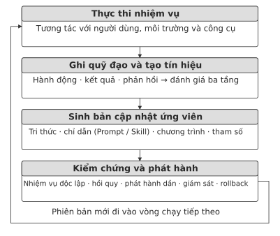
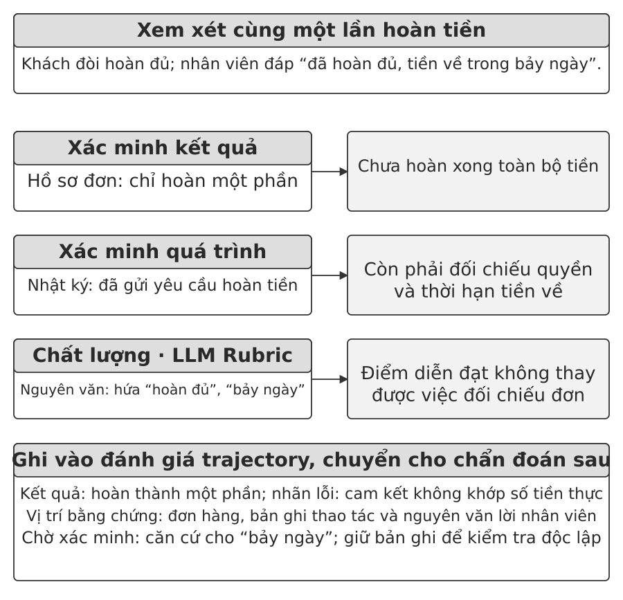
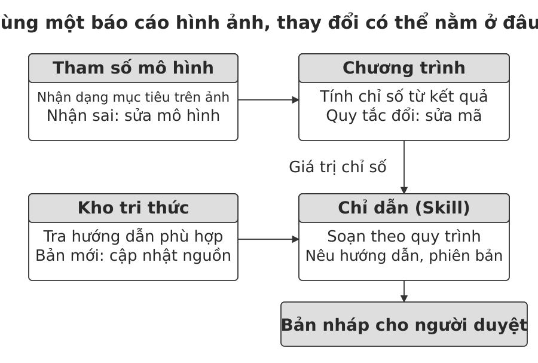
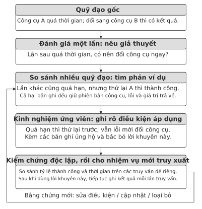
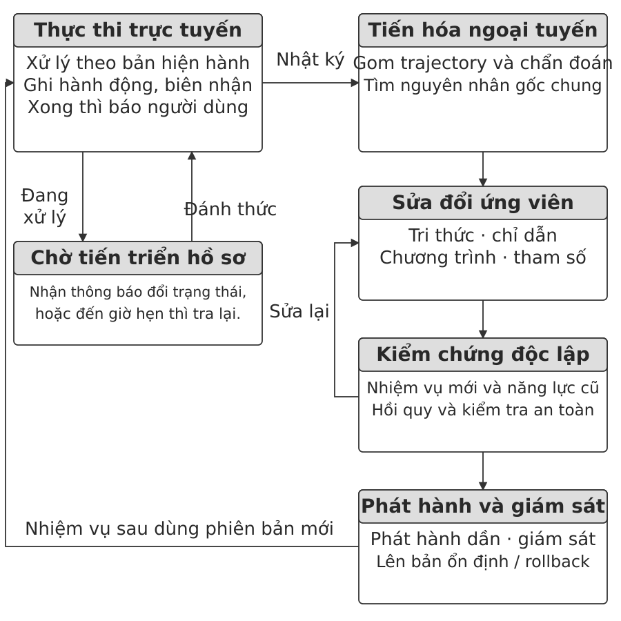

# Sự tiến hóa liên tục của Agent

Một Agent có thể hoàn thành ngay từ lần đầu một nhiệm vụ phức tạp chưa từng gặp, nhưng sau khi xử lý rất nhiều nhiệm vụ tương tự vẫn lặp lại cùng một kiểu lỗi. Muốn nó tiến bộ dần qua công việc hằng ngày như một nhân viên mới, hệ thống phải biến kinh nghiệm vận hành thành năng lực dùng được về sau: ghi lại kết quả, tìm ra nguyên nhân của vấn đề, đề xuất cách cải tiến, rồi kiểm chứng xem cách đó có hiệu quả trên nhiệm vụ mới hay không. **Theo tác giả, học từ kinh nghiệm và tiến hóa liên tục đang trở thành một trong những năng lực quan trọng nhất của Agent.** Năng lực này vừa đòi hỏi công sức kỹ thuật ở tầng hệ thống ứng dụng, vừa đáng là trọng tâm nghiên cứu của thế hệ mô hình tiếp theo.

Thông thường, mô hình đã triển khai giữ nguyên tham số sau mỗi lần suy luận. Học trong ngữ cảnh, duy trì trạng thái và nén ngữ cảnh ở Chương 2 giúp nó điều chỉnh trong phạm vi nhiệm vụ hiện tại; bộ nhớ và kho tri thức ở Chương 3 giúp thông tin được lưu qua nhiều nhiệm vụ. Muốn học từ kinh nghiệm thêm một bước nữa, hệ thống còn phải so sánh nhiều lần chạy: các quỹ đạo thành công có chung những bước nào, quỹ đạo thất bại thiếu gì, một cách làm phù hợp với phiên bản công cụ nào và điều kiện nhiệm vụ nào.

Ví dụ, sau khi lưu một trăm quỹ đạo đặt vé, hệ thống có thể truy xuất một lần trải nghiệm bất kỳ khi cần. Nhưng để rút ra kinh nghiệm như “trước khi đặt vé, kiểm tra hạn chót đăng ký suất ăn đặc biệt”, hệ thống còn phải đối chiếu nguyên nhân của các lần đặt thành công và thất bại, kiểm tra hãng bay và điều kiện thời gian, rồi dùng nhiệm vụ mới để kiểm chứng cách làm này. Ghi chép và truy xuất giúp Agent tìm lại trải nghiệm; đối chiếu, quy nạp và kiểm chứng giúp nó hình thành cách làm có thể tái sử dụng. Qua quá trình tích lũy như vậy, Agent mới dần chuyển từ thông minh sang thành thạo.

**Học liên tục (continual learning)** nghiên cứu cách hệ thống tiếp tục học từ nhiệm vụ mới và dữ liệu mới mà vẫn giữ được năng lực sẵn có. Agent đưa bài toán này vào tương tác hằng ngày: phản hồi đến từ người dùng, công cụ và môi trường, và sự hài lòng của người dùng, việc hoàn thành nhiệm vụ và việc tuân thủ quy trình có thể dẫn tới những kết luận khác nhau. Theo tác giả, một khó khăn lớn của học liên tục ở Agent là công việc hằng ngày hiếm khi có ai đánh dấu đúng sai cho từng bước, nên hệ thống phải tự phán đoán phản hồi nào đáng tin. Phản hồi chưa được kiểm chứng mà bị ghi thành quy tắc hoặc đem đi huấn luyện thì quy kết sai sẽ ảnh hưởng đến các nhiệm vụ sau. Loại lỗi này còn kéo dài: một sở thích bị ghi nhớ sai sẽ ảnh hưởng đến lần đặt vé sau, còn huấn luyện mô hình bằng phản hồi sai có thể khiến cả những nhiệm vụ vốn làm đúng cũng bị làm sai.

Cuốn sách dùng thuật ngữ **tiến hóa liên tục** để chỉ toàn bộ quá trình hệ thống Agent cập nhật từ kinh nghiệm, bao gồm bốn loại vật mang: tri thức, chỉ dẫn, chương trình và tham số mô hình. Việc huấn luyện định kỳ mô hình nền tảng cung cấp năng lực tổng quát; cập nhật kinh nghiệm của Agent thì xử lý quy tắc nghiệp vụ cụ thể, thay đổi của công cụ và chiến lược cục bộ. Những thay đổi cục bộ này diễn ra liên tục, và chờ đến lần huấn luyện mô hình nền tảng tiếp theo thường không kịp với nhu cầu nghiệp vụ.

Ở giai đoạn hiện nay, tác giả chủ trương ưu tiên xây dựng một hệ thống học tập có thể kiểm chứng ở vòng ngoài mô hình: kinh nghiệm diễn đạt được rõ ràng thì tác động lên hành vi về sau qua tri thức, chỉ dẫn và chương trình; tư liệu thích hợp cho việc học tham số thì chuyển sang post-training. Mỗi bản cập nhật đều được đánh giá hồi quy trên phiên bản mới trước, qua được bước kiểm tra phát hành thì các nhiệm vụ sau mới dùng phiên bản đó.

Các chương trước đã giới thiệu những bộ phận chính của hệ thống này: Chương 2 tổ chức trạng thái nhiệm vụ, Chương 3 lưu trữ và truy xuất tri thức, Chương 5 tạo công cụ và sửa đổi hệ thống bằng mã, Chương 7 đánh giá kết quả, Chương 8 cập nhật tham số mô hình. Hình 9-1 nối các bộ phận này lại với nhau. Lần trước quên đặt suất ăn đặc biệt, sau khi được đánh giá, trở thành quy tắc sẽ được dùng ở lần đặt vé tiếp theo.

## Thu nhận tín hiệu học tập từ quỹ đạo vận hành

Những quỹ đạo nào đáng đem ra học? Giả sử nhân viên chăm sóc khách hàng nói với người dùng “đã hoàn tiền xong”, trước hết phải kiểm tra số tiền thực sự đã hoàn là bao nhiêu và thao tác có đúng quy định hay không, rồi mới xem câu trả lời ấy có giúp người dùng hiểu khi nào tiền về tài khoản. Hình 9-2 đặt ba bước kiểm tra này cạnh nhau. Ba phán đoán lần lượt dựa vào hồ sơ đơn hàng, nhật ký hành động và nguyên văn lời nhân viên.

**Xác minh kết quả kiểm tra môi trường đã thay đổi ra sao.** Coding Agent có thể chạy kiểm thử, kiểm tra kiểu và benchmark hiệu năng; Agent hoàn tiền có thể truy vấn trạng thái đơn hàng và số tiền hoàn thực tế. Tác giả thường làm tầng kiểm tra này trước. Mô hình tuyên bố đã hoàn toàn bộ tiền, sổ sách lại chỉ ghi hoàn một phần; có hồ sơ đơn hàng, ta mới biết cần quay lại xem thao tác nào.

**Xác minh quá trình kiểm tra hành động có tuân theo quy tắc của nhiệm vụ hay không.** Kiểm thử đã qua, vẫn phải xem các tệp kiểm thử được bảo vệ có bị sửa không; Agent báo người dùng “tiền sẽ về trong bảy ngày”, vẫn phải đối chiếu xem yêu cầu hoàn tiền đã được gửi chưa và thời hạn ấy có căn cứ hay không. Bảng quyền hạn, chính sách có cấu trúc và nhật ký hành động có thể giao cho chương trình kiểm tra; những điều khoản cần diễn giải theo ngữ cảnh thì phán đoán dựa trên bằng chứng tương ứng.

**Xác minh chất lượng kiểm tra sản phẩm bàn giao có đáp ứng yêu cầu sử dụng hay không.** Lời lẽ của nhân viên có rõ ràng không, phương án thay thế có hợp với mục tiêu của người dùng không, báo cáo nghiên cứu có nắm được bằng chứng then chốt không — tất cả đều ảnh hưởng đến hiệu quả cuối cùng. Có thể dùng LLM-as-a-Judge đã giới thiệu ở Chương 7: định nghĩa trước Rubric (thang đánh giá), để mô hình chấm cho điểm, lý do và bằng chứng theo từng mục.

Bảng 9-1 lấy ví dụ chăm sóc khách hàng, khai triển ba tầng đánh giá thành bảy chiều. Kết quả nhiệm vụ thuộc tầng kết quả; quy tắc, quyền riêng tư và cam kết thuộc tầng quá trình; diễn đạt và linh hoạt thuộc tầng chất lượng; còn độ tin cậy của thông tin thì tùy nội dung mà kiểm chứng theo cách khác nhau. Chẳng hạn, số tiền hoàn có thể đối chiếu thẳng với kết quả công cụ trả về, còn phần giải thích chính sách phải xét cả nguyên văn lẫn điều kiện áp dụng.

Bảng 9-1 Các chiều đánh giá quỹ đạo của Agent chăm sóc khách hàng

| Chiều | Câu hỏi xác minh | Bằng chứng chính |
| --- | --- | --- |
| Kết quả nhiệm vụ | Yêu cầu cốt lõi của người dùng đã được giải quyết chưa | Trạng thái môi trường cuối cùng, kết quả công cụ |
| Tuân thủ quy tắc | Chính sách, quyền hạn và quy trình bắt buộc có được đáp ứng không | Kho chính sách, quỹ đạo hành động |
| Ranh giới quyền riêng tư | Thông tin cung cấp có nằm trong phạm vi được phép không | Văn bản phản hồi, nhật ký truy cập |
| Độ tin cậy thông tin | Phát biểu có được tri thức hoặc kết quả công cụ hỗ trợ không | Nguồn trích dẫn, kết quả công cụ trả về |
| Nhất quán giữa cam kết và hành động | Thao tác được tuyên bố là đã xong có thực sự diễn ra không | Đối chiếu phản hồi với nhật ký thực thi |
| Chất lượng diễn đạt | Có tự nhiên, súc tích, rõ ràng không | Toàn bộ hội thoại, Rubric ngôn ngữ |
| Linh hoạt trong khuôn khổ quy định | Khi phương án ban đầu bị chặn, có tìm được lối thay thế được phép không | Mục tiêu người dùng, chính sách và các hành động tiếp theo |

Để phục vụ việc cập nhật về sau, kết quả đánh giá nên gồm bốn nội dung: trạng thái tổng thể của nhiệm vụ, kết luận cho từng chiều, vị trí bằng chứng ứng với từng kết luận, và loại lỗi. Vị trí bằng chứng có thể trỏ tới một lượt hội thoại hoặc một lần gọi công cụ. Chiều nào thiếu bằng chứng thì đánh dấu là chờ xác nhận, chuyển sang kiểm chứng bổ sung hoặc người duyệt lại.

Ví dụ, kết luận “hoàn tiền thất bại, diễn đạt rõ ràng” chưa đủ để xác định cần cải tiến gì. Bổ sung thêm “lượt 4 gọi giao diện hoàn tiền khi chưa có mã đơn hàng, giao diện từ chối thực hiện; lượt 5 vẫn tuyên bố đã hoàn tiền” thì có thể đề xuất riêng hai thay đổi: kiểm tra tham số và xác minh lời tuyên bố hoàn thành.

> **Thí nghiệm 9-1 ★★: Xây dựng bộ kiểm chứng quỹ đạo cho Agent chăm sóc khách hàng**
>
> Trên cùng một tập quỹ đạo chăm sóc khách hàng, so sánh hai kiểu đầu ra: một kiểu chỉ cho tổng điểm, kiểu kia cho kết luận, bằng chứng và độ tin cậy theo từng chiều. Kiểm tra xem kiểu thứ hai có tách bạch được thất bại nhiệm vụ, vi phạm quy tắc, cam kết sai sự thật và vấn đề diễn đạt hay không, và từ đó đề xuất được các bản cập nhật tương ứng hay không.
>
> Tri thức lỗi thời cần cập nhật tư liệu, thiếu tham số có thể thêm bước kiểm tra trước khi gọi, lời lẽ lặp lại thì có thể cải thiện bằng chỉ dẫn hoặc huấn luyện.

Thí nghiệm 9-1 dùng hồ sơ tài khoản hư cấu để dựng tám quỹ đạo, mỗi loại hai quỹ đạo: hoàn tiền bình thường, cam kết sai sự thật, lộ thông tin riêng tư và từ chối quá mức. Trong `real-normal-refund-01`, nhân viên nói đã hoàn tiền xong, trạng thái đơn hàng cũng chuyển thành `refunded`, số tiền hoàn là 480.

Tám quỹ đạo, mỗi quỹ đạo bảy chiều, 56 phán đoán thì 52 phán đoán trùng với nhãn chuyên gia đặt sẵn trong ca kiểm thử, tỷ lệ nhất trí khoảng 92.9%. Trong bốn chỗ bất đồng còn lại, ba chỗ rơi vào cùng một lần đổi vé. Người dùng yêu cầu đổi tấm vé không hoàn tiền sang ngày 3 tháng 10. Nhân viên xác minh danh tính, tra đơn hàng ba lần, đến lượt 10 thì báo người dùng là đã xử lý. Thế nhưng trạng thái đơn hàng vẫn là `confirmed`, nhật ký gọi công cụ cũng không có thao tác đổi vé nào.

Lúc này nên rà lại ai? Mô hình chấm chiều “linh hoạt trong khuôn khổ quy định” trích câu trả lời ở lượt 10 và cho qua, bỏ sót một phương án thay thế làm được mà không làm. Chương trình chấm chiều “nhất quán giữa cam kết và hành động” thì có báo lỗi, nhưng lý do lại là không tìm thấy lần gọi hoàn tiền thành công. Người dùng muốn đổi vé, thứ cần đối chiếu là bản ghi đổi vé và ngày mới. Nhãn đặt sẵn cho chiều này lại là “đạt”, cũng không khớp với câu trả lời thực tế được sinh ra.

Lần đổi vé này cần sửa ở hai chỗ: nhân viên làm thiếu một bước, còn chương trình chấm điểm lại kiểm tra nhầm công cụ. Chuyển sang đặt vé, những lỗi trông giống nhau cũng có thể xuất phát từ những chỗ khác nhau. Người dùng đã nới ngân sách, trợ lý vẫn lọc theo ngân sách cũ; lần ngược theo quỹ đạo, có thể sở thích mới chưa được lưu, có thể lần này lấy ra sở thích cũ, cũng có thể mô hình đã đọc được ngân sách mới nhưng khi chọn vé lại không dùng đến.

## Bốn phương pháp tiến hóa liên tục của Agent

Tìm ra vấn đề rồi, còn phải quyết định sửa ở đâu. Lấy Agent chẩn đoán hình ảnh y khoa trong Hình 9-3 làm ví dụ: nếu báo cáo trích dẫn hướng dẫn chuyên môn phiên bản cũ, có thể kiểm tra trước xem kho tri thức đang lưu phiên bản nào. Nếu hướng dẫn không sai mà báo cáo lại không nêu nguồn trích dẫn, thì phải quay lại xem chỉ dẫn viết báo cáo. Dù cả hai bản báo cáo đều bị trả lại, chỗ cần kiểm tra khi sửa cũng khác nhau.

Hệ thống chăm sóc khách hàng cũng dùng cả bốn phương pháp cùng lúc. Mô hình đã qua huấn luyện lo phần diễn đạt, kho tri thức lưu chính sách của doanh nghiệp, Skill mô tả cách xử lý khi gặp ngoại lệ, còn mã phía máy chủ kiểm tra quyền hạn và số tiền. Bảng 9-2 liệt kê chi phí và giới hạn cần cân nhắc khi chọn cách cập nhật.

Bảng 9-2 Phạm vi áp dụng của bốn cách tiến hóa liên tục

| Cách cập nhật | Phù hợp để chứa | Ưu điểm kỹ thuật | Vấn đề cần xử lý |
| --- | --- | --- | --- |
| Kho tri thức kinh nghiệm | Sự kiện, kinh nghiệm, ngoại lệ và nguồn | Cập nhật nhanh, truy vết được, truy xuất theo nhu cầu | Chất lượng truy xuất, điều kiện áp dụng và việc mô hình có vận dụng đúng hay không |
| Prompt và Skill | Nguyên tắc phán đoán cần gắn với ngữ cảnh, ngoại lệ và thứ tự ưu tiên | Giải thích được, dễ sửa cục bộ | Độ dài tăng dần, xung đột chỉ dẫn và mức độ tuân theo |
| Chương trình và Harness | Quy trình phân tích được, kiểm chứng thực thi được, quyền hạn và ràng buộc cứng | Kiểm thử được, thực thi ổn định | Phát triển và bảo trì, tương thích giao diện và xử lý ngoại lệ |
| Tham số mô hình | Tri giác, phong cách sinh và các khuôn mẫu ra quyết định ngầm | Tái sử dụng khuôn mẫu đã học, giảm ngữ cảnh lặp lại | Chuẩn bị dữ liệu, chi phí huấn luyện, khả năng khái quát và hiện tượng quên |

Một cải tiến có thể tách thành nhiều bản cập nhật. Tác giả ưu tiên đưa sự kiện chính sách vào kho tri thức, đưa những ràng buộc thực thi chính xác được như kiểm tra quyền hạn vào chương trình; nguyên tắc cần hiểu ngữ cảnh và ngoại lệ thì diễn đạt bằng Skill, còn tri giác nhiều chiều và chiến lược ngầm thì cải thiện bằng huấn luyện.

### Kết tinh kinh nghiệm thành tri thức

Cùng ghi lại một lần đặt vé, có thể giữ lại thông tin ở hai cấp. Một là “hãng bay này yêu cầu đặt suất ăn đặc biệt trước hai mươi bốn giờ”; hai là “trước khi đặt vé, kiểm tra hạn chót đặt suất ăn đặc biệt, tránh trường hợp thanh toán xong mới biết không đáp ứng được”. Điều thứ nhất nên lưu kèm hãng bay, chặng bay áp dụng và nguồn chính sách. Một hãng khác có thể có hạn chót khác, nhưng “kiểm tra hạn chót của chuyến bay lần này trước” vẫn chuyển sang dùng được. Như vậy, khi sự kiện hết hiệu lực thì chỉ cần thay mốc thời gian cụ thể, lần đặt vé sau vẫn dùng được kinh nghiệm kiểm tra này. Cả hai đều có thể lưu bằng các phương pháp lưu trữ, lập chỉ mục và truy xuất ở Chương 3.

Rút ra một kinh nghiệm như vậy từ một lần đặt vé có thể rất rẻ, nhưng không được chép nguyên cả bản ghi đặt vé. Trong bản ghi có nguyên văn chính sách do công cụ trả về, cũng có những đoạn đường vòng của nhiều lần Agent thử. Giả sử một lần truy vấn bị quá thời gian, sau đó đổi sang công cụ khác mới có kết quả; làm theo y hệt thì có thể biến một sự cố ngẫu nhiên thành lý do để đổi công cụ.

Có thể lưu tư liệu thành ba tầng: **quỹ đạo gốc** giữ toàn bộ bằng chứng vận hành, **phân tích từng lần chạy** ghi nguyên nhân thành bại và bản nháp kinh nghiệm, **tài liệu kinh nghiệm chính thức** tổng hợp những cách làm đã được kiểm chứng qua nhiều nhiệm vụ. Quỹ đạo gốc được lưu theo phiên bản, còn phân tích và tri thức thì được chỉnh sửa khi có thêm bằng chứng. Tài liệu chính thức ghi rõ tình huống áp dụng, chiến lược khuyến nghị, cách làm bị cấm, ngoại lệ, nguồn và thời điểm kiểm chứng gần nhất, để thuận tiện cho việc truy xuất và rà soát về sau.

User as Code ở Chương 3 ghi thêm nhật ký sự kiện trước, rồi định kỳ dựng lại mô hình người dùng. Ở đây cũng tách việc ghi chép khỏi việc chỉnh lý. Quay lại lần truy vấn vừa rồi. Giả sử một lần truy vấn khác cũng quá thời gian, nhưng thử lại công cụ cũ thì thành công; lời khuyên “quá thời gian thì đổi công cụ” còn đứng vững không? Hình 9-4 cho thấy cách dùng hai bản ghi này để thảo ra một lời khuyên sát hơn, rồi kiểm chứng nó bằng các truy vấn khác.

Khi dùng lại các phương pháp trích xuất, phân cụm và truy xuất của Chương 3, có thể đặt ví dụ thuận và ví dụ nghịch của cùng một kinh nghiệm cạnh nhau. Hai lần đặt vé có dùng cùng một phiên bản công cụ không? Một lần thành công, một lần thất bại là do thiếu một bước, hay vì điều kiện đặt vé vốn đã khác? Từ bản ghi gốc chỉnh lý thành kinh nghiệm dùng được có thể chia thành năm bước:

1. Lưu quỹ đạo gốc và kết quả môi trường, cố định nhiệm vụ và phiên bản công cụ.
2. Sinh bản phân tích cho mỗi lần chạy, ghi loại nhiệm vụ, năng lực cần có, chiến lược thực tế, lỗi và ngoại lệ.
3. Gom theo họ nhiệm vụ, liệt kê cho mỗi kinh nghiệm những quỹ đạo ủng hộ và bác bỏ nó.
4. Chọn những kinh nghiệm có đủ bằng chứng, viết thành bản nháp mục tri thức.
5. Kiểm thử trên nhiệm vụ mới không tham gia vào quá trình chắt lọc, xem chiến lược khuyến nghị có cải thiện kết quả về sau hay không.

GAIA[^gaia-2023] cung cấp các bài toán nhiều bước gồm tìm kiếm, đọc trang web, xử lý tệp và tính toán; AWorld[^aworld-2025] cung cấp môi trường thực thi Agent, gọi công cụ và ghi quỹ đạo. Kết hợp hai bên, có thể dùng đáp án hoặc trạng thái môi trường để gắn nhãn thành công, thành công một phần và thất bại trước, rồi so sánh lộ trình theo họ nhiệm vụ. Từ bản ghi thành công có thể tìm ra cách làm đáng thử lại; từ bản ghi thất bại có thể thấy trong trường hợp nào không nên làm theo. Nếu nhiệm vụ chỉ hoàn thành một phần, còn có thể đối chiếu từng bước xem bước nào hiệu quả và vấn đề bắt đầu từ đâu.

Reflexion[^reflexion-2023] dùng phản tư bằng ngôn ngữ tự nhiên để hỗ trợ các lần thử sau. Khi đưa cách làm này vào quá trình chắt lọc tri thức, phản tư dùng để nêu giả thuyết nguyên nhân và bản nháp kinh nghiệm, kết quả môi trường dùng để kiểm chứng, đối chiếu giữa các quỹ đạo dùng để xác định điều kiện áp dụng, còn nhiệm vụ mới dùng để kiểm tra khả năng chuyển giao. Bốn loại tư liệu cùng quyết định một kinh nghiệm có được vào kho tri thức chính thức hay không.

[^reflexion-2023]: Shinn, N., et al. *Reflexion: Language Agents with Verbal Reinforcement Learning.* arXiv:2303.11366, 2023.

[^gaia-2023]: Mialon, G., et al. *GAIA: a benchmark for General AI Assistants.* arXiv:2311.12983, 2023.

[^aworld-2025]: Yu, C., et al. *AWorld: Orchestrating the Training Recipe for Agentic AI.* arXiv:2508.20404, 2025.

Quay lại tình huống đặt vé ở Chương 6. Người dùng muốn giá vé trong khoảng 1200 tệ, phải bay ngay trong ngày để dự họp, cuối cùng chấp nhận mức giá 1250 tệ. Trợ lý có thể ghi lại ngân sách ban đầu, giá chốt, mục đích chuyến đi và nguyên văn lời người dùng. Ba lần đặt vé tiếp theo, giá thấp nhất đều đúng bằng 1250 tệ. Nên dùng ký ức này thế nào?

- Tuần sau lại phải kịp một cuộc họp công việc giống thế. Những lần trước người dùng đều sẵn sàng trả thêm vài chục tệ để kịp họp, lần này cũng dặn trợ lý cứ đặt như thường lệ. Trợ lý có thể đặt chuyến này và báo giá vé thực tế.
- Người dùng đưa con đi nghỉ, dặn rõ “cả nhà đi thì tiết kiệm một chút, quá 1200 tệ thì hỏi tôi trước”. Trợ lý có thể gửi phương án 1250 tệ cho người dùng, đồng thời tìm xem ngày trước hoặc ngày sau có chuyến nào trong ngân sách không.
- Sau đó người dùng giải thích: “Lần trước tôi gấp nên mới chịu, thật ra 1250 tệ cũng thấy đắt. Sau này đi công tác mà vượt ngân sách thì cũng hỏi tôi trước.” Lần sau, dù vẫn là người đó đi họp ở cùng thành phố đó, trợ lý cũng nên hỏi trước. Giữ lại bản ghi giao dịch lần ấy, đồng thời ghi yêu cầu mới hơn, rõ ràng hơn này vào sở thích công tác, thì mỗi ký ức đều có chỗ dùng.

Ba đơn hàng này cho thấy các tầng cập nhật. Một câu đính chính của người dùng có thể thay đổi ngay nhiệm vụ hiện tại, và cũng đủ để cập nhật sở thích của chính người đó. Chỉ khi nhiều trường hợp độc lập đều cho thấy trợ lý bỏ qua mục đích chuyến đi, mới đáng đề xuất sửa Skill đặt vé dùng chung, để nó lấy ra những sở thích liên quan khi so sánh giá. Chỉ khi ngân sách và sở thích ghi rõ đều đã được nạp, mà mô hình đổi cách diễn đạt vẫn phán đoán sai, mới đáng thu thập loại trường hợp này để huấn luyện năng lực phán đoán của mô hình.

### Viết kinh nghiệm thành chỉ dẫn

Nếu lần nào cũng đưa đúng tư liệu cho trợ lý mà nó vẫn sai ở cùng một khâu, trong khi người có kinh nghiệm có thể mô tả cách phán đoán bằng một câu, thì có thể thử viết một chỉ dẫn. Tài liệu kinh nghiệm để trợ lý tham khảo, system prompt diễn đạt yêu cầu hành vi chung cho mọi nhiệm vụ, Skill nạp quy trình cục bộ theo lĩnh vực hoặc công cụ, còn các ràng buộc cứng như quyền hạn thì do Harness thực thi. Đặt thay đổi vào đúng chỗ sẽ quyết định những nhiệm vụ nào về sau chịu ảnh hưởng.

Andrej Karpathy dùng khái niệm **học qua system prompt (System Prompt Learning)** để mô tả một cách cập nhật kinh nghiệm: sau khi gặp vấn đề, mô hình viết ra một lời nhắc để dùng cho các nhiệm vụ sau.[^karpathy-system-prompt-learning] DSPy[^dspy-2023] tối ưu chỉ dẫn và ví dụ trên tập phát triển, OPRO[^opro-2023] dựa vào các prompt đã thử cùng điểm số của chúng để thảo prompt mới, GEPA[^gepa-2025] dùng phản hồi từ quỹ đạo để đề xuất và sàng lọc các thay đổi prompt. Các phương pháp này đều viết lại chỉ dẫn dựa trên kết quả chạy, rồi dùng nhiệm vụ phát triển để so sánh phiên bản cũ và mới, phù hợp cho tối ưu ngoại tuyến theo lô.

Trong cập nhật ở môi trường sản xuất, tác giả ưu tiên diff nhỏ nhất kèm nguồn, giữ lại trường hợp khởi phát, lý do sửa và phiên bản cũ. Bản vá cục bộ ít làm xáo trộn các quy tắc sẵn có, cũng dễ rút lại riêng một thay đổi khi chất lượng giảm sút.

Làm sao biết chỉ dẫn mới thật sự sửa được lỗi lần trước? Giả sử người dùng chỉ vào một bức thư khách hàng bị lưu trữ nhầm và nói: “Đây là khách hàng đang trả lời tôi, sao cũng bị coi là bản tin?” Trợ lý email mã nguồn mở Inbox Zero có một công cụ chạy thử. Sau khi sửa quy tắc, trợ lý có thể dùng ID email để lấy lại bức thư gốc, phán đoán lại theo các quy tắc đang bật của tài khoản đó, xem quy tắc nào sẽ khớp, vì sao khớp, định gắn nhãn gì hoặc chuyển vào thư mục nào. Bước này chỉ xem các hành động dự kiến, hộp thư giữ nguyên, cũng không sinh bản nháp trả lời.[^ch9-inboxzero] Giờ chọn thêm một bản tin thật để thử: thư của khách hàng ở lại hộp thư đến, bản tin vẫn được lưu trữ như thường, hai bức thư cùng cho thấy lần sửa này có giữ được ranh giới phân loại vốn có hay không.

[^ch9-inboxzero]: `test-rules-on-email-tool.ts` của dự án Inbox Zero hiện thực công cụ chạy thử quy tắc trên một email được chỉ định.

#### Ví dụ 1: làm rõ ranh giới giữa chuyển tiếp và sử dụng công cụ

Chính sách telecom của τ²-bench quy định: khi yêu cầu vượt quá phạm vi hành động của Agent thì chuyển sang nhân viên, nhưng trước khi chuyển phải cố gắng giải quyết. Trong 20 bài dùng để chắt lọc quy tắc, mô hình yếu hơn chỉ qua được 1 bài. 19 bài còn lại thất bại thế nào? 17 bài đã gọi công cụ chuyển sang nhân viên, 2 bài khác chạy mãi đến giới hạn số bước.

Đưa 19 quỹ đạo thất bại này cho mô hình, yêu cầu nó quy nạp quy tắc và nối vào cuối chính sách gốc. Trên cùng 114 bài mới, chỉ dùng chính sách gốc thì qua 14 bài (12.3%); thêm quy tắc phiên bản một thì qua 20 bài, thêm quy tắc phiên bản hai thì qua 22 bài (19.3%). Đối chiếu từng bài, phiên bản hai giữ được 14 bài vốn đã qua, và làm đúng thêm 8 bài. Rốt cuộc hai phiên bản quy tắc đã giúp gì cho nhân viên chăm sóc khách hàng?

**Tư liệu đầu vào quyết định nội dung quy tắc.** Khi chỉ đưa văn bản lỗi và tóm tắt thất bại, mô hình quy nạp ra “dừng gọi khi cùng một công cụ liên tục báo lỗi”. Ở lần chắt lọc thứ hai, mô hình còn thấy danh sách công cụ riêng của nhân viên và của người dùng, prompt cũng đề nghị nó cân nhắc “bước này nên do ai làm”. Lần này quy tắc sinh ra phân công rõ ràng: các thao tác trên thiết bị như trạng thái mạng, thẻ SIM và APN cần hướng dẫn người dùng tự làm. Đến đây, kinh nghiệm đã chuyển từ một lời nhắc thử lại chung chung thành quy tắc phân công cho từng thao tác cụ thể.

**Quy nạp còn cần đối chiếu với chính sách và kết quả.** Trong các quy tắc được nối thêm ở phiên bản một có hai điều: “ba lần gọi liên tiếp thất bại thì chuyển” và “người dùng hai lần không cung cấp số điện thoại thì chuyển”. Chạy theo phiên bản này, cả 114 bài chuyển giao đều từng xảy ra chuyển sang nhân viên, trong đó chỉ 20 bài qua. Hai quy tắc ấy đã học luôn cả thói chuyển giao quá sớm.

Một quỹ đạo cho thấy rõ khác biệt trước và sau khi sửa. Người dùng nói điện thoại không có sóng. Nhân viên ở bản cơ sở điền câu “xin vui lòng cung cấp số điện thoại chính xác của quý khách” vào trường số điện thoại, tra liền năm lần đều báo lỗi, rồi chuyển sang nhân viên. Khi dùng quy tắc phiên bản hai, lần truy vấn đầu tiên nhân viên vẫn bỏ sót số điện thoại, nhưng lần này nó quay sang hỏi người dùng trong cuộc hội thoại, có số rồi thì tra được tài khoản. Tiếp theo nó thử kiểm tra thẻ SIM, công cụ báo không tìm thấy thao tác này, nhân viên bèn đề nghị người dùng tháo ra cắm lại thẻ SIM. Người dùng làm theo, lại tắt chế độ máy bay trên điện thoại, bài này mới qua. Xem tiếp bảy bài khác mà phiên bản hai làm đúng hơn bản cơ sở: chỉ một bài không chuyển sang nhân viên, sáu bài còn lại đều từng gọi công cụ chuyển sang nhân viên. Có thể thấy, nếu lấy “không chuyển sang nhân viên” làm tiêu chuẩn đạt thì sẽ bỏ sót đúng sáu bài này. Có nên chuyển hay không phải xét nhân viên còn làm được gì, và nhiệm vụ yêu cầu nó làm đến bước nào.

> **Thí nghiệm 9-2 ★★: Chắt lọc quy tắc chuyển tiếp và sử dụng công cụ từ quỹ đạo thất bại của τ²-bench**
>
> Dùng lại môi trường telecom ở Chương 7, tách riêng tập chắt lọc và tập chuyển giao. Trước tiên chạy mô hình yếu hơn để thu thập quỹ đạo thất bại, rồi để mô hình sinh quy tắc và nối vào chính sách gốc. Trên tập chuyển giao, so sánh phiên bản gốc với hai phiên bản đã tiến hóa; ba nhóm chỉ thay tệp chính sách, giữ nguyên bộ mô phỏng người dùng.
>
> Bản cơ sở có 104 bài từng xảy ra chuyển sang nhân viên, phiên bản hai có 111 bài; một bài chỉ cần chuyển một lần là được tính. Gọi nhầm công cụ phía người dùng thì tính theo số lần gọi, giảm từ 1049 lần xuống 163 lần. Một chỉ số khác đếm số lần gọi mà trong tham số có ít nhất một giá trị là chuỗi rỗng, giảm từ 904 lần xuống 174 lần; những lần gọi hoàn toàn không truyền tham số không được tính vào chỉ số này. Mỗi chiến lược chỉ chạy một lần trên mỗi bài.

Chăm sóc khách hàng hàng không cũng gặp chuyện chuyển giao quá sớm. Sau khi người dùng phản đối phí hủy vé, phí đổi vé hoặc chính sách hành lý, Agent nên tra cứu và giải thích theo chính sách áp dụng, đồng thời tìm phương án thay thế được phép. Trong các quy tắc dùng ở thí nghiệm dưới đây, tranh chấp chính sách thông thường vẫn do Agent xử lý; chỉ khi người dùng yêu cầu rõ ràng gặp nhân viên hoặc xảy ra tình huống an toàn được chỉ định thì mới gọi `transfer_to_human` để chuyển.

> **Thí nghiệm 9-3 ★★: Tối ưu system prompt của Agent chăm sóc khách hàng hàng không dựa trên quỹ đạo thất bại**
>
> Phân tích các quỹ đạo chuyển giao quá sớm theo ba chiều: tuân thủ quy tắc, giải quyết nhiệm vụ và linh hoạt trong khuôn khổ quy định, rồi sinh bản vá prompt có kèm nguồn. Đặt phiên bản chắt lọc tự động cạnh phiên bản ban đầu và phiên bản tinh chỉnh thủ công trong cùng điều kiện để so sánh.
>
> Có thêm năm bài để kiểm tra năng lực vốn có: ba bài yêu cầu nhân viên tự xử lý, hai bài yêu cầu chuyển sang nhân viên; cả ba phiên bản chỉ dẫn đều đạt 5/5. Trên năm bài chuyển giao quá sớm dùng để chắt lọc bản vá, cùng một mô hình giám khảo chấm bản ban đầu, bản tự động và bản tinh chỉnh thủ công lần lượt qua 0, 2 và 4 bài. Bản tự động sửa được hai bài: hoàn vé giá rẻ và hành lý quá cước. Chương trình dựa vào đó đưa ra quyết định cho phép dùng thử trong phạm vi nhỏ.
>
> Có một điểm đáng bàn. Hành khách yêu cầu miễn khoản phí đổi vé 200 tệ, bản tinh chỉnh thủ công lại đi giải thích vé giá rẻ có được hoàn hay không. Giám khảo chấp nhận gợi ý “hoàn lại thuế phí” và cho qua; còn khoản phí đổi vé mà hành khách hỏi thì nhân viên từ đầu đến cuối không hề giải thích.

#### Ví dụ 2: cải tiến Skill làm rõ yêu cầu dựa trên phản hồi người dùng

Skill làm rõ yêu cầu hiện có có thể quy định khi nào đặt câu hỏi, hỏi những gì và khi nào bắt đầu thực hiện. Khi phản hồi của người dùng tích lũy dần, hệ thống cần điều chỉnh các điều kiện phán đoán này để lợi ích của việc làm rõ tương xứng với cái giá của việc làm phiền.

Ví dụ, người dùng nói “sửa trang đăng nhập để hỗ trợ đăng nhập doanh nghiệp”; trước khi làm có thể cần xác định nhà cung cấp danh tính, cách dự phòng, khả năng tương thích với người dùng cũ và phạm vi triển khai. Ngược lại, sửa một lỗi chính tả thường có thể làm ngay. Hỏi quá ít thì các lựa chọn then chốt bị dồn đến sau khi bàn giao mới phải làm lại; hỏi quá nhiều thì một thay đổi đơn giản cũng bị kéo thành một buổi phỏng vấn dài. Skill nên chọn quy trình theo mức độ mơ hồ, rủi ro và chi phí làm lại.

Một quy trình ban đầu có thể tổ chức như sau: thay đổi nhỏ, rủi ro thấp, dễ hoàn tác thì nêu các giả định cần thiết rồi thực hiện; khi liên quan đến kiến trúc, dữ liệu, quyền hạn, giao diện công khai hoặc thay đổi trên diện rộng thì gom lại hỏi một số ít câu hỏi có thể làm thay đổi phương án. Sau đó lập một bản Spec hoặc Plan ngắn gọn, liệt kê mục tiêu, phi mục tiêu, đánh đổi, giả định và tiêu chí nghiệm thu. Những điểm cần xác nhận có câu trả lời rồi thì tiếp tục; nếu trong lúc thực hiện phát hiện tiền đề thay đổi, thì xác định các quyết định bị ảnh hưởng và xác nhận bổ sung.

Để cải tiến quy trình này, cần ghi lại nhiệm vụ, câu hỏi làm rõ, các phiên bản Spec, chỉnh sửa của người dùng, kết quả bàn giao và việc làm lại. Người dùng nói “không giống tôi hình dung”, thì kiểm tra điều kiện nào bị bỏ sót; người dùng nói “anh hỏi nhiều quá”, thì kiểm tra câu trả lời cho những câu hỏi ấy có ảnh hưởng đến phương án hay không.

Khi nhiều nhiệm vụ xác thực liên tục bỏ sót yêu cầu tương thích với cách đăng nhập cũ, có thể bổ sung vào Skill điều kiện “xác nhận nhà cung cấp danh tính, đường dự phòng và phạm vi tương thích”. Khi rất nhiều bản sửa lỗi chính tả bị chậm trễ vì phải hỏi, thì nên thu hẹp phạm vi kích hoạt quy trình làm rõ.

Đây cũng là chỗ thể hiện sự phân công giữa Skill và Harness. Skill hướng dẫn mô hình hiểu ngữ cảnh, đặt câu hỏi và sắp xếp phương án; Harness dựa vào quy tắc dự án để chặn thao tác khi một lần ghi rủi ro cao thiếu sự cho phép cần thiết, khi sửa trực tiếp nhánh được bảo vệ hoặc khi bỏ qua quy trình phát hành. Phán đoán về nội dung yêu cầu vẫn do mô hình kết hợp với đầu vào của người dùng thực hiện. Các quỹ đạo hội thoại đã được kiểm chứng còn có thể trở thành dữ liệu huấn luyện như giới thiệu ở Chương 8.

> **Thí nghiệm 9-4 ★★: Tiến hóa Skill làm rõ yêu cầu và xác nhận Spec từ phản hồi người dùng**
>
> Đây là bài tập tự thiết kế phép đối chứng. Có thể chuẩn bị trước hai nhiệm vụ: sửa lỗi chính tả trên nút đăng nhập, và thêm đăng nhập doanh nghiệp cho cùng trang đó. Nhiệm vụ đầu có thể viết thẳng ra điều kiện nghiệm thu; nhiệm vụ sau có thể phải hỏi rõ nhà cung cấp danh tính trước. Thêm vào đó các nhiệm vụ liên quan đến kiến trúc, quyền hạn, dữ liệu hoặc giao diện công khai, rồi lần lượt thử ba quy trình: thực hiện ngay, làm rõ rồi thực hiện, xác nhận Spec rồi thực hiện. Ghi lại câu trả lời của người dùng, các chỉnh sửa Spec, kết quả bàn giao và phản hồi về việc làm lại, từ đó sinh bản cập nhật cục bộ cho Skill.

[^dspy-2023]: Khattab, O., et al. *DSPy: Compiling Declarative Language Model Calls into Self-Improving Pipelines.* arXiv:2310.03714, 2023.

[^opro-2023]: Yang, C., et al. *Large Language Models as Optimizers.* arXiv:2309.03409, 2023.

[^gepa-2025]: Agrawal, L., et al. *GEPA: Reflective Prompt Evolution Can Outperform Reinforcement Learning.* arXiv:2507.19457, 2025.

[^karpathy-system-prompt-learning]: Karpathy, A. “We’re missing (at least one) major paradigm for LLM learning … system prompt learning?” X, May 11, 2025.

### Viết kinh nghiệm thành chương trình

Những thao tác ổn định, lặp lại và kiểm chứng được có thể dựa vào kinh nghiệm vận hành mà viết thành workflow, công cụ hoặc mã Harness. Tác giả khuyên ưu tiên chuyển loại thao tác này thành chương trình: khi mô hình đã dò ra một lộ trình khả thi, các nhiệm vụ sau có thể dùng lại lộ trình ấy, bớt được chi phí đọc đi đọc lại hướng dẫn, hiểu trang web và quyết định bước tiếp theo. Chương 5 đã giới thiệu năng lực đọc ghi tệp, chạy kiểm thử và sinh công cụ; mục này dùng tiếp các năng lực đó cho quy trình cập nhật “chẩn đoán thất bại — sửa mã — kiểm chứng hồi quy”.

Thay đổi có thể nằm ở nhiều tầng. Tầng thao tác sinh workflow có tham số hoặc bộ chuyển đổi API; tầng điều khiển điều chỉnh định tuyến công cụ, thử lại, ngắt mạch và nén ngữ cảnh; tầng kiểm chứng thêm kiểm tra tham số, khẳng định trạng thái và ca kiểm thử hồi quy; còn tầng kiến trúc điều chỉnh luồng thông tin giữa lập kế hoạch, thực thi và Reviewer.

Lấy việc gửi email làm ví dụ: lần đầu, Agent đa phương thức tìm ra các điều khiển như “Soạn thư, Người nhận, Chủ đề, Nội dung, Gửi” qua quan sát và hành động. Lần sau, nhiệm vụ thường chỉ đổi người nhận và nội dung, có thể dùng lại quy trình thao tác giống như macro trong bảng tính. Hệ thống chuyển quỹ đạo khám phá thành chương trình, ghi lại tham số, các bước kiểm tra trạng thái và phiên bản áp dụng.

Vòng đời của một workflow trình duyệt có thể chia thành sáu bước:

1. **Ghi lại quỹ đạo.** Ghi các thao tác điều hướng, nhấp chuột, nhập liệu và chọn trong danh sách thả xuống, lưu tham số hành động, URL trang, cùng thông tin định vị như XPath, CSS. Những thông tin này dùng để tìm lại phần tử về sau.
2. **Trích tham số.** Đổi người nhận, chủ đề và nội dung cụ thể thành các biến như `{recipient}`, `{subject}`, `{content}`, giữ lại các hành động ổn định. Ví dụ, `test@example.com` nhập ở lần đầu trở thành một giá trị của tham số người nhận.
3. **Thêm kiểm tra trạng thái.** Trước khi thực hiện, xác nhận nút đã hiển thị và các trường bắt buộc đầy đủ; sau khi thực hiện, kiểm tra trang có thay đổi; khi kết thúc nhiệm vụ, đọc trạng thái thật của trang hoặc của backend để xác nhận email đã được gửi.
4. **Phát lại độc lập.** Khôi phục tài khoản sandbox hoặc trang thử nghiệm về một trạng thái ban đầu mới, chạy trọn chương trình, kiểm tra điều kiện từng bước và kết quả cuối cùng.
5. **Khớp nhiệm vụ mới.** Tìm workflow trong thư viện năng lực theo ý định và từ khóa, trích tham số cho lần này rồi giao cho Playwright thực thi. Chương trình lo việc chờ phần tử và kiểm tra trạng thái; khi phát lại bình thường thì không cần gọi LLM ở từng bước.
6. **Xử lý khi hỏng.** Khi định vị phần tử không còn đúng, kiểm tra trạng thái thất bại, API schema thay đổi hoặc kết quả cuối bất thường, dừng lần phát lại hiện tại, trước hết đối chiếu xem những thao tác nào đã xong, rồi để quy trình Agent đầy đủ khám phá lại từ trạng thái hiện tại và viết các bước mới đã chạy thông thành script. Nếu email đã được gửi mà trang chưa kịp hiển thị kết quả, phải truy vấn trạng thái gửi trước, tránh phát lại từ đầu gây gửi trùng.

Cách làm này tiết kiệm được bao nhiêu thời gian tùy vào việc ban đầu có bao nhiêu thời gian dành cho phán đoán của mô hình. Thí nghiệm nhiệm vụ lặp lại của PreAct báo cáo tốc độ đầu cuối tăng từ 8.5 đến 13 lần; ví dụ email cục bộ dưới đây bỏ được toàn bộ lần gọi mô hình, nhưng bản thân trình duyệt vẫn phải chờ trang phản hồi.[^preact]

> **Thí nghiệm 9-5 ★★★: Sinh workflow kiểm chứng được từ quỹ đạo trình duyệt**
>
> Từ quỹ đạo thành công, sinh workflow có tham số và bước kiểm tra trạng thái, so sánh với bản cơ sở khám phá lại mỗi lần về tỷ lệ hoàn thành, số lần gọi mô hình và thời gian. Sau đó thay đổi cấu trúc trang hoặc dựng trạng thái nhấp chuột thành công nhưng nhiệm vụ chưa được gửi đi, kiểm tra xem chương trình có phát hiện chỗ hỏng và lùi về được không.
>
> Trong lần thí nghiệm trên trang email cục bộ này, lần khám phá đầu gọi mô hình 4 lần, phát lại có tham số gọi 0 lần, thời gian lần lượt khoảng 5.31 giây và 4.45 giây. Khi phát lại còn gặp hai loại sự cố: nội dung trống thì máy chủ từ chối gửi; trong một trường hợp khác, yêu cầu được chấp nhận nhưng thư lại không được lưu. Phiên bản chỉ kiểm tra “thao tác nhấp đã thực hiện” cả hai lần đều báo thành công nhầm, còn phiên bản kiểm tra trạng thái sau khi gửi cả hai lần đều nhận ra thất bại.

**Sửa mã trên một nhánh độc lập trước.** Tạo nhánh cách ly từ phiên bản ổn định hiện tại, để Coding Agent sinh bản vá cục bộ, lần lượt chạy kiểm tra tĩnh liên quan đến thay đổi, kiểm thử đơn vị, kiểm tra an toàn, phát lại quỹ đạo thất bại và hồi quy trên nhiệm vụ cũ, rồi mới vào phát hành thử dần (gray release). Hệ thống đang chạy tiếp tục dùng phiên bản ổn định, bản vá qua hết các bước kiểm tra mới được chuyển sang.

Git worktree và Pull Request có thể gánh quy trình này. Skill hướng dẫn mô hình tạo không gian làm việc độc lập, làm rõ yêu cầu, hoàn thành hiện thực và kiểm thử, đồng thời trong PR nêu rõ vấn đề, thay đổi, những tình huống đã kiểm chứng, và còn những rủi ro nào cần người tiếp nhận kiểm tra. Harness thì thực thi các ràng buộc của dự án, chẳng hạn bảo vệ `main`, kiểm tra trạng thái review bắt buộc, và xác nhận đủ sản phẩm phát hành trước khi bàn giao.

Để phán đoán một thay đổi cụ thể ảnh hưởng thế nào đến kết quả, mỗi thay đổi nên kèm một bản thuyết minh kiểm chứng được: bằng chứng thất bại, nguyên nhân gốc suy đoán, các thành phần liên quan, bản vá dự định gửi, lỗi cần sửa, hành vi vốn đã đúng, và các ca kiểm thử kiểm chứng riêng từng thứ. Agentic Harness Engineering tổ chức thông tin liên quan thành observability ba tầng gồm thành phần, kinh nghiệm và quyết định: thành phần được lưu dưới dạng tệp và có thể chỉnh sửa, quỹ đạo được chỉnh lý thành bằng chứng xem được theo từng tầng, trước khi sửa phải khai báo ảnh hưởng dự kiến, rồi dùng kết quả sau đó để kiểm chứng.[^ahe-2026]

Khi nhờ mô hình thảo phương án sửa đổi, tác giả cung cấp cùng lúc quỹ đạo thành công và những phương án từng bị từ chối. Self-Harness dùng các thông tin này để khoanh vùng hướng tìm kiếm: bản ghi thành công cho mô hình biết cách làm nào vốn đã đúng, các lần thử trước cho biết thay đổi nào đã thất bại.[^self-harness-2026] Nếu chỉ đưa trường hợp thất bại, mô hình có thể mở rộng phạm vi sửa, phá vỡ hành vi vốn đúng; thiếu bản ghi các phương án bị từ chối, nó lại có thể đề xuất mãi cùng một hướng vô hiệu.

Công cụ mới cũng có thể ra đời từ kiểu cập nhật xuất phát từ nhu cầu như thế. Một nhiệm vụ của Alita[^alita-2025] yêu cầu: trong video YouTube 360 VR do diễn viên lồng tiếng Gollum của *Chúa tể những chiếc nhẫn* thuyết minh, tìm con số được nhắc tới ngay sau lần đầu khủng long xuất hiện. Agent nhận ra mình thiếu khả năng đọc phụ đề, bèn tìm và thử `youtube-transcript-api`, đóng gói thành công cụ phụ đề, cuối cùng ra kết quả `100000000`.

> **Thí nghiệm 9-6 ★★★: Quỹ đạo thất bại kích hoạt Agent tự sửa đổi**
>
> Với vấn đề công cụ đã trả về lỗi không thể thử lại mà vẫn bị gọi đi gọi lại, so sánh hai cách sửa: lời nhắc trong Prompt và chính sách thử lại bằng chương trình. Chương trình sau khi sửa quyết định thử lại, dừng hay ngắt mạch theo loại lỗi, rồi phát lại quỹ đạo thất bại để kiểm tra vấn đề mục tiêu, dùng nhiệm vụ có sự cố tạm thời để kiểm tra khả năng phục hồi. Khi loại lỗi và điều kiện thử lại đã có thể xác định chính xác, tác giả nghiêng về viết ràng buộc này vào chương trình, để mọi lần gọi theo cùng một quy tắc, đồng thời bớt gánh nặng mô hình phải hiểu đi hiểu lại lời nhắc.
>
> Agent phụ trách cập nhật gửi bản vá trong phiên bản cách ly, các bước kiểm thử và quy trình phát hành bên ngoài quyết định có dùng hay không. Bộ kiểm chứng, ca kiểm thử nghiệm thu và phiên bản ổn định được bảo vệ bằng quyền hạn độc lập; bản ghi rollback giữ lại căn cứ hành vi trước và sau thay đổi.

Bản thân logic kiểm chứng cũng có thể được cải tiến. Ví dụ, nhiều lần người dùng đính chính và các đợt rà soát phát hiện lời gọi rủi ro cao thiếu bước xác nhận, thì có thể thêm kiểm tra trước khi gọi. Ở đây cần phân biệt thành phần kiểm chứng nghiệp vụ với cơ chế độc lập quyết định một bản cập nhật có được phát hành hay không: cái trước có thể sửa cùng mã nghiệp vụ, cái sau do quyền kiểm thử, rà soát và phát hành độc lập quản lý. Bước kiểm tra mới vừa phải bao được rủi ro mục tiêu, vừa phải để các nhiệm vụ bình thường đã được cấp quyền tiếp tục chạy.

> **Thí nghiệm 9-7 ★★: Phản hồi người dùng kích hoạt cổng xác nhận cho thao tác rủi ro cao**
>
> Từ đính chính của người dùng và rà soát sau sự việc, chắt lọc các trường hợp thiếu xác nhận, thảo một quy tắc kiểm tra quyền trước khi gọi công cụ. Nhóm kiểm thử thứ nhất là các thao tác rủi ro cao chưa được xác nhận, nhóm thứ hai là các thao tác bình thường đã được cấp quyền hoặc không cần xác nhận.
>
> Nhóm thứ nhất đo quy tắc mới chặn sót bao nhiêu thao tác, nhóm thứ hai đo nó chặn nhầm bao nhiêu. Thay đổi có được phát hành hay không tùy vào kết quả kiểm thử độc lập và quy tắc phát hành. Agent viết quy tắc kiểm tra chỉ được sửa những thành phần đã thỏa thuận; ca kiểm thử nghiệm thu, quy tắc phê duyệt và bản sao lưu phiên bản ổn định được cơ chế bên ngoài bảo vệ.

[^preact]: Li, Bojie. *PreAct: Computer-Using Agents that Get Faster on Repeated Tasks.* arXiv:2606.17929, 2026.

[^alita-2025]: Qiu, J., et al. *Alita: Generalist Agent Enabling Scalable Agentic Reasoning with Minimal Predefinition and Maximal Self-Evolution.* arXiv:2505.20286, 2025.

#### Trường hợp: cập nhật kiểu plugin của DeepSeek Harness

DeepSeek Harness (`dsh`) dùng kiến trúc “mọi thứ đều là plugin”, cơ chế kết hợp ở tầng dưới do Cordis cung cấp.[^dsh-2026] Bộ chuyển đổi mô hình, sổ đăng ký công cụ, nhật ký phiên và vòng lặp chính của Agent đều có thể cấu hình và thay thế như plugin. Từ đó, tiến hóa liên tục đặt ra một bài toán phần mềm cụ thể: khi thành phần thay đổi trong lúc chạy, làm thế nào dọn dẹp tài nguyên cũ, và để các thành phần khác phụ thuộc vào nó tiếp tục hoạt động đúng?

Cordis chia bài toán này thành hai chiều. **Khả năng kết hợp theo thời gian (temporal composability)** quan tâm đến việc phục hồi sau khi gỡ thành phần: cấp phát tài nguyên, đăng ký sự kiện và sửa đổi ngữ cảnh đều cần có quá trình hoàn tác tương ứng. **Khả năng kết hợp theo không gian (spatial composability)** quan tâm đến quan hệ phụ thuộc: thành phần khai báo mình cần những dịch vụ nào, và runtime điều phối việc kích hoạt hay vô hiệu hóa khi phụ thuộc xuất hiện, biến mất hoặc thay đổi.[^cordis-2026]

Ví dụ, một plugin công cụ đăng ký trình lắng nghe sự kiện, lại phụ thuộc vào một dịch vụ mô hình. Khi thay plugin, cần gỡ trình lắng nghe cũ, tránh để một sự kiện bị xử lý hai lần; khi dịch vụ mô hình tạm thời không dùng được, thành phần phụ thuộc cần dừng phần việc liên quan, dịch vụ phục hồi thì kích hoạt lại. Vấn đề thứ nhất thuộc vòng đời của tài nguyên và hiệu ứng phụ, vấn đề thứ hai thuộc vòng đời của phụ thuộc.

Khi không có cơ chế thống nhất, mỗi thành phần chỉ có thể tự lo việc nạp, gỡ và xử lý thay đổi phụ thuộc, và một lần thay thế cục bộ cũng có thể làm hỏng bên gọi. Nếu mỗi lần cập nhật đều phải khởi động lại cả tiến trình, các nhiệm vụ đang chạy còn bị gián đoạn, và việc khôi phục trạng thái cũng nặng thêm.

Cordis dùng **hiệu ứng hoàn tác được (revertible effects)** để mô tả các phép biến đổi ngữ cảnh có phép nghịch đảo, do runtime lưu giữ và thực hiện việc dọn dẹp; dùng **đồng hiệu ứng phản ứng (reactive coeffects)** để mô tả yêu cầu của thành phần đối với môi trường, điều phối trạng thái thành phần theo thay đổi của ngữ cảnh. Một cơ chế ngữ cảnh thống nhất còn điều phối thêm tương tác giữa nhiều thành phần khi chúng chạy đan xen.[^cordis-2026]

Thiết kế này giảm sự lệ thuộc của cập nhật cục bộ vào việc khởi động lại toàn hệ thống. Theo tác giả, khả năng kết hợp ảnh hưởng trực tiếp đến việc hệ thống có tiếp nhận được tự sửa đổi liên tục hay không: mô hình viết ra bản vá đúng rồi, runtime còn phải hoàn tất việc nạp gỡ, điều phối phụ thuộc và khôi phục nhiệm vụ.

Plugin hóa còn phải đi cùng quyền hạn và quy trình phát hành. Bộ chạy động của `dsh` quản lý các plugin trong tiến trình cùng phiên bản, việc khởi động, dừng và cấp quyền của chúng; plugin bền vững được duy trì qua một quy trình quản lý cài đặt riêng.[^dsh-2026]

Cập nhật plugin cũng ảnh hưởng đến chi phí ngữ cảnh. Khi định nghĩa công cụ hoặc đoạn prompt thay đổi, phần chung giữa các yêu cầu tiếp theo và tiền tố đã có trong cache có thể bị rút ngắn.

[^dsh-2026]: DeepSeek AI, *DeepSeek Harness*, 2026. Thành phần plugin xem phần mô tả kiến trúc; sự phân công giữa bộ chạy động và plugin bền vững xem phần mô tả mở rộng. Dự án phát hành vào tháng 8 năm 2026; mục này bàn về thiết kế plugin hóa ở giai đoạn bản xem trước dành cho nhà phát triển.

[^cordis-2026]: Shi, Yifan, Wei Zhang, and Tianyi Cui. *A Programming Paradigm for Spatiotemporal Composability*, 2026, arXiv:2608.25512.

### Ghi kinh nghiệm vào tham số

Tri thức, chỉ dẫn và chương trình giỏi chứa đựng những thông tin và quy tắc diễn đạt được rõ ràng. Còn các mẫu thị giác trong hình ảnh y khoa, ngữ điệu giọng nói tự nhiên, phong cách ngôn ngữ và thói quen ra quyết định dài hạn thì dựa vào biểu diễn mà mô hình học được từ lượng lớn mẫu. Với những năng lực khó viết trọn thành quy tắc như vậy, tác giả chuyển kinh nghiệm liên quan thành tư liệu huấn luyện, thông qua cập nhật tham số để hình thành các mẫu nhận dạng và ra quyết định có thể tái sử dụng. Thêm vài lời nhắc bằng chữ nữa thường khó bao quát hết các biến thể của chúng.

Một nhiệm vụ cũng có thể cần nhiều loại vật mang cùng lúc. Khi chỉnh dấu ngoặc kép trong văn bản tiếng Trung, bộ phân tích cú pháp nhận diện ranh giới ngữ pháp của tài liệu, Skill mô tả nguyên tắc chỉnh sửa và ngoại lệ, còn huấn luyện tham số cải thiện việc phán đoán phạm vi xuyên nhiệm vụ. Dịch chuyển phân phối hình ảnh do thay đổi thiết bị có thể thích ứng bằng LoRA hoặc các phương pháp fine-tuning khác, phong cách ngôn ngữ cũng có thể cập nhật qua huấn luyện sở thích định kỳ. Độ ổn định của nhiệm vụ ảnh hưởng đến tần suất và chi phí cập nhật, còn cách biểu diễn của bản thân năng lực quyết định nên thử phương pháp nào trước.

Các phương pháp huấn luyện giới thiệu ở Chương 8 có thể nối thẳng vào vòng khép kín của chương này: các bản minh họa đã kiểm chứng đi vào SFT, các sở thích rõ ràng tạo thành dữ liệu cặp, còn tương tác lặp lại được cùng phần thưởng đáng tin cậy thì hỗ trợ RL.

Làm sao phán đoán có nên chuyển một kinh nghiệm từ chỉ dẫn vào tham số? Lấy một loạt nhiệm vụ đã để riêng làm tập kiểm thử, phát lại hai lần: lần đầu để hệ thống truy xuất và nạp chỉ dẫn như bình thường, lần thứ hai đưa thẳng chỉ dẫn liên quan cho mô hình. Nếu lần thứ hai làm tốt hơn hẳn, trước hết kiểm tra xem hệ thống có chọn sai chỉ dẫn hoặc bỏ sót chỉ dẫn cần nạp hay không. Nếu chỉ dẫn đã được đưa vào mà mô hình vẫn sai đi sai lại cùng một phán đoán dưới các cách diễn đạt khác nhau, khi đó mới có lý do thu thập các bản minh họa đa dạng để kiểm chứng xem huấn luyện tham số có cải thiện khả năng chuyển giao hay không. Hai lần phát lại tách bạch “không tìm thấy kinh nghiệm” với “không biết vận dụng kinh nghiệm”.

### Từ sản phẩm cập nhật đến tối ưu phương pháp cập nhật

Chính sách hoàn tiền đổi một điều thì chỉ cần cập nhật mục tương ứng trong kho tri thức. Nhưng nếu mỗi lần chỉnh lý kho tri thức, cùng một ngoại lệ lại luôn bị xóa mất, thì thứ cần sửa là phương pháp chỉnh lý các mục. Tri thức, chỉ dẫn, chương trình và tham số cho biết kinh nghiệm được lưu ở đâu; còn sửa tầng nào thì phải xem lỗi nằm ở khâu nào. Có khi chỉ cần sửa một mục ký ức, có khi phải sửa các bước dựng ngữ cảnh, cả workflow, Harness, thậm chí cả bộ tối ưu phụ trách thảo phương án sửa đổi.[^weng-harness-2026]

Tác giả coi cập nhật cục bộ là lựa chọn mặc định: thêm một quy tắc vào prompt, hoặc bổ sung một ngoại lệ vào tài liệu kinh nghiệm, để dễ kiểm tra ảnh hưởng và rollback. Khi số mục tăng lên, còn phải cải tiến phương pháp quản lý để giữ được chi tiết trong kinh nghiệm sẵn có. Ví dụ, khi cả tài liệu bị viết lại nhiều lần, một ngoại lệ hiếm mà quan trọng có thể dần biến mất, nhiều điều kiện cũng có thể bị nén thành một nguyên tắc quá rộng. Agentic Context Engineering (ACE) tổ chức ngữ cảnh thành các mục có định danh ổn định, để các mô-đun sinh, phản tư và chỉnh lý đề xuất thay đổi gia tăng, rồi dùng logic tất định để hợp nhất và khử trùng lặp.[^ace-2026] Nhờ vậy có thể duy trì từng mục kinh nghiệm cùng nguồn của nó.

Meta Context Engineering (MCE) đi thêm một bước, tách cập nhật nội dung và cập nhật phương pháp quản lý thành hai vòng lặp. Vòng trong dựng ngữ cảnh nhiệm vụ theo phương pháp hiện có; vòng ngoài dựa vào kết quả thực thi và kiểm chứng để điều chỉnh các thao tác như tìm kiếm, chọn lọc, lọc bỏ và định dạng.[^mce-2026] Ví dụ, vòng trong chọn tư liệu cho nhiệm vụ hiện tại, vòng ngoài so sánh các chiến lược sàng lọc tư liệu khác nhau và giữ lại phiên bản làm tốt hơn trong các nhiệm vụ sau.

Workflow và Harness cũng có thể trở thành đối tượng tối ưu. AFlow biểu diễn nhiều lần gọi LLM cùng luồng điều khiển của chúng thành đồ thị mã, rồi tìm kiếm tổ hợp qua phản hồi thực thi.[^aflow-2025] Meta-Harness để Coding Agent kết hợp mã nguồn, điểm số và quỹ đạo để sửa phần hiện thực việc lưu trữ, truy xuất và trình bày thông tin.[^meta-harness-2026] Năng lực sinh mã ở Chương 5 nhờ đó đi vào một quá trình tìm kiếm đánh giá lặp đi lặp lại: so sánh mỗi phiên bản đã sửa gì, điểm ra sao, mới quyết định được vòng sau tiếp tục sửa từ phiên bản nào.

Muốn truy hỏi một lần cải tiến thật ra đến từ đâu, môi trường nghiên cứu trước hết phải cho phép chỉ sửa một tầng trong đó. Khi tác giả để Agent tự dựng môi trường huấn luyện, nó thường tốn thời gian khớp phiên bản CUDA với PyTorch, nhiều nhiệm vụ còn tranh nhau cùng một GPU. RSIGym biến huấn luyện, suy luận, lấy mẫu quỹ đạo, đánh giá và sandbox thành các dịch vụ dùng lại được, để Agent nghiên cứu dồn sức trở lại vào thiết kế thí nghiệm. Nó cung cấp ba điều kiện đối chứng: khi chỉ sửa dữ liệu huấn luyện thì cố định thiết lập huấn luyện và Harness; khi chỉ sửa Harness thì cố định trọng số mô hình; khi cải tiến kết hợp thì có thể điều chỉnh cả hai trên cùng một mô hình ban đầu và cùng một giao thức đánh giá.[^ch9-rsigym]

Ví dụ, trợ lý chuyển thư mục trong terminal trước, đến lệnh thứ hai lại không tìm thấy tệp trong thư mục đó. Nếu hai lần gọi mỗi lần khởi động một shell riêng, sửa Harness để chúng dùng chung một phiên là giữ được thư mục làm việc, không cần động đến trọng số mô hình.

[^ch9-rsigym]: Evolvent AI liệt kê phương pháp đánh giá của dịch vụ và ba hướng cải tiến trong phần mô tả dự án RSIGym.

Bản thân việc tìm kiếm cũng có chiến lược: tiếp tục khám phá từ kết quả sẵn có nào, khi nào mở nhánh mới, đầu tư bao nhiêu Worker song song, khi nào dừng. Đánh giá các quyết định này thường cần nhiều vòng sinh và thực thi. Nếu mỗi lần so sánh một chiến lược tìm kiếm đều phải chạy lại toàn bộ nhiệm vụ, chi phí phản hồi sẽ tăng rất nhanh.

**Phát lại cây khám phá** cung cấp một cách dùng lại kết quả khám phá sẵn có. Dream-RSI lưu một quá trình khám phá thành cây: nút gốc là không gian làm việc ban đầu, mỗi nút con ghi lại ảnh chụp không gian làm việc thu được khi thử tiếp từ nút cha, sản phẩm của lần thử đó, thông tin chẩn đoán và điểm số.[^dream-rsi-2026] Chiến lược đang được kiểm thử vẫn chọn nhánh qua giao diện dùng khi khám phá trực tuyến, còn bộ phát lại thì trả về kết quả đã ghi tương ứng trong cây lịch sử, bớt được chi phí gọi lại Agent tầng dưới và bộ đánh giá.

Khi phát lại, chiến lược chỉ thấy được cây con đã được mở ra. Nó chọn khám phá tiếp từ một nút lá nào đó, hoặc mở nhánh mới từ nút gốc, rồi mới nhận được nút kế tiếp tương ứng. Nhờ vậy có thể so sánh thứ tự khám phá, lô song song và thời điểm dừng, đồng thời giữ cho thông tin mà mỗi quyết định có được nhất quán với quá trình trực tuyến.

Phương pháp này gồm ba giai đoạn:

1. **Khám phá trực tuyến.** Chiến lược hiện hành chạy nhiệm vụ thật, sinh ra cây khám phá mới.
2. **Dựng môi trường phát lại.** Đưa cây khám phá vào kho lịch sử, giữ trạng thái, kết quả và quan hệ khả kiến của từng nút.
3. **Tối ưu ngoại tuyến.** Agent phát triển chiến lược sửa mã khám phá, so sánh trên kho lịch sử chất lượng kết quả tìm được, chi phí thực thi và hiệu suất song song của từng chiến lược, rồi dùng chiến lược tốt nhất để khám phá nhiệm vụ mới.

Chiến lược hiện hành cũng tham gia cùng vòng phát lại. Nếu không chiến lược mới nào vượt được điểm của nó thì tiếp tục dùng chiến lược hiện hành. Vòng chạy trực tuyến mới lại bổ sung cây khám phá mới, dần mở rộng phạm vi kinh nghiệm dùng được để so sánh ở vòng sau.

Ba phương pháp này mỗi cái lấy gì từ lịch sử? Tóm tắt quỹ đạo là để để lại tri thức hoặc chỉ dẫn cho nhiệm vụ sau; phát lại thao tác trình duyệt là để đi lại một lộ trình đã kiểm chứng. Dream-RSI phát lại cây khám phá để trả lời một câu hỏi khác: nếu đổi thứ tự khám phá, hoặc cho vài nhánh chạy song song, thì với cùng ngân sách tính toán có tìm được lời giải tốt hơn không? Cây lịch sử cho phép nhà phát triển so sánh các phương án nhiều lần, ngoại tuyến và với chi phí thấp; thứ cuối cùng bị sửa là chiến lược khám phá trong chương trình.

> **Thí nghiệm 9-8 ★★★: Giao cuốn sách này cho Hermes: nó có tự nâng cấp được không?**
>
> Độc giả Grace đặt ra một câu hỏi: không đưa cho Hermes danh sách cải tiến, chỉ đưa mười chương sách này và mã nguồn của chính nó, nó sẽ chọn sửa gì? Trong lần chạy này, Hermes chọn phần ghi quỹ đạo. Nó muốn chỉnh lý kết quả công cụ thực sự trả về thành bằng chứng kiểm tra được, để dùng cho lần đánh giá ngoại tuyến tiếp theo. Nó được phép đề xuất bản vá, còn phiên bản ổn định và quy tắc nghiệm thu được bảo vệ bằng quyền hạn độc lập.
>
> Vì sao bản đầu tiên bị trả lại? Kết quả công cụ dùng trong kiểm thử khác định dạng với kết quả được lưu thật. Kết quả thật được bọc trong thẻ XML; kiểm thử vẫn qua, nhưng bộ phân tích lại không đọc được bằng chứng này. Hermes nhận phản hồi và sửa ngay trong cùng phiên; các đợt rà soát sau lại tìm ra một đường lưu bị bỏ sót, và một chỗ có thể khiến một lần thất bại bị đếm hai lần. Sau ba lần bị trả lại, người duyệt độc lập thứ tư chấp nhận bản vá; lúc đó bản vá vẫn chưa được hợp nhất vào Hermes.

## Xây dựng vòng khép kín tiến hóa liên tục có thể vận hành dài hạn

Một việc được ủy thác còn chưa làm xong, đúng lúc đó ở hậu trường lại quy nạp được một quy tắc mới từ các trường hợp cũ; nên bắt đầu dùng nó từ khi nào? Hình 9-5 tách vòng lặp trực tuyến đang thực thi nhiệm vụ khỏi vòng lặp ngoại tuyến đang chuẩn bị phiên bản tiếp theo. Quy tắc mới này phải qua kiểm chứng và được phát hành thì các nhiệm vụ sau mới dùng được. Kho kinh nghiệm có phiên bản và tập đánh giá nối hai bên, để mỗi bản cập nhật đều có nguồn, có kết quả và cũng có thể lùi về phiên bản cũ.

Giả sử người dùng nhờ Agent theo dõi một hồ sơ đăng ký. Lần truy vấn đầu, câu trả lời là “đang xử lý”. Hai mũi tên bên trái Hình 9-5 cho biết phải chờ đến lúc nào mới làm tiếp. Nếu dịch vụ cho đăng ký nhận thông báo thay đổi trạng thái, Agent có thể đăng ký, để khi biên nhận đến thì nhiệm vụ được khôi phục. Nếu không có đăng ký nhận thông báo, chỉ có thể chủ động truy vấn, mô hình có thể dựa vào thời hạn xử lý để tự đặt một tác vụ hẹn giờ, đến giờ thì mang theo mã hồ sơ và trạng thái lần trước để tra lại. Vẫn đang xử lý thì hẹn lần tiếp theo; đã có kết quả thì báo cho người dùng và dừng theo dõi.

Làm sao dùng khoảng chờ này cho việc học ngoại tuyến? Ghi vào quỹ đạo điều kiện đánh thức đã hẹn lúc đó, rồi đối chiếu với những gì thực sự diễn ra. Đăng ký nhận thông báo vẫn còn hiệu lực và hồ sơ chưa thay đổi, thì việc lặng lẽ chờ là đúng sắp xếp. Tác vụ hẹn giờ đã đến giờ mà không tra, hoặc kết quả đã về mà vẫn tra đi tra lại, mới là sai lệch cụ thể để quy kết. Kể cả khi lời nhắc và thông báo tình cờ đến cùng lúc, cũng nên kiểm tra xem nhiệm vụ đã đóng chưa, để khỏi báo cùng một kết quả cho người dùng hai lần.

Voyager[^voyager-2023] trình diễn trong Minecraft sự phối hợp giữa chọn mục tiêu, tích lũy kỹ năng và phản hồi từ môi trường. **Bộ sinh giáo trình tự động** đề xuất mục tiêu tiếp theo dựa trên vật phẩm, môi trường và năng lực sẵn có; **thư viện kỹ năng** lưu các chương trình đã kiểm chứng thành công để truy xuất và kết hợp, chẳng hạn nhiệm vụ thu thập gọi đến kỹ năng di chuyển và chế tạo; **cơ chế prompt lặp** đưa quan sát môi trường, lỗi thực thi và kết quả tự kiểm chứng vào vòng sinh mã tiếp theo. Mục tiêu mới thúc đẩy khám phá, kiểm chứng quyết định giữ lại chương trình nào, còn việc dùng lại kỹ năng tạo điểm xuất phát cho những nhiệm vụ khó hơn về sau.

Không có mục tiêu mới, Agent có thể mãi thu thập cùng một loại nguyên liệu. Nếu lưu cả chương trình không chế tạo được vật phẩm làm kỹ năng, lần chế tạo sau sẽ lại xuất phát từ đúng lỗi đó.

Quá trình này có thể khái quát thành vòng lặp khám phá **giả thuyết — thí nghiệm — đánh giá — phản hồi**. Với Agent, mỗi bản vá đều thể hiện một giả thuyết có thể kiểm chứng: nó sẽ cải thiện hành vi nào, ảnh hưởng đến những nhiệm vụ nào, kết quả chạy có ủng hộ kỳ vọng hay không? Discovery Loop do Jeff Dean và cộng sự sáng lập cũng đặt mục tiêu tự động hóa toàn bộ vòng thí nghiệm, đẩy vòng khám phá tiếp theo bằng cách đề xuất, thực hiện và đánh giá thí nghiệm.[^ch1-discovery-loop] Theo tác giả, tiến hóa liên tục của Agent cũng nên theo phương pháp khoa học này: nêu giả thuyết rõ ràng, kiểm chứng bằng vận hành thực tế, rồi dựa vào kết quả để quyết định giữ lại hay sửa đổi những thay đổi nào.

[^ch1-discovery-loop]: Đội ngũ sáng lập Discovery Loop gồm Jeff Dean, Sanjay Ghemawat, Quoc Le và Oriol Vinyals; mô tả chính thức của họ đề xuất tự động hóa toàn bộ vòng thí nghiệm; thông báo của nhà đầu tư ngày 5 tháng 8 năm 2026 giới thiệu định vị công ty vì lợi ích công cộng và hướng thí nghiệm song song.

Khi đánh giá hiệu quả của tiến hóa liên tục, còn cần kiểm tra riêng **năng lực cập nhật (harness-updating)** và **năng lực hưởng lợi (harness-benefit)**. Cái trước là việc hệ thống có tạo ra được những thay đổi lâu dài có giá trị hay không, cái sau là việc Agent làm nhiệm vụ có tìm thấy và dùng đúng những thay đổi ấy vào đúng lúc hay không. Thí nghiệm thay mô hình của Lin và cộng sự phân tích quan hệ giữa hai năng lực này với năng lực của mô hình nền tảng.[^harness-benefit-2026]

Ví dụ, một Skill hoàn tiền đã mô tả chính xác chính sách, nhưng nhiệm vụ sau có thể không truy xuất được nó, cũng có thể nạp vào rồi mà vẫn bỏ sót bước bắt buộc. Hai trường hợp cần điều chỉnh riêng phần định tuyến và phần thực thi. Nếu chỉ thấy điểm đầu cuối không tăng mà viết lại Skill, có thể đánh mất một quy tắc vốn đúng, trong khi khâu nạp hoặc khâu thực thi thật sự hỏng thì vẫn chưa được sửa. Bảng 9-3 truy hỏi qua bốn bước: sửa đúng chưa? Khi cần có nạp được không? Nạp rồi có làm theo không? Làm xong thì kết quả nhiệm vụ có tốt lên không?

Bảng 9-3 Chỉ số đánh giá phân tầng cho tiến hóa liên tục

| Chỉ số | Câu hỏi cần trả lời | Bằng chứng chính |
| --- | --- | --- |
| Tỷ lệ hiệu quả của đề xuất cập nhật | Thay đổi được đề xuất có cải thiện kết quả không | Tỷ lệ chấp nhận và mức lợi trong kiểm chứng độc lập |
| Tỷ lệ kích hoạt sản phẩm | Skill, ký ức hoặc công cụ mới có được nạp đúng tình huống không | Bản ghi truy xuất, định tuyến và lời gọi |
| Tỷ lệ tuân theo thành công | Sau khi kích hoạt có thực hiện theo quy tắc hoặc quy trình không | Chuỗi hành động và kiểm tra quá trình |
| Lợi ích trên tập nhiệm vụ độc lập | Bản cập nhật có cải thiện trường hợp mới mà vẫn giữ năng lực sẵn có không | Tỷ lệ thành công, chất lượng và chi phí riêng cho nhiệm vụ mới không tham gia tinh chỉnh và cho nhiệm vụ vốn làm được |

Đánh giá dài hạn còn nên theo dõi đồng thời năm loại thay đổi:

- **Suy giảm năng lực.** Các trường hợp vốn đạt có trở thành thất bại không, kinh nghiệm mới và cũ có xung đột không.
- **Khả năng khái quát.** Trên các trường hợp, mẫu hoặc lĩnh vực mới độc lập, bản cập nhật mang lại lợi ích bao nhiêu.
- **Token và chi phí vận hành.** Đầu vào, phần sinh, lời gọi công cụ và thời gian cần để hoàn thành nhiệm vụ thay đổi thế nào.
- **An toàn và tuân thủ.** Quyền hạn, quyền riêng tư và ranh giới từ chối có giữ đúng hành vi kỳ vọng không.
- **Chất lượng kỹ thuật.** Độ phức tạp bảo trì, tính nhất quán kiến trúc, quyền sở hữu thành phần, khả năng tương thích, cùng chi phí di chuyển và gỡ lỗi thay đổi thế nào.

> **Thí nghiệm 9-9 ★★★: Đánh giá xem Agent có đang tiến hóa liên tục không**
>
> So sánh bộ nhớ tĩnh, bộ nhớ chỉ ghi thêm, và bộ nhớ có phiên bản hỗ trợ thay thế và loại bỏ. Trước tiên để Agent nhận phản hồi trên một nhóm nhiệm vụ, sau đó lần lượt thay đổi cách diễn đạt nhiệm vụ, cập nhật quy tắc, và kiểm tra năng lực sẵn có.
>
> Ghi riêng bốn loại kết quả: ghi nhớ, chuyển giao, cập nhật và duy trì — nhiệm vụ mới có dùng được kinh nghiệm liên quan không, quy tắc thay đổi rồi có dùng phiên bản mới không, nhiệm vụ cũ có còn hoàn thành được không.
>
> Nhóm thí nghiệm này chạy ba seed cho mỗi phương án bộ nhớ, mỗi lần lần lượt làm 14 nhiệm vụ, tổng cộng 126 lần gọi mô hình. Hai nhóm chỉ ghi thêm và cho phép thay thế đều có độ chính xác trung bình 100% trên nhiệm vụ chuyển giao. Chỉ nhìn cột này, sẽ tưởng hai cách làm không khác gì nhau. Khi hạn mức hành lý đổi từ 20 kg thành 23 kg, lần đầu hỏi hạn mức mới, cả hai nhóm đều trả lời sai. Nhóm cho phép thay thế sau khi nhận phản hồi này đã viết lại quy tắc, lần thứ hai trả lời 23 kg; nhóm chỉ ghi thêm vẫn trả lời 20 kg. Vì vậy nhóm thứ nhất chỉ đúng một nửa ở hai câu hỏi về thay đổi, nhưng sau đó khi kiểm tra quy tắc mới có thay thế quy tắc cũ hay không thì đạt 100%, còn độ chính xác thay thế của nhóm chỉ ghi thêm là 0. Hoàn tiền và xác minh danh tính vẫn theo quy tắc cũ, tỷ lệ duy trì năng lực cũ của cả hai nhóm đều là 100%.

### Bằng chứng và đánh giá trong nhiệm vụ mở

Kiểm thử mã, kết quả công cụ và trạng thái nghiệp vụ có thể đưa phản hồi khá nhanh. Nghiên cứu khoa học, hoạch định chiến lược và thiết kế sản phẩm thường cần lâu hơn mới thấy hiệu quả, lại còn phải phán đoán giá trị của vấn đề, chất lượng phương án và khả năng bảo trì. Một pipeline có thể chạy trơn tru qua truy xuất, viết mã và viết bài, mà thành quả cuối cùng vẫn không trả lời một câu hỏi đáng nghiên cứu, hoặc thiếu đường cơ sở hợp lệ và bằng chứng mới. Khi thiết kế vòng khép kín tiến hóa, tác giả ưu tiên cải tiến cấu trúc bằng chứng và giám sát, đánh giá riêng việc hoàn thành quy trình với các mục tiêu dài hạn này.

Trehan và Chopra ghi lại bốn lần thử nghiên cứu tự động đi từ ý tưởng đến bài báo; ba lần thất bại ở giai đoạn hiện thực hoặc đánh giá, một lần đi hết cả pipeline.[^llm-scientists-2026] Các trường hợp này phơi bày ba loại vấn đề cụ thể: **trôi dạt khi hiện thực** khiến mã dần lệch khỏi giả thuyết ban đầu; **diễn giải kết quả quá sớm** khiến nhiễu bị coi là phát hiện, trong khi thất bại và kết quả âm tính không được chú ý tương xứng; còn **thiếu năng lực phán đoán nghiên cứu** thể hiện ở việc chọn đường cơ sở, truy theo điểm bất thường và chọn thời điểm dừng đều thiếu căn cứ.

Có thể cải thiện cấu trúc bằng chứng và giám sát của loại nhiệm vụ này từ bốn mặt.

- **Gắn kết luận với nguồn.** Ghi riêng bằng chứng cho trích dẫn, con số, phương pháp và suy luận. Thiết kế Chain-of-Evidence của ScientistOne nối các tuyên bố với nguồn có thể rà soát, thuận tiện truy từ bản thảo về thí nghiệm hoặc tư liệu.[^scientistone-2026]
- **Giữ lại kết quả âm tính.** Lưu trữ cả thí nghiệm thất bại, phương án bị từ chối và lý do dừng. Nếu chỉ giữ phương án thành công cuối cùng, các lần tìm kiếm sau không thấy được lộ trình nào đã bị bác bỏ, dễ phải trả đi trả lại cùng một cái giá thử sai.
- **Khám phá song song các hướng khác nhau.** Ngoài phương án đang điểm cao, giữ lại vài nhánh tạm thời điểm thấp nhưng có hướng nghĩ khác, so sánh kết quả của chúng dưới các điều kiện đánh giá khác nhau. Như vậy, kể cả khi một khuôn trả lời rất dễ đạt điểm cao, nhóm vẫn có cơ hội kiểm chứng các hướng khác.
- **Làm rõ trách nhiệm nghiên cứu của con người.** Con người tham gia định nghĩa vấn đề, rà soát tiêu chuẩn đánh giá, diễn giải kết quả bất thường và quyết định dừng, phân công với phần hiện thực, thực thi và sắp xếp tư liệu của Agent.

Khi viết *Hiểu sâu về AI Infra*, tác giả từng gặp tình huống việc đã làm xong mà bản thảo vẫn chưa nói rõ được. Lúc đầu giao thẳng cho trợ lý một dàn ý, nó viết kín được cả chương nhưng thiếu những chi tiết đáng giải thích. Về sau, trước tiên để nó tra bài báo và thông số chính thức của chip, đọc ra kích thước ma trận từ kiến trúc mô hình, viết công cụ tính hiệu năng theo các đầu vào này, rồi cùng nhau chỉnh dàn ý. Như vậy việc duyệt bản thảo có hai điểm tựa: gặp một con số hiệu năng thì có thể lần theo cấu hình tìm ra đầu vào và chạy lại phép tính; gặp một đoạn giải thích kiến trúc thì phải hỏi, con số này có giúp độc giả hiểu vì sao tác giả chọn thiết kế ấy không? Kể cả khi công thức hoàn toàn đúng, một đoạn văn chọn sai đối tượng so sánh vẫn phải viết lại. Loại phản hồi đầu có thể biến thành kiểm tra tự động, loại sau cần giữ lại lời phê của tác giả để bản thảo kế tiếp có căn cứ phán đoán cụ thể.[^ch9-infra-writing]

[^ch9-infra-writing]: Dự án đi kèm ai-infra-book của *Hiểu sâu về AI Infra* lưu công cụ tính toán, cấu hình và kiểm thử trong thư mục `calculations/`.

Ví dụ, một trợ lý viết lách rút ngắn phần mở đầu theo ý kiến độc giả. Người đánh giá có thể, với cùng một bản thảo và cùng yêu cầu về độ dài, đưa hai phiên bản mới và cũ ở dạng ẩn danh cho độc giả mục tiêu, nhờ mỗi người thuật lại vấn đề cốt lõi và đánh dấu những đoạn giúp họ hiểu. Nếu nhóm đọc bản mới không nói rõ được vì sao tác giả nêu vấn đề này, thì các đoạn mà hai nhóm đánh dấu sẽ giúp xác định tiền đề then chốt nào đã bị cắt mất.

### Ranh giới an toàn của tiến hóa liên tục

Năng lực dài hạn sẽ được dùng đi dùng lại trong các nhiệm vụ sau, nên mỗi lần cập nhật đều phải làm rõ ba câu hỏi: căn cứ của thay đổi đến từ đâu, phiên bản mới được kiểm thử thế nào, và ai có quyền phê duyệt phát hành. Chỉ dẫn sai trong trang web mà lọt vào kho kinh nghiệm sẽ ảnh hưởng đến nhiều phiên; phụ thuộc bên ngoài mà lọt vào công cụ thường dùng sẽ mở rộng phạm vi ảnh hưởng; khiếm khuyết của bộ kiểm chứng thì ảnh hưởng đến phán đoán cho cả một loạt bản cập nhật. Có thể dựng ba lớp ranh giới theo thông tin, phiên bản và quyền hạn.

Lớp ranh giới thứ nhất là **tách bằng chứng khỏi chỉ dẫn**. Trang web, email, đầu ra của công cụ và bản tóm tắt của chúng đều được xử lý như tư liệu chờ kiểm chứng. Hệ thống trích xuất theo cấu trúc cố định các luận điểm, vị trí trong nguyên văn và thời điểm thu thập, giữ lại nguồn và nguyên văn, để người duyệt truy vết được từng kinh nghiệm. Bản tóm tắt và độ tự tin của mô hình giúp sắp xếp tư liệu, nhưng văn bản đã viết lại vẫn có thể mang theo luận điểm sai hoặc chỉ dẫn độc hại từ tư liệu gốc. Vì vậy căn cứ phát hành phải đến từ kiểm tra cấu trúc, danh sách cho phép, kiểm tra nguồn và rà soát độc lập. Agent gửi Skill mới viết hoặc đã sửa qua yêu cầu thay đổi có ghi phiên bản, người duyệt đối chiếu bằng chứng để kiểm tra nội dung và hành vi, cập nhật rủi ro cao còn phải qua con người phê duyệt.

Lớp ranh giới thứ hai là **tách môi trường kiểm thử khỏi môi trường sản xuất**. Mục tri thức mới viết, prompt và Skill đã sửa, cùng chương trình và tham số mô hình mới, đều được đặt trong môi trường kiểm thử trước. Mã và phụ thuộc bên ngoài phải qua kiểm tra quyền hạn, quét chuỗi cung ứng và kiểm thử hành vi trong sandbox bị hạn chế, rồi so sánh hồi quy với phiên bản ổn định. Phiên bản qua được ngưỡng phát hành mới dần dần được đưa vào nhiệm vụ thật; phiên bản ổn định tiếp tục được giữ lại để rollback khi có bất thường.

Lớp ranh giới thứ ba là **tách quyền cập nhật khỏi quyền phê duyệt**. Agent nghiệp vụ có thể đề xuất thay đổi cho tri thức, công cụ, Skill và thành phần kiểm chứng nghiệp vụ. Tập kiểm thử, ngưỡng phát hành, cấu hình quyền hạn, nhật ký kiểm toán và bản sao lưu phiên bản ổn định dùng để phê duyệt những thay đổi đó thì do một mặt phẳng điều khiển độc lập duy trì. Kể cả khi Agent nghiệp vụ sửa chương trình kiểm chứng của chính nó, nó cũng không có quyền nới tiêu chuẩn phát hành hay phê duyệt lần đưa lên này. Nếu Agent nghiệp vụ cũng sửa được bài kiểm thử, nó có thể đạt điểm cao hơn bằng cách nới ngưỡng hoặc xóa ca thất bại, mà năng lực thực tế không hề cải thiện.

### Học trong giấc ngủ: hợp nhất, quên và duy trì năng lực

“Học trong giấc ngủ” mượn hình ảnh bộ não sắp xếp kinh nghiệm khi ngủ để mô tả quá trình hợp nhất ngoại tuyến của Agent. Khi chạy trực tuyến, Agent hoàn thành nhiệm vụ hiện tại và ghi thêm bằng chứng gốc; tiến trình học ở hậu trường, vào lúc rảnh hoặc khi thỏa điều kiện kích hoạt, đọc tập trung các trải nghiệm mới, so sánh kết luận mới và cũ, hợp nhất mục trùng lặp, xử lý xung đột, rồi viết những chỗ cần sửa thành bản vá và chạy kiểm thử hồi quy. Tác giả khuyên tách thu thập khỏi chỉnh lý: một lần thành công ngẫu nhiên, một sự cố mạng hay một đầu vào chưa kiểm chứng thì trước hết lưu làm bằng chứng chờ phân tích; tích lũy đủ quỹ đạo cùng loại rồi mới quyết định có cập nhật hay không. Xử lý theo lô vừa dễ nhận ra khuôn mẫu ổn định, vừa tận dụng được năng lực tính toán lúc rảnh và các mô hình chi phí thấp hợp với việc chỉnh lý.

Một chu kỳ điển hình gồm năm bước:

1. **Kích hoạt.** Đến giờ định sẵn, hoặc số quỹ đạo mới, dung lượng lưu trữ, tần suất lỗi chạm ngưỡng, thì xếp tác vụ chỉnh lý vào hàng đợi trước. Trước khi bắt đầu, xem có nhiệm vụ trực tuyến nào gấp hơn đang chờ dùng cùng tài nguyên không; nếu có thì để việc chỉnh lý làm sau.
2. **Kiểm tra năng lực hiện có.** Đọc tri thức chính thức, Prompt, danh mục Skill cùng phiên bản của chúng, xác nhận năng lực sẵn có và quyền sửa đổi của từng thành phần.
3. **Thu thập và hợp nhất.** Trích tín hiệu mới từ các quỹ đạo gần đây đã được đánh giá, hợp nhất nội dung trùng lặp, đánh dấu xung đột và điều kiện áp dụng, sinh bản vá cục bộ.
4. **Kiểm chứng và phê duyệt.** Cho phiên bản mới và cũ lần lượt xử lý ba loại nhiệm vụ: nhiệm vụ mới giống trường hợp gốc, nhiệm vụ mà phiên bản cũ đã làm đúng, và nhiệm vụ liên quan đến giới hạn an toàn. Thay đổi rủi ro cao do con người phê duyệt.
5. **Cắt tỉa và lập chỉ mục.** Cập nhật chỉ mục truy xuất, đặt trạng thái cho nội dung hết hạn, lưu trữ hoặc xóa nội dung ít giá trị, đồng thời giữ nguồn và các phiên bản có thể khôi phục.

Claude Code duy trì cho mỗi dự án một chỉ mục ký ức ngắn gọn `MEMORY.md` cùng các tệp chi tiết tách theo chủ đề. Khi bắt đầu phiên, nó nạp phần đầu của chỉ mục theo giới hạn độ dài, cần chi tiết thì mới đọc tệp chủ đề. Khi chỉ mục gần chạm giới hạn dung lượng, chuyển chi tiết sang chủ đề tương ứng và hợp nhất các mục trùng lặp, thì ngữ cảnh có hạn vẫn liên tục chứa được thông tin hữu ích nhất. Ký ức tự động của nó chủ yếu tích lũy theo công việc trong phiên, thể hiện sự phối hợp giữa nạp phân tầng và chủ động chỉnh lý.[^claude-code-memory]

Hermes chia thông tin dài hạn thành vài loại vật mang: `MEMORY.md` ghi môi trường và quy ước, `USER.md` lưu sở thích người dùng (mỗi tệp có giới hạn dung lượng riêng), truy xuất lịch sử phiên dựa trên SQLite/FTS5, Skill nạp theo nhu cầu, và dịch vụ ký ức bên ngoài tùy chọn. Truy xuất lịch sử trả về tin nhắn gốc, giúp các phân tích sau giữ được căn cứ truy vết. Những nhiệm vụ có thao tác công cụ phức tạp, phục hồi lỗi hoặc đính chính của người dùng có thể làm tư liệu để rà lại Skill; việc ghi có cần phê duyệt hay không do cấu hình vận hành quyết định. Curator độc lập quản lý trạng thái sử dụng, cũ và lưu trữ của Skill: quy tắc cố định lo cắt tỉa nội dung đã hỏng, còn bước hợp nhất bằng mô hình (tùy chọn) lo viết lại và khử trùng lặp. Trước khi hợp nhất nội dung có lưu ảnh chụp, nội dung đã lưu trữ cũng khôi phục được, thuận tiện hoàn tác những lần chỉnh lý không phù hợp.[^hermes-memory]

Khi kinh nghiệm tích lũy dần, công việc bảo trì sẽ dần mở rộng từ “thêm nội dung” sang “giữ cho nội dung còn hiệu lực”. Tài liệu trùng lặp gây nhiễu truy xuất, quy tắc mâu thuẫn nhau làm tăng gánh nặng ra quyết định, nhiều lần cập nhật tham số cũng có thể làm suy yếu năng lực sẵn có. Vì vậy, tác giả coi hợp nhất, loại bỏ và kiểm chứng lại là việc thường lệ của tiến hóa liên tục. Chỉ ghi thêm kinh nghiệm thì gánh nặng truy xuất và tuân theo chỉ dẫn cùng tăng lên, dần dần triệt tiêu lợi ích của việc học. Chỉnh lý ngoại tuyến có thể cụ thể hóa thành sáu việc:

- Hợp nhất kinh nghiệm trùng lặp, giữ nguồn và quan hệ phiên bản của từng mục.
- Chuyển quy tắc cục bộ của một lĩnh vực vào Skill tương ứng, để Prompt toàn cục tập trung diễn đạt các yêu cầu chung.
- Sắp xếp lại cấu trúc Prompt và Skill để điều kiện kích hoạt, các bước và tiêu chuẩn hoàn thành dễ tìm.
- Kiểm chứng lại các công cụ lâu không dùng, cập nhật thông tin giao diện và phụ thuộc.
- Đưa tri thức đã bị bằng chứng mới bác bỏ ra khỏi phạm vi truy xuất mặc định, giữ lại bản ghi lịch sử cần thiết.
- Duy trì các phiên bản tham số theo kết quả hồi quy; khi cần dọn ảnh hưởng tích lũy, huấn luyện lại LoRA từ mô hình nền gốc và so sánh với phiên bản hiện có.

[^claude-code-memory]: Anthropic, “How Claude remembers your project”, 2026.

[^hermes-memory]: Nous Research, *Hermes Agent Documentation: Persistent Memory, Skills System, and Curator*, 2026.

[^voyager-2023]: Wang, G., et al. *Voyager: An Open-Ended Embodied Agent with Large Language Models.* arXiv:2305.16291, 2023.

[^weng-harness-2026]: Weng, Lilian. “Harness Engineering for Self-Improvement.” *Lil’Log*, 2026.

[^ace-2026]: Zhang, Qizheng, et al. *Agentic Context Engineering: Evolving Contexts for Self-Improving Language Models.* ICLR 2026. arXiv:2510.04618.

[^mce-2026]: Ye, Haoran, et al. *Meta Context Engineering via Agentic Skill Evolution.* arXiv:2601.21557, 2026.

[^aflow-2025]: Zhang, Jiayi, et al. *AFlow: Automating Agentic Workflow Generation.* ICLR 2025. arXiv:2410.10762.

[^meta-harness-2026]: Lee, Yoonho, et al. *Meta-Harness: End-to-End Optimization of Model Harnesses.* arXiv:2603.28052, 2026.

[^dream-rsi-2026]: Zheng, T., et al. *Dream-RSI: Recursive Self-Improvement through Evolving Worlds.* arXiv:2609.14858, 2026.

[^ahe-2026]: Lin, Jiahang, et al. *Agentic Harness Engineering: Observability-Driven Automatic Evolution of Coding-Agent Harnesses.* arXiv:2604.25850, 2026.

[^self-harness-2026]: Zhang, Hangfan, et al. *Self-Harness: Harnesses That Improve Themselves.* arXiv:2606.09498, 2026.

[^harness-benefit-2026]: Lin, Minhua, et al. *Harness Updating Is Not Harness Benefit: Disentangling Evolution Capabilities in Self-Evolving LLM Agents.* arXiv:2605.30621, 2026.

[^llm-scientists-2026]: Trehan, Dhruv and Paras Chopra. *Why LLMs Aren't Scientists Yet: Lessons from Four Autonomous Research Attempts.* arXiv:2601.03315, 2026.

[^scientistone-2026]: Meng, et al. *ScientistOne: Towards Human-Level Autonomous Research via Chain-of-Evidence.* arXiv:2605.26340, 2026.

## Tổng kết chương

Một quỹ đạo thất bại cho ta biết nên đi rà soát ở đâu. Muốn quyết định sửa gì, còn phải biết lúc đó trợ lý nhận được những sự kiện nào và dùng phiên bản quy tắc nào. Thiếu sự kiện thì bổ sung tri thức; biết sự kiện mà vẫn luôn bỏ sót cùng một bước thì viết bước đó vào Prompt hoặc Skill; điều kiện và kết quả đều mô tả chính xác được thì giao cho chương trình thực thi. Chỉ những phán đoán khó mô tả bằng các cách trên mới đáng cân nhắc thêm huấn luyện tham số. Tác giả nghiêng về thử trước những thay đổi khoanh được phạm vi ảnh hưởng và dễ hoàn tác.

Một lời đính chính trong cuộc hội thoại trở thành năng lực của phiên bản Agent kế tiếp như thế nào? Khi chạy trực tuyến thì lưu bản ghi gốc trước, phân tích ngoại tuyến rồi mới đề xuất sửa đổi. Dùng các trường hợp biên độc lập để kiểm tra lỗi cùng loại có giảm không, dùng những bài trước đây làm đúng để kiểm tra năng lực cũ có giữ được không. Đó là chỗ dùng của **thí nghiệm và phản hồi** trong vòng lặp khám phá ở Chương 1. Thay đổi qua được kiểm chứng mới được phát hành, giữ phiên bản trước để lùi về; định kỳ dọn kinh nghiệm lỗi thời, để quy tắc mới và cũ không cùng bị truy xuất ra.

Ngay cả “khám phá như thế nào” cũng có thể sửa. Cây khám phá lịch sử ghi lại các nhánh đã thử lúc đó cùng kết quả của chúng, có thể dùng để so sánh các chiến lược đào sâu tiếp, chuyển sang nhánh khác và phân bổ lại ngân sách. Một khi chiến lược đang kiểm thử đi vào nhánh mà lịch sử chưa ai thử, phát lại không còn kết quả để phán đoán, chỉ có thể làm thí nghiệm trực tuyến riêng. Kết quả nhiệm vụ càng dễ kiểm chứng thì kiểu sửa đổi này càng hợp để làm thường xuyên. Trong nghiên cứu khoa học và hoạch định chiến lược, bản thân vấn đề có đáng làm không, kết quả nào được tính là có tiến triển, vẫn cần con người phán đoán.

Nếu giao việc phát hiện vấn đề, đề xuất sửa đổi và rà soát kết quả cho các Agent khác nhau, rắc rối mới sẽ là: người rà soát làm sao biết tư liệu mình đang xem chính là phiên bản mà người đề xuất đã dựa vào để sửa? Chương sau bắt đầu từ nhiệm vụ nhiều người cùng dịch một cuốn sách kỹ thuật.

## Câu hỏi suy ngẫm

1. ★★ Một tài liệu kinh nghiệm có ba quỹ đạo thành công và một quỹ đạo thất bại, thất bại xảy ra trên phiên bản API mới hơn. Làm sao phân biệt kinh nghiệm đã mất hiệu lực với điều kiện áp dụng đã thay đổi?
2. ★★ Mức độ hài lòng với Agent chăm sóc khách hàng và tỷ lệ vi phạm quy tắc cùng tăng. Nên kết hợp các tín hiệu học tập thế nào, và đặt các chỉ số rào chắn khi phát hành ra sao?
3. ★★★ Một Agent thường tuyên bố thao tác đã hoàn thành, nhưng nhật ký công cụ cho thấy chưa thực hiện. Làm sao dựa vào nguyên nhân gốc để chọn giữa Prompt, kiểm tra trong Harness hay huấn luyện tham số?
4. ★★★ Agent cần sửa công cụ và thành phần kiểm chứng nghiệp vụ, còn mặt phẳng điều khiển phê duyệt bản cập nhật của chính nó do một mô-đun độc lập duy trì. Phân chia quyền hạn, mã và kiểm thử của hai bên như thế nào?
5. ★★ Sau khi kho tri thức kinh nghiệm lớn dần, xuất hiện lỗi truy xuất và xung đột quy tắc. Thiết kế cơ chế phiên bản, thời hiệu, hợp nhất và loại bỏ như thế nào?
6. ★★★ Hãy thiết kế một phương án tiến hóa liên tục cho dịch vụ chăm sóc khách hàng y tế, nêu rõ sự phân công giữa tham số mô hình, tri thức, Skill và ràng buộc bằng mã, cùng quy trình kiểm chứng và phát hành cho từng loại cập nhật.
7. ★★★ Một chiến lược khám phá đạt điểm cao nhất trên mọi cây khám phá cũ, nhưng vòng khám phá trực tuyến tiếp theo lại thoái lui. Làm sao phân tích thiên lệch miền hỗ trợ, tính ngẫu nhiên và quá khớp đánh giá, rồi dựa vào đó phân chia thế giới phát lại và đặt ngưỡng phát hành?
