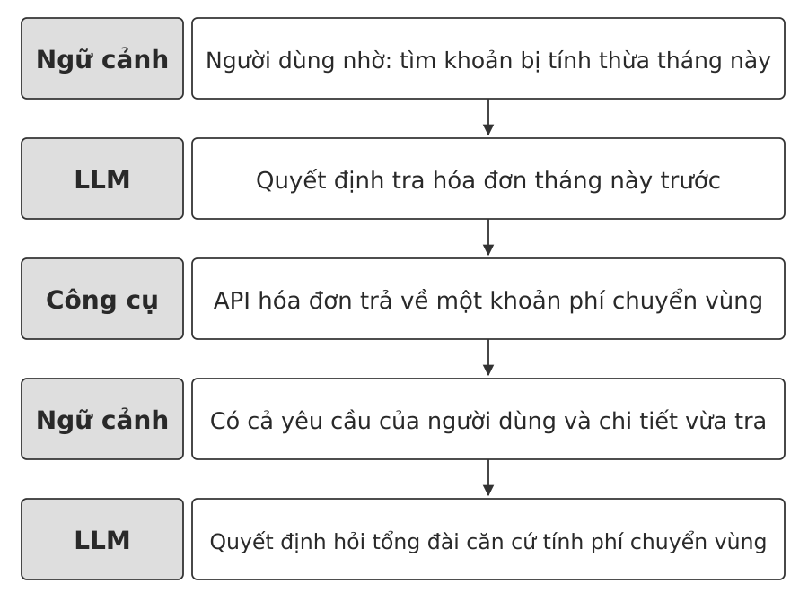
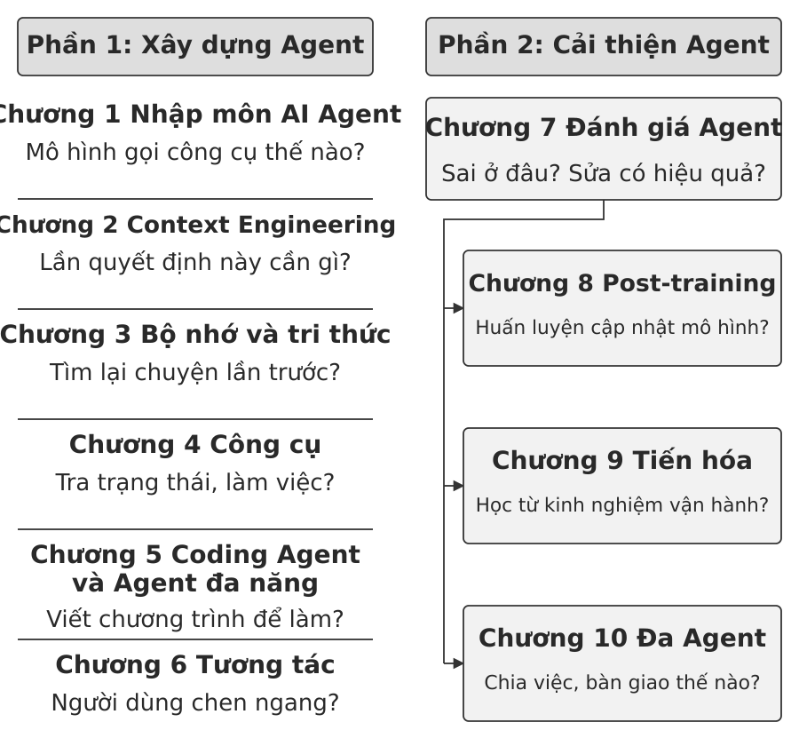

# Giới thiệu {.unnumbered}

Từ tháng 8 năm 2025 đến đầu năm 2026, tôi mở khóa học video trực tuyến “Trại thực hành Agent” tại Turing, bàn về cách xây dựng AI Agent (tác nhân AI) bằng những phương pháp kỹ thuật có thể giải thích, kiểm chứng và tái sử dụng. Khóa học bắt đầu bằng việc chạy thử một Agent, rồi phân tích vì sao nó được thiết kế theo kiến trúc ấy: mỗi lựa chọn thiết kế giải quyết vấn đề gì, phải trả giá ra sao và hợp với những loại nhiệm vụ nào. Cuốn sách này được biên soạn từ giáo trình và các thí nghiệm đi kèm của khóa học.

> **Cuốn sách ra đời thế nào: một lần cộng tác giữa người và máy**
>
> Khi soạn bài, tôi nói dàn ý cho Agent giọng nói của Pine nghe, để nó tra cứu tài liệu và viết bản nháp đầu tiên. Cách cộng tác bằng lời nói này được gọi là **whisper coding**. Sau mỗi buổi học, học viên vướng ở bước nào, thí nghiệm nào cho kết quả bất ngờ, tôi lại quay về rà soát ví dụ và lập luận tương ứng.

Từ năm 2025, tôi nhận thấy một chuyển biến quan trọng: trọng tâm của nghiên cứu AI và thực tiễn công nghiệp đang mở rộng từ việc nâng năng lực của mô hình nền sang việc để Agent hoàn thành những nhiệm vụ thực tế. Nhờ vậy, việc huấn luyện mô hình và việc ứng dụng mô hình gắn bó chặt chẽ hơn. Các mô hình suy luận như DeepSeek-R1 cho thấy học tăng cường giúp nâng năng lực toán học, lập trình và suy luận.[^preface-r1] Học tăng cường cho Agent (Agentic Reinforcement Learning) đưa việc gọi công cụ và tương tác với môi trường vào quá trình huấn luyện, để mô hình học lập trình và học cả thao tác trên giao diện đồ họa. Loại nhiệm vụ sau thường được gọi là Computer Use: mô hình đọc ảnh chụp màn hình để nhận biết trạng thái trang, rồi bấm, gõ hoặc cuộn để thực hiện thao tác. Các sản phẩm như Manus, Claude Code, OpenClaw cho phép người dùng giao việc trực tiếp, đồng thời cho thấy “sinh mã + hệ thống tệp” có thể làm nền cho một Agent đa dụng như thế nào.

Tháng 9 năm 2026, Meta ra mắt Muse. Khoảng thời gian đó, các sản phẩm Agent cá nhân trong và ngoài Trung Quốc mọc lên như nấm sau mưa. Nhiều vấn đề cuốn sách này bàn tới, tôi và nhóm của mình đã gặp từ sớm hơn khi làm Pine. Tôi là nhà khoa học trưởng của Pine AI, cùng các đồng nghiệp phát triển Agent cá nhân này để làm thay người tiêu dùng những việc vặt. Đầu tháng 1 năm 2025, Pine đã ra mắt tại Mỹ: người dùng có thể nhờ nó gọi điện cho doanh nghiệp để thương lượng hóa đơn, xin hoàn tiền hay hủy gói đăng ký.

Khi doanh nghiệp đồng ý qua điện thoại sẽ miễn một khoản phí, điều Pine có thể báo ngay cho người dùng là “nhân viên đã đồng ý”; muốn nói “tiền đã được hoàn”, phải đợi khoản hoàn tiền hiện lên trên hóa đơn. Để làm được những việc như vậy, chúng tôi cần mô hình nhớ người dùng đã ủy quyền những gì, biết bước tiếp theo cần kiểm tra điều gì, và phân biệt được việc đã làm tới đâu. Về sau, khi giới công nghiệp bắt đầu nói về Skill, Harness và Loop engineering (kỹ thuật vòng lặp), khá nhiều cách làm trong đó chính là thứ chúng tôi đã mò ra qua những cuộc gọi này.

- **Skill.** Chúng tôi chỉ nạp prompt tương ứng khi nhiệm vụ thực sự cần đến. Khi số công cụ tăng lên, chúng tôi để mô hình gọi công cụ qua dòng lệnh, nhờ đó không phải liệt kê định nghĩa của mọi công cụ trong mỗi yêu cầu.
- **Harness.** Chúng tôi ghi môi trường thực thi, thời điểm hiện tại và trạng thái công việc của người dùng vào một thanh trạng thái để mô hình tham khảo khi ra quyết định. Mô hình đôi khi bịa kết quả, gọi nhầm công cụ hoặc bỏ sót chỉ dẫn, còn các thao tác nguy hiểm có thể vượt quá phạm vi người dùng đã ủy quyền. Vì thế chúng tôi đặt ràng buộc lên quá trình thực thi; sau này chúng tôi cũng thấy cách làm tương tự trong Claude Code.
- **Loop engineering.** Mô hình đôi khi mới làm được nửa việc đã tuyên bố hoàn thành. Chúng tôi để một Agent làm việc, một Agent khác đối chiếu hóa đơn hoặc đơn hàng; phát hiện việc gì còn sót thì giao lại để làm bù. Đó là cách phân vai người đề xuất–người thẩm định (proposer-reviewer).

Các nhóm phát triển mô hình và Agent khác, khi giải quyết những vấn đề tương tự, cũng độc lập đi tới các phương pháp gần giống. Điều đó càng khiến tôi tin rằng nhiều khó khăn nhóm tôi gặp phải là vấn đề chung của mọi hệ thống Agent khi đưa vào ứng dụng thực tế. Ngoài “Trại thực hành Agent”, trong giai đoạn 2024–2026 tôi cũng liên tục giảng dạy môn thực hành Agent tại Đại học Viện Hàn lâm Khoa học Trung Quốc. Câu hỏi của học viên ở cả hai khóa giúp tôi nhận ra những kinh nghiệm nào còn cần giảng rõ hơn. Cuốn sách được phát hành mã nguồn mở, với mong muốn có thêm nhiều nhà nghiên cứu và kỹ sư sử dụng, kiểm chứng và cải tiến các phương pháp này.

**Thực hành đi trước, tên gọi đến sau.** Với các nhóm phát triển, điều này còn một tầng ý nghĩa nữa: khi một thuật ngữ trở thành nhận thức chung của ngành, các nhóm dẫn đầu thường đã khám phá vấn đề ấy từ lâu. Muốn tích lũy lợi thế kỹ thuật của riêng mình, cần phát hiện vấn đề sớm từ công việc kinh doanh thực tế và thử giải quyết nó. Theo tôi, để làm được điều đó có hai điều kiện then chốt.

**Thứ nhất, chọn một mảng kinh doanh thực tế đặt ra yêu cầu đủ cao đối với năng lực Agent và liên tục nhận được phản hồi.** Một nhiệm vụ của Pine có thể kéo dài hàng giờ, thậm chí hàng tuần, phải liên lạc với nhiều bên: những cuộc gọi dài, những biểu mẫu phức tạp, nhiều lượt trao đổi email, mà vẫn phải bảo đảm con số chính xác, thao tác trong tầm kiểm soát và quyền lợi của người dùng được giữ gìn. Những tình huống như vậy liên tục phơi bày khoảng cách giữa năng lực mô hình và yêu cầu của công việc, buộc nhóm phải cải tiến Harness. Nếu giá trị chính của một sản phẩm chỉ là bù đắp điểm yếu của một thế hệ mô hình nào đó, lần nâng cấp mô hình kế tiếp có thể xóa mất phần giá trị ấy, và nhóm khó tích lũy được lợi thế lâu dài.

**Thứ hai, xây dựng một cơ chế đánh giá (Evaluation) có hệ thống.** Sau khi sửa hệ thống, một lần thương lượng hóa đơn thành công có thể là do trợ lý hỏi đúng câu, cũng có thể là do nhân viên lần này tình cờ có quyền giảm phí. Phải dùng cùng một bộ tình huống, so sánh nhiều lần phiên bản cũ với phiên bản mới, thì mới thấy được khác biệt có ổn định hay không. Chương 7 sẽ trình bày cụ thể cách đặt tiêu chí thành công, xây dựng môi trường đánh giá, phân tích thất bại và kiểm chứng các thay đổi.

Ở Pine, từ việc thương lượng giảm hóa đơn, chúng tôi học được một cách làm: để người thẩm định nhìn vào khoản tiền trên hóa đơn. Áp dụng cách đó cho việc đổi vé thì phải xem vé mới đã được xuất hay chưa. Bằng chứng cụ thể thay đổi theo từng loại việc, nhưng phía sau có chung một nguyên tắc: muốn biết nhiệm vụ đã hoàn thành chưa, hãy xem hành động ấy để lại kết quả gì ở thế giới bên ngoài. **Nguyên tắc tốt có thể vượt qua các chu kỳ thay đổi của mô hình**.

## Sứ mệnh của cuốn sách {.unnumbered}

Hình dung có người đưa cho trợ lý một hóa đơn điện thoại và nhờ nó liên hệ nhà mạng để thương lượng giảm phí. Trước khi bắt đầu, trợ lý phải làm rõ khoản phí nào đang bị tranh chấp; trong cuộc gọi, nó phải nghe được lời giải thích và hỏi tiếp về điều kiện; khi kết thúc, nó phải cho người dùng biết rốt cuộc nhân viên đã đồng ý những gì. Ở mỗi bước, trợ lý phải trả lời ba câu hỏi: lúc này nó biết những gì? Nó có thể thực hiện những hành động nào? Nó dựa vào đâu để chọn bước tiếp theo? Cuốn sách bắt đầu từ ba câu hỏi đó để giới thiệu cấu trúc, cách xây dựng và giới hạn năng lực của Agent. Công thức cốt lõi là **Agent = LLM + ngữ cảnh + công cụ**: LLM (mô hình ngôn ngữ lớn) phụ trách hiểu, lập kế hoạch và ra quyết định; ngữ cảnh (context) chứa thông tin cần cho quyết định hiện tại; công cụ nối Agent với môi trường bên ngoài để thu nhận quan sát hoặc thực hiện hành động.

Nói một cách hình ảnh, LLM là “bộ não”, ngữ cảnh là “tầm nhìn ra quyết định hiện tại”, công cụ là “giác quan và tay chân”. Tầm nhìn ấy gồm thông tin môi trường, lịch sử hội thoại, bộ nhớ và tri thức, và cả chỉ dẫn hệ thống, định nghĩa công cụ cùng trạng thái nhiệm vụ. Tìm kiếm, đọc tệp và chụp màn hình mang thông tin về; bấm, ghi dữ liệu và gọi API nghiệp vụ làm thay đổi trạng thái bên ngoài. Hình 0-1 tách một lần tra hóa đơn ra để xem từng phần. Ở lần quyết định đầu tiên, mô hình chỉ biết người dùng thắc mắc về một khoản phí; đến lần thứ hai, nó đã chỉ ra được cần hỏi về khoản tiền nào.



Độc giả quen với học tăng cường (Reinforcement Learning, RL) còn có thể hiểu cách phân vai này qua các khái niệm chính sách, quan sát và hành động. LLM chọn bước tiếp theo dựa trên ngữ cảnh, nên chức năng ra quyết định của nó gần với chính sách (Policy); ngữ cảnh chứa những quan sát và lịch sử cụ thể dùng cho lần quyết định này; công cụ cung cấp giao diện quan sát và hành động. Không gian quan sát (Observation Space) mô tả những quan sát nào có thể thu được, không gian hành động (Action Space) mô tả những hành động nào được phép thực hiện; hai không gian này vạch ra phạm vi tương tác giữa Agent và môi trường.[^preface-spaces] Chương 1 sẽ triển khai các khái niệm này qua những ví dụ gọi công cụ, đồng thời giới thiệu cách phân vai giữa Model và Harness trong một hệ thống chạy thực tế.

> **Suy ngẫm thêm: từ sự sống đến thực thể được thiết kế**
>
> Ngoài thực tiễn kỹ thuật, Agent còn gợi ra những câu hỏi về sự tiến hóa của các hệ thống thông minh. Richard Sutton, người đoạt giải Turing và là người tiên phong của học tăng cường, tóm tắt tiến hóa của vũ trụ thành bốn giai đoạn: bụi, sao, sự sống và “thực thể được thiết kế” (designed entities).[^preface-sutton] Sinh vật tiến hóa nhờ đột biến ngẫu nhiên và chọn lọc tự nhiên, còn thực thể được thiết kế có thể được các hệ thống thông minh sẵn có xây dựng và cải tiến một cách có chủ đích.
>
> Agent có thể sinh mã, xây dựng Agent mới, rồi phân tích hành vi khi chạy, đề xuất sửa đổi và kiểm chứng kết quả, từng bước đạt tới tự khởi động (bootstrap) và tiến hóa liên tục. Điều này giống như một lập trình viên viết ra một lập trình viên khác, và người thứ hai lại tiếp tục tham gia xây dựng những hệ thống mới. Khả năng tự hiểu mình và tự cải tiến mình như vậy cũng là một trong những câu hỏi tôi hứng thú nhất khi viết hai chương về sinh mã và tiến hóa liên tục.

## Cấu trúc của cuốn sách {.unnumbered}

Hình 0-2 cho thấy mối liên hệ giữa các chương. Giả sử người dùng đổi ý ngay giữa cuộc gọi mà trợ lý vẫn làm theo yêu cầu cũ, bạn có thể bắt đầu từ Chương 6 ở cột bên trái để xem trợ lý xử lý việc người dùng chen ngang ra sao. Sửa xong rồi, làm sao biết ở những cuộc gọi khác nó cũng tiếp nhận được yêu cầu mới? Đó là lúc cần đến phương pháp đánh giá của Chương 7 ở cột bên phải. Ba mũi tên tỏa ra từ Chương 7 cho biết: có kết quả đánh giá rồi, có thể dựa vào nguyên nhân thất bại để chọn những cách cải tiến khác nhau.



- **Chương 1 (Nhập môn AI Agent)** dùng các ví dụ về sản phẩm và gọi công cụ để giới thiệu các thành phần cốt lõi, vòng lặp vận hành, Harness và các cách điều phối, dựng nên khung khái niệm để hiểu toàn bộ cuốn sách.
- **Chương 2 (Context Engineering)** là chương then chốt nhất của cuốn sách, bàn về cách tổ chức thông tin mà mô hình cần vào lúc này. Chương đi từ thiết kế prompt, nạp theo nhu cầu đến quản lý lịch sử, và dựa vào KV Cache để giải thích các phương pháp này ảnh hưởng thế nào tới chất lượng câu trả lời và chi phí vận hành.
- **Chương 3 (Bộ nhớ người dùng và cơ sở tri thức)** bàn về cách lưu giữ và truy xuất thông tin xuyên phiên làm việc. Chương đi từ bộ nhớ người dùng đến RAG, chỉ mục có cấu trúc và cập nhật tri thức, giúp bạn đọc nắm được cách truy xuất và duy trì tri thức lâu dài.
- **Chương 4 (Công cụ)** bàn về cách Agent thu nhận quan sát, thực hiện hành động và yêu cầu cộng tác. Qua phân loại công cụ, thiết kế giao diện, MCP và quản lý thực thi, bạn đọc sẽ hiểu cách đưa năng lực bên ngoài vào hệ thống.
- **Chương 5 (Coding Agent và Agent đa dụng)** đưa ra một hướng kiến trúc cốt lõi cho Agent đa dụng: lấy Coding Agent làm lõi thực thi và hệ thống tệp làm không gian làm việc. Chương trình bày quy trình phát triển trước, rồi qua các tình huống như đa phương tiện và hệ thống nghiệp vụ, cho thấy Agent viết chương trình để giải quyết vấn đề như thế nào, từ đó tạo ra công cụ và xây dựng Agent mới.
- **Chương 6 (Tương tác: mở rộng không gian quan sát và không gian hành động)** bàn về cách Agent tương tác theo hai chiều: phương thức (modality) và thời gian. Qua sự kiện bất đồng bộ, giọng nói, Computer Use và robot, bạn đọc sẽ hiểu việc quan sát liên tục, đường nhanh – đường chậm và kiểm soát thực thi.
- **Chương 7 (Đánh giá Agent)** trả lời câu hỏi làm sao đánh giá hiệu quả của hệ thống và của một lần thay đổi. Chương xác định tiêu chí thành công, môi trường và bộ dữ liệu trước, rồi đến bộ kiểm chứng (verifier), chấm điểm và phân tích thống kê, cuối cùng phân tích nguyên nhân thất bại để tìm hướng cải tiến.
- **Chương 8 (Hậu huấn luyện mô hình)** bàn về cách dùng dữ liệu và môi trường để cập nhật năng lực mô hình, chủ trương ưu tiên đầu tư vào chất lượng dữ liệu và môi trường huấn luyện. Qua fine-tuning có giám sát, học tăng cường và thiết kế phần thưởng, chương giải thích vì sao học từ minh họa và học qua khám phá đem lại khả năng khái quát hóa khác nhau, và vì sao chỉ thay đổi thuật toán thường thu được ít kết quả.
- **Chương 9 (Sự tiến hóa liên tục của Agent)** bàn về cách dùng kinh nghiệm vận hành để cải tiến các phiên bản sau của Agent. Chương so sánh bốn loại cập nhật: tri thức, chỉ dẫn, chương trình và tham số, rồi dùng quy trình kiểm chứng, phát hành và khôi phục để quản lý các thay đổi dài hạn.
- **Chương 10 (Cộng tác đa Agent)** bàn về việc khi nào nhiều thành viên đem lại giá trị tăng thêm, và cách phân công, giao tiếp, điều phối giữa họ. Chương nói rõ ngữ cảnh và quyền điều khiển được phân bổ ra sao, rồi qua các tình huống cụ thể giảng giải cơ chế cộng tác, phân tích nguyên nhân thất bại, và bàn về những hình thái có thể có của xã hội và nền kinh tế Agent.

## Cách đọc cuốn sách này {.unnumbered}

- **Xây dựng sản phẩm Agent từ đầu**: nên đọc toàn bộ cuốn sách. Trước hết dùng Chương 1 đến Chương 6 để dựng một trợ lý làm được việc, rồi dùng Chương 7 kiểm tra xem nó dễ sai ở những nhiệm vụ nào. Ba chương cuối bàn về cách dựa vào những thất bại đó để cải tiến mô hình, hệ thống hoặc cách phân công giữa các thành viên.
- **Nắm bức tranh tổng thể trước**: đọc lần lượt Chương 1, 2, 4, 7. Hãy lần theo một lần gọi công cụ: trước hết làm quen với vòng lặp vận hành của Agent, sau đó xem mô hình nhận được những thông tin gì, công cụ thực sự đã làm gì, cuối cùng dùng đánh giá để xét kết quả có đúng yêu cầu của người dùng hay không. Khi Chương 2 nói đến KV Cache, lần đọc đầu bạn có thể nắm ba kết luận ở phần mở đầu trước, làm thí nghiệm xong rồi quay lại đọc nguyên lý bên dưới.
- **Tập trung vào huấn luyện mô hình**: đọc Chương 1 và 2 trước để hiểu cách Agent vận hành, rồi đọc Chương 8 cùng với phương pháp đánh giá ở Chương 7. Như vậy bạn có thể gắn mục tiêu huấn luyện với hiệu quả trên nhiệm vụ thực tế.
- **Bảo trì một Agent đã đưa vào sử dụng**: chọn một loạt nhiệm vụ thực tế để đánh giá theo Chương 7. Chẳng hạn trợ lý báo cho người dùng một mức giá cũ, trước hết hãy kiểm tra nó đã nhận được bản báo giá nào. Nếu tri thức hoặc quy trình đã lỗi thời, hãy mang thất bại này theo khi đọc Chương 9; nếu báo giá và công cụ đều đã cung cấp đầy đủ mà sau khi sửa quy trình mô hình vẫn liên tục chọn sai, hãy đọc Chương 8 để xét xem có đáng chuẩn bị dữ liệu huấn luyện hay không.

Mỗi chương đều có thí nghiệm và câu hỏi suy ngẫm. Thí nghiệm được đánh số theo dạng “Thí nghiệm X-Y”, trong đó X là số chương, Y là thứ tự trong chương. Số sao biểu thị độ khó: ★ hợp với người mới bắt đầu, ★★ cần một ít kinh nghiệm kỹ thuật, ★★★ liên quan tới vấn đề mở hoặc thiết kế hệ thống phức tạp. Phần lớn thí nghiệm có mã chạy được, tập trung trong kho mã nguồn mở:

> **Kho mã đi kèm**: `bojieli/ai-agent-book`

Lần đầu làm thí nghiệm, bạn có thể bắt đầu từ “Thí nghiệm 1-1: Vai trò then chốt của ngữ cảnh”. Nếu dùng Git, hãy chạy trong terminal:

```bash
git clone https://github.com/bojieli/ai-agent-book.git
cd ai-agent-book
```

Chọn **Code → Download ZIP** trên trang kho mã rồi giải nén cũng cho ra cùng thư mục ấy. Từ mục lục thí nghiệm của Chương 1 (`chapter1/README.md`), tìm số 1-1 rồi mở `chapter1/context/README.md`. Từ đó về sau, mỗi khi gặp “Thí nghiệm X-Y”, bạn đều có thể tra dự án và cách chạy trong `chapterX/README.md` của kho mã. “Hướng dẫn tái hiện” cho biết các dự án bên ngoài và cách lấy chúng; lệnh cài đặt và mô tả thư mục được gom trong README.

## Kiến thức tiên quyết {.unnumbered}

Cuốn sách dành cho những độc giả có năng lực lập trình cơ bản, muốn hiểu và xây dựng Agent. Khi tự tay làm thí nghiệm, bạn sẽ cần những nền tảng sau.

**Bắt buộc: nền tảng để đọc toàn bộ cuốn sách**

- **Lập trình Python**: quen với cú pháp, các cấu trúc dữ liệu thông dụng và công cụ quản lý gói như pip, đọc hiểu và sửa được mã thí nghiệm. Phần lớn thí nghiệm trong sách dựa trên Python.
- **Kinh nghiệm dùng LLM**: đã dùng ChatGPT, Claude hoặc sản phẩm tương tự, quen với quy trình cơ bản: đưa ra yêu cầu, đọc câu trả lời rồi hỏi tiếp.
- **Hiểu biết chung về kỹ thuật phần mềm**: biết dòng lệnh, Git, JSON và REST API, đủ để chạy dự án, kiểm tra thay đổi và đọc dữ liệu giao diện.

Khi tự tay làm thí nghiệm, tôi rất khuyến khích bạn chọn một trong các công cụ Claude Code, Codex, Cursor, TRAE. Hãy nhờ nó gỡ lỗi một đoạn mã, rồi xem nó đã đọc những tệp nào, gọi những công cụ gì. Về sau, khi đọc tới vòng lặp vận hành và quản lý ngữ cảnh, bạn sẽ có một trải nghiệm của chính mình để đối chiếu.

**Khuyến nghị: kiến thức bổ sung theo từng chương**

- **Nền tảng học máy (Chương 8)**: huấn luyện và suy luận, hàm mất mát, hạ gradient và quá khớp, giúp hiểu quá trình cập nhật mô hình.
- **Toán cơ bản (Chương 2, 3, 7, 8)**: vector và ma trận giúp hiểu embedding và cơ chế chú ý (attention), xác suất thống kê giúp hiểu các chỉ số đánh giá và phần thưởng kỳ vọng. Sách thiên về giải thích trực quan và công dụng thực tế.
- **Nền tảng phát triển web (Chương 6)**: HTTP, WebSocket và cách phân chia front-end – back-end, giúp hiểu kiến trúc sự kiện bất đồng bộ và giao tiếp giọng nói thời gian thực.
- **Nền tảng Transformer (Chương 2, 8)**: hiểu cơ chế chú ý và cấu trúc mô hình, giúp nắm được cách tính toán trên ngữ cảnh và quá trình hậu huấn luyện (post-training). Độc giả muốn học một cách hệ thống có thể đọc *Hands-On Large Language Models* (Jay Alammar, Maarten Grootendorst; bản tiếng Trung do Li Bojie dịch, Turing Education xuất bản). Cuốn sách ấy dùng hình minh họa để giảng giải Transformer, tiền huấn luyện và fine-tuning, bổ sung cho góc nhìn kỹ thuật của cuốn sách này.

Ngoài phần hậu huấn luyện ở Chương 8, các chương còn lại dùng khá ít kiến thức toán và học máy; có kinh nghiệm lập trình cơ bản là bạn đã có thể bắt đầu đọc.

## Lời cảm ơn {.unnumbered}

Cảm ơn hai biên tập viên Meng Ge và Liu Meiying ở Turing đã phụ trách biên tập cuốn sách và dồn nhiều tâm sức tổ chức “Trại thực hành Agent”; cảm ơn giảng viên Liu Junming đã mở môn thực hành Agent tại Đại học Viện Hàn lâm Khoa học Trung Quốc. Cảm ơn các học viên và sinh viên của hai khóa học: những câu hỏi, phản hồi về thí nghiệm và góp ý của các bạn đã giúp tôi không ngừng cải thiện cách giảng, đồng thời hiểu sâu hơn chính những khái niệm này.

Cảm ơn tất cả đồng nghiệp ở Pine AI. Những thách thức trong công việc thực tế và các cuộc thảo luận trong nhóm là nguồn gốc của nhiều phương pháp và tình huống trong sách. Thực tiễn và hiểu biết của các bạn giúp những nhận thức này không ngừng được hoàn thiện.

Cảm ơn những người bạn trong giới AI. Qua mỗi lần trao đổi, các bạn thẳng thắn góp ý, chia sẻ những kinh nghiệm và nhận định khác nhau, giúp tôi hiểu sâu hơn về mô hình và Agent.

Biết ơn nhiều nhất là gia đình tôi, đặc biệt là vợ tôi, Meng Jiaying. Cô ấy luôn ủng hộ việc viết cuốn sách này và đóng góp nhiều ý kiến quý báu cho bản thảo.

[^preface-r1]: DeepSeek-AI, *DeepSeek-R1: Incentivizing Reasoning Capability in LLMs via Reinforcement Learning*, 2025.
[^preface-spaces]: Mục “Spaces” trong tài liệu Gymnasium.
[^preface-sutton]: Cuộc phỏng vấn Richard Sutton của Dwarkesh Patel, 2025-09-26, phần “Succession to AI”.
