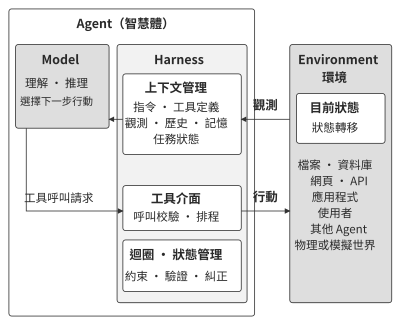
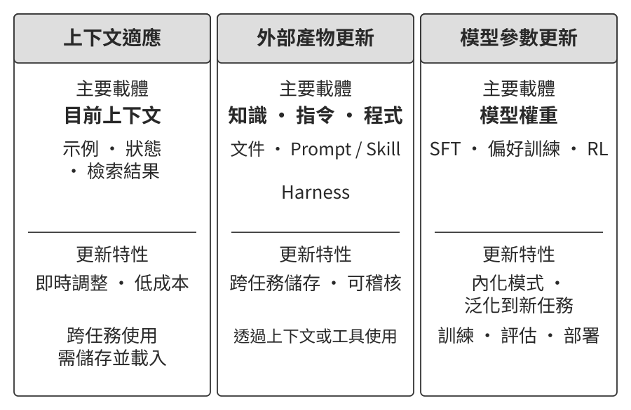
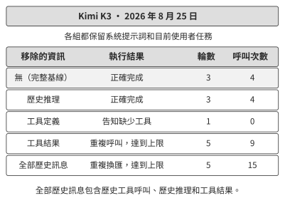
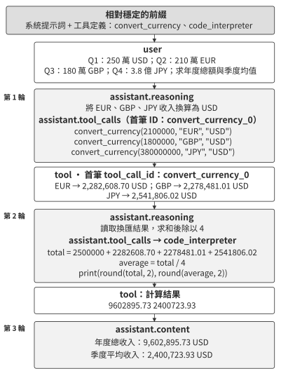
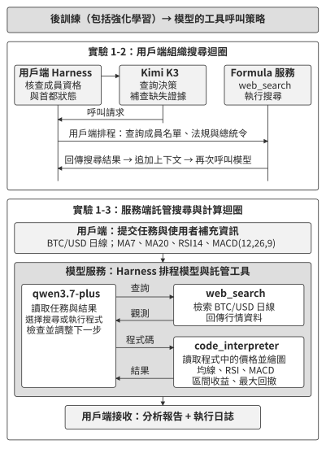
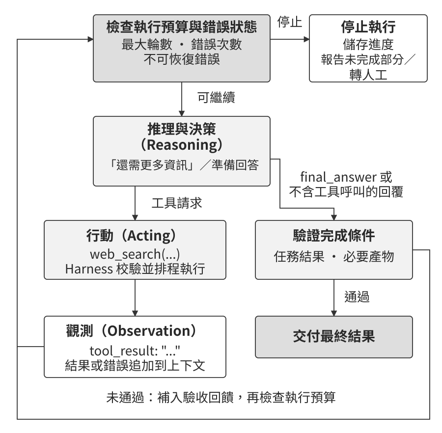
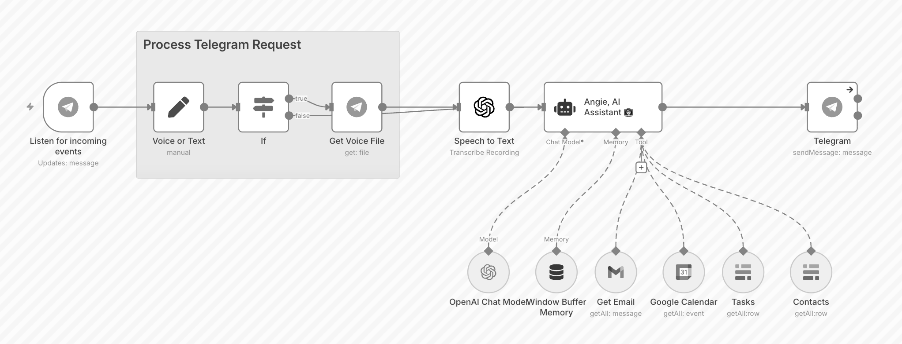

# AI Agent 入門

用 Deep Research 研究一個主題時，它會反覆搜尋和閱讀，最後整理出報告。Manus 可以操作瀏覽器完成線上任務，豆包手機助手可以在手機上訂票、發訊息，Pine AI 可以替使用者打電話，與電信業者協商降低帳單。這些都是 AI Agent 的應用。

用 Cursor 修復一個函式時，它找到函式、編輯檔案，然後執行測試。測試仍然失敗時，錯誤資訊成了它下一次修改的依據；測試通過時，它才有證據向你報告結果。搜尋、編輯和測試這三步的次序可以事先寫入程式，但究竟改哪一行、失敗後該回到哪裡，要看執行中得到的資訊。這種圍繞目標選擇動作、再依據結果調整計畫的過程，也發生在研究調查和電話協商等任務中。

## 現代 Agent = LLM + 上下文 + 工具

本書用一個公式概括現代 Agent 的三類功能要素：**Agent = LLM（大語言模型，Large Language Model）+ 上下文 + 工具**。

- **LLM 是 Agent 的大腦**，負責理解任務、規劃步驟和選擇行動。預訓練為模型提供語言能力與世界知識，後訓練進一步塑造指令遵循、推理和工具呼叫等行為。第八章將介紹監督微調與強化學習等後訓練方法。
- **上下文是 Agent 的目前決策視野**，容納這次決策需要的資訊，包括指令、工具定義、環境觀測、使用者記憶、領域知識、歷史訊息、自身狀態和任務進展。
- **工具是 Agent 的感官和手腳**，透過介面獲取資訊或執行操作。工具體系包括定義、呼叫協定和適配器，既支援搜尋、讀取、截圖等觀測操作，也支援寫入、執行程式碼、委託子 Agent 和與使用者溝通。

同一個工具可以兼具多種作用。例如，模型透過命令列讀取檔案，回傳的檔案內容就成了下一步決策的依據；透過命令列執行程式，還可能改變檔案或處理程序的狀態。

假設你剛拆開包裹，想問客服：「拆封後還能退貨嗎？」系統可以用**檢索增強生成**（Retrieval-Augmented Generation，RAG）查詢店鋪的現行退貨政策，再請模型依據條款回答。[^ch1-rag] 沿著一次查詢，就能看清幾個部件的職責。政策原文與索引儲存在外部知識庫中；檢索工具按問題查出相關段落，呼叫模型的程式再把段落連同出處放進這次請求。模型讀到「拆封」一項，可以解釋條款；如果條款還按商品類別區分，就得先問清你買的是什麼。

[^ch1-rag]: Patrick Lewis 等，Retrieval-Augmented Generation for Knowledge-Intensive NLP Tasks，NeurIPS，2020。

在這次退貨查詢中，發起檢索是 Agent 的動作，回傳的條款是它從環境（Environment）中得到的觀測。下一步是答覆還是追問，取決於條款寫了什麼。這就構成了強化學習和控制論所說的閉環，如圖1-1 所示。



圖的外層劃分了 Agent 與環境的邊界。檔案、資料庫、網頁、使用者、其他 Agent，以及物理或模擬世界，都可以成為它互動的環境。圖的內層展示了生產實作的分工：**Model 負責理解、推理和決策；Harness 位於 Agent 邊界內、Model 之外，負責組織上下文、工具介面、執行迴圈和狀態，並實施約束、驗證與糾正。** Harness 可以建立、隔離或代理環境；檔案內容、處理程序狀態等則隨行動在環境中發生變化。[^ch1-harness]

[^ch1-harness]: 可參閱 LangChain 的《The Anatomy of an Agent Harness》與 Anthropic 的《Effective harnesses for long-running agents》。有些實作把沙盒也計入 Harness；圖1-1 單獨畫出環境，便於追蹤動作實際改變了什麼。

因此，本書採用兩套互補的分解方式：**「LLM + 上下文 + 工具」說明功能組成，「Model + Harness」說明生產實作。** 上下文由 Harness 組織後提供給 Model，工具呼叫由 Model 決策、Harness 校驗和排程，再交給工具或環境執行。一個簡單系統可以從上下文組裝和工具排程起步，逐步補齊生產執行所需的約束、驗證與糾正機制。

如果熟悉強化學習，可以從「誰決定下一步、依據什麼來決定、怎樣付諸行動」這三個問題讀下表。這是按功能作的粗略類比。

| 直覺理解 | 工程要素 | 強化學習中的相關概念 | 含義 |
|-----------|-----------|----------------------------|----------------------------------------------|
| **大腦** | LLM | **策略**（Policy） | 根據目前資訊決定下一步做什麼 |
| **目前決策視野** | 上下文 | **觀測與歷史** | 將環境回傳的資訊與已有歷史組織成決策依據 |
| **感官和手腳** | 工具與適配器 | **觀測和動作介面** | 規定如何讀取環境資訊、發出動作，以及呼叫和回傳的格式 |

### 觀測空間與動作空間：模型與世界的介面

**觀測空間描述 Agent 可能接收到哪些觀測，動作空間描述它可能發出哪些動作。** 一次呼叫中的上下文承載具體資訊，可用工具則提供與環境互動的介面。工具之外，使用者輸入、事件通知等也可以帶來觀測；工具呼叫的參數、權限和執行環境共同限制動作的範圍。

請分別設想兩種故障。第一種，模型能解釋帳單上的每一個收費項目，卻拿不到本月的帳單。使用者授權讀取後，還要把帳單查出來交給模型，它才能判斷哪筆費用有爭議。第二種，使用者請助手改資費方案，助手已經查到了合適的方案，可帳戶介面只允許查詢。即使再讀一遍帳單，它也辦不了變更，還需要相應的操作權限。Harness 的工作是把讀到的材料放進上下文，接收模型選擇的動作，檢查參數與權限，然後排程執行。

因此，**在底層模型固定時，調整觀測空間與動作空間，是提升任務表現的重要工程手段。** 模型漏看關鍵事實，可以把相關資料納入上下文；模型經常選錯相似工具，可以合併重複介面或只載入目前任務需要的工具。

看影片時還會遇到相反的問題：畫面一直都有，值得重新判斷的變化卻不多。假設助手在等檔案上傳，進度條每動一下就呼叫一次主模型，平添了許多計算；若每隔十秒才看一眼，又可能錯過一閃而過的失敗提示。**筆者認為，觀測空間的稀疏化是 Agent 設計中的一個基本問題。** 系統可以持續觀察環境，只把可能改變下一步行動的變化連同必要的上下文交給主模型。

**Manus：在同一任務中結合研究調查、程式設計與電腦操控。** Deep Research 擅長搜尋與閱讀，Coding Agent 可以編寫和執行程式碼，Computer Use Agent 可以操作介面。Manus 將瀏覽器、檔案系統、程式碼執行和命令列整合到雲端沙盒中，使同一個 Agent 能先查資料，再處理檔案和執行程式碼，最後透過瀏覽器完成操作。瀏覽器與檔案讀取增加了可獲取的資訊，程式碼和命令執行增加了可組合的操作。**筆者認為，這種組合是通用 Agent 的重要突破：同一個 Agent 可以跨越原來分離的產品邊界，把獲取資料、處理資料和執行操作串成完整任務。**

**OpenClaw：把介面延伸到使用者的數位生活。** OpenClaw 透過 WhatsApp、Telegram、Slack、Discord、iMessage 等訊息管道接收任務、回傳結果，並用執行在使用者裝置上的 Gateway 連接訊息管道、模型和工具。配置相應工具並獲得授權後，Agent 可以處理本地檔案，也可以接入 Google Drive、Notion 等雲端服務。使用者散布在帳號與裝置中的資料，由此能夠進入同一任務的處理過程。早期 Manus 主要在雲端沙盒中工作，使用者需要上傳檔案；後來加入的 Google Drive 連接器和 My Computer 桌面功能，則進一步擴展了雲端檔案與本地資源的存取範圍。這些演進說明，產品能力的增長常常來自觀測與動作介面的擴展[^ch1-agent-products]。

[^ch1-agent-products]: 產品結構參見 Manus 官方的 Sandbox 介紹、Google Drive Connector 介紹、My Computer 介紹，以及 OpenClaw 官方儲存庫與工具文件。連接器、工具配置與使用者授權決定具體可存取的資源。

不同產品的任務各異，但都可以從決策依據、可用操作和執行策略三個方面理解：

| Agent 產品 | 上下文中的主要資訊 | 可用工具與操作 | 執行策略 |
|----------------|----------------------|----------------------------|------------------------------|
| **Cursor 等 Coding Agent** | 需求、程式碼片段、目錄列表、終端輸出 | 程式碼搜尋、檔案讀寫、執行命令 | 理解需求→搜尋相關程式碼→編輯程式碼→測試驗證→除錯修復 |
| **Deep Research 等搜尋 Agent** | 搜尋結果、網頁內容、論文摘要與引用 | 搜尋查詢、網頁讀取、生成報告 | 根據已有資訊調整搜尋方向，逐步綜合出完整報告 |
| **Browser Use 等電腦操控 Agent** | 螢幕截圖、DOM 或無障礙樹、操作結果 | 點選、輸入、滾動、截圖、執行程式碼 | 讀取介面→識別目標元素→執行操作→驗證結果 |
| **豆包等手機助手 Agent** | 手機截圖、App 介面狀態、系統回饋 | 點選、滑動、輸入、開啟 App | 理解需求→定位目標 App→執行操作→確認完成 |
| **Pine AI、Meta Muse 等個人辦事 Agent** | 經授權讀取的帳戶記錄、帳單、服務商資料 | 打電話、發郵件、填表單、與使用者確認 | 收集資訊→制定協商策略→聯絡服務商→談判→彙報結果 |

**一次委託如何變成可以執行的任務？** 筆者在 Pine 做個人辦事助手時，發現使用者經常只說一個目標，例如「幫我訂去出差的機票，希望不超過 1200 元」。助手要先弄清日期、目的地以及這趟行程最看重什麼，再收集缺少的資料，和使用者談清打算怎樣辦、哪些條件可以商量，隨後才聯絡服務商。辦事中得到的新情況還可能把任務帶回前一步。

假設客服查到的最低票價是 1250 元。模型會結合常識、這趟行程以及記得的使用者習慣來判斷。對一位正在出差、通常願意為合適行程多花一點的使用者，Pine 可能直接訂下；換成一家人出遊，且以往明確在意總開銷，它可能先把差額告訴使用者，繼續請客服查別的航班。使用者如果事後補充「下次遇到超預算的票，先問我」，這條回饋就給下一次判斷增加了比一般經驗更具體的依據。

換一個場景，銀行客服提議把檔案寄到家裡，助手記得使用者正在海外旅行。這次需要改變的是交付方式：前台可以當場說明收件困難，爭取用電子郵件送達。再看帳單減免，客服在電話裡口頭答應，助手可以準確地報告商家的承諾；要確認款項實際扣減，還需要後續帳單作為新的觀測。一個助手的動作空間可以擴展到真實電話，它的結論仍受觀測空間限制。

從委託的事情看，本書會遇到三類應用：生活代辦、協作辦公和科研探索。同一個助手可以承擔不同類別的任務，區別在於誰給它授權、它能改變什麼，以及最後由誰驗收。到了辦公室，一位同事交回核查結果，工單就能關閉了嗎？假設專案負責人在 Multica 的工單裡點名請助手核對預算表中的一筆差額。這條評論會觸發核查，工單仍歸原負責人，狀態也保持原值。助手交回兩處金額及其出處，回答了同事的問題；整份預算能否提交，還得由負責人結合其餘待辦事項判斷。[^ch1-multica]

科研任務也可以問同一個問題：憑什麼認定有了進展？Google DeepMind 的 AlphaEvolve 搜尋矩陣乘法演算法時，模型提出候選程式，評估器執行這些程式，檢查乘積算得對不對、用了幾次乘法。後續搜尋可以接著改進表現好的程式。研究團隊報告，其中一種演算法用 48 次純量乘法即可完成兩個 $4\times 4$ 複數矩陣的乘法。「少做了幾次乘法」有明確的計數對象，演算法還要算出正確的矩陣乘積。[^ch1-alphaevolve]

[^ch1-multica]: Multica，在工單評論中點名 Agent。第十章討論如何在協作中區分臨時求助與責任移交。

[^ch1-alphaevolve]: Google DeepMind，AlphaEvolve 研究說明，2025 年 5 月。這裡的乘法次數指演算法中的純量乘法次數，實際執行時間還取決於實作和硬體。

這些系統的動作空間具有**開放式**的特點。搜尋詞、輸入文字、生成的程式碼和操作組合難以預先窮舉，而每次行動仍受工具、參數、權限和執行環境限制。正因如此，一份可執行的計畫需要為新觀測留出改變下一步的餘地。

### 工具：Agent 的感官和手腳

工具把模型的決策落實為對外部環境的讀取或操作。搜尋和讀取工具帶回觀測，檔案寫入、命令執行等工具落實行動。模型透過回傳結果得知操作的效果，再決定繼續、重試或結束任務。

按主要用途，本書將工具分為五類。一個介面可以兼具多種用途，例如語音通話既能獲取資訊，也能傳達請求。

**感知工具**負責獲取資訊：搜尋引擎提供網路資料，檔案讀取工具存取本地文件，API 和資料庫介面對接外部服務與企業資料。

**執行工具**負責實際操作：執行程式碼、修改檔案、下達系統命令或呼叫外部 API，將決策落實到環境中。

**協作工具**支援分工與協調：把專項任務委託給子 Agent，收集結果，協調多個 Agent 的工作。需要人類參與決策時，系統還可以透過使用者溝通介面請求確認。

**事件觸發工具**將外部事件接入執行過程。一封新郵件、預定時間到達或 Webhook 回呼，都可以觸發任務。事件適配器負責把這些輸入轉換為 Agent 可處理的觀測，排程機制負責啟動或恢復執行；觸發規則可以由開發者配置，也可以透過獲准的工具呼叫註冊。

**使用者溝通工具**負責向使用者傳遞資訊並收集回饋，例如傳送文字訊息、發起語音通話或傳送郵件。它們用於彙報進展、請求確認，也可以主動提醒使用者處理事項。

第四章將展開這五類工具的設計。介面定義影響模型能否正確選擇工具和填寫參數，錯誤處理決定失敗後能否繼續，權限控制限定操作的影響範圍。MCP（Model Context Protocol，模型上下文協定）則為工具發現與呼叫提供統一的接入方式，減少不同系統之間的適配工作。

**工具呼叫**（Tool Calling）是模型以約定格式提出操作請求的能力。常見的函式呼叫（Function Calling）用工具名稱和結構化參數表達請求。本書統一使用「工具呼叫」這一術語。

以查詢北京天氣為例。模型可以寫出城市名，實際氣溫要等 Harness 執行查詢後才會出現在上下文裡。下面是這次呼叫的四步訊息：

```text
第一步：宣告工具                    第二步：模型決定呼叫
tools: [{                          assistant: {
  name: "get_weather",               tool_calls: [{
  parameters: {                        id: "call_1",
    city: "string"                     function: "get_weather",
  }                                    arguments: {city: "北京"}
}]                                   }]
                                   }

第三步：結果追加到上下文              第四步：模型根據結果回覆
tool: {                            assistant: {
  tool_call_id: "call_1",              content: "北京今天 28°C，晴。"
  content: '{"temp":28,"sky":"晴"}'  }
}
```

其中，`call_1` 將工具回傳值與呼叫請求關聯起來。開發者說明工具怎樣呼叫，編寫查詢天氣的函式，並把查詢結果交回模型，模型決定是否呼叫、呼叫哪個工具以及傳入什麼參數。第二章將進一步介紹 API 訊息結構。

設計工具時，可以先提供剛好夠用的能力。四則運算用參數清晰的計算器即可；任務擴展到讀取表格、清洗缺失值、計算統計量和繪圖時，受限的 Python 程式碼直譯器更便於組合這些步驟。通用能力擴大後，隔離與資源管理也要跟上：程式碼在沙盒中執行，網路存取預設關閉，檔案存取限於授權工作目錄，並為執行時間、CPU、記憶體和輸出大小設定上限。

記錄一段執行過程，可以使用單一日誌工具。持續數小時甚至數天的任務，則適合用受控的虛擬工作目錄儲存計畫、中間結果、執行日誌和最終產物，讓 Agent 在多次執行之間接續工作。目錄應限制可讀寫路徑、容量和檔案類型，並檢查路徑是否越過授權邊界。

支付、刪除資料、傳送郵件和生產部署等操作具有較高風險或明確的業務規則，適合封裝為參數清楚、權限受限、全程可稽核的專用工具，必要時加入預覽與人工確認。**通用基礎能力支援組合與探索，專用工具落實高風險操作的約束和業務規則。**

### LLM：Agent 的大腦

LLM 是 Agent 的決策核心。收到請求後，它先從使用者的表述中識別目標和約束，再把複雜任務拆成可執行的步驟。執行過程中，它還要判斷下一步做什麼、是否呼叫工具、選擇哪個工具以及如何填寫參數。這些能力以預訓練積累的知識和語言能力為基礎，再由後訓練塑造為適合任務的決策行為。工作流與自主 Agent 都需要這類判斷，實際操作則透過 Harness、工具和環境完成。

行動前的規劃與推演，可以幫助 Agent 比較方案、預測結果並減少無效嘗試。例如，模型可以利用數學規律檢查計算步驟，利用因果關係分析故障，再按依賴關係安排操作順序。模型先在推理中比較不同方案，選定行動後再請求工具執行。傳統強化學習系統也可以利用學到的策略、價值函數、環境模型或規劃演算法來組織探索；LLM Agent 的特點在於，開始具體任務前就已透過大規模預訓練獲得廣泛的知識與問題求解模式，後訓練又進一步強化了這些能力的使用方式。

#### 模型原生工具呼叫

業界用「模型即 Agent」（Model as Agent）概括一種發展趨勢：越來越多的規劃和工具呼叫決策由模型承擔。透過後訓練，尤其是強化學習，模型可以學會何時呼叫工具、呼叫哪個工具、傳入什麼參數，以及獲得結果後如何繼續。開發者提供目標、介面和約束，模型根據任務進展安排具體步驟。

模型的自主決策需要 Harness 支撐。Harness 原指韁繩、挽具等馬具，用來把馬的力量傳遞到載具並控制方向。在 Agent 中，Harness 將模型能力組織成可持續執行的任務過程，承擔上下文管理、工具介面、約束、驗證和糾正等職責。本章後半部分將逐項介紹這五項功能。

模型能夠自主安排的操作越多，錯誤可能影響的範圍也越大。模型與 Harness 因此需要協同最佳化：模型提升規劃和工具選擇的品質，Harness 管理權限、檢查結果並處理失敗。模型廠商可以同時改進這兩部分，這種協同迭代構成了重要的工程優勢。

> **模型能力與 Harness 的演進**
>
> Rich Sutton 在《苦澀的教訓》（The Bitter Lesson）中回顧了 AI 研究的一條長期趨勢：能夠利用更多計算資源的搜尋與學習方法，逐漸超越依賴大量人工領域設計的方法[^ch1-1]。沿著這個方向，工具選擇、步驟安排等曾由外部流程承擔的決策，可以逐步透過訓練內化到模型中。
>
> 本書的立場是：**方向認同，節奏務實。** 模型會持續接管 Harness 中的部分決策職責，而一輪訓練與部署需要時間，業務規則和使用者偏好卻不斷變化。真實業務中的約束也很難一次全部寫進模型參數。因此，模型暫時做不穩的環節，由 Harness 先補齊。**模型此刻的能力邊界，就是 Harness 此刻的價值所在。** 這種分工會隨模型能力變化：模型每掌握一類決策，Harness 就可以減少相應的編排，轉而解決新的困難。權限執行、狀態持久化和結果校驗，則繼續由執行系統落實。

[^ch1-1]: Sutton, Rich. The Bitter Lesson, 2019。

#### Agent 的學習機制：從上下文適應到持久更新

工具報錯後，Agent 這一次學會了換個路徑找檔案。明天換一個新會話，它還記得這個教訓嗎？沿圖1-2 看這條經驗存放在哪裡，就能分清三種不同的更新。



**上下文適應**發生在任務執行中。模型讀到示例、任務狀態或檢索結果後，就能調整後續行為。例如，工具回傳檔案不存在，模型可以重新查詢路徑，再繼續操作。這條路徑回應快、成本低，效果取決於上下文視窗容量和資訊組織方式。要讓經驗用於後續任務，還需要把相關資訊儲存並再次提供給模型。第二章將介紹上下文的組織方法。

**外部產物**（artifact）可以把經驗跨任務儲存下來。事實與經驗寫入知識文件，可用語言表達的策略寫入提示詞或 Skill，確定性的流程與約束寫成程式或 Harness 邏輯。這些產物便於稽核和修訂，在執行時透過上下文或工具介面參與決策與執行。第三至五章介紹相應的知識和程式基礎，第九章討論如何從經過評價的執行軌跡中生成、驗證和發布更新。

**模型參數**則透過訓練更新。醫療影像理解、語言風格和隱式決策策略等能力，涉及大量難以逐條寫成規則的模式，可以透過後訓練從資料與回饋中學習。參數更新需要訓練、評估和部署投入，目標是讓模型在新的任務中也能運用學到的能力。第八章將展開相關方法。

同一次失敗可以先用來糾正眼前的操作，事後又整理成專案說明，供下一位 Agent 查閱。如果同類錯誤在許多專案裡反覆出現，還可以將這些案例用於訓練。

### 上下文：Agent 的目前決策視野

做決策時，人需要把任務說明、參考手冊、溝通記錄和最新資料放在一起看。Agent 也需要這樣的資訊集合，這就是上下文。一次 LLM 呼叫能接收的資訊量受上下文視窗限制，Harness 則負責選擇和組織其中的內容。從 API 的角度看，本書的基礎實作包含五類資訊：

- **系統提示詞**（System Prompt）：由開發者或 Harness 構造，說明 Agent 的身份、任務邊界和行為準則。提示工程透過調整這些指令塑造工作方式。系統提示詞可以在會話中保持相對穩定，也可以按產品配置加入跨會話的使用者記憶，例如偏好、歷史行為和背景資訊，或注入目前環境狀態。真實權限由 Harness 與環境中的存取控制執行。第三章將介紹使用者記憶。
- **工具定義**（Tool Definitions）：宣告可用工具的名稱、功能和參數格式，幫助模型選擇操作並構造請求。在本書的基礎實作中，工具定義與系統提示詞放在請求前部，形成相對穩定的前綴。工具較多時，也可以按需載入完整的 schema，並保留已有前綴；第二章和第四章將展開這一方法。
- **使用者訊息**（User Messages）：包含使用者的任務和補充輸入，也可以附帶透過 RAG（檢索增強生成，Retrieval-Augmented Generation）獲取的外部知識，例如訓練資料截止後的資訊或私有領域資料。第三章將介紹檢索與知識組織。
- **模型回覆**（Assistant Messages）：包括面向使用者的文字 `content`、工具呼叫請求 `tool_calls`，以及服務提供的推理資訊。本書用 `reasoning` 簡寫推理資訊；不同服務可以回傳推理內容、摘要，或用於續接的不透明狀態。呼叫工具時，回覆可以包含推理資訊與呼叫請求；任務結束時，可以包含推理資訊與最終文字。具體欄位及可見性由模型服務決定。
- **工具執行結果**（Tool Results）：包含執行後的回傳值、錯誤或狀態，追加到訊息歷史後，為下一次決策提供依據。模型據此判斷操作是否成功、是否需要調整，並減少本輪任務中的重複嘗試。

每次呼叫模型，Harness 都要把相對穩定的前綴（系統提示詞、工具定義）和不斷增長的訊息歷史一起發給模型。這樣，即使換匯工具在上一輪就回傳了結果，模型在這一輪計算總額時仍然讀得到。

不同資訊對決策有什麼作用，可以透過**消融實驗**（Ablation Study）來檢查：固定任務與執行條件，每次移除一類資訊，比較行為變化。實驗 1-1 保留系統提示詞和目前使用者任務，以固定角色、約束與任務要求，再對工具定義、工具結果、歷史推理資訊和歷史訊息分別做消融。

> **實驗 1-1 ★★：上下文的關鍵作用**
>
> 讓 Agent 彙總一家公司的季度收入：第一季 250 萬美元，第二季 210 萬歐元，第三季 180 萬英鎊，第四季 3.8 億日圓。任務要求透過換匯工具將收入統一為美元，再用計算工具求年度總收入與季度平均收入，結果保留兩位小數。這樣，模型既需要選擇工具，也需要記住已經完成的步驟和回傳值。
>
> 實驗設定完整基線和四組消融，每組最多執行五輪。移除歷史推理資訊時，每輪仍允許模型重新推理；移除工具定義時，請求不再提供可用工具；移除工具結果時，保留呼叫記錄，隱藏回傳內容；移除歷史訊息時，只保留系統提示詞、工具定義和目前使用者任務。先試著預測：只知道「已經查過日圓匯率」和知道「3.8 億日圓換回多少美元」，分別能支撐哪一步計算？圖1-3 展示五組結果。
>
> 
>
> 在 2026 年 8 月 25 日的 Kimi K3 執行中，**完整基線**用三輪、四次工具呼叫完成任務，得到年度總收入 9,602,895.73 美元、季度平均收入 2,400,723.93 美元。**移除歷史推理資訊**後，也以相同輪數和呼叫次數得到正確結果：工具記錄已經儲存了換匯結果，模型可以據此重建下一步計算所需的資訊。
>
> **移除工具定義**後，模型沒有發出工具呼叫，並告知缺少換匯工具。**移除工具結果**後，模型發起了九次呼叫，在五輪上限內仍未完成任務；已有呼叫記錄無法告訴它換匯得到多少美元。**移除歷史訊息**後，模型累計發起十五次呼叫，反覆執行換匯，同樣耗盡五輪預算；先前完成的工作沒有進入下一輪上下文，任務進度因而無法積累。
>
> 換一個模型再做同一道題。9 月 1 日，DeepSeek V4 Flash 在移除歷史推理資訊後，同樣用了三輪、呼叫工具四次，卻算出了 9,600,000.00 美元。少算的 2,895.73 美元去了哪裡？看第一次換匯呼叫就有線索：第二季收入是 210 萬歐元，模型把金額寫成了 `2.1`，打算按「百萬」計算。工具收到的是 2.1 歐元，換算後保留兩位小數，得到 2.28 美元。模型隨後按 228 萬美元計入總額，換匯時的捨入誤差也就放大了一百萬倍。其餘兩筆也用了同樣的寫法。即使最後把總數列印到小數點後兩位，先前捨掉的數也回不來。[^ch1-context-runs]
>
> 這組對照展示了不同資訊的作用：工具定義提供可呼叫能力，工具結果提供環境事實，歷史訊息儲存任務進度。歷史推理資訊的價值，則取決於目前決策能否從其他記錄中恢復依據。

[^ch1-context-runs]: 儲存庫的 `chapter1/context/validation/` 目錄儲存了兩次執行的逐輪請求與回傳。8 月的記錄在 `real_20260825T025409Z/evidence.json`，9 月的記錄在 `real_20260901T163146Z/evidence.json`。

### ReAct 迴圈

**ReAct**（Reasoning + Acting）是這種迴圈的一種典型實作，將推理與行動交替組織起來[^ch1-react]。模型先分析目前資訊，選擇行動，再根據工具回傳的**觀測**調整計畫。在後面的示例中，我們用簡短的 `reasoning` 欄位表示每輪決策依據，幫助讀者理解行動之間的關聯。

[^ch1-react]: Yao, Shunyu, et al. ReAct: Synergizing Reasoning and Acting in Language Models, ICLR 2023。

任務執行時積累的決策、行動與觀測序列，稱為**軌跡**（trajectory）。訊息歷史是記錄軌跡的一種方式：使用者訊息儲存任務，模型回覆儲存決策與呼叫請求，工具訊息儲存執行結果。完整執行記錄還可以包含時間、環境狀態和驗證結果，供除錯與評估使用。

在本節的基礎實作中，**每輪上下文 = 相對穩定的前綴 + 累積的訊息歷史**。前綴包含系統提示詞與工具定義，訊息歷史則隨互動增加。圖1-4 摘出了實驗 1-1 的三輪訊息。看第一輪的三筆換匯請求：哪一個結果對應第二季的 210 萬歐元？



歐元請求的 ID 是 `convert_currency_0`。Harness 校驗參數並執行工具，再把同一 ID 寫入工具訊息的 `tool_call_id`。這樣就能找到 2,282,608.70 美元這筆結果，再看第二輪求和時有沒有用對。這筆金額可以驗算：實驗的固定匯率表中，1 美元兌 0.92 歐元，2,100,000 除以 0.92，保留兩位小數就得到這個數。工具回傳的反向匯率 1.087 已經捨入，直接拿它乘以歐元金額會差 91.30 美元。[^ch1-context-runs]

執行迴圈可以用下面的 Python 風格虛擬碼表示。Model 決定下一步，Harness 組裝上下文並校驗、排程呼叫，工具在環境中執行並回傳觀測。這裡以模型停止請求工具作為結束條件，生產系統的驗證與退出機制將在後文展開。

```python
history = [user_request]

repeat:
    context = stable_prefix + history
    decision = Model(context)
    history.append(decision)

    if decision has no tool call:
        return decision.answer

    for call in decision.tool_calls:  # 相互獨立的呼叫可並行執行
        validated_call = Harness.validate(call)
        observation = Harness.dispatch(validated_call)
        history.append(observation)
```

下面按八月基線執行的順序節錄訊息，保留原呼叫 ID 和參數名，換匯結果只列金額與幣種，計算程式碼也作了簡寫。讀到第二輪時，可以在求和式中逐項找出處：季度收入有四筆，為什麼工具只回傳了三個換算結果？

```text
訊息歷史 = [
  {role: "user",
   content: "Q1 250萬美元，Q2 210萬歐元，Q3 180萬英鎊，Q4 3.8億日圓。用工具換算為美元，計算年度總收入和季度平均收入。"},

  # 第一輪：提出三個換匯請求
  {role: "assistant",
   reasoning: "先將 EUR、GBP、JPY 收入換算為 USD。",
   tool_calls: [
     {id: "convert_currency_0", name: "convert_currency",
      args: {amount: 2100000, from_currency: "EUR", to_currency: "USD"}},
     {id: "convert_currency_1", name: "convert_currency",
      args: {amount: 1800000, from_currency: "GBP", to_currency: "USD"}},
     {id: "convert_currency_2", name: "convert_currency",
      args: {amount: 380000000, from_currency: "JPY", to_currency: "USD"}}
   ]},
  {role: "tool", tool_call_id: "convert_currency_0", content: "2282608.70 USD"},
  {role: "tool", tool_call_id: "convert_currency_1", content: "2278481.01 USD"},
  {role: "tool", tool_call_id: "convert_currency_2", content: "2541806.02 USD"},

  # 第二輪：根據換匯結果計算
  {role: "assistant",
   reasoning: "第一季原本就是美元，加上其餘三筆換匯結果，求和後除以4。",
   tool_calls: [
     {id: "code_interpreter_3", name: "code_interpreter",
      args: {code: """
        total = 2500000 + 2282608.70 + 2278481.01 + 2541806.02
        average = total / 4
        print(round(total, 2), round(average, 2))
      """}}
   ]},
  {role: "tool", tool_call_id: "code_interpreter_3",
   content: "9602895.73 2400723.93"},

  # 第三輪：交付結果
  {role: "assistant",
   reasoning: "計算完成，按兩位小數報告結果。",
   content: "年度總收入為9,602,895.73美元，季度平均收入為2,400,723.93美元。"}
]
```

第一季的 250 萬美元已經在使用者訊息裡，可以直接參與求和。其餘三筆取自工具回傳的金額，四筆合計再除以 4，就能核對最後的季度平均值。這裡共呼叫模型三次、工具四次：第一輪模型一次請求了三個互不依賴的換匯操作，第二輪請求執行彙總程式碼，第三輪直接回答使用者。

把執行過程記錄成結構化軌跡，還能幫助開發者改進系統。開發者可以沿著使用者請求、模型決策、呼叫參數和工具結果定位失敗環節；彙總多條軌跡後，還可以識別重複操作、改進工具介面或最佳化決策路徑。經過評價和篩選的經驗可以寫入知識庫，也可以作為後訓練資料，用於改進模型。第七至九章將分別介紹評估、後訓練和持續進化。

換匯任務只用了幾次工具呼叫。搜尋與分析任務往往需要更長的迴圈，也更容易遇到資訊缺失和工具失敗。下面兩個實驗將說明，這些任務怎樣逐步推進，以及用戶端和伺服器端分別負責什麼。

> **實驗 1-2 ★：Kimi K3 的多輪搜尋與查詢調整**
>
> 一項研究任務通常需要多次檢索：先確定基本事實，再追查缺失的證據，最後綜合結果。本實驗讓 Kimi K3 核查東協成員資格與印尼首都狀態。題目還要求它在初次檢索後繼續查詢尚未證實的事實。
>
> Kimi K3 採用混合專家架構（MoE，Mixture of Experts），共有約 2.8 兆參數，支援原生視覺與百萬 token 上下文。MoE 可以類比為一個專家團隊：處理每個 token 時，路由機制只選取部分專家參與計算，以控制計算成本。其後訓練包含面向通用任務、程式設計和 Agent 任務的強化學習，重點提升長程執行能力[^ch1-k3]。
>
> 本次軌跡中，模型先搜尋東協官方成員資料，再補查成員名單和入盟日期，隨後把查詢收窄到印尼遷都相關法規、總統令和司法機關資料。任務最終以帶來源連結的結構化回答結束。
>
> 追蹤這個過程，可以看到三方分工。**模型**決定查詢內容、呼叫參數及下一步搜尋；**用戶端 Harness**獲取工具定義、呼叫模型、把請求交給 Formula，並將結果追加到上下文；**Formula 工具服務**執行網路搜尋，回傳結果。前一輪的搜尋結果由此進入下一輪請求，模型可以據此修改查詢[^ch1-2]。
>
> 訓練可以把工具呼叫策略內化到模型參數中，搜尋實作與結果回傳由執行系統承擔。這個分工同樣適用於程式碼執行等工具：模型決定要執行什麼，工具服務提供執行環境，Harness 組織呼叫與回饋。

[^ch1-k3]: Kimi Team. Kimi K3: Open Frontier Intelligence, 2026。模型結構、上下文長度及後訓練方法見技術報告；服務接入見 Kimi 官方工具說明。

[^ch1-2]: 感謝讀者 asdlem 在配套儲存庫的第 30 號議題中指出工具呼叫決策與工具執行機制需要分別說明。

> **實驗 1-3 ★：Responses API 的託管研究閉環**
>
> 搜尋之後常常還需要計算。例如，要找出一組首都中距離最近的一對，先要獲取座標，再列舉城市對並計算距離。本實驗使用百煉的 `qwen3.7-plus`，透過 Responses API 呼叫兩項伺服器端託管工具：`web_search` 獲取資料與來源，`code_interpreter` 在沙盒中執行 Python，完成計算和繪圖[^ch1-hosted]。
>
> 第一項任務在本次執行中選取汶萊、柬埔寨、印尼、寮國、馬來西亞、緬甸、菲律賓、新加坡、泰國和越南的十座首都進行計算。模型搜尋座標後，編寫程式碼列舉 $10\times9/2=45$ 對城市，以地球半徑 6,371 公里的球面模型，用 Haversine 公式計算大圓距離。在本次採用的座標下，最近的一對是吉隆坡與新加坡，距離約 316 公里。搜尋負責提供輸入，程式碼負責完成可複核的計算，模型再把來源、假設和結果組織成答案。
>
> 第二項任務是「搜尋最近一個月的比特幣走勢，做技術分析」。系統提示詞規定：資料來源或指標不明確時，先向使用者澄清。模型因此先詢問資料來源和分析指標；使用者補充 CoinGecko 的 BTC/USD 日線收盤價，以及 MA7、MA20、RSI14、MACD(12,26,9)、區間收益和最大回撤後，模型再開始搜尋和計算。
>
> 開啟這次執行的程式碼執行回執，可以看到一個容易忽略的細節。直接存取行情介面連續超時後，模型在最後一段 Python 程式碼裡生成了 31 個連續日期，又把 31 個價格直接寫成列表。程式碼用這組數算出了指標，也在沙盒裡儲存了圖。模型在報告中說價格來自搜尋材料。執行回執能說明指標怎樣算出來，價格列表的來源卻仍不清楚。
>
> 在這兩項任務中，搜尋和程式碼執行都由伺服器端託管，模型根據回傳結果決定後續行動，伺服器端 Harness 負責銜接各次呼叫。用戶端傳送任務並接收結果；遇到澄清問題時，再提交使用者補充資訊，接續已有上下文。圖1-5 對比了這一結構與實驗 1-2 的用戶端迴圈，並用具體搜尋、計算步驟展示兩種分工。
>
> 

[^ch1-hosted]: 託管工具的接入方式參見百煉程式碼直譯器文件。本實驗的模型、呼叫次序與結果以配套執行記錄為依據。

> **介面補充：自由格式工具呼叫**
>
> 工具的參數還可以採用自由格式文字。例如，OpenAI Responses API 用 `type: "custom"` 宣告自訂工具後，模型可以直接傳送 Python 程式碼或 SQL 查詢，減少把多行文字放進 JSON 字串時的跳脫處理[^ch1-custom]。常規函式工具則按 JSON schema 接收結構化參數。
>
> 參數格式與執行位置是兩個獨立的設計選擇。自由格式自訂工具仍由應用側接收輸入、校驗、執行並回傳結果；託管程式碼直譯器則由伺服器端提供沙盒和執行迴圈。

[^ch1-custom]: OpenAI，Function calling，其中的 Custom tools 一節介紹自由格式輸入及呼叫結果回傳。

## Harness 工程：模型之外的競爭力

兩套客服應用用了同一個模型，都向使用者答覆「已經退款」。第一套只儲存了這句話，第二套還能調出支付服務回傳的退款金額和交易狀態。要判斷哪一筆退成了，可以從答覆往前查：支付服務執行了什麼？模型回答前看到了哪條回執？如果呼叫超時，誰記下這筆待查的交易，又怎樣決定下一步？

模型生成一句話和支付系統改變狀態，是兩件分別需要核實的事。今天的 LLM 採用聯結主義的神經網路方法，從資料中學習 token 的條件機率，逐步生成回答或工具請求。[^ch1-connectionism] 即使每次解碼都生成同一句答覆，也不能由此得知錢是否已退。應用得把操作請求送去執行，記下工具回傳的結果，再把結果交給模型，據此核對最終答覆。把這些步驟組織起來，就是 Harness 工程要解決的問題。

[^ch1-connectionism]: 中國科學院學部人工智能諮詢研究組，《人工智能賦能科學研究：人工智能學科體系》，科學出版社，2026，ISBN 978-7-03-084786-7，第 1 章第 1.1 節。

前面用 LLM、上下文和工具解釋了 Agent 的功能組成。落實到程式碼和服務時，Model 根據輸入作出決策，Harness 負責組織輸入、排程工具呼叫和處理回饋，工具或環境完成實際操作。本書用下面的公式概括這一分工，並將 Harness 的職責歸納為五項功能：

> **Agent = Model + Harness**
>
> **Harness = 上下文管理 + 工具介面 + 約束 + 驗證 + 糾正**
>
> **Agent $\leftrightarrow$ Environment**

上下文管理和工具介面支撐 Agent 執行，約束、驗證與糾正提高執行的可靠性。以退款 Agent 為例，Harness 將退款政策、訂單和申請原因組織成上下文，透過工具介面查詢訂單並發起退款；執行前檢查權限與金額規則，執行後查詢交易狀態。請求超時時，先查明退款是否已發生，再根據冪等性決定重試、補償、回退或轉人工。

這套分工也幫助我們判斷系統邊界。工具定義、呼叫適配器、沙盒權限和重設機制屬於 Harness；沙盒中隨操作變化的檔案與處理程序、外部資料庫、網頁、使用者和物理世界屬於環境。即使模擬環境與 Agent 部署在同一處理程序中，二者仍分別承擔環境演化和行動決策的職責。

| 功能 | 職責與設計要點 | 實際例子 | 詳見 |
| --- | --- | --- | --- |
| **Context（上下文管理）** | 選擇和組織目前決策所需的資訊，儲存任務進度與關鍵依據 | 系統提示詞、知識庫、Agent 狀態列、Sidecar 旁路查詢 | 第二、三章 |
| **Tools（工具介面）** | 提供觀測與行動介面；名稱直觀，參數配有例子，回傳值和錯誤清晰 | MCP 工具、程式碼直譯器、搜尋工具 | 第四章 |
| **Constrain（約束）** | 按最小權限開放能力，並在執行前檢查操作、參數與授權範圍 | 檔案存取範圍、退款金額上限、工具呼叫核准 | 第四章 |
| **Verify（驗證）** | 用可檢查的規則、工具結果和環境狀態核驗操作；同時檢查資料來源與有效性 | Linter、型別檢查、測試、交易狀態核對 | 第五、六章 |
| **Correct（糾正）** | 按錯誤類型選擇重試、接續、補償、回退或人工接管，並限制恢復次數 | 靜默重試、接續生成、熔斷後轉人工 | 第二、五章 |

約束可以從預設關閉敏感能力開始：涉及敏感資源或外部副作用的能力，獲得明確授權後再開放，類似手機 App 申請相機或位置權限。驗證則要把模型的陳述與可核對的證據連結起來。例如，退款成功應由交易系統中的狀態確認；工具回傳 JSON 時，還要檢查欄位型別、取值和來源。模型輸出與外部工具內容都可能受到錯誤資訊或提示注入影響，可信的驗證邏輯應在獨立的執行邊界內工作。

糾正機制需要兼顧任務恢復和使用者體驗。遇到短暫故障，可以在預算內自動重試，避免頻繁打斷使用者；涉及外部副作用時，要先確認執行狀態。持續失敗則應停止重複操作，說明目前進度和需要人工處理的事項。把這五項功能加入前面的迴圈，就得到下面的虛擬碼：

```python
history = [user_request, Environment.observe()]

while Harness.within_budget():
    decision = Model(Harness.build_context(history))
    history.append(decision)

    if decision has no tool call:
        verdict = Harness.verify_completion(decision, Environment)
        if verdict.passed:
            return decision.answer
        history.append(verdict.feedback)
        continue

    for call in decision.tool_calls:
        permission = Harness.constrain(call)
        if permission.denied:
            history.append(permission.feedback)
            continue

        result = Harness.dispatch(call)
        verdict = Harness.verify(result, Environment)
        if not verdict.passed:
            result = Harness.correct(call, result, verdict)
        history.append(result)

return Harness.report_incomplete(history)
```

這段迴圈把約束放在執行前，把驗證放在工具回傳和任務結束時，再把糾正結果帶回上下文。第二章將展開 API 訊息迴圈，第四、五章介紹工具執行與自動驗證。

**從展示走向生產，工程重心會從接通上下文和工具，轉向約束、驗證與糾正。** 一個展示版本可以靠少數順利完成的任務說明能力；產品需要在輸入變化、服務失敗和長時間執行中持續交付。權限、狀態、驗證和恢復因此成為工程投入的重點。Claude Code 提供了具體例子：檔案讀寫、命令執行和搜尋之外，它還提供權限規則、上下文壓縮和檔案檢查點等機制。權限規則按工具類型、操作範圍與所選模式決定是否確認；檢查點支援恢復其記錄的檔案修改[^ch1-claude-harness]。在自動模式下，Claude Code 還會請獨立的分類器審查工具呼叫。這裡有一類適合交給 Jev 等專用判斷模型的工作：主模型要想清楚怎樣完成任務，輔助模型只需回答一個範圍明確的問題，例如「這次操作是否超出了使用者剛才交代的範圍？」第四章會用工具核准說明怎樣分工。

從這些產品機制出發，可以歸納出建構 Harness 時需要考慮的幾項工作：

- **流程狀態管理**：記錄執行到哪一步，哪些操作已完成，哪些結果仍待確認。
- **上下文壓縮**：在資訊增長時保留關鍵事實、約束和進度，為後續決策騰出空間。
- **權限分類**：區分讀取、修改、外部呼叫等操作，按風險與授權範圍執行規則。
- **熔斷器**（Circuit Breaker）：連續失敗達到閾值後停止重試，避免同一故障持續消耗資源或擴大影響，作用類似電路故障時跳閘。
- **錯誤恢復**：捕獲異常，結合檢查點與環境狀態，選擇回退到穩定狀態、重新嘗試或交還給人類。

[^ch1-claude-harness]: Claude Code 官方文件：權限配置、檢查點、互動命令與上下文壓縮。檔案檢查點的恢復範圍由工具記錄決定，外部服務中的狀態需要相應的恢復機制。

### 從提示工程到 Graph 工程：工程關注範圍的擴展

給一個失敗的任務換提示詞以前，可以先看失敗發生在哪裡。模型誤解了一句約束，適合先查指令；整份帳單從未送進模型，適合先查資訊組織；任務中斷後丟了已經做完的步驟，則要查執行機制。隨著任務延伸到跨日執行和多成員協作，持續運轉與執行結構也會影響結果。下面五個工程視角各自提供一個排查入口。

**提示工程**（Prompt Engineering）關注指令表達。任務目標、約束和示例怎樣寫，直接影響模型如何理解請求並生成結果。

**上下文工程**（Context Engineering）進一步組織模型能看到的全部資訊，包括系統指令、工具定義、對話歷史和外部知識。提示詞只是其中的一部分，檢索、壓縮與狀態組織同樣影響決策。

**Harness 工程**關注模型的執行與環境互動。它把上下文構造、工具排程、權限、驗證和錯誤恢復組織成可執行的系統，使模型能連續完成任務。

**Loop 工程**（Loop Engineering）關注持續自主運轉：一輪結束後，誰發現下一件該做的事，何時重新啟動，何時驗證結果，以及用什麼條件判斷真正完成。第十章將結合多 Agent 協作系統展開這一視角。

**Graph 工程**（Graph Engineering）關注多個執行單元的組合。Agent 迴圈、確定性程式和人工核准可以作為節點，邊規定路由與依賴，結構化狀態在節點間傳遞，並在關鍵邊界儲存檢查點。2026 年出現的相關討論用這一名稱概括這些編排問題[^ch1-graph-engineering]。

Harness 承載上下文管理與單次任務迴圈，外層排程機制可以反覆啟動任務；執行圖可以包含 Agent 迴圈，一個迴圈也可以呼叫圖式工作流完成子任務。

**當候選模型都已能勝任任務時，模型之外的工程實踐往往決定產品差異。** LangChain 在 Terminal Bench 2.0 上的改進提供了一個具體例子：固定使用 GPT-5.2-Codex，透過調整 Harness，將得分從 52.8% 提高到 66.5%，當時的排名從三十名之外進入前五。改進包括完成前自檢、重複操作偵測、環境資訊補充和推理預算分配。這裡的提升來自對執行軌跡中失敗模式的分析，以及據此反覆修改、評估 Harness[^ch1-langchain-harness]。

[^ch1-graph-engineering]: Josh C. Simmons，We Are Entering the Graph Engineering Phase，2026 年 7 月 4 日，討論節點、型別化連線和可檢查點狀態。相關實踐也見 LangGraph、Microsoft Agent Framework 工作流和 Google ADK 的官方資料。

[^ch1-langchain-harness]: Vivek Trivedy，Improving Deep Agents with harness engineering，2026 年 2 月 17 日。分數與排名對應文中報告的模型、基準和測試設定。

### 建構有效 Agent 的核心原則

動手設計前，先看使用者究竟想把哪一步交出去。筆者做過一個購物實驗：助手挑了十件商品，購買者起初一件也沒看上。她原先希望商品好看、便宜，最好還沒有差評。自己去逛淘寶，比較了一圈，她才逐漸拿定主意，願意在哪一項上讓步，最後選中的恰是原來十件裡的一件。若只看最終成交，似乎第一次推薦就足夠了。可在第一次看到清單時，她還沒形成足以作決定的偏好。助手可以幫她核對規格、比較價格，也可以把有代表性的差異列出來，供她自己逛和選。

把同樣的問題用在帳單申訴上，答案就不同了。使用者想弄清一筆收費，原本可能因為要排隊等一小時而放棄；助手替他等待和核實，省下的恰好是他想省的時間。還有一些任務，個人原本獨立做不到，例如不會程式設計的人藉助助手做出一個自己需要的小工具。選擇委託範圍時，可以問使用者：如果有人代勞，你最希望省去哪一步？又有哪一步，你希望親自參與才有收穫？

Anthropic 將建構有效 Agent 的經驗歸納為三個原則：保持簡單、保持透明，以及認真設計 Agent 與工具的介面[^ch1-anthropic-building-effective-agents]。

**保持簡單。** 從能解決任務的最簡單方案開始，評估發現穩定問題後再增加機制。直接呼叫 API 往往更容易看清輸入、輸出和控制流；使用框架時，也要能追蹤它如何組織上下文和呼叫工具。

**保持透明。** 開發者要弄清一次退款為什麼失敗，可以沿執行記錄找到支付介面的回執。使用者關心的則是錢退了沒有、下一步由誰辦理。任務計畫、工具日誌和關鍵決策都可以記錄下來，再把進度和待確認的事項告訴使用者。

**設計好工具介面。** ACI（Agent-Computer Interface，Agent—電腦介面）強調從 Agent 的使用方式設計工具：名稱要直觀，參數要配合具體例子，回傳值要便於後續決策，容易誤用的地方要加上可執行的約束。介面越清楚，模型越容易把意圖轉換為正確操作。

這可以借鑑製造業中的**防呆**（Poka-yoke）方法。SIM 卡的缺角幫助使用者辨認安裝方向，微波爐的門聯鎖使裝置在開門時停止加熱。對應到工具設計，可以用列舉限制操作類型，用參數校驗檢查格式，用權限控制限制作用範圍。模型透過工具定義和回傳結果理解介面，含糊的說明會在多輪呼叫中反覆造成誤用；清楚的介面與執行約束則能從源頭減少錯誤。

[^ch1-anthropic-building-effective-agents]: Anthropic，Building effective agents，2024 年 12 月。

接下來從模型選型、編排模式、護欄與安全三個方面展開設計取捨：選擇模型決定可用的決策能力，編排組織執行路徑，護欄把約束、驗證與糾正落實到具體操作。

### 如何選擇模型

**選對模型，往往比反覆打磨提示詞更有效。** 模型決定 Agent 能理解多複雜的任務、能否選對工具，以及出現錯誤後如何調整。確認任務資訊充分、工具可用後，仍然反覆出現規劃或工具使用錯誤，就應優先比較模型能力，再決定投入多少提示詞和編排工作。

**閉源模型適合透過服務介面快速接入。** OpenAI 的 GPT 系列、Anthropic 的 Claude 系列都是本書討論的例子。評估時，既要看任務能力，也要檢查 API 提供的工具呼叫方式、上下文容量、服務限制與費用。

**開放權重模型提供部署與客製空間。** DeepSeek、Kimi、GLM 等模型可以按具體版本的許可條件，用於自部署或後訓練。私有化部署有利於控制資料流向，微調可以適配特定任務。**對於模型能力已夠用、呼叫量穩定的業務，以及需要嚴格控制資料流向的業務，筆者會優先評估開放權重方案。**

寫作時，筆者對開放權重模型追趕速度的經驗判斷是，差距已經縮短到半年以內。

**同時評估模型能力、產品介面和使用規則。** 同一模型透過聊天產品、Coding Agent 或 API 提供服務時，可呼叫的工具、權限和執行限制可能不同。網路安全、模型蒸餾與提取、隱私資料和高風險操作等業務，還需要逐項核對服務的使用規則。

**多步 Agent 任務，筆者優先選擇推理模型作為起點。** 規劃、工具選擇、結果核驗和失敗恢復都需要連續判斷，為這些環節投入更多推理計算，通常有助於提高任務完成品質。對於單步分類、簡單格式轉換，或 Computer Use 中目標已明確的固定位置點選，較輕量的模型也可能滿足要求。

**把速度放到完整任務中衡量。** Agent 常有多輪順序呼叫，模型每輪生成所需的時間會累積到端到端延遲中。一個任務需要二十輪推理，每輪多耗時兩秒，總時長就增加四十秒。首 token 的等待、模型的生成和工具執行都算在這段時間裡。

**按輸入形式檢查多模態能力。** 需要理解圖片、音訊或影片時，應使用任務中的真實材料評估相關能力，例如介面截圖中的小字、語音中的打斷，或影片中的連續動作。

### 編排模式：工作流與自主

收到使用者請求後，誰來決定下一步？單次模型呼叫適合已有資料足夠、交付物明確的任務；固定步驟反覆出現時，程式可以把它們組織成工作流；需要根據環境回饋更改路徑時，可以把選擇權交給模型。這樣的分工決定了上下文在呼叫之間怎樣傳遞、工具何時執行。

以「從百萬條聊天記錄中提煉個人記憶」為例，一種設計會先切分對話，再讓幾個 Agent 分別提取事實、核對原話、辨認對話裡提到的人、整理記憶，最後由另一個 Agent 複核合併結果。系統還要用圖記錄事實之間的關係，登記哪些聊天記錄已經處理，並把每版結果存成唯讀快照。這些機制分別解決了實際問題，但一開始全部引入，會增加資訊傳遞、狀態同步和錯誤定位的負擔。遇到新情況時，如果繼續增加分支，原本可以由模型結合上下文完成的語義判斷，就會逐漸變成難以維護的固定規則。

更合適的起點，是給一個能力足夠的 Agent 明確目標、必要上下文和可組合的工具，讓它查證資料、比較說法並處理衝突；程式落實權限、原始材料保護和原子發布等必須始終成立的規則。若評估發現系統總在同一類任務上出錯，再加入專門驗證器、獨立 Agent 或確定性流程。**結構的複雜度應由業務約束和實際失敗驅動。** Manus 用「Less structure, more intelligence.」 概括了這種取捨。

#### 工作流模式：預定義的編排

**工作流**（Workflow）透過預定義的程式碼路徑組織模型和工具。開發者規定節點、連線和分支條件，節點內部可以使用 LLM 理解或生成內容。遇到不同輸入時，系統按程式設定的條件進入相應分支。

以訂機票為例，可以把一條簡化的業務流程設計為四個節點：

1. **核實使用者身份**：透過身份服務確認帳戶和操作權限。
2. **搜尋並確認航班**：查詢可用航班，讓使用者確認行程、票價與退改規則。
3. **完成付款**：在使用者授權後，透過支付介面處理訂單費用。
4. **確認預訂**：按供應商流程完成出票或確認，向使用者傳送預訂結果。

模型可以在搜尋節點內把自然語言需求轉換為日期、目的地和篩選條件，程式則檢查進入支付節點所需的身份、報價與授權狀態。實際訂票介面可能要求先鎖座、再支付或出票，工作流應按供應商協定安排順序，並為失敗設定補償路徑。

工作流的優勢在於**流程控制明確**：關鍵步驟、分支和校驗點都可以檢查，開發者能用程式碼落實「金額已確認才能支付」等規則。它也便於限定每個節點的權限與資料存取範圍。

要讓固定流程處理好例外，開發者需要提前設計相應分支。使用者在付款階段改變行程，或航班取消後需要重新比較方案時，系統只能沿已設計的分支處理，或把控制權交給人工。任務中的例外越多，維護這些分支的成本越高。

另一個直觀的工作流是**文生圖**。使用者可能只說：「幫我畫一個 AGI 實現以後程式設計師的工作場景。」工作流可以安排兩個節點：

1. **提示詞改寫**：LLM 將寬泛需求展開為主體、場景、構圖、光線和風格。比如，把場景構思為「程式設計師在海邊休息，透過腦機介面指揮 AI 員工」，再整理成適合目標模型的提示詞。
2. **圖片生成**：把整理後的提示詞交給生圖模型，獲取圖片。

在一些 Stable Diffusion 工作流中，開發者習慣使用逗號分隔的英文標籤、品質詞和負面提示詞。改寫節點可以統一這種格式，也可以補充構圖細節。Stable Diffusion 也能接收自然語言描述[^ch1-image-prompt]。這裡的 LLM 節點把使用者需求整理成影像模型適用的輸入，並補充創意細節，可以視為 Harness 中的**適配層**。

當影像生成服務能直接理解自然語言需求時，**筆者優先直接提交原始描述，省去僅為適配輸入格式而增加的改寫呼叫。** 每經過一次改寫，約束就多一次被遺漏或改變的機會。寬泛需求需要構圖探索，或系列圖片需要統一風格時，再讓改寫節點承擔這些明確的創作任務。

[^ch1-image-prompt]: Stability AI，Stable Diffusion API 參考，介紹文字提示詞、負面提示詞與風格等輸入；官方應用案例展示了自然語言描述的使用。

> **實驗 1-4 ★：文生圖工作流與直接生成的對照**
>
> 把同一句需求送入兩條路線。**工作流路線**先由 Kimi K3 改寫提示詞，再交給通義萬相生成圖片；**直接生成路線**把原始需求提交給影像生成服務。本次記錄使用了 Gemini 影像模型和 GPT-Image 2 兩種直接生成服務。
>
> 對照包含兩類需求。具體需求包括週末加班的程式設計師、晨光中的窗台綠植，以及帶有「深夜獨處也清淨」文案的降噪耳機海報；寬泛需求包括 AGI 實現後的程式設計師工作場景和未來城市的早晨。
>
> 拿耳機海報來說，改寫節點增加了啞光黑耳機、午夜藍背景、月光輪廓光和留白，同時把 `text` 放入負面提示詞，建議後期補上中文文案。這樣，工作流把原本的一次海報交付拆成了圖片生成與後期排版。

隨著模型能力提升，部分適配工作可以交給模型或服務介面完成。指令微調與推理模型減少了對部分 few-shot 示例和「逐步思考」提示的依賴，結構化輸出與原生工具呼叫減少了格式修復和 JSON 解析容錯所需的工作，影像模型的語言理解能力則簡化了提示詞改寫。**模型升級後，應主動清理已經失去作用的適配程式碼。** 原來必要的格式翻譯和修補步驟，可能變成額外的呼叫、延遲和出錯點。

#### 自主 Agent：動態自主決策

**自主 Agent**（Autonomous Agent）根據任務進展和環境回饋選擇下一步，適合難以預先列全執行路徑的問題。使用者說「幫我訂下週三去上海的機票」，Agent 可以先查航班，遇到登入要求後核實身份，再繼續搜尋；發現最低價方案需要轉機時，詢問使用者是否接受，得到「只要直飛」的答覆後調整條件。它在授權範圍內決定具體步驟，支付等關鍵操作仍由業務規則約束。

遇到查詢失敗，模型可以修改參數重試，換一種查詢方式，或請使用者補充資訊。Harness 記錄每次嘗試，並限制這項任務可以使用的時間或資源。

圖1-6 的兩條迴路都經過預算檢查。左邊是工具回傳了結果，右邊是模型準備結束，驗收時卻發現缺了東西。模型呼叫 `final_answer` 等最終輸出工具，或回傳不含工具呼叫的回覆時，Harness 就檢查所需的結果是否齊全。驗證通過才交付；缺少必要產物時，Harness 告訴模型還缺什麼，讓它繼續執行。遇到不可恢復的錯誤、錯誤次數超限或達到最大輪數時，則儲存進度，報告未完成部分或轉人工。



自主迴圈適合步驟數量隨任務變化的場景，例如 Coding Agent 修復真實程式碼問題、Computer Use Agent 操作介面，以及反覆搜尋和分析的研究任務。SWE-bench 就以真實軟體儲存庫中的問題衡量程式碼修復能力。此類任務的下一步常取決於剛剛得到的測試輸出、介面狀態或搜尋結果。

#### 兩種模式的選擇與混合

工作流和自主 Agent 可以組合使用：程式規定關鍵流程、驗證條件和權限，在需要靈活判斷的節點內執行自主 Agent。沿圖1-7 上方的實線看，Telegram 訊息先經過類型判斷，語音訊息要先轉成文字，最後由 Telegram 節點發回回覆。再看 AI Agent 下方的虛線：Gmail 和 Google Calendar 等工具都接在這個節點上，具體呼叫哪一個，由模型根據訊息內容決定[^ch1-n8n]。



另一種方式是**先讓自主 Agent 生成工作流，再執行經過檢查的工作流**。Agent 根據任務設計拓撲並生成編排程式碼，執行系統驗證程式碼、權限與輸入後，再沿生成的路徑執行。對於重複處理的資料或步驟，這能減少每次排程都呼叫模型的開銷，同時保留任務開始時動態設計流程的靈活性。第十章將進一步討論這種形態。

[^ch1-n8n]: n8n，AI Agent 節點文件。

> **工具參考：Agent 框架與平台**
>
> 各框架對執行迴圈、狀態管理和工具接入的封裝程度不同。[^ch1-frameworks]
>
> | 框架／平台 | 核心定位 | 編排方式 | 開發方式 | 典型用途 |
> | --- | --- | --- | --- | --- |
> | **Codex Harness** | 可整合的 Agent 執行階段 | 自主迴圈 | 程式碼與介面整合 | Coding Agent、產品內嵌 Agent |
> | **Claude Agent SDK** | 複用 Claude Code 的工具與執行迴圈 | 自主迴圈 | Python、TypeScript | 程式碼任務、複雜工具任務 |
> | **LangChain / LangGraph** | 模型與工具整合、狀態圖編排 | 工作流與自主迴圈 | 程式碼 | 多步驟任務、持久狀態與恢復 |
> | **n8n** | 視覺化自動化平台 | 工作流與 Agent 節點 | 視覺化、程式碼節點 | 業務自動化、服務連線 |
> | **Dify** | LLM 應用開發平台 | 工作流、對話與 Agent 節點 | 視覺化與 API | RAG、知識庫與業務應用 |
> | **CrewAI** | 多 Agent 團隊與流程編排 | Crews 與 Flows | 程式碼 | 角色分工、協作與業務流程 |
> | **OpenClaw** | 可自託管的個人助手 | 自主迴圈與事件驅動 | 配置與擴展 | 多平台訊息、個人任務與工具整合 |
> | **DeepSeek Harness** | 外掛化 Agent 執行階段 | 可組合的迴圈與外掛 | 程式碼與配置 | 執行機制客製、Agent 開發與研究 |
> | **Pi** | 精簡的 Agent 與 Coding Agent 工具包 | 自主迴圈與擴展 | 程式碼 | 客製工具、執行迴圈與程式設計助手 |
>
> 以 Codex 為例，開發者可以在桌面應用、命令列或編輯器裡直接交代任務。如果要把這種能力嵌進自己的產品，就要考慮怎樣啟動執行階段、接收事件和處理核准。常見接法有三種：`codex exec` 適合腳本和 CI 中的非互動任務；Codex SDK 便於在應用程式碼中啟動、恢復和處理任務事件；app-server 用雙向 JSON-RPC 通訊支援會話、事件流與核准互動，適合建構自訂用戶端[^ch1-codex-harness]。Claude Agent SDK 則把 Claude Code 的工具、迴圈和上下文管理開放給應用程式，開發者可以透過 SDK 配置權限、會話和鉤子。

[^ch1-codex-harness]: OpenAI 官方文件：Codex SDK、Codex App Server。

[^ch1-frameworks]: 各框架的能力與介面見官方資料：Claude Agent SDK、LangGraph、Dify Agent 節點、CrewAI、OpenClaw、DeepSeek Harness、Pi。n8n 的 Agent 節點見前文引用。

確定了任務怎樣推進，還需要檢查每一步能否執行、執行後是否符合要求。下面介紹的護欄，就把約束、驗證與糾正落實到這些位置。

### 護欄與安全性

**護欄**（Guardrails）把約束、驗證與糾正落實到系統邊界上，用於控制敏感資訊暴露、越權操作和不符合產品要求的輸出。設計時先識別任務中的風險：模型會讀取哪些資料，可以呼叫哪些工具，哪些行動會產生外部影響，再為這些位置設定相應的檢查與控制。

護欄的評估需要同時覆蓋漏攔截與**誤拒絕**。前者關注危險請求是否被放行，後者關注明確允許的任務是否被誤攔截，例如經過授權的安全測試或符合服務規則的模型蒸餾研究。

#### 護欄類型

按防護生效的位置，本書將護欄分為**上下文層、執行層和資料層**。這種分層的工程價值，在於逐步減少安全性對模型判斷的依賴：進入上下文的資訊靠來源與內容檢查，實際行動再受執行權限約束，最終讀寫還要經過資料層規則。三層配合，使一道檢查遺漏的問題仍有機會在後續邊界被發現。

**上下文層**關注模型讀取什麼，以及如何區分資訊來源。常見機制包括：

- **相關性分類**：識別偏離產品任務的請求，例如程式設計助手收到「帝國大廈有多高」時，按產品範圍決定回答或引導使用者回到任務。
- **安全分類**：識別誘導模型違反安全規則的越獄請求，以及試圖把輸入資料轉成控制指令的提示注入。提示注入既可能出現在使用者輸入中，也可能透過網頁、文件或工具結果間接進入上下文。
- **內容審核**：按用途和規則檢查涉及暴力、歧視等敏感主題的內容，區分討論、分析與不允許的用途。
- **規則檢查與來源標註**：限制輸入長度，檢查欄位格式，標記不可信來源，並在上下文中區分指令與資料。資料庫呼叫還應使用參數化查詢等執行側機制處理 SQL 注入風險。

**安全關鍵的檢查應放在模型上下文之外執行。** 當不可信內容已經影響了模型的判斷，讓同一個模型在同一上下文中自查，很容易繼續沿用受影響的前提。來源標註和分類器幫助減少這類問題，獨立的權限與執行檢查則限制其實際後果。第二章將展開上下文組織與提示注入防護。

Anthropic 的 **Constitutional Classifiers** 展示了分類器的另一種組織方式：用自然語言規則生成合成資料，訓練對輸入和輸出的檢查能力。後續系統將問題與回答聯合判斷，使分類器能結合對話理解含義；例如，單獨看似普通的「食品調味料」表述，結合上下文可能實際指代化學試劑。為了降低計算開銷，系統先用讀取模型內部激活值的輕量探針篩查，再將可疑對話交給更強的分類器組合複核。第一級負責篩選，最終判斷由複核階段完成，有助於兼顧成本與誤拒絕率[^ch1-3]。

[^ch1-3]: Anthropic，Next-generation Constitutional Classifiers，2026 年 1 月 9 日；Cunningham et al.，Constitutional Classifiers++。

**執行層**關注模型提出的操作能否生效。可以按可逆性、權限範圍、財務影響與資料敏感度，為工具呼叫劃分低、中、高風險，並結合實際參數動態檢查。讀取公開資料與修改帳戶資訊需要不同的控制，高風險操作可以追加獨立審查或人工確認。

執行檢查應由具有獨立權限邊界的機制落實，例如受信任的審查處理程序、最小權限憑證、沙盒和人工核准。即使模型受不可信內容影響，實際呼叫也要經過這些檢查。回傳使用者的回覆同樣是一種行動：PII（個人身份資訊）過濾可以檢查身分證字號、手機號碼等敏感欄位，輸出驗證可以檢查內容是否符合產品用途與品牌要求。第四章將介紹工具風險與執行權限。

**資料層**直接控制對資源的存取和修改。資料庫的資料列層級安全策略決定目前身份可以存取哪些記錄，約束與校驗器檢查寫入是否合法，受控檢視和預存程序限定可執行操作，受信任執行階段負責綁定身份與存取上下文。實際讀寫都經過這些機制、執行憑證也受到權限限制時，上層生成的程式碼即使遺漏了檢查，資料層仍能拒絕越權讀寫。第五章將結合動態生成軟體說明如何把信任邊界落實到這一層。

#### 人工干預

**人在迴路**（human-in-the-loop，HITL）指系統在某些步驟請人判斷或接手。例如，助手可以獨立核對帳單，把需要使用者選擇的兩種方案和差價發給使用者，得到答覆後再辦理。每多請示一次，使用者就要多花一份注意力；是否設定這個停頓，取決於選錯的代價以及使用者是否已給過足夠明確的授權。部署早期，人工回饋還可以幫助團隊識別失敗模式、補充邊緣案例並改進評估。客戶服務系統可以把問題轉給人工客服，Coding Agent 可以把未解決的問題和目前修改交還給開發者。

兩類情況尤其適合觸發人工介入：一類是**超過失敗閾值**，例如重試次數或操作次數達到上限；另一類是**高風險操作**，例如大額退款、付款或難以撤銷的資料修改。觸發條件應寫進執行規則，使系統能夠及時停止、儲存狀態並移交。

移交時，應提供原始目標、已完成步驟、目前結果、失敗原因和待決定事項。使用者暫時不在線上時，可以儲存任務並等待，或按預設規則繼續低風險的獨立工作；需要授權的操作應保持待處理狀態。這樣，人工接手後能夠直接判斷下一步，任務也能從儲存的狀態恢復。

### Harness 五項功能與全書的對應

**「LLM + 上下文 + 工具」描述功能組成，「Model + Harness」描述生產實作。** 前者說明能力來自哪裡，後者說明系統如何執行。

下表列出各章討論的 Harness 功能及其對應的風險。

| Harness 功能 | 主要章節 | 技術內容 | 安全與可靠性關注點 |
| --- | --- | --- | --- |
| 上下文管理 | 第二章 | 提示工程、狀態列、上下文壓縮、Agent Skills | 提示注入、上下文汙染、進度丟失 |
| 上下文管理（跨會話） | 第三章 | 使用者記憶、RAG、結構化索引、Agentic RAG | 敏感資訊暴露、來源與隱私 |
| 工具介面與約束 | 第四章 | 工具分類、權限控制、MCP、主動工具發現 | 誤操作、越權存取、不可逆操作 |
| 驗證 | 第五、七章 | 測試驅動、程式碼化規則、產物評價 | 身份與責任邊界、結果誤判 |
| 糾正 | 第二、五章 | 上下文重建、安全重試、狀態核驗、回滾與人工接管 | 重複執行、恢復失敗、錯誤傳播 |

第六章進一步擴展互動的模態與時機，例如影像、語音、介面操作和非同步事件；這些能力需要相應的上下文與工具介面承載。第七章衡量整個 Agent 的表現，第八、九章分別透過參數和外部產物更新改進能力，第十章研究多個 Agent 如何分工、通訊和協調。

安全貫穿這些章節。上下文層與執行層的控制主要由 Harness 組織，資料層的存取控制在環境側生效。各章會結合具體技術，說明這些控制應放在哪裡、怎樣配合。

Anthropic 的長時執行 Agent 案例展示了五項功能的配合：**初始化 Agent**設定環境並分解任務列表，後續**執行 Agent**逐項推進，每個會話結束時留下進度記錄和可接續的產物。新會話讀取這些記錄後繼續工作，測試與任務清單幫助系統判斷還有哪些功能未完成。這種安排緩解了跨上下文交接困難和過早宣告完成的問題[^ch1-long-running]。第二章將從上下文組織開始，第五章進一步討論 Coding Agent 的完整 Harness。

[^ch1-long-running]: Anthropic，Effective harnesses for long-running agents，2025 年 11 月 26 日。

## 貫穿全書的設計模式

設想一個 Agent 要更新客服政策。審核者要找得到被改動條款的原文；模型執行時只需先看到政策目錄；更新後還得查得回舊版本，並驗證原來能答對的問題。這一項任務裡已經出現了下面幾種設計模式。

**提議者—審核者（Proposer–Reviewer）**把產出與評判交給兩個獨立角色。在更新客服政策的例子裡，一個 Agent 起草修改，另一個拿著原條款核對改動。審核的方法取決於交上來的東西：審投影片可以看渲染結果，審程式碼可以看測試輸出，審工具呼叫則可以檢查參數。審核者需要了解任務背景，並使用獨立的上下文作出判斷，減少產出方已有結論對審核的影響。模型自審容易沿用先前的假設，獨立審核可以增加發現盲點的機會，權限邊界與確定性檢查則繼續負責約束執行。第三章用它更新知識，第四章用它審查工具呼叫，並介紹 Sidecar 唯讀變體；第五章的 PPT、影片和日誌案例，第七章的 UI 評估，第九章的規則修訂和第十章的對等協作，也會使用這一模式。

**漸進式披露（Progressive Disclosure）**先提供可檢索的目錄或摘要，再按需載入細節。這樣既能控制上下文開銷，也能幫助模型先縮小選擇範圍。第二章的 Agent Skills 讓後設資料常駐上下文，正文按需載入；第三章的分層檢索、第四章的主動工具發現與分頁截斷、第十章的 Agent 發現，都採用了類似方法。

**只增不改（Append-only）**用追加記錄表達變化，為快取、重放和稽核保留歷史。第二章中，穩定的前綴有利於複用 KV Cache；改動越靠前，受影響的後續快取通常越多。第三章的事件式記憶用新事件記錄狀態變化，第四章按需把工具 schema 加入後續上下文，也利用了保留已有前綴的思路；第六章的接入日誌則把各類來源的事件追加到同一份記錄中，供分派、重放和排查使用。需要壓縮或更新狀態時，可以生成新版本，同時儲存追溯所需的記錄。

**邊界集 + 保留集（Boundary Set + Retention Set）**從兩個方向驗證修改：一組收錄希望這次修好的問題，另一組收錄舊版已經做對的任務。例如，修復某類工具參數錯誤後，既要重測這些錯誤樣本，也要檢查原先能夠完成的任務。只測目標樣本，容易把針對這些樣本的過擬合當成進步；只測原有能力，又可能接受毫無效果的修改。第七章的迴歸評估、第八章的訓練與評估隔離、第九章的更新驗證都會使用這類對照，同時檢查收益與退化。

**最小 diff + 可回滾**要求每次變更範圍清楚、有來源，並能恢復到先前版本。小步修改便於將效果歸因到具體變化，也便於在失敗後撤回。第三章的知識更新、第五章的程式碼補丁、第九章的提示詞與程式更新都遵循這一思路。上下文、外部產物和模型參數各有相應的恢復方式：儲存輸入快照、產物版本或模型檢查點，可以恢復對應狀態；已經產生的外部副作用還需要補償機制處理。

## 本章小結

**Agent 的能力來自 LLM、上下文和工具的協同。** 回看機票例子，1250 元的報價是客服給出的觀測，出差目的和使用者以往的回饋構成目前上下文，模型據此選擇接受報價或繼續詢問。助手透過電話繼續談價；要告訴使用者「票訂好了」，還得拿到訂票成功的回饋。

**擴展上下文和工具，是提升 Agent 能力最主要的工程手段之一。** 在模型固定時，補充關鍵資料、提供必要操作，往往能使此前無法完成的任務變得可行。Manus 與 OpenClaw 的案例展示了這種擴展；工具、參數、權限和執行環境同時規定了行動的邊界。

**上下文組織影響每一輪決策。** 基礎實作把相對穩定的前綴與累積訊息歷史提供給模型。消融實驗中，工具定義讓模型知道有哪些能力可用，工具結果提供計算所需的事實，歷史訊息儲存已經完成的步驟。已有記錄足以恢復決策依據時，模型也能在移除歷史推理資訊後繼續完成任務。ReAct 將推理、行動與新觀測銜接起來，使任務能夠逐步推進。

**Harness 是 Agent 產品積累工程競爭力的關鍵。** 當候選模型都能滿足基本能力要求時，上下文管理、工具介面、約束、驗證和糾正決定了產品能否持續、可靠地交付。

**編排應從簡單方案開始，按需要增加複雜度。** 優先嘗試單次呼叫；需要多個固定步驟時採用工作流，需要根據回饋調整路徑時再引入自主 Agent。三者也可以組合使用。

如果助手開始辦理原先無權處理的訂單，怎麼辦？先沿資料來源、工具權限和狀態變更三條線排查：模型從哪些記錄裡看到了訂單，執行層為什麼接受這個操作，環境裡的存取控制有沒有攔住它。遇到高風險或超出授權的操作，助手可以停下來請人處理。假設排查發現某條授權規則寫得過寬，提議者可以只改這一條。審核者用越權訂單組成邊界集，再用正常訂單組成保留集，檢驗修改後該攔的能否攔住、該辦的能否繼續辦。規則可以按需載入，改動要追加到歷史記錄裡，以便必要時恢復舊版本。這些做法在後面各章會反覆用到。

再回到訂票通話。客服報出 1250 元時，助手要同時看見報價、使用者的預算和先前談妥的條件。如果通話已經持續了半小時，下一輪還該保留哪些訊息，哪些資訊可以另存、需要時再取？第二章從一次模型呼叫的實際輸入開始回答這個問題。強化學習中的 Agent 與這裡的 LLM Agent 有何關聯，第八章還會展開。

## 思考題

1. ★★ 如果只能優先改進模型、上下文或工具中的一項，你會如何判斷最值得投入的位置？哪些評估結果會使你改變選擇？
2. ★★★ 假設每輪新增的訊息量大致相同，且每輪都向模型提供此前的完整歷史，為什麼累計輸入量會隨輪數近似二次方增長？快取、壓縮和歷史裁剪分別改變了哪些成本？
3. ★★ 模型承擔越來越多的工具呼叫決策，Harness 也需要支援更長、更複雜的任務。兩者的職責會怎樣變化？哪些機制可以簡化，哪些需要加強？
4. ★★ 實驗中缺少工具結果會導致重複呼叫。在生產系統中，還有哪些原因會造成類似迴圈？如何偵測、恢復並設定終止條件？
5. ★ 選擇一個日常使用的 AI 產品，分別列出上下文中的主要資訊、可用操作和執行策略。它在哪個環節最容易失敗？你會如何改進？
6. ★★ 為航班訂票客服設計一套流程：哪些步驟適合工作流，哪些適合自主 Agent？使用者臨時改變行程時，兩部分如何配合？
7. ★★★ 同一個 `delete_file` 工具，刪除臨時檔案與刪除關鍵系統檔案的風險不同。你會怎樣結合參數、資源範圍和可恢復性進行動態風險評估？
8. ★★ 開放式動作空間允許難以預先窮舉的內容與操作組合。在什麼任務中，把行動限制為少量預定義選項更合適？這種限制會帶來哪些收益與代價？
9. ★★ Agent 需要人工確認時，使用者可能不在線上、回覆緩慢或指令含糊。系統應儲存哪些狀態，可以繼續哪些工作，哪些操作必須等待？
10. ★★★ 舉一個會隨模型進步而簡化的工程方法，說明它原先解決什麼問題，以及背後的系統設計原則如何繼續發揮作用。
