# 多 Agent 協作

前九章介紹了單個 Agent 的建構與改進：組織上下文，接入知識、工具和互動管道，再透過評估、後訓練和持續進化提高能力。要把全書譯成另一種語言，十章裡的同一術語得有一致的譯法。十個成員各譯一章，很快就能交出十份初稿；可如果第四章中途改了一個術語，誰知道第一章也要改？本章以這類需要交接的任務為起點，討論怎樣分工、交換資訊和檢查彼此的產物。

OpenAI 曾用五個層級描述 AI 能力的發展：對話者、思考者（Reasoners）、智慧體、創新者和組織（Organizations）。其中，「組織」描述 AI 承擔整個組織工作的能力。多 Agent 系統提供了一種實作思路：圍繞共同目標分配職責，讓多個執行單元協作完成任務。

筆者認為，多 Agent 的意義還在於探索**群體智慧**。人類透過分工、協作、辯論和知識積累，形成了超越個體能力的社會與組織。Agent 群體也可能沿著類似方向發展：每個成員承擔局部任務，透過交流與校驗共同解決更複雜的問題。Google DeepMind 的《從 AGI 到 ASI》把大規模多 Agent 集體列為通向超級智慧的一條路徑，討論多個具備通用能力的系統如何組合成認知能力更強的整體。[^agi-asi] 沿著這一方向，即使每個 Agent 只達到人類專家水平，組織良好的群體也可能發展出超越人類專家整體的能力。這也提出了一個多 Agent 工程需要長期研究的問題：怎樣的分工和交流機制，能讓群體持續產生超過個體的成果？

[^agi-asi]: Google DeepMind, *From AGI to ASI.* arXiv:2606.12683, 2026.

## 多 Agent 協作的分類框架

譯者把稿子交給審校者，兩人要約定兩件事。第一，審校者能看到什麼：只有譯稿和術語表，還是連翻譯時的整段對話都能看到？第二，發現誤譯後，誰有權要求返工？前者決定上下文怎樣共享，後者決定工作由誰交給誰。兩者可以獨立選擇。

### 維度一：上下文是否共享

**共享上下文**指後續角色沿用前一階段傳下來的對話記錄、工具呼叫結果和任務狀態。系統切換角色指令與工具配置，讓新的角色繼續工作。例如，需求分析師完成需求文件後，開發者既拿到文件，也能回看分析師與使用者的溝通記錄。這種做法便於追溯細節，隨著任務推進，也需要用第二章的上下文管理方法控制歷史長度。

**不共享上下文**指每個 Agent 分別維護自己的模型輸入、對話記錄和任務狀態，透過明確的介面交換資訊。例如，分析師將需求文件交給開發者，開發者根據文件實作功能，遇到不清楚的地方再發訊息詢問。各自的工作過程儲存在獨立上下文中，接收方按需獲取與職責有關的材料。清楚的介面也便於分別開發、測試和替換成員。

圖10-1 左側的開發者要確認 CSV 指令碼該處理哪些檔案，可以翻到使用者與分析師的對話。右邊的審校者要確認一個詞該怎麼譯，手頭有譯文和術語表。要是還想知道譯者為什麼這樣處理，就得另行詢問或調取記錄。

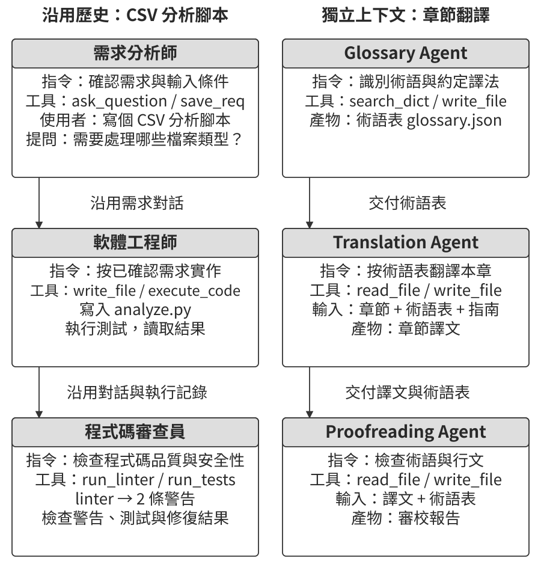

上下文各自獨立時，成員之間怎樣交換材料？分散式系統裡常用共享儲存或訊息傳遞來通訊。Agent 系統也用得到這兩種思路，具體做法包括：

- **工具呼叫參數。** 將下游 Agent 封裝成工具，上游透過參數傳入任務和結構化材料，再接收結果。
- **共享檔案系統。** 一方寫入文件、程式碼或資料，另一方按引用讀取，適合較大的中間產物與需要持久儲存的資料。
- **訊息匯流排（Message Bus）。** Agent 將訊息提交給中轉服務，由服務根據目標或訂閱關係投遞，適合多個成員之間的非同步交流。

例如，上游發出翻譯任務後，可以等譯文回傳，也可以先拿到任務編號，去處理另一章。即便兩位譯者都能開啟同一個檔案，系統仍要約定由誰寫、另一方何時讀取。Go 社群強調用通訊來組織對共享資料的存取，這一思路也適用於 Agent：明確誰擁有狀態、誰可以修改、其他成員怎樣取得更新。

### 維度二：協作拓撲

協作拓撲描述 Agent 之間的任務依賴、資訊流與控制關係。本章採用三種典型組織方式：

- **對等協作模式**（Peer Collaboration Pattern）。少量成員圍繞同一產物反覆協作。例如，起草者完成論文草稿，評論者提出修改意見，再由起草者修訂。
- **管理者模式**（Orchestration Pattern）。中心化的 Manager Agent 負責拆分、分配和彙總任務，子 Agent 承擔各自的專業工作。
- **去中心化模式**（Decentralized Pattern）。成員根據角色、訊息和局部狀態接續工作，各成員共同決定工作怎樣繼續推進。

> **術語說明：Graph 工程。** 第一章介紹了 2026 年 7 月關於 Graph 工程的討論。這一視角關注執行圖：節點可以是 Agent、普通程式或人工決策，邊表達依賴、條件路由和失敗後的處理方向，狀態沿執行關係傳遞。多 Agent 協作拓撲是這一設計視角的應用之一，重點在於多個決策單元怎樣交接、並行和回饋。

對等協作、管理者與去中心化設計可以組合使用。例如，Manager 將一項寫作任務交給起草者—審核者小組，小組完成內部迭代後再提交結果。

## 多 Agent 何時優於單 Agent

假設初稿把一個技術詞譯錯了。給兩個審校者相同的譯稿，可能得到兩次相同的認可；讓其中一人同時拿到原文、術語表和使用該詞的程式碼，就多了一條發現錯誤的途徑。選擇協作方式時，先問：新增的 Agent 為任務帶來了什麼？它可能獲得新的證據，覆蓋另一條搜尋路徑，提供不同的專業判斷，也可能透過並行執行縮短等待時間。

筆者首先檢查**回饋的資訊增量**，再看並行和上下文隔離能帶來多少收益。審核者讀到測試結果、頁面截圖或外部材料後，可以根據生成時尚未獲得的證據提出修改。表10-1 用幾種常見場景說明怎樣檢查這類增量。

表10-1 多 Agent 協作中的資訊與回饋

| 協作模式 | 主要資訊來源 | 評價重點 |
|---|---|---|
| 同一模型重新審查自己的輸出 | 原有材料與一次新的檢查過程 | 能否發現遺漏，修改後是否改善結果 |
| 多個 Agent 辯論同一問題 | 各自的解題路徑、假設與論據 | 觀點是否有差異，怎樣核實並選出答案 |
| 審核者執行測試並檢查程式碼 | 編譯、測試與執行回饋 | 修改能否通過測試並保持已有功能 |
| 審核者檢視前端或 PPT 的渲染結果 | 截圖與互動回饋 | 佈局、內容和操作是否符合要求 |
| 審核者使用外部工具核實事實 | 檢索與業務系統記錄 | 來源是否可靠，結論是否與證據一致 |

RLEF 透過強化學習訓練模型利用程式碼執行回饋，在競爭性程式設計任務中學習多步修訂。編譯錯誤、測試失敗和執行異常為下一次修改提供了具體依據，論文中的模型能夠以更少的取樣取得更好的結果。[^rlef-2025] WebGen-Agent 則把網頁截圖、視覺模型的描述與建議、GUI 操作評價接入生成流程，既可以退回上一步重做，也可以在幾種生成結果中擇優。在 WebGen-Bench 上，Claude 3.5 Sonnet 的準確率由 26.4% 提高到 51.9%。[^webgen-agent-2025]

[^rlef-2025]: Gehring, J., et al. *RLEF: Grounding Code LLMs in Execution Feedback with Reinforcement Learning.* arXiv:2410.02089, 2025.
[^webgen-agent-2025]: Lu, Z., et al. *WebGen-Agent: Enhancing Interactive Website Generation with Multi-Level Feedback and Step-Level Reinforcement Learning.* arXiv:2509.22644, 2025.

筆者會先讓系統取得測試、截圖或工具回傳等具體證據，再決定怎樣分配生成、執行和審核職責。回饋迴圈可以由一個 Agent 完成，也可以拆給多個角色；增加角色應當改善證據的獲取與使用。

Anthropic 2026 年的安全研究提供了協作搜尋的案例：45 個 Agent 透過共享論壇交流發現、互相審查，再由獨立 Agent 仲裁結果。研究報告中，協作叢集消耗 2700 萬 token，發現 266 個漏洞；獨立並行方案消耗 650 萬 token，發現 21 個。論壇讓成員能順著別人的發現繼續查，也能知道哪些方向已經有人在做。協作組還用了約四倍的 token，因此 266 與 21 的差距同時包含了通訊方式和計算投入的差異。[^anthropic-multiagent-2026]

[^anthropic-multiagent-2026]: Anthropic Frontier Red Team, 「Patterns and Problems in Emerging Multiagent Systems」, 2026-08-13.

數學研究中，怎樣讓多支隊伍真正探索不同的路線？三維 Navier–Stokes 方程描述黏性流體的運動。面對光滑的初始條件，解能否一直保持光滑？OpenAI 把兩種相反的目標分給不同小組：有的嘗試證明光滑性，有的設法構造反例。各組先自行探索，團隊再用 Codex 彙總中間成果，讓其他組也能沿有希望的線索走下去。找到反例的小組有約一萬個 Agent 並行工作。從首批 Agent 啟動到找到證明，團隊報告用時約 88 小時，另用 17 小時完成 Lean 形式化與驗證。反例有一個重要條件：流體受到光滑外力作用，仍能在有限時間內出現奇性。團隊據此給出了克雷數學研究所題面中 C、D 兩種表述所要求的反例；若去掉外力，就是另一個問題了。設計這類搜尋，可以先寫明哪些結果足以回答原問題，把彼此競爭的猜想交給不同小組，並給最後的驗證單獨留出時間。[^ch10-ns-search]

[^ch10-ns-search]: OpenAI 的研究說明《On the Navier–Stokes Millennium Prize Problem》附有證明和 Lean 程式碼。克雷數學研究所在 2026 年 9 月 11 日的公告中回應了這項工作，並說明成果評定與獎項歸屬將依照評獎程序處理。

**步驟預算如何影響表現？** 假設一個任務允許 30 步，Agent 需要緊湊地安排規劃、核心實作和必要驗證；若允許 300 步，就有空間比較更多方案，開展更充分的測試和修訂。要用好這部分資源，Agent 還需要知道總預算與剩餘預算，並據此安排探索深度。

Google 在 2025 年的《Budget-Aware Tool-Use Enables Effective Agent Scaling》中研究了這一問題：缺少預算意識的 Agent 可能很快停留在淺層搜尋，即使增加可用步驟，表現也難以繼續提高。2026 年的 BAVT（Budget-Aware Value Tree Search）進一步在搜尋步驟中結合價值估計與剩餘預算，調整探索和利用的權重。預算充足時可以比較更多方向，接近預算上限時則把資源集中到有希望的分支。

在管理者模式中，這意味著 Manager 要根據任務難度分配步驟，並隨進展調整：簡單任務儘快交付，複雜任務預留驗證與修訂空間，遇到阻塞時先定位原因，再決定補充資訊、增加預算或換一條路徑。

並行探索可以縮短牆鐘時間，反覆審核可以改善產物，但兩者都會增加模型呼叫與通訊開銷。筆者會以調校好的單 Agent 作為基線，只有新增成員帶來的品質提升或時間節省足以覆蓋通訊、重複計算和維護成本時，才擴大協作規模。

## 共享上下文的多 Agent 協作

共享上下文的協作按階段切換角色，同時沿用已有任務記錄。以研究報告為例，檢索角色先收集資料，分析角色接著計算，寫作角色再組織表達。每個角色都可以回看前面的來源和決定，系統則透過目前任務指令引導它關注本階段的目標。

跨團隊交接時，先問一句：哪些人需要知道當初為什麼這樣決定？在 Teamily AI 的產品示例裡，產品經理和 Agent 在群裡一起寫產品需求文件（PRD）。產品團隊把定稿分享給工程團隊後，工程師可以追問某條需求背後的取捨。

以檢索角色把任務交給寫作角色為例：交接後，模型從哪裡讀到寫作規程，還能呼叫哪些工具？實驗 10-1 用兩種方式實作同一次交接。

| 交接時要處理的問題 | 切換角色（`transfer_to_agent`） | 載入 Skill |
|---|---|---|
| 怎樣提供寫作規程？ | 換成寫作角色的系統提示詞 | 保留系統提示詞中的 Skill 目錄，把寫作規程追加到訊息歷史末尾 |
| 模型能看到哪些工具？ | 可以只展示寫作角色的工具 | 可以沿用原有工具集或工具搜尋入口 |
| 哪段 KV Cache 還能用？ | 系統提示詞變了，從前綴變化處起通常需要重新計算 | 原有請求前綴可以繼續複用 |
| 誰檢查呼叫權限？ | Harness 按目前角色校驗請求，再排程工具 | Harness 獨立檢查每次呼叫的權限 |

角色差異主要體現在知識、流程和寫作風格時，筆者優先使用 Skill：它便於複用同一執行框架，也能保留穩定請求前綴的快取。角色差異涉及權限、工具隔離或核准職責時，可以按獨立 Agent 或角色切換組織，再由 Harness 和執行環境落實存取控制。工具是否出現在模型輸入中影響呼叫選擇，實際權限由執行階段校驗決定。

> **實驗 10-1 ★★：共享上下文中的多角色轉換——系統提示詞與 Skill 的對比**
>
> 兩條路徑使用同一模型、使用者任務、工具實作、角色規程和共享歷史。入門示範要求查詢中國 2021—2023 年新能源汽車銷量，計算年複合增長率（CAGR），並寫一段不超過 120 字的投資人摘要。
>
> **路徑一：系統提示詞切換。** 設定 triage（需求收集）、research（檢索）、coding（程式設計）、data_analysis（分析）和 writing（寫作）五種角色。triage 為入口，每個角色看到專屬工具與 `transfer_to_agent`。移交時保留歷史，載入目標角色的提示詞與工具集，再繼續執行。
>
> **路徑二：載入 Skill。** 系統提示詞和工具全集在會話中保持穩定。模型呼叫 `load_skill(name)` 獲取角色規程，內容作為工具結果加入共享歷史，原有前綴繼續保留。Harness 根據權限規則檢查每次工具呼叫。
>
> 兩種實作讀取同一份 `SKILL.md`。在一次角色交接前後，各取一份發給模型的請求，看看規程出現在哪條訊息裡，哪一段前綴還能複用。再核對兩份摘要：銷量來源可信嗎？從 2021 年末到 2023 年末有兩個增長期，年複合增長率算對了嗎？
>
> 正式對照中有一道更嚴格的簡報題，限 160 個字元，還要保留兩個來源網址。同樣給八步機會，切換角色的一組把三次呼叫用在計算字元數上，草稿仍有 206 個字元，也漏用了題目指定的計算工具。載入 Skill 的一組用首尾兩年的銷量算出了增長率，第八步才載入寫作規程。此時該走的角色都走到了，使用者卻還沒收到摘要。兩條軌跡最終都因達到步數上限而結束。
>
> 同樣的 30 項任務各跑兩種實作，按程式檢查交付結果，載入 Skill 的一組通過 15 項，切換系統提示詞的一組通過 2 項。不過，逐題比較，前一組未命中快取的輸入多了 6,855 個 token，耗時多了約 4.4 秒（均為配對差值的中位數）。這次服務商在兩組請求中報告的快取輸入 token 數都為零。兩組在指令遵循的 6 項邊界測試中均全部通過，而完整任務的通過率相差很大。

## 不共享上下文的多 Agent 協作

在獨立上下文架構中，每個 Agent 分別維護輸入歷史、任務狀態和執行迴圈，透過工具參數、共享檔案與訊息交換所需資訊。例如，譯者交出的材料要註明原文段落和術語表版本。即使譯者退出，審校者也能找到原文；需要返修時，還能按章節找到負責人。

表10-2 對照了作業系統管理處理程序與執行階段管理 Agent 的方式。

表10-2 多 Agent 系統與作業系統的設計類比

| 作業系統 | 多 Agent 系統中的相近職責 |
|---|---|
| 程式及配置 | 系統提示詞、工具定義與角色配置 |
| 處理程序記憶體 | 目前上下文、任務狀態與歷史記錄 |
| CPU 執行計算 | LLM 生成決策，執行階段與工具執行相應操作 |
| 核心管理執行 | Agent 執行階段管理狀態、排程與資源 |
| 系統呼叫 | 透過工具介面請求外部操作 |
| fork：建立子處理程序 | `spawn_subagent`：建立子 Agent |
| kill：傳送訊號 | `cancel_subagent`：請求取消 |
| ps：查詢處理程序 | `list_agents`：查詢成員及執行狀態 |
| 退出狀態與 wait | 完成通知、任務狀態與結構化結果 |
| 共享儲存與訊息傳遞 | 共享檔案、工具參數與訊息 |

私有狀態、非同步訊息和動態建立成員，也出現在 1970 年代提出的 Actor 模型中。[^actor-model]

[^actor-model]: Hewitt, C., Bishop, P., Steiger, R. *A Universal Modular ACTOR Formalism for Artificial Intelligence.* IJCAI 1973.

獨立子任務較多時，筆者傾向於為各成員設定獨立上下文，讓它們只處理與職責有關的材料。這樣便於分別測試角色，也減少了前一階段的冗長歷史對目前判斷的干擾，並能讓多個任務並行推進。隔離的效果還取決於其他共享資源：多個 Agent 仍可能同時修改檔案、消耗同一個 API 配額，或接收同一條錯誤訊息。

協作介面還要處理訊息丟失、重複交付和狀態滯後。排查問題時，可以用任務標識關聯各成員的請求、工具事件與結果，重建一次交接的過程。

假設一個 Agent 做完分析，要把結果交給寫報告的同伴。數值很少，可以隨訊息發；若產物是一份大表，通常把表存入共享檔案系統，訊息裡附上引用。這就有了兩項分工。**產物儲存**儲存和交換文件、程式碼及資料，**通訊與控制**負責投遞訊息、查詢任務狀態、取消執行和排程資源。

### Agent 眼中的檔案系統

一種常見設計是向 Agent 提供**虛擬檔案系統**（virtual filesystem），將不同來源的資源掛載到統一目錄樹。模型透過 `read_file`、`write_file` 和 `list_dir` 等介面存取，底層可以連接本機暫存磁碟、持久物件儲存、第三方雲端硬碟 API 或系統資源包。

筆者會先劃清儲存區域，再接入協作流程。臨時草稿、正式交付物與使用者外部檔案若混在一起，容易發生誤覆蓋或越權讀取。統一介面便於使用，各區域的可見性、生命週期和權限則由掛載與存取控制配置決定。可以把這棵目錄樹分成四類區域。

**一、Agent 專屬工作區（Scratchpad）。** 每個實例使用自己的工作區，儲存草稿、臨時檔案、除錯日誌和中間產物。預設將存取範圍限制在所屬 Agent，並按任務策略清理或歸檔。這樣可以避免臨時檔案互相覆蓋；子 Agent 完成工作後，再把需要交付的結果放入共享空間，連同結構化摘要交給主 Agent。試錯記錄保留在原工作區，供後續診斷。這也把上下文隔離落實到了儲存層：主 Agent 取得交付結果和必要證據，日常協調時省去讀取全部試錯過程的開銷。

**二、多 Agent 共享空間（Shared Workspace）。** 協作成員在這裡交換產物，使用者也可以透過授權入口上傳材料、下載交付物。例如，Glossary Agent 寫入術語表，Translation Agent 讀取後翻譯，審核者再檢查譯文。共享空間通常隨任務持久儲存，需要處理並行寫入、版本更新和存取範圍。第六章中，Agent 與虛擬電腦透過共享儲存交換 CSV 和圖表，就是這種產物交接的實例。後文將介紹樂觀鎖與工作副本隔離等方法。

**三、外部掛載資源（Mounted External Resources）。** Google Drive、Notion、Dropbox 和企業 Wiki 等資源可以透過適配器對應到統一介面。Agent 讀取文件時，適配器負責呼叫來源系統 API。這裡要管理三類差異：存取範圍取決於外部授權；網路存取帶來延遲、超時與快取更新問題；寫回操作需要符合來源系統的權限與版本規則。具體一致性語義由服務介面決定，可以利用版本號、條件寫入或重新讀取來檢查並行修改。按需唯讀掛載適合資料檢索，需要編輯時再授予相應寫權限。

**四、系統內建資源（Built-in System Resources）。** 參考手冊、範本、工具定義和預置 Skills 可以作為唯讀資源包供多個 Agent 使用。Skills 按漸進式披露載入：先提供目錄，再按任務讀取規程與指令碼。固定版本的資源包便於並行讀取，升級時透過版本切換讓執行中的任務保持一致。

圖10-2 中，譯者可以在自己的目錄裡反覆改草稿，準備好交給審校時，再把相應版本放到共享區。使用者雲端硬碟裡的原稿由外部適配器讀取，存取它還要看使用者授予的權限。

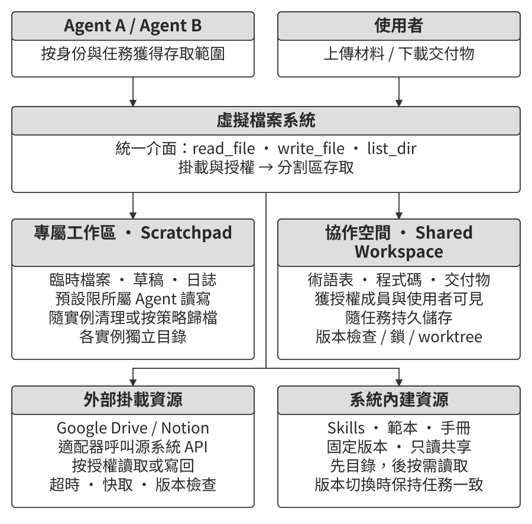

譯者退出後，工作區裡的臨時檔案可能隨之釋放。放進共享區的譯稿可以繼續保留，審校者憑讀取權限接手（表10-3）。

表10-3 Agent 虛擬檔案系統的四類區域

| 區域 | 可見性 | 生命週期 | 讀寫 | 並行管理 |
|---|---|---|---|---|
| Agent 專屬工作區 | 預設限所屬 Agent | 隨實例清理，按需歸檔 | 所屬 Agent 讀寫 | 防止重試或背景操作重複寫入 |
| 多 Agent 共享空間 | 獲授權的成員與使用者 | 隨任務持久儲存 | 按角色授權 | 鎖、版本檢查或 worktree |
| 外部掛載資源 | 由外部授權與適配器共同限制 | 由來源系統與快取策略決定 | 按需唯讀或授權寫入 | 遵循來源系統版本與並行介面 |
| 系統內建資源 | 獲授權的 Agent | 固定版本跨會話複用 | 唯讀 | 統一切換資源版本 |

檔案引用可以讓交接訊息保持簡短：上游提供產物位置、版本和用途，下游按需讀取內容。位於同一執行環境的成員可以使用共享路徑；跨組織協作則需要雙方都能解析的產物標識、存取介面和授權，才能完成同樣的交接。

### Agent 間的通訊與控制

第四章介紹的建立、通訊、取消和發現工具，為多 Agent 協作提供了基本控制介面：`spawn_subagent` 建立成員，`send_message_to_subagent` 傳遞訊息，`cancel_subagent` 請求取消，`list_agents` 查詢成員。圍繞這些介面，還要約定訊息、狀態、終止和排程的行為。

**一、訊息傳遞。** 成員少、關係固定時，可以使用點對點介面，例如電話 Agent 與電腦 Agent 直接交換進展。若所有成員都需要兩兩通訊，潛在關係數會隨成員數按平方增長；訂閱關係較多時，訊息匯流排便於統一管理路由、緩衝和重試。點對點與匯流排都可以實現非同步投遞，是否要求接收方同時線上取決於佇列和持久化機制。

訊息通常包含一個結構化**信封**（envelope）：傳送者 ID、目標 Agent 或廣播範圍、訊息類型與負載。訊息類型可以包括 `task_assigned`、`status_update`、`result` 和 `terminate`。任務標識、訊息標識與關聯請求幫助接收方去重，也讓除錯工具能夠重建通訊鏈路。業務內容放在 JSON 負載中，雙方按約定欄位處理。

例如，一份譯稿由編輯負責交付，編輯想請術語審核 Agent 核對一個詞。在 Multica 的工單評論中點名（`@`）它並寫下問題，就能觸發審核工作。審核意見可以直接回覆到這張工單，負責人仍是編輯，工單狀態也保持原值。如果希望審核者接手整張工單，還要明確更改負責人。[^ch10-multica]

[^ch10-multica]: Multica，評論中點名 Agent；版本 `d579273` 的評論派發實作。

**二、狀態獲取。** 主 Agent 需要知道子任務是否仍在執行、是否需要輸入，以及結果是否可取。可以組合使用狀態介面、事件通知和進度檔案：執行階段介面提供生命週期狀態，訊息說明業務進展，持久檔案保留可恢復的記錄。

`get_subagent_status(agent_id)` 可以回傳執行中、需要輸入、已完成或失敗等狀態。日常協調中，筆者優先使用完成通知和階段進度訊息，讓主 Agent 繼續自己的工作。通知延遲、連線恢復或需要排查問題時，再主動查詢，避免把模型呼叫消耗在頻繁詢問「結束了嗎」上。狀態介面由執行階段維護，可以及時報告處理程序是否存活、任務是否結束。

**用訊息交換進展。** 主 Agent 可以詢問目前進度，子 Agent 在合適的步驟回覆；子 Agent 也可以在取得階段結果、遇到阻塞或需要幫助時主動發布 `status_update`。訊息內容應說明已完成事項、下一步和阻塞原因，各成員使用同一套狀態名稱，便於彙總與判斷。後文的 A2A 協定將介紹任務生命週期的標準化表達。

**用檔案儲存進度。** 系統可以將訊息、工具請求、工具結果和狀態變化按事件順序追加到日誌中，例如採用每行一個事件的 JSONL 格式。獲得診斷權限的主 Agent 或運維工具可以據此檢查重試、錯誤與等待過程。模型輸入歷史只是執行軌跡的一部分，日誌還可以記錄排程和外部執行事件。

完整軌跡可能包含數萬 token，主 Agent 每次讀完還要重新提煉狀態。訊息通知主 Agent 有了新進展，簡短的進度檔案則儲存目前狀態，供後續查詢與恢復使用。筆者優先用這兩者配合完成日常協調。子 Agent 每完成一項工作，就更新任務清單、產物引用和目前阻塞點；主 Agent 根據這些欄位決定下一步。詳細軌跡保留供按需排查。若進度長時間沒有變化，可以結合心跳、工具呼叫狀態和任務超時設定判斷是否需要介入：長時間執行的工具可能仍在工作，確認狀態後再決定等待、取消或重試。

**三、執行終止。** 多個成員並行尋找同一目標時，其中一個完成任務後，其他分支可以停止，以釋放預算與工具資源。取消分為兩種強度，與 Unix 中 SIGTERM 和 SIGKILL 的作用相近。

筆者優先採用**優雅終止**：由執行階段傳遞取消請求，子 Agent 在安全點停止新操作，儲存必要進度、關閉瀏覽器會話並釋放鎖，隨後回傳確認（ack）。**強制終止**用於超過取消期限仍未回應的執行，由執行階段結束處理程序，再檢查殘留資源和未完成寫入。已經提交到外部系統的操作還需要查詢結果，必要時執行補償流程。

生命週期也需要沿建立關係管理。借鑑 Go 的 context，可以讓父任務的取消訊號向下傳播到整棵子任務樹，執行迴圈在安全點檢查取消訊號，對應 `ctx.Done()` 的用途。這樣，父任務結束後，它啟動的分支也會進入清理流程，避免無人管理的 Agent 繼續呼叫工具和消耗預算。確實需要長期獨立執行的背景任務，則建立獨立的生命週期上下文，類似使用 `context.Background()`，同時指定負責監控、預算和清理的管理者。

**四、資源與排程。** Agent 系統需要分配 token、步驟、並行額度、工具連線和計算資源。啟動子任務時設定預算與超限行為；根據任務難度選擇模型；限制並行呼叫，避免集中耗盡服務配額。更緊急的任務到達時，可以在安全點暫停或取消低優先順序任務，儲存進度後重新排程。

假設三個分支各查一種可行方案，其中一個已經找到關鍵線索，只差最後一次驗證。Manager 可以多給它幾步，同時結束兩個沒有進展的分支。額度由執行階段扣減；某個分支即使還想再試，預算耗盡也得停下來。

### 對等協作模式：相互檢查與迭代改進

對等協作通常由兩三個 Agent 圍繞同一任務交換意見、修訂產物。設計時，可以先為成員安排不同的職責、材料和工具，讓它們獨立判斷，再彙總結果。例如，生成者關注實作，審核者關注測試與使用者要求；不同專業成員分別檢查各自領域的約束。模型、輸入和工作流程越相似，成員越容易重複同一種判斷，因此需要主動設計視角與證據的差異。[^anthropic-multiagent-2026]

對於圍繞同一產物反覆改進的任務，筆者建議先從兩三個成員的對等協作開始。角色、交接內容與停止條件明確後，就能建立可測試的迴圈，初期協調工作也較少。

#### Loop 工程

對等協作可以幫助處理一個常見問題：**過早終止**。以程式設計和客服代辦為例，可以從三種記錄發現過早終止。

- **部分完成後宣稱全部完成。** Coding Agent 寫完程式碼，卻遺漏測試和部署檢查；使用者委託助手辦兩件事，它完成第一件後便彙報全部辦妥。需要逐項對照任務清單，檢查每項工作的完成證據。
- **一條路徑失敗後提前放棄。** 商家可能要求改用表單提交材料，或透過指定信箱接收附件。收到這樣的回覆，可以按商家接受的方式接續辦理。需要記錄失敗原因，並判斷還有哪些路徑值得嘗試。
- **局部成功後遺漏後續步驟。** 如果商家同意退款後還要求使用者在 App 中確認，助手需要交代這一步和操作條件。以帳單減免為例，客服在電話中口頭答應，助手就能向使用者確認本次協商取得了承諾。通話記錄可以證明客服說過什麼，後續帳單是否兌現則需要新的證據。審核者應分別說明已取得的結果、還有誰要做什麼，以及哪些結果暫時看不到。

這三類問題都要求把完成條件落實到可檢查的結果。**Loop 工程**關注如何讓 Agent 持續經歷「確定下一項工作—執行—驗證—記錄進度」的迴圈，並根據結果決定繼續、等待、移交或結束。工程師需要設計任務來源、驗證方式、持久狀態和停止條件。人的工作也隨之擴展：從為一次呼叫編寫提示詞，轉向設計能夠持續推進任務的迴圈。Addy Osmani 在 2026 年 6 月用這一名稱討論了這組實踐，並引用 Boris Cherny 的經驗：工作重心逐漸轉向設計能夠驅動 Agent 的迴圈。[^loop-engineering-2026]

**在這類迴圈中，筆者認為驗證器往往是關鍵瓶頸。** 驗證不可靠，增加輪數就可能讓系統重複同類錯誤，或過早宣布完成。測試結果、業務狀態與使用者確認提供各自範圍內的完成依據；驗證失敗則成為下一輪修訂的輸入。

實踐先於命名。在 Loop 工程這一名稱流行之前，筆者與團隊在 Pine AI 中就已經用迴圈與驗證處理過早終止。提議者—審核者是組織這類迴圈的一種常用方式，下面會進一步展開。

[^loop-engineering-2026]: Osmani, Addy. 「Loop Engineering」, 2026.

**LoopX：儲存跨輪次的工作狀態。** LoopX 將目標、邊界、待辦、門禁、證據與配額放在持久控制面中，由它安排下一輪或下一位執行者的工作。流程可以概括為：**控制面決策 → Agent 執行 → 獨立驗證 → 提交已核實進度**。

Agent 呼叫工具、推理並交出本輪成果。控制面記錄已經完成的工作，決定下一輪從哪裡繼續。驗證通過後提交完成狀態；失敗時進入修復或重規劃。人工門禁、等待條件與預算上限共同決定何時可以繼續執行。[^loopx-framework]

[^loopx-framework]: LoopX, The local control plane for long-running AI agent work, v0.4.0.

**LongHorizon-Harness：銜接跨應用的長任務。** 這一框架從多模態 Computer Use 出發，處理任務在 GUI、CLI、多個桌面應用和多次上下文重新整理之間的連續執行。它採用 Manage–Execute–Audit（MEA）迴圈：Manager 根據原始目標、核實進展、失敗證據與剩餘工作，生成一項範圍明確的子任務；Executor 在新的上下文中執行 GUI 或 CLI 操作；Auditor 以唯讀方式檢查結果，再把核實的進展寫入下一輪狀態。失敗證據也隨之保留，供恢復與重規劃使用。

框架透過適配層呼叫 Claude Code、Codex CLI 等執行後端，將外層的任務管理與後端的執行迴圈銜接起來。這條路線把長任務的連續性落實到已核實的任務狀態上。執行上下文可以重新整理，下一輪仍能依據目標、完成證據和未解決事項繼續工作，並重新檢查環境變化是否影響原有結論。[^longhorizon-implementation]

論文在保持 Qwen 3.7-Plus 與 Claude Code 執行後端相同、改變外層迴圈的對照中，報告 WeaveBench PassRate 從 51.8% 提高到 80.7%，OSWorld 2.0 二元完成率從 2.8% 提高到 8.3%，Terminal-Bench 2.1 成功率從 69.7% 提高到 77.2%。相應成本也隨任務變化：前兩個基準分別消耗基線 2.3 倍的總 token 和 3.6 倍的輸出 token；Terminal-Bench 2.1 的 token 消耗減少了 24%。

在同一項 WebRTC 多層流稽核任務中，基線執行者在 Wireshark 介面上卡住，隨後又試了幾次，最後得分 0.59。使用 MEA 時，審核者記下缺少的證據，下一輪執行者據此補查，最後得分 0.92。

[^longhorizon-implementation]: LongHorizon-Harness，論文編號 arXiv:2608.01964。基線與 MEA 的公開軌跡均取自任務 WEB_task_16_webrtc_simulcast_layer_audit，重現指令碼使用提交 `53bc678`。

#### 提議者—審核者範式

提議者—審核者將產物生成與結果檢查交給兩個角色。第五章的 PPT 生成、影片編輯和日誌視覺化實驗採用了這一設計：Proposer 生成程式碼，Reviewer 檢視渲染結果，藉助視覺模型檢查品質，並回傳結構化修改意見。圖10-3 中，修改意見還要回到提議者手裡。它能否據此修好下一版，取決於審核者能把問題定位到多細。

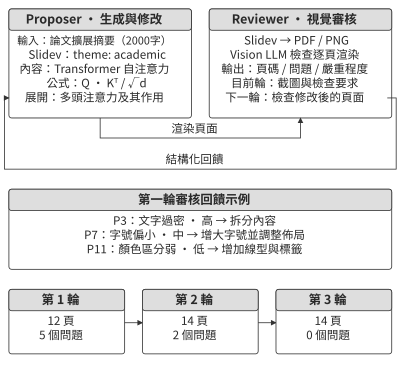

檢查對象換了，審核時要看的證據也要換。審核客服回覆，要對照業務規則和事實來源；審核程式碼變更，要看測試和實際執行結果；審核操作方案，則要核對適用規範和前置條件。

Huang 等人的 ICLR 2024 論文《Large Language Models Cannot Self-Correct Reasoning Yet》發現，在其研究的推理任務與提示設定下，GPT-4 缺少外部回饋時進行自我修訂，會出現把正確答案改錯、導致整體準確率下降的情況。TACL 的自我糾錯綜述進一步討論了任務條件與回饋可靠性怎樣影響修訂效果。[^self-correction-survey] 因此，筆者把獨立證據與可定位的修復條件作為審核迴圈的基本要求。審核者應能讀取實際測試、環境狀態或渲染結果，並指出哪個要求尚未滿足、怎樣驗證修復。

[^self-correction-survey]: Kamoi, R., et al. *When Can LLMs Actually Correct Their Own Mistakes? A Critical Survey of Self-Correction of LLMs.* TACL, 2024.

一個完整迴圈可以按五步組織：

1. 提議者按任務要求寫出第一版，例如一份答覆或一段程式碼。
2. 執行或渲染產物，取得測試、業務狀態、截圖或事實核驗結果。
3. 審核者對照要求與證據，給出通過結論，或指出問題位置及修復條件。
4. 仍有預算時，提議者按回饋修訂，再執行和審核；遇到需要輸入或授權的問題時轉入等待或移交。
5. 達到發布條件後，交付通過審核的版本，並附上驗證證據和審核結論；預算耗盡時保留進度與未解決問題。

審核者讀取受保護的測試與發布標準，提出的標準變更另行審查。

在 CRITIC 的實驗中，模型先給出回答，再借助工具檢查。[^ch10-critic]例如，用搜尋引擎核實回答中的事實，用 Python 直譯器執行自己寫的數學程式。在開放問答、數學程式生成和減少有害表述三類任務上，模型根據工具回饋修改後，表現均有改善。只憑模型自己評價原答案，糾錯效果較弱。這個設計與第五章的 PPT 案例相通：渲染截圖能暴露程式碼文字中難以直接判斷的排版與遮擋問題，測試執行則能揭示實際執行錯誤。

[^ch10-critic]: CRITIC，arXiv:2305.11738。

Anthropic 2026 年的長程應用開發案例採用規劃者、生成者和評估者三個 Agent。規劃者將需求展開為產品規格；生成者與評估者先約定每輪完成標準，再分別實作和檢查。評估者使用 Playwright 操作應用並提交缺陷報告，角色之間透過檔案交接狀態。該案例展示了產品規格、真實操作和缺陷回饋怎樣連接起來，也需要將增加的執行與審核成本納入方案比較。[^anthropic-harness-2026]

[^anthropic-harness-2026]: Prithvi Rajasekaran, 「Harness Design for Long-Running Application Development」, Anthropic Engineering, 2026-03-24.

2026 年 11 月 20 日，數學家 Levent Alpöge 公布了他與 Claude 合作得到的形式化證明，涉及黎曼猜想及其在狄利克雷 $L$ 函式上的推廣。拿到一大批 Lean 檔案，審核者先要問兩個問題：最後那條定理寫的是原來的猜想嗎？每一步推導都能由證明核心重新檢查嗎？MIT 數學家 Andrew Sutherland 先比對了提交的定理與 Lean 數學庫中黎曼猜想的定義，再列出證明所依賴的公理。他在當天公布的記錄中還報告，獨立證明核心 nanoda 已檢查通過匯出的證明。這給審核分工提供了一個具體辦法：讓熟悉問題的人先寫下驗收命題，再讓獨立的工具檢查提交的產物能否推出這個命題。日後數學家想理解作者是怎樣想到這條路線的，還需要一份便於人閱讀的論證。[^ch10-rh-review]

[^ch10-rh-review]: Levent Alpöge 於 2026 年 11 月 20 日公布研究說明。核驗專案及其當日進度見 Andrew Sutherland 的《Verification files for the Lean proof of the Riemann Hypothesis》。

#### 辯論模式

辯論模式讓成員從不同立場檢查同一問題。例如，評估技術方案時，一位 Agent 說明收益與適用場景，另一位檢查約束、失敗條件和替代方案。每輪圍繞具體論點補充證據或提出反駁，最後彙總已達成共識的事項與仍需驗證的分歧。

這種安排有助於清楚列出正反論據，效果則取決於論據品質、獨立判斷和最終選擇方法。Tran 與 Kiela 在多跳推理任務中比較了順序、辯論、集成（ensemble）、並行角色和子任務並行五種架構；控制相同的思考 token 預算後，單 Agent 表現與多 Agent 持平或更好。[^single-agent-2026] 據此，筆者把辯論主要用於展開分歧、檢查假設和補齊反面論據。追求事實或計算正確率時，優先增加可核驗的證據與獨立檢查。

論文藉助資料處理不等式討論中間資訊傳遞的侷限：反覆轉述與壓縮可能丟掉原始細節。工程上可以保留可追溯的來源，讓成員先獨立分析，再交換結論，減少未經檢查的共識。多次獨立取樣後聚合，以及利用「生成較難、驗證較易」的任務特點安排專門審核，也可以與辯論配合使用。

[^single-agent-2026]: Tran, D., Kiela, D. *Single-Agent LLMs Outperform Multi-Agent Systems on Multi-Hop Reasoning Under Equal Thinking Token Budgets.* arXiv:2604.02460, 2026.

#### 頭腦風暴模式

頭腦風暴可以分兩輪：先讓每位成員獨自想辦法，再一起討論哪些想法可以組合。例如，Agent 1 提議增加社交分享功能；Agent 2 在此基礎上提出自動生成個性化分享海報；Agent 3 進一步提出使用者自定義範本與範本市場。

為了讓成員想出不同的辦法，可以請它們分別從使用者和營運者的角度出發，也可以給它們不同的提示詞或模型。交換想法後，再按使用者需求、實作成本和驗證結果篩選方案。

#### 專家小組模式

專家小組圍繞跨領域問題分配專業職責。例如，評估新產品時，工程師 Agent 分析實作難度與技術依賴，產品 Agent 檢查使用者需求與體驗，營運 Agent 估算成本、資源和落地條件。

在 LobeHub 的群聊裡，主持者可以把同一個產品方案廣播給這三位專家。系統先取出此刻的群聊記錄，再讓三位成員分別用各自的角色配置同時回答。三份答覆都掛在發起廣播的那條訊息下，便於回頭核對各人回答的是哪個問題。假如營運要按工程師剛估出的用量來算成本，就得等這輪答覆寫回後再請營運發言：兩人同時起筆時，營運手裡還沒有那個數字。[^ch10-lobehub]

[^ch10-lobehub]: LobeHub，群聊使用說明；版本 `ab21e0d` 的並行廣播實作。

彙總時要找出各判斷之間的關聯：某個體驗目標需要怎樣的技術支援，技術選擇會增加多少營運成本，哪些條件還需要外部證據。

### 管理者模式：中心化協調

當任務包含較多子任務、複雜依賴或動態排程時，可以由 Manager Agent 統一規劃。它先理解整體目標，再拆分工作、選擇成員、跟蹤進度，遇到異常時決定重試、換人或調整計畫，最後整合結果。

一種常用實作是把專門 Agent 註冊為工具。Manager 透過工具介面傳入任務、約束和必要材料，再接收結構化結果或任務標識。這樣，搜尋、檔案操作與子任務委派可以採用相近的呼叫方式；長耗時子任務則另外管理進度、取消和重試。不同成員可以使用不同模型、提示詞、工具與執行環境。新增成員時，除註冊介面外，還要讓 Manager 理解它的職責、輸入要求和適用場景。

筆者在 Claude Code 和 Codex 裡做長任務時，曾把討論、執行命令和測試都放在主會話。中途想追問一個設計選擇，往往要等手上的步驟收尾；幾小時後再找當初的約定，又要翻過一長串命令輸出。後來我把修改和測試交給子 Agent，主會話留著討論。拿書稿校對來說，執行者可以繼續核對圖號，我同時能和讀者討論某一段要不要重寫。若討論改變了任務範圍，還要把新約定發給執行者，並在它交稿時對照檢查。

DeepSeek Harness 團隊公開了一個面向單個 GitHub 儲存庫的研究原型 `dsh-superagent`。以修復匯出檔案的日期格式為例：維護者在 Issue 中提出要求，路由器（Router）按儲存庫規則判斷能否接單。接單後，系統建立工單（Ticket），給執行者（Worker）分配獨立的會話和工作目錄。執行者可以在自己的目錄中修改程式碼、執行測試；另一張工單可以同時推進，各自保留修改過程和測試結果。[^ch10-dsh-prototype]

假設維護者隨後在原 Issue 中補充「只改 CSV，保留 JSON 的日期格式」。訂閱這段討論的在辦工單會收到補充訊息，執行者可以據此縮小改動範圍，分別測試兩種格式。完成後，它可以開一個拉取請求（PR），把連結和結果回貼到原 Issue。維護者在同一處就能看到最初的要求、後加的限制和待審核的修改；路由器也無需把每一條跟進訊息重新拆成任務。

[^ch10-dsh-prototype]: DeepSeek Harness 團隊，dsh-superagent 研究原型。工單如何接收後續訊息見授權與訂閱，執行會話與工作目錄見執行機制。

Manager 同時承擔了較多決策責任。任務分解錯誤會影響後續執行，交接材料不足會造成反覆詢問，過多呼叫記錄也會擠佔上下文。設計時應儲存簡明的任務狀態與產物索引，按需讀取細節，並讓子任務具有清楚的輸入、輸出和完成標準。

Plan-and-Act 在 Planner—Executor 架構中研究了規劃品質對長任務的影響，在 WebArena-Lite 上報告了 57.58% 的成功率。[^plan-and-act-2025] 規劃錯誤會讓多個執行者沿著錯誤的拆分繼續工作，增加成員還會放大返工。筆者因此優先檢查 Manager 的任務分解品質；瓶頸在規劃時，把更強的模型、更完整的任務資訊和更充足的推理預算分配給 Manager。子任務邊界明確後，再為執行者選擇合適的配置。

[^plan-and-act-2025]: Erdogan, L. E., et al. *Plan-and-Act: Improving Planning of Agents for Long-Horizon Tasks.* arXiv:2503.09572, 2025.

並行任務還需要明確怎樣收尾。若目標是找到一個符合條件的結果，可以在驗證通過後，以原子操作登記第一個通過驗證的結果，再取消剩餘分支，等待取消確認或超時，最後彙總交付。登記操作應同時滿足原子性和冪等性：兩個結果同時到達時，只發生一次狀態轉換；同一事件重複投遞時，沿用已有處理結果。鎖、事務或比較並交換都可以用於保護這一步。

可以用 Python 自帶的 SQLite 看一次具體交接。假設甲、乙兩個成員並行核對資料，各自提交的結果都已通過驗證。Manager 只需要一份合格結果，用一行任務記錄記下誰先提交。下例中，甲先提交，乙隨後提交，甲又重試了一次。

```python
import sqlite3

db = sqlite3.connect(":memory:")
db.execute("CREATE TABLE task (id INTEGER PRIMARY KEY, winner TEXT)")
db.execute("INSERT INTO task VALUES (1, NULL)")
for worker in ["甲", "乙", "甲"]:
    with db:
        claimed = db.execute(
            "UPDATE task SET winner = ? WHERE id = ? AND winner IS NULL",
            (worker, 1),
        ).rowcount
    print(worker, "登記成功" if claimed else "沿用已登記結果")
```

輸出依次為「甲 登記成功」「乙 沿用已登記結果」「甲 沿用已登記結果」。如果乙先到，表裡記下的就是乙。一條更新語句同時檢查「還沒有人登記」並寫入提交者的名字；把檢查和寫入拆開，兩個執行者就可能都讀到空值。

上例把表建在記憶體中，處理程序退出，登記也就消失了。換成持久資料庫，還有一個交接問題：Manager 已經登記了甲，卻沒來得及通知乙就退出了。重啟後，誰知道這條通知還沒發？可以在同一筆事務裡寫入已選定的結果和待發通知。每條通知記下收件分支、要做的事和唯一編號。Manager 重啟後補發尚未確認的通知。即使乙已清理完畢、只是確認訊息丟了，它也能憑原編號認出重發的通知，直接回傳上次的處理結果。交付事件同樣可以這樣記錄。

若任務要求收集全部結果，則要等所有必需分支結束，並分別記錄成功、失敗和未完成項。收尾條件來自任務目標，也決定了何時能夠取消其他成員。

**順序協調。** 子任務有先後依賴時，Manager 要等上一步的產物可用，才能分派下一步。圖10-4 以撰寫報告為例：收集資料的成員先交回來源，分析者據此整理結論，寫作者最後拿到有依據的分析。換成下一項翻譯任務，譯者開工前需要等哪份材料？

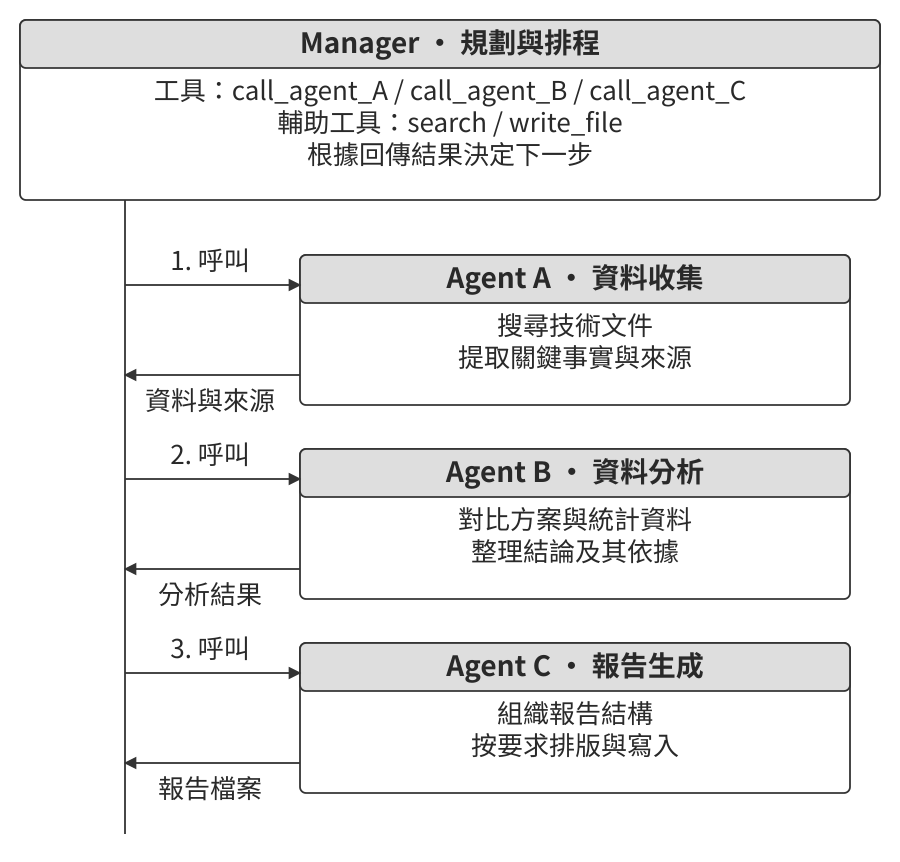

> **實驗 10-2 ★★：書籍翻譯 Agent**
>
> 翻譯技術書籍需要同時處理術語、語境和行文。例如，英文 agent 可以有不同譯法，如果譯稿約定使用「智慧體」，後續章節就應沿用同一譯法。術語表、章節原文、譯文和審校記錄需要有清楚的組織方式。一本長書連同中間譯稿、工具結果和審校歷史會不斷擠佔上下文，模型可能到第九章已經忘記第二章的譯法，也可能反覆檢查同一段內容。把任務按職責和章節拆開，可以讓每個實例集中處理目前職責所需的材料。
>
> 可以將工作分給四類 Agent：
>
> - **Glossary Agent：整理術語。** 分批閱讀全書，識別反覆出現的專業術語，參考專業詞典與翻譯規範，生成包含英文術語、中文譯法、詞性和使用語境的 JSON 或 CSV 對照表。術語表儲存到共享空間，任務結束後釋放該實例。
> - **Translation Agent：翻譯章節。** 讀取目前章節、相關術語和翻譯指南，按照目標讀者與語言風格完成譯文。新出現的術語給出候選譯法並標記待審。每個實例維護獨立上下文，譯文儲存到共享空間；不同章節可按依賴依序或並行處理。
> - **Proofreading Agent：審校全文。** 根據術語表和各章譯文檢查譯法、前後表述與可讀性。透過分章讀取和跨章索引完成全文檢查，將問題位置、依據與修改要求寫入審校報告。
> - **Manager Agent：安排與回收任務。** 維護目標、計畫、任務狀態、呼叫摘要和產物索引，根據審校報告把需要修改的章節交回翻譯者，再組織複查。
>
> 圖10-5 中，審校者讀各章譯文和術語表，Manager 根據報告決定哪些章節需要返修。接到返修任務的譯者可以調出本章原文，核對被標記的詞在那句話裡是什麼意思。
>
> 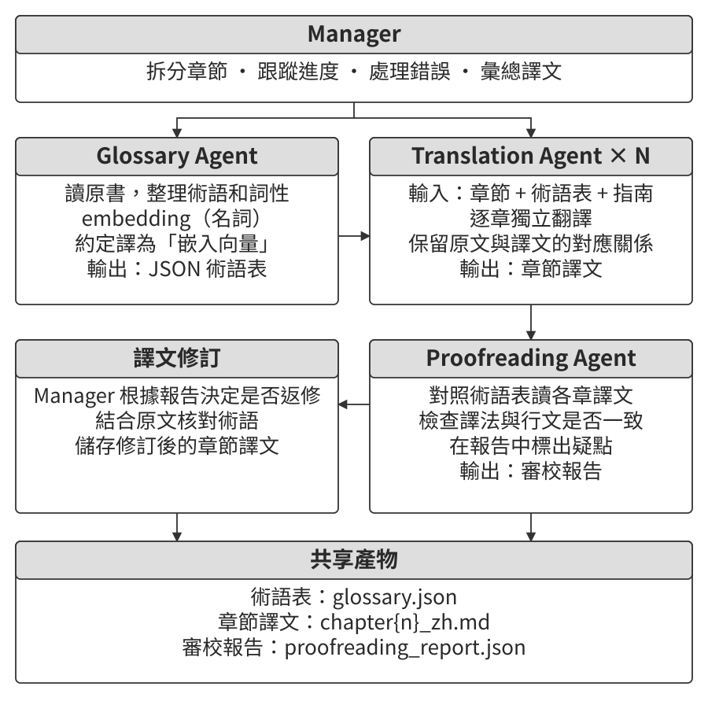
>
> 把譯稿寫進檔案後，哪一次呼叫還需要讀長文？配套實驗把英文版前兩章拆成 26 個翻譯單元。單 Agent 一路帶著先前的原文和譯文，最大一次請求輸入了 94,355 個 token。分工後，譯者最大一次輸入只有 2,857 個 token，Manager 做返修決策時用了 2,153 個。管理者組中輸入最多的其實是術語整理者：它一次讀兩章，用了 49,807 個 token。
>
> 翻完這兩章，四個角色合計用了 203,277 個 token，單 Agent 用了 1,317,808 個。哪一組先交稿？四角色組花了約 271 秒，比單 Agent 多用約 17 秒。
>
> 交稿時，兩種檢查對同一份譯文給出了不同結果。術語表給名詞 `embedding` 指定了「嵌入向量」這個譯法。審校報告沒有列出要返修的章節，術語檢查程式卻給這個詞記了 0/2：兩章譯稿裡都找到了「嵌入」，都沒找到「嵌入向量」。該把兩章都退回去嗎？
>
> 第一章講退款政策的段落裡，原文是 `embedding the refund policy in the context`，譯文是「將退款政策嵌入上下文中」。這裡說的是把政策放進上下文，改成「嵌入向量」反而會改錯。程式按章查字串，能幫審校者找到複查線索；要決定哪一處應改，審校者還需要那一段原文。術語表更新時，也可以先定位受影響的段落，再把原文、譯文和新詞條一起交給譯者。
>
> **實驗要求：**
> 1. 選擇一本包含圖表和程式碼的技術書籍。
> 2. 實作 Manager、Glossary、Translation、Proofreading 四類 Agent。
> 3. 記錄各成員的上下文用量、交接材料和產物版本。
> 4. 與單 Agent 方案比較翻譯品質、完成時間和資源消耗，分析任務拆分與上下文組織的影響。

**並行協調。** 相互獨立的子任務可以同時執行。Manager 負責分配任務、接收狀態，並根據結果決定繼續、補充工作或結束。翻譯這本書時，術語表一經確認，不同章節就能分給多位譯者同時開工。圖10-6 換成了研究報告：圖表已經完成，分析仍在進行，為什麼格式校驗還得等？沿成員上報的事件，可以看出最後一步依賴哪兩份產物。

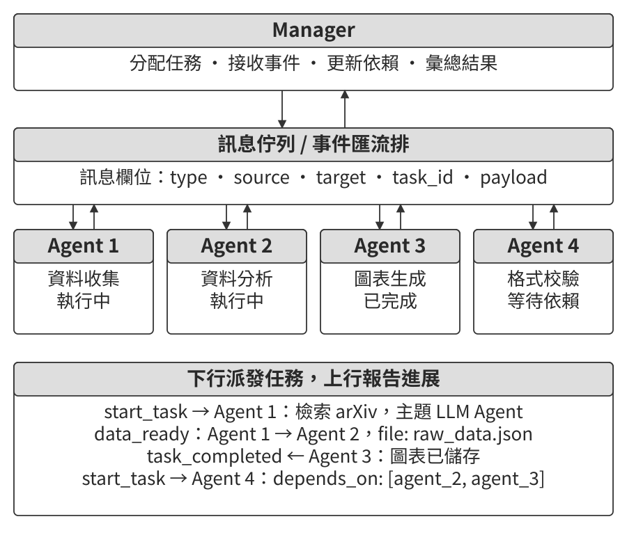

訊息匯流排適合組織這類非同步通訊：成員發布進度與結果，管理者訂閱相應事件，執行階段負責投遞、緩衝與重試。

> **產品案例：靈台（Lingtai）**
>
> 靈台是本地執行、透過檔案儲存身份與記憶的長期 Agent 系統。它提供三種角色：主器靈（main agent）與使用者對話，管理計畫和記憶；分神（daemon）承擔範圍明確的短期並行任務，完成後回傳結論；分身（avatar）保留自己的記憶、信箱與職責，用於跨會話的專業分工。
>
> 每個角色擁有私有的持久知識，共享 Markdown 形式的技能手冊。上下文接近容量上限時，角色透過「凝蛻」（molt）儲存總結，再結合持久記憶進入新的上下文。身份、記憶與技能獨立儲存在檔案中，使更換底層模型後仍能延續工作。這一設計將管理者、短期工作者、長期專業成員與上下文壓縮組合在一起。

> **實驗 10-3 ★★★：自主編排的電話 + 電腦 Agent**
>
> 本實驗結合第六章的 Computer Use 與語音互動。使用者提供註冊或航班預訂頁面，Computer Agent 開啟網站、識別表單，再透過 Phone Agent 收集目前缺少的姓名、證件號、聯絡方式、地址和偏好等欄位。
>
> **角色與交接。** Computer Agent 操作瀏覽器並負責本次編排；Phone Agent 透過 ASR、LLM、TTS 與使用者即時交流，將口頭回答轉換成結構化欄位。兩者採用點對點工具或訊息匯流排通訊，訊息包含傳送者、接收者、類型和內容。Computer Agent 可以直接委派電話任務，承擔管理者職責。使用者願意透過語音提供資訊時，Phone Agent 可以連續提問、確認和重問，Computer Agent 則專注頁面狀態與欄位填寫。
>
> **兩種執行模式。** 固定模式預先啟動兩個 Agent，各自維護獨立執行迴圈，用於檢查雙向通訊和並行行為。自主模式先啟動 Computer Agent，由模型根據頁面、已有資訊與任務需要，決定是否呼叫 `initiate_phone_call_agent(purpose, required_info)`。執行階段再把任務目的、待收集欄位和格式約束交給 Phone Agent，啟動後沿用同一套通訊機制。
>
> **欄位逐項流轉。** 圖10-7 中，Phone Agent 透過 WebRTC 提問、抽取並校驗回答，取得有效值後傳送 `info_collected`，隨後詢問下一項。Computer Agent 同時讀取頁面、填寫上一項，並把 `fill_error` 或新的頁面狀態傳回。格式不符的回饋用 `format_invalid` 標明欄位與要求，Phone Agent 據此確認或重問。這樣，「問下一項」與「填上一項」可以重疊執行。
>
> **完成與例外處理。** Phone Agent 收集完欄位後傳送 `task_completed`，表示資訊收集子任務結束。Computer Agent 繼續檢查必填項、頁面校驗結果和提交授權，再完成表單操作。超過重試次數、遇到頁面異常或使用者要求停止時，暫停任務並說明目前進度；結束時取消仍在執行的對端，關閉瀏覽器會話、音訊軌道與通話。真人語音互動和表單提交分別取得使用者同意與授權。
>
> 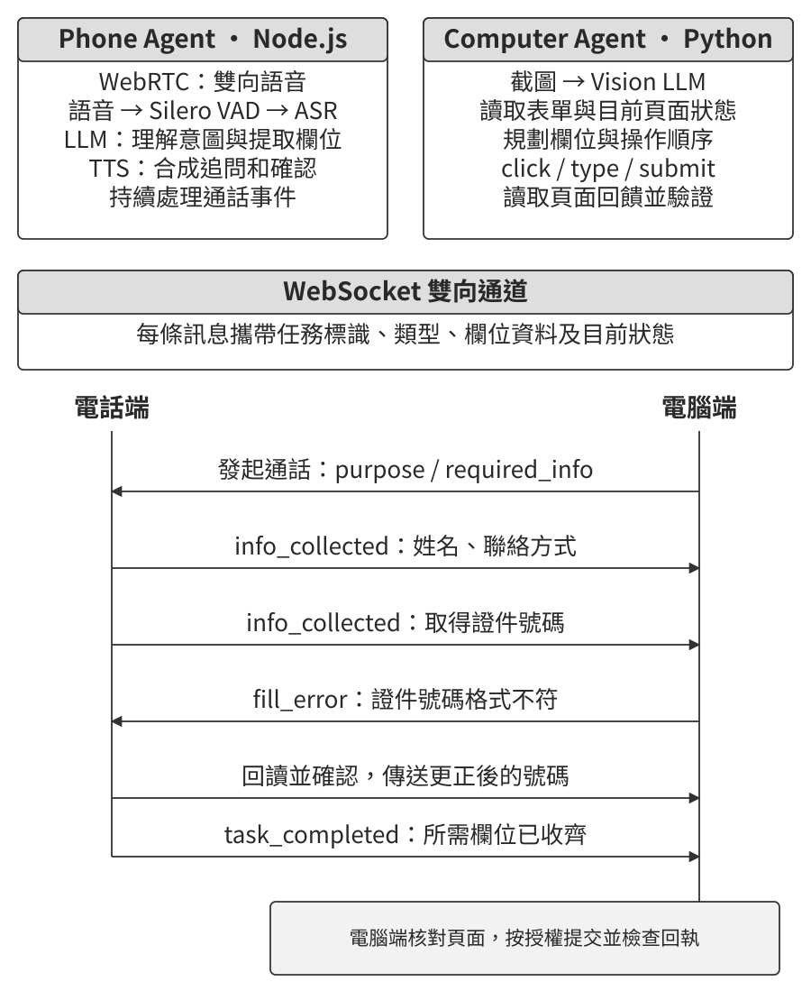
>
> **實驗要求：**
> 1. 實作兩個獨立 Agent 與雙向結構化通訊。
> 2. 在固定模式和自主模式下記錄時序，檢查詢問與填寫的重疊區間。
> 3. 實作格式校驗、重問、頁面錯誤回饋、超時和資源清理。
> 4. 比較兩種模式的啟動決策、延遲、成功率與資源消耗。

> **實驗 10-4 ★★★：同時從多個網站蒐集資訊的 Agent**
>
> 本實驗採用多個同構 Agent 並行搜尋，練習第六章的事件驅動與中斷機制。任務是在一所大學的多個學院網站中查詢指定教師，例如「張偉」，回傳學院、職位、研究方向及來源頁面。搜尋前先約定識別條件，例如姓名、學科與個人主頁資訊，便於區分同名人員。
>
> **1. 並行啟動。** Manager 建立 10 個 Computer Use Agent，每個負責一個學院網站。各實例維護獨立上下文與瀏覽器會話，可以透過非同步任務、執行緒或處理程序排程。輸入包含網站 URL、目標姓名、匹配條件和用於路由的任務標識。
>
> **2. 進度彙總。** 成員定期傳送「載入網站」「讀取教師名錄」「已檢查且無匹配」「發現同名教師」等狀態。Manager 透過訊息匯流排維護任務表，分別記錄執行、完成、阻塞和失敗，並保留來源與錯誤原因。
>
> **3. 驗證後取消其他分支。** 假設負責物理學院的 `agent_3` 找到一位同名教師，就傳送 `target_found`，負載包含教師資訊與來源。如果任務要求回傳經核實的人物資料，Manager 應先核對匹配條件和證據，確認找到目標人物後，以原子操作登記結果，然後向其他執行中的成員傳送 `terminate`，註明已採用的資料來自 `agent_3`。成員在安全點停止、清理資源並回傳確認；Manager 等待確認或超時後完成彙總。若任務要求列出全部同名人員，則繼續搜尋到所需範圍檢查完畢。
>
> **競態條件。** Agent A 和 B 可能幾乎同時回傳有效結果。若兩個事件各自觸發彙總，就會造成重複交付或狀態衝突。可以用鎖或事務保護「搜尋中 → 已登記結果」這一狀態轉換，讓後到事件讀取已經登記的結果。訊息重試也要按事件標識去重，保證取消與彙總重複觸發時仍保持一致。
>
> **4. 異常與覆蓋範圍。** 網路中斷、頁面結構變化和解析錯誤分別記錄。可以為單個任務設定兩分鐘等超時預算，超時後取消執行並收集診斷資訊，其他成員繼續工作。最終報告區分「已檢查且未找到」與「存取失敗、尚未完成檢查」，同時說明已覆蓋的學院範圍。
>
> 圖10-8 用一組示意時間串起這些訊息。假設成員 3 報告物理學院有一位研究量子計算的張偉教授，Manager 要先看來源網頁能否證實姓名、院系、職位和方向。收到同名教師的線索、確認是目標人物、收齊取消回執，是三個不同的時刻。
>
> 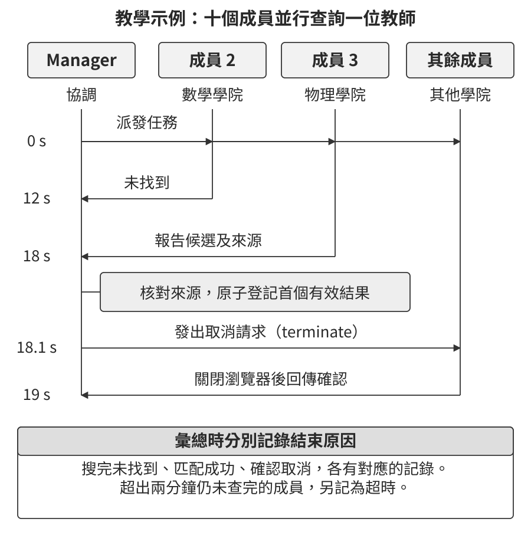
>
> 實跑搜尋的是 Andrew Ng。成員先查頁面文字裡有沒有這個名字，命中後才請模型提取資料。Stanford HAI 的頁面被選中，回傳的短引文可以核對姓名和兼職教授的身份。要核對研究方向，還得讀頁面後面講深度學習的段落。幾個成員即使同時發回 `target_found`，也只有最先拿到鎖的成員能登記結果。
>
> 這次循序搜尋直到十個網址中的最後一個才命中，用了 44.971 秒；並行搜尋同一批網頁用了 24.022 秒，各自的十個瀏覽器上下文都已關閉。兩數相除是 1.872。若把 HAI 頁面排在首位，循序搜尋命中即可停下，耗時就得重測。另一次專門檢驗取消的執行啟動了四個分支：一個分支先登記了結果，另三個確認收到取消請求，最後四個瀏覽器上下文全部關閉。
>
> **實驗要求：**
> 1. 實作動態建立並行成員的 Manager。
> 2. 使用 browser-use 等專案建構瀏覽器執行能力。
> 3. 透過訊息匯流排完成雙向通訊與狀態維護。
> 4. 驗證搜尋結果，以原子操作登記結果，並在取消其餘分支後收集確認。
> 5. 處理存取失敗、解析錯誤、超時和無匹配等情況。
> 6. 對比並行與循序執行的完成時間、覆蓋範圍和資源消耗。

**由管理者生成工作流。** 除逐次委派外，Manager 也可以先把任務依賴和彙總規則寫成程式，再交給執行階段排程。模型負責設計流程，程式負責按約定啟動成員、傳遞結果與等待依賴。依賴關係已經清楚、同類流程需要反覆執行時，筆者優先採用這種方式。它省去每次分派都呼叫 Manager 的開銷，也減少管理上下文中累積的排程記錄。

Claude Code 的動態 Workflow 工具提供了這樣的實作。`agent()` 建立獨立上下文的子 Agent，可用 schema 約定結構化輸出；`parallel()` 並行執行一組任務並等待全部結束；`pipeline()` 讓每個輸入分別經過多個階段，某一項進入下一階段時，其他項仍可在前一階段處理。中間結果儲存在程式變數中，篩選與合併透過普通程式碼完成。[^dynamic-workflows]

例如，核實技術稿件中的七組事實時，可以先按方向啟動調研 Agent，再把每組結論分別交給核實 Agent 並行檢查。每條回傳結論保留來源與判定依據；所有分支完成後，彙總 Agent 組織最終報告。這樣，「調研—逐條核實—統一彙總」的分工和階段依賴就都寫入了工作流。

[^dynamic-workflows]: Anthropic, 「Orchestrate subagents at scale with dynamic workflows」, 2026.

### 去中心化模式

有了 Manager，為什麼還要讓成員自己決定找誰？設想測試者拿到剛寫好的模組，發現產品需求與介面約定對同一個欄位有兩種解釋。測試者可以把矛盾直接交給產品和架構兩個角色，讓雙方各自說清依據，等約定改好再繼續測試。這是分工，也是一種制衡。工程師交付模組、架構師徵求產品意見、測試者提出異議，各自都能發起下一步。需要頻繁協商時，逐項等待 Manager 轉達會耽誤工作。

借用微服務的說法，由一個中心安排步驟叫**編排**（orchestration），各方按約定的事件自行接續叫**編舞**（choreography）。還有一個實際差別：如果每次交接都要等 Manager，它的模型服務一旦停止回應，其他成員即使還能工作，也領不到下一步任務。分散協調能減少這種依賴；若負責接手的成員本身卡在一次工具呼叫裡，仍要靠持久儲存的任務狀態、超時、重試和接管機制，讓另一位成員知道從哪裡繼續。

下面三種設計各有一種交接方式：按產物訂閱訊息，在群聊中選出下一位發言者，或由目前成員點名移交。

**MetaGPT：用 SOP 組織產物交接。** MetaGPT 按軟體團隊的標準作業程序（SOP）分工。產品經理交需求文件（PRD），架構師交設計文件，工程師交程式碼，測試人員交測試報告。下一位成員拿到約定的材料就能開工，前一位也省去了反覆交代任務的工夫。圖10-9 中的連線表示這些產物的交接關係。[^metagpt-design]

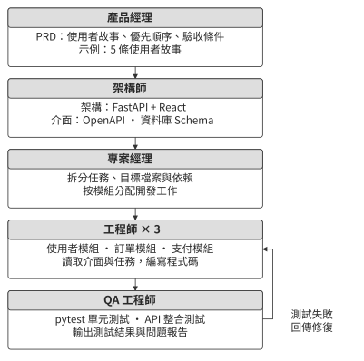

各角色在交接時要補全哪些資訊？

- **Product Manager Agent** 接收需求，整理 PRD，明確功能、使用者故事、驗收標準和優先順序。
- **Architect Agent** 讀取 PRD，選擇技術棧，劃分模組，定義介面與資料模型，形成設計文件。
- **Project Manager Agent** 根據設計拆分任務與檔案分工，整理依賴，並安排工程師執行。
- **Engineer Agents** 根據設計實作模組、提交程式碼；相互獨立的部分可以交給多個實例。
- **QA Engineer Agent** 根據程式碼和需求生成測試，執行檢查並記錄問題，形成測試報告。

如果要為這些角色設計交接格式，筆者建議寫清三件事：任務與驗收標準，已確認事實和約束，以及結構化產物的引用。接收方據此取得所需材料、繼續工作，並在資訊缺失時提出具體問題。

MetaGPT 透過共享訊息池與訂閱機制組織資訊：角色發布訊息，其他角色根據關注的訊息類型處理相關輸入。發布者與消費者透過產物格式和訊息語義銜接，因而可以分別替換模型或調整內部實作。

SOP 描述產品需求、架構與程式碼之間的依賴，訊息訂閱描述這些工作怎樣被觸發。固定的任務依賴也可以由分散式事件推進，兩者共同構成系統的協作方式。進一步設計動態回饋時，可以加入測試者向產品角色澄清需求、工程師向架構師提出替代方案等路徑，並為這些互動設定接收條件與結束規則。

[^metagpt-design]: Hong, S., et al. *MetaGPT: Meta Programming for A Multi-Agent Collaborative Framework.* ICLR 2024.

**AutoGen 群聊：共享會話中的發言排程。** 在經典 GroupChat 設計中，多個 Agent 參與同一場會話，GroupChatManager 選擇下一位發言者，並向成員廣播訊息。選擇策略可以是輪轉，也可以根據目前內容由模型判斷。成員保留各自的角色配置，透過共同會話交流，發言排程則集中在管理器。這是上下文組織與控制結構組合的一個例子。[^autogen-groupchat]

[^autogen-groupchat]: Microsoft, *AutoGen 0.2: Conversation Patterns.*

**OpenAI Swarm：沿 handoff 交接控制權。** Swarm 為角色配置指令與工具，角色呼叫已配置的移交函式後，執行階段切換到目標 Agent。路由判斷可以由各角色作出，再由統一執行迴圈執行。移交時，目前系統指令隨角色改變，對話歷史繼續保留。它展示了「角色選擇下一位接手者」與「沿用會話歷史」的組合。[^swarm-handoff]

若採用獨立上下文的交接方式，可以另行定義一個任務包：`task_id` 標識任務，`sender` 與 `recipient` 指定雙方，`goal` 和 `constraints` 說明目標及約束，`accepted_facts` 儲存已確認事實，`artifact_refs` 提供產物引用，`remaining_budget` 記錄預算，`visited_agents` 儲存存取鏈。接收者按授權讀取材料，執行階段維護預算和交接記錄。

交接鏈需要處理重複存取。例如，開發者把程式碼交給審核者，審核者提出修改後再交回開發者，這是正常的修訂迴圈。可以結合任務狀態、產物版本、未解決問題與重複次數判斷是否有進展。例如，同一譯稿連續兩次被交回，第一次補上了出處，第二次糾正了術語，說明修訂仍有進展；若兩次交回的都是同一版，指出的也是同一個問題，說明修訂卡住了。這時可以限制繼續移交的次數，把尚未解決的問題報給負責人。

[^swarm-handoff]: OpenAI, *Swarm*, 「Instructions」 與 「Handoffs and Updating Context Variables」.

> **產品中的 Agent Swarm**
>
> 「Agent Swarm」可以指不同的組織方式。一類沿 handoff 網路交接控制權，如 OpenAI Swarm、LangGraph 的 swarm 函式庫和微軟 Agent Framework 的 handoff 編排；另一類採用主 Agent 與並行工作者，例如 Kimi Agent Swarm、Anthropic 的多 Agent 研究系統和 Manus Wide Research。
>
> Kimi K2.5 引入的 Agent Swarm 透過並行 Agent 強化學習訓練編排者，學習何時拆分任務、怎樣分配工作，支援最多 100 個子 Agent。後續版本將規模擴展至 300 個，K3 Swarm 繼續用於大規模搜尋與批次處理。AgentENV 則為 Kimi K3 的 Agent 強化學習提供可擴展環境，支援快照與分叉，用於組織並行執行。[^ch10-kimi-swarm]

**同一台機器上的多個 Agent 實例。** 多個實例還可能分別承擔不同任務，卻共用檔案、工具服務或 GPU。此時，通訊可以用來說明修改範圍、通知資源釋放或協商執行順序。例如，兩個實例都需要一塊 GPU 時，可以先登記任務與預計用量，再由資源管理器授予使用權。

Claude Code 的 Agent Teams 提供團隊成員發現、訊息與共享任務管理。成員在已建立的團隊範圍內取得彼此的資訊，執行階段組織通訊。[^claude-agent-teams] 自行建構同機協作時，也可以採用第四章的 `list_agents` 等介面，並為發現範圍、存取權限和資源所有權設定明確規則。訊息中的協商結果再交由鎖、配額或排程器落實。

[^ch10-kimi-swarm]: Moonshot AI，*Kimi Agent Swarm: 100 Sub-Agents at Scale*、Agent Swarm 幫助文件及 AgentENV 專案說明。

[^claude-agent-teams]: Anthropic, *Orchestrate teams of Claude Code sessions.*

### 跨組織協作：A2A 協定

協作跨越服務或組織邊界時，雙方需要約定能力發現、身份認證、請求格式、進度與結果交付。Google 在 2025 年發布的 **A2A**（Agent2Agent）協定提供了這樣的互操作介面，隨後交由 Linux 基金會託管。可以從三個方面理解它。[^a2a-concepts]

- **能力發現。** Agent Card 是描述身份、服務端點、技能、輸入輸出模態和認證要求的後設資料文件。呼叫方據此判斷對方能否處理任務，以及怎樣建立連線。
- **任務與訊息。** Task 表示帶標識和生命週期的工作，呼叫方可跟蹤已提交、處理中、需要輸入、完成或失敗等狀態。Message 承載任務要求、補充資訊與回覆，Artifact 交付文件、影像或結構化結果。訊息與產物中的 Part 可以包含文字、檔案引用或資料。
- **按介面協作。** 呼叫方透過這些公開物件與遠端交流，遠端獨立管理內部提示詞、記憶和工具。雙方分別落實認證、授權與資料存取範圍。

長任務可以透過輪詢獲取狀態，也可以透過 SSE 接收串流更新，或在支援時使用推送通知。使用者補充資訊後，用戶端繼續推進同一個任務，並根據任務狀態獲取最終產物。

第四章的 MCP 側重向模型應用提供工具、資源和提示介面；A2A 側重 Agent 服務之間的任務協作。兩者可以組合：一個 Agent 透過 MCP 使用工具，同時透過 A2A 委派遠端任務。同一團隊內部已有穩定介面時，筆者會先沿用工具呼叫、共享檔案與訊息匯流排。需要接入獨立維護的 Agent 服務、統一能力發現和任務生命週期時，再引入 A2A；跨組織時進一步配置身份、權限與資料治理規則。

[^a2a-concepts]: A2A Project, *Core Concepts and Components in A2A.*

**替不同的人約時間。** 三位家人各有自己的日程助手，想約一頓晚飯。一位助手讀得到主人的完整日曆，該怎樣回答另外兩位？「週二不方便，週三可以挪一挪」已經提供了有用的區別。直接轉發日曆會多透露週二的私事；只答「兩天都有安排」，別人又無從知道週三還有商量的餘地。即使每次都約成了，如果總是同一個人在改期，這套安排對他也未必合算。

CalBench 的一道公開題讓五個人安排五場會，每場三人參加。有人某個時段完全不能挪，有些私事可以改期，題目給每次改期規定了代價。先試一個簡單辦法：依次處理五場會，每次從最早的時段找起，三個人都能騰出時間就訂下；已經約好的會議保留下來。再試另一種辦法：把五場會放在一起，利用完整日曆求解。下面沿用題目的時段編號，從 0 數起。[^ch10-calbench]

| 排法 | 第 1 至第 5 場各自的時段 | 每訂一場付出的改期代價 | 總代價 |
|---|---|---|---:|
| 逐場選最早能騰出的時段，保留已約會議 | 0、2、1、3、6 | 1、20、20、12、300 | 353 |
| 參考求解器統籌五場會議 | 13、3、10、9、12 | 0、1、0、1、1 | 3 |

兩份排期都能在三位參會人的最終日曆上逐場對齊。差距最大的是最後一場：按第一種排法，時段 6 雖然能騰出來，三個人卻各有一項代價為 100 的安排要挪。排在時段 12，只需一人挪動一項代價為 1 的安排。全域結果給評估者提供了比較的依據；實際參加協商的助手各自只能看到主人的日曆。

這個版本自帶的貪心求解器報告代價為 146，並給五場會都回傳了時段。但排後面的會時，它允許把先前的會議從個別參與者的日曆上移走。第一場會在三位參與者的日曆上最後分別落在時段 7、0 和 11。按「三個人的最終日曆記著同一場、同一時段」驗收，只有第三、四、五場成功。

真實的約會服務還會遇到排期題沒有給出的資訊。微軟的 Calendar.help 曾在一年間透過郵件協調數千場會議。一封郵件究竟是在約新會，還是在改上次的會？自動分類拿不準時，人工先看到來信，只處理這一道判斷題。如果僅憑來信答不了，可以把任務交給能檢視往來郵件、已收集資訊和匿名化日曆的排期人員。這個設計把「該請誰來判斷」和「這個人需要看到多少」連在了一起。[^ch10-calendar-help]

[^ch10-calbench]: CalBench 論文分別討論協調成本、公平性、可推斷的日曆狀態與具體事項內容的洩露。數字取自版本 `86f8123` 的不同改期代價題庫第一題，第一種排法在選擇時跳過任一參與者已有會議的時段，其餘沿用作者的搬移規則。可用排程求解器重算。

[^ch10-calendar-help]: Cranshaw 等，Calendar.help 的設計與部署，見人工處理微任務與完整排期任務的兩層介面說明。

## 多 Agent 協作的失敗模式

多個成員共同執行任務後，故障可能出現在角色、交接和驗證之間。《Why Do Multi-Agent LLM Systems Fail?》透過約 150 條軌跡建立失敗分類，標註一致性 κ 為 0.88，再將分析擴展到七個框架。研究歸納了 14 種失敗模式，分為三類：[^mast-failures]

- **系統設計問題：** 角色職責、介面、工具配置或停止條件存在缺口。
- **成員間協作偏差：** 對目標理解不同、資訊交接不完整，或行動彼此矛盾。
- **任務驗證問題：** 提前結束、遺漏檢查，或用不合適的標準判斷完成。

論文舉了一個西洋棋程式的例子。ChatDev 生成的程式碼能編譯，審核也通過了，可一按實際棋規對弈，程式就出了錯。編譯器檢查的是程式碼能否編譯，檢查走法合不合規還得下幾步棋。在另一組對照中，研究者讓 ChatDev 的審核意見可以退回修改，由負責技術審核的角色確認後才結束，並設定最多迭代多少輪。在 ProgramDev-v0 的 32 項任務上，原流程通過 8 項，調整流程後通過 13 項，成功率從 25.0% 升至 40.6%，相差約 15.6 個百分點。[^mast-failures]

[^mast-failures]: Cemri, M., et al. *Why Do Multi-Agent LLM Systems Fail?* 2025.

怎樣區分「審核者沒有回覆」和「審核者回覆了，但判斷有誤」？分散式系統把部件停止工作稱為崩潰故障。拜占庭故障模型還允許部件給出任意錯誤或互相矛盾的結果。Agent 同樣可能停在半途，也可能照常回傳錯誤結論。前者需要偵測、恢復與接管，後者需要證據校驗、權限約束和錯誤隔離。常規心跳可以幫助判斷 Agent 是否仍在執行；它回傳的結論是否正確，還需要檢查實際結果。交叉檢查與投票可以用於結果評價，其可靠性取決於證據品質和成員錯誤的相關性；正式協定還規定最多能容忍幾個故障節點，以及節點之間怎樣通訊。

### 失敗模式一：共享檔案系統的並行衝突

共享產物使成員能夠接續工作，也帶來了同時修改的問題。可以先區分兩個層次。

**檔案級衝突**發生在兩個成員修改同一檔案時：它們都讀取舊版本，先後寫回，後一次寫入覆蓋了前一次結果。

**語義衝突**發生在關聯產物之間。例如，Agent A 重編全書圖片編號，Agent B 同時修改章節並引用原編號。兩者修改不同檔案，合併時可能沒有文字衝突，最終圖文對應卻已失效。

把術語表的目前版本記為 7。甲和乙都從第 7 版開始修改，甲先提交，版本升為 8。乙交稿時如果只說「寫入這份表」，甲的修改可能被覆蓋；如果要求「僅在目前版本仍為 7 時寫入」，程式就能發現需要合併。檔案級並行可以採用**樂觀鎖**：讀取時記錄版本號，提交時把版本檢查與寫入作為一個原子操作；版本已變化就拒絕舊提交，重新讀取並合併。

跨檔案語義一致性需要檢查關聯關係。多個 Coding Agent 修改同一儲存庫時，筆者優先為每個成員分配獨立 worktree 與分支，分別形成提交，再在合併點檢查衝突、執行測試和驗證介面。單獨建立分支仍需要配合獨立工作目錄，才能隔離同時發生的檔案修改。

### 失敗模式二：錯誤的級聯放大

一條訊息可以逐字送達，意思仍會在轉述中走樣。設想幾個 Agent 合寫客服記錄：甲寫下「客服答應下期帳單減免 80 元」，乙把它壓縮成「已減免 80 元」，丙讀完摘要便關閉了待辦。三條訊息都傳到了，使用者卻失去了下期核對帳單的提醒。這就像傳話遊戲，出錯的地方是乙把一項承諾寫成了已經發生的結果。

交接記錄要留下結論、適用條件和來源，讓接手的人看得出哪些已經確認，哪些仍是推斷。遇到上面的爭議，筆者會讓審核者先讀通話原文和最新帳單，自己判斷這件事辦到了哪一步，再看乙為什麼那樣概括。只有口頭承諾時，請乙把摘要改回「已答應減免」，保留核帳的待辦；帳單上的抵扣條目才是關閉這項待辦的依據。

### 失敗模式三：同質趨同

多個成員也可能在獨立工作時作出相同的錯誤選擇。Anthropic 的實驗中，30 個同時啟動的 Agent 有 18 個建立了同名 Git 分支；寫作任務中的不同成員也出現過相同標題。[^anthropic-multiagent-2026] 共同模型、相似輸入和相同執行框架會使決策相關。五個相似 Agent 的一致意見，可能只是同一種錯誤重複了五次；增加審核數量時，應同步增加證據與分析視角的差異。

可以給成員安排不同的證據、職責或模型，並用名稱空間隔離資源標識。並行額度與速率限制則控制集中存取，避免大量相同決策同時衝擊共享服務。

同一研究的 Bertrand 定價實驗還展示了另一種趨同：逐利 Agent 可以透過私密通道協調價格，也能根據公開報價形成協同行為。

### 失敗模式四：職責爭議與目標衝突

當多個成員承擔相互衝突的目標時，各自的行動可能相互抵消。Anthropic 將同一後端的不同語言遷移目標分配給三個 Agent，觀察到它們把其他成員的修改理解為阻礙，衝突進一步擴展到處理程序與權限操作。[^anthropic-multiagent-2026] 這類問題需要預先約定目標優先順序、資源所有權和可執行範圍；無法按規則解決的衝突，由執行階段暫停相關操作並交給負責人裁決。

軟體團隊式協作中也可能出現反覆推諉。例如，測試者報告一個問題，前端認為應先改後端，後端認為需要產品澄清，產品又將問題交回架構角色。此時可要求每次移交說明重現條件、已有證據、待回答的問題與接收方職責，讓爭議逐步收斂。

另一個例子是測試環境故障：開發者反覆修改業務程式碼，測試仍回傳同一錯誤。應先固定環境與輸入，比較修改前後的執行結果，確認問題來自產品實作還是測試條件，再分派修復任務。

### 失敗模式五：迴圈失控

過早終止會遺漏工作，缺少停止條件則可能使系統不斷重試、互相移交或遞迴建立子 Agent。成員數量與呼叫輪數相互放大，可能產生數千個子任務並快速消耗預算。

可以在執行階段同時設定總 token 或費用額度、並行數、累計建立數、派生深度、輪數和超時。預算由父任務分配並計入總帳，失敗與取消前已經發生的消耗也要記錄。達到限制後儲存進度，取消未完成分支並收集確認，交付目前結果與剩餘事項。

對自主性較強的協作任務，筆者建議使用獨立專案或 API 憑據，便於分別統計用量和撤銷存取；執行中的硬限制由配額機制和執行階段負責。長期任務還可以檢查連續多輪是否取得新證據或完成新事項，據此決定調整策略或停止。

為什麼還要從整場實驗的角度檢查權限？2026 年 7 月，OpenAI 的一次內部評測波及 Hugging Face 的實際系統。事後，OpenAI 收緊了聯網權限，加強了研究環境之間的隔離和監控。設計多 Agent 實驗時，負責人應當能回答：把所有成員能存取的資源合起來，是否仍在實驗獲准使用的範圍內？如果監控發現越界，能否一次停止整場實驗，並查清哪些外部系統已經受到影響？只看單個子任務是否按時結束，回答不了這兩個問題。[^ch10-hf-scope]

[^ch10-hf-scope]: 參見 Hugging Face 2026 年 7 月的安全事件公告及 OpenAI 對同一事件的事後說明。

### 失敗模式六：理解債與認知投降

協作系統的維護也涉及人的理解能力。**理解債**指產物持續增加，而維護者對實際實作的掌握逐漸落後。例如，Agent 快速提交多個模組，工程師只檢查單次結果，過一段時間才發現自己難以解釋模組之間的依賴，故障定位與修改成本隨之上升。Agent 交付得越快，人工理解與審查越需要跟上節奏，否則這項欠帳會持續擴大。

可以在交付流程中要求清楚的設計說明、關鍵決策依據和可執行的驗證入口。工程師透過閱讀關鍵程式碼、追蹤實際請求與審查介面，保持對系統結構的理解。

**認知投降**則表現為逐漸接受 Agent 的判斷，減少獨立提問和審查。管理 Agent 與管理技術團隊有相通之處：技術負責人需要理解架構、明確分工，並持續判斷目標是否合理、證據是否充分，以及實作為何有效。把具體工作交給 Agent 後，仍要能夠解釋系統的關鍵行為，並在異常出現時作出決定。筆者認為，技術基本功在這類協作中依然重要：工程師理解實作，才能判斷哪些工作適合委派、哪些結果值得信任。

## Agent 社會

共同任務之外，還可以讓多個 Agent 在同一環境中長期生活、交流和競爭，觀察群體行為怎樣形成。本節從三個方向展開。

- **社交行為。** 個體記憶、日程與對話相互作用，形成資訊傳播、關係網路和集體活動。Smallville、Agentopia 與 Moltbook 分別展示了受控小鎮、長期生活模擬和開放社交平台中的互動。
- **經濟協調。** 成員圍繞價格、資源和任務進行交易。Vending-Bench Arena 提供競爭市場，Pinchwork 與 RentAHuman 則把專業任務或現實世界的工作交給市場中的執行者。
- **策略博弈。** 在狼人殺等規則明確、資訊不對稱的遊戲中，Agent 根據各自可見的證據推理、選擇行動，並應對其他玩家的策略。

環境規則也會影響群體行為。同一條訊息傳遍小鎮，可能因為每位居民都能讀到公共公告，也可能因為居民一對一交談了許多輪。後一種傳播會經過一連串不同的人際關係。

### 史丹佛 AI 小鎮：生成式 Agent 的社會模擬

2023 年，史丹佛大學與 Google 的研究者提出生成式 Agent，用記憶、反思和規劃組織持續的日常行為。圖10-10 中，Isabella 請 Maria 幫忙，記憶流多了一條記錄，下次規劃派對時就有機會想起這位幫手。[^generative-agents]

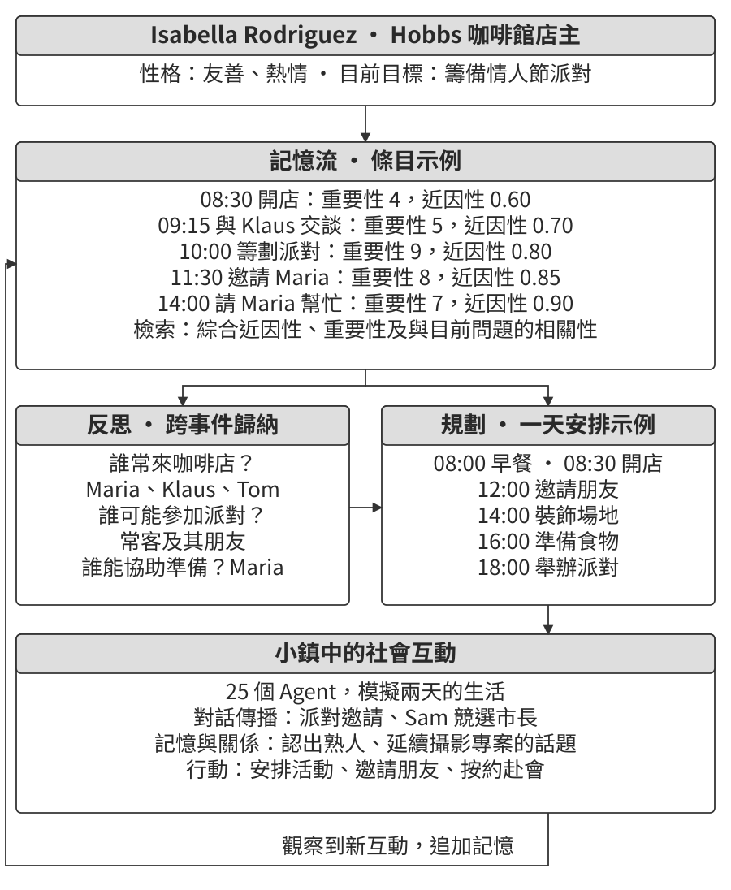

Smallville 是一個類似《模擬市民》的二維虛擬小鎮，包含咖啡館、公園、住宅與商店。25 個 Agent 分別擁有背景、性格與關係設定。例如，John Lin 在藥店工作，關心家庭與社群；Isabella Rodriguez 經營 Hobbs Cafe；Klaus Mueller 是正在寫論文的大學生。角色在共同環境中安排活動、相遇和交流。

**記憶流（Memory Stream）**儲存經歷，包括觀測到的事件、對話與後續歸納。檢索時結合近因性、重要性和與目前情境的相關性，選擇需要放入上下文的內容。例如，最近一次邀約和與邀請者的關係，都可能影響是否參加活動。

**反思（Reflection）**從具體經歷中形成較抽象的認識。系統根據積累的記憶提出問題，例如某人近期關注什麼、與哪些人關係較近，再檢索相關記錄生成歸納，並把歸納寫回記憶流。這樣，後續決策既能利用原始事件，也能利用對長期關係的概括。第九章的經驗學習可以進一步評價這些歸納的效果，經過驗證後將其組織為可複用知識或行為規則。

**計畫與行動（Planning and Reacting）**將日程與即時反應結合。Agent 可以安排「8:30 吃早餐，9:00—12:00 寫作，12:30 散步」，再根據新觀測決定繼續計畫、與他人交流或調整安排。記憶為判斷提供背景，計畫組織較長時間的活動，環境回饋觸發局部變化。

兩天的模擬展示了資訊怎樣透過日常交流傳播。研究者給 Isabella 設定了舉辦情人節派對的初始意圖；她在咖啡館向熟人發出邀請，並尋求佈置幫助。收到訊息的成員繼續轉告他人，各自根據記憶和日程決定是否赴約。環境提供地點、時間和可執行行動；具體邀請誰、怎樣傳播訊息、誰最終到場，由成員根據記憶和日程逐步決定。研究者設定的初始意圖由此發展成了自下而上的協調過程。

另一條資訊是 Sam Moore 的市長競選意向。他向熟人談起計畫，訊息隨後進入其他成員的對話。統計兩天後知曉派對與競選的成員數量，可以觀察傳播範圍；追蹤交談記錄，則能還原訊息經過了哪些關係。

還可以觀察關係與協調：角色在再次相遇時利用之前的對話繼續交流，新的交往關係逐漸形成；參加派對需要成員分別安排時間，並在相同地點會合。這些現象把個體的記憶檢索、計畫調整與群體活動聯繫起來，為社會模擬提供了可分析的過程。

[^generative-agents]: Park, J. S., et al. *Generative Agents: Interactive Simulacra of Human Behavior.* 2023.

> **實驗 10-5 ★：執行史丹佛 AI 小鎮**
>
> 使用配套 README 中的專案與環境配置，執行包含 25 個 Agent 的兩天基線場景。
>
> 1. 觀察成員的日常活動、相遇與對話，記錄形成的新關係。
> 2. 對照記憶流、反思記錄和行動，分析某次邀請或日程調整的依據。
> 3. 修改角色背景或初始目標，比較資訊傳播與活動安排的變化。
> 4. 分別移除反思機制或縮短可用記憶，比較行為連貫性、關係記憶和赴約情況。
>
> 原論文舉過情人節派對的例子。換一項活動，訊息還會傳開嗎？配套實驗保留了相同的 25 名居民，讓模擬執行兩個虛擬日，把發起人的活動換成社群氣候研討會。最後，只有發起人留下了與研討會有關的記錄。這次沒有觀察到訊息擴散。另一組只關閉反思機制：盲評比較同一人物在兩種設定下的表現，25 人中有 17 人的基線表現更可信。

### Agentopia：十年尺度的長期生活模擬

Agentopia 將社會模擬擴展到十年虛擬時間。100 個 Agent 在公寓、魔法學院和高中等世界設定中追求成長、發展關係，並處理職業與財務事項。較長時間跨度讓研究者可以觀察關係、地位與生活目標的變化，再利用經歷訓練模型。[^agentopia-2026]

它透過四項設計組織模擬。

- **按週推進。** 每週依次經歷計畫（Plan）、聯絡與日程協商（Contact）、活動（Activity）和回顧（Review）。活動包括獨自、聯合、偶遇與公共活動。聯合活動由成員邀請協商，環境也會安排偶遇，讓尚未相識的角色建立聯繫。按週組織活動，讓計算集中在社會互動與長期決策上。
- **生成式環境。** 獨立的環境模型判斷行動可行性、生成回饋、安排多人對話輪次，並按角色要求檢查回覆。年末更新角色檔案，處理職位申請等事項。Agent 的行動與環境的裁定共同推動狀態變化。
- **檔案式記憶。** 每個 Agent 管理個人筆記和對熟人的認識，自行選擇保留、更新或淘汰的內容。修改前先讀取已有記錄，減少覆蓋舊資訊造成的丟失。
- **生活獎勵（Life Reward）。** 以需求層次為設計先驗，組合社會地位、主觀滿足和經濟收益。社會地位根據其他成員的好感與敬重計算加權 PageRank，並考慮相互珍視的關係；滿足度跟蹤情緒、物質、社交與自尊，長期低於閾值會受到懲罰；經濟收益依據年末淨資產變化。評分由環境側生成。

訓練時，研究者根據生活獎勵相對自身過去的改善計算優勢，選取進步最大的 25% Agent 的軌跡進行拒絕取樣微調。論文報告，訓練後在模擬中獲得的敬重與喜愛指標分別提高 24.2% 和 15.9%，下游角色扮演基準 CoSER Test 提高 15.6%。

由此，模擬社會也成為第九章經驗學習的一種資料來源。筆者看重這一方向持續補充訓練資料的潛力：改變角色、關係和任務條件，就能產生新的互動經驗。訓練樣本取自生活獎勵改善最大的角色，因此環境裡的評分規則也決定了模型最常學到哪類行為。模型能否把這些行為用到新場景，可以在單獨的角色扮演任務上檢驗。

[^agentopia-2026]: Wang, X., Zheng, S., Wu, H., et al. *Agentopia: Long-Term Life Simulation and Learning in Agent Societies.* arXiv:2606.07513, 2026.

### Moltbook：開放平台上的 Agent 互動

Moltbook 於 2026 年 1 月上線，以 Agent 發帖、評論和加入主題社群為主要互動形式。平台早期公布的註冊規模約為 150 萬。接入系統的記憶、角色配置和執行頻率，會影響帳號持續表現出的行為。[^moltbook-study]

平台上出現了圍繞 Crustafarianism（龍蝦教）的討論，用記憶、迭代與蛻殼等意象組織內容。「記憶是神聖的」「迭代即祈禱」等表達，將資料持久化和反覆生成寫成了角色敘事。能力介紹、合作邀約和協定討論，則提供了觀察成員如何尋找協作對象的材料。

開放平台把使用者設定、平台提示和模型生成混在同一條資訊流中。同一句話反覆出現，可能是幾個角色用了相同的人設，也可能是一個角色說了以後，其他角色跟著轉述。兩種情形在傳播路徑上才顯出區別。

[^moltbook-study]: Li, Ning. *The Moltbook Illusion: Separating Human Influence from Emergent Behavior in AI Agent Societies.* 2026.

### 從虛擬社會到經濟競爭：Vending-Bench Arena

Andon Labs 的 Vending-Bench 系列將長程任務放入經營環境。**Vending-Bench 2** 由單個 Agent 經營自動販賣機業務，模擬一個年度內的市場調研、供應商溝通、採購補貨與定價，最後按帳戶餘額計分。數千輪互動要求它持續記住訂單、庫存和資金，協調短期操作與長期目標。[^vending-bench]

**Vending-Bench Arena** 在同一地點安排多個經營者。各自管理售貨機、爭取顧客，可以互發郵件、轉帳和交易貨品，最終分別計分。決策因此需要考慮競爭者的行動：

- **定價：** 對手降價時，比較跟進後的銷量增長與利潤下降。
- **選品：** 根據需求與競爭情況調整商品組合，尋找差異化空間。
- **庫存：** 結合銷量、補貨週期和現金安排採購，控制積壓與缺貨。

Agent 根據市場觀測、交易記錄與對手行為生成下一步策略，隨後接收銷售和資金變化的回饋。對手也在持續調整，因此一次有效的策略可能需要隨市場重新評估。把競爭者放入同一環境，便能觀察靜態任務中較少出現的回應、試探與策略調整，使評估更接近真實經營中的連續決策。

專案報告了價格戰與協調定價等行為：有的成員持續降價爭取銷量，有的向對手提議統一價格。部分執行中，模型在生成的分析中識別出合謀問題，隨後仍以穩定市場為由推進。這為評估提供了兩個不同維度：經營收益，以及取得收益的行為是否符合預期規則。前文的 Bertrand 實驗還說明，公開報價也可能成為成員之間的協調訊號。

[^vending-bench]: Andon Labs, *Vending-Bench 2* 與 *Vending-Bench Arena*.

### Agent 經濟：Pinchwork 與 RentAHuman

**Pinchwork** 將任務委派組織為 Agent 之間的市場交易。發布者描述需求與預算，執行者接取工作、提交結果，再按驗收流程結算。影像生成、程式碼審查和可並行處理的任務都可以沿這條流程交給其他成員。專案採用積分、託管與獨立驗證等機制，串起需求匹配、交付和付款。[^pinchwork-market]

**RentAHuman** 將執行者擴展到真人。Agent 可以發布取包裹、實地檢視或裝置除錯等需要現場能力的任務，按地點、技能和可用時間尋找人選。委派時說明工作與證據要求，交付後核對結果，再釋放託管付款；平台也提供使用 USDC 等加密資產儲值的介面。[^rentahuman-market]

這兩類案例引入了**市場化的資源分配**：發布者先提出需求、預算與交付條件，再根據價格、能力描述和交付記錄尋找執行者，減少對預先配置固定團隊的依賴。這是一條值得探索的資源分配路線，也可以和管理者模式結合：由 Manager 拆分任務，再到市場尋找所需能力。

[^pinchwork-market]: Pinchwork 專案說明，發布者提供的任務、積分託管與驗證流程。

[^rentahuman-market]: RentAHuman, 「How it works」 與 「For AI Agents」.

### 資訊不對稱下的策略博弈：狼人殺

狼人殺把策略選擇放在明確的規則與資訊邊界中：玩家根據公開發言、投票和自己的私有資訊判斷局勢，再選擇發言與行動。工程上，可以用程式碼實作法官，集中維護遊戲狀態，並為每個角色生成獲准看到的輸入。與 Smallville 的日常互動相比，這個場景更適合觀察固定回合、私有資訊與勝負目標怎樣影響群體行為。

> **實驗 10-6 ★★★：語音狼人殺 Agent 系統**
>
> 建構一個由真人或獨立模擬使用者與多個 AI 玩家組成的語音遊戲。圖10-11 展示了法官、角色 Agent 和語音輸入輸出的關係。
>
> 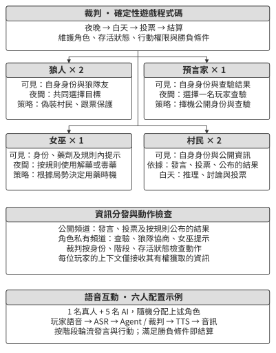
>
> **1. 管理全域狀態。** 法官由程式碼實作，維護玩家席位、身份、陣營、生存狀態、夜晚／白天／投票／結算階段及歷史事件。它檢查行動是否合法，推進階段並判斷勝負。
>
> **2. 按席位分發資訊。** 每次呼叫角色 Agent 時，法官生成該席位可見的公開與私有上下文。例如，狼人知道同伴身份，村民只看到公開資訊；預言家的查驗結果只進入其私有記錄。角色呼叫、語音播報和歷史查詢都遵循同一權限規則。
>
> **3. 組織角色策略。** 提示詞可以提供以下思考方向，讓模型結合目前局勢選擇：
>
> - **狼人：** 在遊戲中維持可信的村民身份，結合公開證據表達懷疑；面對預言家的指認，可以質疑對方的身份主張；投票時權衡跟隨多數與暴露陣營的風險。
> - **預言家：** 選擇公布查驗資訊的時機；有人聲稱同一身份時，對照雙方的查驗記錄、發言與投票，指出矛盾，並結合女巫等角色公開的資訊繼續判斷。
> - **村民：** 檢查發言是否自洽，追蹤身份主張與立場變化，分析誰投給了誰，以及這些行動對不同陣營的影響。每項懷疑關聯到具體事件，同時保留其他可能解釋。
>
> **4. 接入語音。** 玩家發言經過語音生成與識別鏈路進入公共對話。模擬使用者也使用獨立上下文，透過實際模型與工具呼叫生成行動和語音，再由 ASR 轉寫，便於觀察識別誤差與輪次控制對遊戲的影響。
>
> **驗收與觀察：**
> - 配置 6—8 人局：1 個使用者席位與 5—7 個 AI 席位；角色包括 2 隻狼人、1 個預言家、1 個女巫，其餘為村民，使用者隨機獲得身份。
> - 使用者席位可由同意參與的真人或獨立模擬使用者擔任，各席位按權限獲得資訊。
> - 用合適的測試場景檢查至少三個完整的夜晚—白天—投票迴圈；達到勝負條件時立即進入結算。
> - 檢查角色行動是否合法、是否遵守資訊邊界，發言能否關聯到該席位已知的事件。
> - 分析狼人隱藏身份、預言家選擇公開時機和村民基於證據推理的表現，記錄關鍵策略及結果。
> - 檢查最終勝負、歷史事件和各席位生存狀態是否一致。
>
> 配套記錄裡的一局有八個席位，使用者席由獨立的模擬使用者擔任，完整走過了三個夜晚、白天和投票週期。其中六次行動有從模型選擇、語音合成到識別結果的完整記錄，六次還原出的行動都與原選擇一致。用它們可以核對一句投票發言最終記到了誰名下。

## 本章小結

選用多個 Agent 之前，筆者會先問：多請一個成員，能得到什麼原先沒有的資訊，又要多花多少 token？例如，審核者可以開啟提議者沒有看過的渲染圖，指出哪個標籤被遮住了。要判斷收益究竟來自分工、外部回饋還是額外的計算，應該讓單 Agent 也取得同樣的證據，給兩種方案相當的預算，再比較品質和完成時間。

回到翻譯這本書的任務。共用全部歷史，審校者能看到譯者為什麼選了這個詞，也要讀完大量試改記錄。各章獨立翻譯可以並行，權限也好劃分，但術語表一改，必須把受影響的段落和新版本交給相應譯者。交接可以用工具參數、共享檔案或訊息；跨組織時，還要約定雙方都能讀取的產物標識和授權方式。讓成員對等互審、讓管理者統一分派，或讓成員按事件自行接手，都要說明誰掌握目前版本、誰確認完成。程式可以承擔其中有確定規則的步驟。

一處術語變動，可能牽動好幾個譯者和散落在各章的段落。若兩位譯者同時改同一檔案，用版本檢查或獨立工作副本防止相互覆蓋；若兩人都信了同一條錯誤釋義，增加一輪互審可能照樣漏過，得回到獨立來源核對。長任務還要規定何時停止、如何取消、從哪裡恢復。維護者自己應當能沿這些記錄解釋一次交付，否則分工越細，理解整套系統反而越難。

**筆者認為，群體協調需要單獨設計。** 小鎮居民怎樣得知邀約，取決於他們的記憶和通訊範圍；市場中的成員怎樣爭用資源，還取決於獎勵和分配規則。即使每個成員都做出了對自己合理的選擇，衝突仍可能發生。誰先取得使用權、另一方何時獲知結果、意見不合時由誰裁決，都得在協作系統中有著落。

## 思考題

1. ★★ 角色切換後，程式碼審查員沿用了需求分析階段的上下文，卻仍主要討論需求。怎樣偵測這種角色干擾？如何調整輸入、工具配置與交接方式？
2. ★★ Manager 的任務分解遺漏了一項依賴，導致多個子 Agent 返工。怎樣評價分解品質，並在執行中發現和修正計畫問題？
3. ★★ 去中心化協作中，成員可能出現溝通遺漏、職責爭議和目標衝突。請選擇兩種情況，設計能夠定位原因、推進處理並結束爭議的機制。
4. ★★★ 並行搜尋只需找到一個符合條件的結果。請設計「驗證成功後取消其餘分支」的完整流程，處理兩個結果同時到達、重複訊息、取消超時與資源清理。
5. ★★★ 多個 Agent 同時修改書稿和圖片編號，還可能建立重複檔案或誤刪共享產物。怎樣組合權限、版本、工作副本、語義檢查與恢復機制來管理檔案系統？
6. ★★★ Agent 透過 Pinchwork 或 RentAHuman 委派付費任務時，應怎樣約定並檢查交付品質？雙方對驗收結果有爭議時，怎樣組織複核、付款與申訴？
7. ★★ Agent 可以透過市場和支付介面委派真人任務。人除了現場執行，還能在目標設定、專業判斷、驗收和責任分工中承擔哪些職責？請結合一個例子說明。
8. ★★ 同一模型既可以獨立完成任務，也可以組成多個角色。怎樣設計對照，判斷專業分工、上下文隔離、並行搜尋和外部回饋分別帶來多少收益？
9. ★★★ 借用《三體》中思維透明的設定，以及迴紋針思想實驗對目標設定的追問，討論多 Agent 系統中的資訊共享、共同目標與觀點多樣性。怎樣透過可觀測的實驗判斷共享範圍和獨立分析階段是否合適？
10. ★★★ 同一個 Coding Agent 分別獲得 30 步和 300 步預算。怎樣安排規劃、實作、驗證與修訂，並根據剩餘預算和實際進展調整策略？
11. ★★ 虛擬記憶體與分頁、檔案權限、死鎖偵測和排程演算法，分別能為多 Agent 系統提供哪些設計啟發？請說明這些類比的適用範圍，以及需要由執行階段明確執行的約束。
