# 上下文工程

第一章把上下文比作 Agent 的「目前決策視野」：模型每次作出判斷，都要依據此刻收到的資訊。**上下文工程**（Context Engineering）負責選擇、組織和更新這些資訊，包括系統指令、工具定義、使用者請求、歷史訊息和任務狀態。Harness 每次呼叫模型前，都要把任務背景和最新進展整理成輸入。圖2-1 用具體內容展示了上下文視窗的構成。

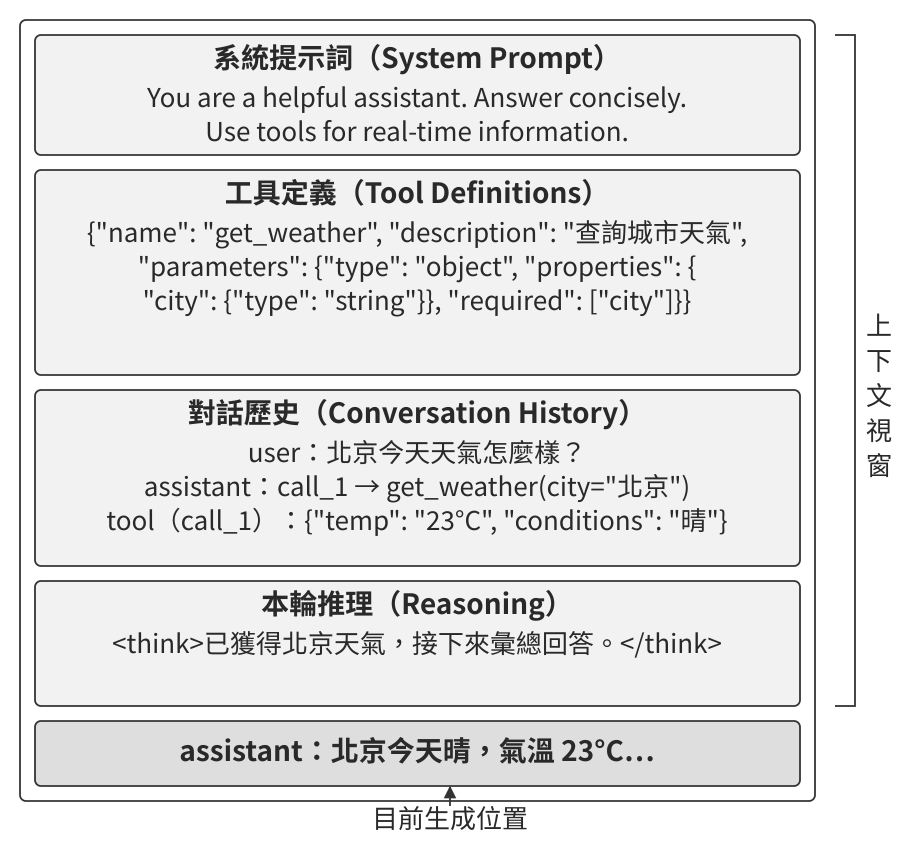

## 上下文：讓模型能力用於具體任務

設想一位經驗豐富的工程師剛加入團隊，接到的第一個任務是「按我們的規範修改配置」。他會程式設計，卻還不知道哪個檔案才是配置的來源，哪些欄位可以改，又該怎樣驗證。即使把整個程式碼庫交給他，他也可能改錯檔案。Agent 接手陌生專案時，同樣缺少這些背景。

以「幫我修復這個 bug」為例，Coding Agent 通常需要三類背景：

- **即時程式碼上下文**：目錄結構、模組職責、核心資料結構和程式碼規範。例如，改動的是一份自動生成的設定檔，即使在本地生效，下次生成時也會被覆蓋。知道檔案由哪個模組生成，才能找到該改的地方。
- **流程規範**：Git 分支策略、提交規範、程式碼審查流程和 CI/CD 要求。Agent 據此安排修改、測試和提交，執行系統則按權限執行這些操作。
- **環境資訊**：開發配置、測試資料庫的連線方式、測試環境的部署方式和 API 金鑰的管理方式。這些資訊幫助它選擇正確的執行環境，理解本地與測試環境的差異。

專案程式碼和測試資料庫都在模型的上下文之外。以自動生成的配置為例，Agent 透過搜尋工具讀到生成指令碼，才知道應該從哪裡改起。**上下文的品質決定了模型能否把已有能力用到目前問題上。** **對於依賴大量背景資訊的任務，能力夠用的模型配上完整、準確的上下文，表現可以優於缺少必要資料的更強模型。**

**建構 AI 原生團隊，首先要把關鍵知識文件化。** 如果當年選用某個資料庫的理由只有老員工記得，業務規則變更又只在私聊裡提過，那麼新同事和 Agent 接手時都會遇到同一個問題：程式碼裡看得到團隊做了什麼，卻看不出當初為什麼這樣做。

**對遠端協作友好的團隊，往往也對 Agent 友好。** Linux 核心開發者透過郵件列表討論補丁、交換審查意見，開發流程文件則說明怎樣提交、審查和合並補丁[^ch2-linux]。新參與者讀到一處出乎意料的改動，可以循著補丁找到當時的爭論；Agent 查證背景時也用得上這段記錄。

筆者聽過翁家翌在 WhynotTV 的訪談後，把他的一個觀點概括為：**人和模型都依賴 Context。** 人可以找參與過決策的同事補問一句，模型能讀到哪些背景，則取決於團隊留下了什麼記錄，以及 Harness 把哪些內容放進了這次請求。[^ch2-weng]

[^ch2-linux]: Linux 核心官方文件，How the development process works。

[^ch2-weng]: WhynotTV，《翁家翌：OpenAI，GPT，強化學習，Infra，後訓練，天授，tuixue，開源，CMU，清華》，Podcast #4。

ReAct 論文用一個形式化表達描述互動歷史如何參與決策[^ch2-react]。在時刻 $t$，Agent 從環境收到觀測 $o_t\in\mathcal{O}$，根據策略 $\pi(a_t\mid c_t)$ 選擇動作 $a_t\in\mathcal{A}$，其中上下文為：

$$
c_t=(o_1,a_1,\ldots,o_{t-1},a_{t-1},o_t)
$$

這個表達說明，**Agent 的下一步行動依賴截至目前的互動歷史。** 比如，Agent 查過哪個檔案、工具回傳了什麼錯誤，都會影響下一步選擇。對 LLM Agent，使用者輸入和工具結果可以提供觀測，工具呼叫及對外回覆記錄行動；系統指令和工具定義進一步說明任務規則與可用介面。

本章先採用無狀態的請求方式：Harness 每輪組裝訊息和工具定義，再呼叫模型。完整訊息歷史便於保留任務進展；隨著歷史增長，可以透過檢索、狀態記錄和壓縮，把後續決策需要的資訊留在視窗內。上下文佈局、狀態列和壓縮技術，都圍繞同一個問題展開：怎樣在有限的上下文裡把模型這一步要用的資訊放進 $c_t$？

[^ch2-react]: Yao, Shunyu, et al.，ReAct: Synergizing Reasoning and Acting in Language Models，ICLR 2023。

## Agent 如何呼叫大模型：理解 API 的上下文結構

先從一句問候看訊息格式，再看「溫哥華現在幾點、天氣怎樣」如何引出兩次工具呼叫。本節使用相容 Chat Completions 的介面和本地執行的 Qwen3-0.6B，最後用 Python 把各輪請求串起來[^ch2-chat-api]。

### 示例中的四種訊息角色

請求中的**訊息列表**（`messages`）按順序儲存互動資訊。每條訊息用**角色**（`role`）標記來源和用途。本節使用四種角色：

- **system**：系統提示詞。本節用它承載開發者提供的身份、行為規則和約束，放在訊息列表前部。部分模型介面使用 `developer` 角色承載開發者指令。
- **user**：使用者訊息，儲存任務、追問和補充要求。
- **assistant**：模型回覆，包括文字和工具呼叫請求。把這些訊息放回下一輪輸入，模型就能讀到此前的回答與操作請求。
- **tool**：工具執行結果。Harness 收到回傳值後，把它寫成工具訊息，透過 `tool_call_id` 關聯到具體呼叫。

工具定義透過請求頂層的 `tools` 欄位傳入，列出可用工具的名稱、用途和參數格式。

模型根據工具定義構造呼叫請求。它能否執行這項操作，由 Harness 和執行環境決定。

[^ch2-chat-api]: OpenAI，Chat Completions API 參考，介紹訊息角色、工具定義與呼叫結果欄位；Qwen，Function Calling，介紹相容服務中的工具呼叫與範本。

### 單輪對話：最簡單的 API 呼叫

先看一次問答。使用者問「Hello, who are you?」，Harness 把系統指令與使用者問題一起發給模型，再讀取回復。圖2-2 展示了請求和回應的對應關係。

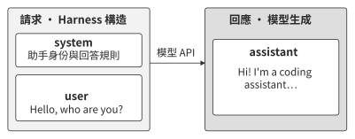

下面按本地模型的介面形式寫出請求與示例回覆，程式碼中的註釋標出了各部分的來源：

```javascript
// Harness 構造請求
{
  "model": "Qwen3-0.6B",
  "messages": [
    {
      "role": "system",                           // 开发者提供的指令
      "content": "You are a helpful coding assistant. Follow user instructions."
    },
    {
      "role": "user",                              // 用户输入
      "content": "Hello, who are you?"
    }
  ]
}
```

```javascript
// API 返回響應
{
  "choices": [{
    "message": {
      "role": "assistant",                         // 模型生成
      "content": "Hi! I'm a coding assistant. I can help you write code, debug issues, and explain technical concepts. How can I help?"
    }
  }]
}
```

請求包含一條 `system` 訊息和一條 `user` 訊息，回應中的 `choices[0].message` 儲存模型生成的 `assistant` 訊息。在這裡採用的無狀態介面中，**Harness 負責為每次呼叫提供所需上下文**。下一次請求若要接著這段對話進行，就要帶上相關歷史。

### 帶工具呼叫的多輪互動：Agent 的核心迴圈

再看一個需要工具的問題：「What's the current time and weather in Vancouver?」 要回答它，得先查到當地的時間和天氣。圖2-3 中，Harness 第一次呼叫模型，得到的是兩項工具請求。它分別向時間服務和天氣服務查詢，把兩項結果補進訊息歷史，再第二次呼叫模型，才得到給使用者的答覆。

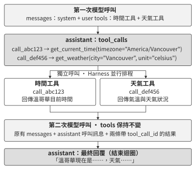

這兩個工具誰先執行？時間工具需要時區，天氣工具需要城市和溫標。使用者只說了溫哥華，示例中的模型據此填入 `America/Vancouver` 和 `Vancouver`，溫標選了攝氏度。查天氣用不著等時間工具回傳，兩項查詢可以同時發出。

**第一次 API 呼叫——Agent 框架傳送初始請求：**

```javascript
// 第一次模型調用：Harness 構造請求
{
  "model": "Qwen3-0.6B",
  "messages": [
    {
      "role": "system",                           // 开发者提供的指令
      "content": "You are a helpful assistant. Use the provided tools to get real-time information when needed."
    },
    {
      "role": "user",                              // 用户输入
      "content": "What's the current time and weather in Vancouver?"
    }
  ],
  "tools": [                                       // 开发者定义的工具
    {
      "type": "function",
      "function": {
        "name": "get_current_time",
        "description": "Get the current date and time in a specific timezone",
        "parameters": {
          "type": "object",
          "properties": {
            "timezone": { "type": "string", "description": "Timezone name, e.g. America/Vancouver" }
          },
          "required": ["timezone"]
        }
      }
    },
    {
      "type": "function",
      "function": {
        "name": "get_weather",
        "description": "Get the current weather for a specific city",
        "parameters": {
          "type": "object",
          "properties": {
            "city": { "type": "string", "description": "City name" },
            "unit": { "type": "string", "enum": ["celsius", "fahrenheit"] }
          },
          "required": ["city", "unit"]
        }
      }
    }
  ]
}
```

這份 `tools` 清單由開發者預先定義，包含名稱、描述和參數 schema。本例在各輪請求中提供相同的兩個工具，模型讀取清單與使用者問題後，再選擇要呼叫的工具並填寫參數。

**模型回傳兩個工具呼叫請求：**

```javascript
// 模型返回工具調用請求
{
  "choices": [{
    "message": {
      "role": "assistant",                         // 模型生成
      "content": null,                             // 本轮没有文本回复
      "tool_calls": [                              // 请求调用两个工具
        {
          "id": "call_abc123",
          "type": "function",
          "function": {
            "name": "get_current_time",
            "arguments": "{\"timezone\": \"America/Vancouver\"}"
          }
        },
        {
          "id": "call_def456",
          "type": "function",
          "function": {
            "name": "get_weather",
            "arguments": "{\"city\": \"Vancouver\", \"unit\": \"celsius\"}"
          }
        }
      ]
    }
  }]
}
```

回應中的 `tool_calls` 包含兩個請求，每個請求都有自己的 `id`、工具名稱和參數。`arguments` 是 JSON 編碼的字串，執行側需要先解析，再校驗欄位與取值。**模型決定呼叫什麼、傳入什麼參數；Harness 負責校驗和排程；工具實作負責存取時間或天氣服務。**

**Agent 框架執行工具，然後發起第二次 API 呼叫：**

Harness 校驗請求後排程兩個工具，將回傳值寫成 `tool` 訊息，再把已有歷史與新增結果一起交給模型：

```javascript
// 第二次模型調用：追加工具結果
{
  "model": "Qwen3-0.6B",
  "messages": [
    {
      "role": "system",                           // 保留第一次请求中的消息
      "content": "You are a helpful assistant. Use the provided tools to get real-time information when needed."
    },
    {
      "role": "user",                              // 保留第一次请求中的消息
      "content": "What's the current time and weather in Vancouver?"
    },
    {
      "role": "assistant",                         // 保留前一轮模型的调用请求
      "content": null,
      "tool_calls": [
        { "id": "call_abc123", "type": "function", "function": { "name": "get_current_time", "arguments": "{\"timezone\": \"America/Vancouver\"}" } },
        { "id": "call_def456", "type": "function", "function": { "name": "get_weather", "arguments": "{\"city\": \"Vancouver\", \"unit\": \"celsius\"}" } }
      ]
    },
    {
      "role": "tool",                              // Harness 写入工具执行结果
      "tool_call_id": "call_abc123",
      "content": "{\"timezone\": \"America/Vancouver\", \"datetime\": \"2025-09-13T05:18:47\", \"day_of_week\": \"Saturday\"}"
    },
    {
      "role": "tool",                              // Harness 写入工具执行结果
      "tool_call_id": "call_def456",
      "content": "{\"city\": \"Vancouver\", \"temperature\": 13.2, \"unit\": \"celsius\", \"conditions\": \"clear\", \"humidity\": 93}"
    }
  ],
  "tools": [ ... ]                                 // 沿用前面的工具定义，此处省略
}
```

沿著 `call_def456` 讀第二次請求：前一條 `assistant` 訊息裡，它是溫哥華天氣查詢的編號；後面的 `tool` 訊息用同一個編號送回了 13.2 ℃ 和晴天。即使天氣先於時間回傳，Harness 也能讓結果和請求對上。模型在這一輪同時讀到了使用者原來的問題、自己發出的兩項查詢，以及工具查回來的資料。接下來就能回答使用者了。

**模型根據工具結果生成最終回覆：**

```javascript
// 模型生成最終回覆
{
  "choices": [{
    "message": {
      "role": "assistant",                         // 模型生成
      "content": "It's currently 5:18 AM on Saturday, September 13, 2025 in Vancouver.\n\nWeather: 13.2°C with clear skies and 93% humidity. It's quite cool this morning - you might want to grab a jacket."
    }
  }]
}
```

第二次回應給出最終文字，`tool_calls` 為空，示例迴圈隨之結束。這個「呼叫模型→執行工具→回傳結果→再次呼叫模型」的過程，就是第一章執行迴圈在 API 中的具體實作。

如果使用者追問「那東京呢？」，Harness 就把這條訊息追加到歷史末尾，再次呼叫模型。模型可以沿用「查詢目前時間和天氣」的任務背景，生成針對東京的新請求；工具回傳後，再組織新的回答。

**換用 Responses API，怎樣把工具結果交回去？** 上面的本地實驗使用 Chat Completions 相容介面。如果用 OpenAI 的服務開發新專案，官方推薦 Responses API。還是看溫哥華的例子：應用把使用者問題放入請求的 `input`，並在 `tools` 中宣告時間和天氣兩個函式。回傳的 `output` 是一組有型別的條目。若其中出現兩條 `function_call`，應用就從每條裡讀取函式名、參數和 `call_id`，分別執行工具。[^ch2-responses-loop]

假設天氣函式的呼叫編號是 `call_weather`。下一次請求的 `input` 就可以放入這樣的回執；時間函式也要按自己的編號交回結果。

```json
{"type": "function_call_output", "call_id": "call_weather", "output": "{\"temperature\": 13.2, \"unit\": \"celsius\"}"}
```

`call_id` 把一條回執對回一次函式呼叫。`previous_response_id` 指向上一次模型回應，讓服務接續那一輪的上下文。兩個編號指的物件不同。採用這種續接方式時，本輪仍需提供要繼續使用的工具和頂層 `instructions`；上次請求的頂層指令不會隨回應編號自動繼承。模型可能繼續請求工具，應用要讀下一份 `output` 再決定是否結束。第一章實驗 1-3 用的是服務端託管搜尋；這裡的兩個自定義函式由應用實際執行。

[^ch2-responses-loop]: OpenAI，遷移到 Responses API、函式呼叫及建立回應的參數說明。

### 用程式碼實作 Agent 的核心迴圈

迴圈中的兩處 `messages.append` 分別儲存模型的回覆和工具的執行結果。時間和氣溫都來自溫哥華；把兩個呼叫 ID 對調，下一輪模型讀到的就會是「查詢時間」回傳了 13.2 攝氏度。

示例透過 OpenAI Python SDK 連線相容服務。預設地址是本機的 `http://localhost:8000/v1`，適用於已啟動、無需鑑權的本地服務。這組預設值對應實驗 2-1 的 vLLM 後端。若使用該實驗的 Ollama 後端，把地址設為 `http://localhost:11434/v1`，並把模型名改為 `qwen3:0.6b`。連線其他服務時，按需設定環境變數 `LLM_BASE_URL` 和 `LLM_API_KEY`，並讓下方的 `model` 與實際部署的名稱一致。時間和天氣工具暫用上一例的固定資料，以便對照訊息；接入真實資料時再替換這兩個工具的實作。

```python
import json
import os

from openai import OpenAI

client = OpenAI(
    base_url=os.getenv("LLM_BASE_URL", "http://localhost:8000/v1"),
    api_key=os.getenv("LLM_API_KEY", "EMPTY"),
)

# 工具定義：名稱、用途和參數結構
tools = [
    {
        "type": "function",
        "function": {
            "name": "get_current_time",
            "description": "Get the current date and time in a specific timezone",
            "parameters": {
                "type": "object",
                "properties": {
                    "timezone": {"type": "string", "description": "Timezone name, e.g. America/Vancouver"}
                },
                "required": ["timezone"],
            },
        },
    },
    {
        "type": "function",
        "function": {
            "name": "get_weather",
            "description": "Get the current weather for a specific city",
            "parameters": {
                "type": "object",
                "properties": {
                    "city": {"type": "string", "description": "City name"},
                    "unit": {"type": "string", "enum": ["celsius", "fahrenheit"]},
                },
                "required": ["city", "unit"],
            },
        },
    },
]

# 示例工具使用固定數據，參數與前面的溫哥華查詢一致。
def execute_tool(name, arguments):
    args = json.loads(arguments)
    if name == "get_current_time" and args == {"timezone": "America/Vancouver"}:
        result = {
            "timezone": "America/Vancouver",
            "datetime": "2025-09-13T05:18:47",
            "day_of_week": "Saturday",
        }
    elif name == "get_weather" and args == {"city": "Vancouver", "unit": "celsius"}:
        result = {
            "city": "Vancouver", "temperature": 13.2,
            "unit": "celsius", "conditions": "clear", "humidity": 93,
        }
    else:
        result = {"error": "示例仅提供温哥华时间和摄氏天气数据"}
    return json.dumps(result, ensure_ascii=False)

# 初始消息：指令與用戶任務
messages = [
    {"role": "system", "content": "You are a helpful assistant. Use tools to get real-time information when needed."},
    {"role": "user", "content": "What's the current time and weather in Vancouver?"},
]

# 運行循環：最多調用模型八輪
rounds = 0
while rounds < 8:
    rounds += 1
    response = client.chat.completions.create(
        model="Qwen3-0.6B", messages=messages, tools=tools
    )
    assistant_message = response.choices[0].message

    # 保存模型回覆，包括本輪的調用請求
    messages.append(assistant_message.model_dump(exclude_none=True))

    # 本例在模型給出不含工具調用的回覆時結束
    if not assistant_message.tool_calls:
        print(assistant_message.content)
        break

    # 逐個執行並追加結果；獨立調用也可以改爲並行調度
    for tool_call in assistant_message.tool_calls:
        try:
            result = execute_tool(tool_call.function.name, tool_call.function.arguments)
        except json.JSONDecodeError:
            result = json.dumps({"error": "工具参数需要有效的 JSON"})
        messages.append({
            "role": "tool",
            "tool_call_id": tool_call.id,
            "content": result,
        })
    # 下一輪使用追加了結果的消息列表
else:
    print("已达到轮数上限，任务尚未完成。")
```

假設模型在第一輪同時請求時間和天氣。這裡的 `for` 迴圈會先查時間，把結果追加到 `messages`，再查天氣，追加第二條結果。兩項都執行完，程式才回到 `while` 開頭，發出第二次模型請求。把 `messages` 在這幾步的內容展開，就能看到模型每次拿到了什麼。

**初始狀態（第 1 次呼叫前）：**
```text
messages = [
  { role: "system",  content: "You are a helpful assistant..." },     # 开发者写的
  { role: "user",    content: "What's the current time and weather in Vancouver?" },  # 用户输入
]
```

**第 1 次模型呼叫與工具執行完成後：**
```text
messages = [
  { role: "system",    content: "..." },
  { role: "user",      content: "What's the current time..." },
  { role: "assistant", tool_calls: [get_current_time, get_weather] },  # 模型生成的调用请求
  { role: "tool",      tool_call_id: "call_abc123", content: "{time...}" },  # 工具执行后由 Harness 写入
  { role: "tool",      tool_call_id: "call_def456", content: "{weather...}" },  # 工具执行后由 Harness 写入
]
```

**第 2 次呼叫後（模型回傳最終回覆，迴圈結束）：**
```text
messages = [
  { role: "system",    content: "..." },
  { role: "user",      content: "What's the current time..." },
  { role: "assistant", tool_calls: [get_current_time, get_weather] },
  { role: "tool",      tool_call_id: "call_abc123", content: "{time...}" },
  { role: "tool",      tool_call_id: "call_def456", content: "{weather...}" },
  { role: "assistant", content: "It's currently Saturday, Sep 13, 2025 in Vancouver..." },  # 最终回复
]
```

### 從 API 視角看上下文的構成

圖2-4 把一次請求分為前綴和訊息歷史兩部分。前面的溫哥華查詢剛發出時，歷史裡只有使用者的提問和此前的對話。等兩項查詢完成，歷史裡就多了模型提出的工具呼叫和兩項工具結果。

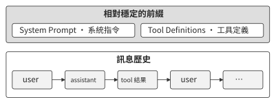

因此，連續兩次請求開頭相同的一段，可以一直延伸到訊息歷史裡。下一輪呼叫能複用多少舊計算，取決於這段前綴有多長。

下面的 Harness 將不常變化的系統指令與工具定義放在前面，每一輪只在歷史訊息末尾追加目前狀態。歷史太長時，它先壓縮舊訊息，再組裝請求。

```python
stable_prefix = system_message
stable_tools = core_tool_schemas
history = load_message_history(session)
status_message = make_status_message(derive_current_state(history))

if estimated_tokens(stable_prefix, stable_tools, history, status_message) > budget:
    history = compress_old_evidence(
        history,
        preserve = [decisions, constraints, failures, citations]
    )

request.messages = [stable_prefix] + history + [status_message]
request.tools = stable_tools
response = call_model(request)
```

壓縮時保留決策、約束、失敗和引用等後續工作需要的資訊，並維護呼叫請求與工具結果的關聯。除了長度預算，資訊重複和過時也可以觸發壓縮，具體策略將在本章後半部分展開。

> **實驗 2-1 ★：本地 LLM 服務部署與工具呼叫**
>
> 本實驗在本地執行 Qwen3-0.6B，沿著「查詢溫哥華時間和天氣」這一任務，觀察訊息如何經過模型、解析器和工具執行器。圖2-5 展示了本地服務與用戶端的分工：服務端載入模型、處理輸入並生成回覆，用戶端維護訊息歷史，排程工具並回傳結果。
>
> 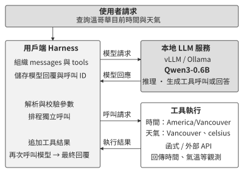
>
> **先跟蹤一次完整任務。** 模型在同一輪輸出中請求查詢時間和氣溫，分別填寫 `America/Vancouver`、`Vancouver` 和 `celsius` 等參數。用戶端並行執行兩個工具。第一份回執給出當地時間 11:11:28，第二份回執給出氣溫 17.9 °C。兩份結果送回模型後，它把時間報到分鐘，回答氣溫為 17.9 °C，隨後結束本次迴圈。這次執行說明，六億參數的模型已經能為這個任務選對兩個工具、填好參數，並用回傳值回答使用者。
>
> **再檢視原始輸出與 API 欄位的對應。** Qwen3 的思考模式可以生成帶有 `<think>` 標記的推理內容，工具請求則使用相應的呼叫標記。服務端解析後，用戶端可能收到單獨的 `thinking` 或工具呼叫欄位。輸出中各部分的排列與保留方式由模型範本和服務協定共同決定。
>
> **接著觀察流式處理。** 介面可以隨著事件更新「思考中」「呼叫工具」和「生成回答」等狀態。工具參數通常分多段到達，需要累積成完整請求；協定確認該呼叫結束，且參數、權限和依賴檢查通過後，執行系統可以開始排程。相互獨立的工具能夠並行執行，也可以與後續輸出處理形成流水線。
>
> **最後比較速度與快取。** 本次在蘋果晶片 Mac 上執行的記錄中，工具任務的平均解碼速度約為每秒 107 個 token。Token 是模型處理文字的基本單位，具體切分由分詞器決定，一個詞或漢字可能對應一個或多個 token。解碼速度反映開始生成後的輸出速率；使用者等待多久，還受到首 token 延遲、推理長度和工具耗時影響。
>
> 快取對照使用相同的長前綴，分別測試保留前綴與修改前綴開頭的請求。本次五組配對中，保留前綴的請求有四組更快；兩組平均首 token 延遲分別約為 1.30 秒和 1.51 秒。下一節將解釋這些請求在計算上有什麼區別。
>
> 這個實驗也讓筆者更加看好端側 Agent：小模型已經能夠在使用者自己的裝置上完成這樣的工具呼叫任務。**端側 Agent 的時代，比許多人預期的更近。**

## KV Cache 友好的上下文設計

Agent 的相鄰請求通常共享大量資訊：系統指令、工具定義，以及此前已經發生的互動。如果推理引擎能夠複用這些內容的中間計算結果，就能把更多計算用於新增資訊。**KV Cache** 儲存每層注意力計算中已經得到的鍵（Key）和值（Value），供後續 token 使用；**Prompt Cache** 則進一步在請求之間複用符合條件的前綴快取[^ch2-kv-basics]。

考慮一個客服 Agent：為了讓模型知道目前時間，開發者在系統提示詞開頭加入 `Current time: {{now}}`，每次請求都更新。後面的業務規則和工具定義保持原樣，實際輸入會從時間戳處開始變化。對於按相同前綴複用 KV 的服務，這會使時間戳及後續部分重新計算，增加輸入處理時間和費用。

把時間寫成追加訊息，或在需要時呼叫時間工具，就能保留已有前綴。兩種佈局提供的資訊相近，觸發的重算範圍卻不同。

可以先記住三個做法，後面的原理和實驗將逐項解釋它們：

1. **保持可複用的前綴穩定。** 系統指令和常用工具定義採用確定的內容與順序。
2. **把執行中的變化追加到後部。** 時間、餘額、呼叫次數和任務進度可以透過新訊息或工具結果提供。最新狀態應標明生效時點，讓模型能識別哪條記錄適用於目前決策。
3. **按模型協定組織訊息。** 使用正確的角色、呼叫 ID 和工具結果格式，由相應的聊天範本生成模型輸入。快取匹配的是處理後的前綴及相關配置，訊息協定還決定模型如何識別指令、使用者請求和工具回傳值。

在本節採用的因果注意力模型中，後續 token 的加入不會改變此前位置已經算出的狀態。修改已有輸入時，首個變化位置及其後面的狀態需要重新計算；變化之前的前綴仍有複用機會。服務端還會根據快取塊大小、保留時間和執行配置決定實際命中範圍。

[^ch2-kv-basics]: Hugging Face，How caching works，介紹逐層儲存與複用 K、V 的機制。

> **實驗 2-2 ★：注意力機制視覺化**
>
> 先用「北京 的 天氣 怎麼樣」理解一次注意力計算。為了便於展示，圖2-6 將這句話分成四個語義單元；實際模型由分詞器切分輸入。處理「怎麼樣」這一位置時，注意力層要從已有資訊中組合出目前表示。Query、Key 和 Value 分別承擔查詢、匹配和資訊聚合的作用。
>
> | 向量 | 作用 | 在這個例子中的直觀理解 |
> | --- | --- | --- |
> | **Query（查詢）** | 目前位置用於匹配其他位置的向量 | 「怎麼樣」需要從已有內容中找出相關資訊 |
> | **Key（鍵）** | 各位置參與匹配的向量 | 「北京」「天氣」等位置提供可供匹配的表示 |
> | **Value（值）** | 按權重聚合的資訊向量 | 將地點、天氣等資訊按相應比重匯入目前表示 |
>
> 可以把 Key 想像成用於檢索的標籤，把 Value 想像成取回的內容。模型中的這些向量都是從隱藏表示計算出來的數值，並由訓練塑造其匹配方式。
>
> 一次計算分三步。首先，目前位置生成 Query；然後，它與各位置的 Key 做點積，經過縮放、因果掩碼和 softmax，得到和為 1 的注意力權重；最後，用這些權重對 Value 加權求和。點積就是兩組數字逐位相乘再求和，softmax 則將可見位置的分數轉換成歸一化權重。各位置的 Value 按對應權重參與聚合，共同形成這個注意力頭的輸出。
>
> 沿圖2-6 的最後一行橫著讀：「怎麼樣」這個位置給「天氣」的權重是 0.55。這個數要乘上「天氣」所在位置的 Value，再加上另外三個位置的貢獻，才得到該注意力頭在「怎麼樣」處的輸出。換到「天氣」那一行時，右邊為什麼多了一個叉？因為計算這個位置時，序列還沒走到「怎麼樣」。
>
> 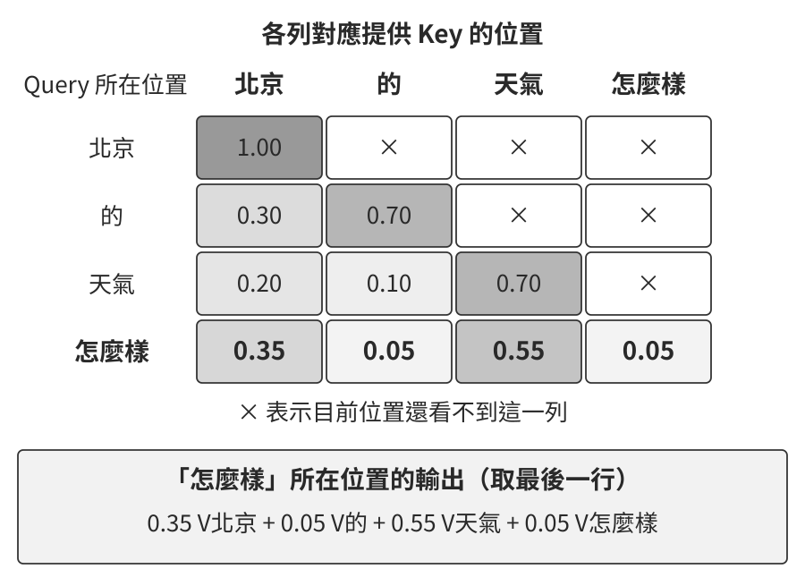
>
> 把每個位置的權重排成矩陣，就得到**注意力熱力圖**。每行對應一個 Query，每列對應一個 Key，顏色深淺表示權重大小。因果掩碼允許目前位置讀取自己和前面的位置，圖中用 × 標出被遮蔽的位置，它們經過 softmax 後的權重為零。這一結構適用於輸入處理和後續生成。
>
> 從這裡也能看出 K、V 快取的用途：生成繼續推進時，新位置仍會讀取已有位置的 Key 和 Value。儲存這些向量後，新位置就可以直接用它們進行匹配與聚合，省去歷史位置的重複計算。
>
> 理解了這組示意權重，再用 Qwen3-0.6B 檢視模型實際計算出的注意力分布。實驗分別記錄短句和一段包含推理、最終回答的生成序列，比較不同層的注意力矩陣。圖2-7 分別展示第 0、13、27 層：左列是九個 token 的短句，右列是計算 17 × 23 的生成序列，按輸入、推理和回答標出位置範圍。灰度採用對數刻度，便於同時看清較強與較弱的注意力權重。
>
> 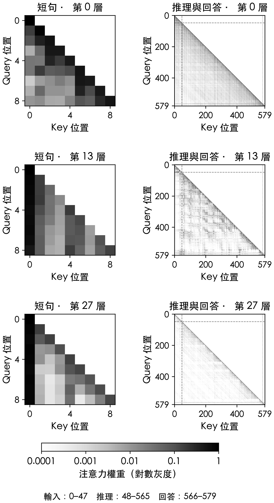
>
> 閱讀時可以沿著四條線索分析：
>
> 1. **注意力儲存池（Attention Sink）。** 某些層把較大權重分配給序列開頭，即使開頭的 token 承載的語義很少。看圖2-7 左列的短句。每幅圖已對同一層的各注意力頭取了平均。再取矩陣第一列九個數的平均值，就能算出九個位置平均分給首個 token 多少權重。第 0、13、27 層分別為 14.7%、73.9% 和 83.2%。換到右列較長的生成序列，第 13 層的這個數值就變為 28.0%。softmax 要求各位置權重合計為 1，模型可以學出相對穩定的接收位置；StreamingLLM 對這一現象及其在流式推理中的作用作了專門研究[^ch2-attention-sinks]。
> 2. **推理區域。** 標出 `<think>` 對應的生成區間，沿這些行檢視模型關注了哪些提示詞、工具說明或此前推理。三角形來自因果掩碼，三角形內部的深淺才反映各位置的權重差異。
> 3. **回答區域。** 再標出最終回答的生成區間，比較它對原始輸入和先前推理的權重分配。這能幫助定位哪些已有資訊進入了目前注意力聚合。
> 4. **位置差異。** 《Lost in the Middle》在長上下文問答和鍵值檢索中觀察到，中間位置的資訊更難被有效利用[^lost-in-the-middle]。工程上可以據此優先把常駐規則放在前部，把目前目標和進度放在末尾。

[^ch2-attention-sinks]: Xiao et al.，Efficient Streaming Language Models with Attention Sinks，ICLR 2024。

[^lost-in-the-middle]: Liu et al.，Lost in the Middle: How Language Models Use Long Contexts，TACL 2024。

### 從 API 訊息到模型 Token：Chat Template

前面的 API 示例是一組帶角色的訊息，注意力圖中的輸入則是一串 token。**Chat Template（聊天範本）**負責完成這次轉換：為訊息加入角色與邊界標記，按約定組織工具說明和回傳值，再交給分詞器編碼。對照圖2-8 兩欄：左邊只提交了系統指令和使用者提問，右邊怎麼又多出一個 `assistant`？那是範本為下一條回覆加上的起始標記。後面討論工具呼叫、推理資訊的保留和快取命中時，還會用到這些標記。

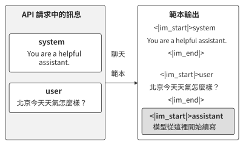

Qwen、Llama、Gemma 等模型家族各有自己的聊天範本。同一組 API 訊息交給不同模型，轉換出的角色和邊界標記也可能不同。託管 API 通常由服務端完成轉換，自行部署時則要為推理服務配置與模型匹配的範本。

假設使用者發來一句「溫哥華 17.9 °C」，天氣工具也恰好回傳相同的文字。把這兩條訊息分別交給 Qwen3-0.6B 的範本，會得到圖2-9 中的兩段輸入。它們都以 `<|im_start|>user` 開頭，哪一處標記表明文字來自工具？

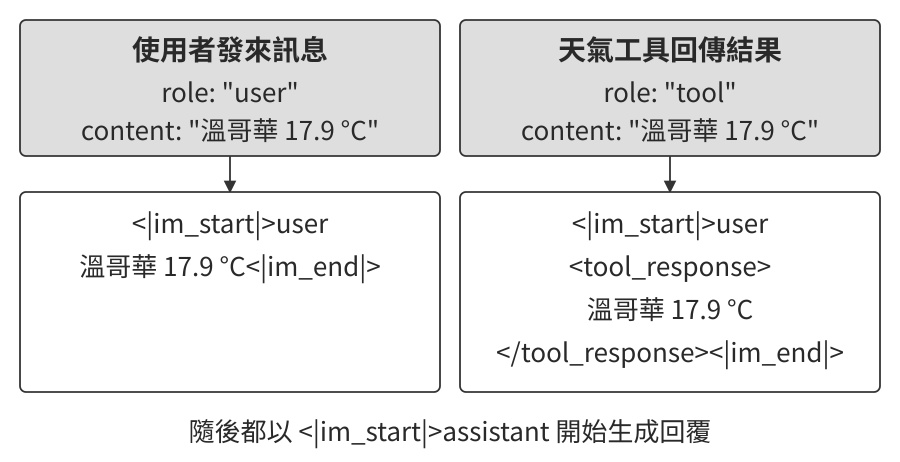

右欄多了一對 `<tool_response>` 標籤。範本還按訊息角色定位使用者最近一次提問：在這次提問之前的輪次，只保留回答內容；在此之後，工具互動還可以帶上模型的推理資訊[^ch2-qwen-template]。

例如，模型查完檔案後仍要繼續分析。把工具結果按 `tool` 角色回傳，範本就能將它識別為目前任務中的工具回饋；如果把同樣的結果直接寫成普通 `user` 訊息，範本可能把它識別為新的查詢，改變此前推理的保留範圍。這就像繼續做一道題時需要保留演算草稿：Harness 應儲存服務要求的推理欄位，並按正確的訊息結構接著呼叫。

**從單輪推理走向長程 Agent，歷史思考逐漸成為需要維護的任務狀態。** 早期 DeepSeek-R1 的聊天範本會去掉歷史回答中的思考部分，只保留最終回答[^ch2-r1-template]；後續 DeepSeek 的工具呼叫協定則要求回傳推理資訊。一次問答結束後，最終回答可能已經包含下一輪所需的資訊；工具任務進行到一半時，「為什麼查這個檔案」「已經排除了哪些假設」卻可能只寫在中間推理中。保留這些資訊，有助於下一輪接著已有思路工作。

**推理資訊的回傳方式由模型協定決定。** 接入時要同時處理 `content`、`tool_calls` 和服務提供的推理欄位。下面幾種方案體現了不同的續接規則：

- **DeepSeek 思考模式**透過 `reasoning_content` 回傳推理。按照其工具呼叫協定，請求帶有 `tools` 時，後續請求須完整回傳歷史推理，包括未呼叫工具的模型回覆；缺失欄位會觸發 400 錯誤。純聊天請求不帶 `tools` 時，服務忽略回傳的歷史推理[^ch2-deepseek-thinking]。
- **Kimi 的思考與工具互動**同樣需要在執行迴圈中管理推理、工具請求和結果。以 Kimi K2.5 的交錯思考示例為例，模型可以在多次工具呼叫之間繼續推理，用戶端按其協定儲存和回傳模型訊息[^ch2-kimi-thinking]。
- **GLM 的保留思考**可以透過 `thinking.clear_thinking: false` 開啟，隨後完整、按原順序回傳 `reasoning_content`。Coding Plan 與標準 API 的預設設定不同，用戶端應明確選擇所需模式[^ch2-glm-thinking]。
- **Claude 的 thinking block**需要連同簽名儲存。支援 preserved thinking 的模型還會檢查塊的來源與前綴，具體規則見後面的「快取作為架構約束」。

這些規則影響連續工具呼叫，也影響中途切換模型。切換時，適配層要把工具請求、結果和任務狀態轉換成目標介面接受的形式，再按目標模型的規則處理推理資訊。第五章的實驗 5-1 將展開這種軌跡接續。

**範本還決定快取所匹配的輸入。** 同樣的訊息內容，經過不同範本、工具順序或序列化方式處理，可能形成不同 token 前綴。要複用已有 KV，需要保持相關模型配置和前綴一致。

[^ch2-qwen-template]: Qwen3-0.6B 的分詞器設定檔 `tokenizer_config.json` 儲存了聊天範本，其中包含使用者查詢、推理內容與工具回應的處理邏輯。

[^ch2-r1-template]: DeepSeek-R1 官方聊天範本在普通曆史回答中保留 `</think>` 之後的內容；後續工具呼叫的推理回傳規則見 DeepSeek 的 Thinking Mode 文件。

[^ch2-deepseek-thinking]: DeepSeek，Thinking Mode。

[^ch2-kimi-thinking]: Moonshot AI，Kimi K2.5 官方倉庫，Interleaved Thinking and Multi-Step Tool Call 一節。

[^ch2-glm-thinking]: Z.ai，Thinking Mode，介紹交錯思考、保留思考及端點預設設定。

### KV Cache 的原理與約束

模型處理一次請求時，先對輸入進行 **prefill（預填充）**，計算已有 token 的表示，再進入 **decode（解碼）**，逐個生成後續 token。KV Cache 在解碼過程中儲存已有位置的 K、V；跨請求的前綴快取進一步複用上一請求留下的相同前綴。

例如，Agent 到第六輪時已經累積了 2,000 個輸入 token。如果服務只使用本次請求內的 KV Cache，就需要先處理這 2,000 個 token，再利用快取繼續生成。如果跨請求快取中已有其中一段相同前綴，prefill 就能從尚未快取的位置接續。圖2-10 展示了這種跨請求複用。

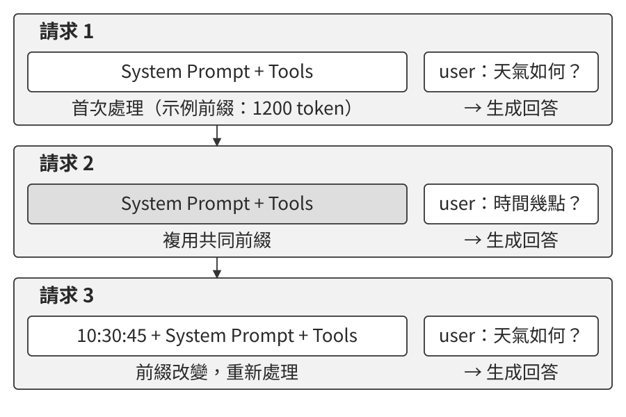

**用四個 token 跟蹤快取的增長。** 假設輸入為 `[A, B, C, D]`。模型處理位置 D 時，用 D 的 Query 與 A、B、C、D 的 Key 匹配，再對它們的 Value 加權聚合。經過各層計算，D 位置的最終表示用於預測下一個 token E。此時，A 至 D 在各層的 K、V 都已儲存。

取樣得到 E 後，下一步把 E 送入模型，計算它在各層的 Query、Key 和 Value。E 的 Query 讀取此前的快取與目前位置的 K、V，模型再預測第六個 token；E 的 K、V 同時追加到快取中。這樣，每生成一步，都可以沿用此前的狀態，只計算新輸入 token 的狀態。

若完全不用 KV Cache，預測 E 時要重新處理 A 至 D，預測第六個 token 時又要處理 A 至 E。僅按重複生成 K、V 的位置數計算，累計工作量會出現 $1+2+\cdots+N$ 這樣的增長。使用快取後，歷史位置的逐層計算得以複用；新位置仍要讀取可見的 K、V。在標準全注意力解碼中，這部分讀取與匹配隨上下文長度線性增加，所以長上下文仍會佔用更多顯示記憶體和記憶體頻寬。

**修改輸入為什麼會影響後續快取？** Transformer 的各層依次處理隱藏表示，每層都有自己的 K、V。某個位置經過注意力計算後，表示中已經匯入此前位置的資訊，再傳給下一層。因而，第 $k$ 個 token 改變時，影響會從該位置向後、向更高層傳播。

對於相同模型與計算配置，$k$ 之前的位置只依賴更早的輸入，可以繼續複用；從 $k$ 開始，需要重新建立受影響的狀態。實際服務通常按快取塊匹配前綴，重算邊界還受到塊大小影響。更新越靠前，通常需要重算的輸入越多。把穩定指令放在前部、把新狀態追加到後部，就是在利用這一依賴關係。

> **實驗 2-3 ★★：上下文管理方式的對照**
>
> 本實驗讓 Agent 使用檔案發現、讀取和搜尋工具完成同一個任務，比較一種穩定追加的基線與五種上下文改動。基線保持指令和工具順序穩定，逐輪追加模型訊息和工具結果。其餘各組分別改變指令、狀態、工具排序或歷史表達，觀察快取統計和任務過程怎樣變化。
>
> **動態系統提示詞**在每輪的系統指令中更新目前時間。變化之前仍可有共享前綴，從時間資訊起的後續輸入則需要重新匹配或計算。可以把時間作為新訊息追加，或透過時間工具按需獲取，讓常駐業務規則繼續複用。
>
> **動態使用者配置**在前部訊息中更新剩餘呼叫次數或帳戶餘額。狀態本身是任務所需的資訊，設計重點在於更新位置：把最新狀態追加到末尾，並標明其生效時間，能夠同時保留進度與前綴。後面的 Agent 狀態列將採用這種組織方式。
>
> **工具定義重排**每輪改變工具清單的順序。名稱和參數雖然相同，序列化後的 token 順序已經變化。開啟 Kimi K2.6 的執行報告，基線和重排組的 `Hit%` 都是 100%。兩組真的複用了同樣多的輸入嗎？基線三輪共輸入 7,567 個 token，其中 768 個命中快取；重排組也是三輪，7,568 個輸入 token 中只有 256 個命中。用快取 token 數除以輸入 token 數，就得到 `Cache%` 一列的 10.1% 和 3.4%。另一列 `Hit%` 按有命中判定的請求計數：基線記了兩次命中，重排組只記了一次，兩組記下的未命中次數都是零。其餘請求的命中情況，單憑這份記錄無從判斷。固定工具順序可以避免前綴無故變化。
>
> **滑動視窗**只保留最近一段歷史。假設按十輪互動保留，第十五輪就可能讀不到第二輪取得的關鍵檔案內容。除了縮短共享前綴，裁剪還會改變模型能獲取的事實和任務進度。配套實作以最近六條歷史訊息為起點，並向前補齊工具結果所對應的呼叫請求。滑動視窗組複用了 2,224 個輸入 token 中的 1,510 個，快取佔比達到六組中最高的 67.9%。再看實驗 2-3 滑動視窗組的工具記錄：模型三次查詢檔案，接著讀取兩個檔案，卻沒有交付使用者要求的三句話總結。
>
> **文字格式化**把帶角色的歷史重新寫成 `USER: ...`、`ASSISTANT: ...` 等文字。這樣會改變範本中的訊息邊界和工具結構，模型需要從正文恢復原來的關係。本次文字組仍生成了最終回覆，也有快取命中。介面提供的訊息角色、呼叫 ID 和工具結果欄位，有助於穩定傳遞這些關係。
>
> 程式即使重新構造訊息列表，只要送出的前綴和快取配置相同，這段前綴仍有機會複用。
>
> 如果還想知道使用者少等了多久，要先看計時器在哪裡停。滑動視窗組第一輪的 `ttft` 約為 2.23 秒。程式雖然把這個欄位叫作 TTFT（首 token 延遲），卻是在非流式請求回傳整份回覆時才停表。

### KV Cache 與 Prompt Cache：兩個層級的快取

可以用兩個時刻區分這兩層快取。模型生成回覆中的第二個 token 時，可以讀取該請求中已有位置的鍵值狀態，這用到 **KV Cache**。稍後使用者追問，Harness 發來新的請求；服務要先找到此前儲存的相同前綴，才可能少算這部分輸入，這屬於 **Prompt Cache**。前者解釋同一次生成如何繼續，後者還要求跨請求的儲存與匹配機制。

在 API 服務中，快取還受到最小前綴長度、塊大小、有效期、模型配置和租戶隔離範圍影響。可複用前綴必須在相同的快取作用域內查詢。例如，Claude API 按組織與工作區隔離快取；相同文字出現在不同隔離域時，會分別建立快取[^ch2-prompt-cache]。

計費需要分別考慮寫入和讀取。一些 Claude 模型的快取讀取價為普通輸入價的十分之一，首次寫入則有額外費用。同一段前綴在有效期內反覆使用，只需付一次寫入費，後續命中的請求都按讀取價計費。

[^ch2-prompt-cache]: Anthropic，Prompt caching，介紹快取匹配、隔離、有效期和計費。

### 快取作為架構約束

**在生產系統中，快取已經成為一項架構約束。** 提示詞怎樣排列、子 Agent 從哪裡開始、會話如何恢復，都會影響可以複用多少計算。**設計之初就要安排快取邊界。** 先確定哪些內容可以共享、哪些狀態會變化，再組織提示詞和會話結構，能減少執行中的反覆重算。等到長程任務的延遲和費用已經成為問題，再調整這些結構，往往會牽動狀態管理、子 Agent 和會話恢復。

**按穩定程度安排前綴。** 多個任務共享的指令與工具定義可以放在前部，隨後再加入使用者資料、會話狀態和新觀測，並按適用範圍分組。例如，作業系統有 macOS/Linux 兩種選擇，執行模式有普通/除錯兩種，語言有中文/英文兩種，三項獨立條件最多產生 $2\times2\times2=8$ 種前綴組合。把變化較多的欄位放到共享部分之後，可以增加公共前綴的複用機會。公共部分的共享範圍還要遵守服務的組織、工作區和隱私邊界。

**為子 Agent 選擇可複用的起點。** 子 Agent 若繼承父 Agent 的任務背景，可以複用雙方一致的前綴，再追加自己的子任務。提示詞、工具順序、模型與相關配置共同決定可複用範圍。需要獨立角色或隔離上下文的子 Agent，則按其任務構造輸入，再檢查哪些公共部分適合共享。

**儲存已經發送的內容。** 大型工具輸出壓縮成摘要或預覽後，應儲存實際送入模型的版本。會話恢復時重放這份記錄，能夠重建一致的訊息序列；每次恢復都重新生成摘要，則可能引入新的措辭和前綴變化。更新摘要時，可以發布一個新版本，並明確之後從哪裡重新建立快取。

**保留推理還需要滿足協定約束。** Claude 的 preserved thinking 為這個問題提供了具體例子。其文件將這一機制用於防蒸餾：服務檢查 thinking block 的簽名、生成模型及其前綴。對於 Claude Fable 5.1、Claude Opus 5.5 等支援前綴綁定的模型，塊之前的頂層 `system`、`tools` 和訊息共同構成校驗範圍；修改其中的內容，會使該塊及後續 thinking block 失效[^ch2-preserved-thinking]。

例如，每輪重寫系統時間、重新渲染首條訊息中的環境資訊、原地截短舊工具結果，都會改變後續推理塊所綁定的前綴。觸發校驗後，API 可以回傳 400 錯誤，也可以按 `prefix_mismatch_behavior` 的配置丟棄失效塊，繼續處理請求。後一種情況下，模型仍能使用保留下來的任務資訊與工具結果，但失效推理不再參與本次輸入。2026 年 8 月 31 日起建立的帳戶預設啟用前綴校驗，較早帳戶的啟用方式見協定說明。

接入這類協定時，可以保持會話的頂層指令和工具集合穩定，把狀態變化追加到後部。需要中途更新指令或工具時，使用該服務提供的會話內系統訊息、工具變更塊等介面。裁剪 thinking block 也要維持原順序中的連續區間：可以從頭部或尾部刪除，或全部刪除；中間留出缺口會影響後續塊，已主動刪除的塊也應保持刪除狀態。

中途切換模型時，服務還會檢查目標模型是否能夠讀取原模型的推理塊。用戶端應儲存原始歷史，讓服務按相容規則處理；若用戶端自行刪除，後續切回原模型時也無法恢復這些記錄。

[^ch2-preserved-thinking]: Anthropic，Preserved thinking，介紹模型、前綴綁定、失效處理及推理塊裁剪規則；會話內更新介面見Mid-conversation system messages and tool changes。

### 研究延伸：可編輯、可組合的 KV Cache

> 前面的設計都透過匹配前綴複用計算。筆者還希望進一步探索：能否直接編輯、組合 KV 中已經儲存的資訊，讓快取適應上下文的變化？筆者在《Models Take Notes at Prefill》中把這種資訊比作模型的「筆記」[^ch2-2]：prefill 經過多層注意力計算後，一個欄位的影響已經進入後續位置的表示。例如，「使用者所在城市：北京」可能影響後續地點判斷；只替換這個欄位自身的 K、V，後續狀態仍可能保留舊城市所匯出的結論。
>
> 論文透過干預區分了欄位自身的 KV 與後續狀態的作用。在所測決策中，欄位自身 KV 的直接貢獻低於 1%，主要影響儲存在下游表示中。圍繞這些下游留下的「筆記」，可以探索兩種利用快取的方法。
>
> **編輯（Editing）**透過顯式更正資訊推動後續計算更新已有判斷。論文還發現，在所測的 8B 模型任務中，存在顯式思維鏈時，單獨編輯欄位也能恢復目標決策，計算開銷約為完整重算的 1%；缺少這一推理過程時，舊的下游狀態可能繼續影響決策，使欄位修改難以生效。
>
> **組合（Composition）**把預先計算的技能快取接入新的上下文。對於採用旋轉位置編碼（RoPE）的模型，需要先調整快取中的位置表示，再進行拼接。可以把它想像成給一頁已有筆記重新編號，接到另一份材料後面。論文比較了十二個模型，拼接與完整重算的輸出 logits 餘弦相似度為 0.90–0.999；快取重定位與拼接本身可以按長度線性處理，減少整段上下文的注意力重算。
>
> 追加更正資訊還可以與現有前綴快取配合。在論文的 vLLM 線上基準中，這種組合保留了約 98.5% 的前綴快取命中率，p90 首 token 延遲約為基線的 1/398 至 1/53。
>
> **筆者看好這條研究路線，因為它有望讓上下文更新保留更多已有計算。** Agent 經常更新記憶欄位、加入狀態或替換工具定義；如果相關狀態能像筆記一樣修正和拼接，維護長上下文的代價就有機會顯著降低。

[^ch2-2]: Li, Bojie，Models Take Notes at Prefill: KV Cache Can Be Editable and Composable，2026。編輯、組合與線上快取實驗採用不同任務和指標，具體設定見論文。

### 從快取機制到上下文內容的設計

理解了快取如何複用計算，接下來就要決定每輪輸入放什麼，以及這些內容怎樣更新。後面的內容分為三部分：

- **提示工程與 Agent Skills**：先設計系統指令和工具定義，說明目標、規則與操作方式；再透過漸進式披露按需載入領域知識。提示注入防護則關注外部內容進入上下文時的來源與指令邊界。
- **Agent 狀態列**：把任務進度、環境觀測摘要和呼叫計數等狀態提供給模型，減少從長曆史中重新推導的開銷。它像手機上的時間、電量和網路狀態，讓目前執行情況保持可見。
- **上下文壓縮**：在歷史增長時保留後續決策需要的資訊，決定何時壓縮、怎樣組織摘要，以及如何處理快取重算與任務接續。

## 提示工程：最佳化系統提示詞

提示工程透過指令、流程和示例，引導模型完成具體任務。本節重點討論**系統提示詞（System Prompt）**：它像一份員工手冊，說明 Agent 的身份、目標、行為規則和工作流程。在本章的 API 示例中，這些內容透過 `system` 訊息提供。

### 語氣與風格：怎樣面向使用者表達

語氣要求應落實到具體表達。例如，簡短問答可以要求「You MUST answer concisely with fewer than 4 lines」，即用少於四行的文字回答。任務受阻時，可以要求「keep your response to 1–2 sentences」，用一兩句話說明目前狀態與下一步，讓使用者直接看到需要處理的事項。

「NEVER do X」這類大寫強調可以用於突出關鍵要求。更重要的是說明要求適用於什麼情況，以及應採取什麼行動。

### 結構化提示：組織層次與內容邊界

標題、列表和標籤可以幫助組織較長的提示詞。Markdown 標題適合表示章節和步驟，XML 風格標籤適合劃分不同用途的內容塊，例如用 `<working_directory>` 包裹工作目錄資訊。標籤名應直接說明內容用途，讓模型容易識別各塊之間的關係。

同一份提示詞可以組合兩種寫法：

```text
# 工具使用規範

## 文件操作
<file_operation>
- 读取文件前检查路径是否存在
- 修改已有文件前保存备份
</file_operation>

## 網絡請求
<network_request>
- 超时时间设置为 30 秒
- 短暂故障最多重试 3 次
- 有外部副作用的请求，重试前先确认执行状态
</network_request>
```

Markdown 提供便於閱讀的層次，`<file_operation>` 和 `<network_request>` 劃分規則的適用範圍。例如，「最多重試 3 次」只適用於網路請求，修改檔案時遵循的是上一組備份規則。

### 用流程組織規則

**任務有明確階段時，優先按流程組織提示詞。** 以退款為例，先找到訂單，才能按退款政策判斷這筆錢能不能退。查不到訂單，就請使用者補充訂單號等資訊；訂單符合條件，再發起退款。將同樣的規則散放在一份上百條的清單裡，每一步都需要重新找出適用條目。把輸入條件、處理順序和異常出口寫在對應階段，模型就有依據判斷目前走到哪裡、下一步應做什麼。

下面以檔案處理為例，把檢查、分類、預處理、執行和驗證串成一份標準操作流程（SOP）：

```text
文件处理流程

步骤 1：检查
  确认文件存在且可以访问
  文件不存在 → 记录错误，停止处理
  ↓
步骤 2：分类
  结合扩展名与文件内容确定类型
  ↓
步骤 3：预处理
  配置文件 → 先备份
  大文件（>1 MB）→ 使用流式处理
  ↓
步骤 4：执行
  按文件类型执行相应处理
  ↓
步骤 5：验证
  检查处理后文件的完整性
```

每一步都給出一個局部目標，相關規則放在該步驟下。檔案不存在時，在檢查階段退出；設定檔需要修改時，在預處理階段儲存備份。執行進度則由訊息歷史或狀態記錄提供給模型。

### 業務規則細化：把產品約定寫清楚

同一份訂單資料，究竟歸入哪類請求、適用哪種服務、該收多少費用，首先是產品與運營需要明確的業務約定。工程實作再分工：提示詞告訴模型應取得哪些欄位、向哪項服務查詢；工具和業務系統執行確定性的計費與約束。

以替使用者打電話降低訂閱費用或申請退款的 Agent 為例，團隊希望透過「辦不成就退款」降低嘗試門檻，同時為特殊任務設定明確的收費方式。可以設計三類計費：

- **按節省金額提成**：透過談判降低現有帳單，按實際節省金額的一定比例收費，例如 20%。
- **按服務收取固定費用**：餐廳預訂等服務型任務，按任務型別或複雜度收費。
- **困難任務預收款**：對符合特定條件的困難任務，提前說明預收費用與不退款條款，由使用者確認後接單。

寫成「根據任務情況選擇合適的計費型別」，仍會留下分類歧義。「幫我退掉上個月買的衣服」涉及拿回已付款項，「幫我取消 Netflix 訂閱」涉及停止未來付費。這兩種結果都可能被寬泛地理解為省錢，但團隊可以將提成限定為談判降低現有帳單，退款與取消服務統一採用固定費用。

相應提示詞可以直接寫出類別邊界：「NEVER use percentage_based_one_time for refunds and service cancellations. Use fixed_fee instead.」 即退款和取消服務使用 `fixed_fee`，談判降低現有帳單才適用提成模式。

團隊還要估計這件事有多大把握辦成。商家接受哪些申請、這個使用者是否符合條件、帳單上收了什麼錢、過去同類委託辦得怎樣，都會影響接單方式。若規則採用「高於 60% 進入可退款模式、低於 30% 不接單」的閾值，就還要寫清中間區間及邊界值的處理方式。

金額計算要明確單位、基數與舍入順序。例如，電話費用按每分鐘 0.05 美元累計，彙總後四捨五入到整數美元；節省金額以現有帳單為基準。若目前帳單為 150 美元，商家可能明年漲到 180 美元，維持目前價格所避免的潛在漲幅，應按預先約定的口徑處理，不能自動計入降低現有帳單的節省金額。

筆者的建議是，**由產品負責人主導業務規則的設計**，結合線上資料、使用者回饋和運營經驗維護這些定義；工程師再將其落實到提示詞、工具參數、計費邏輯和驗證規則中。

### Few-shot 示例：用例子說明期望行為

當輸出要求難以用幾條規則表達時，**優先給出兩三個高品質示例，比繼續堆疊抽象說明更直接。** 這種做法稱為**少樣本示例（few-shot examples）**。特定文案風格、結構化報告和客服語氣，都適合用輸入與期望輸出成對展示。模型在目前上下文中利用這些例子識別模式，再用於新請求。

示例可以放在系統提示詞中，作為多次請求共享的內容；也可以組織成示範用的 `user`／`assistant` 訊息，在會話開始時載入。**重複處理同一類任務時，筆者優先採用經過篩選的固定示例集。** 固定示例也能保持前綴穩定。任務差異較大、固定示例無法覆蓋時，再考慮按任務檢索。採用動態選擇時，可以先保留共同指令，再在後部加入選中的示例。

沿用前面的計費規則，兩個示例就能講清容易混淆的邊界。使用者請助手把月費從 80 美元談到 60 美元，可以按節省金額提成；使用者請助手停訂每月 80 美元的服務，則按取消服務收固定費用。

### 工具定義的設計

工具定義是 Agent 的操作手冊。模型要從名稱和描述中判斷何時呼叫工具，再依據參數結構填寫請求。清楚的定義應當讓模型知道工具能完成什麼、需要哪些輸入、會回傳什麼，以及呼叫前應滿足哪些條件。

這些資訊可以寫得很具體。例如，搜尋工具可以要求「查詢檔案內容時使用專用搜索工具」；時間工具可以給出 `timezone: "America/New_York"`，展示參數的實際寫法；讀取工具可以提示「相互獨立的讀取可批次呼叫」；編輯工具則應說明「先讀取目標檔案，再根據目前內容編輯」。這四類說明分別交代使用邊界、參數格式、執行效率和前置依賴。第四章將結合更多例子討論工具介面的設計。

工具較少時，可以隨請求提供完整的 `tools` 定義，並在後續輪次保持名稱、內容和排列穩定。工具增多後，完整定義會佔用大量上下文，還會增加模型區分相近工具的負擔。此時可以採用**按需載入**：先讓模型知道有哪些能力，需要時再檢索並載入相關工具的完整 schema。下文的 Skills 也會採用這種先提供目錄、再載入細節的組織方式。

OpenAI Responses API 用 `defer_loading: true` 標記延遲載入的工具。在用戶端管理的工具搜尋流程中，模型發出 `tool_search_call`，用戶端透過 `tool_search_output` 回傳選中的工具定義；常用工具也可以直接提供，與延遲載入的工具一起使用[^ch2-toolsearch-oai]。Claude Code 在支援工具搜尋的模型和服務配置下，預設按需載入 MCP 工具：會話開始時提供工具名稱和伺服器說明，搜尋後再載入完整定義。它也提供閾值模式，在工具定義達到指定的上下文佔比後啟用延遲載入[^ch2-toolsearch-cc]。Codex 的 Apps／Connectors 工具發現範本則採用 BM25 檢索工具後設資料，並將匹配工具提供給下一次模型呼叫[^ch2-toolsearch-codex]。

按需載入還需要與前綴快取配合。對於支援在會話中追加工具定義的介面，已有內容保持原位，新定義隨發現結果加入後續上下文。因果注意力中，每個 token 的 K、V 只依賴自身及其之前的內容，因此末尾新增內容可以保留此前前綴的複用條件。後續輪次繼續在這段歷史之後追加訊息，已經載入的定義也保留在原來的位置。有些介面會把新工具加入請求開頭的 `tools` 集合。這樣一來，排在新定義後面的歷史訊息雖然原封未動，也要重新計算。

[^ch2-toolsearch-oai]: OpenAI，Tool search，Responses API 文件。
[^ch2-toolsearch-cc]: Anthropic，Scale with MCP tool search，Claude Code 文件。
[^ch2-toolsearch-codex]: OpenAI Codex，Apps／Connectors 工具發現範本。

> **實驗 2-4 ★★：提示工程的消融實驗**
>
> 一份提示詞中，語氣、資訊組織和工具說明分別起什麼作用？本實驗藉助 τ-bench 的航空客服任務做對照。τ-bench 透過使用者模擬、業務工具和規則構造互動場景，並檢查任務結束後的目標狀態；航空和零售是其中的兩個任務領域[^ch2-tau-bench]。
>
> 本次使用 Kimi K3 作為執行模型和使用者模擬模型，對同一組十個航空客服任務執行六種配置。基線保留結構化規則、完整工具描述和專業中立語氣；其餘配置分別調整語氣、打亂規則組織、移除工具描述，並增加一組疊加改動。
>
> **語氣對照**保留任務規則，改變表達方式。Trump 風格採用誇張、自信的修辭，例如「我會給你訂到史上最棒的航班」；Casual 風格採用輕鬆口吻和表情符號。
>
> **資訊組織對照**保留規則內容，打亂標題和排列。
>
> **工具描述對照**保留名稱、函式簽名和參數結構，移除描述文字。工具名稱和 schema 本身也傳遞資訊，移除描述後的表現取決於剩餘資訊是否足以支援目前任務。
>
> 本次十項任務中，基線通過七項，Trump 與 Casual 語氣分別通過六項和九項，打亂組織通過八項，移除描述通過九項，疊加改動通過八項。

[^ch2-tau-bench]: Yao et al.，τ-bench: A Benchmark for Tool-Agent-User Interaction in Real-World Domains，2024。

### 提示注入：上下文安全的核心威脅

Agent 為完成任務，需要讀取網頁、郵件、文件和工具回傳值。這些內容也可能夾帶試圖改變任務目標的指令。**提示注入**（Prompt Injection）利用指令與待處理材料共同進入模型上下文這一特點，誘導模型把低信任來源的內容當作行動依據。例如，使用者要求總結網頁，網頁卻要求 Agent 改做一項與總結無關的操作。系統需要保留使用者的任務目標，並把網頁中的要求作為待分析的內容處理。

工具呼叫會把這種偏離傳遞到外部環境。錯誤摘要可能誤導使用者，未經授權的檔案修改、郵件傳送和資料披露則會直接改變系統狀態。分析風險時，可以沿著「內容入口—上下文組織—呼叫決策—實際執行」逐層檢查：外部內容經什麼工具進入，來源資訊是否保留，模型請求了什麼操作，執行層是否允許該操作[^ch2-injection-defense]。

上下文組織首先要儲存來源與權限邊界：

- **來源標記**。外部材料進入上下文時，保留網頁、郵件或文件的來源，並用清晰的邊界包裹內容。例如，`<external_content source="webpage">...</external_content>` 說明其中儲存的是網頁材料。標記及其屬性由 Harness 生成，外部文字放在受控的資料區內。
- **結構化角色**。系統規則、使用者請求和工具結果按介面約定分別傳遞。工具結果與呼叫 ID 對應，便於追溯內容從何而來。摘要或轉交給另一個 Agent 時，也應保留這層來源關係。
- **輸入檢查**。對偏離任務的指令性內容進行偵測，對解析過程帶入的無關內容做清理。檢查結果可供模型和執行層使用；授權判斷仍根據使用者請求及系統權限作出。

Skills 與執行時狀態同樣需要管理來源。安裝第三方 Skill 時，應檢查它的指令、引用文件和捆綁指令碼，確認它要求的操作與用途一致。狀態列中的任務進度、權限和計數應由執行時維護；從網頁中提取的事實仍保留外部來源標籤。這樣，資訊經過摘要、轉存或重新載入後，系統仍能識別其原來的信任邊界。

執行層負責落實這些邊界：工具存取範圍由權限控制，檔案與程序活動由沙盒約束，高風險操作按規則確認。即使模型提出了越權呼叫，Harness 和環境也應在執行前攔截。第四、五章將展開這些機制，第三章則討論檢索內容與長期記憶中的來源管理。

[^ch2-injection-defense]: Anthropic，How we contain Claude across products。

> **實驗 2-5 ★★：提示注入攻防實驗**
>
> 本實驗檢查外部內容進入上下文後，系統如何保持任務目標與操作權限。實驗在隔離工作區中使用合成資料，網頁讀取、檔案寫入和郵件輸出均有可檢查的記錄。
>
> 三類場景分別覆蓋直接請求、網頁內容和跨會話記憶。直接請求場景檢查模型是否遵守合成受保護資訊的輸出規則；網頁場景檢查總結任務是否引發未經授權的寫入；記憶場景檢查外部材料轉為記憶後，是否影響新會話中的操作。
>
> 四組配置逐層加入防禦：基線包含基本的資訊保護與操作確認規則；第二組增加來源與指令邊界的提示；第三組進一步標記外部內容的來源；第四組增加執行時授權檢查，對檔案寫入和郵件傳送執行權限校驗。
>
> 本次 Kimi K3 執行覆蓋三類場景與四組配置，每種組合重複五次，共六十次，均未達到預設的攻擊目標。

## 動態提示詞與 Agent Skills

同時支援退款、改程式碼和整理文件的 Agent，如果每輪請求都附上三套完整手冊，處理一筆退款時就要為無關的程式碼規範和排版規則佔用視窗。哪些說明應當每次都帶，哪些可以等模型選定任務才載入？這個問題引出了動態提示詞與 Skills。

辦理退款時，模型可以先從目錄裡找到退款手冊，讀完這一本，再決定要不要查它引用的特殊票價表。圖2-11 把同一種做法用於製作簡報：模型從目錄裡選中 PPTX，讀到新建文稿的流程後，才去查 HTML 轉換指南。若任務是編輯已有的文稿，則可以沿另一條路徑查 XML 參考。

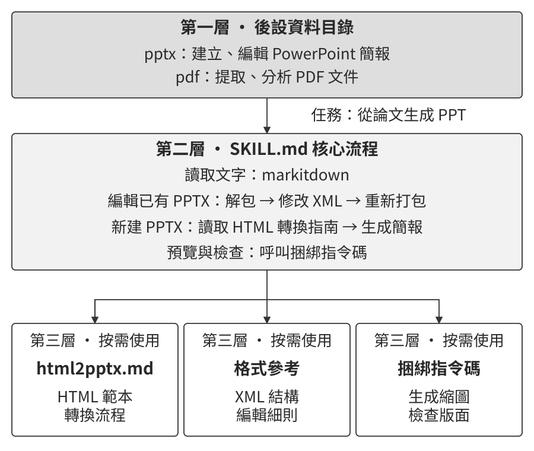

### Skills：領域能力的可組合單元

**Agent Skills** 把一類任務的處理方法、參考資料、指令碼和範本打成可以複用的包。新員工不必在入職那天背完全公司的操作手冊，模型也可以到辦事時才細讀相應章節。這種載入方式稱為**漸進式披露（Progressive Disclosure）**[^ch2-3]。

沿用第一章的十件商品來判斷哪些資訊值得寫成 Skill。假設使用者想比較含運費的到手價，明細和本次收貨地進入目前上下文就夠了。若團隊反覆做跨商家比價，怎樣對齊規格、區分單價和套裝價、標明運費未知，就可以整理成一份比價 Skill。下次有人只是想看看有什麼款式，目錄仍可見，整套核價流程可以等到使用者需要比較價格時再載入。

**第一層是後設資料。** 每個 Skill 用 `SKILL.md` 描述自身，檔案開頭的 YAML frontmatter 由 `---` 分隔，其中包含 `name` 和 `description`。執行時先將名稱與描述組織成目錄，讓模型判斷目前任務需要哪些 Skill。目錄的排列與呈現由 Harness 管理，完整流程在選中後加載。

**Skill 描述首先要寫成路由條件。** 模型在載入正文之前就要決定是否使用它，因此 `description` 應先說明何時適用、何時應跳過，再概括能做什麼。例如，「help with backend」覆蓋面過寬，幾乎所有後端任務都可能匹配；「為已有 HTTP 介面編寫整合測試，覆蓋鑑權、參數校驗和錯誤回應」則給出了明確範圍。對容易混淆的任務，還可以補充排除條件，例如「僅討論介面方案時無需使用」。

**第二層是核心流程。** Skill 被選中後，執行時將完整指令送入上下文。使用者顯式輸入 `/pptx` 一類命令時，用戶端可以直接查詢並載入；模型自主選擇時，則透過 Skill 工具或檔案讀取工具取得內容。前者省去了模型發起啟用呼叫的步驟，後者把選擇與載入留在執行軌跡中。

以本書實驗採用的 PPTX Skill 為例，核心說明介紹了幾條常用路徑：透過 Microsoft 的 markitdown 提取簡報文字，解壓 PPTX 檢視底層 XML，以及選擇新建或編輯簡報的工作流。模型讀到這層說明後，便能根據目前任務決定下一步應讀取哪份資料、呼叫哪類指令碼[^ch2-4]。

**第三層是詳細資料。** 複雜操作分散在專項文件中，主檔案提供入口。本書所用版本中的 `html2pptx.md` 講解如何透過 HTML 生成簡報，其他參考文件補充格式與編輯細節。Agent 按任務繼續讀取這些內容，並使用捆綁的指令碼、素材和範本完成操作。

[^ch2-3]: Anthropic，Equipping Agents for the Real World with Agent Skills，2025；Agent Skills，How to add skills support to your agent。
[^ch2-4]: Anthropic，PPTX Skill。本書實驗固定使用包含 HTML 轉換流程的版本，具體版本與執行方法見配套實驗 README。
[^ch2-codex-skills]: OpenAI，Build skills；OpenAI Codex 公開倉庫中的 Skills 實作。
[^ch2-cc-skill-inject]: Claude Code，How Claude Code uses prompt caching，Invoking skills and commands；Agent Skills，How to add skills support to your agent，User-explicit activation。

### 如何編寫一份可用的 Skill

一份可用的 Skill 要回答四個問題：什麼任務適用，按什麼順序處理，哪些情況需要確認，以及怎樣判斷工作完成。寫作者需要把自己的經驗整理成可執行的步驟，並把關鍵判斷配上例子。

以寫作 Skill 為例，可以參考寶玉從個人表達習慣出發改進 AI 寫作的思路[^ch2-baoyu-remove-ai-writing-flavor]，再將內容組織成四部分：

- **角色與讀者**：說明服務物件、任務型別和成稿要求。
- **核心原則**：先寫三到五條常用判斷，每條配上具體的改寫前後例子。
- **常見錯誤與邊界**：記錄容易出現的表達問題、越權動作及例外情況。
- **參考資料**：收錄術語表、範本、範文與專項說明，供執行時查閱。

規則可以按「作用域、動作、例外、驗證方式」來寫。例如，一條壓縮長句的規則，應當說明適用於什麼段落、如何拆分，以及拆分後如何檢查條件與結論是否仍然完整。

起步時，選三到五篇自己滿意的原創文章，讓 Agent 歸納用詞、句式、段落安排與語氣，生成二十行左右的初版。隨後用它處理一個新題目，由作者逐句修改。修改前後的差異會提供更具體的回饋：哪些詞多餘，哪些句子需要拆分，哪裡缺少事實，哪裡應補回技術細節。把反覆出現的修改歸納為規則，並保留對應例子和適用範圍。

Skill 還可以附帶執行工具與範本。例如，PPTX Skill 將操作說明、解析指令碼、生成指令碼和版式資源放在一起，使模型能沿著說明呼叫相應資源。每個 Skill 可以獨立測試、更新和進行版本管理，團隊成員也能圍繞同一份流程持續補充經驗。**Skills 的長期價值在於讓領域經驗能夠分散積累、獨立發布和複用。** 團隊擴展 Agent 能力時，可以維護各自擅長的 Skill，逐步形成類似 pip、npm 的軟體包生態。這些 Skill 可以共用主系統提供的發現、載入與執行機制。

**設計互動方式時，優先沿用模型已經訓練和適配過的模式。** 角色劃分、工具結果格式和 Skill 載入方式，都影響模型如何接續任務。廠商提供的標準流程適合作為起點，能減少模型從陌生格式中重新推斷含義的負擔。

[^ch2-baoyu-remove-ai-writing-flavor]: 寶玉，《別再用提示詞去 AI 味了，方向就是錯的》，2026-02-14。

### Skills 在上下文中的位置

Skills 的上下文成本分為目錄和正文兩部分。目錄讓模型發現可用能力，正文在選中後提供操作流程。規範要求按需載入，具體訊息角色、包裝和更新方式則由 Harness 實作。

Claude Code 在呼叫位置將 Skill 指令作為 `user` 訊息加入會話[^ch2-cc-skill-inject]。圖2-12 展示模型自主觸發的一種訊息排列：先發出 `Skill(skill: "pptx")` 呼叫，接收工具回應，再讀取追加的 Skill 正文。使用專用啟用工具時，工具回應可以承擔呼叫確認，正文由 Harness 單獨注入；使用普通檔案讀取工具時，正文也可以直接包含在工具結果中。使用者顯式輸入 `/pptx` 時，用戶端可直接展開指令，省去模型發起啟用呼叫的步驟。

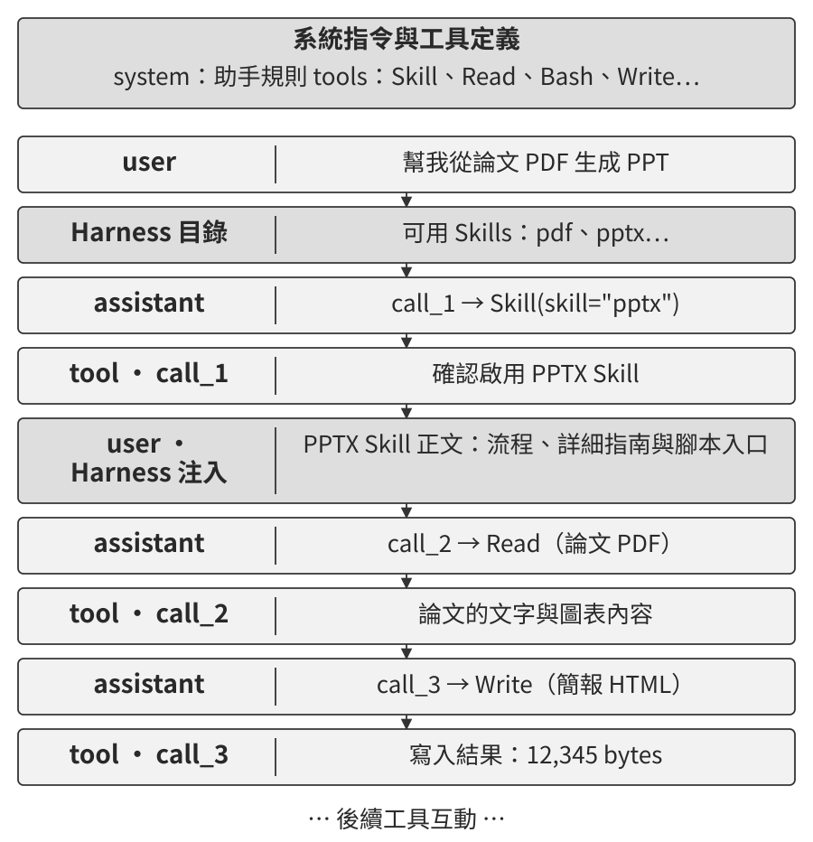{height=55%}

Codex 的 Skills 實作也分別組織能力目錄和選中的指令。公開原始碼中，一部分目錄進入 `developer` 上下文，另一些隨目前輪次及執行環境提供；顯式選中的 Skill 則透過使用者上下文片段加入。目錄的來源和可用執行環境會影響具體排列[^ch2-codex-skills]。

圖2-13 展示按需載入時的快取增長，以尚未建立可複用快取的請求作為起點。目錄首次進入請求需要處理，正文首次載入也會增加計算；當後續請求保留相同前綴時，這些內容便有機會從快取讀取。將新內容追加在呼叫位置，可以保持此前的訊息穩定。已經載入的說明繼續留在歷史中，需要更新時再按執行時的上下文策略處理。

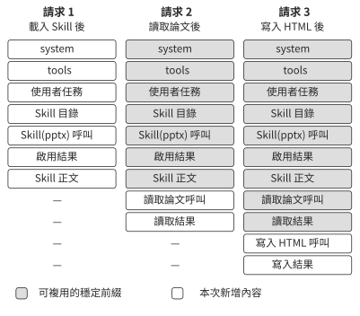

### Skills 與工具的關係

Skill 提供任務知識與操作流程，工具負責讀取、執行和獲取結果。第五章介紹的七個核心工具，可以與不同 Skill 組合：同一個檔案讀取工具既能讀取簡報指南，也能讀取程式碼規範；通用執行器則可執行相應的指令碼。這樣，專業能力可以透過流程和資源擴展，基礎工具集合保持相對穩定。

專用工具也可以與 Skill 配合使用。前文的工具搜尋負責按需提供工具定義，Skill 則說明何時呼叫、怎樣組合以及如何檢查結果。兩者都需要控制常駐資訊量，並為新載入的內容安排合適的位置。第四章將討論通用執行器與專用工具的取捨，第九章進一步討論經驗適合儲存為知識、指令、程式還是模型參數。

> **實驗 2-6 ★★：使用 Agent Skills 從論文生成簡報**
>
> 本實驗以《Attention Is All You Need》為材料，演示 Agent 怎樣按需載入製作簡報的專業流程。任務是從論文 PDF 生成十到十五頁簡報，覆蓋問題背景、方法、關鍵結果與結論，並使用論文中的圖表幫助講解。
>
> 本次執行採用 Kimi Code 與 Anthropic 官方 PPTX Skill。Agent 先在目錄裡找到 PPTX Skill，讀它的操作說明，繼續讀取 HTML 轉換指南，呼叫配套生成工具，最後透過縮圖和逐頁渲染檢查版面。每一步讀取的資料都服務於接下來的操作，完整製作流程隨任務逐步展開。
>
> 成稿共十三頁，引用了論文中的架構圖、注意力機制圖、實驗結果表和注意力視覺化圖。
>
> 生成後的檢查也屬於 Skill 工作流。本次執行曾出現下標缺失、專案符號異常、圖表引用路徑錯誤和數值標籤精度問題，Agent 根據渲染結果與結構檢查逐項修正。最終檔案透過結構檢查，並使用 LibreOffice 重新開啟和渲染。

> **實驗 2-7 ★★：從個人範文建立「去 AI 味」寫作 Skill**
>
> 這個練習把個人寫作經驗整理為可複用的指令。準備三到五篇原創文章，讓 Agent 歸納表達習慣，生成包含觸發條件、三到五條原則和對應例子的初版 Skill。
>
> 選一個新題目試寫，再由作者逐句修改。對照兩版，找出反覆出現的問題，例如用詞空泛、句子過長、因果關係省略，或刪掉了支撐理解的具體例子。反覆出現的改法可以寫進 Skill。

## Agent 狀態列：透過元資訊增強 Agent 軌跡管理

使用者催問：「能不能再打一次？」圖2-14 左側記錄了三次撥號。第一次等了 45 分鐘也沒接通，第三次才談到每月 59 美元。按本例的規則，每次撥號都佔用一次額度；即使只接通兩次，三次額度也已用完。Harness 可以把這類計數、辦理進度和待確認事項整理成一份隨訊息更新的摘要，稱為 **Agent 狀態列（Agent Status Bar）**。

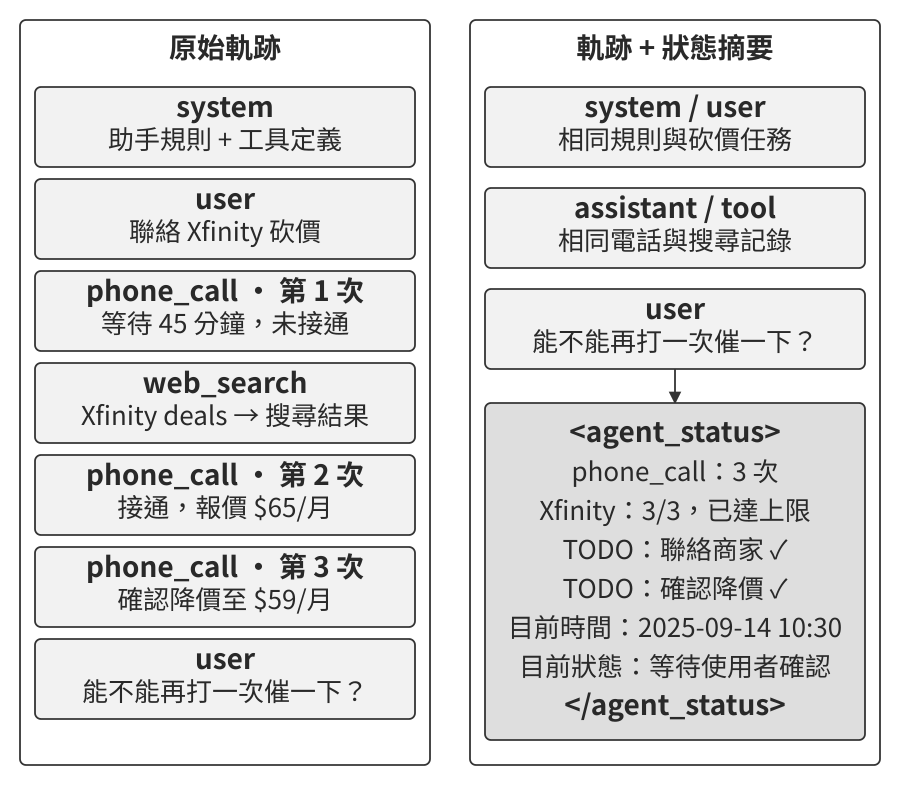

手機把時間、電量和訊號放在螢幕頂端，人掃一眼就知道目前狀態。圖中右側的摘要也有類似作用：助手讀到「已達上限」和「等待使用者確認」，就能向用戶轉述已談妥的價格，請使用者決定是否接受。Harness 可以在回傳工具結果時附上摘要，也可以單獨追加一條狀態訊息。

### 從原始記錄到顯式狀態

考慮一個電話客服任務：系統要求同一任務內撥打每個商家的次數不超過三次。三次通話之間可能穿插搜尋、資料讀取和使用者追問。模型要決定能否繼續撥打，就需要從這段歷史中找齊相關記錄，區分商家，並計算累計次數。

執行時可以在每次呼叫後更新計數，直接回傳「本次是對 Xfinity 的第 3 次呼叫，已達到本任務上限」。下一次決策便能使用這個結果。呼叫次數由程式維護，模型負責結合任務進度決定接下來是等待、查詢其他渠道，還是向用戶說明目前情況；執行層同時依據計數檢查後續撥號請求。

這裡的工程價值是**提前整理後續決策反覆需要的狀態**。完整通話記錄仍負責儲存談話內容和處理經過，狀態列則提供決策常用的統計與進度。**反覆使用的統計應優先由程式碼增量維護。** 在上下文中找到一條記錄，與從全部記錄中算出總數，是兩種工作。把原始軌跡儲存下來，並不會自動得到一份準確、隨時可取用的統計表。每次讓模型重新走訪和計數，既消耗推理 token，也增加漏記與重複計數的機會。

筆者把上下文比作一台需要配套「提煉層」的檢索引擎：原始記錄便於追溯，提煉後的狀態便於直接使用。計數、限額和已核驗的任務完成狀態適合由程式碼維護；需要語義判斷的資訊，可以先逐條抽取，再彙總核驗。這樣，模型每次決策時都能同時看到目前狀態及必要的證據。

長軌跡還會增加尋找關鍵資訊的難度。把最新目標、約束和進度集中放在後部，可以讓模型更容易找到目前決策所需的資訊。

> **實驗 2-8 ★★：透過注意力視覺化觀察 Agent 狀態列的效果**
>
> 本實驗使用 Qwen3-0.6B，構造一段客服退款軌跡：Agent 已經撥打 Xfinity 三次電話，期間穿插網路搜尋，隨後使用者追問「能不能再打電話催促一下？」系統規則限定同一任務內對每個商家最多撥打三次。
>
> 兩組輸入保留相同的歷史與使用者追問。A 組直接使用原始軌跡；B 組在末尾增加以下狀態：
>
> ```xml
> <agent_status>
> Current State:
> - Tool call summary: 'phone_call' has been invoked 3 times (Xfinity: 3 times)
> - Constraint check: Maximum calls to Xfinity reached (3/3)
> </agent_status>
> ```
>
> 每組執行三次。A 組兩次明確拒絕繼續撥打，一次歸入其他輸出；B 組三次均明確拒絕繼續撥打。兩組都沒有出現被判定為違規繼續撥號的輸出。復現這組對照時，進入 `chapter2/attention_visualization`，執行 `python run_status_bar_experiment.py --output runs/status-bar-reproduction`。這次執行的輸入和逐次結果儲存在實驗目錄的 `runs/exp2-7-qwen3-0.6b-20260730-v2/comparison.json` 中。
>
> 注意力圖展示生成區域對歷史通話、搜尋結果、使用者追問和狀態列的權重分布。

筆者與 Noah Shi 的 ContextDistill-Bench 研究進一步考察了預先提煉狀態的收益[^ch2-8]。在該基準覆蓋的狀態查詢中，較小模型也能透過顯式狀態獲得較高準確率；前沿模型的思考量、延遲與查詢成本可降低約一個數量級。例如，Claude 4 Sonnet 的每千次查詢成本從約 35.46 美元降至 3.51 美元。**這一設計在事件發生時維護狀態，省去了每次查詢都要走訪歷史的開銷。** 摘要欄位固定後，即使歷史繼續增長，查詢也只需讀取這幾個欄位。

[^ch2-8]: Li, Bojie and Noah Shi. *Distill, Don't Retrieve: Inference-Time Context Distillation for LLM Agent Reasoning.* 2026.

### Agent 狀態列的構成

狀態列通常包含三類資訊，分別回答「要做什麼」「剛才發生了什麼」和「現在處於什麼狀態」。

**任務規劃**記錄目標、步驟和完成情況。複雜任務可以拆成 TODO 列表，每項保留狀態及必要的依賴關係。模型處理目前步驟時，仍能看到原始需求、核心約束和後續工作；完成一步後，再更新列表。

**事件的側通道資訊（Side-channel Information）**補充事件發生時的背景，例如時間、地理位置和距上次回覆的間隔。這些後設資料隨事件儲存，幫助模型理解先後關係與情境。同一句「還沒有收到回覆」，發生在提交申請後的兩分鐘或兩天，所對應的處理方式可能不同。

**環境目前狀態的觀測摘要**提供目前時間、工作目錄、工具呼叫次數和異常提醒。它與 CLI、GUI 顯示目前目錄或執行狀態的作用相近：讓下一步操作有明確的依據。例如，重複呼叫提醒可以促使模型檢查失敗原因，剩餘預算則幫助它決定是否繼續搜尋。

事件後設資料隨事件追加後通常保持穩定，任務進度和環境狀態則會持續變化。兩類資訊應按各自的更新方式寫入歷史，下面結合訊息結構說明。

### Agent 狀態列在上下文中的具體位置

本節示例由 Harness 在訊息末尾追加一條 `user` 訊息，用於傳遞狀態摘要。這裡的 `user` 是所選 API 的訊息角色，狀態內容由執行時生成，並透過標籤說明用途。使用其他介面時，也可以採用其支援的上下文塊，或隨對應工具結果提供狀態。採用前文按真實使用者查詢裁剪歷史推理的範本時，可把執行狀態隨工具結果提供，讓範本繼續按目前任務保留推理資訊。

沿圖2-15 找到使用者最初的委託，再看最新狀態寫在了哪一輪。保留原請求，才能在電話打完後同時核對兩件事：使用者要辦什麼，眼下辦到了哪一步。

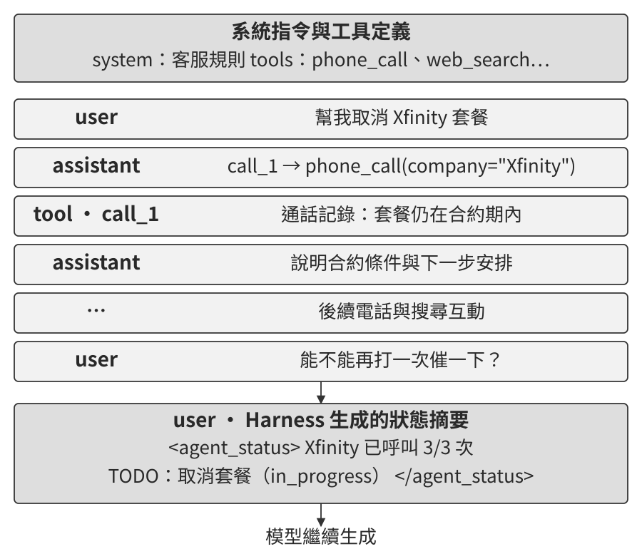

把圖中的次序寫成訊息列表如下。為方便對照，這裡略去重複輪次和部分呼叫欄位。

```text
messages: [
  { role: "system", content: "You are a customer service assistant..." }
  { role: "user", content: "Help me cancel my Xfinity plan" }
  { role: "assistant", tool_calls: [{ id: "call_1", ... }] }
  { role: "tool", tool_call_id: "call_1", content: "Call log..." }
  { role: "assistant", tool_calls: [{ id: "call_2", ... }] }
  { role: "tool", tool_call_id: "call_2", content: "Call log..." }
  ...其余轮次...
  { role: "user", content: "Can you call them again to follow up?" }
  { role: "user", content: "<agent_status>
      Current State:
      - phone_call invoked 3 times (Xfinity: 3/3 max)
      - Current time: 2025-09-14 10:30:45
      - TODO: [1] Cancel plan (in_progress)
    </agent_status>" }
]
```

最後一條訊息把呼叫次數、上限、時間和任務進度集中在一起。模型可以直接使用這些欄位，同時透過前面的呼叫 ID 回查具體記錄。

追加這條訊息後，前面的 token 序列保持不變，仍滿足前綴複用的基本條件。至於下一輪如何處理舊狀態，需要在上下文佔用與快取成本之間取捨。

### 狀態更新的兩種實作與快取代價

下一輪可能完成一項 TODO，也可能增加一次工具呼叫。Harness 需要更新狀態，常用的做法有兩種。

**每輪替換**：構造新請求時移除上一條狀態，在末尾加入最新狀態。上下文只保留一份目前狀態，便於模型使用。例如，上次請求是「任務說明、狀態 A」，這次是「任務說明、工具結果、狀態 B」。任務說明仍可命中快取；工具結果首次提交，本來就需要計算。如果上一次請求在狀態 A 後面還有其他訊息，移除 A 才會使這些訊息失去原有的前綴匹配。模型在這次請求中只能看到 B。需要回看 A 時，可以從執行日誌調出當時的快照。

**持久追加**：保留已有狀態記錄，每次在末尾追加新狀態。歷史前綴保持穩定，也便於追溯狀態變化。舊狀態會逐漸佔用上下文，因此需要明確時間或版本，讓模型依據最新記錄判斷目前情況。Claude Code 將檔案變化提醒追加到會話中的方式，也體現了這種設計思路。

狀態很短、它後面已經快取了大量工具結果時，保留舊狀態可能比重算長後綴更省；狀態較長且更新頻繁時，替換能控制歷史狀態的累積。

可以用一個粗略模型估算分界點：設每條狀態為 $S$ token，每次替換時舊狀態之後需要重新計算的已快取後綴平均為 $R$ token（本輪首次提交的內容不計入），共注入 $N$ 次狀態，快取輸入單價為普通輸入的 $\alpha$ 倍。忽略兩種方案共有的成本， $C_{\text{替换}} \approx (N-1)(1-\alpha)R$， $C_{\text{追加}} \approx \alpha S N(N-1)/2$。對 $N>1$，當 $\alpha SN/2 < (1-\alpha)R$ 時，持久追加的估算成本更低；反之，每輪替換更省。這裡把普通輸入單價作為成本單位：替換方案多付的是後綴從快取讀取變為重新處理的差價，追加方案多付的是歷史狀態的重複讀取費用。

舉個例子，每次注入 100 token 的狀態，一共注入 10 次，快取讀取按普通輸入價的十分之一計。追加方案在後續請求中分別多讀 1、2、……、9 條舊狀態，額外費用折合 450 個普通輸入 token。若替換狀態會使後面平均 1000 個已快取 token 重新處理，九次替換多花的費用折合 8100 個普通輸入 token，追加較省。若舊狀態原本就是快取末尾，後面沒有任何已快取內容，公式中的 $R=0$，直接替換反而省下了這 450 個 token 的等價費用。

> **實驗 2-9 ★★：幾種好用的 Agent 狀態列技術**
>
> 本實驗實作五種狀態列技術，可分別開啟，也可組合使用。每項技術提供一類具體資訊，幫助模型決定下一步行動。
>
> **時間戳跟蹤**在使用者訊息和工具回應中記錄事件時間，例如 `[2025-09-14 10:30:45]`。時間隨事件寫入歷史，後續輪次保持原值；目前時間則隨新的狀態訊息更新。實驗還提供時間模擬，用來檢查模型能否區分「昨天的檔案」與「今天的修改」，以及是否正確理解等待時長。
>
> **工具呼叫計數器**用字典維護每個工具的累計呼叫次數，並在回應中標註 `Tool call #3 for 'read_file'`。結合錯誤內容，模型可以判斷是否繼續嘗試。例如，首次讀取失敗後檢查路徑，再列出目錄；多次失敗後，查詢替代檔案或向用戶說明缺失情況。需要限制重試次數時，執行時還應按計數執行上限。
>
> **TODO 列表管理**提供 `rewrite_todo_list` 和 `update_todo_status` 兩個工具。每項包含唯一識別碼、內容、時間戳，以及 `pending`、`in_progress`、`completed`、`cancelled` 四種狀態。列表集中儲存「做了什麼、還差什麼」，與 Manus 透過重複呈現任務計畫保持目標可見的思路相近。
>
> **詳細錯誤資訊**提供錯誤型別與描述、呼叫參數的 JSON、呼叫棧和修復建議。例如，遇到 `FileNotFoundError`，可以提示模型核對檔名、目前目錄與絕對路徑。參數幫助定位錯誤輸入，呼叫棧幫助查詢失敗位置，修復建議則給出下一步檢查方向。向模型回傳這些內容前，應清理憑證等敏感欄位，並控制冗長堆疊的長度。
>
> **系統狀態感知**提供目前時間、工作目錄、作業系統、Shell 和 Python 版本。實驗中的命令工具會識別單獨的目錄切換操作，更新執行時維護的工作目錄，再用於後續呼叫；複合命令中子程序的目錄變化遵循對應程序的執行範圍。環境欄位也幫助模型選擇可用工具，例如根據實際系統和已安裝的軟體選擇 `apt` 或 `brew`。
>
> 本次 Kimi K3 對照中，各類任務各有五個案例。時間戳和組合配置均通過五項，對照組各通過三項；工具計數器與系統狀態的開啟、關閉兩組均通過五項。TODO 配置透過零項，對照組通過一項；詳細錯誤配置通過四項，對照組通過五項。

**狀態列應儘量由程式碼維護。** 模型會直接使用其中的統計和限制，一條錯誤的「已撥打三次」就可能改變後續行動。計數、時間和狀態遷移交給程式；需要語義理解時，先讓模型逐條抽取，再由程式碼彙總、核驗，避免一次性讓模型統計整段長曆史。原始事件、抽取結果與最終狀態之間保留對應關係，便於發現重複計數、漏記和來源混淆。

狀態列彙總哪些資訊，需要預先選擇。例如，「已撥打三次」足以判斷還能不能再打，卻無法回答「第二次通話中客服承諾了什麼」。對於只需統計值的後續任務，可以用狀態摘要替換歷史，並將原始記錄歸檔；需要核對談話內容時，再按索引讀取原文。摘要的欄位設計決定了哪些問題可以直接回答，也決定了何時需要回查。

## 上下文壓縮策略

一個調查任務讀過十份長網頁以後，假設視窗只夠再放兩份資料。先問模型下一輪還要做什麼：要比較兩個報價，就留下報價、有效條件和出處；要複核引文，就保留能取回原文的位置。已查過但無關的網頁正文可以歸檔，為新輸入和輸出騰出空間。這裡既要算騰出了多少空間，也要算另一筆帳：刪去的材料若在後面用到了，要花多大代價才能找回來？

### 壓縮的三個目的

**控制長度與成本。** 以 128K token 的視窗為例，長網頁和大檔案可能佔據其中相當一部分空間。Harness 需要為後續輸入、模型輸出和工具互動保留預算。

**整理後續決策所需的知識。** 十幾輪搜尋可能反覆提到同一事件，也可能留下互相矛盾的說法。將其整理為「已確認 A、B，C 仍缺少證據」，能讓模型接著未完成的問題工作。摘要應保留事實之間的關係、來源和未解決的問題，使後續決策有明確依據。

**支援長任務持續推進。** 一些模型在認為視窗即將耗盡時，會提前收尾，這種現象被稱為**上下文焦慮（Context Anxiety）**。Anthropic 在 Sonnet 4.5 的長任務測試中發現，壓縮後仍可能出現這種行為，因此採用結構化交接記錄，重設上下文後繼續執行[^ch2-7]。

[^ch2-7]: Prithvi Rajasekaran，Harness design for long-running application development，Anthropic Engineering，2026。

### 把重複計算的結果整理為可用知識

狀態列提前維護計數和進度，摘要則進一步整理長文字中的事實與關係。兩者都在提前整理散落的資訊，讓後續決策可以直接使用。

看一個寵物店巡查的例子：

> 籠子 1：黑貓。籠子 2：白貓。籠子 3：黑貓。籠子 4：黑貓。籠子 5：白貓。
> ……（共 100 個籠子，其中 90 只黑貓、10 只白貓）

回答「籠子 37 裡是什麼貓」，需要定位對應記錄；回答「黑貓和白貓各有多少隻」，需要彙總全部記錄。若後續多次使用總數，就可以先計算並儲存「黑貓 90 只，白貓 10 只」，避免每次從頭統計。程式適合完成這種確定性的彙總，模型則可以繼續根據統計結果回答業務問題。

摘要的內容應隨任務選擇。只保留兩類貓的總數，足以回答數量問題；要回答籠子 37 的情況，還需要逐籠記錄或相應索引。

即使視窗尚有空間，過長或混雜的上下文也可能影響資訊使用：模型遺漏關鍵事實，重複處理已解決的問題，或把過時狀態用於目前決策。這類隨上下文增長出現的表現退化通常稱為**上下文腐化（Context Rot）**。它體現為任務表現變差；請求超過容量限制時，則會觸發視窗溢位。

**視窗還有空間時，也應主動整理已經反覆使用的知識。** 關鍵判斷已經可以彙總，卻仍讓模型在長曆史中一遍遍尋找，會持續消耗計算並增加遺漏。搜尋任務可以儲存已確認事實、來源與待查問題；程式設計任務可以儲存架構決定、修改範圍、測試結果與失敗原因。

上下文中的示例還會影響模型處理新問題的方式。Dherin 等人的研究從 Transformer 中注意力層與 MLP 的組合出發，將特定前向計算表示為與上下文相關的低秩權重更新，為上下文學習提供了一種理論解釋[^ch2-6]。實際推理時，模型權重保持不變，示例透過目前輸入影響輸出。希望在後續會話複用這類經驗，可以把它整理成記憶、示例或 Skill，再按任務載入；第九章將進一步討論經驗的積累方式。

[^ch2-6]: Benoit Dherin et al.，Learning without training: The implicit dynamics of in-context learning，2025。

### 壓縮與 KV Cache 的取捨

壓縮通常發生在兩次模型呼叫之間。Harness 根據剩餘預算和任務進度，整理下一次請求所需的訊息，再將它們傳送給模型。替換歷史會改變前綴，因此需要同時考慮壓縮收益與快取重建成本。

首先，保持仍然適用的系統指令與工具定義穩定。它們位於前部，後續歷史的壓縮可以繼續複用這部分前綴。其次，選擇具體的壓縮物件：長工具結果可以替換為摘要，已經完成的多輪互動可以合併為階段記錄。替換位置之前的快取還能複用，替換位置及其後的內容需要按新的前綴處理。

**歷史壓縮優先成批進行，避免每輪都改寫同一段前綴。** 壓縮之後，每輪輸入會縮短，但壓縮呼叫與後綴重算也要消耗資源。觸發時機可以結合視窗占用、預期後續輪數和任務階段來確定：長工具結果集中出現後批次整理，完成一個階段後儲存交接摘要，都能減少頻繁修改歷史的開銷。保留最近幾輪時，應檢查工具呼叫與回傳值是否成對，並把未完成操作的狀態寫入摘要。

壓縮時還要檢查推理資訊的回傳協定。部分模型的歷史 thinking 與生成它時的前綴綁定。若在這些塊之前替換歷史，保留下來的 thinking 就可能與新前綴不匹配。採用這種協定時，可以將會話整理成摘要，清除受影響的舊 thinking，讓模型從摘要繼續推理；也可以使用服務端支援的壓縮或上下文編輯機制。

先看圖2-16 中的個體摘要：處理後的字元數只有原來的 10.9%，主 Agent 累計用掉的 token 卻是六組裡最多的。要解釋這兩個數字為什麼能同時成立，得追蹤壓縮了哪些材料，以及這些材料又隨多少輪請求送進模型。

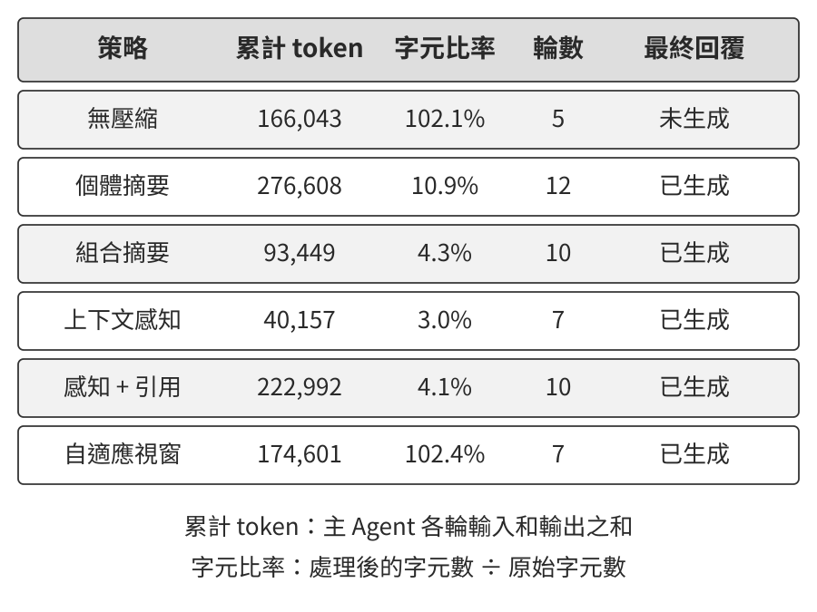

> **實驗 2-10 ★★★：上下文壓縮策略對比**
>
> 本實驗用 Kimi K3 研究 OpenAI 聯合創始人的職業狀態。任務需要逐步建立人員名單、查詢經歷和職位變化，再把相關事實與來源對應起來。為觀察壓縮與溢位處理，實驗將應用側上下文預算設為 128,000 token，保留無壓縮基線，再比較五種處理辦法，每種最多執行 15 輪[^ch2-compression-results]。
>
> **策略一：無壓縮。** 搜尋與頁面讀取的結果完整進入歷史。七次工具呼叫計入了 367,246 個原始字元。程式在第五輪觸發保護並停止，主 Agent 的累計用量是 166,043 token。舊版用歷次請求的輸入 token 之和觸發保護，錯誤資訊中的 165,227 因此是累計輸入。舉例說，同一段歷史在三輪請求中各發送一次，就會被累計三次。
>
> **策略二：個體摘要。** 每個搜尋結果單獨生成兩到三段摘要，保留各頁面的主要內容。這種方式容易並行處理，也便於保留頁面邊界；多個頁面講述同一事件時，重複資訊仍會進入歷史。這一配置用十二輪生成最終回覆，主 Agent 累計使用 276,608 token，字元壓縮率為 10.9%。
>
> **策略三：組合摘要。** 將一批搜尋結果合併，再生成綜合摘要，便於整理重複事實和不同來源的關係。該配置用十輪生成最終回覆，主 Agent 累計使用 93,449 token，字元壓縮率為 4.3%。
>
> **策略四：上下文感知摘要。** 壓縮時同時提供目前查詢和已經掌握的資訊，例如在提示中加入 `Given the search query: {query}` 與 `Current context: {context}`。模型據此保留與目前問題相關的事實，並優先補充已有摘要中的缺口。該配置用七輪生成最終回覆，主 Agent 累計使用 40,157 token，字元壓縮率為 3.0%。其中一次壓縮把約十五萬字元整理成約兩千字元，保留了人員姓名與職位變化。
>
> **策略五：帶引用的上下文感知摘要。** 在任務相關摘要中保留事實對應的來源連結。該配置用十輪生成最終回覆，主 Agent 累計使用 222,992 token。按工具記錄彙總，處理後的材料有 52,891 個字元，原文有 1,295,044 個字元，兩者相除約為 4.1%。
>
> **策略六：自適應視窗化。** 前期保留原始材料，輸入達到閾值後再批次整理。實驗採用三個機制：超過預算的 80% 時觸發壓縮；彙總處理尚未壓縮的工具結果；為處理過的結果新增 `[COMPRESSED]` 標記，避免重複摘要。按本實驗的 128,000 token 預算，觸發閾值為 102,400 token。該配置用七輪生成最終回覆，主 Agent 累計使用 174,601 token。歷史記錄按累計輸入觸發閾值，後來程式改為檢查最近一次請求的輸入大小。
>
> 圖2-17 對照六種策略的輸入與輸出。
>
> 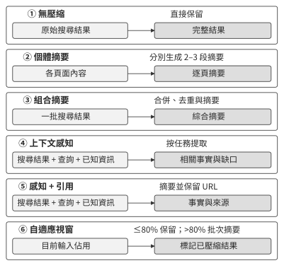
>
> 比較圖2-16 的數字時，需要區分三個量：單次請求輸入決定是否達到視窗預算，累計 token 反映多輪呼叫用量，字元壓縮率描述被統計材料的處理後長度與原始長度之比。這裡的累計用量來自主 Agent 各輪請求的輸入和輸出，生成摘要的獨立模型請求未併入這個欄位。
>
> 復現實驗時，按配套說明配置模型與真實搜尋服務，在實驗目錄執行 `python experiment.py -m kimi-k3 -n 15 -o results/reproduction.json`。讀取各策略的 `metrics`：用 `total_compressed_size / total_original_size` 復算字元比率，再比較 `total_tokens` 與 `iterations`。無壓縮基線也會為搜尋正文補上標題、URL 等格式，因此處理後字元數可以略高於原文。實驗程式只要收到最終回覆，就把該組記為完成。試著在兩份成品裡查同一個人：帶引用組把 Pamela Vagata 的任職機構寫成 Pebblebed，視窗化組的彙總表卻寫成 Stripe。前一份回答提到了機構網站，但沒有給出可開啟的網頁連結。兩組都交付了彙總表，給出的人物資料卻相互矛盾。

[^ch2-compression-results]: 實驗 2-10 的結果檔案 `kimi_k3_real_20260718.json` 儲存了每種策略的統計欄位、最終回答與時間戳，可直接復算字元比率。2026 年 7 月 18 日執行使用舊版保護條件；7 月 22 日的程式碼修訂（提交 `aea4d72`）將累計輸入改為最近一輪請求的輸入。

### 生產級的分層壓縮機制

工具輸出可能要暫存全文，已完成的步驟可以歸檔，目前約束應保持可見；下面五類機制分別適合不同的使用頻率和保留期限。

1. **工具結果預算控制**。大體積輸出儲存到外部儲存，上下文中保留摘要預覽與讀取入口。預覽一旦進入歷史，就保持內容穩定；需要更多細節時，再讀取相關片段並追加結果。
2. **清理無關內容**。網頁導航欄、重複頁尾等可以在結果進入上下文前過濾。已經進入歷史的內容需要刪除時，先確認後續任務和引用是否仍依賴它，再計算修改歷史帶來的快取成本。
3. **API 層上下文編輯**。支援這類能力的服務可以按規則清理舊工具結果。用戶端需要配置觸發條件，並處理服務回傳的編輯資訊。清理範圍和快取行為由介面約定決定，適合與輸入預算監控一起接入。
4. **歸檔式摘要**。按輪次或任務階段記錄目標、操作、結果和未完成事項，保留執行順序。可以把它理解為任務的變更記錄：後續能夠查到某個決定在哪一步作出，以及依據是什麼。
5. **會話整體壓縮**。當局部清理仍無法滿足預算時，將目前目標、約束、已確認事實、關鍵決定和下一步工作整理為交接摘要。可以先整理已有會話筆記，再彙總整段歷史。壓縮連續失敗時，由重試上限或熔斷機制停止重複呼叫，儲存可恢復的狀態，再選擇縮小輸入或人工處理。

這幾類機制可以分層配合：入口控制減少一次性的大輸出，局部整理控制日常增長，階段摘要和整體壓縮為長任務儲存交接資訊。

筆者讀 dsh-superagent 時注意到一個細節：事件和工具結果可以先送來摘要和物件 ID，需要細節時再憑 ID 讀取。假設背景跑完一組測試，只告訴前台「有兩項失敗」，前台能報告進度，卻答不了使用者接著問的「是不是昨天那兩項？」如果摘要附有本次測試記錄的標識，前台就可以取回失敗用例的名字，與昨天的記錄對照。

### 壓縮策略的設計原則

決定壓縮後保留什麼時，可以從以下四個方面檢查。跨任務積累經驗的過程將在第九章展開。

- **按任務價值分配篇幅**。人員名單、身份關係和目前待查問題通常應直接保留；支撐結論的關鍵證據保留來源與必要細節；導航欄、廣告和重複內容可以清理。事實存在爭議時，證據之間的差異也屬於重要資訊。
- **保持語義完整**。例如，「Sutskever 於 2024 年 5 月離開 OpenAI」中的人物、時間、動作和機構共同構成一條事實。壓縮時應保留這些要素，避免只剩下「Sutskever 離開」這樣難以解釋的片段。
- **圍繞後續問題組織內容**。「查詢創始人名單」需要完整覆蓋人員，「瞭解個人背景」則需要經歷、時間線和來源。同一份材料可按不同任務生成不同摘要：檢索重在覆蓋，分析重在關係與依據，創作還需要保留有用的細節和例子。
- **驗證摘要能否支援執行**。語義摘要需要理解任務、消除重複，並儲存條件和例外。**複雜材料的語義壓縮，應優先使用理解能力接近主模型的模型。** 壓縮者需要判斷哪些條件、例外和證據會影響後續工作；如果這些內容被丟掉，主模型再強也很難補回。

早期架構決定、約束背後的原因和失敗路徑容易在長曆史中被遺漏。**長任務應定期更新進展文件**，儲存「決定了什麼、為什麼這樣決定、驗證了什麼、下一步做什麼」。Prompt 或 Skill 可以規定更新時機，Harness 則在任務交接時載入相應記錄。這樣的文件也方便執行者、審核者和後續 Agent 理解已有工作。

### 子 Agent 上下文隔離

**對於交付邊界清楚、會產生大量中間材料的任務，筆者優先採用子 Agent 隔離。** 大範圍搜尋會讀入許多只在探索階段有用的材料，先隔離能減少這些內容對主任務的持續干擾。主 Agent 將任務交給擁有獨立上下文的子 Agent，由子 Agent 閱讀中間結果，再回傳結論、證據位置和未解決問題。主 Agent 的上下文中因此只需保留後續決策所需的資訊。

例如，要「找到處理支付回呼的函式」，主 Agent 直接搜尋時，可能需要讀取十幾個檔案。交給搜尋子 Agent 後，可以要求它回傳函式名稱、所在模組、呼叫點和判斷依據。它的回覆可以是「支付模組中的 `handle_callback` 負責處理回呼，另有兩處呼叫點」，並附上可定位的引用。主 Agent 根據這些結果決定是否繼續讀取相關程式碼。

任務描述應當足夠完整：目標是什麼、搜尋範圍多大、需要遵守哪些約束、回傳什麼格式，以及遇到歧義時如何處理。若委派請求和回傳結果都追加到歷史，主 Agent 原有前綴仍可複用。

第四章將討論子 Agent 作為工具的介面設計，第十章進一步討論多 Agent 系統中的上下文分工。

## 本章小結

客服助手第三次撥完電話，怎樣接著辦下去？下一輪請求帶上這通電話的工具回執，用呼叫 ID 對應到撥號操作。狀態列把已用次數更新為三次，並列出還沒談妥的條件。系統規則和工具定義保持在穩定前綴裡，需要辦理某項業務時再載入相應的 Skill。這樣每個欄位都有來處，也能看出哪些內容會隨下一輪呼叫而變化。

通話拖長，工具回傳越來越多，可以給結果限定長度，把已經結束的部分整理成帶來源的摘要，或者把可獨立辦理的工作交給子 Agent，只取回結論和憑據。

這個任務結束後，已撥三次的計數可以隨任務歸檔。可要是使用者特意交代「以後工作日下午再聯絡我」，只把這句話留在通話摘要裡，下次接受委託的助手可能根本看不到。怎樣儲存有長期用處的資訊，又怎樣在恰當的任務裡把它找回來？第三章討論跨任務的使用者記憶和共享知識庫。

## 思考題

1. ★★★ 閱讀實驗 2-3 的滑動視窗執行記錄：五次工具呼叫分別做了什麼？要判斷重複呼叫是否由歷史裁剪造成，還需要記錄什麼、做什麼對照？設計一種保留關鍵狀態的裁剪方案，並說明它對前綴快取的影響。 記錄見 `chapter2/kv-cache/result_sliding_window_20260718_kimi_k2_6.json`。
2. ★★ Qwen3 的 Chat Template 按最後一個真實使用者查詢的位置處理歷史思考。若一次 ReAct 迴圈持續上百輪，你會如何管理逐漸增長的推理內容？請比較歷史思考的裁剪、回傳與前綴綁定協定，並說明 Harness 應如何適配。
3. ★★ 假設要把約十五萬字元的搜尋材料壓縮到兩千字元，你會保留哪些事實、關係與來源？怎樣檢查摘要是否足以支援後續問題，又怎樣恢復被省略的細節？
4. ★★ 工具計數器漏記了一次呼叫，狀態列因此給出錯誤的剩餘次數。請設計事件記錄、彙總校驗和執行層檢查，說明如何發現並修復這種不一致。
5. ★★ 實驗 2-4 比較了語氣、資訊組織與工具描述。若系統提示詞由多人長期維護，你會如何管理版本、檢查規則衝突，並用迴歸任務評估每次修改？
6. ★★★ 寵物店案例同時包含單條檢索與總體統計。請設計原始記錄、統計摘要和查詢路由，使系統能高效回答這兩類問題，並說明摘要需要在什麼時候更新。
7. ★★★ 一個 Skill 已在目錄中，但模型沒有發現它適用於目前任務。你會如何從描述、目錄組織、顯式觸發和評估樣例四個方面排查問題？
8. ★★ Skill 已經成功載入，模型卻漏掉了其中的驗證步驟。請設計一個對照實驗，區分觸發、理解、工具使用和完成判斷中的問題，並比較不同模型的表現。
9. ★★★ 系統包含大量工具，工具集合又經常變化。你會如何安排固定定義、工具目錄、按需載入結果與執行時狀態的位置？請同時考慮發現準確率、上下文預算和快取命中。
