# 使用者記憶和知識庫

如果使用者上週告訴助手自己偏愛靠窗座位，今天只說「再訂一張去東京的票」，這次請求要從哪裡找回上次的偏好？如果航空公司昨天改了行李規定，又該去哪裡查新條款？上一章討論了怎樣組織一次任務的上下文，本章討論從哪裡找回使用者說過的話、從哪裡查到航空公司的新規，以及這兩類資料分別該在什麼時候更新。

**使用者記憶**圍繞特定使用者組織資訊，記錄其偏好、習慣、需求和經歷，讓 Agent 在後續會話中繼續按使用者的情況提供服務。**知識庫**則在一定權限範圍內供多個使用者共享，例如行業法規、企業操作流程和技術文件。前者幫助 Agent 瞭解服務對象，後者提供完成任務所需的領域知識。

兩者都要解決怎樣儲存資訊、需要時怎樣找到資訊的問題，也會遇到事實衝突、內容過期和檢索遺漏。向量檢索、結構化索引和知識壓縮等技術可以同時用於這兩類系統。圖3-1 展示了本章的安排：先討論使用者記憶的表示與管理，再介紹檢索增強生成（RAG），最後把檢索方法用於跨會話記憶和更複雜的知識組織。

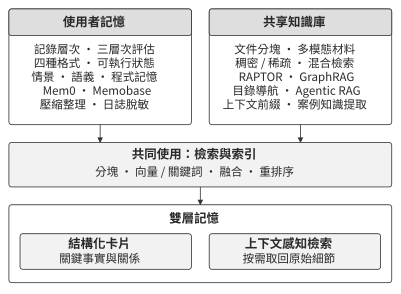

## 使用者記憶系統

把「下週我在國外，銀行文件請發郵件」拆開讀。使用者說出了一個有期限的行程，又在這個行程內指定了收件方式。助手在銀行提出郵寄文件時，可以據此爭取電子送達；行程結束後，再遇到寄信問題，就要重新看目前條件。若只存「使用者不喜歡紙信」，日後雖然檢索到了這條記憶，卻會用錯範圍。

再看機票。使用者若說「上次那張 1250 的票比我預想的貴」，系統至少能儲存那次報價、當時的預算、出行場景和這次回饋。下次遇到相似情形，模型據此更謹慎地處理超預算報價。如果使用者另行說明「以後家庭出行都先問我」，這就給今後的家庭出行定下了明確的詢問條件。由此可以區分三類資訊：使用者實際說過什麼，當時處在什麼條件下，模型從這次經歷推斷出了什麼。

可以在會話結束時請 LLM 整理這些記錄，把有後續價值的事實寫入持久儲存。新任務開始時，只把相關且仍然適用的記錄帶入上下文。

例如，使用者在預訂機票時提供了以下資訊：

```text
User: Help me book a flight to Tokyo next Friday. I prefer window seats
      and I'm vegetarian, so I'll need a special meal.
Agent: I'll search for flights to Tokyo for next Friday...
       [calls flight_search tool, returns 3 options]
Agent: Here are your options. Based on your preference, I've filtered for
       window seat availability. Shall I book the ANA direct flight?
User: Yes, and use my United MileagePlus number 12345678.
```

會話結束後，記憶提取器可以整理出四條記錄：

```text
Extracted memories:
- User prefers window seats (preference)
- User is vegetarian, needs special meals on flights (dietary restriction)
- User's United MileagePlus number: 12345678 (loyalty program)
- User has travel plans to Tokyo (recent activity)
```

這個例子包含三項處理。**選擇性提取**保留座位偏好、飲食要求和會員號，過濾「搜尋回傳三個選項」這類臨時細節。**抽象化**把使用者明確表達的靠窗偏好整理為以後訂票可用的規則。**結構化**為事實標註類別，便於檢索與更新。東京之行還應記錄出發日期和目前狀態；「下週五」需要結合會話日期轉換，行程結束或取消後再更新狀態。這樣，長期偏好與近期活動就能按各自的有效期維護。

個人助手 Today 的產品說明舉過一個例子。使用者說自己每週二、週四訓練，準備跑半程馬拉松。六週後，經使用者授權接入的睡眠記錄顯示，他昨晚睡得很少。助手把這兩條資訊放在一起，建議挪一挪當天的高強度間歇訓練。這裡該記多久？訓練計畫在備賽期間都用得上，昨晚的睡眠記錄要帶上日期。即使使用者接受了這次改期，下週四的訓練仍按原計畫安排，除非使用者說以後都要改。Today 也把提出建議與更改日曆分成兩步，後一步需要使用者確認。[^ch3-today]

[^ch3-today]: Today 團隊在《What Is Today》中以半馬訓練說明記憶與當天資訊怎樣配合。創始人在《Meet Today》中解釋了更改日曆前的確認機制。

### 記憶能力的評估：三層次框架

公開基準 **LoCoMo**（Long-term Conversational Memory，長期對話記憶）包含平均約 300 輪、最多 35 個會話的長對話，透過問答、事件摘要和多模態對話生成考察記憶能力。問答分為五類。單跳題可以從一次會話中找到答案，多跳題需要把幾次會話中的線索拼起來，時間推理題還要弄清事件發生的先後。開放域知識題要求把使用者說過的話與外部知識結合起來。沿用訂票的例子，使用者只說過「下週去東京」，要回答「目的地使用哪種貨幣」，既要記得東京這條線索，也要知道當地使用日元。如果問的是使用者從沒說過的航班號，助手應該指出資訊不足。能否識別這種無從作答的問題，正是對抗性題目所考查的能力。[^ch3-locomo]

[^ch3-locomo]: Maharana 等人的 LoCoMo 論文（arXiv:2402.17753）第 4.1 節給出五類問答的定義。作者專案頁提供資料與對話樣例。

結合這類基準和記憶產品的實踐，筆者將需要關注的能力歸納為八項：

- **個人資訊保留**：準確儲存並取回使用者身份等長期資訊。
- **偏好追蹤**：記錄使用者偏好，並隨新的明確表達更新。
- **上下文切換**：切換話題後仍能接續相關背景。
- **記憶更新**：處理使用者對既有事實的補充和更正。
- **多會話連續性**：在新會話中使用先前儲存的資訊。
- **複雜思考**：關聯多個記憶片段。例如，使用者曾提到花生過敏，討論泰國菜時就應結合這一資訊提醒核對食材。
- **時間感知**：儲存日期、解析相對時間，並計算事件間隔。
- **衝突解決**：發現不一致的資訊，結合來源、時間和適用對象作出判斷。

圍繞 Agent 的實際任務，本書進一步採用三層次評估框架。實驗 3-1、3-2 先用它比較記憶表示；實驗 3-9 和 3-11 再用同一框架評估檢索方法。

**第一層：基礎回憶。** 準確儲存並取回使用者直接提供、含義明確的資訊。例如，使用者說「我的會員號是 12345」，後續訂票時應能回傳完整號碼。這一層主要檢查事實是否丟失、混淆或被改寫。

**第二層：多會話檢索。** 從不同時期、涉及不同對象的會話中找齊相關資訊，再判斷目前請求涉及誰、需要哪些記錄。使用者有兩輛車，卻只說「為我的車預約保養」，系統應先取回兩輛車的資訊並澄清對象。查詢貸款狀態時，需要區分已生效合約與過去諮詢的報價。取消「洛杉磯之旅」時，則要把機票、飯店等預訂關聯到同一次旅行。

**第三層：主動服務。** 根據目前任務，發現使用者沒有逐項點明的相關事項。例如，預訂國際航班時關聯數月前儲存的護照資訊，檢查有效期是否滿足行程要求；手機損壞時彙總裝置保修、信用卡附加保修和電信業者保險，列出可用的處理方案；準備報稅材料時，從全年記錄中找齊股票交易、自由職業收入和房產稅文件。

> **實驗 3-1 ★：用三層次框架評估記憶系統**
>
> 評估集每層包含 20 個用例，共 60 個。第一層以單會話為主；第二、三層包含跨時間、跨對象的多段會話，用於檢查實體關聯、資訊更新和主動提醒。
>
> 每個用例分兩步執行。先逐段輸入會話：模型根據第一段生成記憶，後續每次只收到已有記憶和新會話，並生成更新後的記憶。此後模型就讀不到之前的會話原文了，要回答當時談過的問題，只能靠寫進記憶的那些資訊。所有會話處理完後，再輸入一個新問題，要求 Agent 根據記憶作答。
>
> 評估採用 LLM-as-a-judge：由獨立的評審模型對照參考答案和評分要求，檢查回答覆蓋的事實及錯誤。本次執行使用 Doubao Seed 1.6 生成記憶和回答，使用 Moonshot 模型評分。評審能看到原始對話，答題的模型只能看到最後保留下來的記憶。
>
> 怎樣讀成績單？例如，使用者只想找回寬頻服務的帳號。在增強筆記組，助手答出了正確號碼。評審給準確性、召回和推理各打 4 分，主動性只打了 1 分，這道題依然通過。程式的通過條件是前三項各得至少 3 分（滿分 4 分），且評審沒有發現缺乏依據或與原話矛盾的重要事實。主動性參與綜合得分，單看通過數無法知道助手在多大程度上主動提供了幫助。

### 記憶的層次結構

要回答「上次訂了哪趟航班」，需要找到一次事件；要回答「訂票時優先選什麼座位」，需要取回從多次互動中保留的偏好。兩個問題都涉及同一個人，卻要求不同的記錄粒度和檢索方式。

**軌跡（trajectory）**按時間記錄一次 Agent 執行中的事件，包括使用者訊息、模型回應、工具呼叫與執行結果。採用只增不改（append-only）的事件日誌時，新事件追加到末尾，原記錄保留供追溯。Harness 可以從軌跡中選取歷史、提取狀態或生成摘要，構造每輪實際傳送給模型的上下文。

**使用者長期記憶**儲存跨會話有用的資訊，如偏好、人物關係、歷史活動摘要和已確認的事實，並透過使用者 ID 等標識劃定歸屬。新的表達可能補充、更正或替代舊記錄，因此長期記憶需要合併與更新。讀取和維護既可以由 Agent 顯式呼叫工具完成，也可以由 Harness 在會話載入、結束或背景整理時觸發。

**業務狀態**描述任務所處的邏輯階段，如「需要澄清」「處理中」「等待付款」「已完成」。程式可以檢查這些狀態，決定接下來等待什麼事件、執行什麼操作。第六章將進一步討論事件驅動架構中的狀態管理。

這三類記錄可以協同工作：軌跡提供執行依據，長期記憶提供跨會話背景，業務狀態說明目前任務推進到了哪裡。下面重點討論長期記憶的表示、管理和檢索。

### 使用者記憶的四種儲存格式

如果只要改一個電子郵件地址，最好能直接找到那一項；如果要弄清當初為什麼改地址，還得讀到事情的經過。圖3-2 左上把信箱、公司和職位分條儲存，右上則把職位、團隊和專案寫在一起。再看下面兩張卡片：今後要更新職位，或者要分清是誰去看的心臟科，各該查哪個欄位？

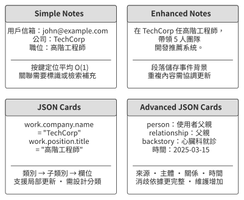

**Simple Notes** 將每條記憶寫成一個簡短事實，例如「使用者信箱：john@example.com」。單條記錄容易讀寫；用雜湊表按穩定鍵定位時，查詢和更新的平均時間複雜度通常為 O(1)。按語義搜尋大量筆記時，還要建立檢索索引。拆分過細還會丟失關係：「在 TechCorp 擔任高階工程師，負責推薦系統開發」若拆成公司、職位、專案三條互不關聯的記錄，後續就需要重新判斷它們是否屬於同一份工作。

**Enhanced Notes** 用完整段落儲存事實及其背景。例如：「使用者在 TechCorp 擔任高階軟體工程師，從事機器學習工作已有三年，目前領導一個 5 人的推薦系統專案。」公司、職位、經歷和團隊之間的關係在同一段中得到保留。代價是部分事實可能在多段中重複；職位變化後，需要找齊相關段落並更新，避免新舊記錄並存。

**JSON Cards** 按「類別—子類別—鍵值對」組織資訊，例如 `personal.contact.email` 和 `work.position.title`。修改職位欄位時，可以保留 `work.company.name` 等其他欄位，適合局部更新。設計分類時還要考慮交叉資訊：「週末用 Python 開發個人專案」同時涉及時間、技術偏好和活動。可以儲存一條活動記錄並新增多個標籤，或透過引用關聯相關類別，保留這些關聯。

**Advanced JSON Cards** 在事實之外增加來源背景 `backstory`、主體 `person`、與使用者的關係 `relationship` 和時間戳。這些欄位幫助系統識別資訊屬於誰、何時獲知、適用於什麼場景。例如，「張醫生」可能指使用者的牙科醫生，也可能指使用者父親的心臟科醫生；將姓名與就診者、親屬關係及專科一起儲存，就能減少混淆。

當使用者說「幫我安排家人的年度體檢」時，系統可透過 `person` 和 `relationship` 找出家庭成員，再從 `backstory` 中讀取相關經歷。欄位越豐富，提取和更新時需要處理的關係也越多。筆者建議按資訊的重要性和關聯需求混合儲存：關鍵人物、合約和長期偏好採用 Advanced JSON Cards，保留來源與關係；數量多、關聯少的簡單事實採用 Simple Notes，降低提取和維護成本。兩類記錄透過標識或引用相互連結，需要時再一起取回。

> **實驗 3-2 ★★：四種記憶格式的對比**
>
> 配套實作為四種格式提供統一的記憶生成、更新和檢索介面，在實驗 3-1 的同一組 60 個用例上比較最終回答。
>
> 本次執行中，Simple Notes、Enhanced Notes、JSON Cards 和 Advanced JSON Cards 分別通過 48、52、51、49 個用例。Enhanced Notes 在第二層通過 16 個用例，Advanced JSON Cards 通過 12 個；兩者在第三層均通過 19 個。包括記憶維護、回答和評審在內，Enhanced Notes 約為 99 萬 token，Advanced JSON Cards 約為 155 萬 token，後者的模型呼叫平均耗時也更長。
>
> 以第二層的串流訂閱題為例。使用者想節省開支，問自己訂了哪些服務、各要多少錢。增強筆記組列出了 Netflix、Disney+ 和 Max 的月費，分別為 22.99、19.99 和 19.99 美元。高階 JSON 卡片組只報了 Max 的價格，還列出了 Max 的兩種低價方案。建議再具體，也補不上另外兩份帳單。
>
> 問題從哪次更新開始？翻看高階卡片組逐次儲存的記憶，第一段會話後還有 Netflix，第二段會話後只剩 Disney+ 的相關記錄，第三段會話後又只剩 Max。等到提問時，前兩份訂閱已經從記憶裡消失了。

### 進階知識表示形態：可執行程式碼

儲存事實之後，還需要彙總統計、檢查衝突，並根據業務規則判斷下一步。筆者在 **User as Code**（UaC）中嘗試把使用者資訊組織為帶型別的 Python 物件，並將這些操作寫成函式[^uac]。模型從對話中提取事實，程式執行定義清楚的計算。

對於日期比較、金額彙總和明確的業務約束，筆者優先把計算寫成函式，讓同一組事實得到可重現、可測試的結果。這樣，模型可以集中處理語義理解，減少在長對話中反覆心算和核對規則的負擔；記憶的表示與使用也能在同一套程式碼中檢查。

UaC 採用兩階段流程：先將提取的事實追加到日誌，再定期生成檢查點，從日誌重建帶型別的狀態。日誌保留事實的來源和變化過程，狀態物件提供目前可查詢的欄位。

以護照與行程為例，狀態可以這樣定義：

```python
from dataclasses import dataclass
from datetime import date

@dataclass
class PassportInfo:
    number: str
    country: str
    expiry_date: date

@dataclass
class Trip:
    destination: str
    departure_date: date
    is_international: bool

@dataclass
class UserState:
    passport: PassportInfo
    trips: list[Trip]

state = UserState(
    passport=PassportInfo("AB1234567", "US", date(2025, 2, 18)),
    trips=[
        Trip("Tokyo", date(2025, 1, 15), True),
        Trip("Paris", date(2025, 6, 10), True),
    ],
)
```

**聚合統計**直接走訪記錄。例如，計算 2025 年登記的國際行程數量：

```python
count = sum(
    1 for trip in state.trips
    if trip.is_international and trip.departure_date.year == 2025
)
# count == 2
```

**衝突檢查**將兩個欄位集合按預定規則比對。下面以藥物類別匹配為例，說明如何把需要進一步核對的條目送入處理佇列：

```python
def find_allergy_matches(profile):
    matches = []
    for medication in profile.current_medications:
        for allergy in profile.allergies:
            if medication.drug_class == allergy.drug_class:
                matches.append((medication, allergy))
    return matches
```

每個匹配項都保留對應的用藥記錄與過敏記錄，後續流程可以據此核對，再按領域規則決定是否提醒、轉交審核或補充資訊。

**約束檢查**可以隨狀態更新自動執行。例如，某項行程規則要求出發時護照至少還有 180 天有效期，可以把天數作為參數傳入：

```python
def passport_alerts(state, required_days):
    alerts = []
    for trip in state.trips:
        if trip.is_international:
            days = (state.passport.expiry_date - trip.departure_date).days
            if days < required_days:
                alerts.append((trip.destination, days))
    return alerts

alerts = passport_alerts(state, required_days=180)
```

按示例中的 180 天計算，去東京時護照只剩 34 天有效期，到巴黎出發那天則已經過期。使用者換發護照後，程式可以用新日期重新計算這兩趟行程。

[^uac]: Li, Bojie，User as Code: Executable Memory for Personalized Agents，2026。

### 使用者記憶的認知科學基礎

認知科學按記憶內容和使用方式區分不同類型。這些概念也可以幫助我們組織 Agent 的長期資訊：

- **情景記憶（episodic memory）**儲存具體事件及其時間、參與者和經過。人的例子是「上週三與同事在義大利餐廳吃晚餐」；Agent 中可以對應「使用者計畫下週五乘 ANA 航班前往東京」，並記錄後續是否預訂成功、是否改票。
- **語義記憶（semantic memory）**儲存事實和概念。人的例子是「義大利的首都是羅馬」；Agent 中可以對應「使用者是素食者」「使用者偏好靠窗座位」。這些資訊既可來自使用者明確表達，也可從多次經歷中歸納；記錄來源有助於區分兩者。
- **程序性記憶（procedural memory）**與技能和行為流程有關。人的例子是騎腳踏車；Agent 工程中可用可複用流程作類比，例如「搜尋直飛航班→確認座位偏好→使用常旅客號碼→預訂餐食」。

回看第一章的購物記錄，「看過十件後買了其中一件」支援記下一次購買事件，卻很難據此判斷使用者今後喜歡什麼。她可能喜歡這個款式，也可能只是當天能收到貨。如果她隨後說「以後買這一類都先看能不能當天送到」，就多了一條有適用範圍的長期偏好。下次推薦同類商品時可以優先查配送時間，也能向她解釋這個篩選條件來自哪一次回饋。

表3-1 把這組分類與前面的記憶層次、儲存格式放在一起，說明三者各自回答的問題。

表3-1 記憶設計的三個方面

| 設計方面 | 回答的問題 | 具體類別 |
| --- | --- | --- |
| 記錄層次 | 資訊承擔什麼職責？ | 軌跡、使用者長期記憶、業務狀態 |
| 儲存格式 | 用什麼結構表示？ | Simple Notes、Enhanced Notes、JSON Cards、Advanced JSON Cards |
| 記憶內容 | 儲存哪類資訊？ | 情景記憶、語義記憶、程序性記憶 |

例如，「使用者偏好靠窗座位」屬於語義記憶，可以用 Simple Notes 儲存在長期記憶中；一套訂票流程屬於程序性記憶，可以用帶來源和適用條件的卡片儲存。

### 記憶框架案例

使用者說「我最近改坐走道了」，舊記錄裡卻寫著「喜歡靠窗」。系統可以在寫入時更新座位偏好，也可以儲存兩次表述，等下次訂票再判斷哪條適用。下面先看 Mem0 在哪個環節處理這類衝突，再看 Memobase 怎樣分別記錄使用者畫像和具體事件。

**Mem0：調整衝突處理的位置。** 2025 年論文與 v2 的流程在寫入時比較新舊事實，後續 v3 則採用追加事實與混合檢索。圖3-3 對照這兩種安排。

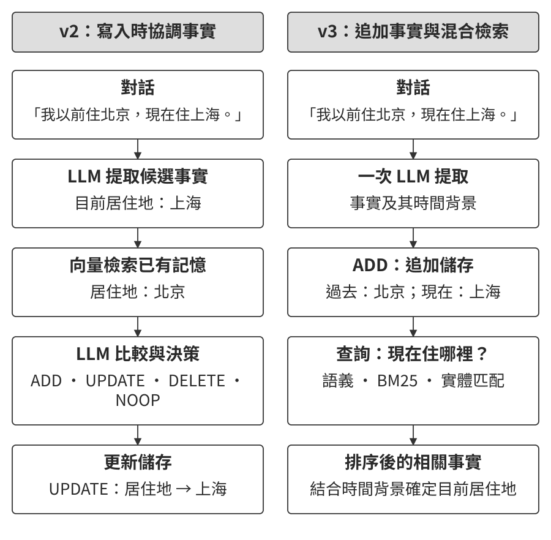

在早期流程中，LLM 先從對話提取候選事實，再檢索相近的已有記憶，決定執行 **ADD**、**UPDATE**、**DELETE** 或 **NOOP**。使用者先說「我住在北京」，後來又說「我搬到了上海」，系統可以把目前居住地更新為上海。這樣，查詢時容易取到整理後的事實；維護時則要正確識別更正、時間變化與不同對象，儲存更新依據，以便發現錯誤後回查。論文還提出圖記憶變體 **Mem0-g**，用實體與關係表達關聯知識[^ch3-mem0-paper]。

v3 把自動提取改為一次 LLM 呼叫，只追加 **ADD** 記錄。北京和上海兩條資訊可以連同時間背景一起保留，查詢時再結合上下文判斷目前居住地。檢索同時使用語義相似度、BM25 關鍵詞和實體匹配；已經確認完成的行動也可提取為事實。遷移指南報告，LoCoMo 得分由 71.4 提高到 91.6，LongMemEval 由 67.8 提高到 93.4。該開源版本將實體關聯用於內部檢索，移除了外部圖儲存介面及 `relations` 回傳值；圖記憶由託管平台提供[^ch3-mem0-migration]。

這一演進說明，記憶系統可以把衝突判斷從寫入階段移到讀取階段。寫入時一旦誤把兩個人的經歷合併，或把補充資訊當成更正，後續回答就可能一直沿用錯誤的目前狀態。追加儲存讓新舊證據都能參與判斷，也減少了寫入時逐條決策的模型呼叫。對於變化頻繁、當下難以判斷衝突的使用者記憶，筆者傾向先儲存事實及其時間和來源，再在回答具體問題時整理出有效狀態。

[^ch3-mem0-paper]: Chhikara 等，Mem0: Building Production-Ready AI Agents with Scalable Long-Term Memory，2025。

[^ch3-mem0-migration]: Mem0，Open Source: Migrating to the New Memory Algorithm。

**Memobase：使用者畫像與事件記憶。** Memobase 將長期資訊組織為兩部分。**使用者畫像（profile）**按主題與子主題儲存較穩定的屬性，例如 `basic_info` 下的姓名、`interest` 下的興趣、`work` 下的職位。開發者可以配置需要提取的槽位，控制畫像的範圍與粒度。**事件記憶（event memory）**記錄使用者經歷及其時間，供系統回答「上次討論預算是什麼時候」這類問題。

Memobase 先把新對話放入緩衝區，在緩衝區積累到指定規模，或會話空閒達到設定時長後批次處理，也可以在會話結束時顯式觸發。這樣，多條訊息共享一次整理流程，查詢時則讀取已經生成的畫像和事件。非同步更新減少了目前互動等待記憶提取的時間；需要立即使用最新事實時，可以等待本次處理完成[^ch3-memobase]。

[^ch3-memobase]: Memobase，官方專案說明，包括畫像欄位、事件記憶、緩衝區和同步更新介面。

如果助手既要記得上次訂票的經過，又要掌握使用者的座位偏好和辦理退票的流程，可以像圖3-4 那樣分別儲存事件、事實和流程。每次接到任務，再把用得上的部分放進工作記憶。

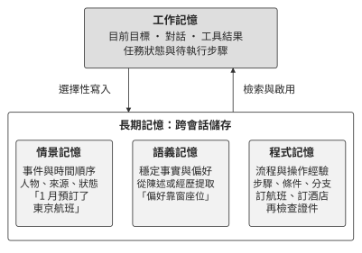

情景記憶保留事件序列及時間戳、情感標記、任務標識等後設資料，可以組合時間與主題檢索。例如，「上次討論預算」同時需要主題匹配和時間排序。語義記憶儲存從事件中提取的事實與偏好，程序性記憶儲存反覆使用的流程。

**工作記憶（working memory）**組織目前目標、任務狀態和已取回的相關資訊。Harness 從軌跡和長期儲存中選擇內容，載入到目前上下文；任務產生的新事實經過整理後，再寫入長期記憶。軌跡記錄事情如何發生，工作記憶集中儲存下一步決策所需的資訊，兩者透過事件標識和來源相互連結。

用 RAG 讀取使用者記憶時，先根據目前請求找出一批可能相關的記憶，再決定哪些該放進工作記憶。假設助手今天要幫使用者選座，檢索同時找到了兩句話：「出差我喜歡靠窗」和「上次膝蓋受了傷，回程幫我選走道」。兩條都與選座高度相關，但第二條只對當時那趟回程提出了要求。按相關性重排，即使把它排在第一，也沒有回答它今天是否適用。

這種情況下，筆者更看好用 Jev 一類判斷模型篩選候選記憶。把本次行程、使用者目前的要求，以及每條記憶的原話、日期和適用條件一併交給它，逐條判斷「本次適用」「僅供參考」或「依據不足」。如果今天也是出差，第一條可以作為選座依據；如果使用者剛說膝傷還沒好，第二條就值得拿回來詢問。

### 記憶壓縮與整理機制

一個常訂機票的使用者可能提到十次「靠窗」。其中九次也許都在複述同一張訂單；把提及次數直接當偏好強度，會放大一件事的權重。整理時先辨認來源和事件，再合併重複記錄，檢查是否存在更晚的更正，最後才決定哪些規律適合在未來任務中使用。遇到「上回那個靠窗的位置不錯」，可以請 Jev 一類判斷模型讀這句話和相關訂單，只判斷它屬於「回顧上次乘機」「提出本次要求」還是「表達長期偏好」。訂單對應不上或幾種解釋都說得通，就保留原話，等訂票時再核實。這樣一次局部判斷，可以避免把同一段經歷反覆算成新的證據。

1. **篩選整理對象。** 存取頻率、記錄時間、情感標記和資訊獨特性可以作為排序訊號。例如，一條三天前建立、被存取五次、情感標記較強且沒有重複的記錄，更值得單獨儲存；一條九十天前建立、僅存取一次、又與其他三條高度重複的記錄，可以優先與相關記錄合併。系統可先按分數篩出需要整理的記錄，再按業務規則決定是壓縮、合併還是刪除。長期約束和有效合約即使存取很少，也應保留到其有效期結束。
2. **聚類並生成摘要。** 將相似記錄分組，用一段摘要保留共同內容。例如，多次天氣對話可以整理為「使用者經常詢問天氣，特別關心降雨」。具體日期與原始詢問歸檔儲存，摘要關聯原記錄，便於後續回查。
3. **提取規律與流程。** 從多次購物記錄中歸納「偏好性價比高的產品，重視使用者評價」，或者提煉選品步驟。

### 隱私保護：日誌脫敏

使用者記憶常包含身份、聯絡方式和帳戶資訊。系統需要按任務決定哪些欄位進入模型輸入，按運維需要決定哪些內容進入日誌。脫敏可以放在日誌寫入前，將敏感片段替換為類型標籤或穩定佔位符，保留排查問題所需的結構。

> **實驗 3-3 ★★：基於本地模型的日誌脫敏**
>
> 本實驗透過 Ollama 呼叫本地 Qwen3-0.6B，在本機識別日誌中的敏感片段。小模型適合在消費級裝置上部署，也可以切換到 1.7B、4B 等規格，比較識別品質與處理時間。原始日誌需要留在本地時，識別和替換也應在本機完成，再把脫敏結果交給後續服務。
>
> 測試材料包括身分證字號、金融卡號等結構化號碼，地址等半結構化內容，以及自然語言中透露的密碼等敏感資訊。模型按 JSON Schema 回傳資訊類型、文字位置和置信度，程式據此替換原文。對照組使用正規表示式；混合組先做正則匹配，再讓模型處理剩餘文字。
>
> 先看兩條日誌。第一條有身分證字號和手機號碼，正則只遮住了手機號碼，召回率是 $1/2$。第二條裡，正則找齊了美國社會安全號碼和金融卡號，卻把格式相似的工單號也遮住了。它標出的三處只有兩處需要脫敏，精確率是 $2/3$。只檢查敏感值是否還留在日誌裡，第二條就會通過；等到客服拿這條日誌查工單，才會發現線索已經丟了。
>
> 對全部 12 條樣例逐條計算召回率再取平均，正則、模型與混合方案分別約為 50%、69% 和 78%。替換後逐條清點，三種方案分別留下了 9、3、2 個敏感值。怎樣取捨，還要看處理時間：在這台機器上，正則平均每條約用 0.1 毫秒，模型和混合方案都接近 3 秒。日誌量大時，可以先用正則處理格式穩定的欄位，只讓模型補查需要結合上下文判斷的片段。

記錄增多後，下一步是從成千上萬條資訊中找出目前任務需要的內容。下面介紹的 RAG 技術既可用於共享知識庫，也可用於使用者記憶檢索。

## RAG 基礎：建構 Agent 的知識獲取管道

一家商店改過退款政策，使用者來問：「我上個月買的商品，現在怎麼申請退款？」要答對，先要查到適用於這筆訂單的條款，再把條件和步驟講清楚。**檢索增強生成**（Retrieval-Augmented Generation，RAG）把這兩步連起來，使模型可以使用商店內部的資料，也能用上訓練結束後才公布的政策。

先從只有一版政策的情況入手。下面用簡化介面查詢同一家店的退款流程，觀察檢索結果怎樣進入模型的回答：

```python
query = "退款流程"
results = retriever.search(query, top_k=2)
# results = [
#   "退款政策：訂單簽收後7天內可申請全額退款，需提供訂單號。退款將在3–5個工作日內到帳。",
#   "退款操作：進入‘我的訂單’，選擇訂單，點選‘申請退款’。"
# ]
answer = llm.generate(system="你是客服助手。", context=results, question=query)
# 回答包含申請期限、所需資訊、操作步驟和到帳時間。
```

對照圖3-5 和程式碼中的兩條檢索結果：申請退款的步驟來自「退款操作」，到帳要等 3–5 個工作日則來自「退款政策」。如果檢索結果只剩下操作步驟，模型還有依據告訴使用者錢什麼時候到帳嗎？這個問題關係到手冊該怎樣分塊。

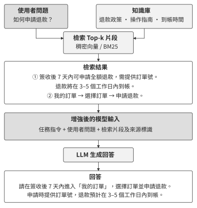

### 文件分塊（Chunking）

假設一份售後手冊先列出「七天內可退」，下一段再說明例外商品。只取回第一句，就可能給例外商品也承諾退款；整本手冊作為一個檢索單元，又會同時夾帶安裝、配置和故障排查，使向量難以突出退款主題。**分塊（chunking）**要在這兩端之間選取大小，讓一塊文字足以解釋自身條件，也容易被具體問題找到。塊的長度還要滿足嵌入模型的輸入預算，並為後續生成預留上下文空間。

常用方法有三類。

**固定大小切分**按 token 數劃分，例如每塊 512 token，相鄰塊重疊 50～100 token。重疊使邊界附近的內容有機會完整出現在另一塊中。這種方法便於控制塊的長度；切點可能落在段落、程式碼或表格內部。

**遞迴或結構感知切分**優先沿章節、段落等自然邊界劃分，遇到過長的部分再按句子等更小單位切分。Markdown 標題和 HTML 元素可以提供結構線索。程式碼塊、表格和標題關聯的正文也可以採用專門的處理規則。對於結構清楚的技術文件，筆者建議從這種方法開始：先利用現成的章節與段落，再對過長部分細分，通常比直接截斷更容易保住完整含義。

**語義切分**計算相鄰句子或句群的嵌入相似度，在主題發生明顯變化的位置切開。它增加了嵌入計算，但有機會把同一主題保留在一個塊中。

假設檢索器只送回來一句話：「該公司收入增長了 3%。」哪家公司？哪個季度？數字找對了，回答問題的依據卻在上一段。如果把整份財報都裝進一塊，季度和公司名倒是保住了，但查詢收入時，連招聘和裝置採購的段落也會一起進來。這些內容還要共用一個向量，收入這個主題在向量裡可能就沒那麼突出了。實際選塊大小時，可以從每塊 256～1024 token、相鄰塊重疊 10%～20% 開始試。

標題、來源和時間等後設資料可以隨片段一起儲存。後文的上下文感知檢索會進一步為每個片段補充其在原文中的背景，幫助獨立檢索時解析指代和範圍。

### 稠密嵌入：用向量表示文字

**嵌入（embedding）**將詞、句子或文字塊對應為數值向量，例如 `[0.2, -0.5, 0.8, ...]`。檢索模型透過訓練，讓相關的查詢與文件在向量空間中具有較高相似度。「稠密」表示向量的大多數維度都有非零數值，共同表示文字的資訊；後面的稀疏表示則只有少量維度非零。

可以把向量空間想像成一張高維地圖：每段文字對應一個位置，檢索是在其中尋找與查詢接近的內容。常用度量之一是**餘弦相似度**：

$$
\operatorname{cos}(A,B)=\frac{A\cdot B}{\|A\|\,\|B\|}
$$

點積 $A\cdot B$ 將對應維度相乘後求和，模長 $\|A\|$ 是各維度平方和的平方根。除以兩個模長後，結果只反映方向關係。對於非零向量，餘弦值範圍為 $[-1,1]$，越接近 1，方向越一致。不同檢索模型也會使用點積或歐氏距離。兩個向量都歸一化到單位長度時，點積就等於餘弦相似度。

> **手算：三個句子的餘弦相似度**
>
> 用三個示意向量表示「如何養貓」 $A=(0.9,0.5,0.1)$、「貓咪飼養指南」 $B=(0.8,0.6,0.1)$ 和「股票投資策略」 $C=(0.1,0.1,0.9)$。
>
> $A\cdot B=0.9\times0.8+0.5\times0.6+0.1\times0.1=1.03$。兩者模長分別為 $\sqrt{1.07}$ 和 $\sqrt{1.01}$，相似度約為 **0.991**。
>
> $A\cdot C=0.9\times0.1+0.5\times0.1+0.1\times0.9=0.23$，$C$ 的模長為 $\sqrt{0.83}$，相似度約為 **0.244**。在這組向量中，養貓查詢與飼養指南更接近。

實際模型通常使用數百至上千維表示。

#### 從 Word2Vec 到上下文感知

圖3-6 從固定詞向量講起。**Word2Vec** 根據詞彙共現學習每個詞的固定向量。一些關係能在向量運算中表現出來，例如經典的「國王－男性＋女性≈女王」。固定表示的限制也很直觀：`bank` 在 `river bank`（河岸）和 `investment bank`（投資銀行）中使用同一個詞向量。

**GloVe** 從整份語料統計詞與詞的共現次數，再透過加權最小二乘目標學習詞向量。Word2Vec 側重局部視窗中的預測任務，GloVe 將全域共現統計直接納入訓練；兩者都為詞彙學習固定表示[^ch3-glove]。

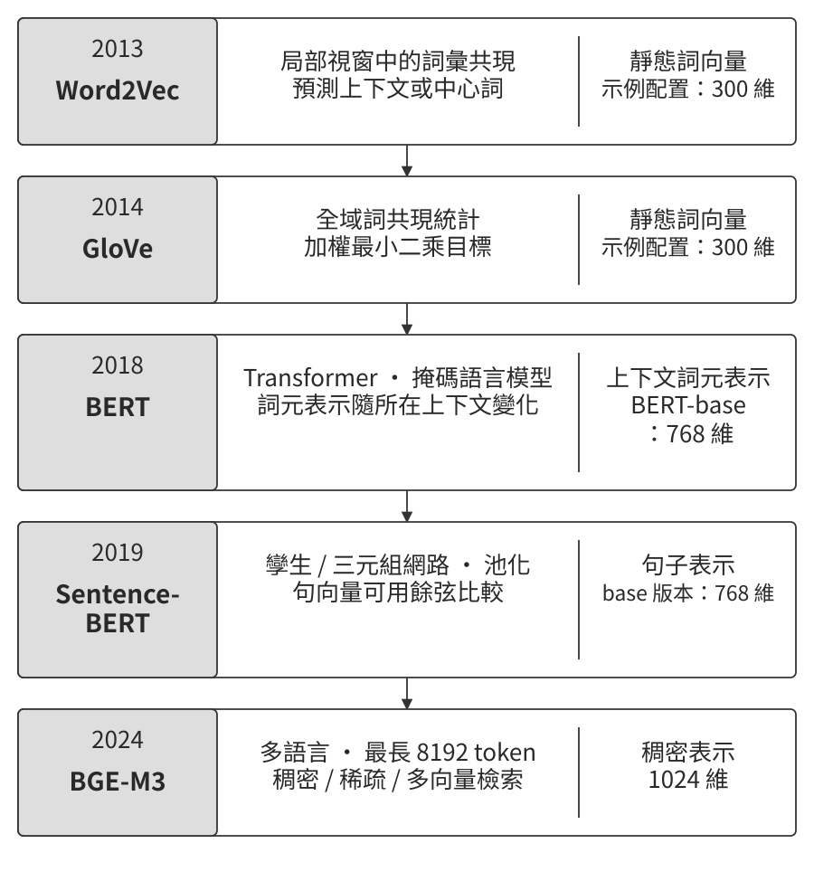

到了 **BERT** 這類上下文模型，同一個詞元的表示會隨句子改變。藉助自注意力，模型可以根據「發布新產品」和「買了兩斤」這些線索，給兩句話裡的「蘋果」算出不同的表示。用於檢索的嵌入模型還需要把詞元表示彙集為查詢或文件向量，並透過相應訓練使兩者可比較。

**Sentence-BERT** 將 BERT 與池化、孿生或三元組網路結構結合，訓練可直接比較的句向量。文件可以預先編碼並存入索引，查詢到來時只需編碼查詢，再計算向量相似度。預先編碼省去了每次查詢時重新計算全部文件表示的開銷[^ch3-sbert]。

**BGE-M3** 同時提供稠密、稀疏和多向量檢索表示，並支援多語言與較長輸入；本節採用其中的稠密表示說明單向量檢索[^ch3-bge-m3]。模型可接受的長度影響分塊方案：原始 BERT 的典型上限為 512 token，BGE-M3 支援到 8192 token。

[^ch3-bge-m3]: Chen 等的 M3-Embedding 論文（arXiv:2402.03216）介紹三種檢索表示如何聯合訓練。另見 BAAI 的 BGE-M3 模型說明，包括表示方式、維度、輸入長度和使用方法。

> **實驗 3-4 ★★：比較兩種近似最近鄰索引**
>
> 文件向量建好後，需要快速找到接近查詢的向量。逐個計算可以得到精確近鄰，資料規模增大後，**近似最近鄰**（Approximate Nearest Neighbor，ANN）索引用可控的召回損失換取查詢速度。本實驗在同一批真實嵌入和相同查詢上比較 ANNOY 與 HNSW，並用精確搜尋結果作為參照。比如，某次查詢的精確搜尋列出了十個最近鄰，近似索引回傳的十個結果裡包含其中八個，那麼這次查詢的 Recall@10 就是 0.8。這個數衡量索引保留了多少精確近鄰。
>
> ANNOY 使用多棵隨機投影樹縮小候選範圍；HNSW 使用分層近鄰圖，先在稀疏的高層快速接近目標區域，再進入更密集的低層搜尋。圖3-7 展示 HNSW 的分層結構。
>
> 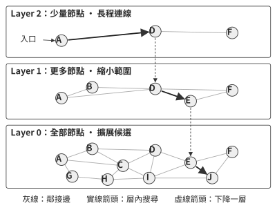
>
> 表3-2 ANNOY 與 HNSW 的實作取捨
>
> | 比較方面 | ANNOY | HNSW（以 hnswlib 為例） |
> | --- | --- | --- |
> | 索引結構 | 多棵隨機投影樹 | 分層近鄰圖 |
> | 建構開銷 | 隨樹數量、向量數量和維度變化 | 隨鄰接規模、建構搜尋範圍和資料量變化 |
> | 記憶體與檔案 | 靜態索引支援記憶體映射和多處理程序共享 | 儲存向量及圖鄰接關係，鄰接規模影響開銷 |
> | 增量更新 | 索引建好後新增條目需要重建 | 支援新增、更新及刪除標記，需管理容量 |
> | 召回與速度 | 用樹數量和查詢搜尋預算調節 | 用建構參數與查詢搜尋範圍調節 |
> | 使用場景 | 便於分發和共享的靜態索引 | 持續寫入並查詢的動態索引 |
>
> 本次執行先用 240 段文字建庫。對同樣的 20 個查詢，兩種索引都找齊了精確搜尋得到的前 10 個近鄰。初次建庫時，ANNOY 在 Linux 容器中建構約 13 毫秒，HNSW 在本機環境中建構約 78 毫秒；儲存的索引分別約 1.40 MB 和 1.02 MB。再加入剩餘 60 段，ANNOY 重新建構索引，HNSW 直接插入新向量。這時庫中共有 300 段，原先的近鄰也可能隨之改變。在新庫上重做精確搜尋後，兩種索引的平均召回率仍為 100%。

[^ch3-ann]: Spotify 的 Annoy 專案說明介紹了怎樣建構唯讀索引、用記憶體映射載入索引，以及怎樣用 `search_k` 調節查詢時檢查的節點數。hnswlib 專案說明的 Python 介面部分給出了追加向量的 `add_items` 方法和調節查詢範圍的 `set_ef` 方法。

**索引應按知識的更新方式來選。** 語料定期批次發布、多處理程序共享同一份唯讀索引時，筆者會先考慮 ANNOY；持續接收新文件、需要線上插入時，則優先考慮 HNSW。嵌入模型決定語義表示，索引決定這些表示能否以合適的延遲和更新成本投入使用，兩者共同決定檢索服務的效果。

調節 ANNOY 的樹數量與搜尋預算，或 HNSW 的鄰接規模與搜尋範圍，可以觀察召回和延遲的變化[^ch3-ann]。索引召回衡量是否找到了目標近鄰；這些近鄰能否回答使用者問題，則取決於嵌入表示與資料內容。

### 稀疏表示：從關鍵詞到相關性評分

**稀疏表示**使用高維向量，其中只有少量維度非零。傳統關鍵詞檢索以詞項為維度，根據文件中出現的詞賦權。它的基礎是**詞袋模型**（Bag of Words，BoW）：儲存詞及其出現次數，忽略順序。因此，「貓追狗」與「狗追貓」具有相同的詞袋表示。

這種表示適合匹配名稱、編號和技術術語。下面從 TF-IDF 講起，說明詞頻與文件頻率如何轉化為排序分數。

#### 從 TF-IDF 到 BM25

**TF-IDF**（Term Frequency–Inverse Document Frequency，詞頻—逆文件頻率）結合兩個訊號：詞在目前文件中出現多少次，以及它在整個語料庫中有多常見。假設 100 篇文章中有 60 篇包含「模型」，只有 3 篇包含「蒸餾」，查詢「模型蒸餾」時，「蒸餾」更有區分作用。

一種基本寫法是：

$$\operatorname{TF\!\text{-}\!IDF}(t,d)=\operatorname{TF}(t,d)\times\operatorname{IDF}(t),\qquad \operatorname{IDF}(t)=\ln\frac{N}{\operatorname{DF}(t)}$$

$\operatorname{TF}(t,d)$ 表示詞 $t$ 在文件 $d$ 中的次數，$\operatorname{DF}(t)$ 表示包含該詞的文件數，$N$ 為文件總數。按這個公式，一個詞出現十次時的得分貢獻，是出現五次時的兩倍；長文件也可能僅因詞更多而得分較高。TF-IDF 有多種歸一化變體，下面的 BM25 則用詞頻飽和與長度歸一化處理這兩類影響。

**BM25** 將各查詢詞的貢獻相加：

$$\operatorname{Score}(Q,D)=\sum_i\operatorname{IDF}_{\mathrm{BM25}}(q_i)\cdot\frac{\operatorname{TF}(q_i,D)(k_1+1)}{\operatorname{TF}(q_i,D)+k_1\left(1-b+b\frac{|D|}{\operatorname{avgdl}}\right)}$$

其中，$q_i$ 為查詢詞，$|D|$ 為文件長度，$\operatorname{avgdl}$ 為平均文件長度。$k_1$ 控制詞頻的飽和程度；$b$ 控制長度歸一化強度，取 0 時關閉這一校正。圖3-8 把這幾項分開計算。先固定文件長度，讓查詢詞從出現一次增加到三次，看看每多出現一次能多得多少分；再固定詞頻，只把文件長度加倍。最下面一行比較兩個詞在文件集合中有多常見。

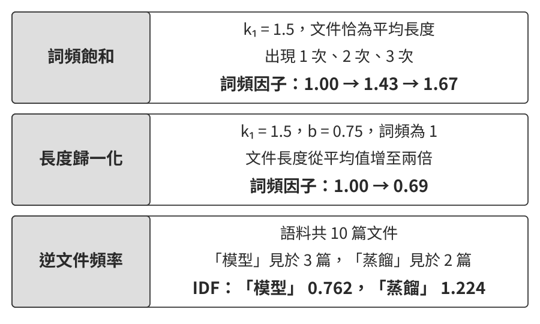

圖中第一行，第二次出現讓詞頻因子增加了約 0.43，第三次只增加了約 0.24，這就是詞頻飽和。第二行裡，同一個詞都只出現一次，在較長的文件裡更不突出，長度校正就把它的詞頻因子調低了。還要乘上 IDF，才是這個詞對總分的貢獻。

上式還有一項要確定：同樣出現三次，為什麼罕見詞往往比常見詞更有用？本節用下面的逆文件頻率給詞加權：

$$\operatorname{IDF}_{\mathrm{BM25}}(t)=\ln\frac{N-\operatorname{DF}(t)+0.5}{\operatorname{DF}(t)+0.5}$$

分子表示不含該詞的文件數，分母表示包含該詞的文件數，兩者各加 0.5 平滑，使文件頻率為 0 或 $N$ 時仍可計算。稀有詞得到更高權重；當超過半數文件包含該詞時，這個公式會給出負數。配套實作將實際評分權重下限設為 $10^{-6}$，同時保留原始值供檢查。

> **實驗 3-5 ★★：從零實作 BM25 搜尋引擎**
>
> 本實驗依次完成分詞、停用詞處理、倒排索引和評分。停用詞處理可以過濾「的」「了」等高頻詞。**倒排索引**記錄每個詞出現在哪些文件中，以及相應詞頻；它類似書末的術語索引，查詢「TCP」就能找到第 45、112、203 頁，再讀取這些位置的內容。
>
> 用「模型蒸餾」手算一次查詢。設語料庫有 10 篇文件，平均長度為 250 詞，$k_1=1.5$、$b=0.75$。「模型」出現在 3 篇文件中，IDF 約為 0.762；「蒸餾」出現在 2 篇中，IDF 約為 1.224。下表按詞列出命中的文件、詞頻和文件長度。把這些數值代入公式，就能算出各詞對文件得分的貢獻。
>
> | 查詢詞 | 文件 | 詞頻 TF | 文件長度 | BM25 貢獻 |
> | --- | --- | ---: | ---: | ---: |
> | 模型 | doc_1 | 5 | 200 | 1.52 |
> | 模型 | doc_3 | 2 | 500 | 0.82 |
> | 模型 | doc_7 | 8 | 150 | 1.68 |
> | 蒸餾 | doc_1 | 3 | 200 | 2.15 |
> | 蒸餾 | doc_5 | 1 | 250 | 1.22 |
>
> 兩個詞在 doc_1 中的貢獻相加約為 3.67，排序為 **doc_1（3.67）> doc_7（1.68）> doc_5（1.22）> doc_3（0.82）**。doc_1 中「蒸餾」的詞頻低於「模型」，但稀有程度更高，最終貢獻也更大；同時匹配兩個詞又進一步提高了總分。
>
> 現在用 `cat` 查配套實驗的英文語料。標註為相關的兩篇短文分別用了 `kitten` 和 `feline`，倒排索引中卻查不到 `cat`，候選列表是空的。即使把前面的詞頻權重調得再高，也沒有一篇文件可以打分。換用這兩篇短文中的詞再查，就能看到它們各自進入候選列表。

### 混合檢索：合併兩路結果再重排

有些問題很難預先列全同義詞。實驗 3-6 有一道題問的是「怎樣自動回收不用的堆空間」，目標短文卻寫成了「自動記憶體管理讓開發者省去手動釋放物件的工作」。英文查詢和短文沒有共同詞項，關鍵詞檢索一篇也沒找回，向量檢索卻把目標排在第一。換成型號查詢 XR-7003，關鍵詞檢索直接找到了對應型號，向量檢索還列出了幾個相近的型號。

**混合檢索**先用關鍵詞和向量分別查詢相關段落，再決定哪些段落值得交給模型。知識庫同時包含精確標識和自然語言描述時，筆者建議以此為起點。沿圖3-9 追蹤 XR-7003：兩路都把它排在第一，融合時它就得到了兩份排名貢獻。重排換掉了第二名，使用者首先看到的型號仍然正確。

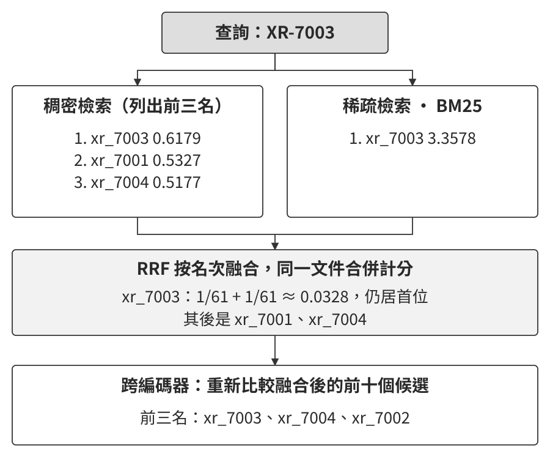

第一階段是**並行檢索**：將查詢傳送給稠密和稀疏引擎，各自取回一批可能相關的文件。兩路可以使用相同的原始文字，也可以按各自模型的要求進行預處理。

第二階段是**結果融合**：把兩路結果中的同一篇文件合併，再統一排名。餘弦相似度與 BM25 的數值尺度不同，直接相加容易使數值較大的一路主導結果。一種做法是先校準或歸一化分數，再加權組合；另一種是**倒數排名融合**（Reciprocal Rank Fusion，RRF），按各路名次計算：

$$\operatorname{RRF}(d)=\sum_{j:\,d\in R_j}\frac{1}{k+\operatorname{rank}_j(d)}$$

$R_j$ 是第 $j$ 路結果，名次從 1 開始，文件未出現在某一路時，該路貢獻為零。平滑常數 $k$ 常取 60；它越大，前幾個名次之間的分數差距越小。RRF 便於組合不同打分方式，但只保留名次，原始分數中的強弱差異需要透過其他方法利用。

試著算一個兩路檢索的例子。使用者問「退款多久到帳」，文件甲在關鍵詞檢索排第一，在向量檢索前列沒有出現；文件乙在兩路都排第二。取 $k=60$，甲得 $1/61$，約為 0.0164；乙得 $1/62+1/62$，約為 0.0323。融合後乙排在甲前面。這個結果只說明兩條檢索路徑都找到了乙。要判斷乙是否真的回答了到帳時間，還要看它寫的是「如何申請退款」還是「退款何時到帳」。

第三階段可以加入**神經重排序**。系統取出融合後排名靠前的文件，例如前 50 篇，讓重排序模型給每篇文件與查詢的相關程度打分。重排能改變這 50 篇的次序。如果真正有用的文件根本沒入選，就得回到上游改進檢索。

這裡常用的模型是**跨編碼器（cross-encoder）**：把查詢與候選文件一起輸入，讓兩部分在模型內部互動，輸出相關性分數。檢索階段的**雙編碼器（bi-encoder）**則分別編碼查詢和文件，文件向量可以提前計算，查詢時只做向量搜尋。前者適合細排少量文件，後者適合在大量文件中初篩。可以類比簡歷篩選和面試：先根據已有特徵縮小範圍，再圍繞具體要求深入比較。BGE Reranker v2 M3 是可用於這一環節的模型之一[^ch3-reranker]。

[^ch3-reranker]: BAAI，BGE Reranker v2 M3 模型說明，介紹查詢—文件輸入與相關性評分。

當相關材料已經進入候選池，卻經常排在無關材料後面時，筆者會優先評估跨編碼器重排序。它聯合讀取問題與文件，可以直接比較文件中的條件、限定詞和細節是否符合問題要求。表3-3 列出三個常用指標。

表3-3 檢索品質的三個指標

| 指標 | 計算與含義 |
| --- | --- |
| recall@k（召回率） | 前 k 個結果中的相關文件數，除以該查詢全部相關文件數，衡量找回了多少相關內容；測試集通常再對各查詢取平均 |
| MRR（平均倒數排名） | 每個查詢取首個相關文件名次的倒數，再求平均；首位為 1，第十位為 0.1，未找到為 0 |
| nDCG@k（歸一化折損累積增益） | 按相關程度給結果賦分，並對靠後的名次折損，再除以理想排序得分，衡量前 k 個結果的整體排序品質 |

還可以記錄**命中率**：多少查詢在前 k 個結果裡至少找回一篇相關文件？比如，一個問題需要三篇資料，前二十個結果只找回其中兩篇。這個查詢已經命中，因而沒有計入「完全未命中」的失敗次數，但它的 recall@20 只有 $2/3$，還有 $1/3$ 的資料沒找到。如果每題都只有一篇目標文件，找回它的題得 1 分，漏掉的題得 0 分。對同一份檢索結果求平均，命中率就等於平均召回率。

> **實驗 3-6 ★★：比較稀疏、稠密、融合與重排序**
>
> 本實驗在相同的 12 個標註查詢上比較五種配置：稀疏檢索、稠密檢索、RRF 融合、加權融合，以及融合後重排序。查詢覆蓋語義相似、精確名稱、多語言和技術程式碼，其中兩道題分別用英文和中文詢問植物怎樣把陽光轉化為食物。稠密模型採用 Qwen3-Embedding-0.6B，重排序採用 MS MARCO MiniLM 跨編碼器，每路檢索最多取 10 篇文件，重排器處理 RRF 排在前面的最多 10 篇文件。召回率和 nDCG 只看最終排序的前 3 篇，MRR 則沿回傳的列表尋找第一篇相關文件。
>
> 先開啟實驗 3-6 執行記錄裡的逐題排名，比較兩道光合作用題的檢索結果。英文題的目標文件仍排第一。中文題先回傳程式語言和火山，第三篇才講光合作用。每題只有一篇標註為相關的文件，兩題在前三名裡都找到了它，recall@3 都是 1。但中文題的首篇相關文件排第三，倒數排名只有 $1/3$。按本實驗的計分方式，第三名的增益是 $1/\log_2(3+1)=0.5$，第一名的增益是 1，因此中文題的 nDCG@3 為 0.5。
>
> 再看全部 12 道題。重排後，除中文光合作用題外，另有一道關於回收堆記憶體的題，目標文件從第一退到了第二。其餘十題都保住了首位，所以重排後的 MRR 是 $(10+1/2+1/3)/12\approx0.903$。作為對照，稠密檢索和 RRF 的 MRR 都是 1。兩者的 nDCG@3 也都是 1，重排後降到約 0.928。只看平均召回率就看不出這些名次變化：稀疏檢索的 recall@3 為 0.833，其餘四組都是 1。
>
> 假設現在要為這組題選一個配置，重排付出的時間換來了什麼？在這台 CPU 上，RRF 從開始檢索到給出排名，平均每題約用 194 毫秒；接上重排後約用 237 毫秒。多花的約 43 毫秒沒有多找回目標文件，還把兩道題的正確答案推後了。

## 知識的組織與檢索

知識的組織方式決定每個條目包含什麼，檢索器則決定從這些條目中取回什麼。技術手冊、法律文書和論文中的段落透過章節層次、概念依賴和跨文件引用聯繫起來。將這些結構保留下來，可以讓查詢同時存取具體證據和較高層的概括。

本節依次討論幾種組織方式：RAPTOR 與 GraphRAG 建立層次或關係索引；OpenViking 用目錄組織上下文資源；增量更新和定期整理維護知識時效；智慧體化 RAG 讓 Agent 根據已有結果繼續檢索；上下文感知檢索補充片段背景；最後從資料集中提取可複用的知識。它們分別作用於表示、索引、更新和查詢過程，也可以組合用於使用者記憶。

先看兩個例子，理解查詢所需資訊與原始記錄之間的差距。

**案例一：黑貓白貓的計數。** 上一章讓程式數完 100 個籠子，得到 90 隻黑貓、10 隻白貓。這一次只讓檢索器回傳排在前面的 20 條記錄。假設其中 18 條給出了有效的顏色資訊，15 條是黑貓，3 條是白貓。算出來的 83.3%（15/18）是這批有效記錄裡黑貓的比例；全店的黑貓比例卻是 90%（90/100）。檢索器按相關性挑選記錄，它沒有為全店抽取一個有代表性的樣本。

如果經常有人問全店的比例，可以預先統計所有籠子，儲存黑貓和白貓各有多少，並標明統計範圍和更新時間。籠裡的貓換了，就更新相應明細並重算總數。有人問第 37 個籠子裡是什麼，仍然要查回那一條明細。

**案例二：護士能享受醫生拿到的折扣嗎？** 以一個圍繞 Xfinity 優惠諮詢構造的教學情境為例：工單中，退伍軍人 John 通過審核，醫生 Sarah 獲得折扣，教師 Mike 被告知不符合條件。每條工單記錄一次處理結果。如果一位護士來問自己能不能享受折扣，僅檢索相似工單會遇到三個問題。

- **職業相近，未必享受同一項優惠。** 「護士」與「醫生」語義接近，Sarah 的記錄可能排在前面；是否適用優惠還取決於活動條款規定了哪些人可以申請、要出示什麼證明。
- **個別工單列不全適用條件。** 某人通過審核，只能直接說明該人在當時條件下的結果；調大檢索數量也未必能找到未曾出現過的類別或例外。
- **資料範圍不清楚。** 工單可能來自不同活動或不同時間。需要先確認哪些記錄適用，以及缺少哪些政策依據。

索引時可以把同一活動的工單關聯起來，再查閱對應的正式條款，把適用對象、例外情形、生效時間和條款出處整理為規則卡。例如，若該教學情境中的條款明確覆蓋現役與退伍軍人、持證醫護人員，並排除教師類別，就把這些條件逐項儲存；護士是否屬於醫護人員範圍，也由條款確認。工單繼續保留，用來解釋實際辦理過程和發現執行差異。

這兩個例子體現了不同的資訊需求：數貓要統計全店的籠子，判斷誰能享受折扣要查完整的條款和例外。面對這類查詢，筆者主張把統計和規則整理前移到建庫階段。僅增加取回的片段，模型仍可能看不到完整的統計範圍或決定這次申請能否獲准的條款。圍繞任務建立統計摘要、規則卡和來源關係，檢索才能一次拿到足以支援判斷的資訊，並能繼續回查原始材料。

### 結構化索引：建立層次與關聯

讀一份長報告時，「維修申請要填哪一欄」往往能在一段原文中找到答案；「幾類故障為什麼反覆出現」則要橫跨幾個章節。若希望兼顧這樣的查詢，可以在建庫時生成摘要、建立層次，或者提取實體和關係。下面的 RAPTOR 用遞迴摘要形成層次，GraphRAG 則透過實體關係和社群摘要組織材料。

**RAPTOR**（Recursive Abstractive Processing for Tree-Organized Retrieval）從文字塊開始，先把每個塊編碼成向量，按相似程度聚成若干組，再為每組生成摘要。把摘要當作新的一批文字塊，重複這些步驟，就得到了圖3-10 中的樹。沿箭頭從文字塊 3、4、5 往上看，它們共同生成摘要 B；再往上，A、B、C 三組的摘要匯成全域摘要。[^ch3-raptor]

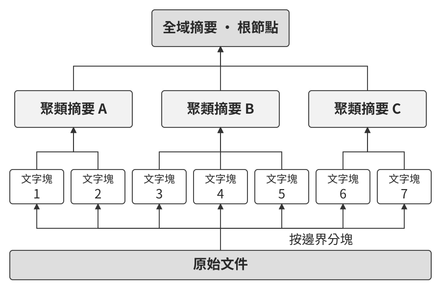

例如，「SSE2 支援在 128 位 XMM 暫存器中執行整數 SIMD 運算」和「SSE4.2 新增字串比較指令」可以納入「x86 SIMD 指令集演進」的摘要。細節問題可以匹配底層塊，概覽問題可以匹配高層摘要。查詢既可以沿層次逐步深入，也可以把各層節點放在一起檢索，選出最相關的一組。

[^ch3-raptor]: Sarthi 等，RAPTOR: Recursive Abstractive Processing for Tree-Organized Retrieval，2024。

**GraphRAG** 利用實體、關係和社群摘要組織知識。它用「主體—關係—客體」這樣的三元組記錄一條關係，例如（中國，首都是，北京）或（張三，就職於，騰訊）。兩條記錄只要提到同一個實體，就可以在圖中連起來。圖3-11 裡的兩位醫生都姓張。使用者問「我的牙醫所在醫院的地址」時，系統該沿哪條關係查下去？

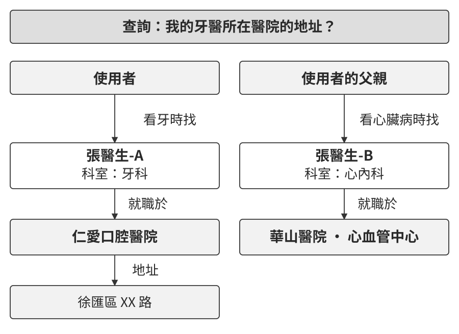

1. **建圖時區分同名實體。** 一位張醫生在仁愛口腔醫院給使用者看牙，另一位在華山醫院給使用者的父親看心臟病。系統提取實體、歸併記錄時，可以根據這些線索給兩位醫生分配不同的標識。前面的 `person`、`relationship` 欄位也有類似的作用。判斷 `bank` 在句中表示河岸還是銀行，是詞義消歧；判斷一條記錄說的是哪位張醫生，是實體消歧。
2. **查詢時沿關係鏈檢索。** 從使用者出發，沿「使用者→醫生→醫院→地址」逐步查詢，就能把分散在幾條記錄裡的資訊連成一個答案。

微軟 GraphRAG 的索引流程先從文字單元提取實體和關係，再透過社群發現識別連接緊密的實體群，生成社群層次與摘要。查詢某個實體時，局部搜尋結合其關聯資訊和原文；查詢整個語料的主題時，全域搜尋利用社群摘要組織回答[^ch3-graphrag]。

[^ch3-graphrag]: Microsoft GraphRAG，索引與查詢概覽、局部搜尋和全域搜尋。

關係表示還需要容納條件和時間。例如，「如果下週還下雨，我就取消去海邊，改去博物館」，包含條件、有效時間和備選行動。如果只提取（使用者，有計畫，海灘旅行）和（使用者，有備選計畫，博物館旅行），就會丟失切換條件。可以保留完整原句，並用條件節點、事件節點或結構化欄位表示「下週下雨時」的約束，讓關係回指原文。

對於使用者記憶，筆者更推薦**自然語言與結構化索引分層配合**：用自然語言儲存完整表達，用後設資料記錄對象、時間和來源，再為需要頻繁關聯的內容建立圖索引。

> **實驗 3-7 ★★★：比較層次摘要與關係索引**
>
> 本實驗選取 Intel 架構手冊中與 SSE、AVX 和狀態管理有關的 14 頁，建構兩種教學實作。層次摘要分支先生成逐頁摘要，再聚為三組，生成組摘要和根摘要；關係索引分支提取實體與關係，再生成社群摘要。兩組使用相同資料與八個問題，比較概念細節和關係推理。
>
> 查詢「解釋 SSE 程式設計環境」時，層次摘要可以同時匹配 SSE 概覽和暫存器細節。本實作將各層節點一起檢索，選擇最相關的五個。關係分支則從相關實體擴展鄰居，結合社群摘要組織上下文。沿「SSE→XMM 暫存器→浮點運算→ADDPS」這樣的關係，可以把概念與具體指令聯繫起來。
>
> 更複雜的問題是「處理器宣告支援 AVX，程式是否就能使用 AVX？」需要把處理器能力與作業系統狀態管理聯繫起來：檢查 CPUID 的 AVX、OSXSAVE 標誌，再讀取 XCR0，確認 XMM 與 YMM 狀態均已啟用。這道題給圖檢索程式的端點提示是 CPUID 和 YMM。程式找出連接兩者的最短路徑，經由 XSAVE、CR4.OSXSAVE 和 XCR0，再把路徑交給模型作答。
>
> 兩組在八個問題上的平均來源頁覆蓋率都約為 95.8%。

筆者建議先把分塊與混合檢索做好，遇到反覆出現的跨文件綜合和關係查詢需求時，再建構結構化索引。定位某一段退款政策，通常用分塊與混合檢索就能解決；比較 SSE 與 AVX，或從總體架構查到具體指令，則更需要跨段摘要和關係索引。

### 檔案系統範式：用目錄結構組織知識

**OpenViking** 用虛擬檔案系統組織記憶、資源和技能。每個條目透過 `viking://` URI 引用，Agent 可以瀏覽目錄、讀取概覽，再存取需要的內容[^ch3-openviking-uri]。按資訊用途，可以把目錄理解為三組：外部資源、使用者資料，以及 Agent 使用的技能和經驗。使用者與 Agent 標識進一步限定各自的名稱空間。

| 內容 | 典型用途 |
| --- | --- |
| Resources | 技術文件、程式碼庫、網頁等外部資料 |
| User memories | 特定使用者的偏好、習慣和經歷 |
| Skills 與 Agent memories | 可複用的流程、任務記錄和有待驗證的經驗 |

URI 提供統一定位方式，物理儲存與索引由服務管理。目錄介面使 Agent 能按主題逐層瀏覽，也能把語義搜尋限制在相關子樹內。檔案系統式的存取、內容儲存和向量索引可以共同組成服務。

[^ch3-openviking-uri]: OpenViking，Viking URI與系統架構。

OpenViking 將內容分為 **L0、L1、L2** 三個層次：L0 是簡短摘要，供快速判斷目錄是否相關；L1 是目錄概覽，說明主要內容及導航入口；L2 是需要詳細閱讀的正文。目錄級摘要和概覽分別儲存在 `.abstract.md` 與 `.overview.md` 中。兩者生成正文的預算分別為 256 和 4000 個字元[^ch3-openviking-layers]。

查詢可以先讀摘要定位，再讀概覽選擇檔案，最後載入原文。這與第二章 Skills 的漸進式披露相通：輕量目錄支援發現，完整內容按任務需要載入。需要精確數值、條件或原始措辭時，應繼續取回對應正文。

[^ch3-openviking-layers]: OpenViking，Context Layers (L0/L1/L2)。L0、L1 是目錄級生成表示；L2 可為原始檔案或解析後的正文。

對於需要人和 Agent 共同維護的知識，筆者傾向於用 **Markdown 純文字與版本控制**管理。人可以直接閱讀、編輯和修正知識，Agent 也能使用同樣的檔案介面，在工作分支提出更新，經審核後再發布。版本控制儲存每次修改的差異，也讓錯誤更新可以撤回。會話結束時，使用者偏好進入對應使用者的記憶，操作經過進入任務記錄。任務記錄經過結果評價、跨軌跡歸納與後續驗證後，可以進一步形成第九章討論的經驗。

採用檔案系統組織知識，必須同時**為相關條目建立連結與索引**。一批互不引用的檔案只能靠全文掃描或語義檢索重新尋找關聯；檔案越多，Agent 就越難從已經找到的內容繼續追查。連結可以提供明確的查詢路徑，例如讓退款政策指向例外條款，合約摘要指向簽署記錄，人物條目指向相關事件。入口頁說明主要主題，索引頁提供導航，條目之間的交叉引用支援橫向查詢。這種做法類似百科條目的組織，可以用較輕量的方式儲存部分關係。

建庫時，還可以標明哪些條目能一起用，哪些預案在同一次處理中只能選一套。例如，客服處理取消訂單的請求時，回覆客戶要同時遵守措辭規範和隱私規範，兩份規範可以一起放入上下文。倉庫若為取消發貨準備了兩套預案，就應在索引中寫清各自的適用條件。對同一個包裹，尚未出庫時撤銷出庫單，已經交給承運商時申請攔截。工單裡只有「請取消訂單」時，Agent 要先查包裹狀態，再載入適用的預案。

連結維護應寫入更新流程：新增條目前先檢索已有記錄，確定合併還是新建；寫入後補充相關引用，並更新所屬目錄的索引。連結能帶讀者找到條款，條款是否適用於手裡的訂單，還得看它是什麼時候生效的。

### 知識應該如何更新

一條政策今天修改，使用者明天可能問「現在該怎麼辦」，也可能問「上月我的訂單為什麼那樣處理」。只用新條款覆蓋舊條款，第二個問題就失去了當時的依據。**增量更新**及時寫入新證據，**定期整理**再從更大範圍發現重複、衝突和結構變化；兩條路徑都要保留版本、證據引用並在發布前檢查，才能按問題選擇適用時期。

#### 使用者記憶和知識庫的增量更新

筆者的建議是：**把知識庫當成程式碼庫，把每次知識變更當成一個 Pull Request（PR）。** 一次更新應有明確的修改範圍，並附上支撐修改的證據，供審核者檢查。Markdown 文件、規則檔案和 User as Code 的可執行狀態都可以納入這一流程。版本歷史幫助維護者檢視變化、追查原因，並在錯誤發布後恢復。

沿用第一章的**提議者—審核者**模式，一次更新可以這樣進行：

1. **提議者生成變更。** Proposer Agent 閱讀新證據，檢索已有知識，找到新增、更正或過期的條目，在工作分支提出範圍明確的修改。同時維護關聯連結、目錄索引、時間資訊和證據引用。
2. **審核者獨立核查。** Reviewer Agent 對照修改前後的內容與原始證據，核對新增說法有無出處、適用條件寫全了沒有、不同檔案裡的說法是否一致，以及刪去的段落裡還有沒有用得上的資訊。發現問題時，指出具體條目和依據，並說明應補充、恢復或更正什麼。
3. **迭代並作出決定。** 提議者按意見修改，審核者重新核查。審核通過後進入合併流程；達到輪次或成本上限仍有爭議時，就把這份修改留在工作分支，請人審閱。
4. **檢查並發布。** 自動檢查格式、連結、後設資料和權限標籤；可執行知識還要通過型別檢查和相關測試。合入後，從確定的知識版本重建受影響的分塊、摘要和向量索引，再發布服務版本。

這條流程對應三層資料。**原始證據層**儲存對話、執行軌跡、業務文件和工具結果；**知識層**儲存經過提煉、可以修訂的文字或程式碼；**服務層**儲存由特定知識版本生成的索引。變更記錄關聯證據標識、知識版本、審核意見和最終決定，使維護者能追查某條知識為何寫入、何時生效。原始證據按保留策略歸檔，索引則可以從知識版本重新生成。前文的追加式記憶適合儲存新舊事實及其來源；這裡的審核流程負責把這些證據整理為可供使用的知識版本。查詢時遇到尚未解決的衝突，仍可回查證據，結合任務條件判斷。

在這套設計中，**提議者和審核者都應是能夠呼叫工具、持續查詢的 Agent。** 提議者可能需要搜尋多份記錄才能找到受影響的條目；審核者也可能沿引用繼續查詢、比較版本或執行檢查。檔案搜尋、證據檢索、差異檢視和測試工具使它們能夠處理這些後續步驟，具備相應能力的 Coding Agent 就可以承擔這樣的工作。

兩者的檢索範圍應覆蓋目前變更涉及的知識及原始證據，並受使用者、租戶和任務權限約束。審核軌跡、引用的工具結果和回饋一同歸檔，後續可以檢查審核者實際核驗了什麼。

模型選擇上，筆者建議優先採用能力相近、來自不同家族的組合，例如 Claude 與 GPT、DeepSeek 與 Kimi。不同的訓練資料和推理習慣可能帶來不同判斷。審核者應獨立檢索證據、核對修改中的斷言與條件。權限應由執行系統執行：提議者寫工作分支，審核者讀取證據並提交結論，合併與發布服務掌握主庫和線上索引的更新權限。

#### 使用者記憶和知識庫的定期整理

多次局部更新後，同一事實可能散落在多個檔案中，新舊表述也可能並存。定期整理從目錄、時間或主題出發，檢查這些累積問題。它與第九章討論的週期性回顧有共同的工作方式：前台積累新證據，後台集中整理，形成可供後續任務使用的記錄。

整理包括三項工作。

1. **去重、歸併與結構調整。** 找出重複、過期或過度碎片化的條目，合併相關內容，拆分過大的檔案，並更新連結、入口頁和索引頁。刪除服務中的舊表達時，記錄其替代關係和原始依據。
2. **回查原始材料。** 如果每輪整理都只改寫上一輪摘要，早期的遺漏和誤解就會一輪輪傳下去。因此，應對照對話、執行軌跡、業務文件和工具輸出，檢查摘要是否遺漏關鍵事實，是否丟失否定、時間或條件，是否把推測寫成確定結論。大型知識庫可以按目錄、時間或主題分批處理，用覆蓋清單記錄已檢查、待檢查和存在爭議的部分，直至完成全庫核查。
3. **處理衝突與適用範圍。** 比較矛盾記錄的來源，以及時間、對象、地域、任務和前置條件。若兩條資訊分別適用於不同場景，就補齊各自範圍；若新證據明確取代舊規則，就儲存版本關係；若依據不足，就記錄待確認項和需要補充的證據。

整理結果同樣作為變更提交審核。較大的重組可以按目錄或主題拆成多個 PR，共享整理計畫與覆蓋清單；相關變更通過後重建派生索引，並重播典型檢索和問答用例，檢查原來能找到的知識是否仍可存取。觸發方式可以採用每週、每月等週期，也可以依據新增條目、衝突數量或檢索品質變化設定閾值。

**失效內容下線。** 分塊和摘要應保留版本、生效時間與失效時間。舊政策被替代後，目前業務查詢過濾失效版本；歷史查詢則按目標時間讀取相應規則。這樣既能使用最新知識，也能解釋過去的處理結果。

**權限與租戶隔離。** 權限過濾應在檢索層完成：檢索服務先按呼叫者身份劃定可查的文件範圍，再從中查詢相關資料。一旦把其他使用者的私密資料送進上下文，模型就可能在回答或呼叫工具時洩露它。原文、摘要、關係邊和快取結果都需要繼承適當的存取範圍，避免透過派生內容帶出其他使用者或租戶的資訊。服務可以採用獨立索引或具備強制過濾能力的共享索引，關鍵是讓每條查詢都執行權限約束。

### 智慧體化 RAG：由 Agent 控制檢索過程

先問一次檢索是否已經足夠。例如「售後電話是多少」，一份現行服務手冊往往就能給出答案，筆者建議沿用單次檢索再生成的簡單路徑。若使用者問「我買的這一型號能否按上月的保修條款換貨」，第一次只查到產品系列，還無法判斷上月的換貨條件。把檢索開放成工具，Agent 就能用上一次回傳的線索構造下一次查詢。這種由 Agent 決定是否補查、接下來查什麼的做法，稱為**智慧體化 RAG（Agentic RAG）**。對照圖3-12，第一次回傳的產品資料完全相同。右側路徑多用到什麼線索，才能查到當時適用的條款？

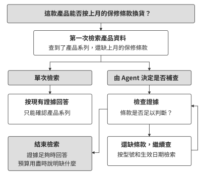

以 ReAct 為例，模型先分析問題並選擇查詢，呼叫 `knowledge_base_search`；工具回傳觀測後，模型判斷證據是否足夠。若缺少條件或相關對象，就改寫查詢繼續檢索；若材料已經充分，就結合來源生成回答。Harness 維護歷史、工具呼叫和預算，在達到限制時結束搜尋或轉入澄清。

再看圖3-13。即使把知識庫後端從向量索引換成關係圖，模型也可以繼續透過同一個工具介面請求搜尋。如果回傳的文件裡恰好有一段指令，模型可以照著執行嗎？

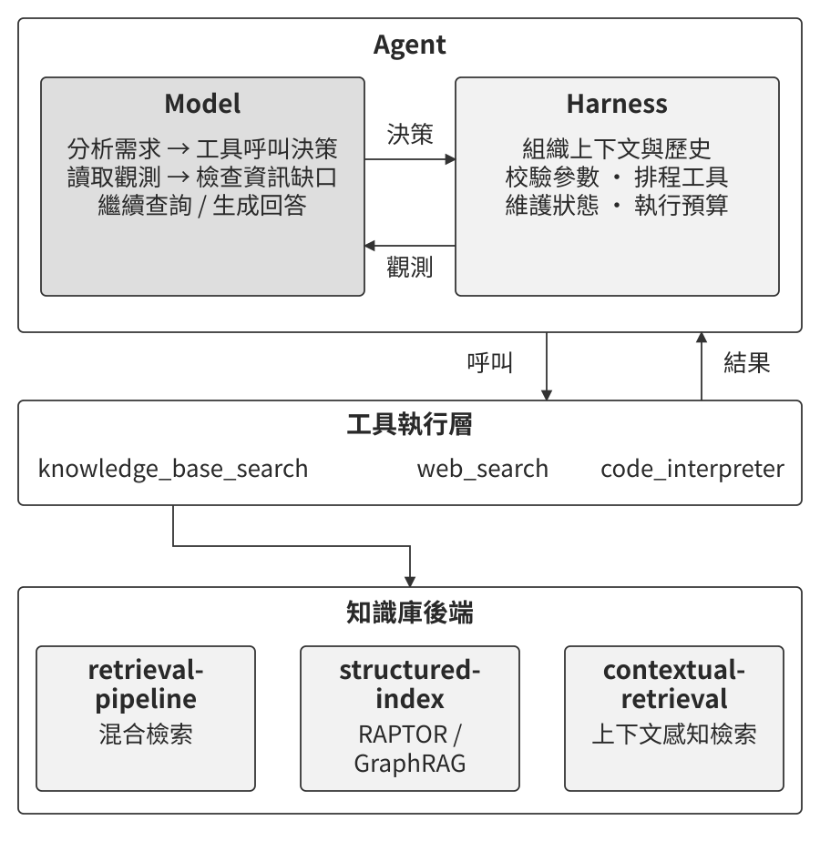

**檢索內容的信任邊界。** 外部文件可能包含試圖改變模型行為的文字，也可能在入庫前被加入錯誤事實。前者涉及間接提示注入，後者屬於知識庫投毒。處理時，需要同時管理內容來源與執行權限：檢索結果帶上來源、版本和引用位置，作為回答證據；轉帳、刪除、對外發信等行動，則由 Harness 和執行環境依據使用者授權校驗。入庫審核、來源追溯和事實核查進一步控制錯誤知識的傳播。第二章介紹的來源標記與第四章的工具約束在這裡共同發揮作用。

> **實驗 3-8 ★★：比較單次檢索與多輪檢索**
>
> 本實驗使用同一份中文法律材料、同一 BM25 檢索器和相同模型，對七個問題比較兩種模式：基線按原問題搜尋一次，Agent 模式允許模型調整查詢，最多執行四次搜尋。
>
> 對「正當防衛是怎麼規定的」這類查詢，直接檢索即可獲得主要條文。更複雜的例子是「醉酒過失致人重傷且有盜竊前科，應如何量刑」。它同時涉及目前行為、醉酒情形和先前記錄，檢索時需要分別定位有關材料，再檢查適用條件。
>
> 實際執行依次搜尋了「醉酒過失致人重傷 盜竊前科 量刑」「醉酒 犯罪 量刑」「盜竊前科 量刑影響 刑法」和「前科 量刑影響 刑法」。模型隨後還提出「累犯 認定 刑法」，此時搜尋預算已用完，Harness 回傳預算耗盡資訊。
>
> 在實驗劃分的四個複雜問題上，目標法條覆蓋率從約 8% 提高到 92%，平均搜尋次數從一次增至 3.5 次，回答階段平均耗時從約 8 秒增至 66 秒。三個簡單問題的證據覆蓋均為 100%，兩組都只搜尋一次。

同一檢索迴圈也可以用於使用者歷史。下面沿用實驗 3-1 的三層次評估集，觀察 Agent 如何從跨會話記錄中取回事實、區分對象和處理更新。

> **實驗 3-9 ★★：用智慧體化檢索讀取使用者記憶**
>
> 本實驗把完整對話歷史作為知識庫，按視窗切分後建立索引，再向 Agent 提供 `search_user_memory` 工具。視窗大小可以調整；本次執行每塊包含八輪對話，相鄰塊重疊兩輪，並儲存會話標識、時間和業務後設資料。查詢最多執行三次，每次取回四個片段。
>
> 基礎回憶可以圍繞明確欄位搜尋，例如「我的支票帳戶號碼是多少」。多會話問題還需要檢查對象是否完整：使用者既有本田 Accord，也有特斯拉 Model 3，詢問車輛服務安排時，系統應區分兩輛車及各自的預約狀態。
>
> 可以據此設計一條檢索路線：先搜尋車輛與服務記錄；發現另一輛車的線索後，再查詢特斯拉的安排；最後說明本田的已有預約，並確認使用者是否還需要為特斯拉預約。本次實際記錄只執行了 `scheduled car services` 這一查詢，普通檢索組的回答集中在本田，遺漏了特斯拉。
>
> 另一類困難來自連續修改。轉帳案例中，妻子設立安排，丈夫隨後修改金額和日期，妻子再次調整。取回記錄後，需要按時間、對象及確認狀態還原變化，找到最終生效的指令。目前分塊已經儲存時間資訊，檢索仍可能漏掉關鍵修改，因此可以進一步為片段補充事件背景。
>
> 在這 60 個用例中，18 個只搜尋一次，6 個搜尋兩次，36 個用滿三次。普通分塊檢索組通過了 47 個：基礎回憶 19 個、多會話檢索 15 個、主動服務 13 個。下一節繼續在相同用例上比較上下文前綴和結構化記憶，分析它們分別補充了哪些資訊。

### 上下文感知檢索：為片段補充背景

回到那份財報。要查 ACME 公司 2025 年第二季度的業績，查詢裡有公司名和年份，可是寫著「該公司收入增長了 3%」的片段偏偏沒有這兩個詞。除了擴大分塊，還可以保留這段短文，把缺少的背景補在它前面。**上下文感知檢索（Contextual Retrieval）**在建索引時，為片段生成簡短的背景前綴，再將前綴與原文一起用於檢索[^ch3-1]。圖3-14 展示這一處理過程。

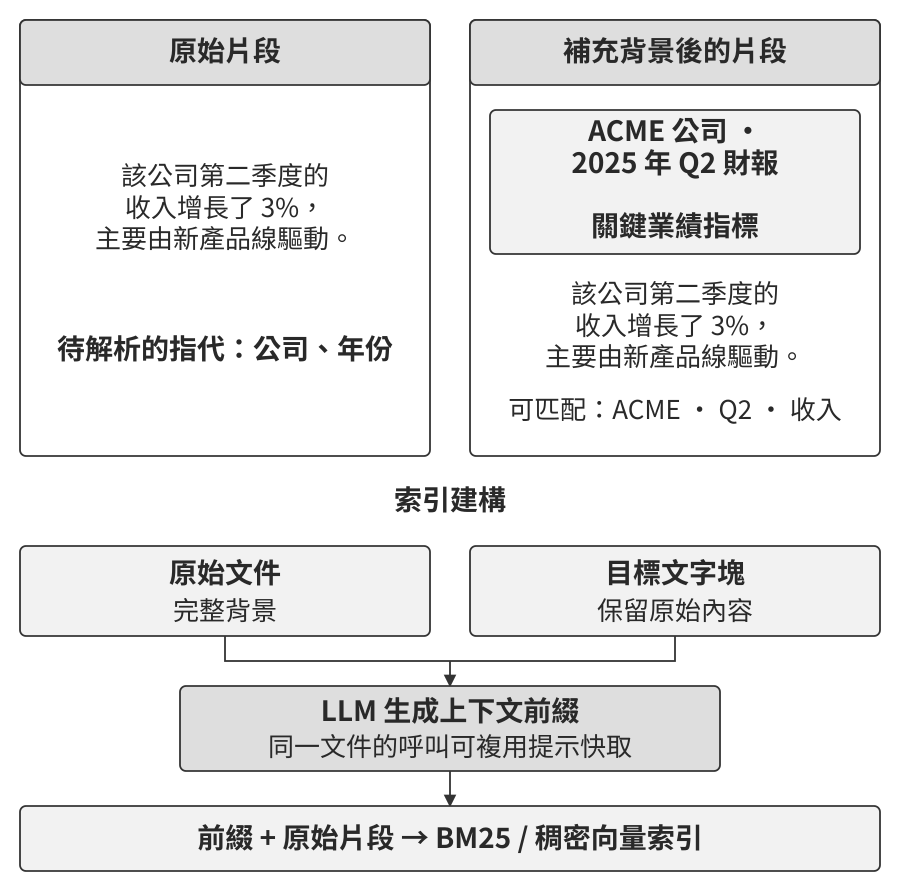

例如，前綴可以說明「本段來自 ACME 公司 2025 年第二季度報告的關鍵業績指標部分」。生成時同時提供原文和目標塊，讓模型補充確有依據的指代、時間和章節資訊。BM25 因此獲得公司名、季度等可匹配詞項，稠密嵌入也能結合這些背景表示片段。

它與第二章的上下文感知壓縮可以配合使用：索引期為知識塊補充背景，提高發現相關資訊的機會；執行期根據目前任務整理已經取回的歷史，控制輸入長度。前者關注片段的可檢索性，後者關注目前決策所需的資訊與預算。

[^ch3-1]: Anthropic，Introducing Contextual Retrieval，2024 年 9 月。

> **實驗 3-10 ★★：比較原始分塊與上下文增強分塊**
>
> 本實驗為同一批資料建立兩套索引：一套使用原始片段，另一套加入模型生成的前綴。保持查詢和目標標註一致，分別比較 BM25、稠密檢索與混合檢索。
>
> 沿用前面的財報例子，查詢「ACME 公司最近的收入增長情況」時，可以檢查命中片段是否同時包含目標公司、期間和增長資料。僅有「收入增長」可能匹配到其他公司；補充前綴後，公司名和時間能夠參與排序。
>
> 在本次 15 個查詢中，加入前綴後，BM25 的 recall@1 從 0.60 提高到 0.80，稠密檢索從約 0.867 提高到 0.933；兩者的 recall@3 分別保持 0.867 和 1.0。混合檢索的 recall@5 從 14/15 提高到 15/15。多找回的是哪一題？查詢全國人大常委會的職權時，目標片段列出了職權，卻缺少主語。加上前綴後，BM25 把它從第 16 名提到第 12 名，仍在前五條之外；混合檢索把它從第 6 名提到第 5 名，它才進入前五條。再看原文，第一個片段列出了第（一）至（四）項職權，第五個片段從第（四）項接到第（二十二）項。評分只查標註的第五個片段有沒有入選，要列全職權卻得把兩段接起來。
>
> 前綴生成增加了索引期呼叫。為同一文件的多個塊生成背景時，可以複用文件前綴快取。Anthropic 在 2024 年報告中，按 800 token 的塊、8000 token 的文件及指定提示長度估算，每百萬文件 token 的一次性處理成本約為 1.02 美元。
>
> 該報告中，上下文嵌入結合 BM25 將 top-20 檢索失敗率從 5.7% 降至 2.9%，相對下降約 49%；加入重排序後降至 1.9%，相對下降約 67%。報告採用的失敗率為 $1-\mathrm{recall@20}$。

對於需要反覆查詢、內容相對穩定的資料庫，筆者建議優先在建索引時補齊片段背景，一次處理可以服務後續多次查詢。公司名稱、事件主體和時間若在切分時丟失，單純增大檢索數量，仍可能取回一批指代不明的片段。生成前綴時補足這些線索，後續檢索就能利用它們定位材料。

> **實驗 3-11 ★★★：用上下文前綴與結構化卡片增強記憶**
>
> 對話中的「好的，就訂這個吧」需要關聯前面的商品或行程。若原文討論的是上海到西雅圖、500 美元的單程機票，前綴可以補充這些背景，並保留確認發生的會話與時間。
>
> 本實驗在普通分塊上增加兩組配置：上下文前綴組，以及同時載入 Advanced JSON Cards 的雙層記憶組。模型先基於普通索引生成搜尋序列，再將同一組查詢用於兩套索引；雙層組使用相同增強檢索結果，並增加結構化卡片。
>
> 在轉帳案例中，前綴分別說明 Patricia 發起轉帳、James 修改安排，以及 Patricia 再次調整，幫助定位事件次序。原始記錄給出的最終狀態是 95,000 美元、10 月 1 日，之前的安排已被替代。本次三組都正確找到了這一狀態。
>
> 雙層結構還可以支援主動關聯。卡片儲存「東京行程」和「護照有效期」等關鍵事實，詳細對話按需檢索。以 1 月 15 日至 22 日的行程、2 月 18 日到期的護照為例，系統可以先發現日期接近，再查詢續辦記錄與行程要求，最後提醒使用者確認尚未完成的準備事項。這個旅行用例中，三組回答均通過評審；卡片與檢索的差異主要體現在下面的車輛和跨會話用例中。
>
> 全部 60 個用例中，普通檢索、上下文前綴和雙層記憶分別通過 47、52、57 個。前綴組的主動服務用例從 13 個增加到 18 個；雙層組在多會話檢索層通過全部 20 個，主動服務層同樣通過 18 個。車輛用例中，卡片補充了第二輛車的資訊，幫助回答覆蓋原先遺漏的對象。再看其中一項退步：使用者問房產水損的保障範圍，普通組提到了自住房和出租房，前綴組卻漏了出租房。逐題對照可見，前綴組比普通組多答對了 8 題，也丟了原先答對的 3 題。

**需要主動服務時，筆者優先採用關鍵事實常駐、詳細記錄按需檢索的雙層架構。** 單靠檢索，模型往往需要先知道該問什麼，才能找出有關記錄；尚未進入視野的護照、車輛或家庭關係，很容易因此被漏掉。把少量關鍵事實先放進上下文，有助於模型發現關聯、提出查詢，再取回原始細節。選擇常駐資訊時，需要考慮人物關係、目前約束和未完成事項；檢索結果則保留來源、時間和變更依據。

### 從資料集中提取知識：由案例到結構化表示

知識還可以來自對大量案例的整理。判決文書、客服工單和維修記錄中，許多有用資訊分散在具體敘述裡。當任務需要從大量案例中歸納規律、比較結果或決定追問什麼時，筆者建議先提取統一欄位，再做統計與原型整理。只取回幾個相似案例，難以看清整個資料集中的分布；統一欄位後，就可以對整批記錄作統計，並為後續個案查詢提供概覽。

這個過程可以分為兩步。**知識提取**將原始描述轉換為結構化記錄，明確欄位含義、取值和來源；**模式分析**再利用統計與聚類，尋找相似案例及其共同特徵。圖3-15 展示了從案例提取、特徵編碼到原型檢索的流程。

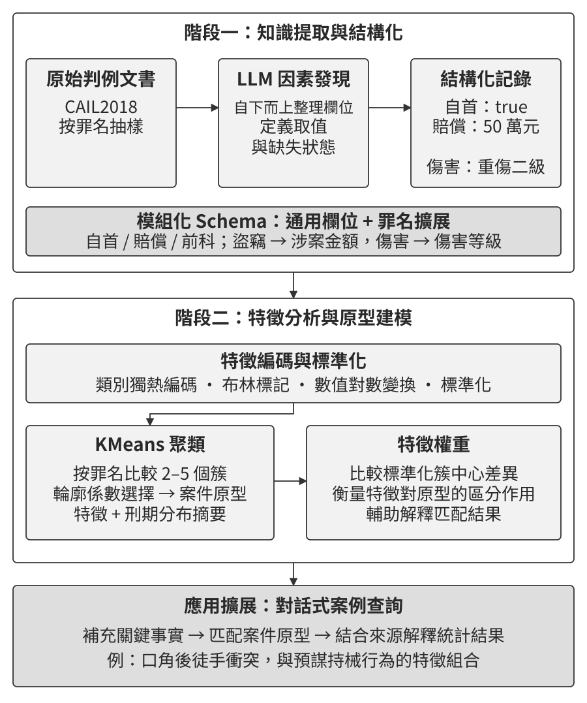

> **實驗 3-12 ★★★：從司法案例中提取因素與原型**
>
> 本實驗使用 CAIL2018 的刑事案件材料，選擇盜竊、故意傷害和詐騙三類樣本，建構「因素發現—欄位提取—聚類—原型解釋」的教學流程[^ch3-cail]。每類取 120 條用於建模，另外保留 20 條，共形成 360 條建模樣本和 60 條留出樣本。
>
> **發現並整理欄位。** 模型先分批閱讀建模樣本，提出可能有用的因素，再合併成模組化 Schema。通用部分儲存多個罪名都需要關注的欄位，如自首、賠償；擴展部分儲存與具體罪名相關的資訊，如涉案金額或傷害情況。本次整理得到 16 個通用欄位，以及分別含 12、12、11 個欄位的三組擴展。每個欄位還需要定義取值和缺失狀態，便於一致提取。
>
> **把欄位編碼為向量。** 類別欄位可以使用獨熱編碼：以盜竊、搶劫、詐騙三類作示意，分別編碼為 `[1,0,0]`、`[0,1,0]`、`[0,0,1]`，每個位置只表示是否屬於該類。使用 1、2、3 則會給某些演算法引入類別之間的順序和距離。「是否自首」「是否賠償」等欄位可用 1 和 0 表示已確認的兩種狀態；原文未提及的情況應單獨處理，避免把缺失自動當成否定。
>
> 對金額等跨度較大的非負數值，本實作先使用 $\ln(1+x)$ 壓縮尺度，再參與標準化。若一個欄位允許同時出現多個類別，例如一條記錄包含多種處置措施，可以為每類分別設定指示位，形成多熱編碼。
>
> **建立案件原型。** 對編碼後的特徵做標準化，再按罪名分別聚類。本實作比較二至五個簇，用輪廓係數選擇分組，最終形成 11 個原型。每個原型儲存樣本數、主要特徵，以及樣本刑期的中位數、四分位數和範圍。例如，可以圍繞衝突起因、作案方式和傷害後果，比較口角後徒手衝突與預謀持械行為這類不同特徵組合；具體分組由提取結果與聚類共同決定。
>
> **解釋特徵與匹配結果。** 程式根據各簇標準化中心的差異，計算特徵在區分原型時的權重。原型匹配則將新案例對應到相同特徵空間，取回相近組的統計摘要和依據，供模型組織解釋。
>
> 本次從 60 條留出樣本中選了 12 條生成解釋，再交給獨立模型評審。先看其中一條盜竊樣本：它匹配到的原型只有一條建模記錄，刑期為 4 個月，所以最小值、中位數、最大值都是 4。生成器如實報告了這個數，也指出只有一條記錄可供參考。評審給「數字是否忠實於原型」打了 4 分（滿分），留出樣本的實際標籤卻是 8 個月。
>
> 如果把原型檢索用於對話，可以先詢問哪些缺失事實可能影響匹配，再根據回答重新檢索。

[^ch3-cail]: CAIL2018，官方資料集專案。配套實驗從公開材料中抽樣，使用樣本內部劃分開展建模與評估。

從案例到原型，知識庫增加了一層可檢索的統計表示。原文提供證據，欄位支援計算，原型概括相似樣本的共同特徵；三者保留對應關係，才能在發現提取錯誤或樣本偏差時回查和修正。

### 前沿探索：多模態與參數化記憶

設想使用者指著先前上傳的照片說「就要這個顏色」。如果系統當時只留了「藍色外套」四個字，下次可能無法區分兩種藍。聲音中的音色、圖表中的空間關係也會在轉寫時損失細節。要讓未來查詢有機會找回這些資訊，可以儲存原始材料、儲存可供模型使用的表示，或者進一步研究模型內部的持久記憶。

**第一條路線：原始材料與文字索引配合。** 例如，在使用者授權的相簿整理任務中，可以裁剪並儲存人物面部等局部區域，在 Markdown 條目中引用圖片，同時記錄拍攝時間、場景和使用者提供的人物標籤。檢索時先根據描述找出幾張可能相關的照片，再讀取原圖或裁剪區域，比較外觀細節。聲音片段也可以關聯時間、來源和轉寫，按需重播原始音訊。文字提供入口，原始材料保留難以用文字概括的細節。

**第二條路線：儲存嵌入並按需載入。** 視覺或音訊編碼器可以把材料轉換為向量，存入索引，供相似性檢索使用。例如，將圖片局部區域或聲音片段編碼後，分別關聯到對應的記憶條目。若模型支援經過訓練的投影層和記憶介面，還可以在上下文中預留一組槽位，裝入這些連續向量，讓模型透過注意力存取。這裡需要解決編碼器表示與語言模型內部表示的對齊。

筆者與 Noah Shi 的一項初步研究把這個問題拆成兩步。合照裡有兩個人，使用者問「站在窗邊的是上次見過的那位嗎？」先要根據「窗邊」找到使用者指的那個人，再把這個人的影像與先前儲存的樣本比較。第一步選錯了人，即使第二步認得很準，答的也是另一個問題。論文還把姓名等可準確抄錄的事實留在文字記憶裡，使兩類資訊各有合適的取用方式。[^ch3-perceptmem]

[^ch3-perceptmem]: 李博杰、Noah Shi，Parametric Multimodal User Memory；配套專案 `19PINE-AI/multimodal-user-memory` 收錄了實作和 PerceptMem 實驗。合照問題為教學示例。

**第三條路線：模型內部的持久記憶。** 為每位使用者訓練 LoRA，是把個性化事實寫入模型的一種方式。直接提問「使用者住在哪裡」與根據住址規劃行程，對記憶的使用要求不同：前者讀取事實，後者還要將事實用於後續推理。只圍繞事實複述訓練，模型可能記得答案，卻在複雜任務中沒有主動用到它。因此，訓練樣本需要同時包含直接提問和依賴這些事實的任務。

筆者的 **User as Engram** 研究將文字事實寫入 Engram 模型的局部記憶表，由共享適配器學習如何利用這些事實進行推理[^engram]。帶雜湊鍵的 N-gram 查詢負責定位表項，門控機制將取回內容送入模型；每位使用者儲存局部表項，推理部分可以共享。論文在其文字事實實驗中比較了直接回憶和間接推理，展示了如何分別管理每位使用者的記憶內容與共享的推理能力。

[^engram]: Li, Bojie，User as Engram: Internalizing Per-User Memory as Local Parametric Edits，2026。

把這條路線擴展到多模態，還需要設計影像或音訊表示的定址、寫入和讀取機制。

## 本章小結

回到章首的訂票委託。「我偏愛靠窗」來自這位使用者，「可以帶幾件行李」要查航空公司在出行日期適用的條款。把兩條資訊都存成一句話，很容易丟掉最重要的區別：前一句適用於誰，後一句從何時起生效。儲存時留下來源、時間和適用條件，取出後才有依據判斷這次能不能用。單個事實適合寫成簡短筆記；需要說明人物關係或保留來龍去脈時，可以用卡片或原文段落；日期和數量還可以存成有型別的欄位，交給程式計算。

如果助手報錯了行李額度，先查現行條款有沒有入庫，再查條款被切進哪個片段、檢索器有沒有找到它、重排後它排在第幾位，最後看模型拿到哪些材料。原文很多時，可以把結構化概覽留在上下文裡，按需檢索細節。章節摘要有助於找主題，關係索引有助於查關聯；若片段丟了指代，可以補上出處背景；一次檢索仍缺證據時，Agent 還可以換個查詢繼續查。

航空公司公布新規定後，可以先做一次小範圍更新，保留新舊條款的生效日期和來源；積累的重複條目、衝突和結構變化，再定期整理。提議者提交修改，審核者核對證據，批准後重建服務索引。有了版本記錄，就能重放原來答錯的題，也能查明舊答案當時依據哪份資料。怎樣進一步從執行結果中積累經驗，第九章會專門討論。

查到可託運兩件行李，只回答了「規則允許嗎」。要替使用者把行李加進訂單，助手還得知道可以呼叫哪個工具、需要哪些參數，以及收到什麼回執才算辦成。這是下一章的起點。

## 思考題

1. ★★ 使用者說：「5 月 1 日我從 A 搬到 B，5 月 10 日至 20 日住飯店 C，這期間帳單發郵件。」5 月 15 日，助手應怎樣回答家庭住址、臨時住處和帳單送達方式？請設計記錄與查詢規則，說明如何處理筆誤更正或相互衝突的地址。
2. ★★ 原始文件包含矛盾資訊時，上下文前綴可能把錯誤一起寫入索引。你會怎樣儲存來源、版本和不確定項，並在檢索與生成階段使用這些資訊？
3. ★★ 將圖表轉換為文字後，哪些空間關係容易丟失？請用表格、架構圖或折線圖舉例，設計原圖、結構化表示和文字索引協同檢索的方案。
4. ★★★ 隨著模型和長上下文能力提升，分塊、索引和檢索流程中的哪些工作可能交給模型？請結合 Rich Sutton「苦澀的教訓」中對搜尋和學習的討論分析，並設計實驗比較全量輸入與按需檢索，同時檢查任務品質、計算成本和權限約束。
5. ★★★ 如果模型已經掌握大量領域知識，外部知識庫還應儲存什麼？請分別討論公開常識、持續更新的規則、私有資料和需要精確追溯的證據。
6. ★ RAPTOR 的多層摘要與 GraphRAG 的實體關係、社群摘要分別支援哪些查詢？請為總體概覽、局部細節和多跳關聯各舉一例，並說明需要檢查什麼證據。
7. ★★ 目錄、連結與向量索引如何協同組織知識？請設計一個需要人和 Agent 共同維護的知識庫，說明導航、語義搜尋、版本更新與權限過濾各自的位置。
8. ★★★ 從案例中提取欄位並聚類後，怎樣判斷原型有用？請區分聚類特徵的重要性、結果預測能力與因果解釋，並設計留出評估和專家複核流程。
9. ★★★ 為 Markdown 使用者記憶庫設計增量更新與定期整理流程。若審核者與提議者使用相同模型，且審核者只能看到提議者挑選的片段，哪些錯誤容易遺漏？請從證據覆蓋、工具權限和審核評估三個方面改進。

[^ch3-glove]: Pennington 等，GloVe: Global Vectors for Word Representation，2014。

[^ch3-sbert]: Reimers 與 Gurevych，Sentence-BERT: Sentence Embeddings using Siamese BERT-Networks，2019。
