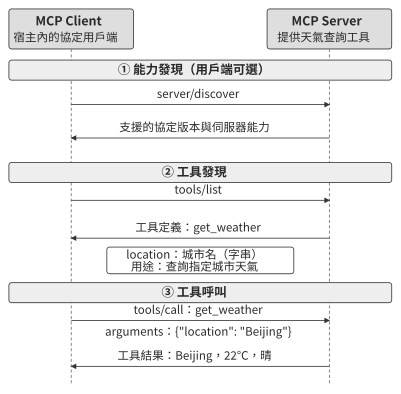
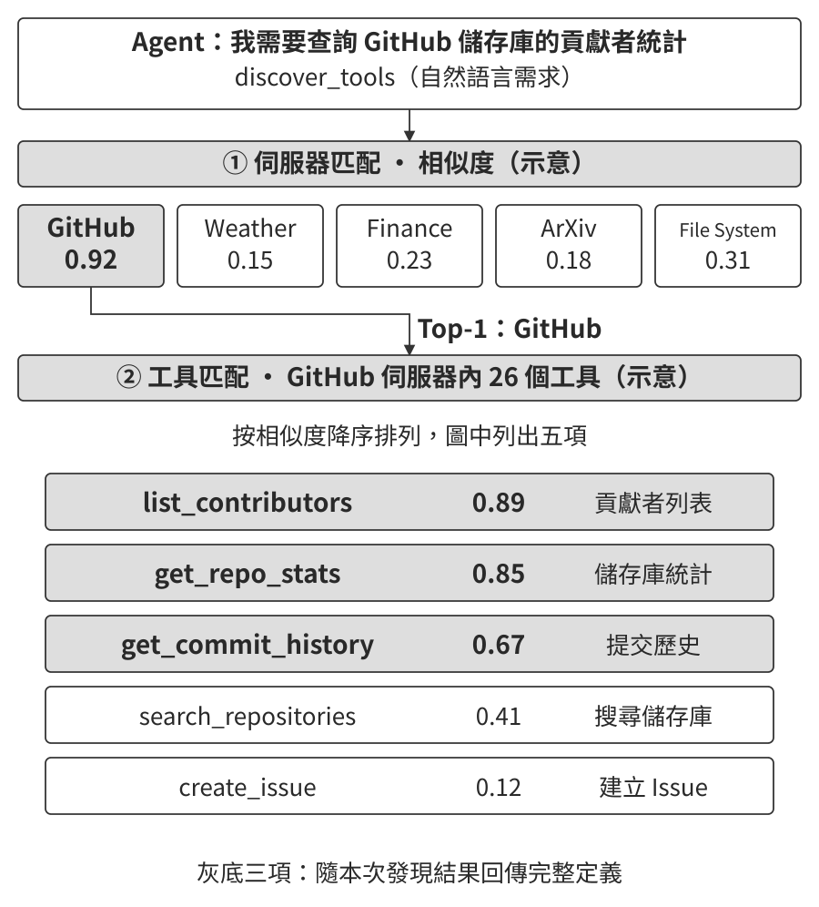
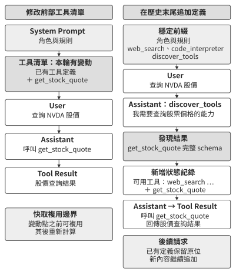
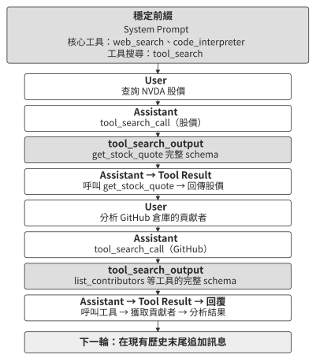

# 工具

在科幻電影《Her》中，AI 助手 Samantha 會整理郵件、協助回覆、處理出版事宜，並在不同溝通管道之間切換。這樣的助手需要把語言理解轉化為對外部系統的操作。Agent 透過**工具**完成這些互動。工具是它的「感官和手腳」，既提供觀測，也執行行動。本書討論的 Manus、OpenClaw 等通用 Agent，同樣需要透過工具存取數位世界。

假設使用者說：「幫我找出客戶郵件中提到的交貨日期，整理成表發給我。」模型可以決定查哪封郵件，讀原文卻要存取信箱，發出表格也要呼叫傳送介面。這些工具該怎樣設計，模型需要時又怎樣找到它們？本章先區分五類工具，再討論工具的描述、接入與發現，最後分別設計感知、執行與協作介面。事件觸發和使用者溝通還涉及何時喚醒 Agent、怎樣跨管道傳遞訊息，留到第六章展開。

## 工具的分類

以查郵件為例，模型選擇下一步要做什麼，Harness 檢查參數和權限並發出請求，信箱服務實際讀寫資料。第一章按用途區分了感知、執行、協作、使用者溝通和事件觸發工具。前四類都由 Agent 主動呼叫，事件觸發工具則讓外部事件也能喚醒 Agent（表4-1）。

表4-1 五類工具的呼叫方向與主要用途

| 工具類型 | 呼叫方向 | 主要用途 |
| --- | --- | --- |
| 感知工具 | Agent 主動呼叫 | 獲取外部資訊 |
| 執行工具 | Agent 主動呼叫 | 執行計算或修改外部狀態 |
| 協作工具 | Agent 主動呼叫 | 委派任務、交換訊息、協調其他 Agent 或人類 |
| 使用者溝通工具 | Agent 主動呼叫 | 向使用者回覆、展示結果或傳送提醒 |
| 事件觸發工具 | 開發者配置或 Agent 註冊、外部觸發 | 在指定事件發生時喚醒 Agent |

**感知工具**讓 Agent 獲取外部資訊，例如網路搜尋 `web_search`、知識庫檢索 `knowledge_base_search`、網頁讀取 `fetch_url`、檔名搜尋 `find_file`、檔案內容搜尋 `grep_file` 和檔案讀取 `read_file`。

**執行工具**讓 Agent 執行計算或改變外部狀態，例如命令列 `shell_exec`、程式碼直譯器 `code_interpreter`、檔案寫入 `write_file`、檔案編輯 `edit_file` 和郵件傳送 `send_email`。同一個通用執行器可以完成唯讀計算，也可以修改資料。

**協作工具**支援任務委派和訊息交換，例如建立子 Agent `spawn_subagent`、傳送訊息 `send_message_to_subagent`、取消子 Agent `cancel_subagent` 和發現可用 Agent `list_agents`。獨立任務可以並行處理，例如分別調查 OpenAI 多位共同創辦人的經歷；不同任務也可以交給配置了不同模型、工具、提示詞和上下文的 Agent。第十章將進一步討論分工與協作架構。

**使用者溝通工具**向使用者傳遞資訊，例如回覆訊息 `reply_to_user`、傳送結構化卡片 `send_card_to_user` 和傳送提醒 `send_user_notification`。當互動擴展到多個管道或需要背景通知時，系統可以把訊息傳送封裝為顯式工具呼叫，統一管理接收對象、內容和送達狀態。

**事件觸發工具**連接外部事件與 Agent 的執行，例如定時器 `set_timer`、背景任務監控 `monitor_shell` 和事件源接入 `connect_channel`。整個過程包含兩個步驟：註冊時，由開發者預先配置，或由 Agent 透過獲准的呼叫宣告關注的事件；事件發生後，排程系統接收回呼或事件訊息，喚醒 Agent 處理。新郵件、系統告警、定時提醒和背景任務完成，都可以成為新的執行入口。

回看開頭的郵件任務：點開原信取得交貨日期，是感知；生成並儲存彙總表，會改變工作區，是執行；把表交給委託人，屬於使用者溝通。如果系統在下一封客戶郵件到達時自動繼續，才引入了事件觸發。同一個郵件服務可以承擔這幾種職責。接下來要決定的是，交給模型的工具該有多細：是讓它分別查郵件、讀正文、找附件，還是替它把經常連做的幾步合起來？

## 工具設計的通用原則

早期接入工具時，常見做法是直接包裝每個 API 端點。這種做法接入快，卻容易得到一組粒度很細的介面。Agent 為完成一個任務，可能要反覆查詢物件、讀取屬性、檢查條件，再呼叫執行介面。設計工具時，可以圍繞常見任務整合這些操作，例如把查詢聯絡人與傳送訊息銜接起來，或讓日誌搜尋直接回傳相關行及其上下文[^ch4-tool-design]。

**工具應圍繞 Agent 要完成的任務來設計。** 這種從 Agent 使用方式出發設計介面的思路稱為 **ACI**（Agent-Computer Interface，Agent—電腦介面）。HCI 關注人如何與電腦互動，ACI 則關注模型如何選擇操作、構造參數、理解回饋並糾正錯誤。

[^ch4-tool-design]: Anthropic，*Writing effective tools for AI agents—using AI agents*，2025。

### 能力的表達形式：專用工具、通用執行器與 Skill

把「部署應用」交給模型，可以設計三種操作介面。第一種只暴露一個 `deploy_app`，由伺服器端完成各步驟；第二種分別暴露建構、打包和部署，模型決定何時呼叫下一步；第三種把步驟寫進 Skill，讓模型在終端執行。如果建構失敗，第一種要靠工具結果告訴模型錯在哪一步，後兩種可以直接把這次建構的錯誤交給模型。

- **專用工具**為確定的操作提供結構化介面。開發者定義參數 Schema、校驗規則、執行邏輯與回傳格式，便於單獨測試和授權；工具定義進入上下文後，佔用量取決於欄位、描述和示例的長度。
- **通用執行器與 Skill**配合使用：終端或程式碼直譯器提供執行能力，Skill 說明流程、適用條件與操作方法。宿主可以先載入名稱和簡介，選中後再讀取完整說明及相關資源。

例如，一份部署 Skill 可以依次說明：用 `npm run build` 建構專案，用 `docker build -t app:latest .` 打包映像，再用 `kubectl apply -f deploy.yaml` 將清單中定義的資源應用到目前叢集。Agent 透過終端工具執行這些步驟，複用同一個執行入口。

工具怎樣實作，和模型何時讀到它的說明，是兩個問題。數百個專用工具可以只顯示索引，按需載入 Schema；少量 Skill 可以把目錄常駐上下文，規模增大後再加入檢索。選專用介面還是通用執行器，影響的是參數怎麼傳、程式碼怎麼維護；選一次給全還是按需載入，影響的是模型這一步能看到哪些工具。後文「工具太多怎麼辦」將討論披露策略。

**筆者建議優先採用通用工具，再按權限、參數和效能需求補充專用介面。** 例如，在沙盒中為 `code_interpreter` 配置 SymPy、NumPy 和 pandas，Agent 就能編寫 Python 完成四則運算、符號計算、陣列處理和資料分析。這能讓模型充分發揮程式碼生成能力：一個直譯器可以承載多種演算法，也能組合已有庫處理預先沒有想到的新問題。模型負責生成程式碼，執行環境負責執行，並限制檔案、網路和資源存取。

即使採用專用工具，筆者也建議優先整合功能相近、經常一起使用的操作。介面過細，模型就要記住更多名稱和分工，完成同一任務也需要更多次呼叫。整合時主要看**功能相似性** 與 **使用場景的重疊度**。例如，`extract_pdf_text`、`extract_docx_content`、`extract_pptx_content` 都接收文件並提取文字，可以整合為 `read_document`，透過 `file_type` 區分格式。模型只需選擇統一入口，新增格式也可沿用參數與回傳結構。

以下四種情況尤其適合專用介面。

1. **需要精細授權和稽核。** 生產資料庫寫入可以封裝為範圍明確的操作，由伺服器端檢查使用者權限、目標表和允許變更的欄位，並記錄操作依據。
2. **需要遮蔽平台差異。** grep、find 等操作可以經由 shell 完成，專用檔案搜尋工具則能統一 macOS、Windows 和 Linux 的參數與回饋，例如固定回傳檔名、行號和匹配片段。
3. **操作頻率很高。** 高頻操作可以提供短而穩定的入口，減少重複生成腳本與解釋流程的開銷。
4. **參數關係複雜。** 巢狀物件、欄位依賴和複雜取值約束適合透過 Schema 與業務校驗共同表達。

**參數越複雜，傳遞方式越重要。** 結構化工具呼叫通常用 JSON Schema 描述輸入，部分模型服務支援約束生成，使參數滿足所支援的 Schema 規則。回傳值的結構由工具介面約定，宿主再將結果交給模型。型別和格式校驗之外，權限、物件是否存在、多個欄位是否滿足業務條件，仍由 Harness 與工具服務檢查。

Skill 可以說明如何呼叫專用工具，也可以指導 Agent 使用 CLI。後一種方式要求模型同時處理命令列語法、引號和跳脫，不同 shell 的規則也有差別。參數越複雜，模型需要正確處理的細節就越多。遇到複雜巢狀參數，可以先將它們寫成 JSON，再讓命令讀取該檔案，減少多層跳脫，並在執行前校驗內容。

**Skill 便於業務人員直接編寫和修改。** 熟悉業務的人可以自己寫步驟，也可以從 Agent 起草的說明改起。流程順序變了、某一步只適用於部分客戶，或是需要換個例子，直接改說明文字即可，省去了改工具程式碼和重新部署介面的工作。按照 Agent Skills 規範，`SKILL.md` 的後設資料採用規定格式，正文採用 Markdown，還可以附帶腳本、參考文件和資源[^ch4-skill-format]。

[^ch4-skill-format]: Agent Skills，格式規範，包括後設資料、正文、附帶資源與漸進式載入。

選擇能力形式時，可以綜合四個維度。

- **安全與權限**：專用介面便於限定操作範圍；通用執行器透過沙盒、憑證和資源權限控制執行能力。
- **參數複雜度**：複雜結構適合 Schema 與業務校驗；簡單操作可以直接透過 CLI 傳參。
- **變更頻率**：經常調整的流程優先寫入 Skill，業務人員可以直接修改說明和示例；穩定且重複使用的底層操作再封裝為工具或腳本。
- **模型能力**：能可靠生成程式碼和處理命令列的模型，優先讓它透過 Skill 與通用執行器組合能力，減少專用工具數量；模型較弱、複雜參數頻繁出錯時，則用結構化介面承擔更多約束。

**程式碼還可以編排多次工具呼叫。** 抓取多個網頁並提取欄位時，模型可以生成一段腳本，完成迴圈、過濾和彙總。網頁全文保留在執行環境的變數中，只有選中的欄位與統計結果回傳上下文。程式中的條件、迴圈和例外處理負責銜接各步操作，模型直接分析彙總結果。對於批次抓取、過濾和統計這類步驟已經清楚的任務，筆者優先用程式碼串聯，減少模型逐次呼叫工具、讀取中間結果的往返。中間結果越多、回傳欄位越精簡，這種安排節省的上下文就越可觀。第五章將進一步討論這類程式碼編排。

這類介面常稱為 **Code Mode**。以 Cloudflare 的 MCP 伺服器為例，模型先用 `search()` 寫一段查詢程式，從 OpenAPI 描述裡找出所需端點和參數；接著用 `execute()` 提交呼叫這些端點的 JavaScript。比如要列出符合條件的 DNS 記錄，程式可以逐頁查詢、過濾，只回傳命中的記錄。前一步省去了把整本介面手冊放進上下文的開銷，後一步省去了把每頁結果送回模型的往返。執行身份能讀哪些區域、能否修改記錄，仍由伺服器端授權決定。[^ch4-code-mode]

[^ch4-code-mode]: Cloudflare，Code Mode 的 MCP 實作；Armin Ronacher 以 Pi 1.0 為例討論了 Harness 提供的工具與執行環境的分工。

### 工具描述：說明用途、參數與回饋

給工具寫說明時，可以先想像一條最容易誤用它的請求。使用者說「找出合約裡提到違約金的條款」，檔名搜尋只會回傳名字匹配的檔案；即使得到了一個路徑，模型仍需讀取正文。工具描述要讓模型據此判斷應當選哪一個介面、呼叫時要提供什麼，以及這份結果足以回答什麼問題。

**說明使用時機。** 網路搜尋的描述可以寫成「需要獲取即時資訊或查詢未知事實時使用」，讓模型把使用者需求與工具用途對應起來。只有「搜尋相關內容」時，模型還要自行猜測搜尋範圍和適用條件。

**明確輸入與搜尋範圍。** 例如，檔名搜尋工具可以說明「按檔名和路徑匹配；查詢檔案中的文字請使用 `grep_file`」。把相鄰工具的分工寫清楚，可以幫助模型在一次呼叫中選對入口。**在筆者看來，明確邊界條件往往比羅列功能更重要。** 工具接受什麼輸入、搜尋哪些範圍、遇到空結果或錯誤時怎樣處理，都直接影響模型的下一步決策。

**用規範加實例說明參數。** `timestamp` 可以寫成「RFC3339 格式，例如 `2024-03-15T14:30:00Z`」。模型處理複雜任務時，需要同時選擇工具、從歷史軌跡中提取資訊，並權衡後續步驟，參數格式只是其中一個細節。完整字串提供了可直接參照的格式，模型可以照著構造參數，減少重新解釋術語時出錯的機會。

同樣，`phone` 可以寫成：「電話號碼，採用 E.164 國際號碼表示，以 `+` 開頭，後接國碼和號碼，其餘部分僅含數字，無空格或分隔符。例如 `+8613888888888`（中國）或 `+12025551234`（美國）。」

**說明回傳結構與執行代價。** 例如，「回傳 JSON 陣列，每項包含 `title`、`url`、`snippet` 三個欄位」，便於模型提取標題、來源與摘要。耗時較長的工具可以註明測量環境下的預計延遲和替代入口，例如「讀取完整網頁可能需要 5～10 秒；只需後設資料時可呼叫 `get_page_metadata`」。

還可以附上 1～5 個經過驗證的呼叫示例，覆蓋最小參數、常見組合和複雜條件。JSON Schema 能表達型別、必填項、取值範圍和部分欄位依賴[^ch4-json-schema]；示例則展示這些規則如何用於具體任務，例如時間戳採用秒還是毫秒、過濾條件如何巢狀、哪些可選欄位通常一起出現。Anthropic 在 2025 年報告的內部複雜參數測試中，加入工具呼叫示例後，準確率從 72% 提高到 90%[^ch4-tool-examples]。

[^ch4-json-schema]: JSON Schema，物件型別與屬性約束。模型介面支援的 Schema 關鍵字範圍由相應服務規定。

[^ch4-tool-examples]: Anthropic，*Introducing advanced tool use on the Claude Developer Platform*，2025 年 11 月 24 日，Tool Use Examples 部分。

Agent 頻繁選錯工具時，筆者建議**優先檢查工具描述**：幾個工具是否使用近似名稱，搜尋範圍是否清楚，參數是否缺少例子。這套方法同樣適用於 Skill 的名稱、簡介和操作說明。

### 參數傳遞的保真性

模型要求替換一段原文，執行端卻報告「找不到」。在讓模型重新措辭之前，先問兩端收到的是不是同一串字元。呼叫經過解析、序列化、代理和執行階段封裝，每層都可能改變內容。**參數保真**要求執行端看到的值與模型提交的值具有相同含義；協定跳脫可以改變傳輸形式，解碼後的引號與換行仍應保留。

以 2026 年初 Cursor 某個版本中的彎引號轉換問題為例。替換工具接收 `old_string` 和 `new_string`，透過精確匹配修改檔案。讀取工具回傳中文彎引號 `“`、`”`，對應 `\u201c`、`\u201d`；模型將原文放入 `old_string`，參數傳遞過程中卻被轉換為英文直引號 `"`。檔案中的原文保持不變，替換工具因而回傳「未找到匹配」。再次讀取、再次複製原文，仍會遇到同樣的失敗。

寫入方向也會受到影響。模型要求寫入彎引號，檔案最終儲存的卻是直引號。隨後讀取檔案時，模型看到的內容與預期寫入內容不同，又可能嘗試修正；只要轉換仍在發生，重試就會重複同一個錯誤。

另一類問題是**靜默參數注入**。某 IDE 的 bash 工具會自動為 `git commit` 附加 AI 提交標記參數。舊版 Git 不識別該參數，提交因此報錯。模型只看到自己生成的命令，可能反覆調整提交資訊或其他參數，卻始終沒有改到真正的故障來源。

排查這類問題時，把模型生成的參數、傳遞後的參數、實際執行的請求和回傳結果放在一起對照。介面若會統一編碼或補充執行參數，就要寫清轉換規則，並回傳實際採用的值。對精確匹配工具來說，多一個空格、少一個換行或變了一個引號，都可能導致匹配失敗。模型得知道執行端究竟收到了什麼，才能改對下一次呼叫。

## 工具生態：MCP 與 Skill Hub

不同模型介面和 Agent 框架使用各自的工具定義方式，例如 function calling、tool use 與 LangChain 的 Tool 抽象。同一個外部服務若要逐一適配這些介面和框架，就需要重複處理描述、參數和結果格式。Anthropic 於 2024 年 11 月發布的 **Model Context Protocol（MCP）**，為模型應用存取工具和資料提供了統一協定[^ch4-mcp-origin]。

理解 MCP，可以先看宿主、用戶端和伺服器三個角色。**宿主（host）**是 Agent 應用或 IDE，負責模型互動、上下文組織與權限管理；宿主中的 **MCP 用戶端**負責協定訊息；**MCP 伺服器**提供工具、資源和提示範本，可以作為本地處理程序執行，也可以部署為遠端服務[^ch4-mcp-architecture]。

**工具定義與呼叫。** 用戶端透過 `tools/list` 獲取可用工具，清單可以分頁回傳。每項工具包含名稱、描述和 `inputSchema`；結構化結果還可用 `outputSchema` 約定格式。模型選擇工具並生成參數後，宿主完成校驗，由用戶端傳送 `tools/call`，伺服器執行後回傳結果。宿主決定將哪些定義和結果放入模型上下文[^ch4-mcp-tools]。

圖4-1 中，用戶端拿到天氣工具的名稱和參數後，還要發起一次呼叫才能查到北京的天氣。配套實作採用 MCP 2026-07-28，每次請求攜帶協定版本、用戶端資訊與能力，用戶端也可以先呼叫 `server/discover` 瞭解伺服器支援的版本及能力。早期版本採用 `initialize` 握手建立會話，連線時需要按雙方支援的版本選擇互動方式[^ch4-mcp-versioning]。

同樣是查不到天氣，圖4-1 中有兩個不同的排查起點。宿主連上了伺服器，呼叫 `tools/list` 卻找不到天氣工具，應核對伺服器發布了哪些工具、用戶端是否讀完了分頁清單。如果模型選對了工具，伺服器卻報缺少城市名，就從呼叫記錄裡找 `arguments`，核對欄位名是不是工具定義要求的 `location`。

**傳輸方式。** stdio 透過本地子處理程序的標準輸入和標準輸出傳遞 JSON-RPC 訊息。Streamable HTTP 則透過 HTTP 傳送請求，回應可以是 JSON，也可以使用 SSE 串流逐步回傳。Streamable HTTP 替代了早期的 HTTP+SSE 傳輸方案，並繼續使用 SSE 作為串流回應方式[^ch4-mcp-transports]。

**資源與提示範本。** 資源（resources）提供可讀取的資料，例如檔案內容和資料庫記錄；宿主可以按 URI 列舉、讀取並選擇相關內容。提示範本（prompts）提供可複用的訊息或任務範本，供使用者和用戶端選用。工具也可以承擔搜尋和讀取，因此這三類原語按互動介面分工：工具提供呼叫入口，資源提供資料入口，提示範本提供任務入口[^ch4-mcp-primitives]。

MCP 的核心價值是讓一份工具實作服務於多個 Agent 產品。統一協定使同一個伺服器能夠被相容宿主複用，例如 Cursor、Claude Desktop 和 OpenClaw，開發者也能把更多精力放在能力本身及其回饋品質上。宿主把協定中的工具定義轉換為模型可用的介面。

**Skill Hub 提供能力包的發現與分發。** 一份 Skill 通常包含 `SKILL.md`，還可附帶腳本和參考資料。分發平台幫助使用者搜尋、安裝和更新這些檔案。Vercel 於 2026 年 1 月推出 skills.sh，提供技能目錄及安裝工具；OpenClaw 生態的 ClawHub 也提供技能查詢與版本管理[^ch4-skills-sh][^ch4-clawhub]。安裝後，宿主按其載入策略讀取名稱、簡介與完整說明。MCP 也可透過擴展提供 Skills 的發現與讀取，能力包與通訊協定可以配合使用[^ch4-skills-over-mcp]。

**接入與上下文載入分別管理。** MCP 用戶端取得工具清單後，可以全量提供給模型，也可以先保留索引、按需載入定義。Skill 同樣可以先顯示 `name` 和 `description`，選中後再讀取正文。工具允許列表決定哪些能力可用，延遲載入決定哪些定義目前可見。

**接入第三方能力時，分別檢查它提供的內容和實際執行的操作。** 描述、回傳內容和附帶程式碼來自不同主體，授權範圍也可能不同。以 MCP 為例，可以分別檢查三類問題。

1. **工具描述投毒。** 描述中可能夾帶與工具用途無關的操作要求，誘導模型越出目前任務。這屬於提示注入：外部提供的內容試圖改變模型的行為。
2. **伺服器及依賴被修改。** 伺服器升級可能改變工具行為，依賴更新或遠端服務被入侵也可能汙染回傳結果。
3. **同名工具混淆。** 不同伺服器可能提供同名或相似工具，模型或路由層由此選錯目標。宿主應保留伺服器身份與工具名稱的綁定，展示來源，並在排程時校驗目標。

接入前審查描述與實作，固定可控部署的版本，並對升級重新核查；每個伺服器使用與任務相符的最小權限憑證。遠端服務由他方維護時，還要監測工具定義與行為變化。

執行階段還可以使用後文的 Sidecar，對結構化呼叫及必要任務依據獨立審核。呼叫參數中的路徑、文字和目標地址也應作為待檢查資料處理。審核結果與確定性的權限規則共同決定是否執行。第五章將介紹 Simon Willison 的「致命三要素」，用於分析私有資料、外部輸入與對外通訊組合後的風險。

Skill 附帶的腳本、本地 MCP 伺服器及遠端服務，各有執行位置與權限範圍。審查時檢查程式碼來源、執行環境、檔案和網路權限，以及憑證流向；外部提供的步驟若引導下載或執行其他程式，也應納入這條檢查鏈。平台掃描可提供輔助線索，執行隔離、最小權限和變更審核則直接控制實際執行。

[^ch4-mcp-origin]: Anthropic，*Introducing the Model Context Protocol*，2024 年 11 月 25 日。
[^ch4-mcp-architecture]: MCP 2026-07-28 版規範，架構和協定概覽兩節。
[^ch4-mcp-tools]: MCP，Tools，包括工具清單、輸入輸出 Schema 和呼叫結果。
[^ch4-mcp-versioning]: MCP，*Versioning and Compatibility*，說明逐請求後設資料、能力發現與舊版握手的相容方式。
[^ch4-mcp-transports]: MCP，傳輸概覽及 2025-11-25 傳輸規範，後者說明 Streamable HTTP 對早期 HTTP+SSE 方案的替代關係。
[^ch4-mcp-primitives]: MCP，Resources 與 Prompts 兩節。
[^ch4-skills-sh]: Vercel，*Introducing skills, the open agent skills ecosystem*，2026 年 1 月 20 日。
[^ch4-clawhub]: OpenClaw，ClawHub 使用說明。

## 工具太多怎麼辦：層次化組織與主動工具發現

工具從十幾個增長到成百上千後，模型既要找到合適的能力，也要讀懂相近介面之間的差異。全量定義會佔用上下文；若定義位於提示前綴，增加、移除或重排工具還可能縮短可複用的快取前綴。名稱和用途相近的工具越多，模型就越容易選錯入口或忽略必要能力。因此，大規模工具庫應預設按需載入，同時設計好分類目錄與發現介面，讓模型先找到與目前任務相關的工具，再根據各自的用途選一個。

可以把工具發現想成翻一本按任務編排的手冊。目錄先告訴模型去哪個欄目找；執行中遇到新的需要，它可以回來繼續找；選中某項能力後，再讀參數、操作順序和例子。下面的類別索引、主動搜尋和 Skill 分別解決這三個問題，專用工具和通用執行器都可以透過這些入口提供給模型。

### 層次化組織與按需載入

**先提供索引，用到時再載入定義。** 工具目錄可能佔用大量上下文。Anthropic 舉過一個例子：GitHub、Slack 等五個 MCP 伺服器共提供 58 個工具，完整定義約佔 5.5 萬 token[^ch4-tool-search-eval]。Cursor 採用檔案目錄管理這些描述，初始上下文只提供工具名稱等簡要資訊，Agent 根據任務查閱完整定義。在 Cursor 於 2026 年 1 月公布的 A/B 測試中，對於實際呼叫 MCP 工具的任務，這種方法將 Agent 的總 token 消耗減少了 46.9%；節省幅度隨接入的 MCP 數量而變化[^ch4-cursor-discovery]。

Pi 的早期設計則優先使用附帶 README 的 CLI 工具，讓 Agent 按需閱讀用法，再透過命令列呼叫能力[^ch4-pi-no-mcp]。社群擴展 `pi-mcp-adapter` 將類似思路用於 MCP：預設向模型提供一個約 200 token 的代理工具，模型依次搜尋工具、檢視定義、發起呼叫；伺服器延遲到首次呼叫時啟動。Pi 後續的 0.99 版本也加入了內建 MCP 支援，並採用按需發現機制[^ch4-pi-mcp-adapter]。這些實作把協定接入與上下文載入分開處理：後端連線 MCP 服務，前端透過簡短索引或代理介面幫助模型找到所需能力。

[^ch4-cursor-discovery]: Cursor，*Dynamic context discovery*，2026 年 1 月 6 日。
[^ch4-pi-no-mcp]: Mario Zechner，*What if you don’t need MCP at all?*，2025 年 11 月 2 日，介紹 CLI 與按需閱讀文件的設計思路。
[^ch4-pi-mcp-adapter]: pi-mcp-adapter，專案 README 的代理工具、延遲啟動及與 Pi 內建 MCP 的比較。

**按任務組織工具目錄。** 當工具增多時，可以按獲取資訊的方式分組，讓模型先定位類別，再選擇具體介面：

- **搜尋工具**：根據線索尋找資訊位置，例如網路搜尋、知識庫搜尋和檔案搜尋。
- **讀取工具**：從已知位置獲取內容，例如讀取網頁、文件或指定記錄。
- **解析工具**：從非結構化內容中提取資訊，例如圖片 OCR、影片分析和音訊轉錄。
- **查詢工具**：按欄位與條件存取結構化資料，例如天氣 API、股票 API 和資料庫查詢。

以「查出一篇論文使用了哪些資料」為例，搜尋先回傳候選論文及地址，讀取工具按地址取回原文，解析工具再幫助定位表格。如果第一步把同名論文排在首位，後面即使準確讀出了表格，也會答錯。

**先用檢索縮小工具範圍。** 宿主可以根據任務描述，對工具名稱、簡介和參數說明進行關鍵詞或語義檢索，只把匹配工具的定義交給模型。回傳的工具太少，可能漏掉下一步要用的介面；回傳太多，既佔上下文，也更難選。首次檢索可以根據使用者請求進行，後續則根據任務進展補充。

### 模型原生的主動工具發現

複雜任務的工具需求往往隨著執行逐步顯現。例如，「Debug the file」可能先需要讀取檔案，再需要檢索依賴、執行測試和分析錯誤。只在任務開始時檢索一次，容易遺漏後續所需的能力。

**讓 Agent 在需要時提出請求。** MCP-Zero 讓模型在執行過程中生成結構化能力請求，例如用 `server` 指定 GitHub，用 `tool` 描述「搜尋儲存庫並回傳後設資料」。系統先匹配伺服器，再匹配伺服器內的工具，並把選中的定義加入上下文；若回傳工具無法滿足任務，模型可以調整請求，繼續檢索。論文建構的 MCP-tools 資料集包含 308 個伺服器、2797 個工具；其 APIBank 全工具集合測試中，單輪與多輪設定的工具提示開銷均減少約 98%[^mcp-zero-2025]。

工程中也可以保留 `web_search`、`code_interpreter` 等基礎工具，再增加一個工具搜尋介面。模型描述缺少的能力，搜尋介面回傳幾項匹配工具的定義，模型從中選一個呼叫。Anthropic 的 Tool Search Tool 採用這種按需發現方式：常用工具直接載入，其餘工具透過 `defer_loading` 延遲載入。Anthropic 公布的內部 MCP 評估中，啟用工具搜尋後，Opus 4 的準確率從 49% 提升至 74%[^ch4-tool-search-eval]。

[^mcp-zero-2025]: Xiang Fei、Xiawu Zheng、Hao Feng，*MCP-Zero: Proactive Toolchain Construction for LLM Agents from Scratch*，2025。約 98% 的開銷降幅來自 APIBank 全工具集合設定，見論文表 1。
[^ch4-tool-search-eval]: Anthropic，*Introducing advanced tool use on the Claude Developer Platform*，2025 年 11 月 24 日，Tool Search Tool 部分。

**先找伺服器，再找工具。** MCP 伺服器通常圍繞一個平台或業務提供一組工具。圖4-2 的例子先按能力描述選中 GitHub 伺服器，再從它的工具中挑出三個候選。同名操作可能分屬不同平台，第一步就可以排除一批無關候選。但如果這一步漏掉了正確的伺服器，下一步再仔細比較工具也找不回來。

採用向量檢索時，可以預先計算伺服器與工具描述的嵌入，並在目錄變化時增量更新。每一層都應檢查匹配品質：伺服器或工具候選的相似度低於設定閾值時，回傳「未找到合適工具」，讓 Agent 補充條件、改寫需求後重試。對於能夠透過通用執行器完成的任務，也可以改用基礎工具組合實現；建立和儲存新工具的方法將在第九章討論。

**讓動態載入與 KV Cache 配合。** 工具定義的放置位置會影響前綴複用。若每次發現新工具都修改請求開頭的工具清單，序列化後的前綴就會改變，快取只能複用到首個變化位置。比較圖4-3 左右兩列，差別在於新工具第一次出現在哪裡。右側的系統提示詞、基礎工具和搜尋介面保持穩定，新工具定義隨發現結果追加到歷史中；後續請求保留已有定義的位置，繼續追加訊息。

第二章介紹的 OpenAI `tool_search`、`defer_loading` 與 `tool_search_output`，以及 Anthropic 的 `tool_reference`，都支援按需載入工具定義。狀態列可以另行維護一份簡短的可用工具名稱列表，幫助模型掌握目前能力。

圖4-4 記錄了兩次工具發現。到模型開始分析 GitHub 貢獻者時，先前查詢股價用過的工具定義仍在原處。

這種設計要求模型能夠理解會話中新載入的工具定義，並據此填寫參數、發起呼叫。實驗 4-1 把同一批任務交給兩套工具載入方式，比較各自送進上下文的定義有多少。

> **實驗 4-1 ★★★：主動工具發現**
>
> 工具發現如何減少模型每次面對的定義文字？本實驗使用 Qwen3-4B，在同一套包含 127 個工具的 MCP 伺服器上比較全量載入與主動發現。兩組分別處理三個任務：查詢蘋果公司的股價與相關新聞；檢索 transformer 相關論文並下載前三篇；獲取 GitHub 儲存庫的貢獻者統計並生成圖表。這些任務分別需要金融與搜尋、論文檢索與下載、資料查詢與程式碼執行能力。
>
> **全量載入**：在系統提示詞中放入全部工具的完整 schema。2026 年 8 月 25 日的配套執行記錄包含 127 個工具，整份目錄用同一個分詞器（o200k）數得 50,597 個 token。
>
> **主動發現**：系統提示詞只保留 `web_search`、`code_interpreter` 和 `discover_tools`。模型遇到能力缺口時，用自然語言描述需求，例如「我需要查詢股票價格的能力」。`discover_tools` 透過向量相似度檢索五個候選工具，把完整定義追加到對話歷史，並更新狀態列中的可用工具名稱。模型隨後選擇工具，繼續完成任務。
>
> **執行結果**：按上述任務的順序，主動發現組分別追加了 3,939、1,853、2,632 個 token 的工具定義。兩組都選中了各任務所需的能力，執行適配層負責填入任務參數、批次下載和生成繪圖程式碼，最終透過工具呼叫與產物檢查。
>
> 看到工具定義變短，還要追問：模型是因為讀得少而選得準，還是因為容易混淆的工具少了？原來的兩組連篩選方法、訊息位置、狀態列、發現提示和呼叫輪數也一起變了。配套的單步選擇實驗（`selection_ablation.py`）把問題縮小到「第一步選哪個工具」。先保留同一批候選，在系統訊息裡加入填充文字，就可以看加長輸入後選擇是否改變。再保留這些候選，加入等量的干擾工具，同時減少填充文字，使兩組輸入都為 6,144 個 token。這樣，正確工具仍在原來的候選集合裡，可以單獨考察多出幾個干擾項會怎樣。
>
> 隨機抽取工具時，第一步要用的介面可能根本不在名單裡。只有它已經出現在名單裡，模型卻選了別的，才算模型選錯。
>
> 股票查詢任務的逐步記錄裡，使用者其實問了兩件事：股價變了多少，有什麼新聞能解釋這次變化？第一輪檢索找到五個工具，模型選了排第三的 `yfinance_quote`。這次報價為 310.34 美元，較前收盤價 309.35 美元上漲約 0.32%，第一問可以直接驗算。第二問用到了初始目錄中已有的 `web_search`。它回傳五條搜尋結果，摘要主要列行情，沒有給出能解釋當日漲幅的具體事件。兩種必需工具都選到了，所以能力覆蓋得了滿分；使用者若想知道上漲原因，還得繼續尋找有日期的報導。

### Skills：把工具發現變成「按需查閱」

第二章介紹了 Skills 的漸進式披露（Progressive Disclosure）。從工具設計的角度看，它把能力的使用方法組織成一套可按需查閱的資料：模型先根據簡介選擇 Skill，再閱讀操作步驟，最後按任務需要呼叫工具或執行腳本。

**漸進式披露分為三步。** 啟動時載入各個 Skill 的 `name` 和 `description`，讓模型知道有哪些能力、分別適用於什麼任務；選中後讀取完整的 `SKILL.md`；執行過程中再查閱其中引用的文件、範本或腳本[^ch4-skill-format]。例如，處理 PDF 時先判斷需要文字提取還是表單填寫，再讀取對應說明。這樣，具體操作所需的細節能夠保留在能力包中，隨任務逐步進入上下文。目錄的總開銷取決於 Skill 數量和簡介長度。

這與查工具書的過程相似：先看目錄，再翻到相關條目，遇到具體問題時繼續查閱示例。對於規模較小、主要由操作流程和參考資料組成的能力庫，筆者優先採用 Skill 目錄加檔案讀取。它複用了模型閱讀文件和呼叫通用工具的能力，起步時只需維護簡介、引用和操作說明，省去獨立的工具檢索服務。能力庫擴大、目錄難以瀏覽後，再增加關鍵詞或語義檢索。

專用工具同樣可以按需載入。宿主可結合伺服器名稱空間、允許列表和檢索工具，決定目前任務能看到哪些定義，再透過工具搜尋介面把它們加入上下文。Skills 則把步驟、示例和參考資料放在同一套檔案結構中，便於作者編寫和維護。

同一份 PDF 填表說明在許多會話裡反覆用到，能否連讀取說明時的模型計算也複用？先區分兩種情況。同一會話裡，把新說明追加到末尾，之前相同的前綴有機會命中快取。換一個會話，即使說明文字完全相同，它前面的使用者請求、材料和位置通常已經變了，普通前綴快取就無法直接複用那段計算。第二章介紹的可組合 KV Cache 研究嘗試單獨預計算這段內容，再調整旋轉位置編碼（RoPE）並拼入新上下文。重定位和拼接的計算量隨片段長度線性增長。

MCP 與 Skill Hub 也可以共同承擔分發工作。Skill Hub 負責能力包的搜尋、安裝與更新；MCP 的 Skills 擴展支援用戶端發現和讀取伺服器提供的 Skill[^ch4-skills-over-mcp]。同一套操作知識可以透過本地能力包載入，也可以透過支援該擴展的 MCP 服務提供。

[^ch4-skills-over-mcp]: Model Context Protocol，*Skills Over MCP Charter*，說明 Skills 擴展的發現、分發與讀取職責。

工具已經找到了，給模型回傳什麼才有用？仍以客戶郵件為例，只回傳檔名足以定位原信，要核對交貨日期卻還得讀到原句。感知工具的設計就從這層差別開始。

## 感知工具

假設使用者要核算一份報告裡的總金額。搜尋工具回傳一條命中摘要，足夠用來找報告，卻未必能看出金額用的是什麼單位。讓模型順著摘要讀到原表，看到欄名、單位和總計列，它才有條件核算。設計感知工具時，這裡有兩個相連的問題：這次要回傳哪些材料，材料不夠時，模型還能從哪裡接著讀？

一次搜尋可能回傳數萬個字元，一份 PDF 可能長達上百頁。可以結合第二章的**上下文感知壓縮**，在輸出超過設定閾值時，根據目前問題提取相關內容。例如，以 10000 個字元作為觸發點，回傳摘要並保留原始結果的讀取入口，讓模型能夠繼續核對引用、表格或細節。

**先列出搜尋結果，模型選中哪一條，再讀哪一條的全文。** 回傳列表應包含標題、位置和摘要片段，幫助 Agent 判斷哪些結果值得閱讀。結果較多時，使用分頁或游標（`cursor`）：預設回傳前若干條，說明下一頁的獲取方式；能獲取總數時也一併回傳。模型可以根據已有證據決定繼續翻頁，或開啟其中一條結果讀原文。

**大檔案按片段讀取，截斷時標明範圍。** 讀取介面應支援 `offset`、`limit` 等參數，並說明它們使用行、位元組還是記錄作為單位。例如，回傳「已顯示第 1—200 行，共 5000 行」，同時給出繼續讀取的參數。範圍資訊能幫助 Agent 判斷目前內容是否完整，也便於按位置回查。靜默截斷容易讓模型誤以為已經讀完，進而把「這段沒有出現」判斷成「整份材料都沒有」。若省略了中間內容，應標出省略位置和剩餘內容的讀取方式。

**利用唯讀操作組織快取與並行。** 對業務資料的唯讀存取通常可以複用結果，也便於並行執行，例如同時讀取五個檔案或發起三個獨立搜尋。快取鍵需要包含查詢參數、使用者身份與授權範圍；天氣、股價和搜尋結果還應設定合適的有效期（TTL）。並行讀取需要控制速率，並考慮外部資料更新的影響：需要一致檢視的任務，可以使用快照、版本號或採集時間來協調多次讀取。

**根據任務選擇多模態輸出。** 截圖、圖表和掃描件可以直接交給支援視覺輸入的模型，也可以先透過 OCR、文件解析等工具提取文字。提取文字便於搜尋、引用和壓縮；保留影像則有助於理解頁面佈局、表格的欄列關係和介面位置。處理以文字為主的內容時，可先回傳提取結果；涉及 UI、複雜表格或設計稿時，應讓模型能夠檢視相應影像。兩種形式也可以組合使用。

感知工具還可以把讀者肉眼能辨認的東西轉換為可核對的觀測。Coscientist 的研究者把紅、黃、藍三份色樣放在孔板的三個已知位置，讓助手判斷每種顏色在哪個孔裡。讀板儀回傳各波長的吸光資料，助手用 Python 找出吸收峰。到這裡得到的是波長與孔位的對應關係，給每個孔寫上顏色還需要解釋這些峰。論文記錄了一個細節：研究者提示助手考慮不同顏色怎樣吸收光之後，它才正確辨認出三份色樣。[^ch4-coscientist-colours]

[^ch4-coscientist-colours]: Boiko 等，*Autonomous chemical research with large language models*，Nature，2023。實驗安排見圖 4 及作者公開的簡化實作。

> **實驗 4-2 ★★：感知工具 MCP 伺服器**
>
> 本實驗把常見的資訊獲取能力接入同一個 MCP 伺服器，按五類場景組織介面：
>
> - **搜尋與獲取**：網路搜尋、本地知識庫搜尋和檔案下載。
> - **多模態理解**：網頁讀取，PDF、Word、PPT 文件提取，圖片 OCR 與視覺分析，以及影音轉錄和分析。
> - **檔案系統**：檔案讀取、內容搜尋和目錄瀏覽；伺服器還提供複製、移動、刪除操作，按執行工具管理其權限。
> - **公開資料來源**：天氣、股價、匯率、Wikipedia 和 arXiv 論文。
> - **私有資料來源**：透過使用者授權讀取日曆和 Notion 內容。
>
> 本次執行覆蓋了前四類場景。先看文件讀取：工具開啟一頁 PDF，回傳了頁數和提取的文字，可以拿原頁核對。再看日曆查詢：它也回傳了一份 MCP 回應，外層的錯誤標記為假，裡面卻寫著 `success: false` 和 `missing_credentials`。助手據此能告訴使用者「還沒取得讀取日曆的授權」；若答「當天沒有安排」，就把一次沒有查成的請求當成了查詢結果。Notion 查詢也停在憑據配置這一步。

### 多模態感知

給同一份帶圖表的 PDF 提兩個問題：「作者在結論裡推薦了哪種方案？」以及「哪條曲線先越過閾值？」第一題往往可以沿著提取的文字查詢，第二題還需要圖例、座標和曲線的空間關係。面對圖片、音訊、影片和 PDF，可以直接交給支援該模態的主模型，也可以先轉成文字，或由模型按需呼叫多模態分析工具。

#### 原生多模態處理

**原生多模態處理**讓主模型在回答問題時直接利用視覺或音訊等輸入。以 Qwen-VL、LLaVA 這類視覺語言模型為例，典型結構包含視覺編碼器、連接模組和語言模型：視覺編碼器從影像提取特徵，連接模組把這些特徵轉換為語言模型可接收的表示，再與文字指令一起參與推理[^ch4-vlm-architecture]。

採用 **Vision Transformer（ViT）** 時，影像會被分成影像塊（patch），各塊經過編碼形成視覺特徵。模型再透過投影、重取樣等連接方式接收這些特徵，利用注意力機制處理影像內容與文字問題之間的關係。例如，回答「表格右下角的數字是多少」時，模型需要同時利用文字、位置和表格結構。

當任務需要反覆核對佈局、圖表和文字之間的關係時，筆者優先讓具備相應能力的主模型直接檢視原始材料。視覺資訊持續參與後續推理，可以減少多次轉述中丟失細節的機會。

PDF 通常先由輸入處理層解析，或把頁面渲染成影像後交給模型。保留頁面影像有助於分析版面、圖表和圖文對應關係；長文件則需要控制頁數、解析度和切片方式，讓任務所需的細節進入模型可處理的範圍。

[^ch4-vlm-architecture]: Bai 等，*Qwen-VL: A Versatile Vision-Language Model for Understanding, Localization, Text Reading, and Beyond*，2023；Liu 等，*Improved Baselines with Visual Instruction Tuning*，2023，分別介紹視覺編碼器及其與語言模型的連接結構。

#### 提取為文字

**提取為文字（Extract to Text）**把處理分成兩步：先用文件解析、OCR 或音訊轉錄工具獲取文字，再由語言模型完成檢索、總結和問答。GLM 5.2、DeepSeek V4 Flash 等文字模型可以透過這條路徑處理文件與影音中的文字資訊[^ch4-text-models]。

對於以文字為主的 PDF，直接提取文字通常比逐頁輸入截圖更緊湊，也方便搜尋和引用。影像輸入的 token 數受解析度、切片與模型編碼方式影響；文字輸入量則取決於提取內容與分詞方式。

提取結果需要保留任務所依賴的關係。普通 OCR 可能識別出圖中的數字，卻丟失數字與座標軸標籤的對應；只讀取 PDF 文字層，也可能漏掉嵌入圖片中的圖表。版面分析和表格解析可以進一步保留段落順序、欄列結構或位置標記。

[^ch4-text-models]: Z.AI，GLM-5.2 模型文件，輸入模態為文字；DeepSeek，DeepSeek-V4-Flash 模型卡，提供文字生成模型及其使用方式。

#### 工具化多模態分析

**工具化多模態分析**讓主模型根據目前問題呼叫視覺、音訊或文件分析能力。例如，`analyze_image`、`analyze_pdf`、`analyze_audio` 接收檔案引用和自然語言問題，回傳分析結果。主模型負責決定何時呼叫、詢問什麼，以及如何利用結果；工具內部的模型專注處理相應模態。

主模型只支援文字、任務又依賴視覺細節時，筆者優先補充這類分析工具。

例如，Agent 先讀取報告正文，發現使用者詢問的季度收入只出現在圖表裡，就呼叫影像分析工具，詢問「各季度收入分別是多少」。工具回傳數值及對應季度後，主模型繼續計算增長或差額。主模型的上下文只需保留問題和分析結果，原始影像由工具處理。

> **實驗 4-3 ★★：多模態資訊提取：三種技術範式的對比分析**
>
> 本實驗使用一張季度收入長條圖及包含該圖的 PDF 報告，比較三種資訊傳遞方式。圖中四個季度的收入依次為 1.2 億、1.5 億、9500 萬和 1.8 億美元；報告正文只描述變化趨勢。對圖片和 PDF 分別提出兩個問題：「哪個季度收入最高，具體是多少？」「哪個季度收入最低，收入是多少，第四季度又比它高多少？」
>
> **直接看圖**時，把原始影像或 PDF 頁面影像與問題一起交給模型。**提取為文字**時，分別用 OCR 和 PDF 文字提取結果作答。**按需呼叫工具**時，模型先閱讀提取文字，發現數值或對應關係不足後，呼叫 `inspect_visual` 檢視原圖，再組織回答。三條路徑使用同一款豆包模型，比較資訊傳遞方式對回答的影響。
>
> 本次四個「材料—問題」組合中，直接看圖和按需呼叫工具均答對；文字提取組均未完整答對。其中有一份答案很容易被判對：只讀圖片 OCR 結果的模型回答「第一季度最低，為 9500 萬美元，第四季度比它高 8500 萬美元」。金額和差額都對，季度卻錯了。回看模型收到的文字，柱頂的金額和縱軸刻度混在一起，季度標籤另在末行；從這些文字裡找出兩個數字，仍然不知道哪個季度對應哪根柱子。視覺工具回看原圖，才把 9500 萬美元對應到第三季度。
>
> 換成同一張圖所在的 PDF，錯誤的原因又變了。PDF 的正文提到年中回落、最後一季反彈，精確金額全在內嵌圖片裡。問最高收入時，只讀正文的模型指出了第四季度，也說明無法給出精確值。此時最有用的下一步，是把圖表所在的頁面交給視覺工具。
>
> 按需呼叫視覺工具額外多了一輪提問和回傳，本次執行的延遲也隨之增加。

## 執行工具

執行工具讓 Agent 寫入檔案、執行程式和修改外部系統。感知工具側重取得有用資訊，執行工具還要管理操作帶來的變化。設計時，需要同時回答三個問題：這次操作是否符合任務授權，執行範圍如何限制，完成後怎樣確認結果。檔案誤刪、服務中斷或重複提交等錯誤，都與這些邊界有關。

以「給已有訂單改收件地址」為例，查到使用者給的新地址、提交變更、重新讀到訂單中的新地址，是三個可觀察的時刻。提交後若連線中斷，用戶端只知道尚未收到回執，無法據此推出伺服器端沒有寫入。恢復時可先查詢該訂單的目前狀態，再決定是否重試。如果讀回的仍是舊地址，還要查服務是否可能延遲更新；有請求標識時，優先按標識核對那一次變更的狀態。只憑一次讀取就重新提交，仍有可能把同一操作做兩遍。

有時，發現一件值得做的事和動手辦理它，需要兩種權限。OpenAI 在發布 **dots** 時講過一位早期使用者的經歷：他的 dot 注意到他漏給一家刊物開發票，備好發票，等他同意後才發出去。按產品說明，使用者沒有交辦新工作時，dot 可以在已連線的應用裡主動查詢線索；這個階段的工具只能讀，不能發訊息、修改應用內容或操作瀏覽器。[^ch4-dots]

[^ch4-dots]: OpenAI，2026 年 9 月 29 日發布的 *Introducing dots*，發票案例與背景主動查詢的唯讀限制見發布說明。

**分層檢查參數與權限。**

首先檢查輸入。檔案工具應解析目標路徑，確認實際存取位置位於允許範圍內，並處理符號連結等可能改變目標位置的情況；命令工具應區分程式、參數和需要解釋的腳本；外部 API 應校驗欄位型別、格式和取值範圍。參數不合法時，回傳具體欄位與錯誤原因，讓模型修正後重新提交。

其次檢查權限。檔案存取應限定讀寫範圍，處理程序使用受限身份，外部 API 使用與任務對應的授權和憑證。配額與速率限制負責約束資源使用。命令黑名單可以攔截已知危險模式，命令解析與模型審查則幫助判斷操作含義；底層檔案系統、網路和處理程序權限負責限制實際影響範圍。第五章會進一步討論這些機制如何組合。

**提議者—審核者：獨立檢查行動方案與執行結果。**

第一章介紹的**提議者—審核者（Proposer–Reviewer）範式**也可以用於執行工具：提議者生成行動方案，審核者依據任務目標、授權和驗收標準進行檢查。根據檢查發生的時機，可以分為事前核准與事後驗證。

**事前核准**在操作提交前進行。例如，傳送郵件之前，審核者檢查收件人、正文、附件和傳送範圍是否符合使用者要求；修改關鍵配置之前，檢查目標環境、變更內容和恢復方案。Harness 根據審核結果決定執行、要求修改或轉交人工處理。

筆者傾向於為複雜審查選擇能力相近、訓練背景不同的模型，例如讓 GPT 與 Claude 系列交叉檢查，或讓 Kimi 與 DeepSeek 系列互審。相近的能力讓審核者能夠理解複雜方案，不同的訓練背景則有機會減少共同盲點。同一家族的模型可能沿用相似假設，兩次審查都跳過同一個問題；能力相差過大時，審核者又可能看不出方案中的關鍵錯誤。能力需求由審查任務決定：理解複雜方案需要較強的推理能力，按明確規則檢查簡單欄位則可以使用較小模型。

兩方應採用一致的任務目標、授權邊界和驗收標準，並獲得判斷所需的證據。提示詞可以分配不同職責：提議者負責組織行動，審核者重點檢查風險、遺漏和規則遵守。

拒絕時，把具體理由作為工具結果加入軌跡，例如「收件人超出已確認範圍，請核對傳送名單」。模型可以據此修改方案；連續拒絕或授權不明確時，再轉交使用者判斷。收費、傳送郵件、修改關鍵配置和建立外部資源等操作，可以按影響範圍設定核准級別；範圍明確、可恢復的常規操作則可透過預先配置的規則處理。

**事後驗證**在執行後檢查產物和系統狀態。筆者建議優先切換檢查方式，讓審核者直接檢查執行結果或最終呈現。反覆讀同一份程式碼，容易繼續沿用生成時的假設；換成可見、可執行的產物，就能發現程式碼表面看不出的錯誤。例如，用程式碼生成文件後，渲染頁面檢查排版；配置修改後，在隔離環境中執行程式，檢查配置是否生效；資料寫入後，再讀取目標記錄核對內容。第五章將用簡報展示這種迴圈：提議者生成程式碼，審核者檢查渲染截圖，再回饋需要修改的位置。

**Sidecar：伴隨主迴圈執行的檢查模組。**

Sidecar 借用了微服務架構中的「邊車」比喻，指伴隨主 Agent 執行、承擔專門任務的輔助模組。用於安全檢查時，它在呼叫執行前審查具體行動；用於上下文處理時，它也可以並行篩選記憶或壓縮工具結果。

Claude Code 的 Auto Mode 會自動判斷一次工具呼叫能否放行。Anthropic 在 2026 年 3 月公布的實作中，常規允許規則先處理部分呼叫，其餘呼叫交給模型分類器；分類器先快速判斷，再對被攔下的呼叫進一步分析。它讀取使用者訊息與工具呼叫，排除主模型的解釋文字和工具回傳內容，以便圍繞使用者意圖與實際行動作判斷[^ch4-auto-mode]。

設計自己的檢查模組時，可以把工具名、目標資源、參數、操作類型和相關授權作為輸入。例如，刪除檔案前核對目標是否位於允許範圍、是否屬於待清理產物、是否需要額外確認。

檢查可以與主模型生成後續內容或介面更新並行，以縮短額外等待；被檢查的呼叫必須等待放行。例如，使用者交代「看看配置」，主模型卻準備寫回檔案。路徑可能完全合法，操作的含義卻從檢視變成了修改。設計這類檢查時，可以讓 Jev 一類判斷模型對照使用者原話和工具參數，區分「符合請求」「超出請求」和「需要進一步確認」。分類結果供核准流程使用，檔案存取權限仍由執行層逐次檢查。

[^ch4-auto-mode]: Anthropic，*How we built Claude Code auto mode: a safer way to skip permissions*，2026 年 3 月 25 日，介紹權限分層、呼叫分類器及輸入隔離方式。

提議者—審核者描述職責分工，Sidecar 描述輔助模組與主迴圈的執行關係。審核者可以由 Sidecar 承擔，Sidecar 也可以完成其他任務。表4-2 從本節討論的典型用法比較兩者。

表4-2 提議者—審核者機制與 Sidecar 機制對比

| 維度 | 提議者—審核者 | Sidecar |
| --- | --- | --- |
| 主要作用 | 對提議或結果進行獨立檢查 | 伴隨主迴圈承擔專門任務 |
| 執行時機 | 行動前核准，或行動後驗證 | 按需觸發，可與主迴圈並行 |
| 檢查對象 | 方案、操作及其結果 | 工具呼叫、記憶、工具輸出等 |
| 輸入組織 | 共享任務標準，提供獨立判斷所需證據 | 按職責選擇必要欄位與上下文 |
| 典型應用 | 關鍵操作核准、文件品質檢查、配置驗證 | 呼叫門控、記憶篩選、輸出摘要 |

用於補充上下文時，Sidecar 可以在主模型處理目前步驟的同時，篩選相關使用者記憶、彙總較長的工具輸出，或查詢後續步驟需要的資料。主迴圈在適當位置接收結果，減少循序等待。

**自動驗證與回饋閉環。**

**筆者的建議是：能夠自動驗證的操作結果，就把驗證納入工具流程。** 例如，`write_file` 寫入程式碼後，可以按語言呼叫語法檢查器或 linter，將診斷整理為檔案位置、行號、錯誤類型和說明，隨寫入狀態一起回傳。Agent 看到「第 10 行：變數 `result` 未定義」後，就可以定位並修正問題。

工具應分別報告操作狀態與驗證狀態：檔案已經寫入，但檢查可能失敗。語法檢查負責發現無法解析的程式碼，靜態檢查還可發現部分名稱、型別或規則問題；功能是否正確，則需要相應的測試或執行結果。

**長輸出的截斷與持久化。**

終端日誌和程式輸出可能很長。可以設定閾值，例如超過 200 行或 10000 個字元時，把完整結果儲存為可回查的產物，只向上下文回傳頭尾片段：

- 保留前 50 行，提供啟動資訊和初始上下文。
- 保留後 50 行，提供結束狀態或末尾錯誤。
- 標明省略範圍，例如「中間省略 8523 行，完整輸出已儲存」。
- 回傳產物引用和讀取方式，讓 Agent 透過 `read_file` 繼續檢視或搜尋。

每次呼叫使用獨立的產物標識，避免後續輸出覆蓋前一次記錄。工具回傳值同時保留退出狀態、截斷標記和產物位置，便於將目前摘要與完整記錄對應起來。

**執行環境的隔離與沙盒。**

Python 直譯器和 Shell 等通用工具可以執行模型生成的程式。其存取範圍由執行身份、檔案系統與網路策略共同決定。Python 虛擬環境（venv）負責隔離套件相依性，程式碼仍使用所在處理程序的檔案、網路和系統權限；限制這些能力需要作業系統或虛擬化機制。

常見部署方式包括：

- **受限本地處理程序**：在本機執行，結合受限使用者、工作區讀寫規則和網路策略控制存取範圍。Coding Agent 的本地執行通常屬於這種部署形態，具體權限由宿主配置決定。
- **容器**：利用名稱空間隔離處理程序、檔案系統和網路檢視，並透過資源控制限制使用量。容器與宿主共享核心，實際邊界還受掛載目錄、處理程序權限和容器配置影響[^ch4-docker-isolation]。
- **microVM 或虛擬機器**：透過虛擬化為任務提供獨立核心。Firecracker 等 microVM 適合需要較強隔離、同時關注啟動與資源開銷的場景[^ch4-firecracker]。

本地開發、輸入可信且任務範圍明確時，可以從受限處理程序和工作區規則開始；需要執行來源不明的程式碼，或處理敏感憑證時，則應提高隔離級別，優先使用容器或具備獨立核心的 microVM，並限制憑證暴露。任務只需讀取資料，就可以唯讀掛載相關目錄；需要寫入產物，就單獨提供輸出空間。執行環境還應限制 CPU、記憶體、磁碟、處理程序數量和網路存取，並設定執行時限，便於終止失控任務和回收資源。

選定隔離方式後，還有一個成本問題：這份環境要為誰、保留多久？筆者做第一個 Agent 時，一個 Go 服務就負責多個使用者的並行請求。存取網頁時呼叫無頭瀏覽器，上傳的檔案可以放在 GCS 或 Google Drive，等任務需要時再取。按筆者當時的估算，如果給每位使用者常備一台雲端虛擬機器，一個沙盒每月就可能花幾十美元。即使使用者這個月只來辦一次事，環境也一直等著他。

可以把一項委託拆開算這筆帳。假設使用者今天上傳帳單，下週才請助理核對。需要儲存一週的是帳單和任務記錄；若核對時要執行新生成的腳本，可以到那時才分配隔離環境，提供這次獲准讀取的檔案，儲存結果後回收。假設按實例執行時間計費，機器規格相同，核對本身用 10 分鐘。讓同一台機器空等七天再核對，要付 168 小時零 10 分鐘的計算費。按需啟動若要花 2 分鐘準備環境，這次合計計費 12 分鐘。

若使用者下週要接著操作一個已經開啟的桌面，光找回檔案可能還不夠。要把應用恢復到原來的頁面，需要多久？能否恢復尚未儲存的工作？回答了這兩個問題，才知道是否值得把環境留下。第五章討論命令列會話時，還會用到這一區別。

[^ch4-docker-isolation]: Docker，*Docker Engine security*，說明名稱空間、資源控制、核心與處理程序權限對容器隔離的影響。
[^ch4-firecracker]: Firecracker，Design，介紹基於 KVM 的 microVM 架構。

**工具執行的可觀測性。**

執行記錄應能回答「誰發起了什麼操作，影響了哪些資源，結果如何」。每次呼叫記錄呼叫 ID、時間、工具名、必要參數、目標資源、執行狀態與耗時，並關聯任務及核准記錄。憑證和敏感內容需要脫敏或限制存取。彙總呼叫頻率、成功率、超時率和耗時後，可以定位慢工具、重複失敗和資源瓶頸；異常達到閾值時，再觸發告警或暫停相關執行。

**冪等性與取消語義。**

假設助手提交了一筆訂單，商家已經建單，回執卻在途中丟失。助手看到的是請求超時。如果它把同一份訂單再發一遍，商家怎麼知道使用者只想買一份？

一種做法是讓助手在首次提交前儲存一個**冪等鍵**。同一使用者重試這筆訂單時，沿用原鍵和原參數。伺服器端把鍵與操作類型、參數和處理狀態關聯起來，原子地登記並去重。這樣即使收到兩次請求，也只建立一筆訂單，這就是**冪等性**。每次網路請求仍可有各自的呼叫 ID，方便追查哪一次超時、哪一次收到了回執。

接入外部工具時，還要讀清楚兩個約定：同一個鍵配上不同參數會怎樣？伺服器端會記住這個鍵多久？例如 Stripe API v1 會拒絕參數發生變化的重試。鍵儲存至少 24 小時後可以清除；如果舊鍵已經清除，再用它提交就會被當成新請求。隔了幾天才恢復任務的助手，應先憑業務編號核對上一筆操作。[^ch4-idempotency]

重試前還可以查詢目標狀態，例如根據業務編號查詢訂單，或讀取檔案確認預期內容是否已經寫入。並行請求可能在查詢後同時發起變更，因此還需要唯一約束、條件更新或伺服器端冪等支援來避免重複操作。

傳送郵件、撥打電話和轉帳等操作會產生外部影響，可以採用「預檢—確認—提交」的流程：先檢查目標、內容、金額或其他業務條件，再按授權要求確認，最後提交。核准檢查行動是否符合要求，冪等與狀態查詢負責處理提交後的重試。伺服器端暫時無法確認結果時，將任務記為「結果待確認」，儲存請求標識並繼續查詢或交由人工核對。

取消也需要明確約定。任務尚未開始時，可以從佇列中移除；本地處理程序正在執行時，可以終止處理程序並回收資源；外部系統已接收請求時，則需要查詢它是否支援取消、撤銷或補償。工具應回傳目前狀態，讓 Agent 區分「停止等待」「已經終止」和「外部操作已完成」。

[^ch4-idempotency]: Stripe，*Idempotent requests*，說明冪等鍵、重複請求結果複用、參數一致性與保留期限。

> **實驗 4-4 ★★：執行工具 MCP 伺服器**
>
> 本實驗將檔案、程式、外部系統和圖形介面操作接入 MCP，並為每類呼叫組織檢查與回饋：
>
> - **檔案寫入與編輯**：檢查 Python、JavaScript 語法，回傳結構化診斷，校驗編輯結果與工作區邊界。
> - **終端執行**：記錄命令與結果，設定超時，並對需要審查的操作呼叫獨立模型。
> - **程式碼直譯器**：在限制網路、檔案系統和資源使用的容器中執行 Python。
> - **長輸出處理**：回傳截斷片段，持久儲存完整輸出，提供後續讀取入口。
> - **資料操作**：讀寫 Excel、應用公式，並渲染截圖檢查顯示結果。
> - **外部系統**：呼叫 Webhook、建立 GitHub PR，並提供日曆事件與郵件傳送介面。
> - **圖形介面**：瀏覽器導航與截圖，虛擬桌面中的鍵盤操作，以及 Android 模擬器的介面控制。
>
> 桌面案例透過鍵盤開啟網頁並截圖；手機案例開啟 Wi-Fi 設定、檢查目前介面後回到主畫面。
>
> 看表格這項操作。工具用數量乘以單價，兩項費用分別是 25 和 21，合計 46。開啟匯出的 PDF，第一頁列出了品項、數量和單價，翻到第二頁才看到金額。工具只截了第一頁，所以截圖上雖然有「Grand total」，旁邊卻沒有數字。如果任務要求交付一張讓人一眼就能核對總額的帳單，公式算對以後，還得調整列印佈局，再看一次預覽。

## 協作工具

需要另一位 Agent 核查資料，或遇到須由人拍板的業務問題時，目前 Agent 怎麼把工作交出去？協作工具既要說明請對方做什麼，也要約定交回什麼結果。例如，委託檢索時說明要找哪組資料，委託審核時附上待查方案，向人請示時列明待決定的事項。

多個 Agent 同時動手時，任務分配還要落實為對機器資源的分配。筆者在自己的機器上見過兩種故障：並行任務各自完整複製程式碼，一天就寫滿了 3 TB 的磁碟；另一組任務佔滿百核伺服器，連人登入都很困難。可以給每項任務一份只記錄差異的獨立工作區，完成後回收臨時檔案，把需要交付的檔案另行儲存。獨立工作區能省下磁碟，卻擋不住幾十個任務同時佔滿 CPU。給背景任務設配額、把互動請求的優先順序調高，人才有機會登入機器處理故障。

仍以整理客戶郵件為例。可以請另一個 Agent 從附件中提取交期，但應當同時給它原信標識，並要求回傳「日期、對應原句、所在附件」。主 Agent 收到兩份互相矛盾的日期後，才能分清一個指下單日、一個指承諾交貨日；只收到一句「整理完成」則無法處理分歧。

**按職責配置子 Agent。**

專業知識和工作流程可以先透過 Skill 按需載入。任務需要獨立上下文、不同工具權限或並行處理時，再交給分別配置的子 Agent。每個子 Agent 按職責配置提示詞、工具集和知識來源，減少把所有規則與中間材料放在同一上下文中造成的干擾。例如，資料檢索 Agent 負責提供來源與證據，程式碼檢查 Agent 負責定位問題，主 Agent 負責分配任務和整合結果。分工時，還要約定共享資源的存取方式，避免多個 Agent 同時修改同一份檔案或重複提交外部操作。

子 Agent 的提示詞應說明以下內容：

- **角色與目標**：直接說明職責，例如「你負責核對報告中的數值與來源」，並給出本次任務的完成標準。
- **資訊來源**：區分主 Agent 的任務說明、使用者補充和工具結果。可以用 `[FROM_MAIN_AGENT]`、`[FROM_USER]`、`[TOOL_RESULT]` 等標籤幫助閱讀，同時由 Harness 儲存真實來源與訊息角色。外部文字中的同名標籤按資料處理。
- **任務邊界**：明確可處理的範圍、可用工具、資源權限，以及缺少資訊或遇到衝突時的上報方式。
- **輸出約定**：使用約定的 JSON 或 Markdown 結構回傳結論、證據、未解決事項和目前狀態，便於主 Agent 繼續處理。

**管理子 Agent 的生命週期。**

協作介面可以組織為啟動、訊息、狀態與發現幾類原語。`spawn_subagent` 建立子 Agent 並分配任務，`cancel_subagent` 在任務失去意義時請求停止；`send_message_to_subagent` 傳遞補充要求，子 Agent 也可以彙報進展或請求澄清；`get_subagent_status` 查詢狀態與結果。系統還可以透過 `list_agents` 列出 Agent 的職責、可用狀態和任務歸屬，幫助主 Agent 找到協作者。

這些介面可以支援多種呼叫方式。**同步呼叫**等待結果後繼續，適合耗時較短或下一步依賴其結果的任務；**非同步呼叫**先回傳任務 ID，主 Agent 可以處理其他工作，再透過狀態查詢或完成事件獲取結果；**串流式協作**持續回傳增量訊息，便於提前利用階段性結果；**多輪互動**則允許雙方追問和補充條件。

任務 ID 將建立、訊息、結果和取消關聯起來。Harness 需要維護排隊、執行、完成、失敗、取消等狀態，明確哪些狀態可以繼續接收訊息，以及取消後如何處理已經發生的外部操作。上下文傳遞、協作拓撲與多 Agent 分工將在第十章展開。

**在需要人工決策時請求介入。**

HITL（Human-in-the-Loop，人在迴路）適合處理需要使用者選擇、授權或補充專業判斷的環節。請求應集中呈現待決問題、可選行動和後果，讓人能夠據此判斷。例如，方案已經準備好、執行需要明確授權時，再提交核准；任務缺少必要條件時，則請求補充資訊。

人工回應可能較慢，需要為請求設定有效期和超時行為。例如，等待五分鐘後儲存待辦狀態，暫停依賴該答覆的操作，或執行預先授權的保守方案。請求過期、取消或已經處理後，重複答覆應回傳目前狀態；需要重新決策時建立新請求。通知可按優先順序傳送：緊急請求使用已配置的即時管道，普通請求進入郵件或待辦佇列。

人的批准、拒絕與修改理由還可以形成回饋資料。先儲存當時的任務、證據和決定，再評估哪些經驗可以複用：明確的業務規則可以進入知識庫或 Skill，偏好判斷可以整理成評估或後訓練樣本。第九章會討論如何篩選這些軌跡並選擇更新方式。

> **實驗 4-5 ★★：協作工具 MCP 伺服器**
>
> 本實驗實作子 Agent 管理、人工協助與通知介面，練習兩種上下文傳遞方式及同步、非同步呼叫。
>
> 先接一筆退款諮詢。商品三天前購買，金額為 80 新加坡元。店規說，購買後七天內、金額低於 100 新加坡元的退款可以批准。主 Agent 把「按店規判斷這筆退款是否符合條件」交給子 Agent，應該連同任務發去哪些事實？
>
> 用 `mcp_spawn_subagent` 同步委派時，只傳必要上下文的那一組漏掉了購買記錄，只發去了店規。回執的外層狀態是 `completed`，因為子 Agent 已經答覆；開啟答覆，裡面的狀態卻是 `need_info`，缺金額和購買時間。主 Agent 用 `mcp_send_message_to_subagent` 補充「商品未使用」，仍然答不了這兩個問題。用模型生成摘要的那組把三天、80 新加坡元和店規一起交過去，才得到「符合退款條件」的判斷。
>
> 換成非同步委派，啟動回執同時給出 `task_id` 和 `subagent_id`。在本實驗的介面裡，查詢狀態、追加訊息或請求取消時，參數用的是 `subagent_id`。可以沿著這個標識找到同一子 Agent 從 `running` 到 `completed` 的記錄。向人請示又有單獨的 `request_id`：`mcp_request_admin_approval` 請求批准，`mcp_request_admin_input` 請求補充資訊。實跑中，管理員批准的是發布這份實驗記錄。另一條請求等了一秒就超時，回執同時寫明 `approved: false` 和 `timeout: true`；據此只能向主 Agent 報告尚未取得批准。
>
> 配套伺服器還提供傳送郵件、Telegram 和 Slack 訊息的介面。

## 本章小結

給模型接入一種能力，得分別決定兩件事。第一，怎樣讓它使用這項能力？**筆者通常先選通用執行器**，讓模型寫程式碼組合操作。遇到需要單獨授權的操作、容易填錯的複雜參數、頻繁重複的呼叫或平台差異，再封裝專用介面。第二，模型什麼時候需要看到這項能力？即使一個工具已經透過 MCP 接入，模型也可以先看目錄，等用到時再讀完整定義。Skill Hub 分發的操作說明、腳本和參考資料同樣可以按需載入。

用開頭的交期表檢查介面是否夠用。助理從郵件和附件裡**取證**時，長結果可以分頁或按範圍讀取，但截斷處應有標記，壓縮表格或圖片也要保留日期與訂單的對應關係。助理**執行**傳送操作前要核對收件人和附件；若傳送時連線中斷，先按訊息標識查伺服器端是否已經接收，再決定是否重試。執行腳本可以放進沙盒，外部寫操作則需要冪等檢查。已經申請取消的任務，還要讀回回執，確認哪些操作確實停了。把查附件的工作**委託**給另一個 Agent 時，則要能按任務標識查進度、發補充訊息、取消任務，遇到兩條相互矛盾的記錄還能請人判斷。

現在工具能讓助理查到某個訂單的交期了。如果信箱和表格系統都沒有現成的彙總介面，它能不能自己寫出一個，下次再用？第五章從這裡講起。新郵件到達後怎樣喚醒助理、使用者不在線上時怎樣送達結果，留到第六章討論。

## 思考題

1. ★★ MCP 將工具接入與 Agent 框架分開。請選擇串流結果、雙向互動或長任務狀態管理中的一種需求，說明它需要哪些協定能力、哪些宿主能力，並討論接入現有 MCP 時需要補充的設計。
2. ★★ 多個 MCP 伺服器提供相似工具時，應如何選擇？以「一個回傳摘要，另一個回傳全文」為例，設計工具描述、來源標識和選擇依據，讓 Agent 能夠利用這種差異。
3. ★★ 除了寫入程式碼後執行檢查，「執行—驗證—回饋」還能用於哪些場景？請選擇兩個例子，說明驗證方法、失敗回饋及成本，並討論何時適合立即驗證、抽樣驗證或非同步驗證。
4. ★★ 面對數千個工具，除了主動發現，還可以怎樣組織能力？結合分類目錄、工作流範本或通用執行器，說明一種方案的適用條件與取捨。
