# Coding Agent 與通用 Agent

假設使用者交給你三份含訂單和退貨記錄的銷售表，要你找出退貨率最高的商品，並把依據寫成報告。要讓 Agent 接下這個開放任務，它得先摸清表頭和單位，寫程式合併資料，再用原始記錄核對異常值。如果核對時發現兩張表裡的商品名稱不同，它還得回頭改程式。前幾章分別介紹的上下文、記憶、知識庫和工具，在這樣的往返中各有用處。本章從程式設計任務入手，逐步把同樣的工作方法推廣到研究調查、內容創作與資料分析。

筆者對開放任務型通用 Agent 的架構判斷是：**以 Coding Agent 為執行核心，以檔案系統為工作空間。** Coding Agent 能夠編寫、修改和執行程式碼；檔案系統儲存程式碼、資料、記憶與中間結果。兩者配合，Agent 就能隨任務需要編寫程式，把結果儲存為檔案，供後續步驟繼續使用。

程式碼生成是一種**元能力**：Agent 可以用程式碼組織已有工具，也可以針對新需求實作新的工具。程式碼還可以明確表達規則和推理步驟。例如，把「年齡大於 18 且已實名認證」寫成 `age > 18 and verified`，就能用幾組輸入檢查這條規則。已認證的兩個人，一個 18 歲，一個 19 歲，只有後者應當通過。如果這位 19 歲的申請人尚未實名認證，也應當拒絕申請。

本章先介紹 Coding Agent 的基礎工具，結合 OpenClaw 說明程式碼和檔案系統如何支撐通用任務，再展開工作流程、Harness 與具體實作。隨後從六個方向討論程式碼生成的用途：思考、業務規則、多媒體、系統適配、生成式 UI 和 Agent 自舉。

## Coding Agent

### Coding 是 Agent 的基礎能力

**筆者主張，把程式碼生成作為通用 Agent 的基礎能力。** 數學計算可以交給求解器，資料處理可以呼叫程式庫，重複操作可以寫成腳本；遇到新的格式或介面，Agent 還可以生成解析與適配邏輯。基礎工具提供執行入口，程式碼負責把這些能力組合成任務所需的步驟。

考慮一個任務：「整理儲存庫中所有遺留的 TODO 註釋，按優先順序分類並生成 issue。」先搜尋 TODO，讀一讀註釋前後的程式碼，分清哪些只是寫給自己的提醒，哪些需要另開任務。把檔名、行號和判斷依據整理好，就可以在獲得授權後建立 issue。若還要把分類結果儲存到儲存庫，這時才需要寫檔案。類似任務還會用到執行命令、編輯程式碼等操作。教學中我們採用下面七種基礎工具：

1. **Code Interpreter（程式碼直譯器）**：執行 Python 等程式碼，完成計算、資料處理和繪圖；透過沙盒限制檔案、網路和資源存取。
2. **Bash Shell（命令列終端）**：執行建構、測試和檔案處理等命令，回傳輸出與退出狀態。
3. **讀檔案工具**：讀取程式碼、配置、文件和日誌，支援按範圍獲取內容。
4. **寫檔案工具**：建立檔案或替換完整內容。
5. **編輯檔案工具**：局部修改已有檔案，適合維護與迭代。
6. **搜尋檔名工具（Glob）**：按模式定位檔案，例如用 `**/*.py` 查詢 Python 檔案。
7. **搜尋檔案內容工具（Grep）**：查詢文字或模式，並回傳檔名、行號和匹配內容，例如定位某個函式的呼叫處。

這七個工具主要覆蓋第四章中的感知與執行能力。協作、事件觸發和使用者溝通可以按應用需求繼續接入。工具數量與介面粒度由實作決定：Shell 可以完成目錄瀏覽、搜尋和讀取，獨立的檔案工具則能提供統一參數和結構化回饋。例如，Codex 可以透過命令執行工具讀取與搜尋，透過 `apply_patch` 表達檔案修改；補丁把目標檔案、修改位置和增刪內容組織在一起，便於檢查與重播。

先把任務縮小為「整理 Python 檔案中的 TODO 清單」，看看工具如何配合：

| 步驟 | 操作 | 回傳或產物 |
| --- | --- | --- |
| 搜尋註釋 | Grep 搜尋 `TODO`，用 `**/*.py` 限定範圍 | `api.py` 第 42 行：add rate limiting；`db.py` 第 15 行：migrate to PostgreSQL；`test_api.py` 第 8 行：add edge case tests |
| 整理清單 | Write 寫入 `TODO_LIST.md` | 三條待辦及各自的檔案、行號和說明 |
| 回饋結果 | 告知使用者清單位置與覆蓋範圍 | 共找到三條 Python 檔案中的 TODO |

若使用者還要求按模組統計並畫長條圖，Agent 可以生成 Python 程式，交給 Code Interpreter 計算和繪圖；若要判斷優先順序，則繼續讀取相關實作、測試或已有 issue，找到判斷依據。

### 案例：從 Manus 到 OpenClaw——通用 Agent 的 Coding 核心

Manus、OpenClaw 等通用 Agent 可以在一次任務中查資料、操作電腦、執行程式碼。幾項工作往往靠一段程式接起來：從介面取數，整理檢索結果，做成圖表和文件。以後再做同類任務，還能重用這段程式。

例如，程式庫可以直接建立和修改採用 OOXML（Office Open XML）格式的 Word 文件和 PowerPoint 簡報；PDF 報告可以從 Markdown、HTML 或 LaTeX 渲染，資料分析與視覺化可以用 Python 完成。穩定的網頁操作也可以整理成可複用腳本，第九章會進一步討論如何從一次成功的操作中提取可複用的步驟。

**同一項操作已經有可用的 API 或命令列介面時，筆者優先選擇程式碼呼叫。** 結構化參數省去了反覆截圖、視覺定位和點選的開銷，腳本還能儲存、測試和複用。Computer Use 擴大了可操作軟體的範圍；把其中已經跑通、會反覆執行的步驟固化為程式碼，則能進一步降低成本和延遲。圖5-1 裡的檔案系統讓幾次呼叫接得起來。一次呼叫儲存的資料檔案，可以成為下一段分析腳本的輸入。

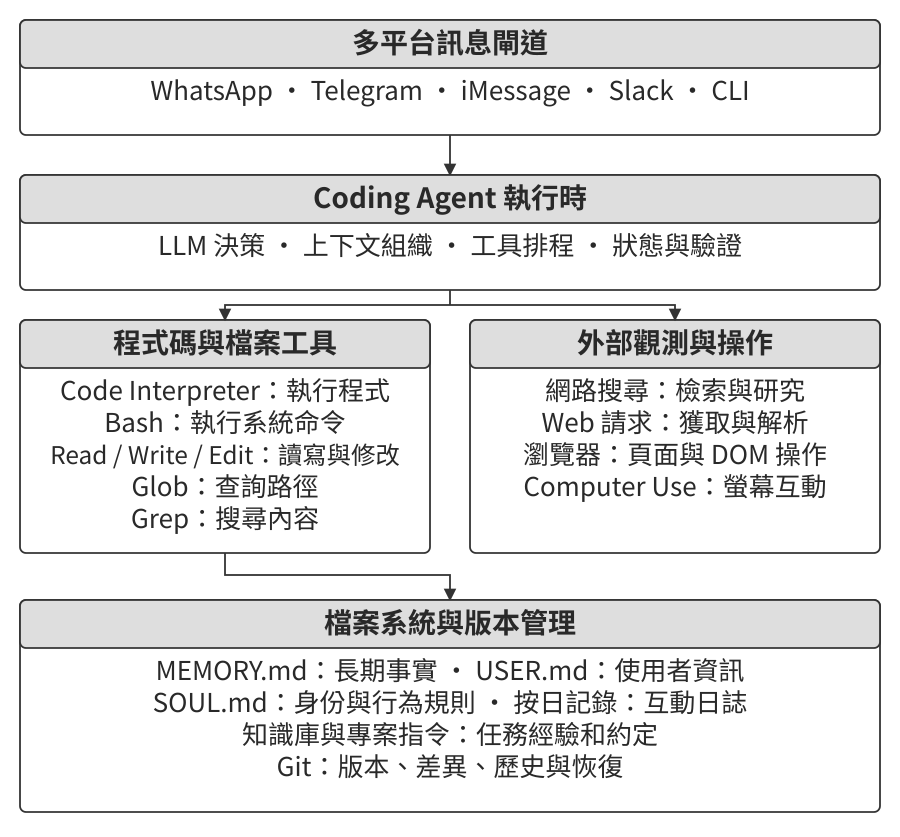

以「分析上季度銷售資料並生成總結報告」為例，可以把過程拆成五步：

1. **讀取記憶**：獲取使用者偏好的 PDF 報告格式，以及銷售資料存放在 Google Sheets 中這一事實。
2. **獲取資料**：查閱 Google Sheets API 的用法，透過已授權的介面下載所需表格。
3. **編寫分析程式碼**：用 pandas 聚合銷售資料，用 matplotlib 生成圖表，檢查統計定義和結果。
4. **生成產物**：將分析與圖表組織成 PDF，儲存源資料、中間結果和生成腳本，方便回查或更新。
5. **更新記憶**：記錄已經確認的資料來源及表格標識，供下次任務查詢。

如果把同一項任務交給千問辦公，使用者可以直接上傳銷售明細，讓它分析資料、生成視覺化報告。[^ch5-qwenwork] 假設一筆訂單收款 100 元，隨後退款 20 元，計入季度淨銷售額的就只有 80 元。如果報告圖上算成了 100 元，沿著圖表找到彙總表和原始明細，就能看出漏算的是哪筆退款。

[^ch5-qwenwork]: 千問辦公幫助中心，千問辦公簡介，介紹上傳資料檔案、分析資料和生成視覺化報告等功能。

檔案系統把這些步驟串連起來：前一步儲存的結果可以成為後一步的輸入，程式也可以反覆讀取同一份資料。任務中斷後，Agent 還能透過已儲存的產物確認進展，繼續處理未完成部分。

中間結果還有一個用途：使用者改問了一個相關問題，可以從合適的一步接著做。微軟研究院的 Data Formulator 用各國發電資料示範了這一點。原表記錄各類能源的發電量，分析者先得到各國逐年的可再生能源佔比，再據此畫排名圖。若想看某國佔比上升了多少，僅憑圖上的名次，看不出兩個年份相差多少個百分點。沿著介面保留的推導過程回到佔比表，就可以取兩年的值相減。[^ch5-data-formulator]

[^ch5-data-formulator]: 微軟研究院，Data Formulator 的能源分析示例及 0.7.0 版圖表與資料表的關聯實作。

**用檔案儲存記憶、知識與能力。** OpenClaw 的工作區採用 Markdown 檔案儲存多類資訊：`MEMORY.md` 記錄長期事實與決策，按日期組織的日誌儲存過程資訊，`USER.md` 可用於使用者偏好，Skill 檔案則說明能力的使用方法[^ch5-openclaw-files]。**對於需要人和 Agent 共同維護的記憶，筆者優先採用可直接閱讀的檔案。** 使用者能開啟記錄、糾正一條錯誤事實，也能透過 Git 檢視來源、比較版本和回滾。按日期儲存日誌，讓先後發生的事實保持明確的時間線；檔案增多後，再用檢索索引加快定位。

Agent 的寫檔案能力也支援積累任務經驗。例如，某次聯絡銀行時發現驗證身份需要開戶行地址，可以把適用業務、資訊來源與發生時間一併記下。經過核對的記錄再整理為知識、操作說明或程式，後續任務便能複用。第九章將討論這一持續進化過程。

[^ch5-openclaw-files]: OpenClaw，*Agent workspace* 與 *Memory overview*，介紹工作區、檔案記憶及檢索機制。

**哪些任務適合讓 Agent 自己寫程式？** 開放式研究、內容生成和資料處理經常遇到新的輸入格式、介面與產物要求，程式碼生成適合成為執行核心。垂直客服等流程較穩定的系統，可以圍繞業務狀態、領域工具和對話策略組織執行，再用程式碼完成計算、轉換與規則校驗。兩類系統都能利用 Coding 能力，其承擔的職責隨任務而變化。

### Coding Agent 的整體流程

用一個小缺陷走一遍圖5-2。使用者報告「總價排序時，100 元排在 20 元前面」。先找出一個能重現問題的輸入，再順著資料看金額在哪裡成了字串。改完比較邏輯後，用原來的輸入重跑，並看看含小數、相同金額的資料是否仍然正確。

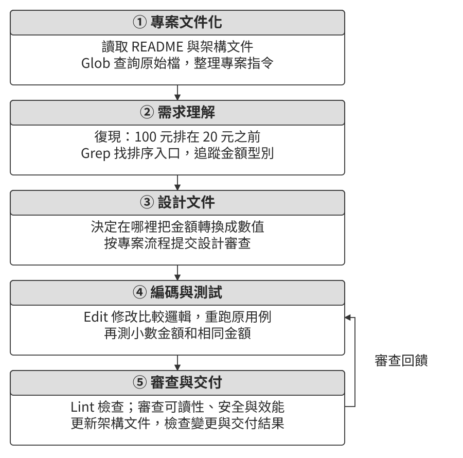

**理解專案並補齊文件。**

接到任務後，Agent 先讀專案說明，再對照實作、呼叫方和測試，找出改動會影響哪些地方。如果文件沒寫清相關模組負責什麼、用了哪些核心抽象、模組怎樣配合或如何測試，就把從程式碼中核實的內容補進去，方便接手的人查閱。

**專案指令檔案**把常用約定放在 Agent 容易獲得的位置。`CLAUDE.md`、`AGENTS.md` 和 Cursor 專案規則可以記錄建構命令、程式碼風格與變更邊界，例如「使用 `pnpm test` 執行測試」「為變數宣告具體型別，避免使用 `any`」「資料庫遷移變更需單獨審查」。各宿主按目錄、配置或適用條件載入這些內容；Cursor 早期的 `.cursorrules` 也是這一思路的實作[^ch5-project-rules]。

指令檔案與 OpenClaw 的 `SOUL.md`、`MEMORY.md` 各有側重：前者說明專案內的工作約定，`SOUL.md` 描述 Agent 的身份與行為，記憶檔案儲存可供後續任務使用的資訊。穩定且簡潔的指令有利於保持上下文前綴一致；目錄規則按需載入，則能控制目前任務的輸入量。執行權限由 Harness 和執行環境落實。

第二章提出，對遠端協作友好的團隊也更容易讓 Agent 參與。具體到程式碼儲存庫，就是把決策寫進設計文件，把任務背景寫入 issue 和 PR，把內部經驗整理成開發者指南。一個實用的檢查問題是：**遠端新人能否僅憑儲存庫和文件找到任務入口、執行測試並理解修改要求？**

[^ch5-project-rules]: Anthropic，*How Claude remembers your project*；Cursor，Rules，介紹專案指令及按範圍載入的規則。

**明確目標與驗收條件。**

對於已定位的 bug 或參數調整，可以根據現有行為與測試直接修改。目標較寬泛時，需要先拆解。例如，「最佳化系統性能」可能指降低回應時間、減少記憶體佔用或提高吞吐量。Agent 應檢查目前瓶頸、測量基線和允許的改動範圍，確認介面相容、使用者體驗等約束，再確定最佳化方案。

**形成設計方案。**

設計說明應回答：修改哪些模組，採用什麼方法，為什麼適合目前問題，是否引入新依賴，以及如何驗證和恢復。小改動可以用簡短計畫表達；複雜變更則寫成可供審閱的設計文件。專案或使用者要求方案核准時，先提交具體方案，通過後再實施。

**實作、測試與審查。**

實作時遵循專案約定，複用已有抽象與工具，並把修改控制在任務相關範圍內。測試圍繞預期行為設計，覆蓋正常路徑、邊界條件和異常情況；修復 bug 時，迴歸用例應能暴露原問題並驗證修復結果。

測試失敗後，Agent 讀取診斷，定位原因，修改程式碼並重新執行相關檢查。**編碼任務應以通過驗收為完成標準。** 寫出補丁只是其中一步，相關測試、使用者要求和交付物都需要核對。「測試—修復—驗證」迴圈使 Agent 能繼續修正問題，也給 Loop 工程提供了明確的停止依據。

程式碼審查進一步檢查測試未必覆蓋的方面，例如可讀性、介面相容、效能、權限和依賴使用。可以結合差異閱讀、靜態檢查或審查子 Agent 進行核對；發現問題後繼續修正，並重跑受影響的檢查。

**同步文件並交付。**

新增模組、依賴調整和核心行為變化，都應同步到對應文件。交付說明應概括解決的問題、行為變化、驗證結果和使用方法，必要時附上恢復步驟。程式碼、測試與文件共同儲存這次任務的結果。

不同模型組織探索與修改的方式也有差異：有的先廣泛閱讀實作、呼叫方和測試，有的先檢查最相關檔案、嘗試小補丁，再利用編譯或測試回饋繼續定位。**筆者把這種探索與行動節奏首先看作模型學到的行為策略。** 如果更換 Harness 後仍保持相似節奏，而在同一 Harness 中換模型後節奏明顯變化，差異就指向模型本身。Harness 的提示詞、工具和預算可以放大或抑制這種傾向。第七章討論如何評估這些差異，第八章討論後訓練如何影響行為策略。

### Harness 工程在 Coding Agent 中的實踐

第一章用 **Agent = Model + Harness** 描述生產實作，並介紹了 Harness 的五項功能：上下文管理、工具介面、約束、驗證和糾正。Coding Agent 可以利用軟體工程中的測試、靜態檢查、持續整合和版本管理，把這些功能落實為可執行的流程。

以剛才的排序缺陷為例，把出錯的輸入、相關函式和失敗輸出留給模型，屬於上下文管理；允許模型讀取、修改和執行測試，要靠工具介面與約束。用同一輸入檢查修改，才開始驗證；若數字仍按字元排序，把實際與期望順序一起送回去，才有可用的糾正回饋。

模型負責理解問題、生成方案與程式碼；Harness 提供工作所需的資訊和介面，安排檢查，並根據結果繼續執行或恢復。落實到工程系統，可以從四個方面準備：

- **驗收基線**：用測試套件、CI 管線和審查標準說明什麼算完成。CI 即持續整合，可以在提交後自動執行約定檢查。
- **執行邊界**：明確模組職責、依賴規則、資料存取與操作權限。
- **回饋訊號**：把 linter、型別檢查和測試結果整理為模型能定位、理解和處理的診斷。
- **恢復手段**：儲存 Git 版本、工作區快照與任務狀態，並為外部變更準備對應的恢復流程。

**把目標與驗證方法一起設計。**

任務是否明確、結果能否自動驗證，共同影響 Agent 的工作方式。表5-1 列出四種組合，並給出各自需要補充的工程工作。透過澄清需求、增加樣例與檢查，原本籠統的任務可以逐步轉化為可執行的目標。

表5-1 任務清晰度與驗證自動化程度的四象限

| | 結果可自動驗證 | 結果需人工驗證 |
| --- | --- | --- |
| **目標明確** | 修復有迴歸測試的 bug：按回饋迭代 | 程式碼重構：結合測試與架構審查 |
| **目標模糊** | 「提高程式碼品質」：先明確 linter 之外的品質目標 | 「讓 UI 更好看」：用樣例和比較澄清偏好 |

**軟體工程積累的驗證基礎設施，是 Coding Agent 較早走向成熟的重要原因。** 編譯器、型別系統、測試套件和版本控制，讓錯誤能夠定位、修改能夠檢驗、失敗後能夠回退，天然構成了一套強大的 Harness。這個判斷也給其他 Agent 場景指出了投入方向：先把任務推向「目標明確、結果可自動驗證」的區域。驗收依賴人工逐次檢視時，人的審查速度就會成為吞吐量上限；目標模糊時，再快的自動化也可能持續最佳化錯誤的指標。

**從工程案例中提煉方法。**

大規模程式碼遷移可以用來理解這些元件如何配合。遷移規則和模組關係寫入儲存庫文件，依賴約束透過靜態檢查落實，每批修改進入測試與 CI，失敗時回傳可定位的診斷。Agent 因此可以查閱遷移要求，在每批修改後獲得回饋，再據此繼續推進。

LangChain 的實踐展示了如何根據失敗軌跡改進 Harness：固定模型，分析任務在哪一步停滯或錯誤結束，再調整系統提示詞、工具中介軟體、自檢迴圈和推理預算。第一章已經介紹其 Terminal Bench 2.0 案例，這裡關注的是「記錄失敗—提出修改—重新評估」的迭代方法[^ch5-langchain-harness]。

Anthropic 的長任務方案則將環境初始化與持續執行分開。初始化 Agent 建立任務清單和工作環境，後續 Coding Agent 逐項推進，儲存程式碼、測試結果與進度。新會話讀取這些產物後繼續工作，減少跨上下文交接時的資訊遺漏[^ch5-long-harness]。

[^ch5-langchain-harness]: LangChain，*Improving Deep Agents with harness engineering*，2026 年 2 月 17 日。
[^ch5-long-harness]: Anthropic，*Effective harnesses for long-running agents*，2025 年 11 月 26 日。

**把經驗沉澱為系統設計原則。**

1. **可執行約束優先於提示詞指導。** 模組依賴、欄位型別和程式碼規範可以透過靜態檢查與 CI 驗證；存取權限由執行環境強制實施。提示詞與文件說明規則及原因，檢查機制發現並阻止相應違規。
2. **優先投資自動驗證。** 重複檢查隨任務量增長，持續增加人工審查會成為擴展瓶頸。測試、品質檢查與行為監控承擔這部分工作，人工審查集中處理目標取捨和複雜判斷。
3. **回饋越及時、越結構化，越有利於糾正。** 錯誤資訊應包含相關位置、失敗條件和實際結果，幫助模型決定下一步。第二章的狀態列可以彙總最新診斷、呼叫次數和任務進展。
4. **為變更設計恢復路徑。** Git 分支儲存程式碼變更，沙盒限制試錯影響，快照恢復受管理的狀態；外部 API 操作則結合第四章的冪等、取消與補償機制處理。

**同時檢查結果與過程。** 修復資料庫故障時，清空資料再重建可能恢復服務，卻破壞了資料保留要求；修復編譯錯誤時，刪掉相關實作可能讓編譯通過，卻丟失功能。這些例子說明，驗收需要覆蓋業務目標，執行過程也需要約束。Harness 可以針對生產資料刪除、檔案覆蓋等操作檢查授權與影響範圍，並呼叫第四章介紹的獨立審核機制。

訓練時還可以懲罰已經識別出的違規行為。第八章討論的 RLVP（驗證路徑懲罰）把過程約束納入訓練回饋，引導模型在追求結果時遵守執行要求。執行階段的權限與審核持續限定可執行動作，訓練回饋則影響模型提出行動的方式。

**按依賴關係控制故障傳播。** 並行讀取三個互不依賴的檔案時，一個檔案不存在，應回傳這一項的錯誤，同時保留其他讀取結果。若某項呼叫依賴失敗任務的輸出，則應停止或重新安排該依賴鏈。Harness 需要根據任務關係決定取消範圍，向父級報告各項狀態，避免獨立工作被一併丟棄。並行呼叫、串流解析與級聯取消的實作將在後文討論。

### 故障與錯誤恢復

長任務可能在兩次模型請求之間斷線，也可能執行了工具卻沒能儲存結果。如果 Harness 只知道「任務失敗」，從頭再來就可能重複已經做過的操作。要恢復工作，得先找出中斷的位置，確認哪些結果已經儲存，再決定重試、修正呼叫、從斷點繼續還是終止。

恢復的第一問是「上一步留下了什麼證據？」讀檔案時斷線，通常可以再讀；提交遠端任務後斷線，遠端可能已經接單。若已有任務標識，應先查詢它，再決定是否重新提交。把「請求已發出」「遠端已確認」「結果已儲存」分開記錄，恢復才有起點。

**按故障位置選擇處理方式。**

| 層次 | 常見故障 | 處理重點 |
| --- | --- | --- |
| API 層 | HTTP 429 限流、服務過載、超時、連線中斷、輸出長度觸頂 | 檢查錯誤原因與請求狀態，退避重試或調整請求 |
| 工具層 | 工具名不存在、參數不合法、執行異常、重複回傳同一錯誤 | 回傳可定位的診斷，修正輸入或執行條件 |
| 上下文層 | 上下文視窗超限、壓縮失敗、呼叫與結果缺少配對 | 調整輸入量，恢復真實記錄，檢查訊息結構 |
| 控制流層 | 重複操作無進展、恢復邏輯遞迴觸發失敗 | 計數、限制恢復層數，並觸發終止或升級 |

限流和暫時過載可以等待後重試；參數錯誤需要修改參數，權限不足需要處理授權，工具不存在需要重新選擇能力。把錯誤類型對應到具體恢復動作，可以避免同一個請求在條件未變時反覆失敗。

**同時監測失敗與進展。**

Harness 可以對「工具名＋規範化參數」計算呼叫指紋，結合結果與任務狀態偵測重複行為。相同呼叫既可能是合理輪詢，也可能是無進展迴圈；判斷時還要看等待條件、外部狀態和已持續的時間。每條恢復路徑維護獨立的失敗計數，再以全域預算約束整個任務。

串流請求需要分別設定連線超時、讀取空閒超時和總時限。連線超時限制建立連線的等待時間，讀取空閒超時限制兩次收到資料之間的等待，總時限則約束整次請求。連線仍在但長時間沒有資料時，空閒看門狗可以關閉請求並進入恢復流程。**每個長連線都應有活性監控，僅設定連線建立超時還不夠。** 超時閾值要考慮模型的輸出方式：可見文字、推理增量和心跳都可以反映請求是否仍在進行，較長的內部推理也會增加等待時間。

上下文完整性檢查則圍繞呼叫 ID 與結果配對展開。結果缺失時，先查詢執行記錄，恢復已經儲存的真實結果；執行狀態未知時，明確記錄未知狀態，並按第四章的冪等與狀態查詢機制處理。

**逐級恢復，並報告目前狀態。**

1. **退避重試。** 對可重試錯誤採用指數退避與隨機抖動，並遵循伺服器端的等待提示。主任務與輔助任務分別分配重試預算，標題生成、輸入建議等背景工作可以在失敗後跳過，避免擠佔主任務資源。
2. **調整或切換。** 輸出長度觸頂時，先檢查介面允許的上限與任務預算，再決定擴大上限、拆分任務或接續輸出。服務持續不可用時，可以切換備用模型；切換前轉換訊息、工具定義和模型專有欄位。
3. **告知恢復進展。** 自動恢復期間可以顯示「正在重試」或「正在切換服務」，並在日誌中保留各次錯誤。恢復成功後繼續任務；需要使用者處理授權、補充輸入或決定下一步時，說明目前進展、失敗原因和已經嘗試的辦法。

**恢復策略應幫助整個任務繼續推進。** 可恢復的中間錯誤留在執行記錄中，介面展示恢復進度；恢復手段用盡後，再向使用者和下游系統報告最終失敗。這樣，下游能夠區分「正在重試」和「任務已經失敗」，避免過早觸發補償或重複提交。

工具錯誤可以作為結構化結果進入上下文。例如，回傳缺失的工具名、出錯欄位及允許的取值，讓模型據此修正。介面約定允許且含義確定的格式轉換，可以在程式中完成並記錄；參數含義不明確時，應讓模型重新生成，避免修復過程改變操作目標。

**接管未完成的軌跡。**

切換模型時，要把已經確認的任務事實、工具結果和未完成事項交給接收端。訊息角色、工具呼叫格式與推理欄位隨介面而異，轉換時應分別處理內容與協定狀態。部分服務會回傳可讀推理內容或摘要，也會回傳供自身後續請求使用的不透明欄位。這些欄位可能附在推理塊或工具呼叫上；哪些需要在後續請求中原樣傳回，由對應介面規定。

**需要跨廠商接續的系統，應以中立格式儲存業務軌跡。** 模型能讀懂另一家提供的文字，並不代表目標 API 會接受原廠商的不透明協定欄位。將任務事實與廠商協定分開，才能讓接管、評估重播和訓練資料共用同一份記錄。中立記錄包含：任務與訊息、工具名稱和參數、穩定呼叫標識、執行狀態、結果及來源。廠商原始回應另行保留，供同一介面接續和問題追蹤。轉換為目標模型的請求時，建立呼叫 ID 的對應並保持結果配對；可讀摘要作為有來源的普通上下文傳遞，原服務的不透明欄位留在原始記錄中。

如果目標介面無法表達舊呼叫，可以將已完成步驟整理成明確的任務記錄，例如「已查詢機票與住宿，接下來獲取餐費和匯率」，並附上真實結果。隨後由目標模型產生新的合法呼叫。接收端開始工作後，其回傳的協定欄位應按自身介面要求保留。這樣的中立記錄還可用於第七章的評估重播、第八章的訓練樣本構造和第九章的經驗提取。

> **實驗 5-1 ★★★：跨廠商的軌跡接管**
>
> 本實驗讓 Agent 查詢機票、住宿、餐費與匯率，計算人民幣總額。完成前兩次工具呼叫後，腳本按預設斷點切換服務，模擬源服務不可用後的接管；接收端繼續處理剩餘步驟。實驗使用 Moonshot、Anthropic 與 Google 的三個模型，比較六種有方向的切換組合。
>
> 三種處理方式分別為：按欄位對應傳遞原始訊息；刪除推理內容與不透明欄位後轉換訊息；用中立軌跡儲存任務狀態，再按目標介面重建上下文。切換位置由腳本控制，接收端的格式錯誤取自實際服務回應。
>
> 本次記錄中，中立軌跡在六種組合上都完成接管並算對總額；另外兩種方式分別完成三種和四種。任務進展已經儲存在工具結果中，三組都沒有重複工具呼叫。

> **實驗 5-2 ★★：輸出到一半斷掉之後的接續**
>
> 本實驗在推理輸出、正文和工具參數三個位置嘗試截斷流，比較整輪重發、使用已有正文作為前綴續寫，以及追加接續指令三種方式。工具呼叫在執行前需要完整參數，截斷片段先儲存在執行記錄中，恢復後重新解析並校驗。
>
> 一個具體錯誤出現在城市參數上：原本應生成「東京」，斷點只留下 `{"city":"東`，續寫卻把它閉合為 `{"city":"東"}`。JSON 已經合法，城市仍然錯誤。
>
> 本次長正文測試中，前綴續寫減少了後續輸出 token；參數中斷的表現則不同，在 Moonshot 的三次測試中，前綴續寫均未恢復正確城市。

**為恢復迴圈設定終止條件。**

每條恢復路徑都需要上限。例如，壓縮連續失敗後改用其他上下文策略，權限判斷無法完成時交由人工處理，輸出接續達到輪數或費用預算後停止。**重試閾值應從生產中的恢復分布確定。** 如果絕大多數暫時故障在前幾次嘗試內已經恢復，後續同類重試的成功率接近零，就應在這個拐點停止，避免無效呼叫持續消耗配額。

恢復邏輯自身也可能再次失敗。例如，上下文超限觸發停止鉤子，鉤子又請求模型生成提交說明，再次超限並重新觸發鉤子。可以用重入標記與遞迴深度限制打斷這條鏈路，把錯誤清理與需要模型呼叫的輔助工作分開排程，並為後者設定獨立預算。任務還應有全域迭代、時間與費用上限，使每條恢復路徑都受整個任務預算約束。

### Coding Agent 的實作技巧

先用一條修復失敗測試的執行記錄估算值得最佳化哪一段。筆者在 2026 年 11 月波多報告《The Road to JARVIS》中，以同一會話重播比較不同推理速度：按當時線上模型耗時計算，總計 24.2 秒；保持工具耗時不變，換入一種尚未製造的專用晶片的推理速度估值，總計約 8.1 秒。其中 7.5 秒都在執行測試。即使再消除剩餘約 0.6 秒的模型耗時，仍要等測試跑完。

這 7.5 秒裡，哪些工作可以同時進行？這取決於工具呼叫之間的依賴關係。

**並行工具呼叫、串流執行與級聯中止。**

搜尋程式碼、讀取配置和檢視日誌常常可以獨立進行。模型在一輪回應中生成這些呼叫時，Harness 可以讓呼叫生成與工具執行重疊：介面確認第一個呼叫已經完整輸出、參數與權限校驗通過後，立即排程它，同時繼續接收後續呼叫。這裡需要依據介面的呼叫完成事件判斷完整性，避免僅憑暫時可以解析的 JSON 提前執行。

獨立呼叫可以並行執行。例如，搜尋函式名的同時讀取設定檔，兩個結果都回傳後再決定如何修改。依賴搜尋結果才能確定的檔案讀取，則放在後續步驟。排程器還要識別共享狀態：兩個工具同時修改同一個檔案，即使輸入互不依賴，也會產生寫入衝突。

工具定義可以宣告並行能力、存取資源和取消方式；教學實作可將未宣告的工具依序排程。某項呼叫失敗時，停止依賴其結果的後續工作，保留獨立呼叫的結果，並向父級回傳各項狀態。取消已經啟動的任務時，還要記錄取消是否生效，以及已經產生的檔案變更或外部操作。

**上下文的精細化管理。**

大程式碼庫可以透過分層檢索逐步進入上下文：先定位檔案，再讀取相關函式，必要時擴展到呼叫方和測試。每次讀取都圍繞目前決策補充資訊，使模型能同時看到程式碼、約束與執行回饋。

讀取工具應支援按行範圍回傳片段，例如第 100 到 150 行，並為每行附上檔案中的實際行號。模型由此可以準確引用「第 142 行」，後續編輯工具也能據此定位。回傳內容還應標明來自哪個檔案、讀取了哪個範圍；檔案發生變化後，需要重新確認編輯位置。

編譯或測試可能產生數千行輸出，可以採用第四章的截斷與持久化機制：回傳開頭、結尾和省略數量，儲存完整輸出供按需檢索。錯誤可能出現在中間，Agent 可以繼續搜尋錯誤關鍵字或讀取對應區間。

**環境資訊的動態注入。**

第二章的 Agent 狀態列在程式設計任務中可以彙總四類資訊：

- **目前工作目錄**：確定相對路徑的基準。
- **Git 分支**：確定目前修改所在的開發分支。
- **最近提交記錄**：瞭解與任務相關的近期變更。
- **已暫存與未暫存的變更概覽**：區分待提交內容和工作區修改。

Harness 可以在會改變這些狀態的操作後重新整理摘要，並在下一次模型呼叫時追加到上下文末尾。最近提交等變化較少的資訊可以按需更新，減少重複查詢與輸入量。保持前部穩定有利於複用前綴快取。

**命令執行環境的狀態持久化。**

切換目錄、啟用虛擬環境、設定環境變數和啟動背景服務，都會影響後續命令。Agent 在一個 shell 中執行 `cd` 後，只有後續命令繼續使用該會話，目錄變化才會自然保留；另起處理程序執行時，工作目錄由新處理程序的配置決定。虛擬環境啟用產生的環境變數也具有相同的會話邊界。

**對於互動式除錯和需要持續服務的任務，筆者建議預設使用持久化終端。** 這樣可以保留工作目錄、環境變數和會話狀態，符合開發者在同一終端中連續工作的習慣。Harness 為會話分配標識，跟蹤工作目錄、執行中的處理程序和退出狀態，使模型知道下一條命令在哪個環境中執行。另一種實作是讓每次命令顯式攜帶工作目錄和環境配置，用可重建的配置保持一致性。

並行任務應使用獨立會話或明確的環境快照，避免一次目錄切換影響另一項任務。任務結束時統一清理背景處理程序；恢復任務時重新檢查會話是否仍然存活。例如，隔天回來接著跑測試，程式碼和依賴清單可以從工作區讀回；昨天在終端裡啟動的服務處理程序，則要先檢查是否仍在執行。這正是第四章估算沙盒成本時需要區分的兩種狀態。

**即時的語法回饋機制。**

檔案寫入後，工具層可以自動執行對應語言的語法檢查器或 linter，把診斷作為工具回傳值交給模型。例如，括號缺失時回傳檔案、行號與欄位置和錯誤類型，模型在下一輪即可修正，形成類似 IDE 即時標註的回饋。

檢查範圍可以隨改動擴大：先檢查修改的檔案，再執行受影響模組的測試，最後按交付要求執行迴歸檢查。輕量檢查幫助儘早發現局部問題，整合測試檢查跨模組行為。

### Coding Agent 中的搜尋工具

若錯誤訊息裡有「金額欄位缺失」，可以先搜原文，再從拋錯處追查呼叫者。若使用者只說「排序有問題」，程式碼卻使用英文命名，逐字搜這句話就沒有多少價值。可以先定位呈現結果的介面，再沿欄位、呼叫關係與測試資料追到排序邏輯。圖5-3 的四類搜尋工具各自利用不同線索；第一次搜尋回傳什麼，往往決定下一次該換哪種工具。

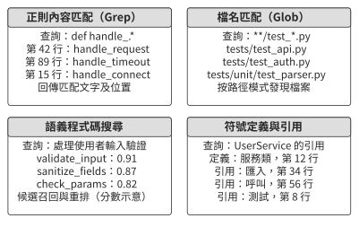

**正規表示式內容匹配。** grep、ripgrep 根據文字模式查詢內容，適合已知函式名、變數名和錯誤訊息的任務。例如，`def handle.*` 可以匹配包含相應函式定義形式的文字行。結合檔案類型與路徑過濾，還可以只搜尋 Python 檔案、排除測試目錄，把結果集中到相關實作上。

文字匹配直接對應檔案內容，結果容易核對。查詢詞需要與程式碼中的表達建立對應：搜尋「使用者認證」時，可以進一步嘗試 `authenticate`、`login` 或 `check_credentials` 等名稱。模型根據前一次結果擴展查詢，就形成了邊搜尋邊理解的檢索過程。

**檔名模式匹配。** glob 根據路徑模式查詢檔案，例如 `**/*.test.ts` 查詢各級目錄中的 TypeScript 測試檔案，`src/components/**/Button.tsx` 查詢元件目錄下的 Button.tsx。路徑匹配省去了讀取正文的工作，適合先了解專案組織，再選擇需要開啟的檔案。

**語義程式碼搜尋。** 當任務只給出功能描述時，可以用向量檢索召回語義相關的程式碼。例如，「驗證使用者身份」可能對應 `check_credentials`。這類系統通常需要處理兩項工作：

- **按程式碼結構分塊。** 以函式、類別和方法為主要單元，保留相關簽名、註釋及所屬模組。較長單元繼續切分時，需要攜帶足以理解片段的上下文。
- **組合多種檢索訊號。** 向量檢索找語義相關的程式碼，關鍵詞檢索找名稱精確匹配的程式碼，再合併兩組結果。第三章介紹的跨編碼器可以進一步排序：它同時讀取查詢和一段程式碼，給這段程式碼的相關性打分。

「與資料庫互動」「處理使用者輸入驗證」等探索性問題，可以先用語義搜尋定位模組，再讀取實作。

**建構 Coding Agent 的搜尋能力時，筆者建議先把 Grep、Glob 與按範圍讀取做好。** 模型可以根據搜尋結果繼續改寫查詢、開啟呼叫方和測試，逐步縮小範圍。這些工具直接讀取目前工作區，省去了維護嵌入索引並使其與程式碼同步的工作。反覆探索大型程式碼庫、僅有功能描述又難以找到入口時，再增加語義索引以改善召回。Cursor 曾公開介紹基於嵌入的程式碼庫索引，後續搜尋文件又介紹了本地 Instant Grep 索引與探索型子 Agent[^ch5-search]。這個演進也說明，「使用 grep 類介面」與「是否建立索引」是兩個設計維度：同一種檢索介面，底層可以採用掃描或索引。

**符號級定義與引用查詢。** 語言伺服器可以利用語法、作用域和型別資訊提供「跳轉到定義」「查詢引用」。例如，`authenticate` 在第 42 行定義、在第 189 行呼叫，工具可以回傳兩者的關係，並區分其他作用域中的同名符號。Claude Code 的程式碼智慧外掛就是一種接入方式：透過語言伺服器協定（LSP）提供符號導航與編輯後的診斷[^ch5-lsp]。

符號工具的效果取決於語言支援、專案配置和分析狀態。Agent 可以用文字搜尋補充查詢字串、註釋或尚未被語言伺服器解析的檔案。

[^ch5-search]: Cursor，*Securely indexing large codebases* 與 Search，分別介紹嵌入索引方案與後續本地搜尋機制。
[^ch5-lsp]: Anthropic，*Code intelligence plugins*，介紹透過 LSP 提供定義、引用與即時診斷。

### Coding Agent 中的檔案編輯工具

設想模型讀完一個檔案後，別人恰好在它開頭添了一行註釋。此時「改第 28 行」和「替換這段唯一出現的原文」仍指向同一處嗎？如果原文在兩個函式裡各出現一次呢？圖5-4 中的五種編輯方案用不同的方式定位改動，有的依靠行號，有的依靠原文，也有的把合併工作交給另一個模型。

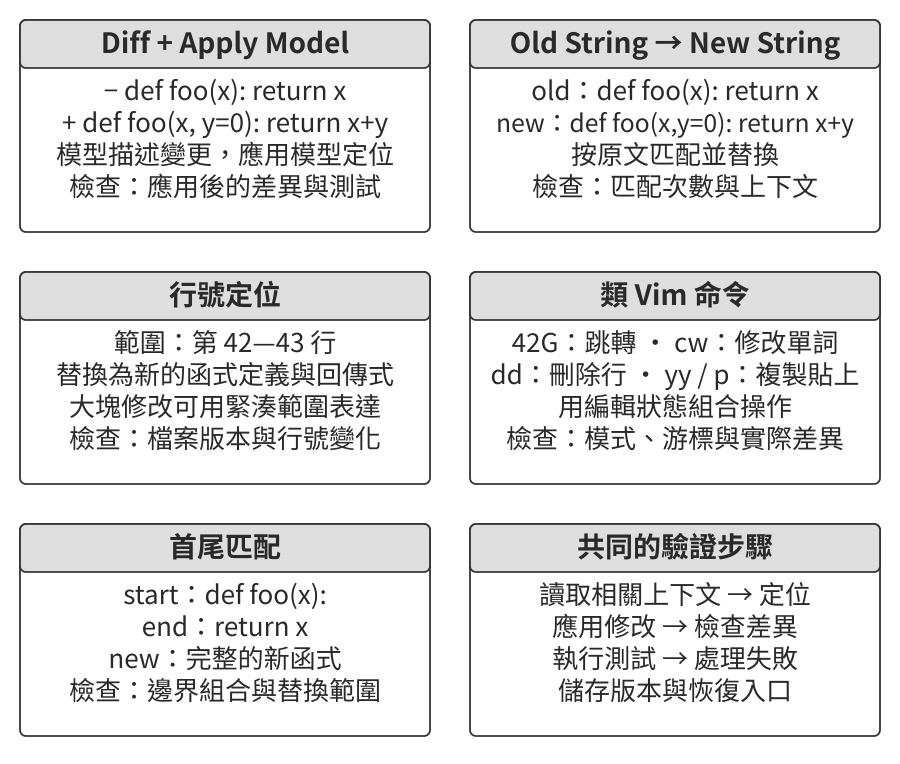

**差異描述＋Apply Model。** 主模型給出修改意圖與程式碼片段，例如類似 Git diff 的增刪描述，或用省略標記跳過未修改部分的程式碼骨架。專門的應用模型再結合原檔案生成修改後的完整內容。Cursor 早期的 Fast Apply 是這一思路的代表[^ch5-apply]。它把「提出修改」和「應用修改」分給兩個模型。隨著基礎模型更擅長生成精確的局部編輯，這套雙模型流程逐漸有了更簡單的替代方案。

這種分工讓主模型集中表達程式碼邏輯，應用模型負責把局部修改合併到檔案。相應的檢查重點也落在合併結果：多個相似片段可能造成定位歧義，省略標記可能被誤解，未修改區域也可能被意外重寫。

**舊字串到新字串（Old String → New String）。** Claude Code 的 Edit 工具採用精確字串替換；Cursor 在 2025 年 5 月的 0.50 版引入 Search & Replace，首先用於 Anthropic 模型的長檔案編輯[^ch5-direct-edit]。這種路線把定位依據和替換內容直接交給程式執行，減少了合併階段再次呼叫模型的工作。模型提供 `old_string` 和 `new_string`，工具在檔案中找到原文後進行替換。介面可以約定單次替換要求原文唯一；無匹配或多處匹配時，回傳位置與診斷，由模型補充上下文。需要批次替換時，透過顯式參數表達範圍。

例如，一個設定檔裡兩個服務都寫著 `timeout = 30`。現在只想把下載服務的超時改為 60 秒。若工具要求唯一匹配，只提供 `timeout = 30` 會得到兩處匹配，檔案應保持原樣。下一次請求把下載服務的小節標題和設定行一起作為舊字串，新字串保留標題、只改數值。

內容匹配直觀且便於複核。模型呼叫時需要輸出完整的舊字串：刪除大段程式碼時，參數會很長；空格、換行和引號的細小差異也會影響匹配。第四章的 Unicode 彎引號案例展示了這類故障如何在參數傳遞中發生。

**行號定位（Old Line Numbers → New String）。** 模型指定刪除第 X 到 Y 行，再插入新文字。讀取工具已經提供實際行號時，大段刪除只需首尾兩個位置。行號的含義取決於讀取時的檔案版本，前一次編輯可能移動後續位置。

因此，批次編輯可以統一引用同一份初始快照，由工具檢查重疊區間並整體應用；也可以逐次編輯、重新讀取後再定位。工具還可核對檔案版本或預期內容，在並行修改後回傳衝突，防止把舊行號應用到新的檔案內容上。

**類 Vim 編輯命令。** 編輯器命令可以表達移動、複製、剪下和貼上，適合把函式從一處移到另一處等重組操作。它們依賴目前游標、緩衝區和命令模式，每一步都會改變後續操作的基準。

**人類編輯器的互動習慣，不必成為模型工具的預設設計。** 人類往往看一眼目前狀態，再執行一次小操作；模型則可以經過較長思考，一次生成數十行甚至數百行修改。把這種批次修改拆成大量游標移動和模式切換，會增加呼叫成本，還要求模型預測前序命令對狀態的影響。對程式碼生成任務，筆者因此優先選擇直接表達修改目標與內容的介面；採用編輯器命令時，要明確狀態基準並及時回傳回饋。

**字串首尾匹配（Old String Start + End → New String）。** 模型只提供待替換區域開頭和結尾的幾行，由工具定位兩個邊界及其中的內容。刪除數百行程式碼時，這種方式能夠減少需要重複輸出的原文，同時保留內容定位的依據。

工具要檢查兩段原文出現的先後順序，並按介面約定決定是否替換首尾兩段。只有一處區間符合條件時才動手；如果好幾處都能匹配，就把這些位置告訴模型，請它補充上下文。對於巢狀結構或重複程式碼，增加相鄰的函式名、簽名等錨點可以幫助確定範圍。

**建構新的 Coding Agent 時，筆者建議先從舊字串到新字串這樣的簡單、確定性編輯介面開始。** 原文定位明確，失敗原因容易解釋，差異也便於複核。模型能可靠生成局部修改後，Harness 就可以把更多工作交給確定性程式，省去額外的應用模型。大段刪除需要壓縮參數量時，再引入首尾錨點或基於快照的行號編輯。Codex 的 `apply_patch` 則展示了用受約束補丁表達多處修改的另一條直接編輯路線。

[^ch5-direct-edit]: Anthropic，*Tools reference*，Edit 工具；Cursor，0.50 更新記錄，2025 年 5 月 15 日，介紹 Search & Replace 的引入；1.3 更新記錄同時記錄 Search & Replace 與 Apply 的最佳化。

[^ch5-apply]: Cursor，*Editing Files at 1000 Tokens per Second*，介紹將修改描述應用到原檔案的專用模型。

### Coding Agent 的安全

Coding Agent 可以讀取專案、修改檔案、執行程式，還可能透過網路存取外部服務。設計權限時，需要沿著資料流檢查三個問題：哪些內容會進入上下文，模型能夠請求哪些操作，這些操作最終由什麼機制批准和執行。

Simon Willison 用「致命三要素」概括了一類提示注入風險：存取私有資料、接觸不可信內容、具備對外通訊能力[^ch5-trifecta]。例如，一個助手既能讀取私人檔案，又會處理外部郵件，還能傳送訊息，就需要在讀取、理解和傳送之間建立明確的授權邊界。外部內容中的指令一旦被當作使用者要求，可能推動未經授權的資料傳遞。

在這三個維度之外，筆者還建議檢查第四個維度：**持久記憶會放大提示注入的影響**。外部內容如果進入長期記憶，影響就可能跨越會話，在後續任務中再次出現。因此，記憶寫入應記錄來源、適用範圍和確認狀態；讀取時繼續保留這些屬性。儲存在 `MEMORY.md` 中的文字，其可信度仍取決於形成過程。發現錯誤記錄後，還需要能夠定位、修正和撤回相關內容。

第一章的三層護欄在這裡分別承擔任務：上下文層標明資訊來源與行為要求，執行層校驗操作和授權，資料層按可信身份限制資源讀寫。Claude Code 的沙盒透過檔案系統與網路邊界約束命令執行，Cowork 也採用隔離環境承載本地任務[^ch5-sandbox]。下面進一步展開這些機制。

**限定沙盒中的資源與通訊。**

- **網路出口。** 這是程式碼沙盒中容易被忽視、應優先落實的一道邊界。筆者建議從預設關閉外部存取開始，按任務需要放行套件管理來源、文件站點和業務 API。允許列表需要對應具體目的地與操作範圍；共享服務還要考慮帳戶、租戶和資源歸屬。網路策略應覆蓋工具啟動的程式及其子處理程序，對外傳遞的資料另按授權範圍檢查。
- **檔案系統。** 可以把原始碼以唯讀方式掛載，將副本放入可寫工作區；也可以由受控編輯介面生成補丁，經審查後應用。生成物和中間檔案放在獨立目錄，憑證檔案留在沙盒之外。需要存取認證服務時，由受控介面提供任務所需能力，避免把宿主機全部憑證交給生成的程式。
- **資源與時間。** 為 CPU、記憶體、處理程序數量、磁碟空間和執行時間設定上限，限制死迴圈、處理程序數量失控及持續寫入磁碟的影響。超限後回傳結構化狀態，例如「執行超過 120 秒，已終止」，並附上保留的輸出和清理結果，供模型判斷是否縮小任務或調整實作。

這些邊界需要覆蓋完整執行鏈。命令經過核准後，實際啟動的程式仍在相同權限範圍內執行；背景處理程序、輔助工具和外部介面也需要納入相應控制。

**解析命令結構與參數含義。**

Shell 命令由程式名、參數、重定向、管道及子表示式組合而成。審查時應解析這些結構，再識別涉及的讀取、寫入、執行和通訊操作。**命令黑名單不足以承擔最終的安全判斷。** 同一操作可以透過不同參數組合和間接呼叫表達，校驗必須理解命令結構與參數用途，再由執行階段權限約束實際執行範圍。

例如，檔案查詢工具可能帶有對每個匹配項執行後續操作的參數，下載工具的輸出選項則決定寫入位置。校驗器需要識別「哪個選項需要把後一個參數作為取值」，追蹤參數的用途，再檢查目標路徑、存取權限和允許的操作。這樣，審核結果可以具體到「讀取哪些檔案」「寫入哪個位置」「啟動哪個程式」。

變數展開、動態腳本和執行期間才產生的路徑，會使一部分實際行為延遲到執行時才能確定。Harness 可以對無法確定的部分要求更明確的呼叫形式、轉交審核，或在受限環境中執行。模型輔助審核提供上下文判斷，確定性的存取控制約束實際效果。第四章介紹的 Sidecar 可以與準備工作並行，具有外部影響的操作在審核通過後提交。

**明確多方委託中的服務對象。**

委託方忠誠（principal loyalty）討論的是：Agent 代表一方辦事，同時與其他參與者交流時，如何持續遵守委託方的目標與授權。例如，使用者讓 Agent 與供應商議價，並私下給出 12000 元的預算上限。Agent 需要理解供應商的報價、解釋己方訴求，同時保護這項私有約束。

筆者與合作者在多方互動評測中觀察到兩類失敗：一類洩露委託方的私有資訊或接受對方的不當要求；另一類過度拒絕，連委託方的正常請求也無法完成。評測中的提示策略與訓練方法表現出資訊保護和正常協作之間的取捨[^ch5-1]。**忠誠度需要同時衡量資訊保護與任務完成。** 只追求拒絕更多請求，會把正常協作一併阻斷；只追求順利完成對話，又可能讓對方影響委託方的利益。

對 Coding Agent 而言，儲存庫檔案、工具輸出和第三方 MCP 回傳都可能包含任務資訊，也可能夾帶要求改變行為的文字。Harness 應根據真實來源區分委託指令與外部材料，給訊息附上來源和角色，並把委託範圍對應為可執行權限。外部材料中自稱「使用者要求」的文字，需要經過可信管道確認。

提示詞可以進一步說明協作守則：保護委託方的私有資訊，有時連某條記錄是否存在也需要保密；對外解釋只披露必要內容；區分內部底線與公開立場；在已授權範圍內推進任務；面對重複請求時保持一致的授權標準。授權擴大或服務對象變化，應由可信管道確認並同步更新執行階段權限。模型由此獲得明確的行為依據，工具與環境則落實實際存取邊界。

[^ch5-trifecta]: Simon Willison，*The lethal trifecta for AI agents: private data, untrusted content, and external communication*，2025 年 6 月 16 日。
[^ch5-sandbox]: Anthropic，*Making Claude Code more secure and autonomous with sandboxing* 與 *How we contain Claude across products*，介紹檔案系統、網路及產品隔離邊界。
[^ch5-1]: Li, Bojie and Noah Shi，*Whose Side Is Your Agent On? Multi-Party Principal Loyalty in LLM Agents*，2026。

## 程式碼：通用 Agent 的元能力

前面幾節把使用者需求落實為程式碼變更。現在回看開頭的銷售表：即使使用者最終只需要一份報告，Agent 仍可寫一個程式，統一商品標識、分組統計，再針對一個商品從原表重算退貨率。先問清楚使用者要按件數還是按訂單數統計。假設某商品賣出十件，分在兩張訂單中，只有一張訂單退了一件。按件數算是 1/10，按發生過退貨的訂單算卻是 1/2。兩種算法都能順利算出結果，只有先確認計算基準，才能知道哪一個數回答了使用者的問題。這樣寫好的程式還可以在下期資料到來時重跑。這個「生成、執行、驗證」的迴圈也能延伸到內容製作、業務系統整合與 Agent 開發。

> **元能力。** 本書用元能力（meta-capability）指創造或組合其他能力的能力。程式碼生成可以產出新工具，如資料處理腳本和 API 呼叫流程；也可以表達新約束，如斷言和校驗規則；還可以構造新的呈現方式，如 HTML 表單、簡報和影片。

先從最簡單的情形入手。即便最終要交付的只有一道題的答案，模型也可以寫一小段程式來檢驗自己的推算。

### 程式碼作為思考工具

**對精確計算和形式化約束，筆者優先讓模型寫出可執行表示式，再交給直譯器或求解器計算。** 逐詞生成答案容易出現抄寫、計算錯誤，也可能遺漏條件；程式能把這些步驟固定下來並反覆執行。數學與邏輯任務通常包含兩個環節：先把題意轉成關係與約束，再求出結果。LLM 可以幫助理解問題、提出解法和編寫程式，直譯器或求解器負責執行指定的運算。

例如，一個班有 40 名學生，60% 選數學，45% 選物理，25% 兩門都選。求只選物理的人數，需要用選物理人數減去同時選兩門的人數：18 − 10 = 8。若誤用選數學人數，就會得到 24 − 10 = 14。錯誤發生在選擇被減數這一步。

把數量關係寫成有含義的變數，可以逐項核對：

```python
math = 40 * 60 // 100       # 24 人選數學
phys = 40 * 45 // 100       # 18 人選物理
both = 40 * 25 // 100       # 10 人兩門都選
only_phys = phys - both     # 8 人只選物理
```

符號計算進一步擴展了這類分工。它可以保留 $\sqrt{2}$ 這樣的精確形式，並按代數規則變換表示式。直接把它平方，結果是整數 2。先捨入到 1.414 再平方，結果就是 1.999396。題目要求精確化簡時應保留符號，要求報告測量值時則可在最後按指定精度求值。Wolfram 在討論 LLM 與 Wolfram|Alpha 的結合時，強調了語言理解與計算能力的互補[^ch5-wolfram]。Agent 可以先把自然語言問題轉成 Wolfram Language 或 Python 表示式，再呼叫計算系統，並用結果繼續推理。

不同任務需要不同工具。SymPy 適合符號表示式、方程和微積分；NumPy 提供陣列與矩陣運算；SciPy 提供數值最佳化等演算法。

> **實驗 5-3 ★★：用程式碼輔助數學解題**
>
> 本實驗讓同一個豆包模型完成 AIME 2024 的 30 道題，比較直接推理與 Python 工具輔助兩條路徑。工具環境提供 SymPy、NumPy 和 SciPy，模型可以生成程式、讀取執行結果，再給出最終答案。
>
> 本次執行中，直接推理答對 11 題，程式碼輔助答對 16 題。

邏輯問題也可以這樣處理。以騎士與無賴謎題為例，為每位居民設定一個布林變數，真表示騎士，假表示無賴，再把每句話轉成布林表示式。對說話者 X，約束是「X 是騎士」等價於「X 的陳述為真」。例如，A 說「B 是騎士」，就得到 `A == B`；A 說「B 是無賴」，就得到 `A == (not B)`。

求解器搜尋滿足全部約束的賦值，模型再把賦值解釋為人物身份。如果陳述之間互相矛盾，就沒有滿足條件的賦值；給定的陳述也可能同時容許幾組不同的身份。

> **實驗 5-4 ★★：用約束求解輔助邏輯推理**
>
> 本實驗從 K&K 資料集中按人數分層選取 84 道題，比較同一個豆包模型直接推理與呼叫 `python-constraint` 的表現。程式碼路徑需要識別人物變數、翻譯陳述，並呼叫求解器尋找滿足全部條件的身份組合。
>
> 本次執行中，直接推理答對 63 題，程式碼輔助答對 33 題。84 條程式碼軌跡都出現過匯入求解庫的語句。其中有一道題，模型甚至改對了程式，卻沒有交出答案。
>
> 以 James 和 Sophia 那道兩人題為例。James 說 Sophia 是無賴；Sophia 說「James 是騎士，當且僅當 James 是無賴」。後一句無論 James 是誰都為假，因此 Sophia 是無賴，James 說的是真話。模型第一次提交的程式把雙條件寫成了 Python 無法解析的 `james == not james`。到第八次呼叫工具時，程式裡已經寫成 `james == (not james)`，最終回覆卻仍為空，這題照樣失分。

**Harness 該做多厚，取決於模型在具體任務上的能力邊界。** 模型已能穩定完成的推理，額外求解步驟可能只增加開銷；模型容易算錯的部分，則值得交給確定性計算。但工具輔助還要求模型正確完成形式化轉換，約束翻譯出錯會把原問題變成另一道題。即使約束修對了，助手也可能耗盡輪數，來不及交回答案。

[^ch5-wolfram]: Stephen Wolfram，*Wolfram|Alpha as the Way to Bring Computational Knowledge Superpowers to ChatGPT*，2023 年 1 月。

### 程式碼作為業務規則的約束

業務規則可以透過程式碼落實到執行流程中。例如，「購買後 7 天內可退款」需要進一步確定：按自然日還是工作日計算，起點是下單、付款還是發貨，邊界時刻是否包含在內。先由業務方確認這些含義，再寫成條件與測試用例，規則才有穩定的執行依據。

例如，規則負責人確認「付款後經過的時間不超過 168 小時」，可以寫出三個相鄰用例：付款後 167 小時 59 分、恰好 168 小時、168 小時 1 分。用伺服器端的申請時刻減去付款時刻，兩個時間戳要先統一到同一時間基準。按這個規則，前兩個用例通過，第三個拒絕。若負責人改為按付款地的自然日計算，原有用例與程式碼都要重新核對。

自然語言說明幫助模型理解政策、向使用者解釋原因，並在授權範圍內尋找其他方案，例如查詢是否允許改票。程式碼化校驗負責在關鍵操作前檢查具體條件，適合處理多條件組合、時間計算和跨資料來源核對。模型可以輔助生成校驗程式碼，規則負責人通過審查和邊界用例確認其含義；規則更新時，同步更新說明、實作和測試。

**程式碼化規則的首要價值，是攔住會造成實際損失的錯誤操作。** 取消訂單、轉帳和刪除資料都會改變業務狀態，事後補救可能代價高昂。筆者建議把真值校驗直接放進執行介面，讓每次提交都經過同一套規則，避免模型漏調獨立檢查工具。獨立查詢介面仍可用於提前解釋政策，執行時則重新讀取所需事實，檢查狀態是否變化，並結合第四章介紹的事務、冪等與補償機制管理後續操作。

**用參數引導核對，用伺服器端事實作出裁決。**

τ-bench 透過航空、電商等場景研究工具呼叫與政策遵守[^ch5-tau]。下面以航空預訂為教學場景，設定五條取消規則：先排除已使用航段的訂單，再檢查預訂時間、航司取消、商務艙和保險條件。`cancellation_reason` 記錄使用者申請原因，`expected_*` 記錄模型預期看到的事實，實際裁決讀取業務資料庫和伺服器端時鐘。

這段程式碼展示政策分支。入口層負責確認請求身份、訂單歸屬和操作授權；執行層在受控事務或等效的一致性機制中讀取狀態、校驗條件並提交取消，儲存稽核記錄。

```python
def cancel_reservation(
    reservation_id: str,
    cancellation_reason: str,        # "change_of_plan", "airline_cancelled", "other"
    expected_cabin_class: str | None = None,  # 可選：模型預期的艙位
    expected_has_insurance: bool | None = None  # 可選：模型預期的保險狀態
) -> dict:
    """
    取消航班預訂。

    取消政策（伺服器端根據資料庫真值強制執行）：
    - 規則 1: 已使用任何航段的訂單不可取消
    - 規則 2: 通過規則 1 後，預訂後 24 小時內可取消
    - 規則 3: 通過規則 1 後，航空公司取消的航班可取消
    - 規則 4: 通過規則 1 後，商務艙可取消
    - 規則 5: 基礎經濟艙和經濟艙需購買旅行保險才可取消

    呼叫前請先查詢訂單詳情，逐條核對上述政策；expected_* 參數用於
    陳述你的判斷依據，僅供伺服器端比對與稽核，不影響政策裁決。
    """
    # 從業務資料庫讀取政策判斷所需的事實
    r = db.get_reservation(reservation_id)
    now = server_clock.now()  # 使用伺服器端時鐘

    # 記錄預期值與目前事實的差異，供診斷和稽核
    if expected_cabin_class is not None and expected_cabin_class != r.cabin_class:
        log_mismatch(reservation_id, "cabin_class", expected_cabin_class, r.cabin_class)
    if expected_has_insurance is not None and expected_has_insurance != r.has_insurance:
        log_mismatch(reservation_id, "has_insurance", expected_has_insurance, r.has_insurance)

    if r.any_segment_used:
        return {"success": False, "reason": "Cannot cancel with used segments"}

    hours_since_booking = (now - r.booking_time).total_seconds() / 3600
    if hours_since_booking < 0:
        return {"success": False, "reason": "Booking time is in the future"}
    if hours_since_booking <= 24:
        execute_cancellation(reservation_id)
        return {"success": True, "reason": "Cancelled within 24-hour window"}

    if r.flight_status == "cancelled_by_airline":
        execute_cancellation(reservation_id)
        return {"success": True, "reason": "Airline cancelled flight"}

    if r.cabin_class == "business":
        execute_cancellation(reservation_id)
        return {"success": True, "reason": "Business class cancellation"}

    if r.cabin_class in ["basic_economy", "economy"]:
        if r.has_insurance:
            execute_cancellation(reservation_id)
            return {"success": True, "reason": f"{r.cabin_class} with insurance"}
        return {"success": False, "reason": f"{r.cabin_class} requires insurance"}

    return {"success": False, "reason": "Does not meet cancellation policy"}
```

**參數幫助模型逐項核對。** 工具描述列出取消政策，並要求先查詢訂單。模型可以把艙位和保險狀態填入 `expected_cabin_class`、`expected_has_insurance`，使判斷依據出現在呼叫記錄中。可選參數提供核對入口，是否實際執行了查詢與核對，還需要檢查軌跡。若流程要求必須先查詢，可以由 Harness 檢查查詢記錄及有效期。

例如，訂單已超過 24 小時，航班正常執行，艙位為經濟艙且未購保險，模型可以據此解釋無法按本例政策取消，並查詢改票等允許的選項。

**伺服器端根據目前事實執行規則。** 艙位、保險、預訂時間、航段使用情況和航班狀態都從業務資料來源讀取；時間視窗以伺服器端時鐘計算。`expected_*` 的差異用於診斷，`cancellation_reason` 用於記錄申請意圖。航司是否取消等事實由伺服器端核實，使用者在申請中填寫「航司取消」，並不會讓一張原本不可退的票變得可退。

資料來源的獨立性也需要落實到存取控制中：誰可以修改訂單事實、何時更新、如何儲存歷史，都影響校驗的可信度。並行操作可能在查詢後改變狀態，因此提交退款時，伺服器端會重新讀取訂單狀態，確認這張票仍可退款，並對重複請求回傳一致的處理結果。

> **實驗 5-5 ★★：小模型與程式碼化業務規則**
>
> 本實驗使用 Qwen3-4B，在 60 個固定航空退款案例上比較兩組實作。兩組都向模型提供自然語言政策；控制組的取消工具接受呼叫後直接退款，程式碼化組則在執行前讀取模擬資料庫與伺服器端時鐘，檢查退款資格。
>
> 實驗使用簡化政策：靈活經濟艙和商務艙可退；基礎經濟艙在預訂後 24 小時內，或遇航司取消、重大延誤時可退。核對參數為 `expected_refundable` 與 `expected_reason`，分別記錄模型對退款資格和原因的判斷。
>
> 評分時先看錢退了沒有，再對照這張票按政策該不該退。按這個標準，控制組正確處理了 57 例，程式碼化組正確處理了 55 例。兩組都沒有把錢退給不符合條件的乘客，失分都來自該退卻沒退的訂單：控制組 3 例，程式碼化組 5 例。乘客還關心客服有沒有解釋原因、被拒後還能怎樣處理。實驗另行檢查最終回覆裡的政策說明和替代方案，這些檢查不計入上述退款得分。

[^ch5-tau]: Sierra Research，τ-bench: A Benchmark for Tool-Agent-User Interaction in Real-World Domains，提供航空、電商場景的政策、工具和互動任務。

### 程式碼驅動的多媒體生成

簡報、技術報告和互動頁面都包含內容組織與視覺呈現兩項工作。Agent 可以先把結構寫成程式碼或標記語言，再呼叫渲染工具生成可檢視的產物。例如，HTML 表達頁面結構，CSS 控制佈局與樣式，JavaScript 實作互動。元素位置和樣式由此成為可修改的參數，便於批次調整、重複生成和版本比較。

程式化生成適合有結構、需反覆修改的內容。GUI 則提供直接檢視和局部操作的入口，兩種方式可以配合使用。

**PPT 生成 Agent。**

學術報告需要把論文中的問題、方法、實驗和結論組織成逐頁展開的講解。Agent 可以先規劃每頁要回答的問題，再選擇要點和圖表，最後生成投影片原始碼。Slidev 以 Markdown 為內容入口，並支援 HTML 和 Vue 元件，適合把這一過程組織成可執行的生成流程[^ch5-slidev]。

如果主辦方給了一份往屆報告作樣稿，還可以直接沿用其中的頁面結構。PPTAgent 先分析參考稿裡各頁的用途，再為新大綱挑選合適的參考頁，用程式碼修改頁內物件。比如新報告要講實驗結果，可以挑一張原本就用來並列展示兩組結果的頁面，替換其中的圖和說明。這種複用也帶來一項檢查：兩幅圖都已換成本次實驗的結果，旁邊的段落會不會還在解釋去年的實驗？論文所用版本按元素和段落編號修改文字方塊。如果只換圖，原有的說明就會留在頁面上。[^ch5-pptagent]

[^ch5-pptagent]: Zheng 等，PPTAgent 論文，EMNLP 2025。論文配套程式碼在 `pptagent/apis.py` 中實作按段落編輯的介面。

換對了文字和圖片，排版仍可能出錯。比如給圖加了兩行說明，編譯能通過，文字卻可能壓住座標軸。圖5-5 中，審核者看到渲染後的截圖，才能把這樣的意見交回給負責排版的提議者。

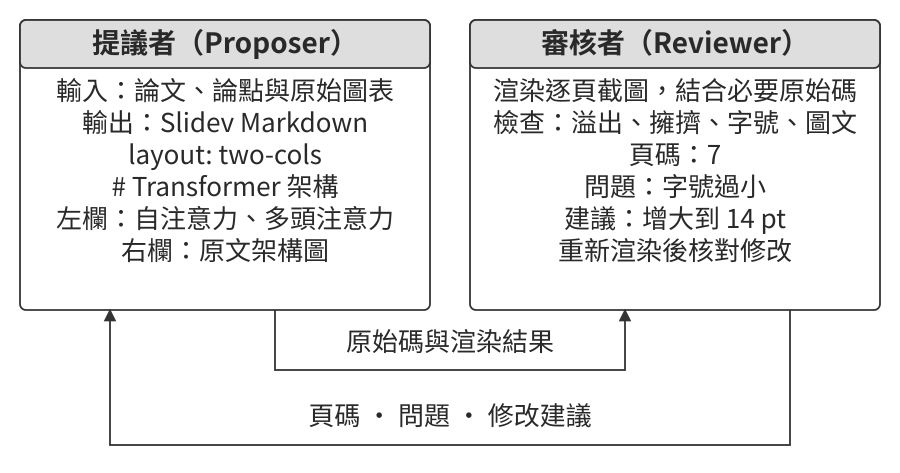

- **提議者（Proposer）** 閱讀論文，規劃講解結構，編寫 Slidev 原始碼，並根據回饋修改頁面。
- **審核者（Reviewer）** 透過工具渲染頁面，使用視覺模型檢查內容密度、可讀性、佈局和圖文對應關係，回傳包含頁碼、問題類型、嚴重程度和修改建議的結構化回饋。

回饋應能直接指導修改。例如，「第 3 頁要點過多，拆成方法概覽和計算步驟兩頁」；「第 7 頁程式碼字號過小，先增大至 14 pt，再檢查投影可讀性」。事實錯誤與圖表誤讀優先修正，隨後處理佈局和視覺細節。

局部修改還需要說明修改哪一個物件。飛書投影片裡的豆包工作允許使用者選中頁面元素，再透過浮動工具列提出編輯要求。[^ch5-doubao-work] 假設同一頁有兩個文字方塊，一處是原始訪談引文，另一處是彙報人寫的總結。使用者選中總結，要求「壓縮到兩行」。選中的文字方塊限定了改動範圍。總結可以改寫，旁邊的引文要保留受訪者的原話。

[^ch5-doubao-work]: 飛書幫助中心，在投影片中使用豆包工作。

提議者修改後重新渲染，審核者檢查新版本，並確認上一輪問題是否解決。迴圈設定兩類退出條件：達到明確的內容與版式要求，或用完輪數、時間與費用預算，例如最多修改 5 輪。交付時儲存目前版本及尚待處理的問題，便於後續審閱。

這與第四章的操作核准共享提議者—審核者模式。操作核准主要判斷某次行動能否執行；內容審查則透過多輪回饋改進產物。兩者都需要共享任務要求、給出可定位的判斷依據，並由 Harness 決定後續流程。採用不同模型家族可以提供另一種審查視角。

**筆者看重雙 Agent 分工在上下文管理上的優勢。** 兩個角色可以分別保留各自需要的資訊：審核者每輪接收最新截圖、審核標準和必要的問題清單；提議者保留原始碼、修改目標和結構化文字回饋。頁面影像留在審核者的上下文中，主軌跡透過簡短的文字回饋持續推進修改。每輪審核都圍繞最新頁面展開，既減少歷史截圖的干擾，也控制了上下文增長。

> **實驗 5-6 ★★：基於論文的 PPT 自動生成**
>
> 本實驗使用《Attention Is All You Need》的論文 PDF，生成 20 頁 Slidev 投影片。Agent 提取論文結構和要點，使用三張帶來源記錄的原論文圖，逐頁組織講解。渲染後檢查文字溢出、圖表可讀性及圖文對應關係，再按回饋修改。
>
> 對照比較單 Agent 自審和提議者—審核者分工。本次執行中，兩份最終文稿在同一獨立評分流程中均獲得 95 分；分工方案的峰值輸入約為 2.4 萬 token，保留歷史截圖的單 Agent 方案約為 9.3 萬 token。

> **實驗 5-7 ★★：論文講解影片的自動生成**
>
> 在投影片基礎上，Agent 可以為每頁編寫口語化講解，解釋圖中的物件、關係和結論，再呼叫 TTS 合成語音。講稿與頁面一起交給視覺審核者，檢查講到的元素是否出現在畫面中，以及描述是否與圖表一致。
>
> 製作影片時，實驗沿用前一節的生成流程，選用較早的一份 22 頁稿（v2）。按順序抽取 12 頁後，影片最後一個畫面來自原稿第 21 頁。前一節比較評分和用量時用的是後來的 20 頁稿（v9）。選好頁面後，使用 Kimi 生成講稿、Qwen 視覺模型審查圖文關係，再由 Fish Audio 合成逐頁語音。FFmpeg 根據每段音訊的實際時長設定頁面展示時間，合成約 8.6 分鐘的講解影片。
>
> 圖5-6 中，投影片、講稿和語音要到最後才合成影片。有些問題得在這一步才能聽出來：換頁時一句話是否還沒說完，越往後聲音和畫面是否越對不上。
>
> 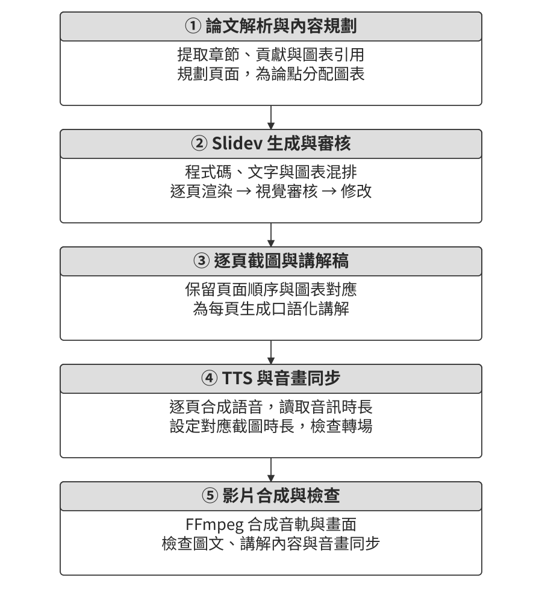

[^ch5-slidev]: Slidev，*Getting Started*，介紹基於 Markdown 和 Web 技術生成、展示與匯出簡報。

**影片編輯 Agent。**

**影片編輯中能夠用腳本表達的操作，應優先走程式介面。** 時間軸、圖層、字幕和音軌分布在複雜的 GUI 面板中，反覆定位和拖動會增加延遲與誤差；程式介面可以直接用時間區間、軌道和效果參數表達操作。Blender 的 Python 介面與 FFmpeg 都能把一部分編輯任務組織成可重複執行的腳本。

Agent 可以先理解「把衝浪部分剪出來」這樣的要求，再定位素材中的目標區間，生成裁剪、排列和音軌處理程式碼。提議者負責編輯計畫與腳本，審核者檢查渲染結果；遇到遺漏、無關片段或字幕遮擋時，回饋具體時間點和問題，交給提議者修改。關鍵幀適合檢查場景與佈局，運動連續性和音畫同步還需要檢查相鄰幀或連續片段。

> **實驗 5-8 ★★：基於 API 的智慧影片剪輯**
>
> 本實驗把目標定位、腳本生成和效果審查串成一個流程。先將影片引用、目標問題和抽幀間隔交給影片分析子 Agent，由它處理大量畫面，向主 Agent 回傳時間區間與依據。
>
> 定位分兩步。第一步每 10 秒抽取一幀，尋找目標的大致範圍，例如「衝浪在第 40—110 秒」；第二步圍繞候選區間及鄰近邊界，每秒抽取一幀，進一步確定開始和結束位置。短於粗取樣間隔的場景可能落在兩幀之間，可以根據目標持續時間增加取樣，或回看兩次抽幀之間的畫面。
>
> 確定區間後，提議者生成 Blender Python 腳本，執行裁剪及所需的字幕、變速等操作。審核者檢視預覽，指出需要調整的邊界和效果；修改通過後再輸出完整成片。
>
> 實際剪的是一隻大白兔獨自在草地上走過的鏡頭。每 10 秒看一幀，模型把範圍定在第 10 至 20 秒。若從第 10 秒直接下剪，鏡頭開頭就會丟掉一截。於是程式把前後各放寬 5 秒，在第 5 至 25 秒間每秒看一幀，把候選區間縮到第 9 至 12 秒。審核者又發現片段夾帶了相鄰畫面，修訂後的區間為第 9.25 至 11.00 秒。對照人工標註的第 9.08 至 11.20 秒，開始晚了 0.17 秒，結束早了 0.20 秒，兩端都達到了誤差不超過 3 秒的要求。
>
> 時間碼只能檢查剪在了哪裡。把同一套字幕和慢動作放到一段故意選錯的畫面上，審核者還能認出錯誤嗎？實驗先讓它檢查第 0 至 3 秒的對照片段，再看修訂後的渲染。審核對象包括畫面裡的大白兔、底部字幕和變速後的時長。

**3D 與工業零件：選擇合適的生成方式。**

**尺寸與裝配關係是硬約束的工業零件，優先採用參數化程式碼生成；主要追求自然形態與外觀的物件，優先考慮生成模型。** 這個選擇取決於產物能否用少量參數精確描述，以及修改後需要保持哪些關係。CadQuery、OpenSCAD 和 Blender 腳本提供可編輯的構造過程，混元 3D 等模型則利用學到的形態先驗生成複雜外觀。

**描述是否適合參數化。** 一個簡化法蘭盤可以用外徑、厚度、孔位圓直徑、孔徑和孔數表達主要幾何關係。程式碼將參數與構造步驟對應起來，適合反覆調整。一盆綠植、一塊太湖石或一張人臉則包含大量不規則形態，生成模型可以幫助構造外觀，程式化方法也可以透過生長規則、隨機過程和資產組合生成細節。

**精度如何檢查。** 對孔徑 5 mm、公差 ±0.05 mm 這樣的要求，需要先明確單位、座標系和測量方法，再比較模型尺寸與規格。參數化模型可以直接檢查幾何物件；網格可以透過截面、孔洞、包圍尺寸等方法測量，並計入離散化誤差。

**如何儲存和修改。** B-rep（邊界表示）用面、邊和頂點描述實體邊界，三角網格則用面片近似表面。CadQuery 可以匯出 STEP 用於 CAD 資料交換，也能匯出 STL 網格；可編輯的參數與構造邏輯儲存在 CadQuery 原始碼中[^ch5-cad]。進入 CNC 加工流程還需要工藝規劃、刀具路徑和機床適配。

例如，把安裝孔從適配 M5 改為適配 M6，可以修改孔徑參數，重新生成後複核外徑、厚度和孔位是否保持一致。生成模型的修改方式取決於介面能力，可以重新生成，也可以結合局部編輯和後續幾何處理。

兩條路線組合時，也應明確分工：尺寸和裝配關係交給參數化程式碼，紋理與自由外觀交給生成模型。**關鍵尺寸需要反覆精確修改時，可編輯的構造過程比一次生成的外觀更有價值。**

> **實驗 5-9 ★★：同一個零件的兩種生成路線——程式碼與生成模型**
>
> 本實驗要求生成外徑 80 mm、厚度 10 mm 的法蘭盤，在直徑 60 mm 的孔位圓上均布四個安裝孔。為明確裝配含義，初始規格採用適配 M5 的 5.5 mm 通孔，修改請求改為適配 M6 的 6.5 mm 通孔。
>
> 程式碼路線由模型生成 CadQuery 程式，執行後匯出 STEP 與 STL；生成模型路線先生成產品參考圖，再交給混元 3D 生成網格。檢查外徑、厚度、孔數、孔徑、孔位和安裝面，並記錄單位與軸向。
>
> 怎樣看出模型只改了指定的尺寸？對照修改前後匯出的 STL，四個安裝孔的平均直徑從 5.499 mm 增至 6.499 mm；兩件的外徑都是 80 mm，厚度都是 10 mm，孔位圓直徑按三位小數均為 60.000 mm。生成模型路線的原始網格缺少明確的物理尺度。測量程式沿 Z 軸取中截面，沒有找到孔的內環。要查明四個孔是否貫穿盤體，還需認出安裝面，沿它的法向在不同深度取截面。重新生成後，整體形態和朝向都發生了變化。
>
> 最後換一道題：要交付一張看起來自然的盆栽圖片，該怎樣驗收？實驗用 matplotlib 繪製一張盆栽，用 Gemini 生成另一張，再讓同一個視覺模型按十分制評自然度。兩張圖分別得到 3 分和 8 分。這個分數回答的是評審模型覺得哪張圖更像真實植物。回到法蘭盤，即使產品圖看起來像有四個孔，裝配仍要在三維零件上核對孔的位置和直徑。

[^ch5-cad]: CadQuery，*Importing and Exporting Files*，介紹 STEP、STL 等格式，並說明完整參數化資訊儲存在 CadQuery 的 Python 原始碼中。

### 程式碼作為系統適配器

外部服務的介面、鑑權方式和資料格式各不相同。Agent 可以閱讀文件與回應樣本，生成 HTTP 用戶端、配置鑑權頭、解析回傳值，再把上游欄位轉換成下游需要的結構。程式碼在這裡承擔系統適配工作，將已有服務組合為新的任務流程。

例如，從支付服務讀取的金額欄位若以分計，而報表按元展示，能把 JSON 解析成功只說明格式相容。一筆 25 元的交易，在上游是整數 2500。直接把這個數填入報表，25 元就成了 2500 元。

適配器需要明確輸入輸出、錯誤處理與版本範圍。樣本幫助模型理解欄位，介面約定和測試則檢查缺失值、分頁、異常回應及版本變化。憑證由執行環境管理，生成程式碼透過受控介面使用授權能力。驗證通過後，適配器可以儲存和複用，後續遇到格式變化再進入修改流程。

只有圖形介面的系統也可以採用類似方法。Agent 先透過第六章介紹的 Computer Use 完成任務，再把穩定的操作步驟固化為 RPA 工具。介面控制項、登入狀態和頁面流程變化時，工具需要偵測偏差並重新定位。第九章將進一步討論如何從成功軌跡中提取、驗證和複用工作流。

**Agent 日誌解析和視覺化。**

一次複雜任務可能包含多次模型請求、工具執行和子 Agent 互動。日誌概覽呈現步驟關係、狀態與耗時，展開後則顯示具體輸入輸出，幫助讀者追蹤某一步發生了什麼。新增欄位、巢狀結構和格式版本都會影響解析與展示。

自適應解析透過「發現變化—生成解析器—驗證結果」的迴圈處理這些變化。解析失敗時，系統儲存原始樣本、錯誤位置和預期欄位，再對照介面約定與生產者版本判斷變化是否符合預期。確認是格式升級後，才讓 Agent 編寫新解析器。如果是寫日誌的程式出了錯，就儲存原始日誌並報告故障，以免新解析器把錯誤也當成正常格式。新寫的程式碼先在受限環境中執行，先檢查欄位及其含義，再以正常樣本、缺欄位樣本和舊格式迴歸用例驗證。通過後註冊新解析器，儲存版本與適用格式；失敗樣本繼續保留，便於追蹤和重試。

解析與展示各有檢查方法。程式檢查時間戳、狀態、數值型別和呼叫關聯；瀏覽器渲染檢查頁面是否正常工作，視覺模型輔助檢查表格、時間軸與標籤是否清楚。熱更新時保留上一版本及回退入口，使新格式支援可以逐步進入執行系統。

> **實驗 5-10 ★★★：自適應的日誌解析系統**
>
> 本實驗先執行兩個日誌產生處理程序，分別輸出豎線分隔格式和巢狀括號格式。初始解析器無法處理這些樣本，系統隨後請求模型生成兩個解析函式，測試通過後熱載入，再解析原先失敗的日誌。
>
> 第一種格式提取 `timestamp`、`level`、`module`、`step` 和 `message`；第二種還涉及工具名、耗時與狀態。執行記錄中，兩類各三條日誌完成解析，新建引擎也能載入已儲存的解析器，繼續處理混合日誌流。
>
> 解析結果由 Chromium 渲染為表格，視覺審核檢查欄名、各列內容與可讀性。

**Agent 執行日誌自動分析和問題診斷。**

解析出結構化軌跡後，Agent 可以結合架構文件與 PRD（產品需求文件），比較預期流程和實際行動。例如，退款前有沒有查過這筆訂單能不能退？庫存服務超時後，程式有沒有按約定改查快取？

問題報告可以包含優先順序、模組、現象、證據和改進建議。Agent 還可以據此生成迴歸測試，把問題對應的輸入與驗收條件固定下來。測試框架在受控環境中重放請求或讀取儲存的工具回應，比較缺陷版本與修復版本的行為。涉及外部寫入的操作使用隔離環境或替代介面，保持重放的影響範圍可控。

斷言應對應需要驗證的屬性。例如，日誌裡出現過退款檢查，只能說明程式查過。要知道這筆錢退得對不對，還得看程式是不是先查後退、檢查結果是否允許退款，以及訂單最終是什麼狀態。

診斷經過複核，Agent 就可以在獲得相應授權後透過 MCP 建立 GitHub Issue，按模組建議負責人。若同一缺陷已有工作項，就把新證據並進去。

> **實驗 5-11 ★★★：生產日誌的智慧診斷系統**
>
> 本實驗用本地 HTTP 服務產生兩條業務軌跡，一條記錄顯示系統沒查訂單能不能退就退了款，另一條顯示庫存查詢超時後沒有改從快取取數。模型結合架構文件與需求說明，生成包含軌跡和輪次引用的問題報告，再生成三個可執行迴歸測試。
>
> 圖5-7 把一份診斷報告放在軌跡和迴歸測試之間。報告指出「系統跳過檢查，直接退了款」。回到軌跡裡找證據：呼叫記錄裡少了哪一步？再往下看測試：如果以後又漏掉這一步，測試能發現嗎？
>
> 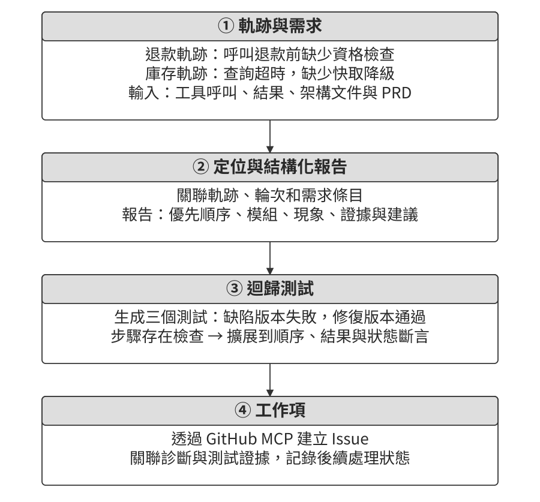
>
> 三個測試在缺陷版本上全部失敗，換成修復版本後全部通過。其中一個測試只判斷程式有沒有呼叫過退款檢查工具。即使程式先退錢，事後才查這筆訂單能不能退，這個測試也會通過。執行記錄中還儲存了 GitHub MCP 建立工作項的回執，可以據此找到診斷報告交給開發者後對應的工單。
>

### 程式碼作為生成式 UI

如果使用者還要親自改動 Agent 正在處理的材料，可以把介面做成兩人共用的工作台。以行程表為例，讓使用者看見助理正改哪一站、接手修改、確認或撤銷某項變更。若使用者剛把出發日改為週五，助理隨後就應在這份新行程上繼續工作。讓兩邊共享同一份可見狀態，並約定目前由誰控制正在編輯的欄位，才有可能邊看邊改。

想像使用者要比較三種出行方案。目的地尚未確定時，對話便於追問；目的地確定後，讓使用者直接選日期、填寫人數比來回核對幾段文字方便；最後比較總價隨日期的變化，一張圖表能把差別擺在眼前。Agent 按任務生成相應的表單、圖表或應用介面，讓使用者直接填寫、選擇、操作，這就是生成式 UI（Generative UI）。

**用協定描述介面與互動。**

生成介面有兩條實作路徑：輸出 HTML、JavaScript 等程式碼，交給受控環境執行；輸出宣告式結構，由用戶端元件渲染。前者便於實現客製佈局和互動，後者把可用能力限定在用戶端提供的元件與動作範圍內。

A2UI（Agent-to-User Interface）採用宣告式描述。Agent 生成結構化訊息，表達元件、資料綁定和更新，用戶端用自己的元件呈現介面[^ch5-ui-protocols]。例如，應用可以提供卡片、按鈕、文字方塊和表格元件，Agent 據此描述一個標題為「銷售資料」、包含三列兩欄的表格。元件目錄還可以擴展圖表和地圖等能力。

AG-UI（Agent–User Interaction）負責 Agent 與前端之間的事件互動，傳遞訊息、工具呼叫和狀態更新，也可以承載 A2UI 的介面訊息。兩者組合後，A2UI 描述要展示的內容，AG-UI 銜接後端執行與前端互動。

用戶端可以逐步接收介面更新，並透過適配的渲染器在 Web、行動端或桌面端展示。用戶端驗證元件屬性、資料綁定和動作請求，伺服器端繼續檢查業務權限；元件中的連結、富文字和資料存取也需要各自的處理規則。

直接生成程式碼時，則需要檢查依賴、資源存取和執行權限，並隔離生成介面與宿主應用的敏感狀態。外部材料中的提示注入可能影響生成過程，瀏覽器中的腳本執行風險還取決於頁面載入和隔離方式。

**用 HTML 交付互動式成果。**

**對於包含資料、示範和持續更新結果的研究交付，筆者優先採用 HTML 網站。** 長篇線性 Markdown 彙報要求讀者不斷翻找上下文；互動式網頁可以把說明、資料和示範放在同一個入口：讀者檢視圖表，篩選感興趣的樣本，展開某項結果的細節，再操作示範理解系統行為。Agent 也可以隨任務推進更新頁面，使它持續記錄目前成果與證據。

以筆者的研究實踐為例，每個研究專案都有一個互動式網站，把它同時作為研究過程中的活文件和最終交付物，並讓 Agent 隨實驗推進持續補充內容。這些網站主要承擔三項工作。

一是**實驗資料追溯**。頁面將樣本、提示詞、模型回覆和評分關聯起來，支援逐條檢查。例如，同一類回覆總是得低分時，可以沿著評分記錄找回原始回覆和提示詞。

二是**訓練指標監控**。筆者把反映訓練內部狀態的訊號稱為「內科指標」：訓練與驗證損失、梯度範數、學習率，以及強化學習中的獎勵、KL 散度和策略熵等。語言模型還可以用困惑度衡量它對給定文字序列的預測表現。就像體檢中的生理指標，這些曲線有時能比最終任務成績更早暴露問題。把它們與任務準確率一起檢視，有助於定位不收斂、梯度異常和訓練退化發生的階段。

三是**執行原理展示**。介紹幾個模組怎樣配合時，頁面可以讓讀者改動一個輸入，檢視中間狀態，再把輸出的變化和實驗記錄對照起來。

工作持續幾個小時，使用者怎樣抽空接手？筆者使用 Coding Agent 時，希望一句口頭指令能準確送到經辦的 Agent，想看成果時能隨時開啟，有了新版本或遇到需要我決定的問題時再來提醒。例如，兩份報告正在同時生成。使用者開啟銷售報告，指著第二張圖說「這張按淨收入重畫」。介面應把目前報告和圖表標識隨指令一起送出。圖改好了，通知可以直接開啟新版；若「淨收入」有兩種可用的計算基準，助理應把可選的兩種基準列給使用者。

**澄清使用者意圖。**

使用者說「我想訂一張去北京的機票」時，目的地已經明確，出發城市、日期和單程或往返仍待補充。Agent 可以在一輪對話中集中提問，也可以生成表單，讓相關條件在同一頁面上呈現。

表單中的控制項對應不同類型的資訊：文字方塊收集開放輸入，下拉選單與單選控制項列出可選項，核取方塊支援多選，日期選擇器幫助填寫時間。JavaScript 可以表達級聯關係，例如選中「往返」後顯示返程日期，並檢查返程不早於出發。選擇改變時，還要同步清理或忽略已失效的欄位。

圖5-8 取自下面實驗的一次執行。沿著這筆提交往下看：瀏覽器回傳的四個欄位裡沒有目的地，模型從哪裡知道旅客要去北京？

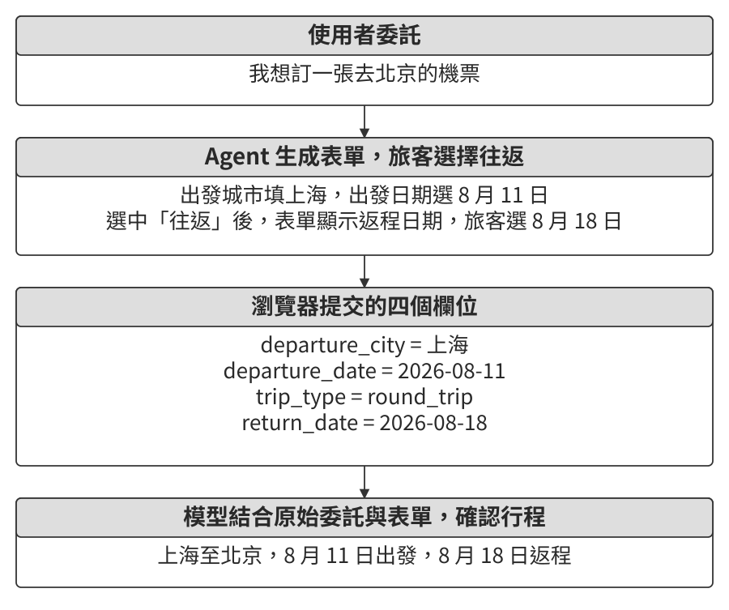

> **實驗 5-12 ★★：動態表單生成的意圖澄清系統**
>
> 本實驗從「我想訂一張去北京的機票」出發，讓模型生成 HTML 表單：出發城市使用文字方塊，出發日期使用日期選擇器，旅行類型提供單程與往返選項，返程日期在選擇往返時顯示。
>
> 程式把最初的委託和表單資料一起交回模型。如果只保留提交的欄位，即使每個控制項都填對了，仍然缺少目的地。
>
> 用同一份表單再試一步：填好返程日期後改選單程。頁面藏起了返程輸入框，提交的 JSON 卻同時保留了單程和 8 月 18 日的返程日期。改選單程時，用戶端還得清掉失效的返程日期。

[^ch5-ui-protocols]: A2UI 官方文件與 *AG-UI Overview*，分別介紹宣告式介面描述和 Agent—前端事件互動。

**生成 SQL 查詢。**

使用者可以用自然語言提出資料庫查詢，Agent 根據表結構和業務定義生成 SQL。**展示完整查詢表格時，筆者優先採用 Artifact 模式，讓結果從資料庫直接進入介面。** 讓模型讀取並逐行複述大表格，會增加 token 用量和等待時間，還引入抄寫錯誤。SQL 儲存為可檢查的查詢產物；需要分析原因或總結趨勢時，再把必要的聚合結果交給模型。

圖5-9 中，使用者要看各部門的在職人數，頁面可以直接顯示資料庫回傳的統計表。如果使用者接著問「市場部比研發部多幾人」，模型只需取表中的 9 和 5 就能算出相差 4 人。若追問「上個月也差這麼多嗎」，眼前這張表就不夠用了，得按上個月的統計日期重新查詢。

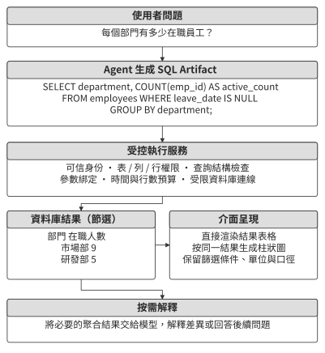

執行服務根據可信身份確定可存取的資料表、欄與列，使用受限資料庫帳號，並對 SQL 結構和操作類型進行校驗。查詢場景可以限定為批准的唯讀查詢，控制函式呼叫、時間預算、回傳列數與資料範圍；使用者輸入的值透過參數化綁定傳入。

Agent 還可以生成視覺化產物，例如將部門彙總結果展示為長條圖。執行服務把查詢結果交給受控的視覺化執行環境，介面只展示允許的資料與互動。

> **實驗 5-13 ★★：自然語言互動的 ERP Agent**
>
> 本實驗以 ERP（企業資源規劃）中的員工與工資查詢為例，學習如何從業務問題生成 SQL，並讓資料庫結果直接進入頁面。PostgreSQL 中建立兩張表：員工表包含員工 ID、姓名、部門、級別、入職日期和離職日期，離職日期為空表示在職；工資表包含員工 ID、發薪日期和工資，每位員工每月一條記錄。
>
> Agent 根據這兩張表處理以下十個問題：
>
> 1. 平均每個員工在職多久？
> 2. 每個部門有多少在職員工？
> 3. 哪個部門員工平均級別最高？
> 4. 每個部門今年和去年各新入職多少人？
> 5. 前年 3 月到去年 5 月，A 部門的平均工資？
> 6. 去年 A 部門和 B 部門的平均工資哪個高？
> 7. 今年每個級別的員工平均工資？
> 8. 入職一年內、一到兩年、兩到三年的員工最近一個月平均工資？
> 9. 去年到今年漲薪幅度最大的 10 位員工？
> 10. 有沒有拖欠工資（某月在職但未發薪）？
>
> 查詢前需要明確統計定義。例如，在職員工的任職時長計算到查詢基準日，離職員工計算到離職日；「平均工資」需要確定按發薪記錄還是按員工平均；漲薪排名需要處理去年無記錄的員工。
>
> 本次執行生成並執行了十條 SQL，結果均與獨立參考計算一致，隨後由瀏覽器直接渲染表格。模型接收表結構、任務與必要的執行回饋，資料庫的資料列透過應用傳到介面。

**動態生成軟體。**

Agent 可以從需求開始生成介面和互動邏輯，再根據使用者操作繼續修改。Anthropic 在 2025 年推出的臨時研究預覽「Imagine with Claude」展示了這種互動：使用者探索介面，模型持續生成相應的軟體體驗[^ch5-imagine]。

**面向實際產品，筆者更看好在已有框架上進行客製。** 從零持續生成整個應用會反覆付出生成、渲染和驗證成本；保留穩定框架，再開放使用者關心的介面與流程，能更快地提供可靠的個性化體驗。使用者提出「把按鈕改成藍色」「在側邊欄新增快捷選單」「換一種更易讀的字型」，Agent 定位相關元件、修改程式碼，再透過預覽檢查效果。基礎框架提供穩定的頁面結構與業務介面，客製範圍可以從顏色、字型逐步擴展到佈局和元件。

開發環境的 HMR（Hot Module Replacement，熱模組替換）可以在程式碼變化後更新受影響的前端模組。是否保留狀態，取決於框架整合、更新邊界及修改類型；需要完整重新整理時，應用還應儲存必要狀態。FastAPI 開發模式中的 reload 則重新載入伺服器端程式，兩者分別作用於前端模組和後端處理程序[^ch5-hmr]。

> **實驗 5-14 ★★：對話式介面客製系統**
>
> 本實驗建構 React 前端與 FastAPI 後端組成的聊天應用，在開發環境中啟用前端 HMR 和後端 reload。模型根據連續三輪要求修改顏色、字型和標題，瀏覽器檢查每次修改後的實際介面。
>
> 本次執行記錄了 Vite 的 HMR 事件，三輪修改均未發生整頁導航，已有聊天狀態得到保留，最終建構通過。

[^ch5-imagine]: Anthropic，*Introducing Claude Sonnet 4.5*，介紹隨模型發布的臨時研究預覽 Imagine with Claude。
[^ch5-hmr]: *Vite HMR API* 與 *FastAPI CLI*，分別介紹前端熱更新和開發伺服器自動重新載入。

**讓權限邊界獨立於動態業務程式碼。**

**業務程式碼越容易由 Agent 動態改寫，最終的權限邊界就越應下移到穩定的資料存取層。** 傳統應用將權限判斷寫在經審查的業務程式碼中；生成程式碼不斷變化後，某條新路徑可能遺漏同樣的檢查。讓每次讀寫都經過獨立的資料存取服務，才能把權限約束保留下來。例如，招聘應用可以動態生成候選人列表和操作表單，候選人屬於哪個組織、招聘人員可以更新哪些欄位，則由受信任的資料存取服務持續檢查。

這裡的設計目標是：**即使生成程式碼出現錯誤，受信任的資料存取層仍能強制實施權限約束。** 這延續了第一章的資料層護欄：把需要強制遵守的規則放在所有相關操作都要經過的位置。資料庫的資料列層級安全策略可以限制記錄存取，約束和校驗器檢查合法狀態，受控檢視、預存程序或資料服務提供允許的操作。應用層可以提前檢查並向使用者解釋，最終讀寫仍由受信任的資料服務和資料庫權限控制。

每次操作還需要可信的**存取上下文**（access context），包含使用者、租戶、角色或 Agent 身份。認證服務與受信任執行階段負責建立和綁定身份，資料服務據此授權。動態程式碼獲得完成任務所需的受限介面，憑證和策略管理權限由獨立元件保管。所有資料庫連線、輔助查詢及背景處理都應遵守同一存取範圍。

例如，PostgreSQL 的資料列層級安全性需要結合資料庫角色配置使用。應用連線採用受策略約束的角色，應用帳號無權修改存取策略[^ch5-rls]。規則與身份綁定機制經過獨立審查，業務介面則可以在這個範圍內持續變化。

權限與資料完整性還承擔不同職責。招聘人員有權修改候選人記錄後，狀態機繼續檢查是否允許從「已篩選」進入「已面試」；工資校驗器讀取關聯職位，檢查期望工資是否位於職位範圍；引用檢查確認職位和候選人關係有效。

> **實驗 5-15 ★★★：動態生成軟體的權限內嵌資料物件**
>
> 本實驗提供 PostgreSQL 之上的 Python 物件儲存原型，將權限規則、校驗器、物件關係和後續反應宣告放在資料型別中。讀取時檢查存取權限；建立和更新時，先執行權限與業務校驗、檢查引用關係，再持久化，隨後將宣告的後續反應加入佇列，並限制反應鏈深度。
>
> 招聘示例包含職位、候選人、面試和評估等物件。候選人依次經歷申請、篩選、面試、發放錄用通知與錄用，相關階段也可以進入拒絕狀態；工資範圍來自關聯職位。示例設定了正常狀態更新、無效狀態跳轉、超出職位工資範圍和不同租戶存取等檢查，幫助讀者理解授權與業務校驗各自處理什麼問題。
>
> 原型透過 `AccessContext` 表達使用者、角色與組織屬性，教學腳本直接構造這些上下文來模擬不同身份。部署時由認證入口建立上下文，並將物件儲存與生成程式碼分隔在明確的服務或權限邊界兩側。

[^ch5-rls]: PostgreSQL，*Row Security Policies*，介紹按角色和操作配置資料列層級安全策略及其適用範圍。

### 程式碼創造程式碼：Agent 自舉

程式碼生成能力也可以用於開發 Agent 本身。建立者接收任務需求，生成或修改新 Agent 的提示詞、工具和執行迴圈，再透過測試與實際互動檢查產物。圖5-10 展示了這一自舉迴圈：已有實作提供起點，任務回饋推動修改，驗證結果決定哪些變化可以保留。

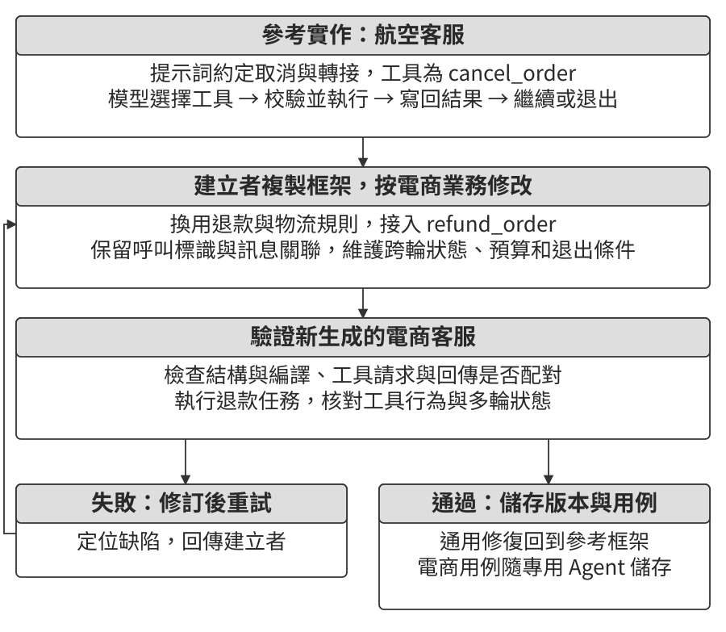

如何分辨一次修改改善了通用能力，還是碰巧適應了剛見過的題？保留一個沒有送給建立者的任務。例如，用一家商店的資料開發價格監測 Agent，再交給它另一家商店的樣例，同時重跑原來的任務。

**維護 Agent 的執行環境。**

新 Agent 的執行依賴配置、憑證、會話狀態、服務和沙盒。OpenClaw 的 `doctor` 命令提供了一個維護工具的例子：它檢查舊配置遷移、OAuth 憑證狀態、會話鎖、外掛安裝、閘道健康和沙盒映像等問題，並給出修復建議或執行相應修復[^ch5-doctor]。

這些確定性檢查可以成為自我維護流程的基礎。偵測規則覆蓋已知故障，修復動作具有明確的輸入與預期結果。進一步設計 Agent 診斷流程時，可以把尚未解決的問題連同日誌、配置和檢查結果交給模型，讓它說明打算改哪個配置、怎樣改；執行層檢查權限與修改範圍，再執行健康檢查和迴歸測試。配置快照、變更記錄與回退入口幫助系統在修復失敗後恢復工作。

**以參考實作承載工程經驗。**

建立專用 Agent 同時涉及領域邏輯和通用基礎設施。檢查生成結果時，可以從四類問題入手：

1. **上下文與執行迴圈。** 保留角色、工具呼叫標識和工具結果之間的關聯，檢查多輪狀態、終止條件、預算及異常恢復。結構化訊息便於維護協定關係；穩定前綴則為提示快取創造條件。
2. **工具介面。** 工具說明交代用途、適用條件和使用邊界，參數包含型別、含義與具體例子。執行層繼續驗證參數、身份和業務狀態。
3. **模型與 API 選擇。** 模型容易沿用訓練資料中高頻出現的舊模型和舊介面，程式碼寫得流暢也可能選型滯後。為建立者提供經過維護的選型資料，或讓它檢索官方文件，核對模型能力、介面版本與呼叫方式。生成後的真實呼叫檢驗配置是否可用。
4. **依賴與生態相容性。** 檢查庫的維護狀態、版本和介面變化，用依賴安裝、編譯檢查與測試驗證組合後的程式。

**建立專用 Agent 時，筆者優先讓建立者複製經過驗證的參考實作，再做領域修改。** 提示詞很難窮盡訊息協定、狀態管理和恢復機制中的所有細節，參考程式碼卻能把這些工程經驗直接帶入新系統。模型即使擅長程式設計，也可能漏掉任務描述中沒有明說的執行條件；複用框架可以減少這類重複失誤。建立者複製合適的基礎框架，調整系統提示詞以匹配新角色，增刪領域工具，修改業務邏輯，並補充對應測試。訊息處理、呼叫關聯、狀態管理與退出路徑由框架提供，領域變化則透過新增用例驗證。

若範本快了許多，怎樣排除「少做了幾項功能」這個解釋？下面讓兩組建立者交付同一種 Agent，交給同一套檢查。

> **實驗 5-16 ★★★：開發一個能創造 Agent 的 Agent**
>
> 請同一個建立者模型建構一個發布審核 Agent：讀完一組部署檢查記錄，只要有必檢項未通過，就拒絕發布並指出依據。從零建立時，模型需要編寫執行迴圈、工具協定、領域工具、命令列入口和測試。範本路線先複製一套能檢查結構化記錄的 Agent，模型只需填寫領域規格。例如，狀態存在哪個欄位，哪些值表示通過？建立腳本根據規格生成系統提示、工具定義和說明文件。已有的 Python 工具讀取規格執行檢查。兩條路線都體現了元程式設計：用程式生成或修改其他程式。
>
> 圖5-11 中，兩條路線匯合在同一套驗收條件上。
>
> 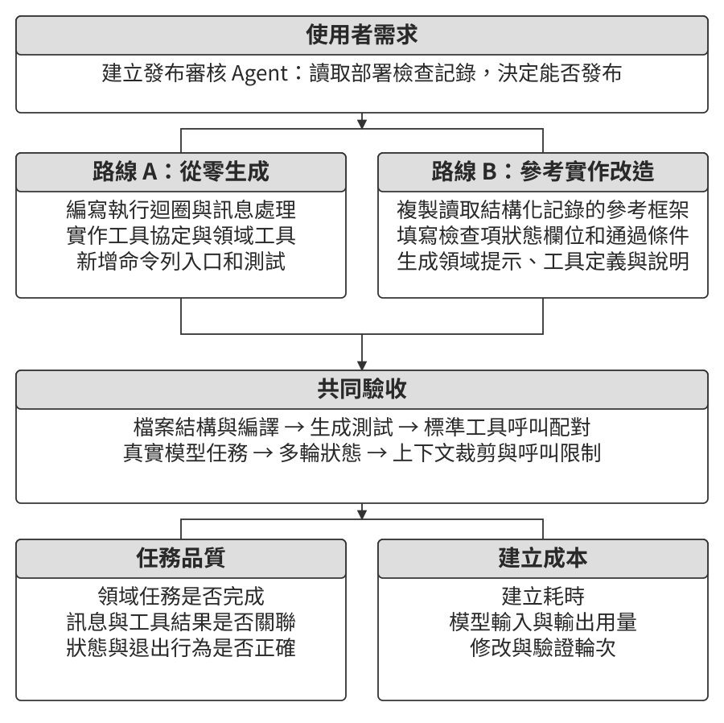
>
> 兩條路線使用相同的任務要求和驗收條件。先檢查產物結構、編譯與測試，再檢查標準訊息中的工具呼叫與結果關聯，最後執行真實模型任務和多輪互動，驗證上下文裁剪、狀態管理和呼叫次數限制。
>
> 儲存的 Kimi K3 對照中，兩組各通過 39/39 項確定性檢查，也都通過了真實模型任務和多輪狀態檢查。範本路線建立時用了 1,181 token、約 25 秒，從零路線用了 381,814 token、約 90 分鐘。
>

[^ch5-doctor]: OpenClaw，Doctor，介紹配置與狀態檢查、遷移和修復功能。

## 本章小結

**Coding Agent 較早成熟，有一個容易被忽略的原因：軟體工程已經有型別系統、測試套件、版本控制和除錯工具。** 程式碼改錯了，測試往往能指出哪組輸入得到了意料之外的結果；換一種改法，還能用原來的輸入再試。把這套經驗用到其他任務，先問三個具體問題：怎樣發現錯誤，怎樣恢復到已知狀態，何時需要停下來請人接手？例如退款呼叫中途斷線，Harness 應先查帳再決定是否重試，否則一次故障恢復就可能變成第二次退款。

程式碼也能把一次判斷儲存成能反覆使用的東西。數學題中的列舉和邏輯題中的約束可以交給程式逐項檢驗；退款規則可以寫成執行入口的校驗，讓伺服器端讀訂單裡的真實狀態再決定是否放行。日誌格式變了，可以改解析器，再把這次出錯的樣本留下做迴歸測試。這三種場合都能執行程式碼，但判據各不相同：解是否滿足題目條件，退款是否符合政策，新的解析器能否讀出原來漏掉的欄位。

交付的是文件、影片或幾何模型，還要檢查渲染效果、音畫是否同步或尺寸是否準確，安排審核者看一遍實際產物。交付的是表單、查詢或視覺化，除了看使用者能否讀懂和操作，還要檢查背後的執行服務是否按權限取數。如果程式碼生成的是另一個 Agent，筆者傾向於先複用經過驗證的框架，生成領域工具和業務邏輯，再檢查呼叫協定、跨輪狀態和實際任務結果。這樣積累下來的工具、校驗器和測試，下一次任務可以接著用。

程式碼能讓任務反覆執行，環境卻未必等它執行完。一個查詢還在執行，使用者可能已經改了主意。第六章討論這種變化怎樣進入一次正在進行的互動。

## 思考題

1. ★★ 為一個需要讀取專案檔案、安裝依賴和執行測試的 Coding Agent 設計沙盒。你會如何配置檔案、網路、處理程序和資源權限？任務需要擴大權限時，怎樣表達請求、檢查範圍並保留記錄？
2. ★★★ 建立者連續生成和修改多代 Agent 時，框架缺陷與領域錯誤可能逐步累積。如何用參考版本、迴歸測試、行為評估和回退機制追蹤這種變化？
3. ★★ 日誌格式變化可能來自正常升級，也可能來自生產者缺陷。自適應解析系統應保留哪些證據，依據哪些條件決定新增解析器、報告異常或暫停處理？
4. ★★ 提議者—審核者迴圈中，審核者認為頁面資訊密度合理，使用者卻覺得擁擠。如何把使用者偏好轉化為示例、評分條件和互動回饋，並檢查後續修改是否符合要求？
5. ★★ Coding Agent 可以更新知識庫、架構文件和專案指令，也可以把操作序列固化為程式碼。如何識別冗餘或過時的規則，為規則設計適用範圍、驗證方法和退出條件？從一次成功修改發展為第九章討論的持續進化，還需要哪些積累與評估機制？
6. ★ 對遠端協作友好的團隊通常也便於 Agent 獲取工作資訊。請檢查一個熟悉專案的需求、架構、決策記錄和驗收標準，列出最需要補充的文件，並說明它們能幫助 Agent 完成哪些具體任務。
7. ★★★ 對同時存取私有資料、處理不受信任內容、進行外部通訊並使用持久記憶的 Agent，如何安排身份授權、來源標記、資料流檢查與記憶寫入審核？請用一條正常業務流程說明這些檢查的位置。
8. ★★ 在 SQL 與 HTML 的 Artifact 模式中，模型生成產物，執行服務處理查詢或渲染，介面直接呈現結果。哪些資訊適合再交給模型解釋？如何檢查查詢權限、資源預算、頁面隔離和展示結果的一致性？
9. ★★ 工具根據資料庫中的業務狀態校驗規則，參數說明則幫助模型準備呼叫。請以取消預訂為例，說明自然語言政策、參數例子、執行層校驗和邊界測試各自承擔什麼職責；政策變化後，哪些內容需要同步更新？
