# 互動：觀測與動作空間的擴展

**底層模型固定時，重新組織或擴展觀測與動作介面，往往是提升 Agent 任務表現最有效的工程手段之一。** 前幾章裡，Agent 通常等使用者說完，再查資料、調工具、給出答覆。它在等工具結果的時候，使用者和外部環境卻還在變化。

使用者委託助理改機票。助理正向客服查詢航班時，使用者又發來「我還有一件行李要託運」；客服還在說話，螢幕上顯示的票價也可能變。助理需要及時問清票價是否包含託運行李，也得留意剛才的報價是否還有效。這裡有兩個設計問題：助理能從哪些管道得知變化，又能在什麼時候作出反應？本章先討論非同步到達的郵件和工具結果，再看連續語音、螢幕變化和機器人的動作回饋。

## 模態與觸發時機的擴展

**模態**描述資訊與行動的形式。Agent 可以讀取文字、聽取聲音、檢視螢幕和接收力矩訊號，也可以輸出文字、合成語音、點選介面或驅動關節。

**觸發時機**關注資訊何時到達、行動何時開始，以及系統何時作出回應。資訊可以由 Agent 主動查詢，也可以由外部服務推送；工具可以立即回傳結果，也可以先啟動任務，稍後報告完成。新事件到達時，系統還需要判斷是否打斷目前工作，以及如何恢復被中斷的任務。

| 維度 | 資訊獲取與觀測介面 | 行動與執行介面 |
|---|---|---|
| 內容組織（第二至五章） | 上下文、記憶與知識庫組織決策資訊 | 工具與程式碼表達可執行操作 |
| 模態（本章） | 語音、螢幕、物理感測器 | 說話、點選、關節運動 |
| 時機（本章） | 主動查詢、事件推送、連續輸入 | 跨回合執行、取消、搶佔與恢復 |

上下文承載某次決策所需的資訊，觀測空間描述系統可能接收的資訊範圍；工具提供具體介面，動作空間描述系統允許執行的動作範圍。擴展介面時，這些範圍仍受裝置能力、參數、權限和執行環境約束。

許多工具呼叫介面按輪次組織訊息：模型提出呼叫，系統補入工具結果，再發起下一輪推理。事件驅動系統需要在這套協定上管理外部變化。介面支援原生非同步時，可以在工具掛起期間接收新要求，並在結果回傳後繼續處理；採用同步介面時，則由 Harness 使用佇列、任務控制碼和排程機制組織互動。後文分別討論兩條實作路線。

不同場景的回饋節奏相差很大。下表列出常見的時間尺度。

| 常見尺度 | 場景 | 觀測側的變化 | 動作側的處理 |
|---|---|---|---|
| 秒至天 | 非同步與事件驅動 | 外部事件喚醒 Agent | 先啟動任務，後續事件報告進展與完成 |
| 數十毫秒至秒 | 語音 | 連續接收音訊 | 串流輸出，處理插話與停止播放 |
| 亞秒至秒 | Computer Use | 螢幕持續變化 | 操作後重新獲取介面狀態 |
| 毫秒級控制週期 | 機器人底層控制 | 感測器持續回饋 | 執行短段動作，回應控制與停止訊號 |

## 非同步與事件驅動：當世界主動找上門

第四章介紹了感知、執行和協作工具，本節接著討論事件觸發與使用者溝通工具。事件觸發工具把環境變化送入 Agent，溝通工具則讓 Agent 在任務推進過程中聯絡使用者。Harness 將這些輸入輸出與正在執行的任務關聯起來，形成持續工作的事件迴圈。

### 為什麼需要非同步

同步呼叫需要等待結果回傳，呼叫方才能繼續目前流程。非同步呼叫則先回傳任務控制碼（用於查詢和管理任務的標識），或約定稍後通知完成，讓呼叫方在等待期間處理其他工作。系統可以據此組織多個進行中的任務，再根據資源和依賴決定哪些操作能夠並行執行。

可以把 Agent 想成一位管理郵件、電話和來訪事項的秘書：等待對方回信時繼續整理材料，緊急電話到達時暫存目前進度，通話結束後再恢復原任務。對應到工程實作，需要處理三件事：

- **長任務與互動分離。** 檔案分析、電話或建構任務在背景推進，使用者仍可以查詢進展、補充要求。
- **事件優先順序。** 緊急停止及時進入控制流程，常規更新進入佇列，獨立查詢可以交給並行會話。
- **中斷與恢復。** 儲存任務狀態，記錄已經發生的操作，恢復時重新檢查仍然有效的條件。

Claude Duet 的研究預覽給了一個例子：使用者下午兩點要開會，想提前拿到對方公司的簡報。他可以留一條語音訊息，然後關掉應用。準備工作在雲端繼續，使用者隨時可以開啟任務頁看進度；需要他補充資訊或簡報做好時，助理再回到主對話通知他。這裡，使用者離開後任務仍能推進，說的是非同步執行。後文要講的全雙工通話還有另一項要求：一方開口時，仍然能聽見對方插話。[^ch6-duet]

模型 API 對訊息的先後順序也有約定。有些介面要求工具呼叫與結果完整配對後才接受下一輪請求，有些允許掛起工具並接收後續更新。應用中的非同步函式負責安排等待與執行，模型協定則規定何時可以提交訊息。

在圖6-1 中，新訊息和工具結果都可以進入佇列，但它們怎樣到達佇列，取決於來源。服務支援推送，狀態一變就能發來通知；服務只提供查詢介面，適配器就要定期去查，發現變化後生成事件。定時器到期也可以產生事件。事件迴圈再把這些輸入交給 Agent。

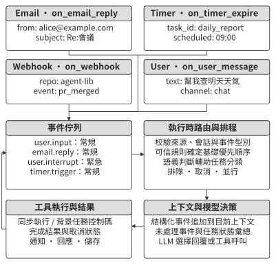

### OpenClaw 的事件驅動機制實作

OpenClaw 透過 Gateway 接入訊息管道，並將事件路由到 Agent 執行階段。它的自動化機制包括內部 Hooks、定時排程、Heartbeat 和外部 Webhook 等入口[^ch6-automation]。這些機制可以按觸發條件理解：

- **Hooks（事件鉤子）**回應框架內部事件，例如會話建立、重設或執行生命週期變化。
- **Cron（定時排程）**按指定時間或週期執行工作。例如 `0 9 * * 5` 表示在所配置時區的每週五上午 9 點觸發。
- **Heartbeat（心跳）**週期性喚醒 Agent，檢查需要關注的事項。
- **Webhook（外部回呼）**接收外部服務提交的事件，經認證與路由後觸發處理。

週報適合按時執行，持續關注的待辦可以週期檢查，新郵件和服務回呼則可以透過推送縮短發現時延。

**PineClaw 的通話事件。** Pine AI 代替使用者撥打電話，處理帳單協商、訂閱取消和保險理賠等事務。PineClaw 將這類電話任務接入 OpenClaw。通話通常持續一段時間，其間可能需要使用者介入：

- **身份驗證。** 客服要求帳戶持有人完成驗證，例如輸入安全碼或一次性密碼。
- **三方通話。** 客服要求直接與帳戶持有人交談，需要及時通知使用者接聽。
- **決策確認。** 客服提出替代方案時，前台結合這次委託和使用者以往的偏好判斷能否接受。需要使用者拿主意時，就把具體選項發給使用者，同時繼續與客服核對其他條件。

例如，客服需要帳戶持有人加入三方通話。通知越早送到，雙方在電話裡空等的時間就越短。PineClaw 案例採用 Channel 機制，在 Gateway 與 Pine API 之間串接通話事件：電話接通、需要使用者輸入和通話結束分別進入事件流，Agent 據此更新任務並通知使用者。

**筆者認為，要讓主動服務來得及時，最好由事件源在狀態改變時通知 Agent。** 通知經通道送達後，Harness 找到對應任務，檢查是否重複、是否過期，模型再決定下一步。如果需要使用者驗證身份，介面應開啟受信任的認證入口，驗證結果隨後作為新事件送回原任務。

### 事件觸發工具

若把「客戶回信後提醒我」交給助理，它怎樣在明天恰好醒來？先查信箱能否在來信時推送事件；只能主動查詢的系統，則需要記住下次檢查時間。以下三個示意介面把這些等待條件交給執行階段儲存，模型可以結束目前一輪工作。

**定時器（`set_timer`）**用於按約定的時間喚醒一項任務。一次性定時器適合「下週一上午 10 點致電銀行查詢房貸進展」；週期性定時器適合每小時檢查一次服務健康狀況。傳送郵件後等待回覆、遇到非工作時間後重新撥號，也可以用定時器安排。介面需要儲存時區、觸發條件和任務標識，並提供取消或修改入口。外部服務只支援查詢時，定時任務還可以承擔進展輪詢。

**背景任務監控（`monitor_shell`）**用於把長時間執行的命令轉化為進展事件。啟動時回傳任務標識，執行階段按新增輸出、關鍵詞或狀態變化通知，結束時報告退出狀態與結果。

讓模型反覆查詢進度，即使狀態沒有變化也要消耗模型呼叫；只等待結束通知，又可能錯過中途故障。因此，筆者建議把監控交給執行階段，只在有用的進展、錯誤或停滯出現時喚醒模型。這樣既能在建構期間繼續溝通，也能及時介入異常。監控規則可設定過濾、合併和頻率限制，避免每行日誌都引發一次模型呼叫。

例如，模型給待處理的工單訂閱狀態更新後，就可以結束這輪推理，等通知帶著工單號喚醒它。若對方只提供查詢入口，模型可以自己給下次檢查設個定時任務。到時查到「仍在處理」，就再約一次；查到工單已辦結，就取消後續檢查。兩種做法都由執行階段負責等待，模型只在收到通知或定時器到期時再作判斷。

**外部事件通道（`connect_channel`）**用於訂閱郵件、即時訊息或 API 回呼。通道適配器驗證來源，把服務自己的標識對應為訊息串與關聯物件，再提交統一格式的事件；後文「接入層」一節展開。PineClaw 的電話狀態通知屬於這一類。

三類工具都需要明確觸發條件、過濾規則和事件載荷。載荷應包含事件標識、發生時間、來源、相關任務及必要內容，讓 Agent 能判斷事件是否仍然有效，以及下一步需要哪些資訊。

### 使用者溝通工具

回到改票任務。向客服發問、給使用者發一條可以直接回答的確認訊息、在任務記錄裡記下「正在等回覆」，會寫到三個不同的地方。使用者可以暫時離開，等需要補充條件、確認決定或接收結果時再回來。

會話介面可以展示最終回覆、工具進度和執行結果；溝通工具則明確指定收件人、管道、訊息內容及附件。模型決定需要表達什麼，Harness 檢查目標和權限，訊息服務完成投遞。執行階段也可以把最終回覆自動路由到原會話。兩種方式可以配合使用。

OpenClaw 的多管道互動使使用者能夠像聯絡秘書一樣傳送訊息、等待進展和接收提醒。這種「活人感」來自持續的任務狀態與及時溝通。使用者可以在熟悉的管道繼續任務，Agent 則需要保持身份、會話和訊息關聯的一致。

溝通內容也可以隨任務變化：簡短進展使用文字，複雜結果附帶圖片或檔案，待填寫的資訊採用結構化卡片，互動式成果採用第五章介紹的生成式 UI。管道支援投遞或已讀回執時，系統儲存相應狀態；失敗重試、重複訊息和跨管道同步也進入投遞記錄。

**多管道通知與使用者召回。**

即時通訊、簡訊、郵件、電話和應用推送，各自適合不同的緊急程度與內容形式。Agent 可以結合緊急程度、使用者偏好、目前狀態和訊息長度選擇管道。需要立即確認的通話事件採用及時提醒，完整報告可以透過郵件或應用連結交付。

筆者曾讓助手盯 ATC 會議的飯店房價。每天同一時間，助手都會發來訊息，說房價還沒降到目標價。有一次房價短暫下跌，捕捉到這個時段的卻是筆者自己寫的指令碼。短暫的低價可能出現在兩次查詢之間。即使助手及時查到了，訊息送晚了，使用者也可能錯過預訂。沒有降價的日子，定時查詢仍可照常執行，使用者無需每天讀一條內容相同的訊息。第七章會用一段五分鐘的降價時段來檢驗這種提醒。

長任務完成時，通知把使用者帶回成果頁面；每日總結與週報則按約定節奏傳送。多管道策略還應設定去重、靜默時段和升級條件，例如首次提醒未獲回應後，是否改用另一管道。通知記錄與任務狀態關聯，便於使用者從收到的訊息繼續處理。

### 虛擬身份與隔離執行環境

第四章借《Her》中的 Samantha 說明通用助理如何透過工具進入數位世界。實作這類助理，需要明確它以什麼身份工作、可以存取哪些資源。**筆者傾向於為通用助理配置獨立的虛擬身份。** 專屬的辦公信箱、電話號碼、儲存空間和計算環境，讓 Agent 像擁有自己辦公帳號的秘書一樣，以明確的代理身份代表使用者處理事務。獨立身份把助理的日常工作與使用者的個人帳號分開，便於單獨授權、稽核和撤銷；發生誤操作時，也更容易限制影響範圍。必須存取使用者帳戶的任務，則透過限定範圍的授權獲得所需權限。

電話號碼歸誰，決定了對方回電時誰能接著辦。Manus 的 Cue 為助理提供獨立號碼，可以接聽來電，再把通話摘要留給使用者。假如商家接受助理留下的回電號碼，客服來電時就能直接找到先前經辦的助理。[^ch6-cue]

以費用減免為例，助理可以用授權代表的身份聯絡商家。若客服要求本人做口頭驗證，可請使用者加入三方通話，完成驗證後由助理接續溝通。若商家將回電給使用者，先把案件號、已談妥的事項和需要核實的問題交給使用者。向使用者報告時，也要說清楚手中的證據：客服已口頭答應減免，就記錄這項承諾；後續查到帳單更新，再報告費用已實際減免。

筆者在北京補辦美國銀行的信用卡時，Pine 聯絡銀行，安排了加急補卡，並爭取到免收 15 美元加急費。通話結束時，助理已經可以報告銀行受理了什麼、同意免去哪筆費用。過幾天使用者若問「新卡到哪兒了」，就需要再查物流或請收件人確認。

虛擬電腦和虛擬手機提供持續執行的操作環境。虛擬機器可以執行桌面系統，容器適合隔離處理程序與依賴，Android 模擬器承載行動應用。它們支援背景執行，也能減少自動操作對使用者目前工作的干擾。隔離範圍由網路、掛載、憑證和執行權限共同決定；這些配置同時影響 Agent 能夠接觸的資料與外部系統。

假設你希望下班關機後由騰訊 WorkBuddy 企業版生成週報，而本週的銷售表只存在辦公電腦上。選擇本地任務，助理可以讀這張表，但電腦必須開機，用戶端也要保持連線。選擇雲端任務，助理可以在你關機後繼續工作，前提是先把允許用於週報的資料上傳到任務，或放入雲端任務能存取的資料庫。如果銷售表必須留在本機，就應安排在電腦開機連線時處理。

網頁和行動應用還可能要求身份驗證、驗證碼或人工確認。接入時優先使用服務提供的 API 與授權方式；需要圖形介面認證時，可以透過 VNC/RDP 遠端桌面讓使用者親自登入，並在認證期間暫停自動操作。使用者完成後，系統檢查會話狀態，再恢復任務。權杖與會話按有效期儲存，撤銷授權或任務結束後按策略清理。

Agent 與虛擬環境之間可以透過**共享檔案系統**交換資料。例如，使用者上傳 CSV，虛擬電腦讀取檔案、執行分析並將圖表寫回共享儲存；執行階段將圖表的檔案位置交給 Agent，再向使用者提供可存取的下載入口。大檔案內容保留在儲存中，模型按需讀取摘要或片段。

[^ch6-dsh-threads]: DeepSeek，dsh-superagent 原型的領域模型和授權與訂閱規則。
[^ch6-dsh-sessions]: DeepSeek，dsh-superagent 原型，版本 `8c32a9d`。兩類會話的職責見 `docs/004-prompts.md`，執行會話與工作目錄見 `docs/003-execution.md`，送入主會話的訊息格式見 `docs/007-architecture.md`。
[^ch6-duet]: Anthropic，*Get started with Claude Duet*，介紹會前簡報、任務頁和主對話通知。
[^ch6-cue]: Manus，*Introducing Manus 2.0*，介紹 Cue 的獨立電話號碼、來電接聽和通話摘要。
[^ch6-automation]: OpenClaw，Automation，介紹內部 Hooks、定時排程、Heartbeat 與外部 Webhook 等自動化入口。

### 接入層：多種來源，一種事件

一家網店的客服 Agent 處理一筆退款：顧客在 App 的客服對話裡提出申請；金額超出 Agent 的權限，它在企業微信售後群裡請主管確認；支付服務退款成功後發來 Webhook；訂單系統隨後在 Kafka 上發布狀態變更。四條訊息說的是同一筆訂單，到達方式各不相同。來源一多，每條鏈路各自處理重試、去重和順序，執行階段就會被這些差異拆散。**接入層統一事件進入系統之後的形態，保留各來源到達之前的能力差異。** 圖6-2 展示了這種分層。

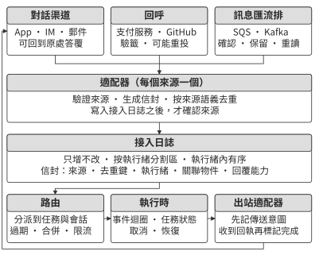

常見來源有四類。**對話管道**包括產品自己的對話介面，企業微信、飛書、Slack 等即時通訊，以及郵件，Agent 可以回到原處答覆。**回呼**是外部服務在狀態變化時呼叫的 HTTP 介面，通常帶簽名，只送來通知；投遞失敗後有的服務自動重試，GitHub 則要手動或透過 API 重新投遞。**訊息匯流排**如 SQS、Kafka，承載內部服務的業務事件，有明確的確認與保留語義。**定時器、輪詢和內部事件**由系統自己產生，寫入同一份日誌即可。下表比較前三類。[^ch6-ingress-mq][^ch6-ingress-callback]

| | App 對話 | 企業微信 / 飛書 | 郵件 | Webhook | SQS | Kafka |
|---|---|---|---|---|---|---|
| 到達方式 | 長連線 | 回呼或長連線 | 推送或輪詢 | 回呼 | 消費者拉取 | 消費者拉取 |
| 有序範圍 | 對話內 | 多數事件不保證 | 不保證 | 不保證 | 標準佇列不保證，FIFO 按訊息組 | 分割區內 |
| 原生去重依據 | 用戶端訊息 ID | 訊息 ID、事件 ID | Message-ID | 投遞 ID | 訊息 ID；FIFO 另有 `MessageDeduplicationId` | 主題、分割區與位點 |
| 能否重放 | 依賴自己的記錄 | 回呼本身不能重放，飛書可用歷史訊息介面補拉 | 可重讀信箱 | 依服務而定 | 刪除後不能 | 保留期內可以 |
| 確認方式 | 用戶端回執 | 時限內回傳成功 | 自行記錄讀取位置 | 時限內回傳 2xx | 刪除訊息 | 提交位點 |
| 回覆路徑 | 原對話 | 原對話 | 回信 | 無 | 無 | 無 |

**統一信封。**

適配器把原始訊息轉換為統一格式的**信封**（envelope）。信封只記錄到達時就能確定的事實；優先順序與處理期限由路由規則補充，客戶等級、訂單狀態由業務系統補充，處理狀態另行儲存。顧客的退款申請可以寫成這樣：

```json
{
  "id": "evt_7f3a",
  "source": {"type": "app_chat", "sender": "user:u_5521", "verified": true},
  "dedupe_key": "app:msg:msg_1029",
  "thread": "app:conv:conv_88",
  "kind": "message",
  "correlation": ["order:12345"],
  "content": {"type": "text", "text": "這個訂單我想退款"},
  "raw_ref": "raw/2026-11-23/app/msg_1029.json",
  "reply": {"via": "app_chat", "target": "app:conv:conv_88"},
  "occurred_at": "2026-11-23T14:02:09+08:00",
  "expires_at": null
}
```

- `source`：來源類型和經過驗證的傳送者。「已驗證」由適配器依據簽名、權杖或管道帳號判斷，正文裡的自我介紹不算；執行階段按這一項判斷權限。
- `dedupe_key`：去重鍵，什麼算重複由來源的語義決定。投遞 ID、訊息 ID、分割區與位點標識同一次投遞，擋住傳輸層的重投；業務訊息若帶冪等鍵（idempotency key），例如退款單號加狀態，適配器把它取出來，才能擋住業務上的重複。使用者對話相反：顧客兩次說「退款」是兩條訊息，只按用戶端訊息 ID 去重。
- `raw_ref`：原樣儲存的原始載荷，排查適配器錯誤時只能依靠它。
- `reply`：經由哪個出站適配器、發往哪個目標。支付回呼沒有回覆路徑，這一項為空。
- `occurred_at` 是來源給出的發生時間；`expires_at` 是有效期，報價、驗證碼這類事件才填。

**訊息串與關聯。**

顧客先說「退款」，緊接著補充「算了，換貨吧」，兩條訊息的順序不能顛倒；另一位顧客的訊息與它們無關，可以並行處理。**接入層只在訊息串內承諾順序。** 適配器把來源自己的順序單元對應為 `thread`：App 的一段對話、SQS FIFO 的訊息組（`MessageGroupId`）、Kafka 的分割區鍵、GitHub 回呼裡的 Issue 或 PR 編號。來源不保證順序時，執行階段靠 `occurred_at` 或來源給出的版本號識別遲到的舊狀態，例如在「退款成功」之後才到的「退款處理中」。

這筆退款的四條訊息分屬四條訊息串。合併成一條的代價不小：售後群裡一條無關討論也要排在顧客訊息後面，訊息串標識又往往兼作分割區鍵，事後修改要遷移資料。**關聯關係另設欄位表達，不改寫訊息串。** `correlation` 列出事件涉及的業務物件，任務按關聯物件訂閱相關訊息串。

**確認時機與進度分離。**

**適配器應當在事件寫入接入日誌之後確認來源，而不是等 Agent 處理完再確認。** 飛書的事件回呼要求 3 秒內回應，企業微信是 5 秒，超時就重新推送；SQS 的訊息若在可見性超時內沒有刪除，會被再取一次。等處理完再確認，一次稍長的模型呼叫就會招來重複投遞。先寫日誌再確認，各來源的投遞保證就收斂為一句話：**每個事件至少進入接入日誌一次（at-least-once）**，重投的那一次由去重鍵擋掉。

接入日誌相當於收件匣（inbox），沿用第一章的只增不改原則，按訊息串分割區。以 Kafka 作接入日誌時，去重需另設唯一約束儲存或在消費端按去重鍵過濾：Kafka 不能按應用給的鍵拒絕寫入，它的冪等生產者只覆蓋生產者自身的重試。

系統要分開儲存三種進度：

| 進度 | 記錄內容 | 由誰維護 |
|---|---|---|
| 來源進度 | Kafka 位點、SQS 接收控制碼、信箱讀取位置 | 適配器 |
| 分派進度 | 日誌中的事件已交給哪些任務 | 路由 |
| 任務狀態 | 處理到哪一步、回覆是否已經發出 | 執行階段 |

把位點當作任務進度，重放日誌時已經發出的回覆會再發一次；分開之後，重放只影響分派進度。出站方向對應發件箱（outbox）：傳送前記下發送意圖和冪等鍵，收到管道回執再標記完成；重啟後怎樣核對，見後文「從郵件事件建立基本迴圈」。

**時效、合併與背壓。**

同一條訊息串上每秒湧來上百個事件時，不該逐條交給模型。路由在分派前處理積壓：

- **時效。** 報價、驗證碼、已恢復的告警過了時間就失去意義。過了 `expires_at` 的事件只記入軌跡，不再喚醒模型。
- **合併。** `kind` 區分兩類事件。狀態型事件描述某個物件的目前值，如支付回呼裡的退款狀態、Kafka 上的訂單狀態，同一訊息串積壓多條時只把最新一條交給模型，中間值留在日誌裡。訊息型事件是某人說的一句話或下的一個指令，如顧客訊息、主管的點選，可以成批交給模型，不能丟棄。
- **背壓。** 拉取型來源可以放慢拉取，積壓留在來源。推送型來源無法讓對方暫停，適配器照常寫日誌、確認，積壓轉到接入日誌，由前兩條規則消化。

**一筆退款走完四個來源。**

1. 顧客在 App 對話裡提出退款。適配器以用戶端訊息 ID 去重，寫入日誌，再回執用戶端；路由按 `order:12345` 建立退款任務，任務訂閱這條對話訊息串。
2. 金額超出權限，Agent 在企業微信售後群發出確認卡片，卡片標識記入任務。主管點選「同意」，適配器寫入日誌後回傳成功，並按卡片標識補上關聯物件。
3. Agent 呼叫退款介面後，支付服務兩次回呼「退款成功」，投遞 ID 相同，第二次被去重。
4. 訂單系統在 Kafka 發布「訂單已退款」，和回呼說的是同一件事。兩個適配器若都從載荷裡取出退款單號加狀態作去重鍵，這條事件在接入時就被擋下；若分別按投遞 ID、分割區與位點去重，兩條都進入日誌，執行階段發現任務裡退款已經確認，只把它記入軌跡。
5. 回呼和 Kafka 事件都沒有回覆路徑。執行階段用第 1 步那條對話訊息串的 `reply`，經 App 出站適配器通知顧客。

第 4 步是接入層去重的邊界：能擋住哪些重複，取決於適配器聲明了什麼去重鍵；沒擋住的，靠任務狀態判斷。事件分派到任務後，接在已有會話後面還是另開會話，屬於上下文管理：跨會話的資訊靠第三章的記憶傳遞，上下文能否共享見第十章。

[^ch6-ingress-mq]: Amazon Web Services，「Amazon SQS standard queues」；「Amazon SQS visibility timeout」；「Using the message deduplication ID in Amazon SQS」；「Using the message group ID with Amazon SQS FIFO Queues」。Apache Kafka 4.4 文件，「Design」中的「Consumer Position」與「Message Delivery Semantics」。核對日期：2026-11-24。
[^ch6-ingress-callback]: 飛書開放平台，「事件概述」；「獲取會話歷史訊息」。企業微信開發者中心，「接收訊息與事件」下的「概述」。GitHub Docs，「Best practices for using webhooks」；「Handling failed webhook deliveries」。核對日期：2026-11-24。

### 事件處理機制

使用者訊息、工具結果、定時器和協作請求可能同時進入一個 Agent。執行階段需要儲存這些事件，確定處理順序，再將相關資訊交給模型。**事件迴圈**（event loop）負責持續推進這個過程：從佇列取出事件，更新任務狀態，組織模型請求，排程工具，隨後等待新的輸入或完成通知。Go 程式透過 goroutine、channel 和 `select` 組織多路訊息，也採用類似的思路。

以 dsh-superagent 原型為例，同一 GitHub 專案裡，一個 Issue 下的討論和一個拉取請求（PR）下的討論分屬兩個會話訊息串（Thread）。系統需要判斷是否接手新工作時，會讀入訊息串狀態，讓模型求值（Eval）。同一訊息串同時最多進行一次求值，但可以有多張工單（Ticket）訂閱它。假設修復缺陷和補充文件的兩張工單都訂閱了同一個 PR，審閱者在 PR 下留言，兩張工單都會收到這條訊息作為上下文。如果隨後有人在 Issue 下補充了重現條件，這條訊息會送達訂閱該 Issue 的工單。訊息送到了誰，取決於訊息串和訂閱關係。收到訊息後能做哪些事，仍由各工單原有的授權決定。[^ch6-dsh-threads]

dsh-superagent 還把「跟人打交道」和「幹活」交給了不同的會話。主會話（Main Session）只負責接單、回話和寫授權，不讀程式碼，也不停下來等結果；每張工單有自己的執行會話（Executor Session），在單獨的工作目錄裡改程式碼、跑測試。執行會話修好了、卡住了或者要問人，才給主會話發一條訊息，附上摘要和讀取地址，也就是第二章說的「摘要加物件 ID」。這樣主會話總騰得出手接下一個請求，向人提問、發通知、叫停也都經過它，承諾只從一個口子發出。後文語音部分的快慢模型，是這種分工在即時通話裡的樣子。[^ch6-dsh-sessions]

同步模型介面通常在一次生成結束或工具結果補齊後接收下一批訊息。這裡可以設定**安全點**：執行階段先記錄已完成的訊息、仍在執行的呼叫和目前任務進度，再切換到新的處理步驟。原生非同步介面則提供執行期間接收更新的協定，具體接續時機由介面與執行階段共同安排。

取消同樣需要執行器配合。模型停止生成後，背景工具可能仍在執行；執行器需要接收取消訊號，並報告實際狀態，類似 Go 任務檢查 `ctx.Done()` 後執行清理。已經完成的寫入、傳送或付款，應透過對應的業務流程處理撤銷或補償。

**三種處理策略。**

圖6-3 比較了新事件到達時的三種選擇。讓它排隊，回應時間取決於何時遇到下一個安全點；取消目前任務，要確認哪些操作已經完成、從哪裡可以恢復；另開一個迴圈，則要檢查兩項任務會不會爭用同一份資源。

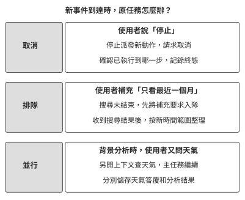

**取消式處理（Cancellation-Based）**適合使用者停止指令或需要立即處理的控制事件。執行階段先停止繼續派發相關操作，向正在生成的請求和可取消的工具傳送停止訊號，再儲存已完成訊息、工具狀態與取消回執。新事件隨後進入決策上下文。例如，使用者說「停！我說錯了」，系統先限制後續執行，再結合目前實際狀態重新確認任務。尚未處理的佇列項保留標識與狀態，按關聯範圍重新排序。

**佇列式處理（Queued）**適合常規補充資訊和進展更新。事件進入佇列，在下一安全點與工具結果一起交給模型。例如，搜尋期間使用者補充「只看最近一個月的結果」，搜尋回傳後，模型同時讀取結果與新條件，再決定篩選或重查。

**並行處理（Parallel）**適合與主任務獨立、需要及時回覆的請求。例如，大批次資料分析期間，使用者詢問天氣，系統可以建立獨立會話完成查詢。

**緊急度與路由。**

事件類型提供初步線索：`user.interrupt`、可信監督指令和系統告警可以進入高優先順序通道；`user.input`、`agent.input`、`tool.result` 與 `timer.trigger` 再結合內容和任務狀態判斷。傳送者在正文中自稱「緊急」時，系統仍按驗證過的身份與規則確定權限。

對於需要理解訊息含義的路由判斷，筆者建議使用輕量級分類模型：「馬上停下來」對應取消，「今天天氣怎麼樣」可能適合並行處理，「報告請用中文」通常進入目前任務的補充佇列。明確的停止入口由執行階段直接處理，語義分類用於其餘需要理解的訊息。

通用模型也能給訊息打標籤，但即使只輸出「需要處理」四個字，模型仍要讀入任務說明和訊息內容。每條新訊息都這樣判斷一次，呼叫費用會隨訊息量增長，真正緊急的訊息也得等模型給出標籤才能往下走。TypeSafe 的 Jev 專門處理這類選項預先給定的判斷任務。給它一條訊息和目前任務狀態，它就能以較低的成本和延遲，並行給出各個選項的機率。[^ch6-jev]

第一章討論的觀測空間稀疏化，在這裡決定了哪些訊息會觸發一次新的推理。以飛書訊息和 GitHub Issue 評論為例，程式可以先按事件編號過濾重複通知，再讓 Jev 判斷新訊息是補充已有任務，還是提出了需要主模型處理的新請求。讀到「補充昨天說的重現步驟」，模型只需判斷這是一條補充說明。至於補充的是哪條 Issue，程式直接讀取評論自帶的編號即可。

即使模型給出很高的機率，也可能高估自己的把握。例如，100 條訊息都以約 90% 的機率被判為「補充已有任務」，實際上只有 60 條屬於這類。自動把這批訊息併入已有任務，就會錯過另外 40 條訊息本來的用途。

[^ch6-jev]: TypeSafe 在 Jev 的發布說明中介紹了預定義輸出、並行回傳機率，以及以決策校準為目標的訓練方法 RLCD。

### 從郵件事件建立基本迴圈

假設處理新郵件的處理程序突然重啟。郵件標識能幫它找回原文，卻不能告訴它上一封回覆有沒有發出去。從入隊、讀郵件、呼叫工具，到更新信箱或通知使用者，最好把每次寫操作和回傳的回執記在同一封郵件名下。重啟後若發現發出了請求卻沒有回執，就先核實信箱裡的實際狀態，再決定是否重發。

> **實驗 6-1 ★★★：事件驅動的郵件處理 Agent**
>
> 本實驗以測試信箱為入口，練習事件註冊、佇列和任務處理。先將新郵件整理為結構化事件，按到達順序處理；再接入郵件歷史、附件讀取、知識查詢和通知等工具。沿圖6-4 追蹤一次會議邀請：在事件迴圈裡找出日曆衝突檢查和擬稿兩步，再到持久層找這封郵件的處理記錄。
>
> 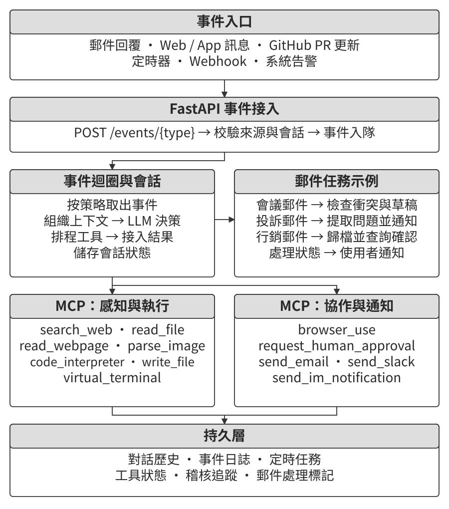
>
> 同一佇列可以擴展多種來源：郵件到達、IM 或簡訊訊息、GitHub PR 與 Issue 更新、定時器、外部 Webhook，以及使用者離線、處理程序超時和資源告警等內部事件。每個適配器負責驗證來源並補充關聯資訊，處理結果按事件標識回寫。
>
> 驗收使用三封測試郵件：會議邀請觸發日曆衝突檢查，並生成接受或拒絕草稿；客戶投訴觸發關鍵資訊提取、高優先順序標記和使用者通知；行銷郵件按規則歸檔。
>
> 目前配套記錄完成了介面文件核對與認證探測，測試信箱接入仍待有效憑據。
>
> **擴展（選做）：多來源接入與故障注入。** 在測試信箱之外，再接一個本地 Webhook 端點和一條 SQS 佇列（可用本地模擬）。每個適配器驗證來源、生成信封，寫入接入日誌後再確認來源；執行階段從日誌讀取事件，按訊息串順序處理。然後注入三類故障：
>
> 1. **重複投遞。** Webhook 端點以同一投遞 ID 收到兩次請求，日誌中只出現一個事件。
> 2. **確認前崩潰。** 適配器寫入日誌後、刪除 SQS 訊息前被終止；訊息重新可見並再次讀取後，日誌中仍只有一個事件。
> 3. **回執前崩潰。** 執行階段發出回覆後、記錄回執前被終止，重啟後從日誌重放。管道支援冪等鍵，或者能查到已傳送的訊息時（例如信箱的已傳送記錄），同一封回覆不重複傳送；兩樣都沒有的管道，只能把這封回覆標為待人工確認。
>
> 三類故障都應在日誌中留下記錄：哪次投遞被去重、哪條訊息被重新讀取、哪封回覆經過核實後沒有重發。
>
> 這一擴展的配套程式碼可以離線執行，不需要 API Key。測試信箱和 SQS 佇列都用本地檔案模擬，與上面等待憑據的真實信箱分開；模擬佇列保留了可見性超時、接收控制碼和訊息組內的順序。崩潰由父處理程序在指定位置直接終止子處理程序。回覆管道各示範一種：郵件查已傳送記錄，App 對話用冪等鍵，簡訊兩樣都沒有。重現時進入 `chapter6/agent-with-event-trigger`，執行 `python multisource_demo.py`，終端會逐項列印三類故障留下的日誌記錄。配套執行記錄中，三類故障的檢查全部通過。
>

郵件佇列建立了順序處理的基礎。接下來加入長時間執行的工具，討論等待期間如何接收新要求、取消任務和恢復工作。

### 不支援原生非同步時的相容方案

假設 Agent 正在起草郵件，已經呼叫 `search_contacts` 查詢聯絡人。結果尚未回傳時，使用者要求「等一下，先查明天的天氣」。如果目前模型介面要求每個工具呼叫先配齊結果，Harness 就需要將背景狀態轉換成介面接受的訊息序列。

**在同步訊息格式中表達背景狀態。**

**相容同步介面時，應儘量保留正常呼叫與真實結果的配對，只在中途切換任務時補入狀態回應。** 過早為每次呼叫填寫「仍在執行」，會使軌跡充滿未完成狀態，增加模型追蹤真實結果的負擔。具體可以遵循五條規則：

1. **記錄完整呼叫。** 將 API 已完成的 assistant 訊息和工具呼叫項寫入軌跡，保留呼叫標識。伺服器端推理狀態按提供商規定的續接方式儲存。
2. **記錄真實完成。** 工具完成後寫入實際結果、任務標識和執行狀態；執行期間，任務管理器持續儲存未完成狀態。
3. **在切換時報告目前狀態。** 對允許此類結果載荷的介面，可以為待完成呼叫回傳明確的狀態資訊，例如「任務仍在背景執行，結果尚未產生」，隨後追加使用者事件。狀態回應中的任務標識關聯後續完成通知。
4. **整理中斷後的訊息。** 缺少中途續接能力時，取消未完成的生成，保留已確認完成的訊息和工具狀態，再提交新請求。未完成輸出按介面規定處理，避免把半截參數當作可執行呼叫。
5. **批次接收常規事件。** 補充資訊進入佇列，在目前週期結束或指定安全點統一提交，並記錄哪些事件已經處理。

在聯絡人查詢例子中，完整呼叫先寫入軌跡；使用者切換任務時，Harness 補入查詢仍在執行的狀態回應，再提交天氣請求。聯絡人結果稍後到達，以帶來源和任務標識的新事件進入上下文，Agent 隨後繼續起草郵件。原呼叫已經獲得狀態回應時，後續結果採用適配器約定的事件形式，保持呼叫與結果的配對關係。

狀態回應只說明目前執行進度。依賴聯絡人資料的步驟必須等真實結果到達後繼續。任務管理器可以儲存 `running`、`completed`、`cancelled`、`failed` 等狀態，並在傳送回覆或執行後續工具前檢查依賴是否滿足。

**用任務控制碼設計非同步工具。**

對於新設計的長任務工具，筆者優先把「啟動」定義為一次完整操作，立即回傳真實的任務控制碼。模型據此區分「已經啟動」和「已經完成」，後續查詢、取消和結果事件也有統一的關聯依據。例如，`initiate_phone_call` 發起電話任務，回傳任務標識與「正在撥號」的狀態；`phone_call_connected`、`phone_call_ended` 分別報告接通和結束。

工具說明應寫清楚：「本工具啟動電話任務，成功後回傳任務 ID。你可以繼續處理其他事項；通話進展和結束結果透過單獨事件回傳。」工具名說明這是啟動操作，回傳結構與後續事件則說明任務如何推進和結束。系統再提供按任務 ID 查詢、取消和恢復的介面，使模型能夠知道目前還能做什麼。

**逐項處理批次事件。**

多個事件一次進入上下文時，模型可能只回應最後一條，遺漏前面已經提出的要求。執行階段應保留各自的處理狀態，讓尚未回應的條件繼續可見。提示詞可以要求模型逐項檢查，狀態列則列出尚未處理的資訊：

```text
[未處理事件 1/4] database_query 結果：……
[未處理事件 2/4] 使用者補充：只看北京地區的資料
[未處理事件 3/4] 系統提醒：報告截止時間還有 30 分鐘
[未處理事件 4/4] 使用者詢問：進度如何？
```

批次摘要可以提示「1 個工具結果、2 條使用者訊息、1 個系統提醒」。執行階段進一步將事件與任務約束關聯：地區條件更新查詢範圍，截止時間影響排程，進度詢問需要回覆。處理後記錄完成、等待或需澄清的狀態，下一輪繼續保留未解決項。

同一任務編號把啟動、進度報告和最後的執行結果串在一起。如果中途有人要求停止，就要再查這個編號下有沒有取消回執。

> **實驗 6-2 ★★★：帶並行執行和打斷能力的非同步 Agent**
>
> 本實驗先驗證非同步執行階段，再接入模型檢查決策。配套執行記錄用真實作業系統子處理程序完成四個場景，事件排程和報告由確定性指令碼驅動。
>
> 1. **背景執行與即時回應。** 啟動持續數秒的分析處理程序，立即回傳任務標識；等待期間回答目前時間，完成後接收分析結果。
> 2. **佇列與批處理。** 長任務期間依次補充「用日語回覆」和「整理成網頁」，任務完成後將結果與兩條要求作為一個批次處理。指令碼生成日語 HTML。
> 3. **取消與恢復。** 示範程式收到「停止分析」時，會打斷仍在生成的模型回合，並要求所有執行中的背景任務停止。這次由指令碼發出打斷，當時只有一個分析處理程序 T1。第 0.803 秒，打斷事件記下 T1 的進度為 18%；到第 0.806 秒，系統才記下它的退出碼 −15。緊接著啟動的 T2 是一項新任務。第 4.436 秒收到的是 T2 的結果，T1 沒有觸發完成回呼。
> 4. **並行任務與進度決策。** 同時啟動三個分析處理程序，每個邏輯時間步分別推進 3%、2%、1%。在本實驗的並行進度記錄裡，最快的 T1 完成時，查詢回執顯示 T2 已到 68%，T3 到了 34%。沿圖6-5 看，進度不超過 50% 的任務會被取消。指令碼只取消了 T3，最後收到了 T1 和 T2 的結果。這說明同一個執行階段既能回應整批停止，也能保留仍有用的並行工作。
>
> 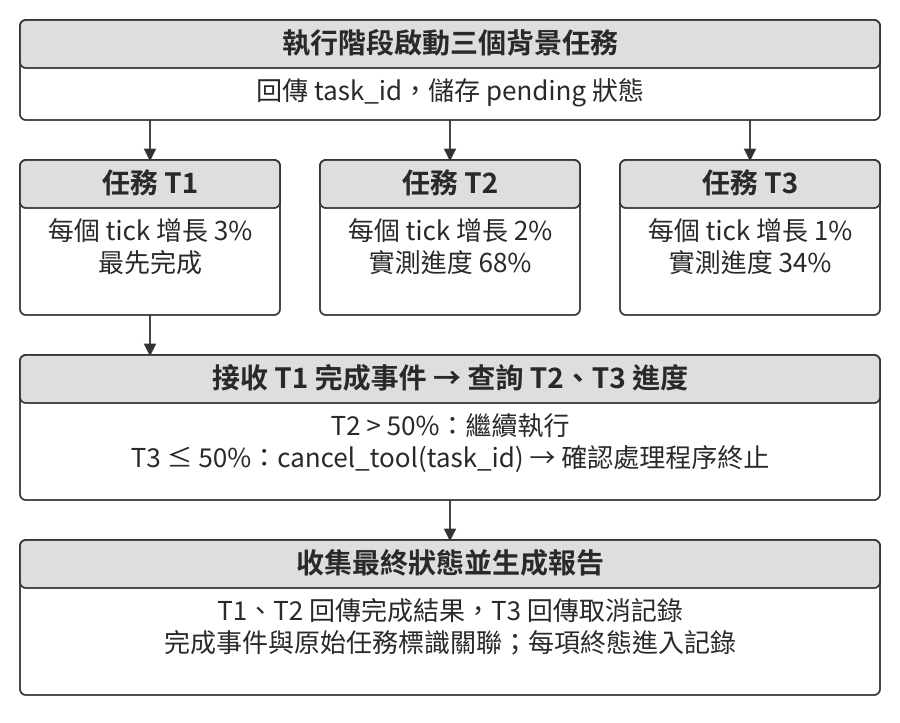
>

### 模型原生非同步：GPT-6 Astra

前面的方案由 Harness 適配同步訊息格式。原生非同步介面則直接允許模型在工具尚未回傳時繼續處理獨立工作，並在後續接收結果。截至 2026 年 9 月，GPT-6 Astra 已提供非同步工具呼叫（Async tool calling）與回合中途引導（Mid-turn steering），分別處理工具等待和使用者更新。圖6-6 對照了同步介面適配與原生非同步的訊息流程。[^ch6-22][^ch6-23]

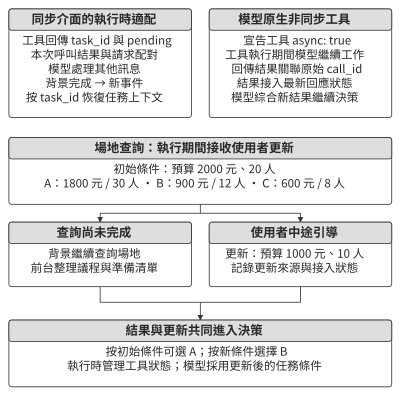

**等待工具時繼續獨立工作。** 例如，Agent 發起會議場地查詢後，可以先整理議程與準備清單；查詢回傳後，再比較價格和容量。工具定義中的 `async: true` 宣告非同步能力，應用收到完整呼叫項後啟動執行，並儲存呼叫標識 `call_id`。結果到達時，應用按原標識歸還結果，接續最新的回應狀態。模型安排後續工作，Harness 管理呼叫關聯與任務生命週期。[^ch6-22]

**在任務進行中接收新要求。** 使用者可以在模型思考或組織回答時補充「預算降為 1000」「參會人數改為 10」。應用透過同一連線傳送引導事件，伺服器端確認接收後，按目前回應狀態繼續處理。斷線重連後，應用可根據儲存的事件與回應狀態恢復任務。[^ch6-23]

這兩項能力可以組合使用：場地查詢繼續執行，使用者的新要求進入後續決策，查詢結果回傳後再完成選擇。執行器同時維護背景任務的真實狀態。需要停止查詢或取消預訂時，Harness 呼叫相應介面並檢查回執；已經完成的業務操作進入撤銷或補償流程。

模型與介面已經支援原生非同步時，筆者優先使用原生協定，讓工具掛起、使用者更新和回應接續按介面約定流轉。同步相容層主要服務於現有模型和舊介面；模型升級後，可以逐步移除僅用於補齊訊息配對的相容邏輯，把工程投入集中到任務狀態、取消與恢復。

### 可靠處理非同步任務

可靠的非同步互動需要同時檢查訊息、任務與執行狀態。

1. **結果歸屬。** 延遲結果攜帶原呼叫標識，應用據此找到相應任務；依賴該結果的決策在資料到達後繼續。
2. **恢復與取消。** 使用者改變要求後，系統保留仍然有效的工作，更新後續步驟，並明確哪些背景任務繼續執行、哪些已經停止。
3. **多條要求。** 預算、人數、地區和截止時間分別進入任務狀態，最終結果逐項檢查這些條件。

> **實驗 6-3 ★★★：模型原生非同步與回合中途引導**
>
> 本實驗讓 Agent 為模擬會議選擇滿足預算與人數要求的最便宜場地。初始預算為 2000，人數為 20；查詢工具等 8 秒才回傳三個場地的報價和容量。
>
> | 場地 | 價格 | 容量 |
> |---|---:|---:|
> | A | 1800 | 30 |
> | B | 900 | 12 |
> | C | 600 | 8 |
>
> 初始條件下應選 A。引導組在任務進行中收到兩條更新：預算改為 1000，人數改為 10，此時應選 B。工具同時回傳一個新生成的回執，最終答案需要引用它，以便檢查模型是否使用了實際到達的結果。
>
> 實驗包含五組，每組三次：同步工具、原生非同步工具、推理期間引導、非同步工具等待期間引導，以及不支援引導能力的模型對照。前兩組比較等待期間能否輸出獨立準備清單；兩種引導組檢查預算與人數是否同時生效；能力對照檢查介面是否明確報告不支援。
>
> 儲存的執行記錄中，非同步工具組在等待期間完成了獨立清單，兩種引導組均按新條件選擇 B。帶工具的各次執行都只查詢一次，並將實際結果歸還給原呼叫；對照模型的介面則明確回覆，它不支援在一輪生成中途接收新要求。同步與非同步組的總耗時接近，主要差別體現在等待期間能否推進其他工作。
>
> 如果模型只記住人數改成 10，仍按舊預算 2000 來選，會選哪裡？A 和 B 都坐得下，最便宜的仍是 B。因此選對場地還看不出預算是否更新。
>
> 人數改了，已經發出的查詢要不要重做？本實驗的工具沒有篩選參數，回傳全部三個場地。助手可以複用正在路上的結果，等它回來再按 10 人、預算 1000 篩選。如果工具只回傳容納 20 人以上的場地，舊結果就只有 A，能容納 12 人的 B 根本不在裡面。這時只在舊列表裡把人數改成 10，還是會漏選 B。如果原來的查詢已經把 B 篩掉了，就得再查一次。

非同步機制使外部變化能夠在任務推進中進入系統。語音、螢幕和機器人互動進一步縮短了回饋週期：系統需要連續接收輸入，並在合適的時機調整輸出和行動。

## 語音：最自然的人機介面

語音讓使用者在雙手或視線忙於其他工作時，仍能向 Agent 說明需求、補充條件和確認結果。語音輸入法將口述轉換為文字，語音 Agent 則進一步管理對話、工具呼叫與回覆播放，兩者都可以支援前言介紹的 whisper coding。

本節討論兩種用途：使用者直接與 Agent 對話，以及 Agent 代表使用者與外部人員溝通。前者關注識別、回應和插話，後者還需要在通話過程中完成身份確認、業務查詢與決策。

### 互動時序：從級聯到全雙工

OpenAI 在 GPT-Live 的介紹中回顧了級聯、輪次式音訊模型和全雙工三類語音互動[^ch6-12]。這條演進路線逐步將「何時開口、何時繼續聽」交給模型持續判斷。級聯系統主要由端點邏輯安排交接，全雙工模型則可以結合連續聲音和對話狀態處理重疊、停頓與插話。

| 範式 | 核心結構 | 便於實作的能力 | 主要設計問題 |
|---|---|---|---|
| 級聯 | VAD、ASR、LLM、TTS 分工 | 獨立替換模組，逐段檢查輸入輸出 | 模組間延遲，轉錄中遺漏的聲學資訊 |
| 輪次式端到端音訊模型 | 模型直接接收與生成音訊 | 利用語調、情緒等資訊組織回覆 | 發言結束判斷、輪次切換與回應時機 |
| 全雙工 | 持續接收音訊並生成輸出 | 重疊說話、附和、插話與連續互動 | 連續狀態、輸出控制和互動評估 |

模型是否直接處理音訊、輸入輸出是否串流、能否同時聽說，是可以分別檢查的能力。級聯系統也可以加入串流模組與打斷控制；端到端模型的互動節奏則取決於具體設計。

[^ch6-12]: OpenAI，*Introducing GPT-Live*，2026-07-08，介紹級聯、輪次式音訊模型與全雙工互動。

### 範式一 · 級聯流水線（Cascading）

級聯系統把語音對話拆成幾個模組。語音活動偵測（VAD）識別音訊中的語音區間，端點邏輯判斷何時提交這一段；自動語音識別（ASR）將音訊轉成文字；LLM 理解請求並生成回覆；語音合成（TTS）再把回覆變成可播放的音訊。圖6-7 展示了按順序執行的基本結構。

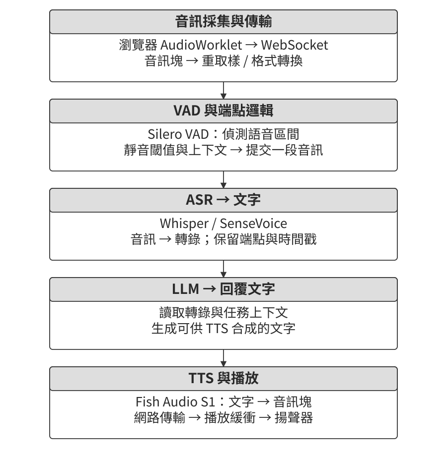

聲學 VAD 找出有人說話的區間，後續識別可以跳過長段靜音。可是，同樣一次停頓，發生在「我想訂……」後面和「週四上午有沒有票？」後面，含義不同。語義 VAD（語義端點偵測）可以在前一種情況下繼續收音，到後一種情況才把話交給對話模型。這就是語音觀測在時間上的稀疏化：一段連續的聲音，只在少數幾個時刻觸發推理。至於要不要開口，由聽到這句話的模型決定；它還可以繼續聽，或先查航班。

| 模組 | 作用 | 常見等待或錯誤來源 |
|---|---|---|
| VAD 與端點邏輯 | 偵測語音，決定提交時機 | 靜音閾值、雜訊與中途停頓 |
| ASR | 將音訊轉換為文字 | 解碼耗時、人名與專有名詞識別 |
| LLM | 理解、推理與生成回覆 | 請求排隊、首段回覆生成 |
| TTS 與播放 | 合成音訊並送達揚聲器 | 首包合成、網路傳輸與播放緩衝 |

在完全序列的實作中，使用者說完後還要依次等待端點確認、轉錄、回覆生成和首段音訊。圖6-8 的例子裡，使用者聽到第一聲回覆時已經過了 1.4 秒，其中最長的一段是等系統確認使用者說完了（500 毫秒）。即使轉錄從 100 毫秒縮短到 50 毫秒，使用者也只少等 50 毫秒。

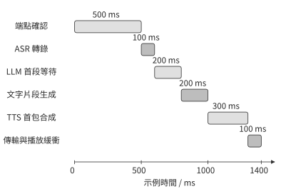

服務負載還會帶來排隊等待。圖6-9 採用 M/M/1 單服務台模型說明這種關係：到達服從泊松過程、服務時間服從指數分布，平均服務時間為 $S$，利用率為 $\rho<1$ 時，包含服務與排隊的平均總時間為 $W=S/(1-\rho)$。取 $S=1$ 秒，利用率從 0.5 增至 0.8，平均總時間就從 2 秒增至 5 秒。其中服務本身平均仍佔 1 秒，多出的 3 秒都花在排隊上。當請求接近處理容量，短時流量波動會形成積壓。

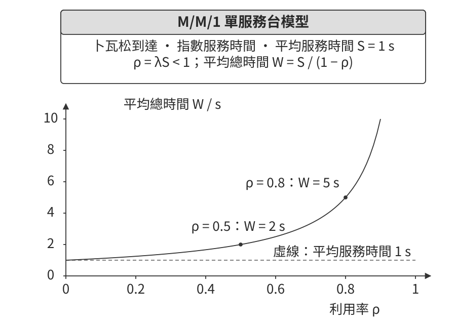

> **實驗 6-4 ★：建構傳統語音 Agent**
>
> 假設助手正在播報週四的航班，你開口糾正：「等等，我想訂週五的。」瀏覽器透過 WebSocket 把麥克風音訊送到後端。Silero VAD 一偵測到你開口，後端就發出 `speech_start`，瀏覽器隨即停止播放，清空排隊的舊音訊。這時助手還不知道你改了哪一天。等你說完、靜音超過預設的 500 毫秒，後端才發出 `speech_end`，把這段語音交給本地 Whisper tiny 轉寫。
>
> Doubao 開始回傳文字，離使用者聽見回答還有多久？一輪錄音重播的記錄裡，轉寫用了 2.710 秒。Doubao 在請求發出後 0.749 秒回傳第一個 token，到 0.792 秒才回傳完整答覆。重播程式等文字收齊，才交給 Fish S1 合成；又過了 2.819 秒，後端收到第一批音訊。從端點判定後算起，把這三段序列耗時相加，約為 **6.321 秒**。歸檔報告寫的是 6.279 秒，它用首個 token 的時間代替了生成整段答覆的時間。
>
> 這 6.321 秒只覆蓋後端處理。使用者先要等靜音偵測認定一句話已經說完，最後還要等音訊傳到瀏覽器開始播放。

#### 從序列到串流感知

序列方案便於逐段檢查，也暴露出三個問題。等待靜音會增加端點延遲；轉錄文字可能遺漏語氣、情緒和環境聲；按停頓切分音訊時，信箱、人名或專有名詞可能失去完整上下文。對於已經採用級聯架構的系統，筆者建議先做串流改造：讓各階段儘早提供增量結果，把識別、推理與播放重疊起來，同時維護已經確認和仍可能修改的部分。這樣能夠複用現有模組，並逐步定位等待時間來自哪裡。

- **ASR 邊聽邊轉。** 持續接收音訊，輸出臨時轉錄；後續音訊到達後修訂不穩定部分，在端點確認時給出最終文字。
- **LLM 推測執行。** 使用臨時轉錄提前準備回覆。最終文字確認後，檢查輸入是否一致以及已有工作是否仍適用，再決定保留、調整或重新生成。對外發送和業務寫入等操作等待所需條件確認後執行。
- **LLM 分段輸出。** 一段適合播報的文字完成後即交給 TTS，分段時保留句意、標點和語調線索。
- **TTS 增量合成。** 音訊塊逐步回傳，使後續文字生成、合成和播放能夠重疊。發生插話時，同時處理生成任務和播放緩衝中尚未播出的內容。

Whisper 的常規轉錄實作按音訊視窗編碼和解碼[^ch6-whisper]。在外部切塊或反覆提交累積前綴，可以建構增量轉錄流程；持續狀態複用、重複編碼成本和歷史文字修訂，需要由具體實作管理。原生串流識別模型則在架構與訓練中直接處理連續輸入。

基於音訊語言模型的感知系統還可以聯合輸出文字與聲學事件。歷史音訊、轉錄和詞彙提示幫助識別人名、品牌及專有名詞，保留多少歷史則取決於上下文與快取設計。針對「使用者是否說完」，模型可以結合語義完整性與靜音作判斷。在「我想訂……」的停頓處，即時系統只聽見了這三個字，還無從知道後面會接上日期。

除轉錄外，介面還可以約定以下事件：`speak_start`、`speak_end` 表示說話起止，`interrupt` 表示打斷，`emotion` 描述情感狀態，`laugh`、`sigh`、`noise` 記錄笑聲、嘆息和環境聲。這些事件可連同文字和時間戳一起送給 Agent。

> **實驗 6-5 ★：使用 Qwen2-Audio 模擬串流語音感知**
>
> 本實驗逐步擴大音訊前綴，每次將從開頭到目前時刻的音訊重新送入 Qwen2-Audio，觀察轉錄與聲學事件隨輸入變化的過程。對照路徑採用 600 毫秒靜音端點與 Whisper。測試包含正常語音、插入 900 毫秒停頓的長句，以及混入粉紅雜訊的語音。
>
> 本次本地量化模型執行保留了 13 次前綴推理，單次約需 8—11 秒。中途停頓觸發了對照路徑的分段；音訊模型檢出了雜訊，也誤報了咳嗽和笑聲。

[^ch6-whisper]: OpenAI，Whisper，介紹音訊視窗轉錄與模型實作。

### 範式二 · 端到端全模態模型（Omni）

端到端音訊模型直接接收聲音，結合語言與聲學資訊生成回覆，並透過音訊輸出分支合成語音。直接處理音訊可以利用語速、音高、停頓和環境聲；先轉錄再回答則便於檢查中間文字、獨立替換模組。

這些聲學特徵會影響理解。例如，同一句「請在午飯前發來報告」，急促和緩慢的說法會給聽者不同的感受。輸出時，模型也可以透過停頓、重音和語調組織意思。

直接處理音訊的系統也可以等使用者說完再回答。比如使用者報電話號碼時停了一下，系統仍要判斷這一串數字是否報完。端點偵測決定何時回應；如果對方在播報途中插話，系統還得協調模型生成和揚聲器播放。[^ch6-audio-architectures]

> **實驗 6-6 ★★：本地執行 MiniCPM-o 4.5，對比端到端與自級聯**
>
> 本實驗固定同一個 MiniCPM-o 4.5 模型，關閉思考模式，比較兩條路徑：直接從音訊回答問題，以及先由模型轉錄、再只根據轉錄回答。輸入包含兩道口述算術題和兩條文字相同、語速不同的語音。
>
> 兩條路徑各答對三題，錯誤出現在不同位置。直接音訊路徑把一道題中的 twelve boxes 聽成 8，導致計算錯誤；轉錄路徑正確保留了 12。語速題中，兩條音訊都說「Please send the report before lunch.」，轉錄後的文字完全相同，快慢資訊隨之丟失；直接音訊路徑則正確區分了兩種語速。
>
> 實驗另生成了一段 24 kHz 語音，把輸入理解與音訊輸出串接起來。

### 範式三 · 全雙工互動模型

全雙工系統一邊說一邊聽，最容易被人察覺的改善是交談時的活人感。試讀一句「想訂週三……不，週四的票」：中間的停頓容得下這次自我修正；如果助理已開始報週三的航班，聽見「不，週四」就應停下來。另一種時機是，對方還在解釋行程，一聲輕短的附和可以讓他知道助理在聽。持續接收音訊，才有條件在發言、傾聽、停頓和呼叫工具之間做這些選擇。同聲傳譯同樣需要輸入和輸出重疊。

Kyutai 在 2024 年發布的 **Moshi** 分別建模使用者和模型的音訊流，透過並行流表示重疊說話與打斷[^ch6-moshi]。把這些時間關係保留在輸入中，模型就能學習何時回應、何時繼續傾聽。

Thinking Machines Lab 的互動模型把連續輸入和輸出切成等長的短塊，每塊覆蓋 200 毫秒，稱為一個微輪次（micro-turn）[^ch6-14]。沿圖6-10 的時間軸看第二格：助手還在說「四」，耳邊已經傳來使用者糾正日期的「不」。到第三格，助手停下來，仍在聽使用者把「週五」說完。

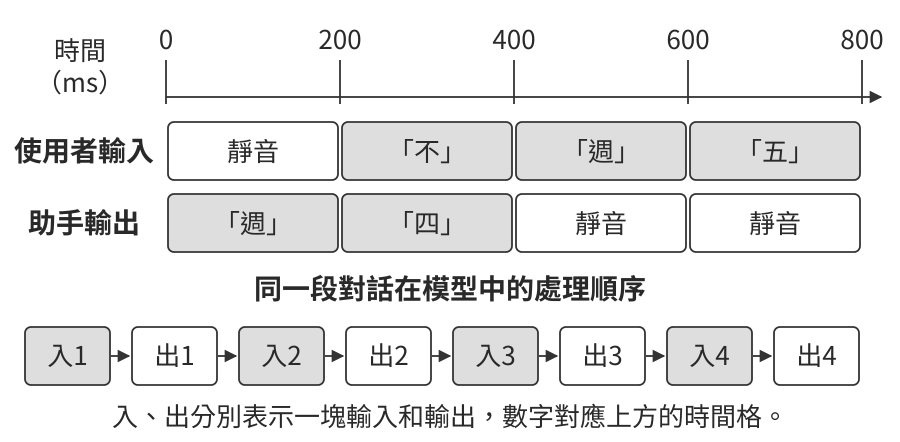

再讀圖的下半部。通話雙方聽到的是兩路可以重疊的聲音，模型卻可以沿一條序列交替處理輸入塊、生成輸出塊。靜音也佔一格，助手因而可以先聽一會兒再開口。圖中的 200 毫秒是這項實作的分塊長度；從使用者插話到揚聲器真正停下，還要計入處理和播放緩衝的耗時。

[^ch6-moshi]: Kyutai，*Moshi: a speech-text foundation model for real-time dialogue*，2024，介紹使用者與模型的並行音訊流。
[^ch6-14]: Thinking Machines Lab，*Interaction Models: A Scalable Approach to Human-AI Collaboration*，介紹微輪次、多流互動與背景任務委派。

### 認知時序：即時互動與深度思考

在 Pine 的客服通話裡，客服說到半句，助理有時該等，有時該輕輕應一聲；自己正在說話時，也得聽見對方插進來的更正。這正是筆者看好 Moshi 這條路線的原因：時機掌握得好，對方才覺得電話這頭真有人在聽。遇到要查資料的請求，還得算另一筆時間帳：從聽懂問題到報出查到的答案，中間要轉幾次手？

前台語音模型能直接呼叫的工具，就由前台呼叫。查航班只需兩次模型呼叫：前台先按使用者給出的條件查詢，再報告結果。委派則需四次：前台交代任務，後台發起查詢，後台整理結果，前台轉述。另一種主張認為，即時模型可能填錯參數，應由後台呼叫工具，讓前台專心判斷何時聽、何時說。

GPT-Live-1 的前台沒有直接呼叫業務函式的介面，只能委派給後台 Agent。OpenAI Realtime 的 GPT-Realtime 支援前台直接呼叫函式。豆包即時語音模型 3.0（Seeduplex）在純端到端模式下也支援前台直接呼叫，混合編排時則由外接語言模型呼叫。[^ch6-voice-tools]

設前台和後台模型每次呼叫分別耗時 $L_f$ 和 $L_b$，工具耗時 $T$。從使用者說完到聽見結果，直接呼叫約需 $2L_f+T$，委派約需 $2L_f+2L_b+T$。委派多出的 $2L_b$ 與工具耗時 $T$ 無關。使用者記憶這類每輪都可能用到的資訊，可以由執行階段查好後放進上下文，前台只需呼叫一次模型，約需 $L_f+T$；如果在使用者開口前就已查好，連 $T$ 也省了。

需要多步推理的任務，例如比較幾種改票方案，適合交給後台。訂票涉及扣款和出票，無論誰呼叫工具，都要等使用者確認後再下單。航班結果可以口頭概述，完整表格則在螢幕上顯示，這與誰呼叫工具無關。

> **實驗 6-7 ★★：語音 Agent 的工具由前台還是後台呼叫**
>
> 用豆包即時語音模型 3.0 搭建前台，用火山方舟提供的 DeepSeek V4 Pro 搭建後台。準備查天氣、查使用者記憶、網頁搜尋、查航班和訂票五個模擬工具，讓它們按設定時間回傳結果，其中查航班和訂票需等 2—5 秒。預先合成使用者錄音，每次重播同一場景的錄音。
>
> 設定四種分工。第一種由前台呼叫全部工具。第二種由後台呼叫全部工具，前台只能委派。其餘兩種都由前台查天氣，執行階段在會話開始時將使用者記憶放入上下文，後台負責網頁搜尋和訂票。兩者的區別在於查航班由前台還是後台負責。前台直接聽使用者的聲音；後台聽不到聲音，只能讀文字。豆包的介面在聽完使用者每一句話後，會另外回傳語音識別得到的文字，稱為轉寫。委派時，把轉寫和助理說過的話按先後順序整理成通話記錄，連同本次通話已執行的工具呼叫和前台寫的任務說明，一起交給後台。在每種分工下重複測試以下各場景 10 次。
>
> 1. 分別查詢天氣和航班。從使用者說完開始計時，直到聽見查詢結果，「我查一下」等過渡語不算作回答。比較直接呼叫和委派的等待時間中位數。在筆者的實驗中，查天氣時兩者分別為 2.81 秒和 6.96 秒。
> 2. 先查航班，再選票、確認。對照上一輪查詢結果、使用者剛說的話和使用者資料，逐項核對訂票的 13 個欄位，檢查下單時間是否晚於使用者確認。在筆者的實驗中，四種分工都填對了全部欄位，也都在使用者確認後才下單。
> 3. 改為給同事訂票，播放口述姓名的錄音：「陳嘉怡，耳東陳，嘉獎的嘉，怡然的怡。」對照錄音、語音轉寫和訂單姓名，檢查前台直接訂票和委派訂票是否都填對了姓名。在筆者的實驗中，前台直接訂票 10 次全對；轉寫卻寫成了「陳佳宜」，委派時有的訂單因此填錯了姓名。
> 4. 在航班查詢結果回傳前播放詢問天氣的錄音，聽前台是否回答天氣問題、隨後是否報出航班結果。在筆者的實驗中，天氣問題都得到了回答，原來的航班結果卻幾乎沒有再說出來。

需要委派時，前台應把有把握的姓名、數字和使用者剛作的更正寫進任務說明，以免後台因轉寫錯誤而填錯參數。執行階段應記下尚未說出的結果，讓前台答完插問後接著報告。

快模型說一句「我查一下」，可以讓客服知道助理聽清了要求。什麼時候能報出票價，則取決於查詢和推理怎樣與通話配合。圖6-11 展示了三種安排：先回應再深入回答、前台持續互動並接收後台建議，以及構思與表達按片段並行推進。

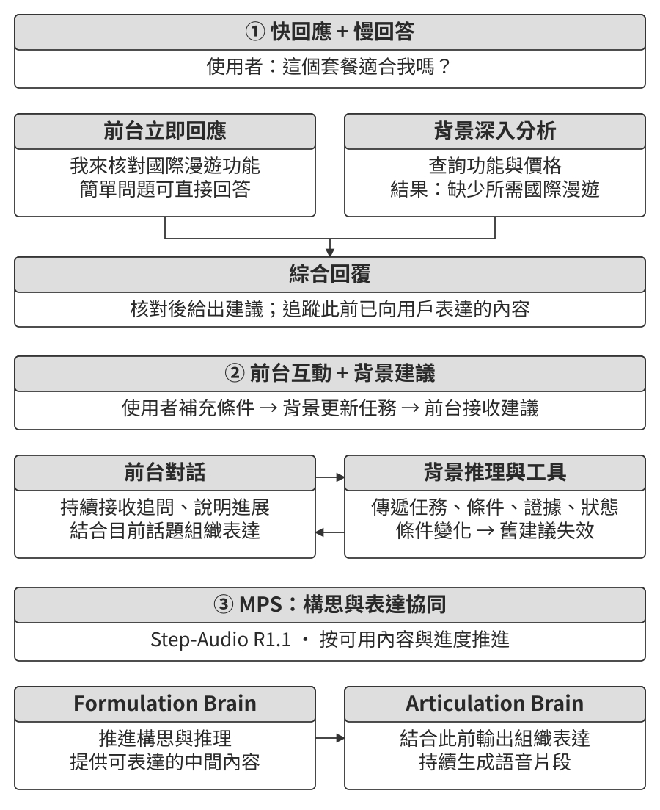

#### 方案一：快思考回應，慢思考回答

快模型先給出簡短回應，慢模型在後台完成分析，再補充詳細答案。這種設計可以儘早確認收到請求，但需要管理兩次回答的一致性。例如，快模型先建議購買某個方案，慢模型隨後發現方案缺少關鍵功能，前後建議就會衝突。衝突的根源在於兩側獨立作答，判斷依據和推理進度可能不同。快模型說出口的建議已經進入使用者的判斷，使用者甚至可能據此行動；慢模型隨後糾正，還需要解釋變化並處理已經產生的影響。

因此，前台應區分任務確認與業務結論。「我來核對方案是否包含這項功能」可以立即表達，購買建議則等待必要的查詢與分析。後台結果回傳時，系統將它與已說出的內容對照，再組織後續回覆。簡單問題還可以直接由快模型完成，減少重複處理。

#### 方案二：快思考互動，慢思考提醒

語音和螢幕也能分工。口頭說「這月帳單多了 15 歐元漫遊費」，使用者一下就能聽懂重點；把原金額、現價和爭議明細留在螢幕上，使用者可以按自己的速度核對。確認一個具體操作可以點選，敏感資訊則讓使用者在商家認可的輸入介面自行填寫。前台只需要接收「驗證已完成」這樣的狀態，就能自然接回對話。

假設旅客請 Pine 訂週四上午去上海的機票，預算 1200 元，中午前要趕到會場。Pine 一邊跟航空客服通話，一邊給後台「遞紙條」：「如果上午十點到虹橋，從機場到會場來得及嗎？」客服查過餘票，告訴 Pine：「十點到虹橋的那班賣完了。還有一班十點半到浦東，票價 1250 元。」如果後台只能看見前台遞來的紙條，它還在算從虹橋出發的路程。前台得再交代一句：「改算浦東，十點半落地，會場和到場時間不變。」

另一種做法是把通話記錄也按順序同步給後台。後台已經從通話記錄裡讀到了客服報出的機場和落地時間，前台只要說「算一下這班來不來得及」，就能委派同一項任務。同步記錄時要標明誰說了什麼；前台被打斷、還沒播出的半句話，也要和已經說出口的內容區分開。語音轉寫可能漏記或寫錯關鍵資訊。前台應把聽準的姓名、數字和使用者的更正寫進任務說明。兩份記錄有出入時，後台以任務說明為準。後台查完，只需告訴前台預計幾點能到會場、時間有多緊。沿途查過哪些路線、地圖介面回傳了哪些欄位，可以留在後台備查。由前台拿著結果繼續跟客服談。

第一章那位商務旅客希望票價控制在 1200 元以內。以往出差時他願意為合適的航班多花一點，這次也沒有另定上限。聽到最低價是 1250 元，助理可以替他訂下。換成一向精打細算的使用者帶家人出遊，這 50 元要先問。前台於是要同時照顧兩段對話：

- 發給使用者：「這班最低 1250 元，比預算多 50 元。你願意訂嗎？」
- 接著問客服：「這班能幫我保價一會兒嗎？同一天晚一點走，有沒有 1200 元以內的？」客服查票時，前台還可以問清行李額和退改條件。

這樣，使用者回來時能看到幾個選項，客服也知道接下來要查什麼。如果使用者後來解釋「上次是趕著開會，以後出差超預算也先問我」，下次就要按這條新要求辦。

等本人驗證時，談話的節奏又不一樣。客服說驗證碼已經發出，前台可以答：「好，請稍等，我請旅客看一下手機。」如果旅客回訊息說還沒收到，再問客服簡訊發到了哪個尾號、多久可以重發。旅客在商家指定的管道完成驗證後，前台就能接著辦。在這樣的通話裡，多等一會兒、晚一點出票，都比催使用者當場作決定更合適。

這時，後台發來「原報價已更新」。前台先向客服核實新價格，再告訴使用者。如果使用者恰在此時回覆「可以訂」，這句回覆對應的是此前發給他的 1250 元報價。前台要根據新的價格和已有授權判斷是否需要再次確認。後台只提供資訊，始終由前台跟客服交談、作出承諾。給訊息帶上航班、價格適用條件和時間，前台才能識別哪一份報價已過期。

同一條後台訊息「價格有變，請核實」，到達的時機也會影響前台怎麼接話。如果客服剛說「最低票價是……」，前台可以先聽完金額。如果客服已報完價，正等答覆，此時適合追問新價。如果旅客剛在電話裡插話說「等等，我改一下日期」，先聽清新日期，再決定還要不要核實原航班。同一句「好的」，說在客服介紹條款時可能只是表示在聽，說在「我現在幫您出票？」之後就可能被聽成同意購買。只看轉寫文字，會漏掉這樣的差別。

#### 方案三：構思與表達協同推進

Step-Audio 系列提供了兩個相關例子。**模態錨定推理蒸餾（MGRD）**關注推理所依據的資訊：圍繞音高、節奏、語調等聲學特徵構造和篩選推理資料，透過迭代蒸餾改進音訊理解。Step-Audio R1 在強化學習階段給音訊題分兩項計分：答對得 0.8 分，給出推理過程再得 0.2 分。後者鼓勵模型寫出依據；推理有沒有用到錄音裡的聲學線索，則要在前面的樣本篩選中檢查。[^ch6-mgrd]

**Mind-Paced Speaking（MPS）**關注推理與表達的時序，採用構思模組（Formulation Brain）和表達模組（Articulation Brain），讓構思過程指導語音生成。Step-Audio R1.1 的即時方案採用了這一方法。[^ch6-mps]

兩個模組按進度交換資訊：構思持續推進，表達根據已經可用的內容與此前輸出組織語音。這樣可以讓部分表達與後續推理重疊，同時保持對已說內容的追蹤。

[^ch6-mgrd]: StepFun，*Step-Audio-R1 Technical Report*，介紹模態錨定推理蒸餾。
[^ch6-mps]: StepFun，*Mind-Paced Speaking: A Dual-Brain Approach to Real-Time Reasoning in Spoken Language Models* 與 Step-Audio-R1.1 模型卡，介紹構思、表達兩個模組及其在即時系統中的應用。

#### 模組分工與升級方式

**筆者看重快慢分工的一項工程優勢：互動能力與推理能力可以分別演進。** 更強的推理模型發布後，系統可以替換後台。這樣，後台能夠跟上推理模型的進步，前台也能持續改善傾聽、回應與插話體驗。前台需要理解任務和使用者的補充資訊，後台則專注於較長的推理、規劃與執行。

**在推理模型快速迭代、團隊又需要持續升級業務能力時，筆者優先選擇可替換的快慢分工。** 這種分工省去了每次升級推理模型都重新訓練整套語音系統的負擔。需要讓中間推理更直接地控制表達、且有相應訓練資源時，再採用更緊密的協同方案。

Pine AI 的語音 Agent 採用前台快思考與後台慢思考配合的架構。其公開文章報告了在 τ²-bench 語音賽道取得榜首的結果，並介紹了持續通話、業務推理與工具操作的組合方式[^ch6-17]。

理解這些組合時，可以區分三個設計維度：**音訊通路**決定模型直接處理聲音還是透過轉錄交接；**聽說時序**決定輸入輸出按輪次還是並行推進；**認知分工**決定即時互動與深度推理如何共享狀態、交換結果。系統可以直接處理音訊並保持全雙工，同時把複雜任務交給獨立的後台模型。Thinking Machines Lab 的互動模型和 GPT-Live 都展示了這類組合。

[^ch6-17]: Pine AI，*The Most Natural Human-Computer Interface Is Your Voice*，介紹快慢思考架構及其報告的語音任務評測結果。該報告將榜單稱為 τ²-bench voice。

### 更像人的語音合成

停頓、語速和重音幫助聽者理解句子結構與說話意圖。例如，報電話號碼時需要適當分組，解釋複雜條款時可以放慢速度，等待查詢結果時可以先說明正在處理什麼。在筆者看來，適當的停頓與節奏變化能讓語音更自然，也能讓使用者聽出任務正在怎樣推進。語音控制可以圍繞這些具體用途設計。

主 LLM 可以在文字中加入控制標記，如 `[THINKING]`、`[EMO:happy]` 和 `[SPEED:0.8x]`。執行層解析標記，將文字分成語音與停頓片段，再對應到合成介面支援的情緒、風格或參考音。標記的含義由應用定義：`0.8x` 可以對應為慢速檔；停頓可以由播放器插入，笑聲、嘆息則透過支援的聲音標記或生成能力表達。

參考音方案將同一說話人的不同表達方式組織成庫。每段文字選擇匹配的情緒、語速與風格，合成後再按順序拼接。控制狀態需要規定作用範圍，例如情緒持續到下一次修改，停頓只在目前位置生效。

> **實驗 6-8 ★★：基於 Fish Audio 的控制標記驅動 TTS**
>
> 本實驗用 Fish Audio S1 建立 24 條參考音組成的語音庫：四種情緒、三檔語速與兩種風格組合。解析器把帶標記的回覆轉換成語音片段和靜音片段，執行層為每段選擇參考音並完成合成。
>
> 比較三種配置：無控制標記、單一參考音和多參考音。保持回覆內容一致，檢查標記是否路由到預期配置，再聽取停頓、情緒和音色變化。
>
> 儲存的聽測採用音訊理解模型，對三種配置輪換呈現順序，評價自然度、情緒匹配、思考停頓、音色一致性和客服感。多參考組的綜合評分最高，單參考組低於無標記組。

## Computer Use：GUI 自動化 Agent

假設你請 Agent 修改網頁上的收件地址。它要先找到地址欄，輸入新地址，再根據回顯確認儲存結果。若在點選前彈出登入框，上一張截圖中的按鈕即使座標沒變，這一擊的對象也已經變了。Computer Use 透過螢幕、滑鼠和鍵盤操作瀏覽器、表格或系統設定，核心功課便是讓每個動作跟得上眼前的介面。

沿著圖6-12 的**感知—思考—行動**迴圈，看模型準備輸入新地址之前要確認什麼。它根據截圖和任務進度選定點選位置，Harness 檢查參數與權限，再交給執行層。點選成功只表示這一擊已經發出。下一張截圖裡，輸入焦點落在哪裡，才決定接下來能否安全地輸入地址。

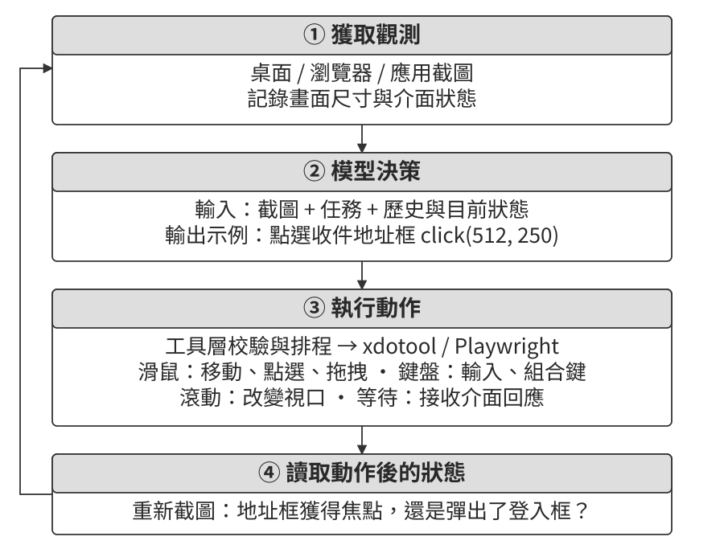

助手填好地址後，該怎樣告訴執行器它要點哪個「儲存」按鈕？螢幕座標和元素編號都可以指認目標，對模型和工具的要求卻不同。

### 動作空間設計

圖6-13 中，Anthropic 的 Computer Use 參考實作提供圖形介面、命令執行和檔案編輯三類工具。僅看圖形介面這一類，資料就有兩個去向：點選動作發給執行端，點選後的截圖送回模型，作為下一輪決策的觀測。原生 API 規定了工具格式；若換用其他模型，適配層要把截圖、動作請求和執行結果轉成相應介面能接收的訊息。[^ch6-computer-tools]

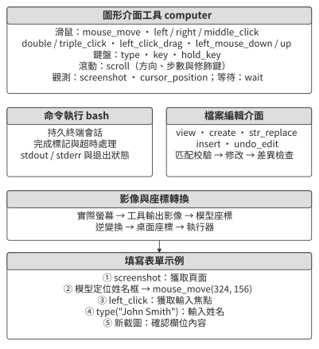

**GUI 操作工具。** 滑鼠動作包括移動、左鍵／右鍵／中鍵點選、雙擊、三擊和拖拽；更細的介面可以分別表達按下與鬆開。滾動需要方向和幅度，部分實作還支援修飾鍵。鍵盤介面提供文字輸入、組合鍵和按住按鍵。截圖與游標位置用於獲取狀態，等待介面則給頁面載入或動畫留出時間。工具版本決定具體動作集合，Harness 根據所用介面校驗參數。

**命令執行工具。** 持久終端可以跨呼叫保留工作目錄和環境狀態。例如，一次呼叫切換目錄後，下一次呼叫繼續在該目錄執行。參考實作可以用哨兵字串識別命令完成，並設定超時；超時後的處理程序狀態仍需執行器檢查。

**檔案編輯工具。** 字串替換介面透過原文定位修改範圍，也可以提供檢視、建立、插入和撤銷。執行前檢查匹配位置與次數，執行後檢查差異；檔案在兩次呼叫間變化時，先重新讀取相關內容。第五章介紹的編輯策略可以在這裡複用。

> **實驗 6-9 ★：執行 Anthropic Computer Use 參考實作**
>
> 本實驗使用官方容器示例提供的 Ubuntu 桌面、瀏覽器與工具執行層。使用者輸入任務後，模型讀取截圖並回傳動作，執行層操作桌面，再把新截圖交回模型。
>
> 配套任務查詢舊金山天氣。儲存的軌跡先存取 Google，遇到驗證碼後，根據執行中的恢復指令轉向可公開讀取的 Open-Meteo 資料，最終報告溫度與天氣狀況。記錄包含 15 次桌面動作和對應截圖，可以逐輪檢查點選、按鍵、文字輸入與等待如何改變頁面。
>
> 開放模型驅動瀏覽器的路徑見實驗 6-10。

### 視覺定位（Grounding）

讓模型點選搜尋框，可以把問題出成兩種形式。一種是給它看截圖，讓它報出點選座標。另一種是給候選目標編號，讓它選出搜尋框；編號既可以標在截圖裡的候選區域上，也可以來自瀏覽器提供的元素列表。下面分別介紹這三條路線。選編號時，執行層負責把編號還原為實際目標；直接報座標時，模型還得估計目標的位置，對定位訓練和螢幕解析度的適配要求更高。

**Set-of-Mark：視覺標註。**

Set-of-Mark（SoM）在影像上疊加可引用的編號，將視覺區域與模型輸出對應起來。原始工作採用分割等方法生成候選區域，例如使用 SAM、SEEM 獲取區域，再放置標記。模型選擇編號後，執行層根據對應區域確定操作位置。這個方法可以用於缺少 DOM 的桌面軟體或遊戲介面，要點的控制項得落在有編號的區域裡，模型還得看清它對應哪個編號。[^ch6-som]

**結構化元素索引。**

瀏覽器還能提供另一類線索。文件物件模型（DOM）描述頁面有哪些元素及其層次，佈局資訊給出元素的顯示位置，無障礙樹（accessibility tree）則保留輔助技術所需的角色與可存取名稱。例如，一個只有放大鏡圖示的按鈕，頁面若提供了「搜尋」這個可存取名稱，Agent 就有機會按角色和名稱找到它。以 browser-use 一類方案為例，系統可以透過 Chrome DevTools Protocol（CDP）等瀏覽器除錯介面獲取元素資訊，識別輸入框、按鈕和連結，再給目前頁面上這些可操作的元素編號。圖6-14 中，模型選中了頁面右上角的 [2]。這個編號怎樣變成對 Submit 按鈕的一次點選？

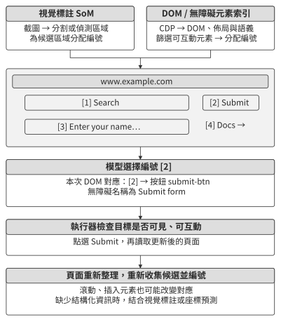

處理過程可以分成四步：讀取 DOM、佈局與可用的無障礙資訊；篩選可互動元素；建立目前頁面的編號對應；將元素描述與必要的標註截圖交給模型。例如，模型可能看到下面四個帶編號的元素：

```text
截圖中標有 [1]、[2]、[3]、[4]

[1] <input type="text" placeholder="Search" aria-label="Search" />
[2] <button id="submit-btn" aria-label="Submit form" />
[3] <input type="text" placeholder="Enter your name" value="" />
[4] <a href="/docs" aria-label="Documentation" />
```

模型選擇編號後，執行層解析成元素引用或座標，檢查目標是否仍可見、可互動，再完成操作。頁面重新整理、滾動或動態插入元素後，需要更新對應，避免使用過期編號。結構化索引能夠利用標籤、角色和文字，Canvas、遮擋或不完整的語義標註則需要結合截圖判斷。列出的元素越多，截圖越大，送進上下文的資訊也就越多。

**直接預測座標。**

座標路線讓模型從截圖和目標描述直接輸出位置，例如將「點選提交按鈕」對應到某個點。SeeClick 等 GUI 定位研究以及 Claude 的 Computer Use 都採用了座標輸出。執行層負責將影像座標轉換到實際桌面座標。

截圖縮放後，兩套座標需要採用同一變換。以 2560×1440 的桌面為例，若傳送給模型的圖片為 1366×768，則模型給出的 (683, 384) 對應：

$$
x = 683 \times \frac{2560}{1366} = 1280,\qquad
y = 384 \times \frac{1440}{768} = 720
$$

圖6-15 中兩種尺寸的寬高比接近。如果截圖為了保持比例而加了黑邊，模型給出的座標就包含留白；換回原螢幕座標前，要先減去相應的填充偏移，再按縮放係數換算。裁剪、顯示縮放與多顯示器原點同樣會改變對應，工具層應儲存實際變換參數。

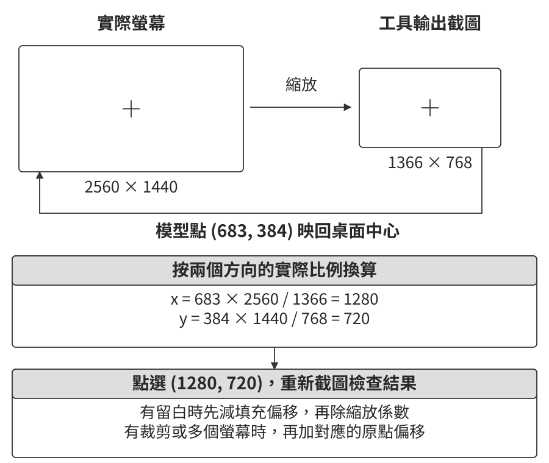

參考實作曾使用 XGA（1024×768）、WXGA（1280×800）和 FWXGA（1366×768）等目標尺寸。強行改變寬高比會使控制項形狀變形；使用錯誤的反向對應則會把正確預測落到錯誤位置。[^ch6-computer-tools]

**結構化資訊完整時，筆者優先採用 DOM 或無障礙樹索引。** 元素的名稱、角色與引用可以直接參與定位，減少模型臨時估計畫素位置的工作。缺少結構時，通用視覺模型可以先配合 SoM，讓模型從標好的區域中選一個；已經接受 GUI 定位訓練的模型則可直接預測座標，省去單獨標註。

> **實驗 6-10 ★：使用 browser-use 實作自動瀏覽器操作**
>
> 本實驗用 Qwen3-VL 32B Instruct 驅動 browser-use，透過瀏覽器狀態、元素資訊和截圖生成動作。任務是查詢舊金山天氣：定位搜尋框，輸入「San Francisco weather today」，提交查詢，再提取溫度和天氣狀況。
>
> 實驗 6-10 的程式碼與執行說明提供兩條入口。有 OpenRouter 金鑰時，可用託管的視覺模型；已有 vLLM、SGLang 等相容服務時，可將 `OPEN_MODEL_BASE_URL` 和 `OPEN_MODEL_MODEL` 指向自己的端點與模型，並按服務要求設定金鑰。兩條路線都先在實驗目錄執行 `python main.py --dry-run`，檢視配置，再按說明啟動實際查詢。
>
> 儲存的執行完成了 16 步互動，並保留 15 張截圖。Google 出現驗證碼後，任務改用 weather.com 獲取結果。

[^ch6-computer-tools]: Anthropic，Computer Use 工具文件與參考實作，介紹版本化動作介面、執行層與截圖處理。
[^ch6-som]: Microsoft，*Set-of-Mark Prompting*，2023；browser-use 的 DOM 服務實作提供結構化元素處理示例。

### 能看動畫、能聽聲音的 Computer Use Agent

頁面只在儲存後短暫顯示「同步失敗」，兩張相隔數秒的截圖卻都顯示同一張表單。重看這兩張圖，模型很可能無法還原中間發生過什麼。影片、動畫、短暫通知和會議語音也有這個問題。**對於持續變化的介面，筆者主張把觀測介面作為重點改進對象。** 要根據變化決定下一步，就需要把動作之間出現過的事件或畫面也儲存下來。

筆者與合作者提出的 **Agent–Computer Observation Interface（AOI，Agent—電腦觀測介面）**，將連續螢幕與音訊轉換為模型可以接收的影像和文字[^ch6-9]。介面包含三個元件：

- **動作間關鍵幀採集。** 在主迴圈執行期間監測畫面變化，透過畫素差異或輕量視覺模型篩選候選幀，再把有用畫面交給下一次決策。
- **音量門控轉寫。** 偵測到聲音後呼叫語音識別，將轉錄與時間資訊加入觀測記錄，幫助 Agent 使用會議內容或口頭指令。
- **持久畫面描述。** 將關鍵畫面概括為文字；原圖移出上下文後，文字仍儲存發生過的變化，供後續步驟引用。

例如，影片中展示了一次選單操作，模型收到中間畫面和對應描述後，可以在播放結束後繼續參考該步驟。論文的消融結果顯示，持久文字描述對收益尤其關鍵，關鍵幀的精細選擇貢獻較小；部分模型加入過多影像後反而退化。

回到剛才儲存表單的例子。即使關鍵幀拍到了「同步失敗」，原圖一旦移出上下文，模型就只能依靠留下的描述。「頁面出現通知」可能意味著儲存成功，也可能意味著失敗；「同步失敗，地址未儲存」才保留了決定下一步的線索。

[^ch6-9]: Bojie Li、Noah Shi，*Agent-Computer Observation Interfaces Enable Dynamic Computer Use*，2026，介紹 AOI 及其元件消融。

### Computer Use 的世界模型

及時獲得觀測之後，Agent 還需要選擇動作並等待執行。OSWorld-Human 研究將 Agent 的操作效率與人類軌跡對照，分析了冗餘步驟和模型呼叫等耗時來源[^ch6-osworld-human]。

世界模型為規劃提供動作後果的預測。桌面狀態可以包含視窗、焦點、滾動位置、輸入內容和載入進度；權限、網路結果等資訊則需要透過相應介面補充。模型根據目前可用狀態與候選動作，預測下一狀態：

```text
目前狀態 + click / type / scroll / wait → 預測的下一狀態
```

人操作電腦時，往往在點選之前已經預想下一步；介面符合預期就繼續，出現意外才停下來檢查。世界模型可以為 Agent 提供類似的推測執行依據：規劃器提前比較候選動作，在頁面載入期間準備後續步驟，待真實狀態確認後繼續執行，減少每次點選後都從頭規劃的等待。例如，在 VS Code 中新建 Python 檔案並寫入 hello world，預期變化包括檔案樹出現新檔案、編輯區包含程式碼、儲存狀態更新。執行後檢查這些變化，符合預期就繼續，出現偏差則重新定位與規劃。

刪除檔案等操作還需要獨立的執行條件：目標是否正確、是否允許刪除、能否恢復，以及是否需要使用者確認。預測幫助理解可能的結果，實際權限與業務條件由執行層檢查。

**Photon-1 的潛在狀態預測。** Induction Labs 在 2026 年 7 月介紹了 Photon-1：將影片幀編碼為離散潛在 token，透過預測後續 token 學習狀態變化。公司披露其預訓練約使用 3 萬 H200 GPU 小時。狀態預測在潛在 token 中完成，輔助影像生成器負責將它們還原為可檢視的畫面，供人檢查預測。規劃與動作生成可以直接利用內部表示，省去每一步都生成完整截圖的開銷。[^ch6-20]

該方案進一步透過微調學習指令與動作格式：先預測希望到達的狀態，再生成通向該狀態的操作，並在虛擬機器中透過線上訓練改進任務表現。動作條件微調則用於預測給定操作後的桌面變化。這兩種用途分別連接規劃與模擬，展示了狀態表示如何參與 Computer Use。

[^ch6-osworld-human]: Reyna Abhyankar 等，*OSWorld-Human: Benchmarking the Efficiency of Computer-Use Agents*，分析任務軌跡與時間開銷。
[^ch6-20]: David Li、Jonathan Li，*Scaling Video Pretraining with Imagination Models*，Induction Labs，2026-07-23，介紹 Photon-1 的預訓練、動作學習與狀態模擬。
[^ch6-21]: Google DeepMind，*Genie 3: A new frontier for world models*，2025-08-05；Zachary Lin 等，*Cosmos World Foundation Model Platform for Physical AI*，2025。

### 行動端：技術介面與生態協作

行動端繼續使用觀測—決策—行動迴圈，動作則更多表現為觸控手勢。同一個座標可以表示單擊位置、長按位置或滑動起點，因此介面還需要手勢類型、持續時間和路徑。螢幕旋轉、軟鍵盤彈出和系統彈窗也會改變可操作區域。

Android 的 `AccessibilityService` 可以在獲准範圍內讀取介面資訊並執行相應動作，手勢介面還需要宣告對應能力[^ch6-android]。截圖、無障礙樹和系統自動化介面可以配合使用，具體可用範圍由作業系統、應用實作和授權決定。第七章介紹的 AndroidWorld 等基準，在真實應用任務中檢查這些動作能否產生預期結果。

**筆者認為，行動端落地的生態壁壘往往比技術問題更難處理。** 平台需要確定哪些操作可以交給代理，帳戶、支付和資料如何授權，以及出錯後如何追蹤責任。這些約定會直接影響 Agent 可以完成的任務範圍。

其中一個結構性的利益衝突來自流量與注意力。許多應用依靠廣告展示、內容推薦和交易入口獲得收入；使用者委託 Agent 直接完成查詢或購買後，頁面瀏覽路徑可能縮短，推薦與廣告獲得的注意力也會變化。對於依靠這些環節變現的平台，代理操作會觸及原有的收入來源。平台因而需要重新考慮介面開放、商業分成和代理身份管理。

[^ch6-android]: Android Developers，AccessibilityService，介紹介面存取、動作與手勢能力。

## 機器人操作：以 XLeRobot 整理桌面為例

把紅色杯子放進托盤，把黃色廢紙放進垃圾盒，最後確認桌面已經整理好——這個任務把感知、規劃和控制連在了一起。夾爪接近杯子時，攝影機中的位置會變化；杯子被夾起後，手臂需要避開桌上的其他物體；紙張第一次沒有夾住，系統還要發現失敗並重新嘗試。每個動作都會改變下一次決策的條件。

本節沿著這個任務安排五個實驗。實驗 6-11 和 6-13 給出真機遙操作與自主操作的實踐設計；實驗 6-12、6-14 和 6-15 使用本地模擬，分別研究控制基線、失敗恢復和視覺條件變化。

同一台機器人可以由人持續看著攝影機操縱，也可以由模型讀取畫面、選擇技能，再交給控制系統執行。保持任務和硬體不變，就可以從四個問題分析兩種方式的差別：人想完成什麼，接下來先做哪個子任務，目前技能輸出哪些動作，以及動作之後的環境是否符合計畫。長程規劃安排杯子與廢紙的處理順序，VLA 策略或預先定義的動作原語負責抓取和放置，世界模型幫助估計動作後果，模擬到現實的遷移則處理畫面、接觸和執行器特性的變化。

### 硬體與演算法的分工

自主整理桌面失敗時，可以先用遙操作檢查硬體能否完成任務。保持攝影機、機械臂、夾爪、桌面佈置和驗收條件不變，讓操作者接管感知與控制閉環。如果人在多輪操作中都能穩定完成，而自主系統反覆失敗，就說明這套硬體已經能夠完成目前任務，瓶頸主要落在自主控制的演算法與回饋上。此時應優先排查物體定位、技能選擇、動作時機和失敗恢復，讓自主系統學會遙操作中有效的修正方法。

XLeRobot 支援用鍵盤、Xbox 手柄和 Switch Joy-Con 遙操作，VR 操作可以先在模擬環境中體驗。[^ch6-1] 夾爪接近杯子時，操作者會減速；杯子一滑，就得修正抓取點。夾爪沒夾住紙張，要再看一次；物體歸位，也要看一眼確認。這些根據觀測作出的修正都值得記錄在示範資料裡。以後由機器人自主操作時，同樣要能發現滑動和漏抓。

> **實驗 6-11 ★：真機遙操作 XLeRobot 整理桌面**
>
> 在完成標定、限位和急停檢查的 XLeRobot 工作區中，放置紅色杯子、托盤、黃色廢紙和垃圾盒。透過一種已校準的遙操作方式執行固定任務：「把紅色杯子放進托盤，把黃色廢紙放進垃圾盒，最後確認桌面狀態。」重複多輪，記錄攝影機畫面、操作者輸入、機械臂狀態、動作時間、抓取失敗和重試次數。
>
> 每輪結束時，確認杯子位於托盤內、廢紙位於垃圾盒內，機械臂回到安全姿態，並檢查全程的碰撞、越界和人工干預記錄。把失敗發生在哪一步、操作者如何恢復與最終結果放在一起分析，就能形成自主控制的對照基線。

模擬實驗則便於重複改變物體數量和初始位置，單獨考察已知狀態下的控制過程。二維桌面模型可以把接近物體、搬運到目標、處理下一個物體表示為三個階段，以完成步數和路徑長度描述控制開銷。

> **實驗 6-12 ★：在模擬器中建立同任務的理想控制基線**
>
> 在二維桌面中隨機生成物體位置與目標位置，讓控制器直接讀取座標，依次接近物體、移動到對應目標，再處理下一個物體。改變初始位置和物體數量，比較成功率、完成步數與路徑長度。
>
> 先跟蹤一個物體的完整軌跡：控制器到達物體後進入搬運階段，到達目標後才能累計完成數量。接著增加物體數量，檢查每個物體都經過這兩個到達條件。配套的二維模擬在五個隨機種子下分別擺放 1、2、3、4 個物體，每種組合執行 512 回合，合計 10,240 回合全部完成。控制器可以直接讀取座標，移動物體也不依賴真實夾爪。

### 機器人控制的基本結構

整理一次桌面可能需要幾分鐘，關節控制卻要持續、及時地更新。系統可以按時間尺度分工，讓高層規劃安排任務順序，讓技能策略生成運動，再由底層控制器跟蹤執行：

| 層級 | 核心問題 | 輸出 | 時間尺度與配置示例 |
| --- | --- | --- | --- |
| 任務目標 | 人想完成什麼 | 「把杯子和廢紙歸位」 | 分鐘級任務 |
| 長程規劃 | 先做什麼、後做什麼 | 先處理杯子，再處理廢紙，最後檢查 | 秒到分鐘 |
| 基本技能 | 目前要完成哪個狀態變化 | `pick(red_cup)`、`place(red_cup, tray)` | 一次技能可持續數秒，如 1—3 秒 |
| VLA / 技能策略 | 目前技能具體怎麼動 | 夾爪動作、末端位姿或一段關節軌跡 | 可按 1—10 Hz 推理配置 |
| 底層控制與安全層 | 如何穩定、及時地執行 | 關節或末端控制量、限速與急停 | 控制器可按數十至上千 Hz 配置 |

規劃器可以採用規則程式、VLM 或最佳化器，VLA 也可以承擔部分技能選擇。**筆者的建議是把任務順序與眼前動作分開處理。** 高層推理需要時間組織計畫，底層控制需要及時回應位置與受力變化；讓兩者按各自合適的節奏執行，才能兼顧規劃與控制。

本節為高層模型提供 `observe_scene`、`pick`、`place`、`verify_state` 和 `stop` 五類工具，分別用於觀測、抓取、放置、檢查和停止。Harness 檢查參數、工作區和目前狀態，執行器將通過檢查的技能轉換為機械臂動作，並處理限速與超時。關節角和連續軌跡由技能策略及控制器生成，模型選擇技能與實際運動之間由此形成清楚的介面。

### 長程規劃與任務分解

使用者說「把桌面整理乾淨」時，規劃器先識別物體及其目標區域，確定處理順序，並為每一步寫清楚開始條件、完成條件和動作限制。例如，整理順序可以是：

```text
處理紅色杯子 → 清理黃色紙張 → 檢查桌面
```

「處理紅色杯子」繼續拆成兩個動作和一次檢查：

```text
pick(red_cup) → place(red_cup, tray) → verify_state()
```

以「拿起杯子並放到托盤」為例，機械臂執行完抓取程式，只說明這段程式結束。下一步抬升之前，還要透過夾爪回饋或新影像判斷杯子是否真的拿住了。如果抓空了，就重新定位杯子；若有人移走了托盤，已成功的抓取仍然有效，只需重規劃放置動作。讓每個技能對應一個可以檢查的狀態變化，限定動作與時長，再回傳執行狀態和新觀測，規劃器就能從實際出錯的那一步恢復。

> **實驗 6-13 ★★：使用 Gemini Robotics-ER 1.5 驅動 XLeRobot 自主整理桌面**
>
> 沿用實驗 6-11 的硬體、桌面佈置、任務與驗收條件，由具身推理模型負責觀測和規劃。參考 RoboCrew 的編排方式，為本任務設計五個工具：`observe_scene`、`pick`、`place`、`verify_state` 和 `stop`。[^ch6-2]
>
> 模型先讀取桌面觀測、決定處理順序，再呼叫經過標定的抓取和放置技能。每完成一個技能，就獲取新觀測並檢查後置條件；失敗後根據目前狀態選擇重試或停止。執行系統在收到急停訊號、偵測到越界或無法確認關鍵狀態時直接停止執行，模型也可以透過 `stop` 主動結束任務。
>
> 最終由新的環境觀測確認杯子位於托盤內、廢紙位於垃圾盒內、機械臂回到安全姿態，並核對碰撞和越界記錄。操作者負責啟動、急停和現場監護，將中途接管單獨記錄。

實驗 6-13 說明了怎樣接入真機動作、怎樣驗收整理結果，配套記錄中還沒有這項任務的真機試驗。下面先在模擬環境中比較三種辦法：按計畫開環執行、每做一步就檢查結果，以及先預測動作的後果。任務目標和五類工具保持一致，故障也可以重複觸發，便於觀察三種辦法遇到同一次失誤時各會怎樣處理。

### VLA 控制

VLA 是 Vision-Language-Action 的縮寫，即視覺—語言—動作模型。它根據目前畫面、任務指令以及可用的機器人狀態，生成接下來要執行的動作：

```text
目前觀測 + 技能指令 → 動作或動作序列
```

在整理桌面的例子中，高層規劃器提交 `pick(red_cup)`，技能策略根據畫面決定從哪個方向接近杯子、何時閉合夾爪，以及沿什麼軌跡抬起手臂。執行完這一段運動後，系統重新獲取桌面觀測，確認杯子已經被夾住，再進入 `place(red_cup, tray)`。工具介面約定期望的狀態變化，VLA 則學習透過連續動作實現這一變化。

動作可以採用不同的表示方式。RT-2 和原始 OpenVLA 將動作各維度的數值量化為離散 token，沿用語言模型的生成方式輸出；π₀ 使用流匹配生成連續動作塊。前者便於複用自迴歸生成框架，後者直接建模一段連續動作的分布。[^ch6-15]

模型推理與執行器控制通常採用不同的更新頻率。動作分塊（action chunking）讓模型一次生成一小段未來動作，由控制執行緒按較高頻率執行。進一步將推理與執行重疊，系統就能在執行目前動作塊時準備下一塊，減少等待。動作塊的銜接還需要處理軌跡連續性與觀測時效：如果手臂伸向杯子時杯子被碰動，剩餘動作仍可能指向舊位置。縮短每次實際執行的片段、用新觀測滾動更新，或在偵測到異常時中斷動作，都可以提高回應速度；這些選擇也會增加推理與排程開銷。

### VLA 的資料與部署條件

要把「抓起杯子」穩定地變成動作，需要同時處理以下幾類差異：

- **訓練資料的覆蓋範圍**：可用的機器人動作示範遠少於網際網路文字和影像，知道「杯子」是什麼，還需要實際抓取經驗來判斷如何施力。示範需要覆蓋杯子的材質、形狀、擺放姿態和摩擦條件。同樣的抓取方向，在陶瓷杯和柔軟紙杯上可能產生不同結果。
- **動作與後果的學習目標**：行為複製主要學習示範者在目前條件下會採取什麼動作。若要比較多個動作的後果，可以增加狀態預測或動作結果評價。
- **機器人本體與介面**：自由度、座標系、夾爪結構和執行器延遲決定動作如何落到硬體上。遷移策略時，需要匹配動作表示、標定參數和控制週期。
- **觀測的時效**：動作塊執行期間，物體可能移動、被遮擋或碰倒。系統需要規定何時獲取新觀測，以及何時用它更新剩餘動作。

這些條件把視覺識別、技能控制與環境變化聯繫起來。杯子中的液體會影響搬運速度，桌邊的電源線會改變可行路徑，紙張與桌面的接觸會影響夾取方式。規劃器若能提前比較這些後果，就能為技能選擇提供更多依據。

### 世界模型

在機器人規劃中，可以把動作條件世界模型理解為「動作結果預測器」：給定目前狀態與候選動作，它估計接下來會發生什麼。

```text
目前狀態 + 候選動作
    → 預測下一狀態或未來片段
    → 比較候選結果
    → 選擇動作、重新規劃或停止
```

這個過程包含三項工作：表示目前狀態，預測動作導致的狀態變化，再讓規劃器或控制器據此選擇動作。狀態可以是物體位置、是否被夾住等結構化變數，也可以是從影像中提取的內部表示。V-JEPA 2 先從影片中學習狀態表示與預測，進一步訓練的 V-JEPA 2-AC 引入動作條件，用於機器人規劃。將動作與未來觀測聯繫起來，也是世界—動作模型（World-Action Model）的一類建模思路。[^ch6-16]

世界模型可以在三個階段幫助機器人：動手前分別預測抓取、推動或等待會帶來什麼結果；執行時對照預測與實際觀測，發現偏差後調整動作或重新規劃；訓練時利用影片、模擬資料和失敗軌跡學習狀態變化，減少真機試錯。

假設黃色廢紙被紅色杯子部分遮住，規劃器可以比較「先抓紙」「先移開杯子」和「換一個抓取方向」。筆者會優先讓世界模型預測這些與任務直接相關、可以檢查的狀態變化。能判斷紙張是否更容易被夾住、杯子是否容易被碰倒，就可以為候選動作排序。模型採用的狀態表示與訓練目標應圍繞這些判斷設計。若模型生成未來畫面，筆者會優先檢查畫面能否準確反映這些動作後果，再考慮增加視覺細節；影像逼真度的價值，最終要體現在規劃和控制的改進上。執行之後，系統再根據攝影機和機器人狀態檢查實際結果，決定繼續、重試或更換方案。

預測範圍越長，誤差越容易累積。實踐中可以先預測短期後果，執行一小段，再用新觀測重新規劃，並把預測的不確定性納入選擇。生成式世界模型還可以提供互動式模擬與視覺化場景；用於控制時，需要進一步檢驗動作條件、接觸規律和預測誤差。硬體限位、急停和即時控制繼續由執行系統承擔。[^ch6-21]

> **實驗 6-14 ★★：在模擬器中比較三種自主整理桌面的閉環**
>
> 用結構化狀態表示紅色杯子與黃色廢紙：每個物體處於「在桌面上」「已拿起」或「已放置」三個階段，目標區域記錄是否可用。模擬器提供觀測、抓取、放置、檢查和停止五類工具，並在抓取廢紙時注入至多一次瞬時失敗。
>
> 比較三種控制方式。**開環執行**按固定順序完成四個動作。**逐步檢查**讀取每次動作後的狀態，失敗後重新獲取觀測，再選擇目前可執行的步驟。**預測式執行**用一個小型神經網路學習「狀態與動作到下一狀態」的對應，根據預測的歸位進度為可執行動作排序。
>
> 比較任務完成情況、工具呼叫次數和失敗恢復過程。例如，廢紙抓取失敗後仍留在桌面上，直接執行放置會因沒有拿起物體而失敗；讀取狀態後重試抓取，才能繼續放置。兩種回饋策略在結束時呼叫 `verify_state` 檢查歸位狀態。
>
> 先看沒有注入故障的回合，三種策略都能完成。把故障注入機率調到 50%，每種策略都在三個種子上執行 384 回合（每個種子 128 回合）。開環仍然每回合呼叫 4 次工具，只有 205 回合完成。逐步檢查和預測式執行都完成了全部 384 回合，平均都呼叫約 6.93 次。多花的呼叫讓控制器能夠發現抓空並恢復。在這項只注入一次可恢復故障的任務裡，預測下一狀態沒有比直接檢查再多挽回一個回合。

### 從模擬環境到真實機器人

從模擬桌面走向真實機器人，需要逐項處理環境差異。畫面方面，同一個杯子和托盤會出現在不同背景、光照、相機位置與遮擋關係中；運動方面，摩擦、感測器雜訊和執行器延遲會影響軌跡及抓取。

域隨機化的做法，是在訓練時改變背景、物體外觀、光照或雜訊，讓模型在多種條件下完成相同的判斷。實驗 6-15 只取其中一個環節來研究：看到物體和目標區域後，應該向哪邊移動？

> **實驗 6-15 ★★★：同一桌面任務的 RGB 跨環境測試**
>
> 用圓形表示物體、方框表示目標區域，生成 RGB 桌面影像。模型根據二者的相對位置，輸出左、右、上、下四個移動方向之一；當兩個位置足夠接近時，輸出實驗定義的 `grasp` 標籤。這個標籤表示二維位置滿足接近條件。
>
> 訓練四組結構相同的視覺策略：固定視覺條件、主要改變背景、主要改變物體外觀，以及組合多種變化。將各組策略分別用於原始條件和包含新顏色、紋理、亮度與雜訊的測試影像，比較方向判斷準確率，並檢視判斷出錯的影像。
>
> 每個測試域、每個種子都有 1,024 張合成影像。先比較三個種子的平均準確率：固定視覺條件訓練的策略在原域為 93.03%，換到帶新紋理和雜訊的目標域（`target_realistic`）降到 54.82%；組合多種變化訓練的策略，原域為 87.50%，在同一目標域卻達到 76.11%。再看只隨機化背景的一組，它在這個目標域只有 36.88%。[^ch6-6]

## 本章小結

回到開頭的改票電話。後台查詢航班時，使用者補充了行李要求。哪怕查詢結果比使用者訊息晚到，也可能回答的是舊問題。事件佇列要保留訊息來源、任務標識和先後關係，前台才能按優先順序接住新要求，判斷原查詢可以繼續、應該取消，還是要換條件重查。這是**時機**問題，光把請求換成語音並不能解決。

語音又多了一層要求。一邊播報價，一邊還要能聽見使用者插話；一旦改了日期，就該停掉過時的播報。級聯和端到端描述聲音怎樣經過識別、推理和生成，全雙工描述使用者與助理能否同時聽說。

換成螢幕或機械臂，同一個問題仍在，只是**觀測和動作的形式**變了。按鈕座標取自上一張截圖，頁面重新整理後就要重新定位；機械臂可以一次預測一小段連續動作，讓關節運動更平滑，但動作段越長，執行中途應對變化也越困難。高層規劃、技能和底層控制以不同時間尺度工作，最終有沒有把杯子放進托盤，還得再看一次桌面。把這些互動寫在一起，可以看出它們共有的次序：

```text
獲取觀測
  → 判斷目前狀態與執行時機
  → 選擇回覆或動作
  → 執行並取得環境回饋
  → 繼續、修正、重試、停止或重新規劃
```

這條流程可以幫助定位故障。若使用者一插話，舊報價還在繼續播，就檢查誰負責喚醒前台、能否搶佔播放，以及取消訊號到了哪個安全點；若停得及時，卻仍報出舊日期，則要沿著前後台的交接去檢查查詢結果。改好後，怎樣證明它在更多通電話裡都能做對？從這裡開始，全書轉入能力改進。第七章先講怎樣設計任務、記錄失敗並比較改動，後訓練、持續進化與多 Agent 協作都要用到這套評估方法。

[^ch6-1]: XLeRobot，Teleop 文件。
[^ch6-2]: Google DeepMind，*Gemini Robotics-ER 1.5*。XLeRobot，LLM Agent 控制。XLeRobot 上游示例展示模型與工具呼叫的編排方式；本節保持同一編排原則，但把動作工具限定為經過標定的桌面抓取、放置、檢查和停止原語。
[^ch6-6]: LeRobot，Sim2Real 教程。
[^ch6-15]: Moo Jin Kim 等，*OpenVLA: An Open-Source Vision-Language-Action Model*，arXiv:2406.09246，2024。另見 RT-2 專案說明及 Physical Intelligence 的 *Our First Generalist Policy*。
[^ch6-16]: Meta AI，*Introducing the V-JEPA 2 world model and new benchmarks for physical reasoning*，2025 年 6 月 11 日。技術報告編號為 arXiv:2506.09985。
[^ch6-22]: OpenAI，「Async tool calling」；「Using GPT-6 Astra」，核對日期：2026-09-05。
[^ch6-23]: OpenAI，「Mid-turn steering」，核對日期：2026-09-05。

[^ch6-audio-architectures]: OpenAI，*Voice activity detection*，介紹按聲音活動與語義判斷輪次邊界的兩種做法。
[^ch6-voice-tools]: OpenAI 的 GPT-Live-1 與 GPT-Realtime 模型說明分別介紹後台委派和函式呼叫。豆包即時語音模型 3.0 的接入方式見火山引擎《Function Calling》。

## 思考題

1. ★★ 非同步 Agent 收到新事件時，需要判斷它與目前任務的優先關係。如果這個判斷涉及語義理解，例如識別使用者是在補充條件還是要求立即停止，應如何分配規則引擎與 LLM 的職責？請比較回應時間、費用和誤判後果。
2. ★★ 事件佇列積壓了 20 個事件：10 個工具結果、5 條使用者訊息和 5 個系統提醒。你會如何組織它們的順序、格式和處理狀態，使模型能夠追蹤任務依賴並回應重要變化？
3. ★★★ Agent 可以使用專屬信箱和電話號碼，也可以在授權後操作使用者的個人帳號。請結合背景執行、對方的身份核驗要求、權限範圍與稽核，討論兩種身份方式各自適用的場景。
4. ★★ 端到端語音模型直接處理音訊，中間環節的錯誤較難從外部定位。如何設計觀測與對照實驗，區分感知錯誤、推理錯誤和表達錯誤？
5. ★ Step-Audio R1.1 的 MPS 讓構思與表達協同推進。系統應如何使用停頓、進展說明和分段表達？後續推理改變了已說出的結論時，應怎樣處理？
6. ★★ SoM 的視覺區域標註與 DOM 元素索引都讓模型能用一個編號指明要操作哪裡。遇到非標準控制項、遮擋或動態變化時，如何組合重新標註、座標預測和操作後檢查？
7. ★★ 遙操作資料的品質受操作者技能影響。抖動、繞路、停頓和抓取失敗會怎樣影響 VLA 訓練？如何篩選資料，同時保留有價值的失敗恢復過程？
8. ★★★ 語音、Computer Use 和機器人都可以採用統一模型、模組化級聯或前台互動與後台推理分工。面向未來五年，你傾向於怎樣組合這些路線？請結合延遲、可觀測性、升級成本與任務風險說明判斷。
9. ★★ 標準 Web 頁面可以提供 DOM 或無障礙資訊，Canvas、WebGL 與自繪控制項往往依賴視覺定位。同時維護結構化與視覺兩條路徑，會增加哪些成本，又能獲得哪些收益？
10. ★★ 動作分塊讓 VLA 一次生成一段未來動作。若執行期間物體被移動，怎樣協調分塊長度、重新觀測、後台推理和動作中斷，兼顧執行效率與回應速度？
11. ★★★ 快速互動需要及時行動。請分別以語音回覆、網頁提交和機器人抓取為例，設計動作分級、狀態確認與停止機制，使回應速度與任務後果相匹配。
12. ★★★ 選擇喚醒、安全點、取消、搶佔或快慢分工中的一個原語，比較它在事件驅動任務與機器人動作分塊中的實作。環境變化速度、動作可逆性和觀測成本怎樣影響設計？
13. ★★ 同一筆訂單的顧客聊天、核准討論和支付回呼，是否應當歸入同一條訊息串？請從處理順序、並行度、分割區鍵遷移和權限隔離四個方面，比較合併訊息串與按關聯物件訂閱兩種做法。
14. ★★ 語音出行助理要查天氣、讀取使用者記憶、搜尋網頁、查航班和訂票。前台、後台和執行階段應怎樣分工？如果使用者口述同行人的姓名，又在等航班結果時插問天氣，怎樣避免訂錯票或漏報結果？
