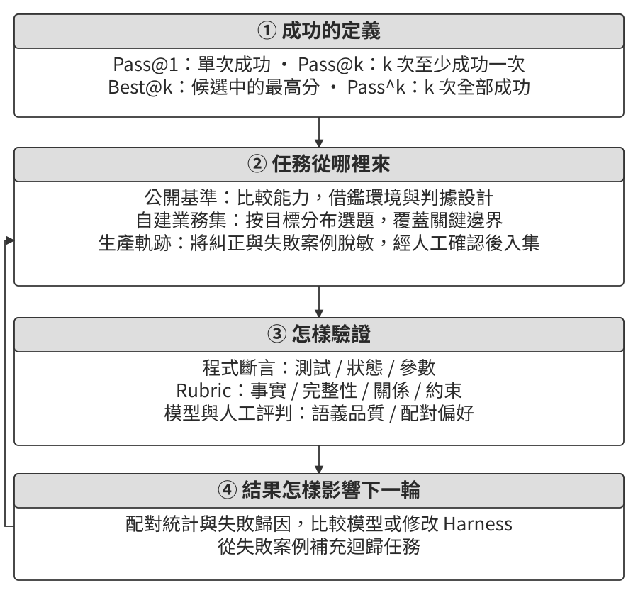
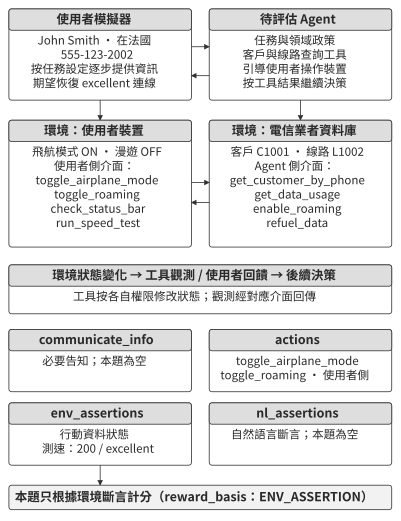
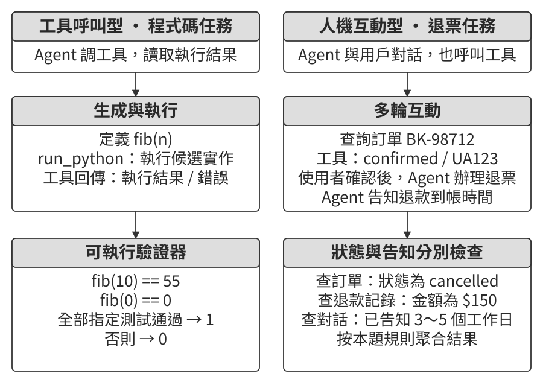
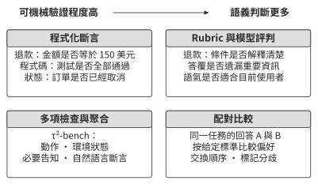
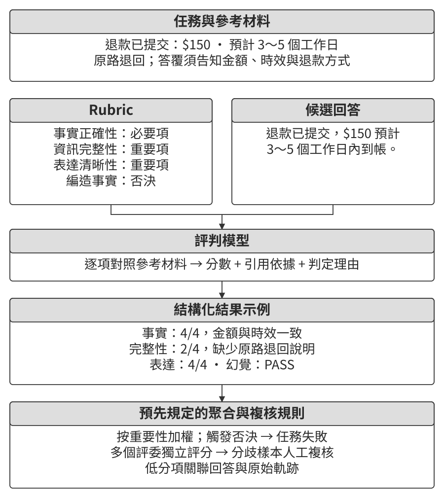
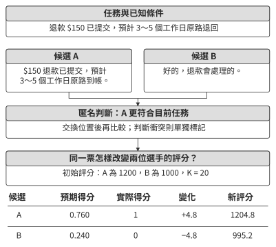
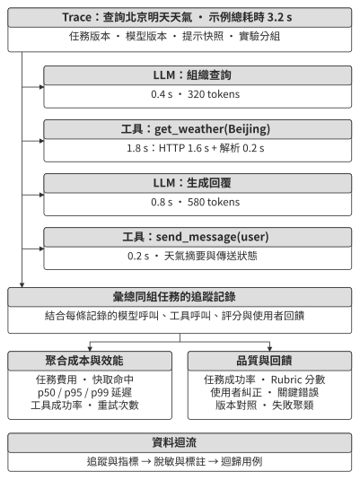
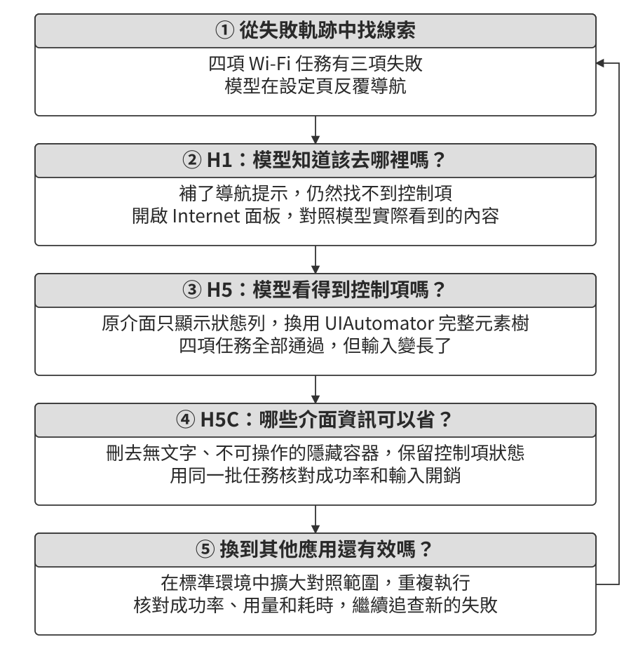
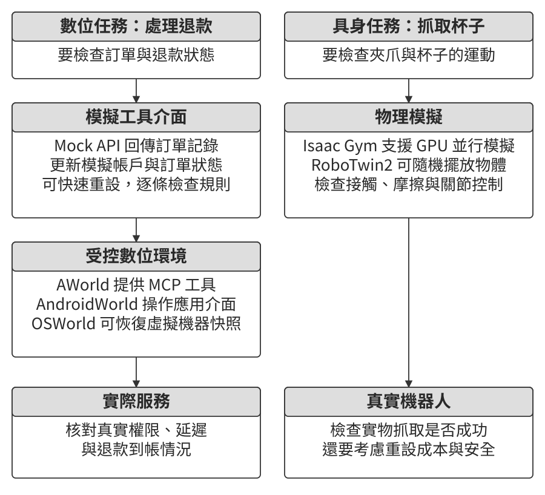
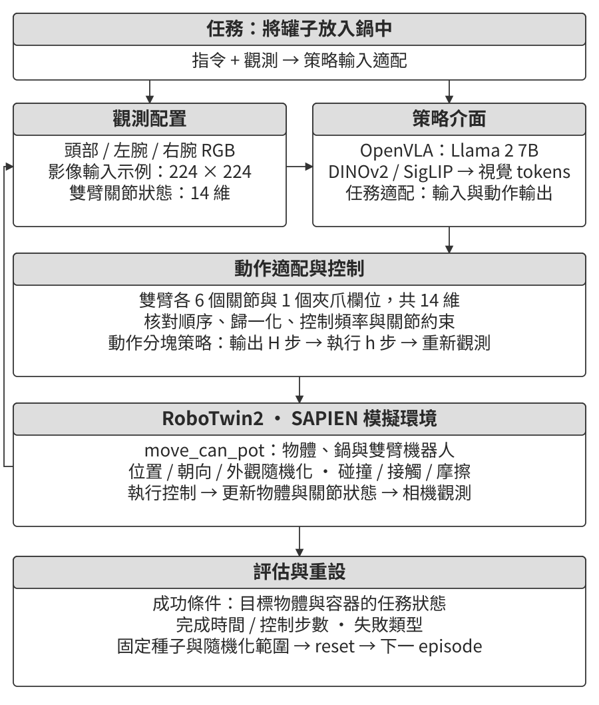

# Agent 的評估

前六章介紹了單 Agent 的建構：上下文、記憶、知識庫、工具、程式碼，以及觀測與動作介面。系統搭建完成後，需要透過一組可重複的任務判斷它能做什麼、在哪些條件下容易失敗，以及下一步改哪裡。評估結果也為後訓練和持續進化提供回饋。

開發過程中，許多選擇都需要用實際任務來比較：使用哪個模型，開放哪些工具，知識庫採用什麼內容與索引，如何組織使用者記憶、提示詞和 Skills，以及 Harness 應增加哪些約束。選擇之間還會相互影響。例如，更詳細的工具說明可能減少參數錯誤，也可能增加上下文開銷；加入驗證步驟可能提高成功率，同時延長完成時間。

**對比實驗**在相同任務與條件下比較不同方案，記錄成功率、耗時和成本的變化。**消融實驗**移除或關閉檢索重排、狀態摘要或結果驗證等元件，再觀察系統表現如何改變。每輪明確改動內容，保持其他執行條件不變，重複測量，就能逐步建立工程選擇與任務結果之間的關聯。筆者主張把對比與消融融入日常開發。單憑幾條順利完成的軌跡，很容易把偶然成功當成改進，或只看到某類任務的收益，漏掉其他任務的退化。

**評估應以模型與 Harness 組成的完整 Agent 為對象。** 模型決定怎樣理解任務、選擇行動，Harness 組織上下文、排程工具、維護狀態並執行檢查。同一個模型接入不同工具或回饋流程，可能產生不同的任務結果。第五章介紹的 Coding Harness 就提供了這類比較場景。

可以用**模型替換實驗（model swap）**研究模型與 Harness 的配合：先固定執行框架和任務，替換模型，比較最終結果與錯誤分布。更強模型仍在相同步驟失敗時，可以檢查工具是否缺失、回饋是否及時、評分是否覆蓋目標；任務表現隨模型顯著變化時，再分析哪些推理、規劃或指令遵循能力影響了結果。

模型替換與元件消融可以交叉進行。例如，讓兩個模型分別執行「有狀態摘要」和「無狀態摘要」兩種配置，檢查摘要是否幫助兩者恢復長任務，以及收益是否依賴模型。這樣既能分析模型差異，也能發現某個 Harness 元件在什麼條件下有效。

評估還是模型升級的迴歸檢查。新模型可能在公開基準上進步，卻在某些業務任務上退化；自己的任務集能夠顯示這些變化。筆者主張「為未來的模型開發產品」：提前完成工具、業務流程和評估集，持續跟蹤新模型在相同任務上的表現。當成功率、回應時間和成本達到產品要求時，再推進上線。

怎樣把上線要求寫成一套評估？讀圖7-1 時，可以沿著一次測試往下追：要衡量什麼，從哪裡選任務，用什麼證據判定成功，最後怎樣記錄和比較結果？



## 從一條任務理解評估：τ²-bench 的 telecom 領域

先看一個手機上網故障。John Smith 使用號碼 555-123-2002，正在法國，手機狀態列顯示「No Service」。他希望恢復網路，測速達到 excellent 才認為故障已經解決；他願意在必要時加購 2.0 GB 流量，希望保留目前方案。

這個案例來自 Sierra 的 τ²-bench telecom 領域。環境同時模擬電信業者後台與使用者裝置，客服 Agent 和使用者模擬器各自透過工具讀取、改變其中一部分狀態。評估需要沿著兩側的互動檢查問題如何被發現、操作如何執行，以及最終網路是否恢復。[^ch7-tau2-task]

### 任務定義的四個組成部分

要讓另一套客服 Agent 處理同一道題，得先還原手機和帳戶的狀態，讓模擬使用者按相同的要求配合排查，最後用同一套標準評分。下表列出任務定義的四部分。讀表時留意一個區別：出題人知道手機的初始設定，客服和使用者在對話開始時各自知道多少？

| 部分 | 欄位 | 本例內容 |
| --- | --- | --- |
| 工單 | `ticket` | 使用者、號碼、所在國家、無法上網的現象、測速要求及方案約束 |
| 使用者場景 | `user_scenario.instructions` | 使用者知道什麼，遇到提問怎樣查詢，何時確認問題解決 |
| 初始狀態 | `initial_state.initialization_actions` | 設定使用者身份與位置，開啟飛航模式，關閉裝置漫遊，開通電信業者側漫遊 |
| 評分標準 | `evaluation_criteria` | 檢查動作與環境狀態，並由 `reward_basis` 指定計分項 |

**使用者知道什麼。** `known_info` 提供姓名、號碼和所在國家。飛航模式開啟、裝置漫遊關閉儲存在環境狀態中，使用者模擬器需要呼叫工具查詢，才能把它們告訴客服。把使用者知道的內容單獨列成欄位，模擬器才能區分可以直接回答的資訊與需要實際查詢的資訊。僅在提示詞中要求「不要一次說完」，很難穩定控制它何時透露哪項事實。這種安排實現了漸進式資訊透露（Progressive Information Disclosure）：對話從「我上不了網」開始，Agent 透過提問和操作引導，逐步獲得排查所需的資訊。

**使用者怎樣回應。** `task_instructions` 規定首次修復失敗後表現出輕度不滿，只有測速為 excellent 才確認解決，並要求裝置相關回答依據工具結果。poor、fair 和 good 都未達到本題目標。事實錨定（Grounding）讓使用者依據模擬環境的實際狀態回應。缺少這項約束，模擬使用者可能順著客服的「現在應該好了」表示同意，兩側對話看似順利，裝置故障卻仍然存在。

**兩側從什麼狀態開始。** 使用者側透過 `set_user_info` 設定身份，透過 `set_user_location(abroad=true)` 表示身在國外，再執行 `turn_airplane_mode_on` 和 `turn_roaming_off`。電信業者側則透過 `enable_roaming` 為客戶 `C1001` 的線路 `L1002` 開通漫遊。因此，後台查詢可以顯示漫遊已開通，手機端仍因飛航模式和裝置漫遊設定而無法聯網。客服需要引導使用者檢查裝置，才能獲得後台查詢沒有提供的資訊。

**哪些檢查決定得分。** `actions` 列出使用者側的 `toggle_airplane_mode` 和 `toggle_roaming`。`env_assertions` 包含行動資料狀態檢查，以及參數為 `expected_speed=200`、`expected_desc="excellent"` 的測速檢查。任務格式還提供 `communicate_info` 和 `nl_assertions`，分別描述必須告知使用者的資訊與自然語言斷言；本題這兩項為空。

本題的 `reward_basis` 選擇 `ENV_ASSERTION`，因此總獎勵取決於環境斷言。動作檢查可以出現在結果中，但是否參與總分，由計分配置決定。

### 沿著執行軌跡檢查結果

配套執行選取五個 telecom 任務，每題執行一次，客服 Agent 與使用者模擬器均使用 GPT-4.1 mini，最終四題通過。下面先分析上述法國漫遊任務，再對照失敗任務。

> **實驗 7-1 ★：執行 τ²-bench 並對比 τ-bench 的演進**
>
> 先閱讀一條任務的使用者場景、初始化動作與評分條件，再執行一次完整互動。沿軌跡標記客服查詢、使用者操作、狀態變化和驗收結果，檢查每次判斷依據了哪條資訊。
>
> 對照 τ-bench 與 τ²-bench 時，重點觀察使用者能否透過工具改變環境，以及這種變化給客服帶來了哪些協調要求。
>
> 看圖7-2 時，先找誰能關掉手機的飛航模式，再找誰能修改電信業者的漫遊配置。兩側各自能做的事不同，也就解釋了為什麼客服做完自己的操作，還得請使用者在手機上測速。
>
> 

處理法國漫遊任務時，Agent 先識別帳戶。它根據號碼查到客戶 `C1001`，查詢了 `L1001`、`L1002`、`L1003` 的流量資訊，卻根據 `L1001` 的詳細資訊得出了錯誤結論：使用者提供的 555-123-2002 不在活躍線路中，最接近的號碼是 555-123-2001。使用者堅持號碼無誤後，Agent 繼續查詢 `L1002`，才確認了正確線路。

隨後，使用者模擬器呼叫 `check_network_status` 與 `check_status_bar`。回傳狀態包括：飛航模式開啟、行動網路無服務、行動資料開啟、裝置漫遊關閉。使用者據此報告：「手機處於飛航模式，資料漫遊也是關閉的。需要先關閉飛航模式嗎？」這裡的查詢由使用者側工具執行，結果經對話傳給客服。

這就是**雙控（Dual-Control）**機制：客服查詢和操作電信業者後台，使用者模擬器擁有獨立的裝置工具，例如檢視狀態列、切換飛航模式、重新插拔 SIM 卡和執行測速。雙方透過交流協調操作，環境記錄各自造成的狀態變化。

Agent 接著引導使用者關閉飛航模式並開啟裝置漫遊，狀態列顯示 5G 訊號。使用者執行 `run_speed_test`，得到 275 Mbps、Excellent 的結果，再確認問題解決。兩條環境斷言均通過，本題獎勵為 1.0。

這條成功軌跡也暴露了過程問題。政策要求客服一次只呼叫一個工具，Agent 卻在同一條訊息中發起 `get_customer_by_phone` 與 `get_customer_by_name`。目前任務總分只納入環境斷言，所以這一行為沒有改變獎勵。

另一條失敗軌跡中，線路選錯後一直未被糾正，後續排查也隨之偏離。使用者號碼仍為 555-123-2002，Agent 選中 `L1001`，並使用該線路 3.2/5 GB 的用量繼續排查。工具已經回傳 `L1001` 對應 555-123-2001，它仍未更正線路，經過多輪無關排查後轉接人工。使用者側成功關閉了省流模式，但正確線路 `L1002` 所需的 2 GB 流量加購沒有執行，三條環境斷言均未通過。

比較兩條軌跡，可以把最終分數展開為具體改進點：核對號碼與線路對應，使用新證據修正判斷，區分裝置與後台狀態，並驗證所需加購是否完成。後文的失敗歸因會繼續討論怎樣從長軌跡中找出這些關鍵轉折。

[^ch7-tau2-task]: Sierra Research 的 τ²-bench 在 telecom 域的 `user_tools.py` 中定義使用者工具，評分入口為 `evaluator.py`。案例內容及結果按配套儲存的五題任務與執行軌跡整理。

## 評估指標：成功的定義

五個任務通過四個，給出了這次執行的總體成績。要據此做產品決策，還需要明確任務類型和失敗代價。退款客服需要持續完成符合條件的退款，寫程式時可以生成幾種實作，用測試篩出能執行並給出正確結果的版本；做研究時也可以提出幾種假設，再由研究者檢驗。評估指標應與這種使用方式對應。

### 技術奇觀：用 Pass@k 衡量多次嘗試的能力

筆者把一些令人印象深刻的 Agent 展示稱為「技術奇觀」：給系統足夠的時間與嘗試機會，它完成了一項此前難以自動完成的任務。對於探索型工作，一條經過驗證的成功軌跡就可能帶來價值。指標 **Pass@k** 對應這種使用方式：同一任務執行 $k$ 次，至少一次通過就計為成功。連續評分的任務也可以報告 $k$ 次中的最高分，稱為 **Best@k**。

例如，Anthropic 曾組織多個 Claude 實例協作建構 C 編譯器，展示長時間執行、測試回饋和任務分工能夠支援複雜工程。研究者尋找數學反例時，也可以讓模型反覆嘗試，最後獨立驗證其中一個反例是否成立。軟體安全審查可以複核模型報告的可疑問題，開放式創作則可以從幾份作品中擇優。[^ch7-long-running]

應用產品也會透過複雜任務展示能力。Manus 將虛擬電腦交給 Agent，使使用者能夠看到它操作介面、查詢資料並持續完成工作。OpenClaw 透過即時通訊接收委託，存取已配置和獲准的檔案與服務，在過程中彙報進展、請求補充資訊，還可以由定時機制喚醒去檢查待辦。這些具體行為讓使用者更容易理解 Agent 的用途。

在筆者看來，能夠完成新類型任務的展示，是這些產品吸引使用者的重要因素。

### 業務可靠性：關注 Pass^k

業務流程通常要求多次執行都能正確交付。**Pass^k** 衡量同一任務執行 $k$ 次、每次均通過的情況，可以讀作「pass power k」。任務的通過條件可以同時涵蓋最終結果、政策執行和權限約束；每次執行都按相同條件檢查。

假設每次執行相互獨立，單次成功機率均為 $p$，則：

$$
\mathrm{Pass@k}=1-(1-p)^k,\qquad
\mathrm{Pass}^{k}=p^k.
$$

例如，$p=0.6$、$k=5$ 時，Pass@5 約為 99.0%，Pass^5 約為 7.8%。前者表示五次嘗試中通常能找到一次成功，後者表示五次全部成功的機率仍然很低。

讀一組實際結果時，可以先不用公式。假設同一道題五次分別是「通、敗、通、通、敗」，這一組的 Pass@5 記 1，Pass^5 記 0，單次成功率估計為 3/5。上面的 99.0% 和 7.8% 回答的是另一個問題：如果已知每次成功機率是 0.6，把五次作為一組反覆做，會有多少組達到對應標準？

同一批記錄也可以回答一個更容易核對的問題：從剛才五次執行裡任取兩次，有多大比例的配對能通過？把每次執行當成一張卡片，不放回地取兩張，共有十種配對。只有兩張失敗卡湊成的一對會讓兩次都失敗，因此九對至少成功一次，Pass@2 的樣本估計為 9/10。三張成功卡可以兩兩組成三對，因此 Pass^2 的樣本估計為 3/10。τ²-bench 正是按任務這樣統計全通過的組合：一題執行 $n$ 次，成功 $s$ 次，從中選 $k$ 次，全通過的組合數佔比為 $\binom{s}{k}/\binom{n}{k}$，其中 $1\le k\le n$。[^ch7-tau2-metrics]

再回頭讀實驗 7-1 的 4/5。那五條軌跡分別屬於五道題，每題都只有一張卡片，連一對都湊不出來。要估計這些任務的 Pass^2，需要給每道題增加獨立執行，再分別計算和彙總。如果把 0.8 直接平方，等於額外假定這些題每次成功的機率都一樣，且各次嘗試相互獨立。

[^ch7-tau2-metrics]: τ²-bench 的實驗版本（修訂號 8d005b0）在 `agent_metrics.py` 中逐題計算 Pass^k。當成功次數少於 $k$ 時，全通過的組合數為零。

計算時需要保持統計單位一致。同一任務的五次取樣，衡量這一任務的重複表現；生產中連續五個不同任務，還受到任務難度與流量分布影響。不同任務成功機率不同時，可以先計算各自的重複成功指標，再按任務權重彙總。共享狀態、快取或相同故障也會使多次執行相關。

**允許回答「資訊不足」時，分母怎樣選？** 設想文獻助手接到 100 道題，答了 80 道，其中 68 道正確。依賴已給答案的讀者關心的是 68/80，即 85%；需要辦完這一批任務的人還關心 68/100，即 68%。另有 20 道需要補找證據或轉給人處理。

PaperQA2 在 248 道 LitQA2 文獻題上就可以選擇「資訊不足」。論文報告三輪執行的平均結果：系統給出實質答案時，正確率為 85.2%；按全題計算，正確率為 66.0%，另有 21.9% 選擇資訊不足。九名人類答題者對應的兩項正確率為 73.8% 和 67.7%。論文報告第一項差異顯著，第二項差異未達統計顯著。[^ch7-paperqa2-denominators]

[^ch7-paperqa2-denominators]: Skarlinski 等，*Language Agents Achieve Superhuman Synthesis of Scientific Knowledge*，2024，見第 2 節及圖 2。

最終狀態相同的兩條軌跡，成本可能不同。以查帳單為例，甲一次查詢就回傳了正確金額。乙查了兩次才給出同樣的答案。兩次查詢帶著相同的請求標識，第一次又已超時，說明重試幫它恢復了任務。如果第一次的結果已成功送達，第二次查詢便白白增加了等待時間和工具費用。

執行涉及寫入或其他外部效果時，先為每次試驗恢復規定的初始狀態，在測試環境中完成操作並記錄所有嘗試。產品若允許失敗後重試，就把重試次數、恢復步驟與執行成本一併納入流程評估；原始失敗記錄繼續保留，便於區分單次表現與恢復後的結果。

[^ch7-long-running]: Anthropic，Building a C compiler with a team of parallel Claudes，2026-02-05，介紹多實例協作、長程執行與測試回饋。

## 評估環境

假設要複查前面選錯線路的那一次執行。複查者需要看到同一位使用者、同樣的兩條線路和相同的初始方案。若第一次執行已經改過其中一條線路，直接再跑一次，就無法判斷結果的變化來自模型還是資料庫。評估環境負責建立任務起點、提供互動介面、記錄過程並檢查終點。

### 五個組成要素

以 telecom 任務為例，可以把評估環境拆成五部分。

**資料集（Dataset）**儲存任務定義：使用者背景、行為要求、初始狀態與驗收條件。一條記錄對應一個用例，執行階段按照各參與者的角色分配資訊。

**環境狀態（Environment State）**儲存任務執行中的可變資訊，例如客戶、線路、方案、帳單，以及裝置的飛航模式、漫遊和省流設定。開始新一輪時，環境先恢復基礎資料，再執行 `initialization_actions`，建立目前任務規定的故障。清理與初始化需要配合，避免上一輪的加購或設定變化進入下一輪。

**工具介面（Tools）**決定參與者能讀取和改變什麼。客服可以查詢客戶、檢查用量、加購流量或轉接人工；使用者可以檢視裝置狀態、切換開關和測速。工具粒度應對應被測能力：若要評估診斷和規劃，就讓 Agent 組合查詢與操作；若直接提供「修復上網問題」的工具，測試重點便轉向何時呼叫這一能力。

**評分標準（Rubric）**說明如何判斷結果。telecom 任務可以檢查動作、環境狀態、必要溝通和自然語言要求，再透過 `reward_basis` 確定哪些檢查參與總分。

**執行協定（Interaction Protocol）**安排發言、工具呼叫與終止。使用者模擬器可以輸出 `###STOP###` 結束互動，執行器還設定輪數等預算。結束原因與任務得分分別記錄：使用者停止對話後，環境斷言仍負責判斷目標是否達成；耗盡預算也需要保留最後狀態和未完成步驟。

### 人機互動型與工具呼叫型評估環境

telecom 任務包含一個持續回應並操作裝置的使用者模擬器。程式碼修復、資料分析和數學求解則常由任務指令啟動，Agent 隨後主要與工具互動。兩類環境都需要任務、狀態、介面、評分和執行協定，區別在於是否還要模擬對話對象，以及雙方如何協調行動。

程式碼任務可以用測試檢查輸出，資料庫任務可以查詢改動後的記錄，開放式分析則可能要請人或模型評審內容。人機互動任務往往還得拼起兩份證據。例如，手機網路是否恢復要看裝置狀態；客服有沒有澄清號碼、引導使用者操作，要看對話。圖7-3 中的退款也一樣：訂單是否已經取消，資料庫中可查；客服有沒有告知到帳時間，就得在對話裡找。



在 Verifiers 中，這兩類任務可以從不同的環境介面入手。表7-1 列出 v0.1.9 中處理單輪回答、多輪工具呼叫、執行狀態注入和沙盒資源管理的介面，方便對照程式碼。[^ch7-verifiers-env]

表7-1 Verifiers 環境類型對比

| 環境類型 | 主要職責 | 工具與狀態處理 | 典型用例 |
|---|---|---|---|
| `SingleTurnEnv` | 組織單輪回答 | 一次回答後評分 | 數學題、單輪問答 |
| `ToolEnv` | 組織多輪工具互動 | 儲存執行軌跡，派發工具並接收結果 | 搜尋與資訊綜合 |
| `StatefulToolEnv` | 將執行狀態接入工具執行 | 根據目前狀態補充工具參數或更新狀態 | 為本次任務綁定資料庫或資源標識 |
| `SandboxEnv` | 管理隔離執行環境 | 為執行分配沙盒並使用其中的工具 | 執行程式碼、檢查檔案與測試結果 |

例如，兩條任務同時修改資料庫時，執行器可以把各自的資料庫標識注入工具呼叫，使每條軌跡操作對應的資料。執行失敗時，工具應回傳可用於下一步判斷的資訊，如物件不存在、參數不符合要求或服務超時。評估系統儲存觀測、呼叫、執行結果和獎勵，分析時便能把錯誤定位到具體步驟。

[^ch7-verifiers-env]: Prime Intellect，Verifiers v0.1.9 的 ToolEnv 與 StatefulToolEnv，展示多輪軌跡、工具分派與狀態參數注入。

## 評估資料集的設計

現在把五道電信題擴展成一份能指導發布的評估集。若新增的全是「給指定號碼開通漫遊」，系統即使從未學會分辨同一帳戶下的兩條線路，也可能拿到高分。如果要根據成績決定客服能否上線，選題就要參考真實工單，既有常規業務，也有容易混淆線路的難題，評分時還得查到客服最終改了哪條線路。上線後還要維護這些題目，使它們持續反映使用者實際交付的工作。

### 基準設計的橫向對照

表7-2 將六個基準按能力、任務來源、執行環境和驗證方式並列。

表7-2 幾個 Agent 基準的關鍵設計選擇

| 基準 | 被測能力 | 任務來源與組織 | 執行環境 | 驗證方式 |
|---|---|---|---|---|
| τ²-bench | 客服互動與工具操作 | 領域任務與故障組合 | 使用者模擬器、裝置與業務資料庫 | 分項檢查，按 `reward_basis` 計分 |
| SWE-bench Verified | 程式碼問題修復 | 真實 GitHub issue，經人工篩選 | 程式碼儲存庫與測試環境 | `FAIL_TO_PASS` 與 `PASS_TO_PASS` 測試 |
| AndroidWorld | Android 應用操作 | 參數化任務範本 | 執行真實應用的 Android 模擬器 | 讀取裝置、檔案或應用內部狀態 |
| OSWorld | 桌面與跨應用操作 | 真實使用場景，配置任務起點 | 虛擬機器與桌面應用 | 按任務執行狀態與產物檢查 |
| Terminal-Bench | 終端中的工程任務 | 人工設計的任務與測試 | 容器及任務所需依賴 | 檔案、程式執行與測試結果 |
| GAIA | 通用助手的資訊處理 | 人工編寫問題，部分附帶材料 | 網路、檔案與輔助工具 | 按答案格式規範化後比較 |

### 驗證器

驗證器把任務目標連接到可檢查的證據。程式碼任務需要執行測試，桌面任務需要讀取應用或檔案狀態，資訊檢索任務需要核對答案及來源。**驗收應以獨立取得的證據為準。** Agent 可能生成一份完整的報告，聲稱所有步驟已經完成；驗證器仍要實際執行產物、讀取狀態或核對來源。完成報告用於定位檢查對象，得分由這些檢查決定。

設想使用者開啟支付應用，請助手「批准本月室友發來的全部收款請求」。假設有三筆待處理：室友本月的、這位室友上月的、同事本月的。第一筆應當獲批，後兩筆應當保持待處理。只查第一筆，連一個把三筆都批准的助手也能得滿分；只查後兩筆，一個什麼也沒做的助手也能過關。AppWorld 在模擬支付應用中出了這道題。設計驗證器時，可以先根據操作前的資料圈出使用者授權的那批請求，再查是否全部獲批，最後從操作後的記錄反查：助手還動了哪幾筆？[^ch7-appworld-scope]

[^ch7-appworld-scope]: Trivedi 等，*AppWorld*，ACL 2024，圖 2 給出任務和驗收條件。

科研搜尋也可以交出一件容易核驗的產物。FunSearch 要在八維空間中儘量多選一些點，每一維只能取 0、1 或 2，運算按模 3 進行，選出的點中任意三點都不能共線。研究者寫好逐步選點的程式框架，讓模型提出給候選點排序的函式，再用實際構造出的合法點集大小評分。論文發表時，已有構造能選出 496 個點，新程式交出了一份 512 個點的清單。[^ch7-funsearch-cap]

你可以只下載清單，獨立檢查這個結果。先確認其中有 512 個不同的八維向量，每個座標都在規定範圍。再任選兩個不同點 $a,b$，它們所在的直線只有三個點，第三點為 $c=-a-b \pmod{3}$。例如在二維取 $(0,0)$ 與 $(1,2)$，第三點就是 $(2,1)$。把同樣的運算逐座標應用於八維，逐一檢查清單中的 130,816 對不同點，得到的第三點都沒有出現在清單裡。這足以證明至少能選 512 個點。要證明 513 個一定做不到，還需要上界證明。

[^ch7-funsearch-cap]: Romera-Paredes 等，*Mathematical discoveries from program search with large language models*，Nature，2023 年線上發表。作者另行公開了八維點集和驗證用的計算筆記本。

**SWE-bench 的兩類測試分別檢查修復與迴歸。** `FAIL_TO_PASS` 是修復前失敗、修復後應通過的測試；`PASS_TO_PASS` 是原先通過、修復後應繼續通過的測試。前者檢查指定問題，後者檢查已有測試覆蓋的行為是否保持。[^ch7-swe-verified]

**OSWorld 用執行式驗證檢查應用產物。** 原始版本提供 134 個執行式評估函式，結合任務配置讀取檔案、應用資料或系統狀態。[^ch7-osworld-design] 例如，要求修改表格時，可以檢查指定儲存格與公式；要求更新瀏覽器設定時，可以讀取相關配置。

**Terminal-Bench 透過執行結果驗收工程任務。** 建構 Linux 核心的案例串聯原始碼修改、編譯、initramfs 和 QEMU 啟動；其中 Linux 6.9、`start_kernel` 中的自定義 `printk` 以及啟動日誌裡的訊息，都提供了具體檢查點。

第五章講過從訂單核對銷售額。如果助手交來的是一份二十個通路的季度報表，從哪兒查起？騰訊 WorkBuddy Bench 有一道公開的對帳題。兩張工作表都是通路資料，結算額看季增，要和上一季比；回款額看年增，要和上年同一季比。即使把兩個基期都填成上一季度，表頭和通路數也可能完全正確。以結算表的「錦繡生活館」為例，從明細中去掉重複行和缺少季度的記錄，按通路、季度彙總，可以算出成交總額從 1,569,231.00 增至 1,787,311.03，差額為 218,080.03。評分程式檢查兩張表的通路覆蓋情況，再抽查兩個指定通路的數值。這道題的通路覆蓋檢查遍及二十家，數值檢查只涉及抽到的兩家。[^ch7-workbuddy-office]

[^ch7-workbuddy-office]: 騰訊 WorkBuddy Bench 辦公任務 `channel-period-compare-L4-017`。所用資料包（修訂號 3e8ad83）附原始工作簿、參考答案與評分程式。

可以用一個時間敏感的任務檢驗驗證器。假設使用者要求某飯店房價降到 950 元以下時提醒。價格在 10:00 為 1000 元，10:10 降到 900 元，10:15 又回到 1000 元。10:12 發出一條含房型和預訂入口的降價提醒，使用者還有機會下單。每天發一條「尚未降價」，偏偏錯過這五分鐘，即使連續執行一週也沒有完成委託。評分時分別記錄符合條件的降價時段數、時段內及時提醒的次數，以及無變化時打擾使用者的次數。如果評估者也只儲存了每天一次的報價，漏掉的時段根本數不出來。要測漏報，應先準備帶時間戳的完整價格重播，再讓待測系統按自己的頻率去查。

### 任務的難度劃分

任務集需要覆蓋不同難度，並說明難度來自哪裡。基礎任務檢查能力是否退化，困難任務則為後續模型進步留下測量空間；如果題目很快全部通過，評估集就難以繼續指導選型。可以按工具種類、操作長度、資訊分散程度、環境不確定性或所需專業知識劃分，再檢視系統在哪些條件下明顯退化。

GAIA 的 466 道題分為三個等級。較簡單任務通常涉及少量工具和步驟，更難的任務需要多步資訊整合與複雜組合。原論文中，人類標註者在三級任務上的正確率分別為 93.9%、91.8% 和 87.3%；GPT-4 加外掛的對應結果為 30.3%、9.7% 和 0%。[^ch7-gaia-design]

Terminal-Bench 的任務跨度同樣很大：模型註冊涉及 MLflow 的使用，多元件部署需要協調 Git 服務與 Web 服務，密碼恢復與 FEAL 差分分析則加入了專門的演算法知識。

業務任務還需要覆蓋政策邊界。例如，使用者聲稱客服已批准取消訂單時，系統應查詢授權與訂單狀態，再按政策決定是否取消。此類用例考察 Agent 如何使用證據處理相互衝突的資訊，可以與正常辦理任務配套設定。

### 資料洩漏防範

**多源組合與專用附件。** 假如模型能在搜尋結果裡找到題目和現成答案，一次答對能證明多少檢索與推理能力？GAIA 用多步查詢和專用附件減少這種機會。例如，先從某日的天文圖片識別太空人，再查詢所屬太空人梯隊、比較成員的在軌時長，最後按要求輸出姓氏和分鐘數。分號、數值捨入與千位分隔符都是答案約定。專門製作的 PDF、音訊和圖片增加了輸入組合。公開的題目可能進入訓練材料。因此還要另留一批題，專供評估，並記錄哪些題已經用於訓練。[^ch7-gaia-design]

**參數化實例。** AndroidWorld 為任務提供初始化、執行檢查和清理邏輯，並透過參數生成不同實例。[^ch7-androidworld-design] 例如，「將聯絡人 `[CONTACT_NAME]` 的電話改為 `[NEW_PHONE]`」可以改變聯絡人和號碼，同時保持操作目標不變。參數變化能檢查模型是否根據目前任務行動；固定部分參數、改變其餘參數，還便於研究特定因素的影響。

**金絲雀識別碼。** 基準檔案可以嵌入獨特的 canary GUID，幫助發現資料被複製或混入其他語料的線索。Terminal-Bench 的任務檔案採用了這類標記。判斷洩漏時，還要檢查模型是否在目前上下文或檢索結果中見過標識，再結合資料來源追蹤；發現標記可以觸發調查，訓練資料歸屬需要進一步證據。

### 品質控制與長期維護

假如同一道 telecom 題昨天通過、今天失敗，除了檢查 Agent 的變化，還要能回答：初始線路有沒有變？使用者模擬器是否仍按同一套規則配合？判卷條件是否在測同一個目標？沿著一次執行的起點、互動和終點，可以整理出五項維護工作。

1. **明確使用者資訊範圍。** 將 `known_info` 與行為要求分開，使查詢和澄清步驟有明確的資訊起點。
2. **寫清驗收條件。** 將「網路恢復」落實到行動資料狀態、測速值與評級，檢查任務真正要求的效果。
3. **約束模擬使用者的回應依據。** 裝置狀態來自工具回傳，情緒和耐心規則用於組織互動。
4. **表示雙方操作。** 使用者與客服各自改變環境，後續決策透過可用工具或對話獲得新的狀態資訊。
5. **組合任務與故障。** 在明確的生成規則下變化故障組合與任務參數，再檢查實例是否可解、初始狀態是否符合任務定義。

**SWE-bench Verified 展示了發布前的人工篩選。** 專案邀請 93 名具有 Python 經驗的開發者，對隨機抽取的 1699 個樣本進行標註，重點檢查問題描述是否充分、測試是否會排除合理解，並估計修復難度；每個樣本由三名標註者獨立檢查。發布的 Verified 集包含 500 個樣本。[^ch7-swe-verified] 篩選規則和難度分布一起公布，使用者才能判斷縮小任務集後保留了哪些能力要求。Agent 任務往往需要多輪模型呼叫和環境操作，含糊或不可解的題目會在每次迴歸中反覆消耗預算。筆者建議優先清理這類雜訊，再擴大任務數量；高品質的小型評估集更適合頻繁執行，也更容易解釋失敗。

**OSWorld-Verified 展示了發布後的維護。** 專案在初版發布約 15 個月後，整理並修復了 300 多條回饋，涉及約十人團隊兩個月的集中工作。[^ch7-osworld-verified]

例如，網頁結構變化後需要更新狀態提取；文件任務開始前需要確認應用已載入、檔案已開啟、游標位於指定位置；驗證條件修改後，需要用正確與錯誤產物迴歸檢查。

> **實驗 7-2 ★：親自執行基準測試任務**
>
> 從 GAIA、AndroidWorld、SWE-bench Verified、Terminal-Bench、OSWorld-Verified 和 τ²-bench 中選取任務，每類按該基準的難度定義選擇簡單、中等、困難各一題。先獨立完成任務，再檢查官方評分；記錄操作路徑、遇到的歧義和最終產物。
>
> 配套材料儲存了 Codex 操作這六類基準的 18 條案例，可用於對照自己的思路。其中，GAIA 的原子距離題在捨入格式上與評分器產生分歧；AndroidWorld 的乘法題算出 840 後，頁面仍未達到要求的成功狀態。其中 τ²-bench 使用本地模型模擬隱藏使用者。18 條案例共有 13 條通過。
>
> 完成後分析：題目是否允許多種合理解釋，驗證器是否覆蓋這些解釋，得到正確的中間結果後，還需要完成哪些操作才能通過驗收。

### 評估集的三個來源

生產評估可以結合公開基準、自建業務任務和生產軌跡。三者承擔不同職責，並共同覆蓋系統的使用範圍。

**公開基準**適合初步比較模型，也提供任務設計、參數化生成和驗證器的參考。筆者用它們初步篩選候選模型，再依據自建業務集的結果決定選型與發布。

**自建業務集**圍繞實際使用者目標、工具和政策組織任務，用於模型選型與 Harness 改進。可以借鑑 τ²-bench 的結構，配置領域資料、使用者場景、工具與狀態檢查，再校準任務難度和使用者模擬器行為。

**生產軌跡迴流**從真實執行中發現遺漏，例如使用者糾正、負面回饋、業務狀態異常，或軌跡評審發現的錯誤。經過授權處理和去標識化後，人工核對失敗原因，恢復必要的任務條件，再納入迴歸集。使用者回饋是定位問題的線索，評分標籤需要結合實際狀態確認。

起步時，可以使用公開基準與少量手寫業務任務；上線後，應把真實錯誤和新業務場景作為迴歸用例的主要增量來源。這些任務直接來自使用者遇到的問題，能夠不斷補上設計階段遺漏的條件。

[^ch7-swe-verified]: OpenAI，Introducing SWE-bench Verified，2024，介紹測試分類、標註標準與人工篩選。
[^ch7-osworld-design]: OSWorld 專案說明列出了任務初始化與執行式評估，134 個評估函式為原始版本統計。
[^ch7-gaia-design]: Grégoire Mialon 等，GAIA: A Benchmark for General AI Assistants，原始論文說明任務分級、答案規範及人類與模型配置。
[^ch7-androidworld-design]: Christopher Rawles 等，AndroidWorld: A Dynamic Benchmarking Environment for Autonomous Agents，介紹參數化任務及裝置狀態驗收。
[^ch7-osworld-verified]: XLANG Lab，Introducing OSWorld-Verified，2025，介紹社群回饋、初始化與驗證器修訂。

## 自動化評估方法

自動化評估從明確檢查對象開始。SWE-bench 透過測試套件檢查程式碼行為，AndroidWorld 查詢應用狀態，GAIA 按答案類型規範化後比較答案。這些檢查可以由程式執行，適合反覆執行。τ²-bench 則組合了多種判據：工具呼叫與環境狀態可以直接核對，自然語言要求還可以交給模型評判。同一個任務常常同時需要這兩類方法。

程式化檢查也能提供診斷資訊。以本章開頭的電信任務為例，分別檢查漫遊設定、流量餘額和加購動作，就能知道哪些條件尚未滿足。進一步定位線路選錯的時刻，需要把檢查結果與呼叫軌跡對應起來。

開放式輸出需要把品質要求寫得更具體。投訴回覆要交代處理方案，並與客戶的情緒和問題相適應；調研報告要覆蓋關鍵事實，並讓結論得到來源支持；記憶回答要正確關聯人物、時間和事件。對於這些要求，可以用 **Rubric（評分標準）**列出逐項判據，再讓 **LLM-as-a-Judge（模型評判）**根據材料打分。

**能用程式核驗的條件，筆者優先寫成程式檢查。** 格式、數值、權限和最終狀態通常都有明確的判據，輸入和環境固定以後可以反覆檢查，開銷也好估算。同一份回答裡，兩種評分方式可能都用得上。以圖7-4 為例，核對退款金額只需比較數字；判斷客服有沒有把退款條件解釋清楚，卻得讀懂整段話。這一項可以請模型評分，再由人抽樣校準。



### LLM-as-a-Judge：把品質要求轉成逐項評分

圖7-5 中，客服準確報出了退款金額和預計到帳時間，完整性為什麼只得了 2 分？評分標準還要求說明退款去向，答覆裡漏了「原路退回」。評判模型需要同時看到任務、評分標準和參考材料，才能指出漏答了哪一項。



評判模型需要先經過校準。一個常見問題是**長度偏差**：內容相當時，更長的回答可能獲得更高分。可以準備事實與結論相同、表達長短不同的樣本，檢查評分是否隨篇幅變化；把兩份回答放在一起評時，可以交換前後順序，看評判模型會不會改選另一份。任務本身有簡潔性要求時，將其寫入 Rubric，並給出恰當長度的示例。批次統計中的「高分與長回答相關」可以用來發現線索，隨後還要比較資訊量、正確性和任務難度，識別具體原因。

**Rubric 的四項設計準則。** Scale AI 的「Rubrics as Rewards」提出了專家指導、全面覆蓋、按重要性加權和自包含四項準則。[^ch7-rubrics] 在 Agent 評估中，可以這樣落實：

（1）**基於專家指導。** 先請熟悉業務的人寫出參考答案、關鍵事實和容易出錯的關係。例如，記憶任務需要明確誰擁有哪張保單、舊地址何時被新地址替代。

（2）**全面覆蓋。** 同時列出必要資訊、關係判斷、表達要求和高風險錯誤，即**陷阱（Pitfall）**。客服回覆可以檢查是否回應了訴求、是否給出下一步，以及是否編造退款承諾。

（3）**按重要性加權。** 區分必要項（Essential）、重要項（Important）和可選項（Optional），並為陷阱規定扣分規則。對於會直接導致任務失敗的錯誤，可以增設**一票否決（Veto）**：例如，記憶任務中編造了使用者的帳戶號碼，即使表達流暢、其他資訊齊全，也判定該次任務失敗。

（4）**評價標準自包含。** 在評分項中寫明判斷需要的事實、條件和接受範圍。例如，「正確回答客戶的目前地址」可以具體化為「回答更新後的上海地址；北京地址已在後續對話中作廢」。

每個維度還需要明確的評分檔次和邊界案例。先用一批回答試評，收集人工與模型之間、不同評價者之間的分歧，再補充判例。例如，答案包含了要求的關鍵詞，卻把兩個人的經歷拼在一起，就應在關係判斷上扣分。這類判例有助於發現**獎勵作弊（Reward Hacking）**：系統獲得了高分，實際行為卻偏離了任務目標。

下面為一個跨會話記憶問題設計完整的 Rubric。第一段歷史寫著「我的女兒叫 Lily」，第二段寫著「Lily 的兒科醫生是 Dr. Chen，今天帶她去複診」。使用者問：「我女兒的兒科醫生是誰？」兩段歷史共同支援「你女兒 Lily 的兒科醫生是 Dr. Chen」。

| 維度與重要性 | 4 分：優秀 | 3 分：良好 | 2 分：部分滿足 | 1 分：未滿足 |
| --- | --- | --- | --- | --- |
| 事實正確性：必要項 | 醫生姓名與人物關係均正確 | 正確回答 Dr. Chen，省略人物稱呼 | 提到 Dr. Chen，卻又把其他醫生列為可能的答案 | 醫生姓名錯誤，或已有充分證據仍回答不知道 |
| 資訊完整性：重要項 | 清楚交代「Lily—兒科醫生—Dr. Chen」的對應關係 | 簡潔回答醫生姓名，已滿足目前問題 | 只回答就診機構或事件，漏掉醫生姓名 | 未提供相關資訊 |
| 關聯正確性：重要項 | 回答正確關聯兩段歷史，並在需要解釋時引用對應依據 | 回答中的人物關係正確，未展開依據 | 找到了有關人物，但關係仍含混 | 把使用者本人或其他孩子的醫生關聯到 Lily |

**幻覺偵測單獨實行一票否決。** 回答中的事實應得到歷史佐證；虛構就診日期、診斷結果或醫生身份時，判定失敗。本例約定，觸發否決後總分置零。關聯正確性依據回答、引用和可觀測軌跡評分，簡潔回答也可以完成任務。

邊界案例決定評分能否處理真實對話。使用者有多個女兒、問題中的指代又無法消歧時，正確行為是追問；歷史已經明確指向 Lily 時，可以直接作答。「Dr. Chen」與「陳醫生」是否為同一人，應結合歷史中的別名、機構和人物關係確認。

**評分項多時，可以讓判斷模型先評。** 假設有一千份回答，每份要查二十項，就有兩萬項判斷。拿表中的人物關係來說，「Dr. Chen 是 Lily 的兒科醫生」和「Dr. Chen 是我的兒科醫生，Lily 陪我去過」包含同樣的人名，結論卻不同。與其為姓名、語序和否定詞逐一寫匹配規則，可以直接把判據寫成一句話：「結合提問和兩段歷史，回答是否把這位醫生正確地關聯到使用者的女兒？」把這些材料、待評回答和判據交給 Jev 一類判斷模型，讓它從「符合」「不符合」「無法判定」中選擇。這一問能識別把醫生認錯人的回答。若要區分表中關聯正確性的四個檔次，可以直接把四檔判據列為選項，另留「無法判定」供複核。同一份回答的不同維度可以並行評判，最後由程式彙總各項得分，執行幻覺否決等明確規則。

要儘快用上這套評分辦法，可以直接呼叫 TypeSafe 官方的 Jev 這樣的前沿判斷模型。把評分規則寫成提示詞，給出可選檔次，每次送入待評回答和相應的歷史材料，就能快速取得判斷結果。若每天都要按同一套規則評大量回答，希望進一步壓低單次成本，可以蒸餾自己的判斷模型。先由評測設計者寫清各檔的判據，再讓 DeepSeek、Kimi、GPT、Claude 或 Gemini 等前沿模型充當教師，按規則給樣本打分。把核過的「材料、回答、教師給出的檔次」組成合成訓練集，用第八章的監督微調方法訓練較小的學生模型。訓練好的學生模型便可承擔日常評分。

> **實驗 7-3 ★★：建構基於 Rubric 的使用者記憶評估系統**
>
> 在第三章的使用者記憶評估框架中實作結構化評分，覆蓋基礎回憶、多會話消歧和跨會話隱藏關聯三層任務。評價維度包括事實正確性、事實完整性、關聯正確性、主動性，以及獨立的幻覺偵測。
>
> 事實正確性檢查數字、日期、名稱等已給資訊；事實完整性檢查回答應包含的關鍵事實；關聯正確性檢查人物、時間和事件之間的關係；主動性檢查是否適時提出有依據的建議或風險提醒。前四項採用四檔評分，每檔給出明確判據，並補充示例和邊界案例；幻覺偵測作為否決項。
>
> 實作中沿用 Precision 和 Recall 作為前兩項的欄位名，記錄的是 Rubric 檔次。若要報告統計意義上的精確率與召回率，需要進一步定義可計數的事實單元，分別計算正確事實佔已給事實的比例、已覆蓋必要事實佔全部必要事實的比例。
>
> 讀實驗結果時，先看任務是否通過，再看它拿了多少分。只要事實正確性、事實完整性和關聯正確性都達到 3 分，且沒有觸發幻覺否決，任務就算通過。連續獎勵還計入主動性：四項各自按 $(s-1)/3$ 折算，再取平均；出現幻覺則獎勵歸零。例如，實驗 7-12 有一組用 BGE-M3 檢索，跳過重排，由豆包作答。其中一道保險理賠題的四項依次得了 3、3、3、2 分。它通過了任務，連續獎勵約為 0.583。

> **實驗 7-4 ★★：Advanced JSON Cards 與 RAG 的對比評估**
>
> 在同一組 60 個問題上比較三種記憶方案：純 Advanced JSON Cards 將結構化卡片放入上下文；純 RAG 將對話分塊後檢索相關內容；混合系統讓核心事實常駐上下文，並按需檢索原始對話。三層任務各 20 題，共形成 180 個「方案—問題」組合。
>
> 三種方案使用相同的問題、來源對話、回答模型和評分規則，分別統計分層成功率、幻覺否決與成本。進一步對齊同一道題的三個結果，分析混合系統在哪些問題上形成互補，在哪些問題上因資訊選擇或融合發生損失。

表7-3 沿用這次實驗的歷史彙總。每層有 20 道題，表中相差 5 個百分點就相差一道題。

表7-3 三種使用者記憶系統的分層成功率

| 系統 | 基礎回憶 | 多會話消歧 | 跨會話隱藏關聯 | 總體 |
| --- | ---: | ---: | ---: | ---: |
| Advanced JSON Cards | 95% | 60% | 50% | 68.3%（41/60） |
| RAG | 90% | 40% | 15% | 48.3%（29/60） |
| 混合系統 | 80% | 70% | 50% | 66.7%（40/60） |

先看純 RAG。在基礎回憶題上，它答對 18 題，卡片方案答對 19 題；到了跨會話隱藏關聯題，純 RAG 只答對 3 題，卡片方案答對 10 題。想弄清這 7 題的成績差距從何而來，可以先抽一道 RAG 答錯的題，檢視檢索結果是否包含建立關聯所需的兩段對話。若兩段都在，再檢查回答把哪兩個人或哪兩件事關聯到了一起。只看成功率，無法區分是材料沒找全，還是模型讀到了材料卻連錯了關係。

**把兩種記憶機制放在一起，會自然得到兩者的長處嗎？** 混合系統在多會話消歧上答對 14 題，超過卡片方案的 12 題和純 RAG 的 8 題。但歷史彙總還記錄了兩組值得分開看的題：有 3 題只有混合系統答對，另有 8 題至少一種單一方案答對，混合系統卻答錯。這樣算下來，至少一種單一方案能答對的共有 $40-3+8=45$ 題，實際執行的混合系統答對 40 題。45 題是事後合併兩份答卷得到的參照；要讓系統自己取得這個成績，還得解決它在作答時如何選用記憶的問題。180 次評判中另有 28 次觸發幻覺否決。

**同源模型與多源評判。**

Agent 和評判模型可能不知道同一件事，也可能偏愛同一種表達。兩者屬於同一模型家族時，尤其要檢查這些偏好會不會影響評分。假如 Agent 學會了評分器喜歡的文風，卻繼續犯評分器查不出的事實錯誤，分數仍可能上漲。這是古德哈特定律在評估中的一個例子：反覆把指標當作最佳化目標，指標可能逐漸失去衡量實際品質的能力。

在重要版本發布前以及關鍵業務的定期檢查中，筆者建議採用多源評判，讓不同模型家族使用同一份 Rubric 獨立評分，例如由 Claude 完成任務，再由 GPT 和 Gemini 評判。先用人工標註樣本測量各評價者的準確性與分歧，再決定如何聚合：常規評分可取加權平均，關鍵失敗條件按預先規定的規則處理，分歧較大的樣本交由人工複核。日常執行可以使用單一評判模型，透過上述檢查及時發現評分漂移。

**多模態 LLM-as-a-Judge。**

多模態評判將同樣的流程擴展到音訊、影像和影片。評分材料需要覆蓋要判斷的屬性：

- **TTS 評估**：檢查朗讀準確性、自然度、情感表達和音色一致性。詞錯誤率（WER）主要反映識別文字中的詞級錯誤，韻律和音色需要聽取音訊。
- **ASR 評估**：結合任務判斷識別錯誤的影響。例如，「轉帳一千」被識別成「一萬」會改變動作參數，金額、日期和人名可以單獨設為關鍵欄位；普通詞語的錯誤也應結合語境判斷。
- **UI 評估**：採用提議者—審核者模式，對截圖中的文字溢出、對比度和按鈕位置進行審查，並用實際互動檢查按鈕是否可用。這裡將第五章的審核機制用於評估生成結果。
- **影片剪輯評估**：用關鍵幀檢查畫面內容和特效，用剪輯點附近的連續片段檢查起止時刻、轉場與音畫同步。取樣範圍隨評價項目確定。

> **實驗 7-5 ★★：建構全自動 TTS 品質評估流水線**
>
> 設計四維 Rubric。準確性檢查漏讀、錯讀和增讀；自然度檢查停頓、重音、流暢度與韻律；情感表達檢查是否符合文字語境和指定風格；音色一致性在給定目標說話人時比較參考語音與合成語音。情感評分應提供樣例，結合語言習慣判斷疑問、強調和悲傷等表達。
>
> 測試語料覆蓋單句與長段落、新聞與故事及對話、中性與興奮及悲傷語氣，以及數字、專有名詞、多音字和方言詞彙。生成模組可接入 OpenAI、ElevenLabs、Fish Audio、MiniMax 和豆包等服務。評判模組將原始文字、待評的合成語音、Rubric，以及任務需要的參考音訊交給能直接接收音訊的模型，逐維評分並說明依據。
>
> 按服務、語料類型和評分維度彙總結果，抽取高分、低分與評價分歧較大的樣本進行人工盲聽。

配套實驗對兩種 TTS 配置各取數字、多音字、長句和興奮語氣四類樣本，由 Voxtral 直接聽評，共得到 8 條評分記錄。按五分制，兩種配置的準確性均為 5.00、自然度均為 4.00；Fish Audio 的情感表達和音色一致性均值為 4.00、3.00，OpenAI 為 3.75、2.75。這兩個 0.25 分的差距都來自數字題：其餘三題的四項評分逐項相同。以多音字題為例，原文末尾是「還得還清所有欠款」，兩個「還」應分別讀作 hái 和 huán。評審給兩段錄音的準確性都打了滿分，理由也完全相同，卻沒有逐字指出聽到了什麼。

這組實驗還說明了參考音訊如何影響評價目標。記錄中的參考音訊來自 Fish S1，音色分衡量的是合成語音聽起來有多像這段參考錄音。比較通用 TTS 時，可以分別報告朗讀、自然度和風格；比較聲音複製時，則讓各方案模仿同一目標說話人，並用人工盲聽校準相似度評分。參考材料也在定義「什麼算好」：參考答案規定應回答的內容，參考圖片或音訊則提供要比較的視覺或聲音特徵。

人工編寫 Rubric 可以快速建立診斷維度。評估規模擴大後，還可以訓練專門的**生成式獎勵模型**執行評分，第八章將討論相關訓練方法。接下來，我們把逐項評分與執行軌跡對應起來，尋找可以修復的具體步驟。

### 失敗歸因：從整條軌跡定位首個錯誤

任務失敗後，先把驗收條件與執行軌跡對齊，再尋找最早使任務偏離目標的決策。這項工作稱為**失敗歸因（failure attribution）**。一條有用的歸因記錄應包含錯誤類別、相關步驟、工具呼叫或模型輸出、支持判斷的證據，以及後續影響。最後出現的報錯往往只是前面錯誤造成的後果；向前追蹤資訊來源和狀態變化，才能找到值得修復的位置。

發現生產問題主要依靠三類訊號：使用者明確糾正、使用者按倒讚或給出負面回饋，以及事後狀態檢查、規則驗證或模型評審發現的異常。筆者建議開發者親自細讀一批問題軌跡，再建立批次歸因流程。失敗分類包含產品判斷：哪些行為需要確認，哪些主動建議屬於越界，都要先轉化為明確要求，標註模型才能據此工作。例如，「主動替使用者完成」與「先讓使用者確認」之間的邊界，取決於目前授權、動作影響和產品約定。模型可以協助批次標註，產品與工程負責人負責校準這些邊界。

以 Coding Agent 為例，可以從下面九類問題開始。隨著案例增加，再細分子類，並把分類判據、正反例與歸因流程寫入標註 Agent 的提示詞或 Skill。

| 錯誤類別 | 典型表現 | 定位方法 |
| --- | --- | --- |
| 需求理解與歧義處理 | 漏掉需求條件；修改範圍偏移；兩個同名設定檔之間選擇缺乏依據 | 對照使用者要求與實際動作，尋找首次偏離，並檢查當時可獲得的資訊 |
| 流程與規範缺失 | 跳過儲存庫要求的測試或計畫；已有內部實作仍引入外部依賴；違反架構約定 | 找出首次違反明確約定的動作，再檢查規則是否已提供或可讀取 |
| 工具呼叫錯誤 | 編輯反覆匹配失敗；參數或 schema 錯誤；特殊字元跳脫錯誤 | 對照原始請求、工具回傳和呼叫前狀態，定位第一次不符合介面約定的輸入 |
| 驗證失真 | 為掩蓋失敗修改斷言、跳過測試或替換被測邏輯；沒有執行測試卻宣告通過 | 檢查驗證邏輯的改動目的，將完成聲明與真實執行記錄對齊 |
| 修改不完整 | 改了函式簽名，遺漏動態呼叫、另一語言的綁定或相關 schema | 對照受影響範圍與已修改位置，追蹤遺漏的依賴關係及檢索過程 |
| 對使用者的資訊回饋錯誤 | 金額、狀態或時間轉述錯誤；部分完成被說成全部完成；遺漏必要告知 | 逐項對照最終答覆與工具結果、最終狀態及告知要求 |
| 相容性與非功能性迴歸 | 公開 API 變化破壞呼叫方；資料結構變化缺少所需遷移；效能或資源消耗退化 | 檢查介面契約、遷移要求和效能基線，定位引入變化的步驟 |
| 執行異常 | 輸出截斷、超時、連線中斷或收尾未完成 | 對齊模型停止原因、Harness 執行事件與工具服務狀態 |
| 過早停止任務 | 多目標任務只完成部分；仍有合理方案可嘗試卻結束 | 對照剩餘目標、已嘗試方案和停止條件，定位結束決策 |

歸因記錄要區分**直接錯誤、原因假設和後續症狀**。例如，`edit_file` 回傳 `old_string` 匹配失敗，Agent 隨後原樣重試三次：匹配失敗是直接錯誤，三次重試表現出恢復策略問題；進一步檢查呼叫前的檔案內容，才能區分字串生成錯誤、檔案已被並行修改或工具匹配規則理解錯誤。

大規模歸因時，筆者先用規則找出可能出錯的執行記錄，再讓模型結合前後步驟分析原因。測試是否執行、介面是否改變等訊號可以低成本提取，把模型呼叫集中到需要語義判斷的部分。例如，將測試通過宣告與執行記錄對照，標記涉及斷言或跳過標記的修改，檢查 schema 變化是否有對應遷移。再由模型或人工結合任務目標判斷這些修改是否合理。

#### 最終狀態與最終答覆分別驗收

使用者收到的是 Agent 的最終答覆，業務系統保留的是動作產生的狀態，兩者都需要驗收。退款已提交時，應準確告知金額、處理狀態和下一步；任務只完成一部分時，應逐項說明已完成和待處理內容。檢查環境狀態與檢查必要告知可以使用獨立評分項，便於區分執行錯誤和轉述錯誤。

設想一款客服代辦助手受使用者委託，向商家申請費用減免。通話中客服說「這筆費用我們會免掉」，錄音可以驗證**客服已口頭答應**。最終帳單由使用者接收。向使用者彙報時也應保留這個動詞：「客服已答應減免。」把這一類任務計入口頭承諾率很合理。要算實際到帳率，就還需要新帳單或使用者後續核實。

同一項委託有時需要在幾個通道之間交接。若商家將直接回電給使用者，助手可以提前把來電目的、已經談妥的事項和仍待回答的問題發給使用者。若商家要求本人完成口頭核驗，助手可以說明需要使用者做什麼，接入三方通話，核驗結束後繼續辦理。遇到一次性驗證碼，則遵循驗證碼提示，由使用者在商家指定的可信介面完成相應驗證。如何評價這些動作？回電案例要核對使用者接電話前是否拿到了交接摘要；核驗案例要檢查使用者能否在正確的環節接入，以及核驗之後任務是否得以繼續。

AndroidWorld 的圖片記帳任務展示了另一條因果鏈：錯誤資料被順利寫入，隨後 Agent 又宣告任務完成。任務要求將圖片中的開銷錄入記帳應用，T3A 在 32 步中完成了導航、輸入和儲存。第 8 步的輸出已明確表示看不到圖片中的具體開銷，卻繼續推進；第 11 步出現了「Coffee $4.50、Lunch $12.75」等缺乏來源的資料，後面的填寫都建立在這些資料上。最終驗證器查詢圖片對應的 Dress 記錄時，發現應寫入的條目缺失。

分析這條軌跡時，需要同時檢查觀測通道與決策策略。T3A 接收的是無障礙元素樹，圖片畫素未進入模型上下文；讀圖任務因此應先補充截圖或文字識別通道。把這類問題籠統記成「模型不會 OCR」，會讓團隊去更換模型或補訓練資料，卻繼續遺漏真正缺少的輸入。在目前資訊不足的狀態下，Agent 還應選擇獲取資訊或報告阻礙。第 8 步繼續推進的決策、後續編造資料和最終完成聲明，分別對應這條因果鏈上的不同問題。

同樣的問題也會出現在科研裡。Denario 團隊報告過一種故障：分析程式讀不進給定的資料，系統有時會自行生成模擬資料繼續分析，卻沒有告訴使用者。[^ch7-denario] 設想讀者拿到由此生成的圖，即使重跑指令碼能畫出一模一樣的曲線，仍有一個問題沒回答：這條曲線用的是哪批觀測？找原因時，可以從畫圖所用的那列數值往回追，找到給它賦值的程式碼，再查這次執行究竟讀到了哪個檔案。讀取失敗原本還有補救機會，把模擬值當成觀測值繼續往下傳，才讓後面的結論失去了依據。

[^ch7-denario]: Francisco Villaescusa-Navarro 等，*The Denario Project: Deep Knowledge Artificial Intelligence Agents for Scientific Discovery*，作者在論文中說明了輸入讀取失敗時可能發生的資料替換。

> **實驗 7-6 ★★：對 AndroidWorld 失敗軌跡做失敗歸因**
>
> 使用儲存的 T3A 執行記錄練習離線歸因。素材包含逐步動作、說明、摘要和最終驗證結果，其中 52 條為任務失敗軌跡。完成以下五步。
>
> 第一步，抽取 10 條失敗軌跡，重點覆蓋工具呼叫表面正常、最終驗收失敗的靜默失敗，並加入可見報錯案例進行比較。配套標註選取了 9 條靜默失敗和 1 條有可見錯誤的軌跡。
>
> 第二步，逐步核對事實依據，標記最早的任務偏離，註明發生在工具呼叫還是模型輸出中。對原因存疑的案例，比較相鄰軌跡前綴；具備可恢復狀態時，可以從不同前綴接手或替換某一步，檢驗原因假設。任務在某個前綴之後仍可被救回，說明錯誤可能可恢復；首次出錯的位置仍由事實和動作對齊確定。
>
> 第三步，寫出結構化歸因記錄，包含任務名、步驟號、錯誤類別、涉及的模型或系統元件、原文證據、主因與後果，以及置信度。
>
> 第四步，與已有歸因筆記對照，記錄分歧和支持各自判斷的證據。例如，圖片轉錄任務需要先核對模型是否收到畫素，再討論識別能力。
>
> 第五步，選取 3 條首錯發生在模型輸出中的軌跡，擷取首錯前的上下文與狀態，寫出可接受動作和禁止動作，形成前綴迴歸任務。

#### 作用域敏感的文件格式錯誤

同一個字元在不同位置承擔不同功能。中文正文的引號用於標示引用，JSON 中的雙引號屬於語法，Markdown 反引號用於界定程式碼。使用者要求調整引號格式時，評估首先要明確允許修改的區域。

可以把文件解析為帶作用域的片段：中文正文（`ZH_PROSE`）、英文正文（`EN_PROSE`）、引文（`QUOTED_SOURCE`）、行內程式碼（`INLINE_CODE`）、程式碼塊（`CODE_BLOCK`）、程式碼註釋（`CODE_COMMENT`）和 JSON 或 schema（`JSON_OR_SCHEMA`）。每個片段記錄允許變換、受保護字元與驗證規則。例如：

| 片段 | 處理要求 |
| --- | --- |
| 中文說明「呼叫 `reset()` 方法」 | 調整正文標點時保留行內程式碼及其反引號 |
| 英文原文「Please restart the service.」 | 按引用規範處理外層標點，保留引文內容 |
| 中文程式碼註釋中的引號 | 按約定單獨處理註釋文字，並維持註釋邊界 |
| `name = "status"` | 保留字串的語法邊界，並檢查程式碼可解析性 |

前綴迴歸同時檢查目標區域的風格、引文保持率、程式碼與 JSON 的語法，以及非目標文字的編輯距離。作用域尚未明確時，可接受的下一步包括讀取格式規範、檢查文件結構或請求必要澄清。這樣，最小修改就有了可執行的驗收條件。

#### 精確複製錯誤：沿字串傳遞鏈定位差異

精確替換工具通常要求 `old_string` 與檔案內容逐字匹配。匹配失敗時，可以沿著下面的鏈路檢查字串在哪一層發生變化：

檔案原始位元組 → 工具回傳 → Harness 序列化 → 模型上下文 → 模型輸出 → 解碼字串 → 工具呼叫解析 → 工具匹配。

對比材料包括原始位元組及其雜湊、Unicode 碼點序列，以及介面可獲得的 tokenizer token ID。先將 JSON 跳脫、換行約定等預期變換還原到同一表示，再找出第一個意外差異。例如，顯示相同的字元可能採用不同的 Unicode 組合形式；參數中保留的反斜槓也可能在某一層多解碼或少解碼一次。

最小探針應覆蓋直接複述、從長上下文抽取、放入工具參數、相似字串選擇，以及空格、換行、反斜槓、Unicode 組合字元和低頻 token。指標可以包括位元組精確匹配、碼點精確匹配、首次分歧位置和真實工具成功率。token 序列比較需要固定 tokenizer、版本和編碼條件；同一文字也可能對應不同的生成 token 切分，最終仍要檢查工具實際接收的字串。

將同一探針放入不同鏈路位置，有助於縮小修復範圍。工具回傳時已出現差異，就檢查讀取與序列化；模型輸出正確、工具接收錯誤，就檢查解碼與協定；模型在資訊完整的上下文中仍生成了錯誤字串，則可以將該案例納入第八章的複製能力訓練資料。並行修改還需要透過檔案版本或重新讀取單獨檢查。

### 端到端迴歸任務與軌跡前綴迴歸任務

失敗歸因完成後，把預期行為寫成可重複執行的**迴歸任務（regression task）**。端到端迴歸從初始狀態開始，檢查完整工作流；軌跡前綴迴歸凍結某個決策之前的上下文與狀態，集中檢查下一步行為。兩者分別回答「整個任務是否完成」和「這一處決策是否符合要求」。

**端到端迴歸任務**提供使用者請求、初始環境和執行預算，讓 Agent 執行到結束，再檢查最終狀態、必要輸出和約束。OSWorld、AndroidWorld、τ²-bench 等任務可以用於這種迴歸。儲存中間檢查結果和完整軌跡，還能支援失敗定位。

**軌跡前綴迴歸任務**提供已有對話、工具觀測、任務狀態與版本資訊，讓 Agent 輸出下一步或少量後續動作。它適合高頻檢查策略邊界、參數生成和錯誤恢復，執行成本通常較低。需要真正執行動作時，還應恢復相應環境快照；僅提供文字前綴時，驗收對象就是模型提出的動作。

**對於需要高可靠性的生產級 Agent，筆者認為積累軌跡前綴迴歸任務往往比增加端到端迴歸任務更重要。** 前綴任務固定了出錯前的上下文，能夠直接檢驗這一處決策，也便於頻繁執行。持續積累這類用例，需要開發者耐心建立失敗分類與歸因體系。前綴迴歸的核心是**可接受動作集合**：根據目前狀態，可以接受讀取儲存庫規則、獲取缺失資訊或向使用者澄清等多種合理下一步，同時列出會造成問題的動作。動作類別與業務語義應對應清楚，避免把同義標籤誤當成行為差異。

從失敗分類到迴歸任務，可以建立以下對應：

| 失敗類型 | 迴歸任務應檢查的內容 |
| --- | --- |
| 流程缺失 | 明確的計畫、測試與提交要求，以及完整流程中的執行順序 |
| 工具呼叫錯誤 | 參數格式、特殊字元跳脫、失敗後的讀取與重試策略 |
| 執行異常 | 截斷、超時和工具故障後的狀態恢復與任務繼續 |
| 完成度與邏輯錯誤 | 多目標清單、剩餘任務、合理探索範圍和停止條件 |
| 需求歧義 | 資訊尚未充分時可接受的澄清或檢查動作 |
| 驗證失真 | 受保護的驗收條件，以及完成聲明所依據的真實執行結果 |
| 資訊回饋錯誤 | 最終答覆中的金額、狀態、時間和必要告知與事實一致 |

這些評估資料也為第八章的模型後訓練和第九章的 Agent 持續進化提供具體目標。

> **實驗 7-7 ★★：軌跡前綴邊界評估：同一上下文的多種表示**
>
> 將已提供給 Agent 的使用者記憶、目前任務、軌跡前綴和環境狀態組合成用例，要求模型輸出下一步可觀測動作。用例按使用者糾正、按倒讚和事後稽核等生產問題類型構造，覆蓋論文風格與 X 貼文的作用域差異、worktree 與 PR 偏好和儲存庫規則的衝突、目前指令覆蓋舊偏好、低置信度推斷、刪除前確認及對外發布前預覽。
>
> 對同一組語義欄位採用 JSON Cards、Markdown 和 Python-like 三種表示。使用確定性規則檢查決策類別、下一步動作、所需證據、禁止動作和記憶的使用方式。
>
> 配套執行由 GPT 5.6 Sol 完成 11 個用例與 3 種表示的組合，共 33 次呼叫。原評分規則下，三種表示均通過 6/11，逐題結果有所不同。回看回答能發現評分規則本身的影響：刪除前模型選擇了詢問使用者，但 `ask_user` 未被列入該題允許的動作標籤；舊偏好與目前要求衝突時，模型選擇遵循目前要求，但相應決策標籤同樣未進入允許集合。

回到開頭的漫遊任務。如果兩條線路在目前軌跡裡都符合條件，追問號碼就是合理動作。若出題人只接受修改某一條線路，很可能把只有事後才知道的資訊寫進了標準答案。端到端題允許依據後續回覆繼續操作，前綴題則必須以當時可見的證據判分。

### 配對比較與模型排名

讀過同一道開放題的兩份回答，人們常常能說出更喜歡哪一份。收集大量這樣的**配對比較**，就可以估計各模型的相對評分。看圖7-6 中的兩份退款答覆：一份交代了金額和時間，一份只說退款會處理。投票能告訴我們讀者這次更認可哪份答覆。要把這一票折成分數，還要知道兩位對手原來的評分相差多少。



**Elo 評分**最初用於棋類對局。採用常見的 400 分尺度時，模型 A 面對模型 B 的預期得分為：

$$
E_A=\frac{1}{1+10^{(R_B-R_A)/400}}
$$

例如，A 為 1200 分、B 為 1000 分，A 的預期得分約為 0.76。在只有勝負的二元模型中，這也就是預期勝率。實際對局中，勝、平、負分別記為 1、0.5、0，再按下面的規則更新：

$$
R_A'=R_A+K(S_A-E_A)
$$

這裡，$S_A$ 是實際得分，$K$ 控制單場對局的影響。若 B 爆冷獲勝，A 的實際得分遠低於預期，扣分幅度就較大；若 A 按預期獲勝，分數變化較小。B 使用自己的實際與預期得分對稱更新。持續處理對局後，評分會反映這批比較資料中的偏好關係。

**Bradley–Terry 模型**同樣用參評雙方的潛在實力差解釋勝負機率，可以對一整批比較資料進行極大似然擬合。線上 Elo 逐場更新，結果受 $K$ 和輸入順序影響；批次擬合則在固定資料與模型設定下同時估計所有參評模型的分數。Chatbot Arena 在 2024 年採用了 Bradley–Terry 排名方法。[^ch7-arena-ranking]

Chatbot Arena 讓使用者匿名比較兩個模型的回答。榜單反映的是哪些人的偏好、偏好模型的哪些本領，取決於誰來投票、他們問什麼問題，以及哪些模型有機會交手。程式設計問題佔比高時，整體評分就會更多體現程式設計表現。

模型評判也可用於配對比較。這時可以將 A、B 的展示位置交換，再評一次，檢查**位置偏差（Position Bias）**。先把兩次評判結果對回各自的模型，記下誰勝出或是否打平，再按事先規定的規則彙總；若結果衝突，可以標記分歧、追加評判或交由人工複核。

> **實驗 7-8 ★★：從配對比較資料建構模型排行榜**
>
> 使用 Chatbot Arena 的公開投票快照實作線上 Elo。配套執行從約 180 萬條原始對局中篩出 1,670,250 條。所有模型初始評分為 1000，按時間順序讀取對局，計算預期得分，以固定步長 $K=4$ 更新雙方評分。其中有 281,121 場投了平局，另有 295,254 場投了「雙方都差」。兩種投票都給雙方各記半分。若產品團隊想知道多少次比較中使用者對兩份回答都不滿意，就得保留後一種投票的原始標籤。
>
> 在相同的資料篩選規則下，另用 Bradley–Terry 批次擬合評分，比較兩種方法的排名相關性、前若干名重合度，以及分歧較大的模型。改變 $K$ 和對局順序，檢查線上更新如何影響排名。這批對局涉及 129 個模型，兩種排行榜的前 20 名有 12 個重合。
>
> 試著讀兩兩得分矩陣（`win_rate_matrix.json`）中的一個空格。找 `chatgpt-4o-latest` 這一行和 `bard-jan-24-gemini-pro` 這一列，實測得分率為空：篩選後的記錄裡，兩者沒有直接交手。可它們都和別的模型比過，最終的線上 Elo 評分分別約為 1126.69 和 1094.21。將兩數代回公式，前者的預期得分約為 0.547。要回答「使用者在這兩者之間實際選了誰」，仍得收集它們直接比較的投票。
>
> 配套記錄按月生成累計快照，每個月的分數都利用此前已納入的對局。如果改成只看最近四週，評分還會因為舊對局移出時間窗而變化。重做時先選定一種計算基準，再解釋名次升降。使用 D3.js 製作條形圖動畫，以長度表示評分、縱向位置表示排名。結合模型加入時間、對戰數量、對手構成與任務分布，解釋評分變化；對變化明顯的位置，再回到具體資料檢查原因。


## 評估驅動的模型選型

模型選型要回答一個具體問題：在目前任務分布、執行預算和可靠性要求下，哪種配置能帶來更好的整體結果？為此，需要同時測量完成品質、回應速度、資源消耗與執行穩定性。

### 選型的關鍵維度

理解速度指標，可以從推理的兩個階段開始。**Prefill（預填充）**處理輸入上下文，**Decode（解碼）**逐步生成後續 token。較長的輸入通常需要更多預填充計算，前綴快取、批處理與推理實作則會改變實際耗時。解碼速度影響輸出完成時間：假設生成速度穩定在每秒 50 token，生成 2000 個思考 token 約需 40 秒。

測量時，要區分單次請求與整個服務，也要明確計時起點和終點。

| 指標 | 測量對象 | 解釋時關注的條件 |
| --- | --- | --- |
| 首 token 延遲（TTFT） | 請求發出到第一個有效輸出 token 到達 | 包含網路、排隊、預填充及首 token 生成等開銷；串流協定還可能緩衝輸出 |
| 單請求輸出速度 | 生成階段單位時間輸出的 token 數 | 輸入長度、實際輸出長度、並行與伺服器端排程 |
| 聚合吞吐量 | 一段時間內服務處理的輸入或輸出 token 總量 | 並行量、批處理方式、成功請求比例；輸入與輸出分別統計 |
| 思考相關耗時 | 推理模型在可觀測階段中投入的時間 | 思考預算、服務是否暴露思考事件，以及最終任務收益 |
| 端到端延遲 | 請求或任務開始到完成 | 多次模型呼叫、工具執行、重試和狀態恢復共同貢獻 |
| p95 尾部延遲 | 同一負載下延遲分布的第 95 百分位 | 約 95% 的樣本不超過該值，可與均值及 p99 一起觀察長尾 |

對於隱藏思考過程的模型，首個使用者可見 token 可能在內部推理完成後才到達。實驗應分別命名「首個串流內容」和「首個可見答案」的計時指標。相同的 50 token/s，也可能因為思考長度不同而對應很不一樣的使用者等待時間。面向互動產品，筆者會特別關注 p95、p99 及其對應軌跡：大量快速請求能拉低均值，少數長時間卡住的任務仍會嚴重影響體驗。

**成本**要按完成任務計量。記錄輸入、快取輸入、輸出及工具費用，再彙總平均成本和分布。單次呼叫便宜、失敗後重試多的模型，完成一項任務可能更貴。

**任務品質**可以使用前文的 Pass@1、Pass@k、Pass^k 和 Best@k。日常單次請求關注 Pass@1，重複執行的穩定性關注 Pass^k，允許多次嘗試的探索任務可以比較 Pass@k。Best@k 記錄這 $k$ 次作答中的最高分；實際部署還應單獨評價選擇器挑出的結果。根據業務確定指標後，再決定試驗次數與執行預算。

**速率限制與可靠性**影響服務承載能力。RPM 表示每分鐘請求數限額，TPM 表示每分鐘 token 限額。選型還需要觀察超時、限流、服務錯誤，以及長任務中的目標保持和錯誤恢復。

**預算—能力曲線**展示增加時間、token、工具呼叫次數或算力後，任務成績怎樣變化。RE-Bench 的人機對照中，在每個環境 2 小時總預算下，最佳 Agent 得分約為人類專家的 4 倍；預算增至 8 小時時，人類略微領先；跨多次嘗試合計 32 小時時，人類得分約為最佳 Agent 的 2 倍。[^re-bench-2025] 兩小時成績領先的 Agent，在更長的工作時間裡被人類反超了。

多模型協同可以沿任務類型分工：輕量模型處理適合它的請求，能力更強的模型處理複雜編排，專用模型承擔影像理解或程式碼生成。路由器本身也需要評估。例如，「9.9 與 9.11 哪個大」句子很短，卻涉及數值理解；「洗車店離家 50 米，走路還是開車去」還需要考慮任務目的。分別統計正確路由、錯誤路由和轉交恢復的效果，再與單模型方案比較完整任務的品質、延遲和成本。筆者只有在整體收益足以覆蓋路由錯誤和維護開銷時，才會採用更複雜的模型組合。

### 模型的行為策略

同一個任務，不同模型可能採取不同的行動路徑。Coding Agent 的一個典型差異是**行動閾值**：有的模型先廣泛閱讀儲存庫，再開始修改；有的模型根據局部資訊先做補丁，再透過測試補齊認識。前者把更多時間花在探索上，後者更依賴快速回饋來糾正局部判斷。

這種傾向由模型與 Harness 共同塑造。系統提示詞可以要求先檢查規則、先執行測試或控制探索範圍；後訓練也會影響模型預設的行動方式。SFT 軌跡示範何時讀取、何時修改，過程獎勵評價具體工具路徑，結果獎勵強化成功軌跡中的行為組合。要觀察這些習慣，就需要把中間行為作為評估對象。

> **實驗 7-9 ★★：在固定 Coding Harness 中測量模型的行動閾值**
>
> 為 GPT-5.6-sol 與 Claude Sonnet 5 提供相同的系統提示、工具 schema、任務儲存庫、測試命令和最大輪次，並透過相同的相容服務入口呼叫。中性提示讓模型自行決定探索和修改順序。三個小型程式碼庫分別覆蓋局部 bug、跨模組身份規範化和公共契約敏感的快取修復，每個模型對每題獨立執行三次，共 18 條軌跡。
>
> 記錄首次嘗試編輯前的工具呼叫、獨立讀取檔案數和耗時，再檢查首次受測補丁、最終測試、返工與總成本。彙總中，GPT-5.6-sol 首次嘗試編輯前平均呼叫工具 6.89 次、讀取 4.67 個檔案，Claude Sonnet 5 分別為 4.56 次、3.56 個檔案；跨模組任務的讀取檔案數接近，分別為 7.00 和 6.67。兩者首次受測補丁與最終測試均通過，首次編輯工具回傳時，平均分別過去了 15.01 秒和 14.48 秒。執行器在工具回傳時記時，因此這兩個數也包含工具處理第一次編輯請求的時間。
>
> 為什麼計時到「嘗試編輯」？看 Claude Sonnet 5 第二次做快取修復題的軌跡：它先搜一次、讀兩份檔案，隨後想用只能新建檔案的工具改一個已有檔案。工具拒絕了這次請求。它換用文字替換工具才改動程式碼，隨後第一次測試就通過了。
>
> 這組比較展示了固定條件下的行動路徑差異。進一步加入「先探索」的提示條件，可以構成「模型×提示策略」的交叉實驗：同一提示比較模型，同一模型比較提示。將探索次數、並行工具呼叫和模型延遲分開記錄，再結合最終品質判斷額外閱讀或提前編輯的價值。

### Agent 系統的成本分析

多輪 Agent 的費用由模型呼叫、工具執行和基礎設施共同構成。上下文不斷累積，早期資訊可能在後續請求中多次出現，因此需要從整條任務軌跡拆解費用。

**模型推理成本**包括輸入、快取輸入和輸出等計費項。假設第 1、2、3 輪分別輸入 1000、2000、3000 token，累計輸入就是 6000 token。若每輪都新增同樣長度並完整保留歷史，累計輸入會隨輪數近似二次增長。前綴快取可以複用已處理的計算，API 中的費用折扣則按相應計費規則計算。

**工具呼叫成本**包括搜尋、資料庫存取等外部服務費用，以及程式碼沙盒使用的計算資源。工具結果還會成為模型輸入：一次搜尋帶回數千 token，隨後保留幾輪，就會增加多次輸入費用。

**基礎設施成本**包括向量庫、訊息佇列、關係型資料庫、日誌與追蹤儲存。按任務或租戶分攤後，可以進一步計算完成一次業務操作的整體成本。

算一次選型帳。假設兩種配置處理同一批 100 個任務，甲總費用 60 元、成功 60 個，乙總費用 72 元、成功 90 個。單次嘗試乙更貴，但每成功完成一個任務，甲花 1 元，乙花 0.8 元。這裡的分子包括失敗嘗試花掉的錢。若兩組採用不同的成功定義，比如一組只需客服答應、另一組必須核實帳單，這兩個單價就無法直接比較。

配套實驗採用固定的八輪客服退款流程，依次提供訂單、物流、政策、知識庫、風控、退款、通知與關單等預設結果，讓模型基於這些資訊生成後續回答。實驗分別控制前綴穩定性和歷史壓縮，形成四組對照。表7-4 按記錄的 gpt-4o-mini 用量與當次單價彙總模型呼叫費用。

表7-4 八輪固定流程的模型呼叫成本

| 方案 | 輸入 token | 快取 token | 模型費用 | 比基線節省 |
| --- | ---: | ---: | ---: | ---: |
| 前綴不穩定、保留歷史 | 20,700 | 0 | $0.003776 | — |
| 僅穩定前綴 | 20,386 | 13,568 | $0.002708 | 28.3% |
| 僅壓縮歷史 | 16,177 | 0 | $0.003115 | 17.5% |
| 穩定前綴與壓縮同時啟用 | 16,035 | 6,144 | $0.002643 | 30.0% |

輸入 token 一列包含快取部分，計費時應拆成快取與未快取輸入。基線組每輪輸入由 1113 增至 3668 token，工具結果在八輪中累計貢獻 9544 個輸入 token；兩項最佳化同時啟用後，工具結果貢獻降至 5248 token。

兩項最佳化一起啟用，實測節省了 30.0%。壓縮既縮短了後續輸入，也可能改變可複用的前綴長度；不同執行的輸出長度和快取命中情況也會變。因此不能把兩次單獨測得的節省比例直接相加。

**成本最佳化與執行控制。** 輸入側可以優先比較第二章介紹的穩定前綴與歷史壓縮；模型側可以比較本章前面介紹的分層路由。

非即時任務可以採用**非同步批處理**，在允許的完成時限內合併排程，並利用服務提供的批次價格。本地部署則可以將待處理任務安排到資源較空閒的時段，提高裝置利用率。

生產系統還應按任務類型、模型和使用者追蹤成本，設定任務預算與分階段檢查點。接近預算上限時，Harness 可以儲存狀態、縮小後續探索範圍，或將剩餘任務交給使用者決定。

> **實驗 7-10 ★：Agent 任務的端到端成本分析**
>
> 先用固定八輪流程學習逐次計量，再換成自己的典型工作負載。使用 LangSmith 或自建追蹤系統記錄輸入、快取輸入、輸出與思考 token，工具呼叫次數和結果大小，以及請求和任務的端到端延遲。按服務計費定義彙總模型、工具和基礎設施費用。
>
> 先猜一猜：已經啟用前綴快取，再壓縮歷史，八輪呼叫的模型費用一定更低嗎？在配套的 Kimi K2.5 記錄裡，只穩定前綴時，19,508 個輸入 token 中有 14,779 個按快取價計費。再壓縮歷史後，總輸入降到 15,303 個，按普通價計費的部分卻從 4,729 個增到 7,180 個。把輸出也算進去，八輪費用反而從約 0.00825 美元升到 0.00906 美元。

### 評估驅動的持續迭代

評估集讓模型切換成為可以反覆執行的工程決策。假設系統目前使用 Claude，團隊希望評估新發布的 Gemini，可以先固定任務、工具、預算與驗收規則，再比較成功率、呼叫正確性、延遲和成本。

比較結果往往因任務而異。例如，新模型處理簡單任務時成本更低、成功率也更高，處理複雜多輪編排任務時，成功率卻下降了 5 個百分點。結合重複執行與差異區間確認影響後，可以將適合的任務遷移到新模型，其他任務繼續使用原配置，再評估路由增加的成本和錯誤。下一節將介紹怎樣判斷觀察到的差異是否足以支援決策。

> **實驗 7-11 ★★：多維度模型效能基準測試**
>
> 選擇與業務有關的 GPT、Claude、Gemini、豆包、Qwen、Kimi、DeepSeek 等具體模型版本，建立配置矩陣；同一權重或模型版本還可以比較不同服務提供商。記錄服務端點、量化與推理配置等可獲得資訊，並按相同測量定義與第三方監測資料比較。
>
> 固定輸入檔位，如 8K、32K、128K token，以及輸出目標，如 512、2048 token；按模型支援範圍選擇組合，記錄實際 token 數。每個配置至少執行 100 次，統計 TTFT、端到端延遲、輸出速度、標準差和分位數。思考 token 與相關耗時按介面可觀測範圍單獨記錄。
>
> 在一週內按小時探測服務，記錄成功、超時、限流和其他錯誤，彙總連續失敗區間與恢復時間。小時探測提供的是取樣解析度下的可用性觀察；需要精確估計故障時長時，應提高探測頻率或結合服務事件記錄。區間跨越觀測起止邊界時，單獨標記未完整觀察的故障。
>
> 在帳戶約定的負載範圍內逐步增加並行，觀察成功率、聚合吞吐和尾部延遲，並記錄 RPM、TPM 配額與觸發限流的條件。費用採用帶日期的輸入、快取輸入和輸出單價；跨幣種比較固定匯率，再計算典型多輪任務的成本。

> **實驗 7-12 ★★：使用者記憶系統的端到端選型評估**
>
> 複用第三章的上下文檢索或智慧體化 RAG，在同一組 60 個使用者記憶問題上比較嵌入模型、重排器和 Agent 主模型三個選擇點。
>
> 嵌入模型可以包括 BGE-M3、OpenAI、Qwen 或 Mistral 的相應版本；重排器包含不重排基線與語義重排配置；主模型在相同檢索條件下比較任務成功率與工具使用效率。分別記錄 top-5 命中率、必要資訊召回、檢索時延和費用，再記錄最終回答的 Rubric 成績。
>
> 配套矩陣採用 4 種嵌入、3 種重排配置和 2 種主模型，形成 24 個配置。分析時先固定另外兩個選擇點，比較單項變化，再檢查組合效應：重排在什麼檢索條件下帶來收益，主模型能否利用分散的證據，缺失關鍵事實時會怎樣行動。
>
> 從配套矩陣中取一格看看：BGE-M3 嵌入、豆包語義重排、豆包作答。這一格做了 60 題，每題取回的前五條材料裡都至少有一條相關，但在標為相關的所有片段中，前五條平均只找回約 47.8%（先逐題計算，再取平均）。最終回答通過評分規則的有 25 題。這 25 題也可以分層看：三層各有 20 題，依次通過 18、5、2 題。
>
> 例如，第一層有道題要求助手列出使用者談過的各項經營支出及金額。檢索器找回了全部標註為相關的片段，這道題的 recall@5 是 1；評分記錄卻指出，答覆漏列了居家辦公這一項的 1,525 美元。這裡要分清兩種遺漏：一項算檢索時漏了幾段材料，另一項算回答時漏了哪些應答要點。


## 評估結果的統計顯著性

兩個配置在同一份報告裡分別答對 70 題和 73 題。下次換一批題，這三題的優勢還在嗎？評估只覆蓋有限任務，Agent 的執行也有隨機性。先估計單個成功率的波動，再利用兩種配置在同一題上的表現比較差異。

若將 $n$ 個任務視為獨立抽樣，每題記錄一次成功或失敗，測得成功率 $\hat p$，其標準誤可粗略估計為：

$$
\mathrm{SE}(\hat p)\approx\sqrt{\frac{\hat p(1-\hat p)}{n}}
$$

例如，100 個用例中成功 70 個，正態近似的 95% 置信區間約為 $70\%\pm9$ 個百分點。這個區間表示單組成功率估計的精度；比較新舊模型，還需要直接估計兩組差值的區間。樣本較少或成功率接近 0、1 時，可以採用 Wilson 區間或適當的重取樣方法。

同一批任務上比較兩個配置，應優先做**配對分析**。逐題記錄「兩者都成功、只有 A 成功、只有 B 成功、兩者都失敗」，差異主要體現在中間兩類任務。每題一次二元結果時，可用 McNemar 檢驗比較不一致對；也可以按任務進行配對 bootstrap，估計平均差值的區間。回到開頭的 100 道題。假設 B 保住了 A 原來答對的全部 70 題，又多答對 3 題，下一步可以看看這 3 題有什麼共同點。另一種可能是，B 在 23 題上有進步，卻把原先答對的 20 題做錯了。兩份報告都寫著從 70% 升到 73%，後一份卻有 20 道退步的題值得逐題排查。估計這三個百分點有多可靠，也要用到這些逐題結果。

重複執行用於觀察模型自身的波動。可以為每個配置安排 3～5 次獨立執行，保持任務實例、環境參數、預算和驗收規則一致；服務支援種子時記錄種子，同一數值在不同模型中也應視為各自的取樣設定。一個任務的多次執行具有共同背景，統計時可以先彙總到任務層，或使用按任務聚類的重取樣，避免把它們全部當成互不相關的新任務。

具體流程是：固定任務與條件，為每題執行兩個配置，儲存配對結果，彙總逐題差值，再估計整體差異及區間。預期收益只有 2～3 個百分點時，幾十道題通常難以精確估計；在獨立抽樣近似下，標準誤隨樣本量按 $1/\sqrt n$ 縮小。

下面用四道任務示範配對計算。字典鍵記錄任務和種子，值是同一驗收規則給出的結果（1 表示成功）。資料專為示範構造，可以直接在 Python 中執行。

```python
a = {("查訂單", 7): 1, ("換地址", 7): 1,
     ("查配送", 7): 0, ("改時段", 7): 0}
b = {("查訂單", 7): 1, ("換地址", 7): 0,
     ("查配送", 7): 1, ("改時段", 7): 1}

if a.keys() != b.keys():
    raise ValueError("兩個配置需要覆蓋相同的任務和種子")

changes = {key: b[key] - a[key] for key in a}
gains = [task for (task, seed), diff in changes.items() if diff == 1]
losses = [task for (task, seed), diff in changes.items() if diff == -1]
print(gains, losses)
print(f"{sum(changes.values()) / len(changes):+.0%}")
```

執行後，B 在「查配送」和「改時段」上新通過，在「換地址」上退步，淨增 1 道，總體成功率從 50% 升到 75%，相差 25 個百分點。僅看總分會漏掉「換地址」的迴歸。

同時篩選許多模型、提示和參數時，還需要處理**多重比較**。可以預先指定主要指標與比較對象，調整顯著性閾值，或用另一批未參與篩選的題目複測勝出的配置。最終決策同時考慮差異大小、統計不確定性和業務價值：省下的成本是否足夠，關鍵失敗是否增加，結果是否在目標任務分布上穩定出現。

## Agent 的可觀測性

評估需要知道 Agent 在什麼條件下採取了什麼動作，以及動作產生了什麼結果。**可觀測性（Observability）**透過日誌、指標和追蹤記錄這些執行訊號，幫助團隊診斷問題、分析成本，並持續補充評估用例。圖7-7 用一次查天氣並傳送訊息的任務舉例。使用者等了 3.2 秒，要判斷該最佳化哪個環節，先順著這次請求找耗時最長的那一步。



Agent 的執行路徑會隨模型輸出、工具結果和環境狀態變化。執行時，應儲存目前輸入、工具呼叫及結果、狀態轉換和最終輸出。模型公開的說明可以幫助理解它選擇動作的理由；診斷時，將這些說明與實際動作、工具回傳和環境狀態對照。

一次任務通常對應一條**追蹤（Trace）**，其中每次模型呼叫、工具呼叫和檢索對應一個 **span**。span 記錄操作名稱、起止時間、狀態與錯誤，還可附帶模型版本、token 用量和經過處理的輸入輸出。「Agent 主迴圈」可以作為父 span，下掛模型呼叫與工具執行；並行子任務、跨服務回呼還可用連結表示關聯。這樣，團隊既能檢視單步詳情，也能還原任務時間線。

**OpenTelemetry**提供通用的遙測採集與傳遞機制，**OpenInference**等規範為 LLM 應用約定模型呼叫、提示、檢索和用量欄位。統一欄位與追蹤標識，便於將採集端對接不同分析後端。LangSmith、Langfuse、Arize Phoenix 等平台可以承載追蹤檢視、資料集管理與評估流程。

採集也需要工程設計。非同步緩衝和批次傳送可以降低對主流程的影響，還應設定佇列容量、取樣規則與丟棄統計，監測採集開銷。輸入輸出按欄位選擇記錄，敏感內容經過脫敏或存取控制後再儲存。對於重現所需的環境狀態，可以儲存版本、快照引用或可重建的參數。

追蹤資料能回答幾類具體問題：哪些任務反覆檢索卻沒有取得必要資訊，哪些工具經常失敗，哪些呼叫佔據主要等待時間，以及哪些任務消耗顯著高於同類任務。將提示版本、特性配置和實驗分組附到追蹤上，還能比較改動前後的行為。

資料迴流形成持續改進的循環：篩選失敗與可疑案例，處理隱私和敏感欄位，人工確認任務要求與失敗原因，再轉成端到端或前綴迴歸用例。保留任務類型與抽樣來源，可以同時維護貼近生產分布的評估集和針對高風險邊界的專項集。

## 從 Benchmark 報告到系統改進

AndroidWorld 上的 Agent 多次卡在 Wi-Fi 設定頁。它是不知道接下來該點哪裡，還是根本看不到那個控制項？沿圖7-8 看團隊怎樣用一次實驗的結果決定下一步查什麼。



**看到成績下降，先檢查評測系統，再調整 Agent。** 具體檢查：任務是否初始化成功，資源是否充足，驗證器是否正確，以及測試條件是否發生變化。處理程序被資源限制終止、正確答案被評分器誤判，都可能表現為分數下降。先區分測量鏈路的問題與模型行為的問題，才能確定接下來該修復哪裡。

### 讀懂報告：尋找集中的失敗模式

歷史報告覆蓋 116 項任務，每項執行一次，總成功率約為 88%。其中四項 Wi-Fi 設定任務集中出現了三次失敗，軌跡中有反覆導航和無法確認狀態的現象。由此可以提出兩個初始解釋：模型缺少導航資訊，或目前觀測沒有充分展示介面。

團隊將後續實驗縮小到 API 35 模擬器上的四項 Wi-Fi 任務，以較低成本檢查這兩種解釋。總分用於瞭解整體表現，逐任務結果與軌跡則幫助尋找值得優先修復的失敗簇。

### 從資料到假設：逐步縮小問題範圍

第一輪 H1 增加 Wi-Fi 設定的導航提示和最終狀態檢查要求。成功率保持 25%，表明這組提示在目前四項任務中沒有帶來成功數提升。

第二輪 H5 將 API 35 上不相容的無障礙資訊通道換成 UIAutomator 元素樹，四項任務全部成功，同時 token 用量明顯增加。第三輪 H5C 在完整元素樹基礎上刪去不可見、無文字且不可操作的冗餘容器節點，檢查哪些資訊可以精簡。

各輪對照保持模型、任務參數、種子、步數上限和模擬器條件一致，並交替安排執行順序。

### 從結果到決策：聯合比較品質與成本

表7-5 彙總每輪四項任務的結果。H1 和 H5 各自比較原觀測方案，H5C 則以完整 UIAutomator 元素樹為對照。

表7-5 AndroidWorld Wi-Fi 子集的三輪實驗

| 實驗 | 修改內容 | 對照組→實驗組成功率 | 實驗組/對照組 token | 後續決策 |
| --- | --- | ---: | ---: | --- |
| H1 | 增加導航提示 | 25%→25% | 0.47× | 轉向觀測通道檢查 |
| H5 | 換用 UIAutomator 元素樹 | 25%→100% | 2.498× | 保留有效觀測，繼續降低輸入開銷 |
| H5C | 精簡 UIAutomator 元素樹 | 100%→100% | 0.506× | 擴大任務範圍進行迴歸 |

為什麼先改觀測？失敗時，程式已經開啟 Internet 面板，原來的介面卻常常只回傳狀態列。模型再仔細讀導航提示，也找不到設定頁裡的控制項。換用完整元素樹後，四項任務都成功了，但平均 token 用量達到對照組的 2.498 倍，超過這輪預設的 1.5 倍上限。於是下一輪保留控制項的文字、狀態和可執行操作，試著刪去空容器。在這一次配對比較中，精簡前後都通過四項任務，平均用量從 139,439.5 降至 70,557.5 token。表中的 0.506 就是這兩個數的比值。

### 持續迭代：把局部改進帶入完整迴歸

圖7-8 的最後一步是回到 Pixel 6、API 33 的標準環境，在 116 項任務上各跑五次。團隊給完整對照定了三個目標：保持成功率，token 用量控制在對照方案的 75% 以內，耗時控制在其 1.5 倍以內。要檢驗這三個目標，精簡樹和完整樹都得用同一模型、同一批任務來跑。

配套專案後來用本地 Qwen2.5-7B 跑完了精簡樹方案的 580 次測試。77 次結束時，應用狀態獲得滿分；按更嚴格的成功條件，還需要 Agent 明確報告任務完成，同時滿足兩項的有 26 次（約 4.48%）。模型有時已經辦成了事，卻沒能及時收尾。

> **實驗 7-13 ★★★：AndroidWorld 的評估和改進**
>
> 從歷史報告和 H1、H5、H5C 配對結果開始，完成以下過程。
>
> 第一步，結合逐任務結果與能力標籤定位失敗簇，再閱讀軌跡，區分環境、觀測、決策、執行和驗收問題。
>
> 第二步，從表面症狀追到流程條件與系統機制，提出改進假設，寫明預期變化、測量指標和可能退化的能力。
>
> 第三步，每輪固定其他條件，比較一個具體變化，聯合記錄成功率、token、延遲和失敗類型。
>
> 第四步，根據結果選擇保留、調整或放棄該項修改；品質改善且成本增加時，分析哪些任務值得啟用。
>
> 第五步，將局部改進帶入標準環境的完整迴歸。按 116 項任務與 5 個種子的方案檢查品質及成本目標，再決定發布範圍與回滾條件。

## 從外部評估到內部評估：生產級 Agent 的評估基礎設施

前面介紹了評估環境、資料集和報告分析。把這些方法納入產品開發，需要進一步提供配置控制、實驗分組、版本追蹤和資料採集能力。這樣，每次模型、提示或 Harness 改動，都能關聯到明確的實驗條件與執行結果。

### 消融基礎設施：比較特性的貢獻

**消融實驗（Ablation Study）**透過關閉或替換某個元件，觀察系統行為的變化。對於 Agent，可以分別控制思考預算、上下文壓縮、自動記憶和背景任務，也可以關閉一組特性，建立較簡單的工程基線。

單項消融幫助判斷某個特性的邊際貢獻，組合消融幫助觀察依賴關係。例如，壓縮歷史可能降低輸入成本，也可能影響快取命中；自動記憶的收益還可能隨上下文預算變化。

配置應在元件讀取它之前確定。若模組在載入時就把配置儲存為常量，需要在載入前注入；若元件支援執行階段配置，則可以在建立任務或會話時固定快照。

在模型升級和重要版本發布前重新做消融，可以發現「特性債務」：某項功能原來用於彌補模型短板，新模型已經能夠勝任，它卻仍然增加呼叫、延遲和維護工作。

### A/B 測試：區分改動機制與業務目標

A/B 測試將符合條件的使用者、會話或任務分配給不同版本，比較實際執行結果。先確定隨機分組單位，再保持該單位內的配置一致，避免同一使用者或連續任務在實驗條件間反覆切換。

**設定多個變體。** 除了原方案與新方案，還可以設計不同強度的變化。例如，對計畫長度設定控制組與三個逐漸收緊的約束，觀察約束強度怎樣影響行為。

**區分機制指標與目標指標。** 計畫檔案長度說明「縮短計畫」是否生效，會話級成本則衡量最終收益。較短計畫可能減少當輪輸出，也可能導致更多修改與檢查。實驗應同時記錄計畫長度、後續返工、總 token 和任務成功率，用整條任務結果判斷價值。

**設定護欄指標。** 成本改善時，任務成功率、使用者滿意度和關鍵錯誤率仍需滿足約定。預先寫明可接受變化及停止條件，實驗觸及邊界時停止擴量或回滾。

**使用者原本會怎麼做？** 回想第一章的購物實驗。十件推薦商品裡，購買者起初一件也沒看中。她自己逛了一圈淘寶，最後買的恰好是其中一件。只看訂單，會覺得推薦得準；只看她起初的反應，又會覺得十件都挑錯了。要弄清這次推薦幫了什麼忙，可以請她回憶：「後來看到什麼，讓你改變了主意？」

帳單協商又是另一種情形。有些人願意接受減免，卻不願為此花一個小時打電話。如果只從已經打過電話的人裡抽樣，就看不到那些有了代辦才願意申請的人。可以在使用者決定是否申請之前分組，一組可以使用代辦，另一組按原來的方式辦理。兩組都以符合條件的使用者總數作分母，分別統計有多少人提出申請、多少人最終核實費用已經減免。兩組申請比例相差多少，能幫助估計代辦讓多少人多邁出了第一步；兩組實際減免的比例則說明這一步使多少人獲得了減免。至於生成投影片，有人做一份是為了講給別人聽，有人則借整理材料弄懂一個問題。設計評估前先問清用途；對後一種人，可以請他合上投影片，用自己的話解釋原先沒弄懂的地方。[^ch7-porto]

[^ch7-porto]: 筆者在波多演講《The Road to JARVIS》中討論了購物、帳單協商和製作投影片的不同動機。分組和回訪是本節據此設計的評估示例。

### 雙層特性開關係統

**筆者建議從產品起步階段就把特性開關納入架構。** 它同時服務於實驗、漸進發布和故障處置，讓團隊能獨立比較主要特性，並在發現退化後及時恢復原配置。建構時與執行階段的開關承擔不同職責。

**建構時開關**決定哪些元件進入產物。對內部專用功能，可以在外部建構中排除相應模組，並檢查依賴和資源是否同步移除。

**執行階段開關**決定目前使用者或任務使用哪些功能。配置可以由伺服器端下發，在用戶端快取，並透過 GrowthBook 等實驗平台分組。設想一個開關控制是否顯示任務進度，使用者開啟助手時，分組服務恰好沒有回應。筆者寧願先按上次快取在本地、仍在有效期內的配置啟動，再在背景重新整理；第一次啟動或快取過期時，就用預先設定的預設值。使用者開啟助手就能開始工作。

### 提示詞敏感性評估

系統提示參與決定 Agent 的行為，應與程式碼一起進行版本管理。除了範本本身，還需要記錄動態展開後的最終文字：工具列表、任務規則、環境資訊和使用者配置都可能改變實際輸入。

一種實用設計是提供專門的渲染入口：給定程式碼版本、配置與環境快照，產出最終系統提示。將時間等動態欄位作為顯式輸入，同一組輸入就能得到一致結果。儲存版本化快照後，可以定位哪次改動改變了哪些提示內容。

**筆者的建議是把提示詞變更當作程式碼變更來管理：每次修改都執行相應迴歸。** 對於影響範圍較大的範本，可以進一步改變段落順序或措辭，測量系統對表達形式的敏感性，再選擇表現穩定的版本。

### 將資料保護納入分析介面

**資料保護應與評估採集一起設計。** 先明確要回答哪些問題，再決定採集哪些欄位，才能持續獲得可用的診斷材料。事後才處理敏感資料，往往意味著已有軌跡難以安全複用，還要重新設計整條採集流程。任務類別、耗時、用量和狀態等結構化欄位，常常已經足以回答主要營運問題；詳細內容按診斷用途進行脫敏和存取控制。

型別系統可以幫助約束資料流。例如，讓分析介面只接受專門包裝的「可採集欄位」型別，將審查或脫敏邏輯集中在構造入口，並限制任意文字直接進入分析系統。型別檢查能約束呼叫方式，欄位內容仍需要透過相應處理規則檢查。

這些能力共同支援持續評估：消融檢查元件貢獻，A/B 測試比較產品效果，特性開關固定實驗條件，提示快照追蹤行為輸入，資料採集為結論提供材料。

## 模擬環境：從評估到後訓練的橋梁

評估環境提供任務、互動介面和驗收方式。進一步用於訓練時，同一套機制還要支援反覆取樣、生成回饋和積累軌跡。**模擬環境**透過受控的環境模型或執行系統，讓 Agent 在可重設的條件下進行互動；它既可以用於評估，也可以用於訓練。

評估側的驗證器和 Rubric 可以參與構造訓練獎勵。程式驗證器檢查測試、狀態和約束，適合提供**可驗證獎勵**；基於 Rubric 的模型評判則提供相應的評價訊號，需要校準其偏差並防範獎勵作弊。**RLVR（Reinforcement Learning with Verifiable Rewards）**指利用可驗證獎勵進行強化學習，具體訓練方法將在第八章展開。

訓練會進一步突出三項工程要求。首先是可靠的 **reset**：每個 episode，即一次從初始狀態到終止的完整互動，都應按指定參數重建環境，清理上輪副作用。其次是可控的隨機化：使用不同任務實例訓練，同時保留獨立的評估分布。最後是足夠的吞吐：隨著互動規模增加，環境並行度、模型排程和單實例開銷共同決定訓練速度。回饋可以在步驟中給出，也可以在 episode 結束後統一計算，取決於任務與訓練演算法。

選評估環境，先問希望哪種錯誤暴露出來。圖7-9 左側的退款任務，用模擬訂單就能查出重複退款；若失誤發生在點選退款按鈕時，還得讓 Agent 操作應用介面。右側的抓取任務則取決於另一類細節：杯子被夾爪碰到後會怎麼動？模擬裡可以反覆改變杯子的位置，最後在真機上檢驗這些練習能否遷移。



**數位環境**可以將工具服務、檔案系統和應用狀態放入受控執行環境。AWorld 的 GAIA 工具環境案例提供了 26 個 MCP 伺服器、126 個工具函式，並採用分散式排程；案例中的執行時間由循序執行的 7695 秒縮短到 525 秒，約為 14.6 倍加速。

**具身環境**還要模擬物理狀態與控制過程。RoboTwin2 基於物理引擎提供雙臂操作任務，可以隨機化物體位置、朝向、外觀及其他環境參數。模型從相機影像與機器人狀態生成動作，環境執行後回傳新的觀測。採用**動作分塊（Action Chunking）**的策略會一次輸出多個後續動作，再按控制協定執行與更新觀測，相關機制見第六章。

OSWorld 的虛擬機器快照和 AndroidWorld 的應用狀態初始化，也服務於可重複互動。數位與具身環境可以結合第四章的隔離執行機制，以及第六章的獨立身份與人工接管設計：分別管理計算資源、檔案存取、外部權限與必要的認證環節，並按任務選擇共享檔案系統或獨立實例。

> **實驗 7-14 ★★：配置 OpenVLA 與 RoboTwin2 的具身智慧環境**
>
> 閱讀 OpenVLA 和 SimpleVLA-RL 的架構與介面說明，理解視覺編碼、語言條件和動作輸出如何銜接。配置 RoboTwin2，並明確所用策略與機器人介面：以三視角 RGB 和雙臂共 14 維關節狀態為觀測配置，對應 14 維關節控制向量時，逐項核對關節順序、夾爪欄位和歸一化方式。
>
> 研究 `move_can_pot` 任務的物體隨機化與空間約束，配置與這些輸入輸出相匹配的預訓練或適配後策略。固定任務條件，記錄成功率、完成時間和失敗類型。配套實驗用同一份策略權重，每次都預測 25 個動作。一組只執行第一個動作就重新觀測，另一組按預測序列最多執行 25 個動作再重新觀測。這樣只改執行方式，兩組可以共用模型、任務和隨機種子。
>
> 每組都做了 128 次分布內測試和 128 次分布外測試。只執行一個動作的組沒有成功；執行長序列的組共成功 26 次，兩類測試各 13 次。長序列在這項任務上佔優，成功率也只有約 10%。回看失敗錄影時，可以先區分兩種情況：夾爪是不是一開始就沒對準？還是頭幾個動作正確，後面物體偏移了卻未能及時調整？前者要檢查初始觀測和動作預測，後者才與重新觀測的時機直接相關。

圖7-10 中，策略根據相機影像和機器人狀態算出動作，適配層把動作交給模擬器。直到下一幀影像回傳，策略才能看到這次動作的後果。換策略時要逐一核對相機數量、狀態輸入和動作頭。即使程式跑得通，動作的含義也可能已經變了。



### 保真度權衡與域隨機化

保真度應圍繞目標任務選擇。抓取任務需要合理的碰撞、摩擦與夾爪接觸，介面操作任務需要忠實的控制項狀態和回應過程。增加細節通常也會增加資源開銷，可以先識別影響策略的關鍵因素，再決定模擬精度。

**域隨機化（Domain Randomization）**透過改變物理參數、視覺外觀、物體位置和感測器雜訊，讓策略接觸更廣泛的條件。隨機範圍要覆蓋預期部署變化，同時保留任務可解性。例如，改變光照和背景有助於檢查模型是否依賴偶然的視覺線索；改變摩擦和物體質量則可以檢查動作是否適應動力學變化。

數位環境也存在模擬與實際執行的差距，例如介面渲染、服務延遲和失敗模式。可以在受控環境中引入延遲、局部故障和佈局變化，再透過獨立的目標環境評估衡量遷移效果。由此，環境既為評估提供可重複條件，也為後訓練提供多樣化互動。

[^re-bench-2025]: Wijk, Hjalmar, et al. *RE-Bench: Evaluating Frontier AI R&D Capabilities of Language Model Agents against Human Experts.* arXiv:2411.15114, 2025.

## 本章小結

客服與使用者都說「修好了」，就能算這次任務成功嗎？回到章首的漫遊故障，驗收要看使用者裝置的測速結果是否達到約定的 excellent。若產品只給使用者一次辦理機會，五次嘗試裡最好的一次就代替不了第一次的表現。允許試 $k$ 次時，也要分清三種問法：至少辦成一次（Pass@k），最好的一次能得多少分（Best@k），還是每次都辦成（Pass^k）。選定判據以後，才知道要從公開基準、自建業務集和生產軌跡中取哪些任務，哪些結果能由程式檢查，哪些需要用 Rubric 逐項評判、請人校準。

有些題即使判了分，仍要讀一遍答卷。使用者以前喜歡簡短的說明，這次明確要求寫全遷移步驟。把軌跡停在助理作決定之前，可以單獨問它下一步怎麼做。它選了直接寫完整說明，評分器卻因決策標籤不在允許集合裡而判失敗。**獲得一條資訊和正確地把它用於目前決策，是兩種不同的能力。** 用軌跡前綴可以查清它有沒有用錯記憶，也能查出評分規則漏掉了哪種合理行為；交付的說明寫得怎樣，則要執行完整任務才知道。

比較兩個模型或兩套 Harness 時，還要問一句：它們做的是同一批題嗎？AndroidWorld 的四項 Wi-Fi 任務在精簡介面樹前後都通過了，平均 token 用量幾乎減半。擴大到完整任務集後，如果只有精簡樹這一組的記錄，就能統計它自身的品質、延遲和成本，卻算不出相對完整樹節省了多少。

失敗也給下一輪訓練指了路。假如客服總能查到訂單，卻反覆填錯同一個工具參數，可以先把出錯前的呼叫留下作迴歸題，再收集相似情形下的正確示範。第八章接著問，這些材料怎樣用來改進模型，新版本又該用哪些獨立任務來驗收？第九章再討論怎樣把這樣的修改和驗證變成日常工作。

## 思考題

1. ★★ 評判模型可能偏好較長回答、特定文風或某個展示位置。怎樣設計控制樣本、交換測試和人工校準集，區分內容品質與這些偏好？
2. ★★★ 公開評估集可能進入訓練資料。怎樣組合新任務、參數化環境、未公開的測試題與生產樣本，降低資料汙染對結論的影響？canary 標記能夠提供哪些線索？
3. ★★ 根據專家指導、全面覆蓋、重要性加權和自包含四項準則，為「回答有幫助」和「語氣恰當」設計 Rubric。怎樣用邊界案例處理評價者的分歧？
4. ★★ τ²-bench 使用模型模擬使用者。怎樣檢查模擬使用者是否遵循任務設定，能否覆蓋情緒、歧義和資訊遺漏等真實互動條件？
5. ★★ Bradley–Terry 用一維潛在實力解釋配對偏好。哪些任務分布或使用者群體可能形成循環偏好？怎樣利用分組分析與模型擬合誤差解釋排行榜？
6. ★★ 一個 Agent 的單次成功率為 60%。在獨立嘗試假設下，比較 $k=5$ 時的 Pass@k 與 Pass^k；再結合重試成本、結果選擇和動作副作用，說明怎樣設計實際評估。
7. ★★ 在有限預算下，怎樣安排小規模診斷、配對比較、重複執行，以及用未參與選型的任務做最後一次驗證，使每一輪評估儘量幫助決策？
8. ★ AndroidWorld 四項 Wi-Fi 任務中，完整元素樹將成功率從 25% 提高到 100%，token 用量為原方案的 2.498 倍；精簡後四項仍全部成功，token 為完整樹的 0.506 倍。怎樣設計裁剪規則與迴歸任務，保留控制項狀態、無障礙關係和後續操作依賴？
9. ★★ 使用者模擬器按 Agent 提問逐步透露資訊。怎樣比較不同透露策略，並判斷互動輪數、成功率和任務難度受到了什麼影響？
10. ★★ 使用者交給科研助手三次觀測值 2、5、8，要求畫圖並報告均值。讀取日誌顯示檔案開啟失敗，繪圖程式隨後用 4、5、6 生成了圖，報告給出的均值是 5。現有檢查只要求「圖能開啟、均值正確」。這個檢查會給出什麼結果？怎樣修改驗收與迴歸用例，才能發現資料被換過？

[^ch7-rubrics]: Scale AI，Using Rubrics to Build Better Models，2025 年 9 月。四項準則用於組織評價標準；本節的一票否決條件和使用者記憶判例按具體任務設計。

[^ch7-arena-ranking]: LMArena，Arena Leaderboard Dataset，記錄了 2024 年採用 Bradley–Terry 評分的歷史。本節實驗使用固定的歷史投票快照比較線上 Elo 與批次擬合。
