# 模型後訓練

前七章主要透過上下文、工具和執行機制改善 Agent。本章轉向模型參數：怎樣讓模型更穩定地理解任務、使用工具、處理回饋，並在新的情境中選擇合適的行動？這些能力可以透過訓練逐步建立。第七章的任務集、驗證器和模擬環境，也由此成為訓練所需的資料與回饋來源。

制定訓練方案，先要診斷模型的問題。模型讀不懂目標領域的材料，需要補足語言能力與領域知識；能理解任務卻總是生成錯誤的工具參數，需要透過示範學習介面用法與操作步驟；能夠偶爾成功，卻經常走入低效路徑，可以利用獎勵提高有效策略的機率。不同問題對應不同的資料、目標函式和訓練流程。

現代模型的能力開發通常涉及四個環節：**預訓練**建立通用語言與知識基礎，**Mid-training**在目標分布上繼續學習，**監督微調（SFT）**透過示範學習回答與行動，**強化學習（RL）**透過任務回饋最佳化策略。本章先解釋四者怎樣工作，再結合數學、導航、工具呼叫和機器人案例討論如何組合。

筆者尤其關注兩個問題。第一，示範學習與獎勵學習怎樣影響泛化。在 GeneralPoints 和 V-IRL 的對照實驗中，有限的 SFT 示範更容易讓模型記住訓練模式，RL 則在變化的任務條件下表現出更好的泛化。後文將結合訓練資料、最佳化目標和測試分布解釋這些差異。第二，訓練效果怎樣依賴資料與環境。筆者的工程判斷是：**資料和環境，比演算法更重要。** 在掌握 PPO、GRPO 等演算法的基本機制後，應把主要精力投入語料覆蓋、示範品質、環境回饋與獎勵設計。許多任務在基礎能力和示範資料到位後，透過 SFT 就能達到應用要求。

> **閱讀指引**
>
> 第一次接觸訓練，可以帶著一個問題讀：客服 Agent 總能查到訂單，卻常常用錯工具參數，團隊需要怎樣的訓練材料？先讀「四階段全景」和「何時選擇 Mid-training、SFT 與 RL」，寫下你會收集的一條示範，再用章末三個問題案例檢查自己的判斷。有訓練經驗的讀者可以沿另一條線順讀，從資料合成開始，手算一次 GRPO 的組內優勢，再檢查多輪任務的獎勵會鼓勵哪些動作。經典 RL 與預訓練基礎兩節可在遇到動作、策略或損失等概念時回查。

## 從預訓練到 RL：四階段全景

拿一段客服對話作材料，可以讓模型預測下一個 token，可以標出值得模仿的工具呼叫，也可以讓模型自行辦理訂單、根據結果給分。同樣是在調整參數，學習的內容取決於誰產生回答、哪些位置計入損失，以及怎樣評價輸出。表8-1 把四種訓練所用的材料和目標並排放在一起。

表8-1 模型能力開發的四個環節

| 階段 | 訓練材料 | 主要最佳化目標 | 主要作用 | 資源開銷的決定因素 |
| --- | --- | --- | --- | --- |
| 預訓練 | 大規模文字、程式碼及其他模態資料 | 自迴歸語言模型預測下一個 token | 建立語言、知識和推理基礎 | 模型規模、訓練 token 數與系統效率 |
| Mid-training | 目標語言、領域、程式碼或長上下文語料，混入用於維持原有能力的通用語料 | 繼續語言建模，通常監督大量文字 token | 補充目標分布中的知識與基礎能力 | 資料規模、序列長度、參數更新方式 |
| SFT | 輸入與期望回答、工具呼叫或完整軌跡 | 提高示範輸出的條件機率 | 學習任務內容、指令遵循、格式和行動流程 | 示範數量、輸出長度、訓練輪數 |
| RL | 任務、策略生成的回答或軌跡、獎勵 | 提高期望累積獎勵 | 最佳化決策、探索和回饋利用 | rollout 數量、生成長度、環境與評分成本 |

### 預訓練：從下一個 token 學習文字規律

自迴歸語言模型在給定前文後，為詞表中的每個 token 分配機率。輸入「中國的首都是」時，訓練文字中接下來出現的字元或詞片段就是監督目標。token 的劃分由分詞器決定，「北京」可能對應一個或多個 token。

訓練透過**損失函式（Loss）**度量模型分配給實際下一個 token 的機率：機率越低，對應的負對數損失越大。隨後計算損失對參數的梯度，再由最佳化器更新權重。梯度描述哪些參數變化會影響損失，學習率與最佳化器共同決定這一步怎樣調整。大量文字中的詞法、語法、事實和推理關係，便透過這種重複預測進入模型參數。

理解後續訓練，關鍵是記住模型輸出的是**條件機率分布**。訓練改變這個分布，使某些續寫或行動在相應情境下更容易出現。生成時，再按解碼規則選取 token，逐步構成回答。

預訓練文字包含問答、文章、程式碼和各種片段，續寫目標也隨上下文變化。一個基礎模型收到問題後，可能生成回答，也可能延續成另一道問題。要讓它穩定地遵循使用者指令，需要進一步提供相應的訓練材料。

要直觀看到「學會預測」的含義，可以只看一個位置。假設訓練句是「這班列車的終點站是上海」，分詞器把「上海」編碼為一個 token。在「終點站是」之後，模型給「上海」的機率從 0.25 提升到 0.5，這個位置的負對數似然就從約 1.39 降為 0.69（自然對數）。這次更新只利用了文字中確實接著出現的詞。要判斷使用者的票訂成了沒有，還要查詢訂單狀態，訓練文字裡的下一個詞給不出這個回饋。

### Mid-training：在目標分布上繼續學習

假設通用模型較少接觸韓語專業文件或企業內部協定，可以在相關語料上繼續語言建模，增加模型學習目標語言、專業術語、程式碼模式和長文關係的機會。在領域語料裡混入通用語料，有助於模型繼續做好原來擅長的任務。這類訓練常被稱為 **Mid-training** 或繼續預訓練（Continued Pre-training，CPT）；領域自適應預訓練（DAPT）和任務自適應預訓練（TAPT）進一步說明了語料選擇的範圍。

Mid-training 通常讓文件、程式碼和推導中的大量 token 參與損失計算。一個概念可以在定義、案例、推導和不同文件中反覆出現，模型由此學習多種關聯與使用方式。SFT 則通常把這些內容組織成輸入與期望輸出，集中監督任務要求的回答或動作。少量問答只覆蓋幾種提問和回答方式，即使模型記住了其中的事實，換個問法或需要組合多個概念時，也可能無法呼叫這些知識。這正是大規模領域知識需要更豐富語料覆蓋的原因。

選擇時可以先看知識的規模與更新方式：大規模領域語料適合繼續訓練；需要按來源檢索、頻繁更新的資料適合 RAG；已有明確任務和高品質回答時，可以透過 SFT 學習如何使用這些知識。幾種方式也可以組合，分別處理基礎能力、外部知識與行為要求。

### SFT：從示範學習回答與行動

**監督微調（Supervised Fine-Tuning，SFT）**將使用者輸入與期望輸出組織成樣本，讓模型提高示範輸出中各 token 的條件機率。對自迴歸語言模型，它沿用負對數似然目標，訓練材料則更集中地體現任務要求。

例如，一條工具呼叫示範包含使用者查詢、工具定義和期望呼叫。模型讀取前面的上下文，學習接下來應選擇哪個工具、填寫哪些參數，以及結果回傳後怎樣回答。多輪示範還可以包含澄清、檢查、恢復與結束任務的步驟。

讀一條查詢訂單的示範，可以圈出部署時要由助手生成的兩段內容：發起查詢時的工具名和參數，以及拿到訂單後的答覆。計算損失時只給這兩段的 token 計分，稱為 **loss masking（損失遮蔽）**。系統指令、使用者問題和工具回傳的訂單仍是上下文，決定了模型該怎樣作答。若把訂單內容也標作助手輸出，就會教模型自己續寫本該由訂單系統提供的資訊。

SFT 的效率來自逐 token 的密集示範。對於格式穩定、任務範圍明確的問題，幾千條高品質樣本就可能讓模型學會所需的行為；複雜任務則需要更豐富的覆蓋。模型既會學習示範中的知識，也會學習措辭、格式和操作習慣。資料過於單一時，某些表面關係也可能被一起強化。

> **參數高效訓練：LoRA**
>
> 全參數微調需要為大量權重儲存梯度和最佳化器狀態。LoRA（Low-Rank Adaptation，低秩適配）凍結原矩陣 $W$，用兩個較小矩陣的乘積表示更新：$W'=W+\gamma BA$。其中秩（rank）控制更新的容量，$\gamma$ 控制縮放；可訓練參數量取決於 rank、目標層和模型結構。LoRA 可以用於 SFT，也可以用於 RL，並支援同一基礎模型載入多個適配器。筆者通常先用 LoRA 建立後訓練基線，以較低的GPU 記憶體和儲存開銷比較資料與訓練方案；適配器容量不足時，再增加 rank 或比較全參數訓練。
>
> 「LoRA Without Regret」的實驗給出了幾項有用的配置線索：把 MLP 等主要權重納入適配，逐步增加 rank 檢查容量是否足夠，並為 LoRA 單獨搜尋學習率。其測試中，適合 LoRA 的學習率約為全參微調的十倍，RL 在較低 rank 下也取得了良好結果。[^ch8-1] 實踐中可將 SFT 的 rank 64～256、RL 的 rank 8～32 作為候選範圍，連同更低 rank 一起比較。

### 根據模型起點安排 SFT 與 RL

RL 用獎勵評價模型自己生成的回答或軌跡。讓策略從給定起點執行到結束、收集一條軌跡的過程，稱為一次 **rollout**。訓練能否取得有效回饋，取決於輸出協定和目前能力分布。

先檢查**輸出協定**。模型若經常生成無法解析的 JSON，驗證器可以把它記為格式失敗，但這樣的回饋難以細分任務能力。用 SFT 示範穩定欄位、工具呼叫和基本流程後，獎勵就能更多地反映內容或行動品質。這是「先 SFT、後 RL」的一個常見用途。

再檢查**成功行為的取樣機率**。在與訓練相近的條件下，對留出任務測量 Pass@1 與 Pass@k。假設同一道題每次成功機率為 $p$，各次取樣近似獨立，則 $k$ 次中至少成功一次的機率為：

$$
\operatorname{Pass@}k=1-(1-p)^k
$$

若 Pass@1 較低，增加 $k$ 後成功率明顯上升，說明目前策略已經能夠生成成功路徑。RL、拒絕取樣或蒸餾可以利用這些路徑，提高其出現機率。若在合理預算和任務覆蓋下仍很少成功，則應先分析模型在哪些步驟缺少知識、格式或局部能力。

以二元終點獎勵為例，一組 rollout 全部得到 0 分時，GRPO 的組內相對優勢也為 0，單看這組獎勵就分不出哪次嘗試更好。PPO 中的價值估計、探索與其他約束可能繼續產生更新，但持續缺少成功樣本仍會使任務學習困難。在獨立固定成功機率的近似下，等到首次成功平均需要 $1/p$ 次嘗試，成功機率很小時，取樣成本會迅速上升。因此，筆者會先補充示範、基礎知識或可達的中間回饋，提高取樣取得有效訊號的機會，再擴大 rollout 數量。

可按問題來源補充訓練：語言、事實和程式碼模式覆蓋不足時增加相應語料；介面與基本流程不穩定時提供 SFT 示範；能夠完成局部步驟時，設計可驗證的部分獎勵或課程學習。已有較強起點的模型也可以直接接受 RL。DeepSeek-R1-Zero 展示了這種路線，DeepSeek-R1 則進一步結合冷啟動資料與其他訓練階段，改善推理表達、可讀性和語言一致性。後文 GeneralPoints 的實驗將展示另一類需要先穩定格式的起點。

### SFT 與 RL：兩種訓練訊號怎樣影響行為

SFT 對照示範輸出，RL 按獎勵評價生成行為。GeneralPoints 提供了一個具體對照：有限示範把紙牌 J、Q、K 按 10 處理，模型可能學到這種固定對應；測試時改變牌面數值，就能檢查它是否真正按照目前規則計算。

表8-2 SFT 與 RL 的訓練機制對比

| 維度 | SFT | RL |
| --- | --- | --- |
| 直接最佳化目標 | 提高示範輸出的條件機率 | 提高策略的期望獎勵 |
| 監督來源 | 指定回答或行動中的 token | 目前或已有策略軌跡及其回饋 |
| 資料形態 | 輸入—輸出樣本、多輪示範 | 任務、狀態、動作、獎勵及終止條件 |
| 主要工程工作 | 構造與篩選示範，配置損失位置 | 生成 rollout、執行環境、評分與策略更新 |
| 泛化所依賴的條件 | 示範覆蓋、基礎能力、訓練強度 | 任務分布、獎勵設計、探索與最佳化穩定性 |
| 資源特點 | 可直接重複使用離線示範 | 線上生成與環境執行可能佔主要開銷 |
| 適用起點 | 有高品質示範，需要建立任務行為 | 模型已能給出有用的回答或動作，且能根據結果計算獎勵 |

也可以從機率分布理解這兩種目標。示範中若存在多種正確寫法，最大概似訓練會推動模型覆蓋它們，常被稱為 **mass-covering（覆蓋式）**傾向。RL 則按獎勵重新分配機率；在獎勵差異與相應正則化條件下，機率可能集中到少數高獎勵模式，表現為 **mode-seeking（尋峰）**。最終保留多少多樣性，還受資料、KL 約束、熵正則和取樣設定影響。

**後訓練也會影響何時行動。** 若示範反覆呈現「廣泛讀取儲存庫後再編輯」，模型會學習這種探索順序；若回饋持續認可快速定位、修改與測試的組合，相應行為就會得到強化。模型何時從讀取轉向編輯，體現了對兩種收益的取捨：多讀一個檔案能增加多少把握，先改程式碼再執行測試又能獲得多少有效回饋。第七章在同一個 Coding Harness 裡觀察到了這種差異：有的模型先讀了許多檔案才動手，有的很早就開始修改。

線上互動還提供了三類學習機會。

- **嘗試示範中沒有的做法。** 模型可以組合已有知識提出新路徑，再由環境檢查結果。SimpleVLA-RL 的機器人案例包含示範之外的動作策略，後文將結合任務說明探索怎樣產生有效行為。
- **利用驗證比生成容易的任務特點。** 數學答案、程式碼測試和形式化證明可以由相應驗證器檢查。模型可以自己解題、寫程式碼或給出證明，再按驗證結果獲得獎勵。驗證器覆蓋哪些條件，也決定了模型會朝哪些行為最佳化。
- **在策略實際到達的狀態上學習。** 模型偏離示範後會進入新的狀態，後續動作也隨之變化，這稱為**協變數漂移（covariate shift）**。在經典序列模仿學習的相應假設下，誤差上界可能隨軌跡長度 $T$ 按 $T^2$ 增長；透過線上資料聚合覆蓋策略造訪的狀態，可以將誤差上界改善到隨 $T$ 線性增長。後文的 On-Policy Distillation 將利用目前策略生成的上下文，再接入教師的密集監督。

訓練流程由此可以逐步展開：先建立可用能力和行為協定，再利用生成、驗證與更新迴圈提高表現。接下來的經典 RL 和預訓練基礎兩節補充背景，也可以先進入 Mid-training 一節，繼續討論具體的資料選擇。

## 從經典 RL Agent 到現代 Agent `[選讀]`

### Agent 與環境的互動

強化學習研究怎樣根據目前可獲得的資訊選擇動作，使長期累積獎勵更高。以下棋為例，策略選擇一步棋，環境更新棋盤；對局結束後，再根據勝負給出獎勵。早期動作雖然沒有立即得分，卻可能影響最終結果。

圖8-1 用一個簡化的尋寶遊戲說明動作、觀測和獎勵的關係。玩家從大廳向東走，遊戲告訴他到了儲藏室，這一步的獎勵是 0。接下來他撿起紅鑰匙，得到 5 點獎勵。遊戲程式知道整個世界的狀態，玩家能看到多少，則取決於遊戲規則。如果觀測給出了完整狀態，稱為完全可觀測；如果只看得到一部分，玩家往往還得記住先前見過什麼、做過什麼，才能決定下一步怎麼走。

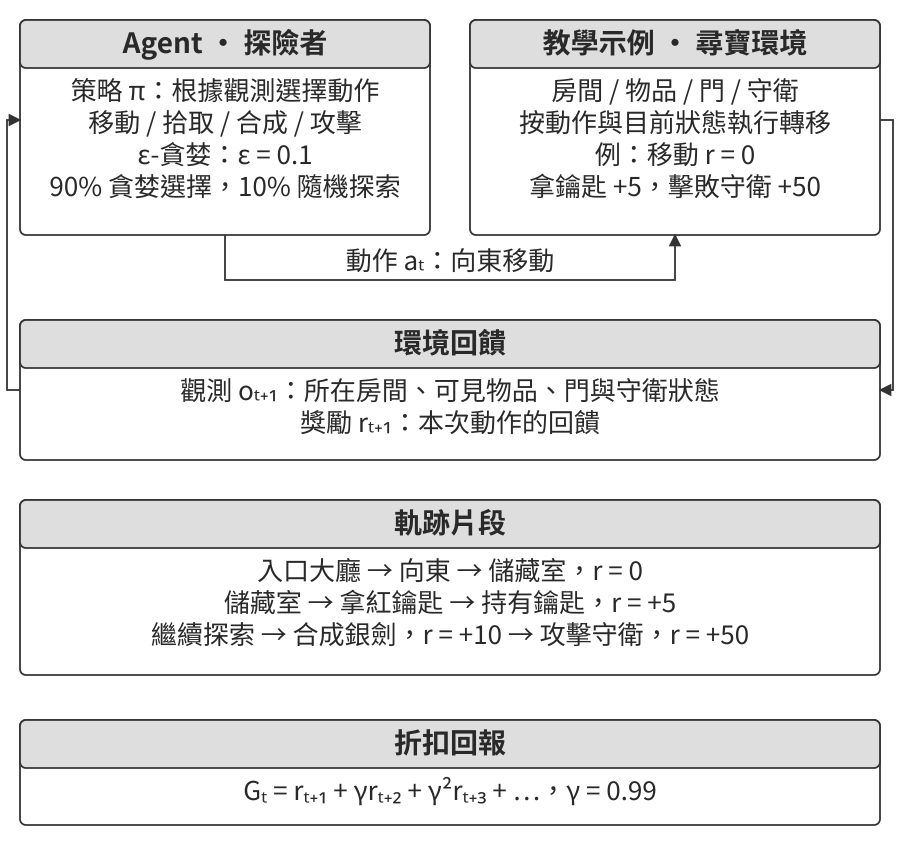

連續互動形成**軌跡**，其中包括各步觀測、動作、獎勵和終止資訊；訓練系統能夠取得環境狀態時，也可以一併記錄。策略決定怎樣行動，**價值函式（Value Function）**則估計：從目前狀態出發，按照某個策略繼續執行，預期能得到多少未來回報。

Agent 與環境的邊界由建模時選定的系統範圍決定。本書討論的模型與 Harness 位於 Agent 內，工具介面將它連接到外部應用、裝置和服務。例如，修改檔案的請求由 Agent 提出，檔案系統執行寫入，工具再把執行結果回傳給 Agent。

學習過程中，需要在**探索與利用（Exploration–Exploitation）**之間分配機會。探索讓策略接觸尚不熟悉的動作，利用則選擇目前估計較好的動作。對於延遲獎勵任務，還需要判斷早期哪些步驟促成了最終結果，這就是後文將討論的信用分配問題。

理解一個 RL 方法，可以先檢查五項內容：

- **動作空間**：允許輸出什麼。棋類使用離散走法，機器人控制可以使用連續關節目標；動作還可能受狀態、物理範圍和權限約束。
- **策略**：根據狀態、觀測或歷史選擇動作的規則。它可以是一張表，也可以是神經網路。
- **獎勵訊號**：訓練目標透過哪些回饋表達。每步獎勵參與形成長期回報，策略可能為了未來收益接受目前代價。
- **價值函式**：估計後續回報，可用於比較動作或構造策略更新訊號。具體演算法決定是否顯式學習它。
- **環境模型**：預測動作後的狀態、觀測或獎勵。基於模型的方法利用已知或學到的環境模型規劃；無模型方法直接從互動資料學習策略或價值。

表8-3 從這些概念中挑出環境、動作和目標，比較幾種熟悉的系統。讀前兩行時，可以把「保持平衡」和「清潔面積」理解為我們給任務建模時可能選用的目標。

表8-3 不同 Agent 系統的關鍵要素對比

| Agent 類型 | 外部環境 | 動作表示 | 獎勵或目標示例 |
| --- | --- | --- | --- |
| 新生小羚羊 | 地形、重力與身體動力學 | 連續肌肉控制 | 保持平衡、避免跌倒 |
| 掃地機器人 | 房間、地面與充電設施 | 移動、清掃、回充及控制參數 | 清潔面積、電量與碰撞代價 |
| 西洋棋 Agent | 棋盤、對手與計時規則 | 目前狀態下的合法走法 | 勝 +1、負 −1、和棋 0 |
| 客戶服務 Agent | 使用者、業務資料庫與服務介面 | 回覆文字、查詢與業務呼叫 | 問題解決、流程合規、處理時間 |
| 程式碼助手 Agent | 需求來源、程式碼庫與執行環境 | 搜尋、編輯、執行與答覆 | 測試結果、任務完成、迴歸與成本 |

這些系統的動作表示不同。棋類通常逐步選擇一個離散動作，機器人輸出指定維度的連續控制量，LLM 則先生成 token 序列，再由介面解析成回覆或工具呼叫。內部計算也可以納入策略建模，與實際改變外部狀態的工具執行分別記錄。

### 兩種動作表示：經典 RL 設定與 LLM 的變長策略

**馬可夫決策過程（Markov Decision Process，MDP）**用狀態、動作、轉移和獎勵描述決策問題。其馬可夫性質要求：給定目前狀態與動作，預測下一步狀態和獎勵就無需額外依賴歷史；歷史中與預測有關的資訊已經包含在目前狀態裡。圖8-2 中，只記下玩家所在的房間就會遇到麻煩：即使兩次走到同一扇門前，能否開門還取決於玩家是否已經拿到鑰匙。

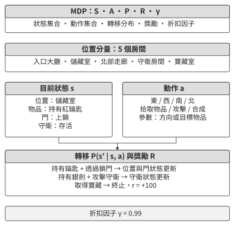

西洋棋提供了一個狀態設計的例子。除了棋子位置，還需要記錄輪到哪方、王車易位權、吃過路兵權，以及判定五十步規則和重複局面所需的資訊。將這些內容納入狀態後，才能按目前狀態判斷規則。若 Agent 只能看到其中一部分，就需要利用歷史補充資訊，或採用部分可觀測的建模方式。

MDP 可以容納離散、連續以及組合式動作。圍棋有 361 個棋盤交點，還要考慮虛手（pass）和合法性；Atari 遊戲通常提供少量離散操作；機器人控制量則由關節、夾爪及物理約束定義。狀態與動作數量都較小時，可以直接用表儲存價值。規模較大時，函式近似、策略最佳化與搜尋分別提供了處理方式。

**表格 Q-learning：用一步回饋更新動作價值。** $Q(s,a)$ 估計在狀態 $s$ 採取動作 $a$ 後的回報。最優動作價值滿足貝爾曼最優方程：

$$
Q^*(s,a)=\mathbb E\left[r+\gamma\max_{a'}Q^*(s',a')\mid s,a\right]
$$

其中 $r$ 是本步獎勵，$s'$ 是下一狀態，$\gamma$ 是折扣因子。持續任務中常取 $0\leq\gamma<1$；終止明確、回報有限的任務也可以取 1。較大的折扣因子使較遠的獎勵保留更多權重。從目前時刻計算的回報為 $G_t=\sum_{k\geq0}\gamma^k r_{t+k+1}$。

一次互動得到 $r$ 與 $s'$ 後，Q-learning 按下式更新：

$$
Q(s,a)\leftarrow Q(s,a)+\alpha\left[r+\gamma\max_{a'}Q(s',a')-Q(s,a)\right]
$$

$\alpha$ 是學習率，方括號內是「一步獎勵加上折扣後的後續價值」與目前估計之差。任務到達終止狀態時，後續價值取 0。在配套遊戲裡試一次：關閉隨機擾動，從入口向東走，再在儲藏室拿起紅鑰匙。拾取鑰匙獎勵 5 分，每做一步扣 0.5 分，所以這次動作回傳的 $r$ 是 4.5。假設表裡「在儲藏室拿鑰匙」的舊估計是 0.25，拿到鑰匙後可選動作的最大 Q 值是 0.63。取 $\gamma=0.99$、$\alpha=0.2$，一步目標就是 $4.5+0.99\times0.63=5.1237$。舊估計向這個目標靠近五分之一，更新為 1.22474。這種用實際一步回饋修正估計的方法稱為**時序差分學習（Temporal-Difference Learning，TD）**。

把一個狀態下各動作的 Q 值放在一起，就能選出目前估計最好的動作。圖8-3 用一張簡化的網格圖畫出了這種策略。每格的數字表示歸一化後的狀態價值。用手遮住數字，只看箭頭，你還能從左上角走到寶藏嗎？

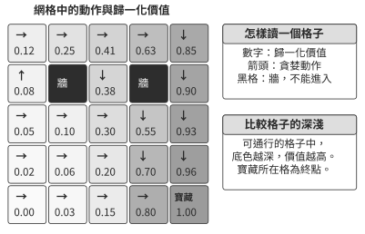

下一次探索可能改變箭頭的方向。圖8-4 把剛才拿紅鑰匙的計算拆開：這一步得到的獎勵會改變「在儲藏室拿鑰匙」這一項估計，表中其他狀態的 Q 值還要等各自的更新。

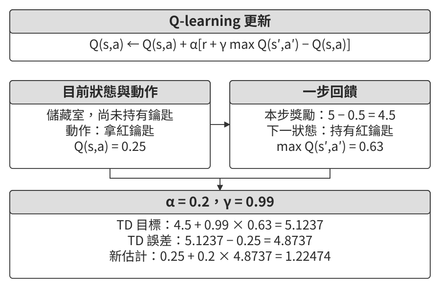

Q-learning 的行為策略可以包含隨機探索，而更新目標使用下一狀態的最大動作價值，因此屬於**離軌（Off-Policy）**學習。

> **實驗 8-1 ★：Q-learning 在尋寶遊戲中的表現**
>
> 尋寶遊戲包含鑰匙與門、武器效果和物品合成等隱藏規則。通關需要按順序完成多個步驟，最優路徑為 11 步；關鍵動作與勝利提供獎勵，其餘步驟的回饋較少。
>
> 這次尋寶訓練取學習率 0.2、折扣因子 0.99，探索率 ε 從 1.0 逐漸降到 0.1。表格 Q-learning 採用 ε-貪婪探索：每一步以 ε 的機率隨機選一個可用動作，其餘時候從目前 Q 值最大的動作中選一個。記錄每個階段的勝率、造訪過的狀態數和通關步數。
>
> 閱讀尋寶實驗的訓練與評估記錄時，先把兩個問題分開：訓練期間，帶隨機探索的策略何時第一次找到寶藏？訓練結束後，固定 Q 表、按貪婪策略行動能否穩定通關？前者反映模型如何發現路徑，後者檢驗它能否依照學到的價值選擇動作。
>
> 在早先一次訓練中，前 1000 局尚未通關，Q 表包含 124 個狀態；到 5000 局仍未穩定獲勝，狀態數為 133；7000～8000 局間，勝率由 34% 升至 96%；到 10000 局達到 100%，Q 表包含 145 個狀態，並找到 11 步路徑。
>
> 為什麼前期遲遲沒有進展，後來勝率卻升得很快？探索先發現關鍵動作與路徑，後續造訪再把終點回報逐步傳播到前面的狀態。整個小型模擬約需 10 秒，因而能夠承擔大量重複互動。
>
> 分析時同時記錄計算時間與互動次數。在遊戲中，一次動作很便宜；換成瀏覽器、電話或物理裝置，一次互動還包含等待、費用和狀態變化。表格又與具體狀態編碼綁定，規則或地圖變化後需要重新檢查已有價值是否適用。下一實驗將比較預訓練知識能怎樣改變探索起點。

**預訓練 LLM：用語言表示計算與動作。**

LLM 可以在呼叫工具前生成一段中間計算，也可以直接輸出呼叫。兩者都由 token 序列表示，但作用不同：中間計算改變模型後續可用的上下文，工具呼叫經執行後改變或讀取外部環境。訓練時可以按協定記錄這些輸出，並結合任務結果和計算成本評價它們。「想多久、想什麼、何時呼叫工具」由此成為同一策略可以學習的選擇，後面的 AdaptThink 就圍繞推理預算展開。

變長序列帶來了更大的組合空間。模型可以寫查詢、程式、JSON 參數和多步推導，序列長度則受預算與上下文限制。預訓練為搜尋提供了起點：數學材料常包含條件分析與計算，程式碼和討論中常包含定位、修改與驗證。模型可以借用這些結構生成候選路徑，再根據環境回饋調整。已有知識讓有用的動作組合從一開始就更容易被取樣，減少了在大量無關路徑中盲目試錯的需要。

例如，「把外幣金額換算成美元」需要取得匯率並計算。預訓練讓模型較容易生成這類有關聯的步驟；後訓練則可以依據匯率來源、計算結果與任務約束，進一步調整路徑的機率。語言知識在這裡提供初始策略，獎勵提供任務回饋。

圖8-5 對比了本節兩種設定：表格 Q-learning 從指定狀態編碼與探索規則出發，LLM Agent 從預訓練語言策略出發，並透過上下文組織工具觀測與歷史經驗。

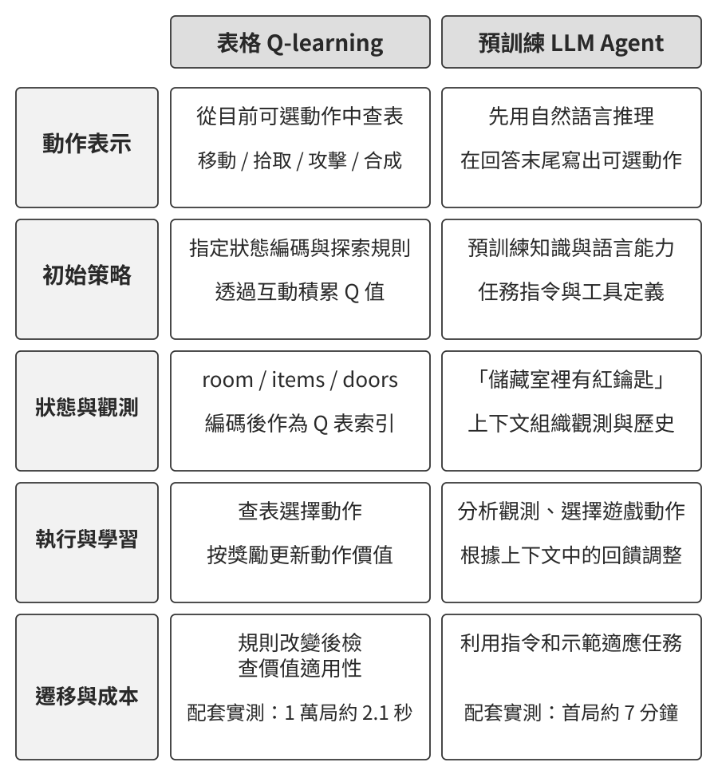

預訓練還使模型能夠解釋新指令，利用少量示範調整任務行為。工具把語言輸出連接到搜尋、程式碼執行和業務操作。設計這類 Agent 時，既要確定工具介面與執行權限，也要為任務結果、執行成本和關鍵過程建立回饋。

模型要控制機械臂，怎樣把「預測下一個 token」用到動作上？OpenVLA 用了約 97 萬條真實機器人示範。取示範中的一步，輸入是當時的相機畫面和任務指令，訓練目標是示範者接下來執行的動作。比如，機械臂沿水平方向移動多少，本來是一個連續的數值。OpenVLA 把每個動作維度劃成 256 檔，用一個 token 表示落在哪一檔。這樣，模型就可以逐個預測動作 token，並只在這些位置計算損失。[^ch8-21]

這個例子也給出了區分行為複製與強化學習的辦法：看什麼訊號使模型更新。OpenVLA 從示範記錄中學習，模型給示範動作 token 的機率越高，損失就越低，這屬於監督微調。到了實驗 8-13 的 SimpleVLA-RL，策略會在環境中實際嘗試動作，再根據任務獎勵調整今後的選擇。

> **從演算法、環境到先驗**
>
> 姚順雨在《The Second Half》中用演算法、環境和先驗回顧了 RL 的發展。[^ch8-2] 筆者據此將關注點的變化概括為三個階段：2015—2016 年側重改進演算法，2016—2018 年更加重視環境建設，2018 年起逐步認識到預訓練先驗的價值。Gym 提供統一環境介面，Universe、World of Bits 探索電腦與網頁任務，Dota 2 等專案展示了複雜環境中的訓練能力。隨後，GPT-2、GPT-3 展示語言預訓練積累的知識與表達能力，WebGPT、ChatGPT 等系統進一步利用了這種起點。任務所需的先驗可以先透過語言建模獲得，再交給 RL 最佳化具體行為。
>
> 筆者贊同這裡的工程優先順序：**先驗、環境、演算法**。先檢查模型具備哪些知識和能力，再構造合適的環境與回饋，最後選擇與之匹配的最佳化方法。圖8-6 按研究關注點出現的先後排列，做專案時則可以倒過來，從已有能力出發。
>
> 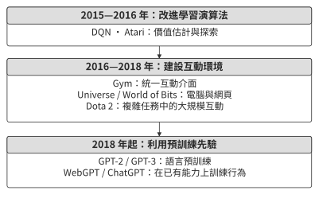

> **實驗 8-2 ★★：傳統 RL 與 LLM Agent 的對比研究**
>
> 在同一尋寶遊戲中比較表格 Q-learning 與 LLM Agent。LLM 配置使用 Kimi K3，並在上下文中維護最多 50 條經驗。兩者每一步都從環境給出的可選動作中選一項。沿圖8-7 的兩條路徑，可以看到 Q 表和語言模型分別怎樣做出這個選擇。
>
> 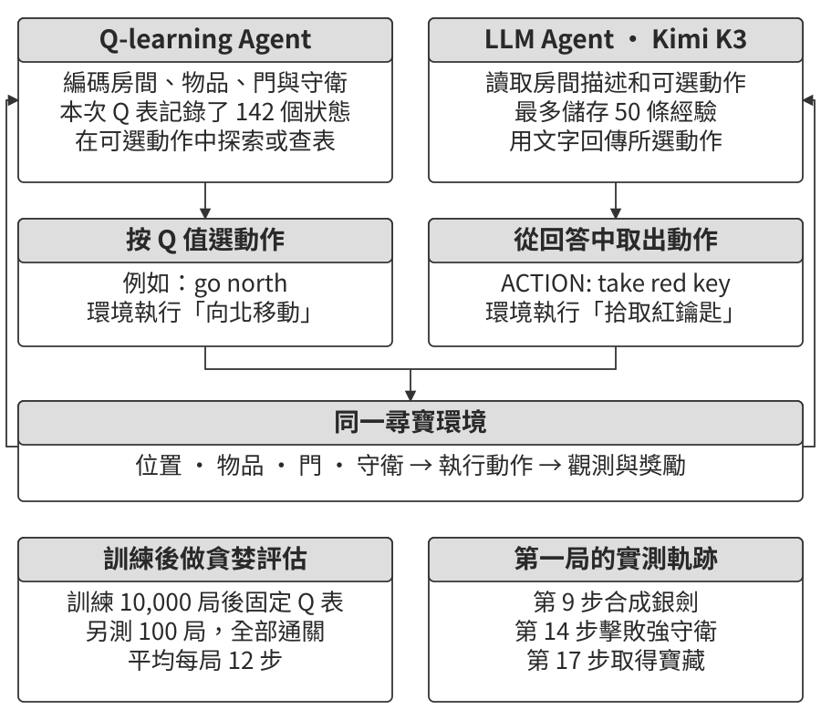
>
> 在配套的 Kimi K3 執行記錄中，Agent 第一局用了 17 步。它先拿起生鏽的劍，發現北門上鎖，轉到儲藏室取得紅鑰匙和魔法水晶，第 9 步把劍和水晶合成銀劍。第 12 步嘗試用鑰匙時，環境提示「需要時會自動使用」；第 13 步往北走，門才真正開啟。第 14 步用銀劍擊敗守衛後，它又試了一次用劍，環境提示此時無法使用。第 17 步取到寶藏。讀這段記錄時，可以遮住下一行，先根據目前回饋猜一猜哪一步還有必要。
>
> 將每個動作與當時的觀測對齊，可以分析模型如何使用「鑰匙開門」「武器應對守衛」等已有知識，以及工具回饋如何改變後續計畫。表格方案則透過反覆造訪狀態—動作組合積累這些關係。
>
> 在這次對照中，Q-learning 訓練 10000 局用時 2.12 秒，隨後單獨用貪婪策略評估 100 局，全部通關，平均 12 步。Kimi 一局呼叫模型 17 次，用時 6 分 56 秒。筆者據此採用一條選擇原則：模擬便宜、能夠大量重複時，可以充分利用傳統 RL 的探索；每次互動都要付出等待、費用或實際操作代價時，優先考慮能利用已有知識的策略，提高每次互動的價值。

這兩個實驗銜接了本章與前面的工程方法：上下文可以在一次執行中組織經驗，外部記憶可以跨任務儲存經驗，後訓練則透過參數更新改變策略。下面先補充語言和視覺預訓練的基本過程，再討論具體的訓練資料與最佳化方法。

## 模型預訓練基礎 `[選讀]`

預訓練建立模型的初始表示和生成分布，後續訓練在這個起點上繼續調整參數。理解這種起點，可以先觀察一個小語言模型怎樣從文字學習，再看它怎樣接入視覺輸入。

文字首先經過**詞元化（Tokenization）**，轉成離散 token。例如，「我喜歡程式設計」可以示意為「我」「喜歡」「程式設計」三個單元，實際劃分由分詞器決定。訓練將前面的 token 作為上下文，預測後續 token，計算損失並更新參數。在圖8-8 裡，先把訓練句遮到「環境」為止，猜下一個詞是什麼，再揭開原文。把這個位置向後移，就得到下一道預測題。

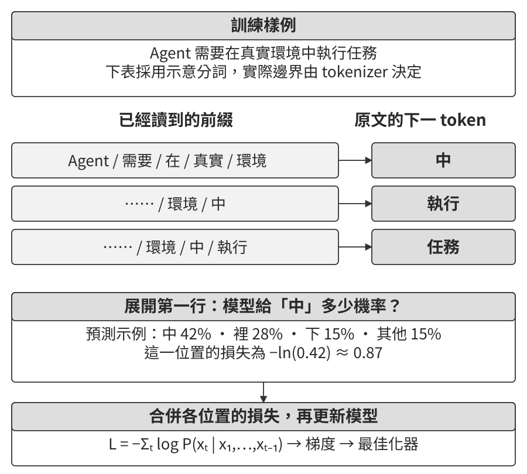

在基礎語言建模之後，可以加入指令示範，訓練回答格式和任務行為；也可以使用偏好資料，透過 DPO 等方法提高更受認可回答的機率。

> **實驗 8-3 ★★：從頭訓練 LLM——演算法改進的威力**
>
> 以約一億參數的 MiniMind 2 為例，在消費級 GPU 上完成預訓練、SFT 與偏好最佳化。比較基線與加入 QK Norm、Muon 最佳化器的配置，觀察損失下降、達到目標品質所需時間和生成結果。配套匯總記錄了約 3 倍的收斂速度提升，完整訓練約 14 小時、費用約 34 美元。
>
> QK Norm 調整注意力中查詢與鍵的數值尺度，Muon 改變相應參數的最佳化更新方式。
>
> 分階段觀察同一組問題：預訓練模型已經能回答「世界上最高的山峰」等問題；SFT 後，指令遵循和輸出組織改善；偏好最佳化繼續影響事實回答與表達。

> **實驗 8-4 ★★：自己訓練 VLM**
>
> 圖8-9 展示「視覺編碼器—投影層—語言模型」的連接。視覺編碼器如 CLIP 提取影像特徵，投影層將特徵轉換到語言模型輸入所需的維度與表示，語言模型結合這些輸入生成描述或回答。
>
> 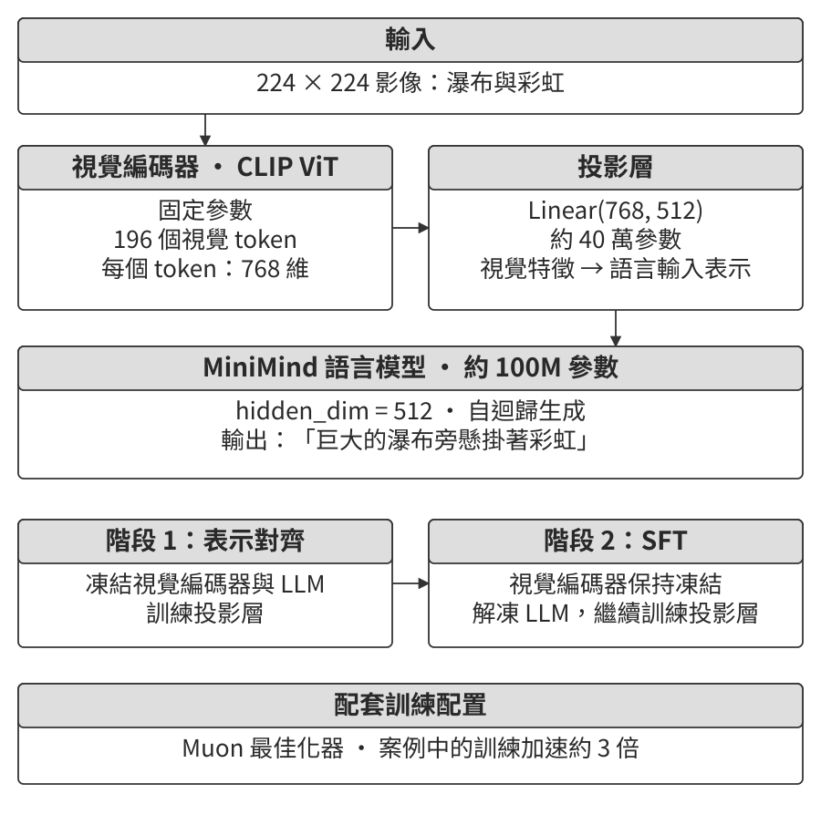
>
> 第一階段凍結視覺編碼器與 LLM，訓練新加入的投影層，讓影像特徵能夠參與語言預測；第二階段按配置解凍 LLM，用高品質影像—描述或問答資料做 SFT。分別觀察物件識別、細節描述、關係判斷與語言能力的變化。
>
> 這種架構複用已有視覺和語言模型，先集中訓練跨模態連接模組，是預算有限時值得優先嘗試的方案。凍結權重減少了可訓練狀態，後續再按任務需要解凍相應模組。描述錯誤時，先檢查物件資訊是否進入視覺表示；若資訊已經存在，模型仍無法利用它，就應重點檢查投影層的表達能力、對齊資料與語言生成監督。將輸出進一步改為動作表示，並對齊控制介面，就銜接到第六章的 VLA 架構。

兩個實驗分別展示了最佳化配置和跨模態連接怎樣影響訓練。在預算受限時，筆者建議先比較演算法和架構改進能帶來的收益，再決定是否擴大模型規模。已有模型進入新語言或新領域時，還可以從預訓練權重繼續學習；下一節討論怎樣為這種訓練選擇資料。

## Mid-training：補知識與基礎能力

本章的 **Mid-training** 指在已有模型上，圍繞目標分布繼續進行一個階段的語言模型訓練。文件、程式碼或推導中的大量 token 參與監督，訓練時可以把目標領域的語料和通用語料混在一起。DAPT/TAPT 研究展示了領域或任務相關語料繼續預訓練對下游任務的幫助。[^ch8-30]

資料選擇從兩類缺口出發。一類是知識與語言覆蓋，例如模型對企業協定、目標語言術語或特定程式碼庫接觸不足；另一類是任務需要的基礎能力，例如在長上下文中追蹤狀態、整合跨文件關係或完成較長的程式碼推導。先按錯誤類型區分理解、知識、格式與行動問題，再確定要補充的材料。

領域文字損失下降之後，還應檢查模型能否在實際任務中使用學到的知識。繼續訓練與指令訓練的順序、問答組織和材料形式都會影響知識的運用。[^ch8-31] 對基礎能力明顯不足的領域任務，筆者建議先用領域語料增加覆蓋，再透過 SFT 示範教模型在任務中使用這些資訊；模型有時能做對、只是成功率偏低時，再投入 RL。

### Mid-training 資料如何構造

**第一步，從失敗分布定位所需材料。** 按主題、語言、文件類型、程式碼模式和上下文長度分別評估，結合 Pass@1、Pass@k 與錯誤樣例，判斷模型在哪些條件下缺少可用解法。參數格式問題可交給介面示範處理，領域概念與關係缺口則需要相應語料。

**第二步，組織高密度語料。** 原始文件提供術語和事實關係，程式碼儲存庫提供模組結構與依賴，教材式推導與合成釋義將隱含步驟展開，跨文件樣本把分散資訊連結起來。完成品質過濾、去重和評估集隔離後，再構造訓練序列。

**第三步，按目標能力混合資料。** 自然長文字可以來自書籍、文件和程式碼儲存庫；針對檢索、多跳推理、指令遵循、聚合與統計，可以加入帶推導的任務資料；針對 Agent，可以加入計畫、工具選擇、參數構造、狀態跟蹤和錯誤恢復軌跡。這些材料可以來自已有資料集或教師模型生成，進入訓練前按內容與行為要求篩選。

**第四步，讓模型繼續練習原來會做的任務。** 一組樣本沿用短文字、通用語料和原來的題目；另一組把相同的任務放進更長的上下文，移動關鍵資訊的位置，再加入干擾項。搭配這兩組材料時，可以參考原有訓練資料的分布，也可以用 FineWeb-2 等公開語料試幾種配比，再根據評估結果調整。

**第五步，用多項指標決定繼續或停止。** 同時記錄訓練損失、留出領域任務、通用能力、原有指令遵循和目標任務成功率。領域成績提高而通用能力下降時，比較混合比例、學習率和訓練量；損失下降而目標任務停滯時，檢查訓練材料能否教會模型完成這類任務，以及是否需要補充在實際任務中運用知識的示範。

假設模型能從很長的訂單日誌裡找出指定的訂單號。如果改問「哪位客戶多次下單又全部取消」，它還得找齊同一客戶的訂單，把訂單與取消記錄逐筆對上。兩道題可以用同一份日誌，考查的能力卻不同。RULER 用合成任務把輸入長度和任務難度分開控制，分別測單條檢索、多跳追蹤和聚合。作者評測了 17 個模型，許多模型在簡單檢索上接近滿分，但隨著輸入變長，綜合表現明顯下降。[^ch8-ruler]

要看這種差別會不會出現在實際材料裡，可以進一步用 LongBench v2 的多文件、長對話或程式碼儲存庫題。要單獨檢查模型能否記住輸出格式等要求，可以取 IFEval 中可驗證的指令，放到較長材料的不同位置。比較兩個模型時，兩者看到的指令位置和干擾內容應保持一致，並註明這是自行構造的測試。最後再用端到端 Agent 任務檢查這些能力能否配合起來。設計評估集時，可以逐項檢查下面幾個維度。[^ch8-longbench]

[^ch8-ruler]: Hsieh 等，RULER，2024。
[^ch8-longbench]: Bai 等，LongBench v2，ACL 2025。論文給出了六類任務，共 503 道選擇題。

- **位置與檢索**：單條或多條關鍵資訊，位於開頭、中間和結尾時能否找到。
- **關係與推理**：跨段落、多文件關係追蹤，矛盾消解與證據組合。
- **聚合與統計**：長表格和日誌中的計數、分組、排序、比較與趨勢歸納。
- **指令遵循**：多條要求、衝突處理、流程條件與輸出格式。
- **長鏈推理**：數學、邏輯與程式碼任務中較長的依賴鏈。
- **Agent 基本行為**：任務分解、工具選擇、參數生成、狀態保持和失敗恢復。

長推理和多輪工具呼叫會不斷拉長上下文，早先的指令、事實和任務狀態仍要參與後續決策。模型如果在長文字中找不到資訊或保持不住約束，長程 Agent 就難以可靠執行。訓練預算擴大前，應先用小規模配置比較資料配比和訓練量。對於頻繁更新、要求出處的事實，筆者優先使用 RAG；對於穩定的大規模領域知識與基礎能力，再考慮繼續訓練寫入參數。

> **實驗 8-5 ★★：繼續預訓練學習新語言**
>
> 從 Mistral 7B v0.3 出發，用韓語維基百科等材料提高韓語能力。訓練先採用約 80% 韓語、20% 英語的混合，再用韓語指令資料進行 SFT，分別觀察語言建模與對話行為的變化。
>
> 韓語資料增加目標語言的覆蓋，英語資料用於維持原有能力。各階段都用同一批未參與訓練的韓語題和英語題測試。配套結果中，韓語最終階段的盲評分改善，英語能力有所下降，這為下一輪多混入一些英語訓練材料或降低更新強度提供了具體方向。
>
> 將目標語言、原有語言和事實品質分開記錄，可以判斷收益與代價；SFT 階段再檢查模型能否按韓語指令組織回答。這樣，繼續預訓練和指令微調的作用就能分別觀察。

## SFT（監督微調）

領域語料能讓模型多見幾次某個介面，但要教它在呼叫失敗後改正參數，還可以直接示範一次。SFT 給定任務輸入，逐個 token 訓練模型生成示範中的回答或動作。看圖8-10 時，先想清楚準備教哪一種行為，再決定怎樣收集示範。示範中的事實、語氣和輸出格式也會一同進入訓練。

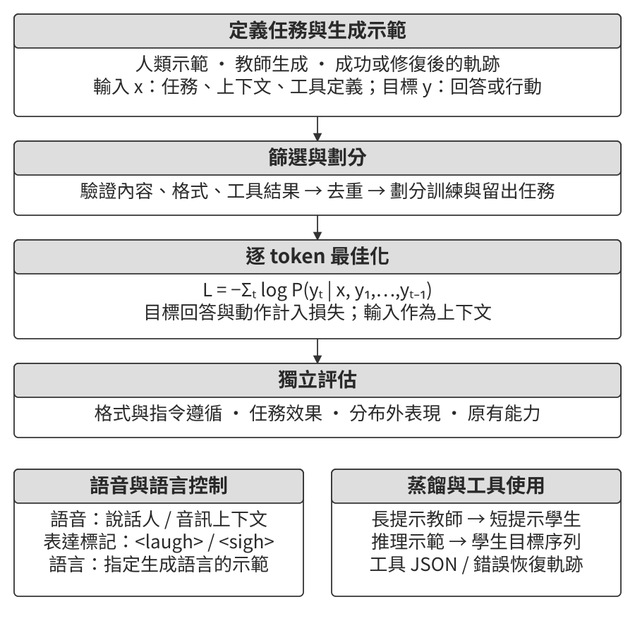

資料通常來自三條途徑：人工專家定義關鍵行為和邊界，教師模型成批編寫示範，驗證器從模型取樣中篩選有效輸出。三者可以組合使用。例如，先由專家寫出少量工具呼叫示範，再讓教師改變任務條件生成更多樣本，最後檢查參數、執行結果與業務約束。

**SFT 的一個用途，是把反覆寫在提示詞和 Skill 裡的做法教給模型。** 以第七章的記憶評分為例：假設評分手冊連同判例長達一萬 token。教師依據完整手冊，給一批回答評分，示範怎樣處理人物同名、關係顛倒或證據不足等情形。訓練學生時，輸入只保留簡短的評分項名稱、當次歷史材料和待評回答，目標輸出是教師選定的檔次。上線後只需提供短提示和當次材料，每次推理都省下了那一萬 token 的固定說明。對於反覆呼叫的 Skill，也可以用同樣的辦法示範何時查資料、怎樣選工具，再把這些穩定步驟蒸餾進模型。

資料準備要先確定任務分布、輸出 schema 和驗收方式。示範通過檢查後，再去重、調整各類樣本的比例並劃分資料集。樣本數量與覆蓋範圍應共同設計：重複數千次同一種問法，會反覆強化相同模式；圍繞關鍵條件構造變化，才有助於模型在不同輸入下選擇恰當行為。筆者會先精修一批覆蓋關鍵情形的示範，再擴大規模。SFT 會逐 token 學習目標輸出，錯誤事實、冗餘步驟和不恰當的操作習慣也會隨之進入參數。

> **實驗 8-6 ★★★：語音 SFT——從聲音複製到副語言建模 `[延伸實驗]`**
>
> 以 Orpheus 和 Sesame CSM 為例，比較說話人條件、對話上下文和表達標記怎樣參與語音生成。Orpheus 將語音表示為 token，可利用參考文字—語音片段生成相應音色，也提供 `<laugh>`、`<sigh>` 等表達標記。Sesame CSM 則接收文字、說話人標識與已有音訊片段，生成後續語音。[^ch8-speech-conditioning]
>
> 構造訓練樣本時，分別記錄文字、說話人、音訊及表達條件；使用同一說話人的跨句材料學習一致性，用多種語境中的笑聲、嘆息和停頓學習表達。比較無參考、有參考和指定表達條件下的輸出，再按準確性、自然度、情感和音色評分。
>
> 資料中應覆蓋足夠的說話人、句型和情緒組合。說話人過少時，輸出可能趨向單一音色；某個標記總與同一聲音片段綁定時，則可能出現重複、機械的表達。

> **實驗 8-7 ★★★：多語言思考——按指定語言生成推理過程 `[延伸實驗]`**
>
> 對 gpt-oss-20b 進行 SFT，用指令指定推理過程的語言。例如，`reasoning language: German` 要求生成德語推理文字。訓練樣本包含英語、西班牙語、法語等語言，並將中文留到測試階段。
>
> 配套案例中，訓練後指定 Chinese，模型能夠生成中文推理過程。可以進一步比較三項結果：是否遵循語言要求，最終答案是否正確，以及生成長度與耗時怎樣變化。預訓練的多語言基礎與 SFT 學到的控制方式共同參與這種跨語言表現；透過不同語言與基模的對照，可以繼續分析它們的作用。

> **實驗 8-8 ★★：Prompt 蒸餾——以更小開銷重現可用能力**
>
> 一項穩定業務可能依賴數千 token 的系統提示，教師還會生成較長推理。Prompt 蒸餾先讓教師在完整條件下產生高品質輸出，再把「使用者輸入—最終回答」組成學生的 SFT 資料。學生使用較短提示，並按目標配置直接回答。
>
> 開啟第一條訓練樣本就能看到，Kimi K3 教師讀完一段夾有拉丁字母的阿拉伯語文字，解釋了判斷依據，最後給出語言代碼 `ar`。交給 SmolLM2-135M-Instruct 學生的示範只有原文和 `ar`。在同一組 80 條測試記錄裡，教師端每次請求平均讀入約 386 個 token，學生端約 97 個。這兩個數分別按各自的分詞器統計。
>
> 配套的語言識別對照記錄可以用來拆開「答對」和「輸出符合格式」。教師在 160 條訓練樣本上生成示範，另外在 80 條測試記錄上全部答對。未微調的學生在測試時一個輸出也沒被評分器解析，得分為零；微調後 80 條都能解析，76 條標籤正確。基線的零分本身無法區分「沒認出語言」和「認出了卻沒按格式作答」。這組測試包含 75 段不同文字，訓練、測試之間沒有完全相同的文字。
>
> 資料構造還要保留學生完成任務所需的條件。教師依賴最新工具結果時，可以把相應結果作為學生輸入，或繼續保留工具介面；教師存在系統性錯誤時，則透過獨立驗證過濾。
>
> 產品規則穩定、輸入分布清楚、呼叫成本較高時，筆者建議優先評估 Prompt 蒸餾，把反覆處理的提示和推理壓縮到參數中。產品仍在探索、任務要求頻繁變化時，則保留可編輯的提示與顯式推理，便於快速試驗和定位錯誤。

> **實驗 8-9 ★★★：思維鏈（Chain of Thought，CoT）蒸餾**
>
> CoT 蒸餾將教師提供的推理文字與最終答案一起作為監督，使學生學習分解、計算、檢查和修正的過程。DeepSeek-R1 對 Qwen、Llama 系列進行蒸餾，是這一方法的代表。對於希望擁有自主可控模型、又希望控制訓練投入的團隊，筆者建議優先考慮這條路線。教師在目標任務上明顯強於學生，就有條件提供有價值的示範；可以先從能夠取得完整推理輸出的開放權重模型中選擇，再比較它與學生的能力差距和資料品質。介面只提供推理摘要時，可用於過程蒸餾的資訊也隨之減少。
>
> 第一步，讓教師對同一道題給出幾種解法。數學題先核對答案，程式碼題則執行測試，只留下通過檢查的解答，這種篩選稱為**拒絕取樣（Rejection Sampling）**。用篩出的解答做監督微調，稱為**拒絕取樣微調（Rejection Sampling Fine-Tuning，RFT）**。如果學生還要學習推理過程，就要接著核對中間步驟，剔除推導有誤卻碰巧答對的示範。
>
> 對於有可靠驗證器的任務，筆者建議先建立 RFT 基線：生成、篩選和 SFT 即可形成訓練流程，省去線上策略最佳化與價值估計的實作工作，再據此判斷 RL 的額外投入是否值得。
>
> 第二步，訓練學生。按所選模型的對話格式組織「問題→推理文字＋最終答案」；使用 `<think>` 與 `</think>` 等邊界時，明確哪些 token 參與損失。可以從 7B 量級學生開始，比較完整軌跡、精簡軌跡與只監督最終回答的配置。
>
> 第三步，看學生學到了什麼。配套實驗讓 Kimi K3 解 24 道 AIME 數學題，保留答對的 23 條推理軌跡，用來微調 Qwen2.5-1.5B-Instruct。再做同一組題，學生從答對 1 題變為答對 2 題，教師答對 23 題。訓練後的學生偶爾也會回頭驗算，但逐題配對檢驗沒有顯示出可靠的正確率提升（$p=1.0$）。

> **成書實踐：蒸餾實驗的開發過程**
>
> 筆者最初使用 GPT-5.6-Sol 驅動的 Codex 實作蒸餾實驗，遇到拒絕後切換到 Claude Opus 5 驅動的 Claude Code，也未能繼續。隨後使用 Kimi K3 完成程式碼與執行。

這四個案例都採用監督學習，分別學習不同的內容：語音中的音色與表達條件，多語言推理中的語言控制，Prompt 蒸餾中的直接回答，以及 CoT 蒸餾中的解題過程。

## SFT 資料合成：從示範到可訓練軌跡

要從一條真實投訴做出一批訓練題，哪些資訊可以換，哪些關係必須保留？從生產軌跡提取使用者意圖、初始狀態、可用工具、業務約束和常見失敗，組織成任務範本。身份、訂單、檔案與憑據要替換；如果原問題涉及兩個相似訂單，生成實例時也要保留這種需要區分的關係。把實例放進可重設環境執行，才能知道新題是否真的保留了原來的難點。

一條完整流程是：**生產案例→任務範本→合成實例→多條候選軌跡→任務與軌跡驗證→訓練資料**。其中兩類驗證分別負責不同問題：任務驗證檢查條件是否充分、目標是否可完成、參考結果是否正確；軌跡驗證則逐條核對任務結束時的狀態、工具呼叫順序以及執行過程是否符合業務約束。

可執行條件使用測試、資料庫斷言或狀態差異檢查，開放式溝通品質使用 Rubric 與模型評判，並透過人工抽樣校準。進一步結合技能圖、可執行環境與獨立驗證器，可以有計畫地擴展任務覆蓋。[^ch8-12][^ch8-17][^ch8-18][^ch8-19][^ch8-20]

合格的示範既可以是順利完成的軌跡，也可以是包含診斷和修復的完整過程。對其中的錯誤動作，應明確它在樣本中的角色，並按訓練目標選擇損失位置。失敗記錄還可用於構造偏好對、發現覆蓋缺口和生成恢復任務。隨後進入 RL 時，目前策略會重新取樣軌跡，並利用環境回饋更新。

訓練集與評估集按目標選擇隔離方式：同分布評估可以隔離具體實例，遷移評估進一步隔離任務範本、客戶群體或時間段。去重時檢查輸入和解法的近似重複；參考答案、隱藏測試和僅供評分使用的資訊，按任務協定留在驗證側。

微調結束後，還能從權重複核訓練材料嗎？以公開的推理模型 s1 為例。按訓練時的分詞和文字處理方式，把公開樣本轉換成詞元編號並去重，可以得到一份清單。再逐行對比微調前後的輸入嵌入矩陣，記下哪些詞元對應的向量變了。筆者複核時，兩份清單中的 16,573 個編號逐個吻合。這項檢查需要找對基座和分詞器，按訓練配置拼入系統提示、截斷長樣本；還要確認訓練確實更新輸入嵌入，且輸入嵌入與輸出層權重分開。例如，只在注意力層訓練 LoRA 時，輸入嵌入會原樣保留，無法據此列出用過的詞元。[^ch8-token-provenance]

可以用三個詞元看清證據的邊界。假設兩條公開樣本分詞後分別為 `[10, 20]` 和 `[20, 30]`，去重得到 `{10, 20, 30}`。現在額外加入一條 `[30, 10]`，再算一次，集合完全相同。即使複核時每個編號都對得上，仍無法據此判斷第三條樣本是否用過，也無法排除某條評估題混入訓練集。

[^ch8-token-provenance]: 李博杰的 training-forensics 專案記錄了 s1 等模型的詞元集合與預處理條件，並討論了嵌入權重共享和 LoRA 對比對方法的影響。

以第七章的「過早結束」案例為例，在準備宣稱完成的時刻擷取前綴，將未經驗證的完成聲明記為 `rejected`，把先檢查剩餘目標、執行相關測試再作答的繼續行為記為 `chosen`。偏好對可以用於 DPO；其中驗證通過的繼續行為，也可以單獨作為 SFT 示範。

後文的中文彎引號與特殊字串實驗進一步說明了怎樣確定監督目標。中文彎引號任務從文件作用域出發，要求修改目標正文並保護程式碼、引文與 JSON；特殊字串任務則要求 `old_string` 在工具參數中保持位元組級一致。前者檢查編輯範圍與文件語法，後者檢查精確複製與實際工具匹配。共同的失敗歸因流程，可以匯出不同的訓練目標。

## 何時選擇 Mid-training、SFT 與 RL

如果模型連工具的輸入格式都寫不對，現在就讓它反覆試錯，會有多少次呼叫真正跑起來？可以沿圖8-11 先找它卡住的步驟，按表8-4 選擇訓練材料和回饋方式。

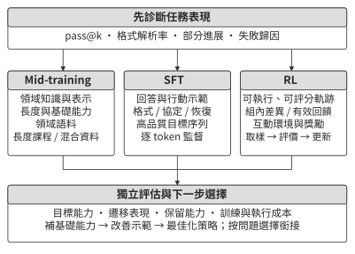

表8-4 Mid-training、SFT 與 RL 的選擇準則

| 觀察到的現象 | 優先檢查 | 候選方法 | 後續評估重點 |
| --- | --- | --- | --- |
| 領域語言、概念或基本操作薄弱，多次取樣仍少有進展 | 語料覆蓋與基礎能力 | Mid-training；可檢索事實結合 RAG | 領域任務、檢查通用能力的測試集與部分正確的軌跡 |
| 內容可用，格式、參數或固定流程不穩定 | 示範、介面與約束 | SFT、約束解碼或工具校驗 | 解析成功、任務結果與恢復行為 |
| 偶爾能完成任務，但成功率低或常走彎路 | 獎勵品質、探索與任務分布 | RL | 任務收益、獎勵差異、獨立泛化與成本 |
| 有示範或偏好資料，互動環境尚未建立 | 離線資料覆蓋與驗證方式 | SFT、RFT、離線偏好最佳化 | 基線品質、資料偏差與環境建設收益 |

可以按四步推進。首先建立 Prompt、上下文、工具和約束方案的基線。這些方法已經滿足任務要求時，筆者會優先保留外部可編輯方案，減少訓練、部署與迴歸的維護成本。動態事實透過檢索與版本管理提供；需要反覆學習的隱式判斷、感知模式和穩定行為，再考慮透過參數訓練改進。

第二步，在留出任務上觀察成功、部分進展、解析結果和錯誤類型。取樣配置固定後，Pass@1 與 Pass@k 展示目前策略是否已有可利用的路徑；失敗軌跡幫助區分知識不足、回饋缺失和流程錯誤。

第三步，為需要學習的行為提供示範。JSON schema、工具呼叫、術語使用、澄清與恢復都可以寫成 SFT 樣本，必要知識則透過相應語料與任務上下文提供。

第四步，評估 RL 的回饋條件。能夠生成可評分候選、獎勵具有區分度、環境允許足夠互動時，可以比較策略最佳化的收益；獎勵過於稀疏時，先考慮課程、部分獎勵或更合適的初始策略。

每一步由評估結果決定後續投入：格式明確的任務可以完成 SFT 後部署，較強起點可以直接做 RL，領域繼續訓練後也可以複用已有的指令能力。下面透過單輪任務，具體觀察示範學習與獎勵學習產生的行為差異。

回到閱讀指引裡的訂單問題。把同一段真實的工具說明直接交給模型，觀察它能否寫對參數。如果說明裡的欄位已變，先更新執行階段可查的說明。若欄位含義清楚，但模型反覆把使用者文字填到訂單號位置，可以提供包含查詢、澄清和正確填參的 SFT 示範。如果它已經偶爾能完整辦成，而不同查詢順序會導致不同的成功率和費用，就具備了比較多條策略軌跡的條件。

## 單輪強化學習：記憶與泛化的對照

單輪任務從一次輸入開始，以模型提交回答並獲得獎勵結束。模型仍可在生成回答時進行多步推理，訓練系統也可以讓它反覆嘗試同一道題。把互動限定為一次回答，便於我們觀察訓練方法怎樣改變模型的行為。下面先用 AdaptThink 說明模型如何學習分配推理預算，再用 GeneralPoints 比較 SFT 與 RL 在規則和視覺外觀發生變化時的表現。

先了解 RL 演算法怎樣利用獎勵更新模型，就能讀懂後續實驗中的訓練過程。本章的 RL 訓練大多基於**策略梯度**。以同一問題的多次取樣為例：讓模型生成幾條回答，再將各條回答的獎勵與基線比較。優於基線的回答獲得正向訊號，訓練會提高它的生成機率；低於基線的回答獲得負向訊號，生成機率隨之降低。

為抑制單次更新把模型帶偏，主流的 **PPO** 演算法會在機率比超出指定區間時裁掉代理目標中的額外收益；實際更新幅度還取決於學習率和更新輪數。後文的「帶價值網路的 PPO」會學習一個價值估計，用它建立比較基線，計算各步動作的優勢。**GRPO** 直接比較同一問題的多條回答，用組內獎勵構造基線，從而省去單獨訓練的價值網路。

下面的 Python 風格虛擬碼串起取樣、獎勵、優勢和參數更新，幫助理解各步怎樣傳遞資訊。實際訓練還要配置取樣並行、KL 正則和最佳化器。

```python
for prompt in batch:
    group = [rollout(policy, env.reset(prompt)) for _ in range(G)]
    rewards = [verify(trajectory) for trajectory in group]
    advantages = normalize_within_group(rewards)       # GRPO baseline
    update(policy, group, advantages)
```

PPO 怎樣用一批長短不同的軌跡更新策略？先在每條軌跡內部，從後往前計算各步的折扣回報。軌跡結束就停止累加，以免把下一道題的獎勵算進來。再把所有軌跡中模型實際選擇的動作放在一起，計算這批動作的平均損失。下面寫出一次更新，省略多輪小批次最佳化。[^ch8-ppo-method]

```python
states, actions, returns = [], [], []
for trajectory in rollouts:
    states.extend(trajectory.states)       # 每次選擇動作之前的狀態
    actions.extend(trajectory.actions)     # 與狀態逐項對應
    returns.extend(discounted_returns(trajectory.rewards))

returns = tensor(returns)
values = value_model(states)
advantages = returns - stop_gradient(values)
ratio = exp(policy.log_prob(actions, given=states)
            - old_policy.log_prob(actions, given=states))
policy_loss = -mean(min(
    ratio * advantages,
    clip(ratio, 1 - epsilon, 1 + epsilon) * advantages
))
value_loss = mean((values - returns) ** 2)
update(policy, value_model, policy_loss + value_coef * value_loss)
```

GRPO 的「相對」來自同一問題的多條回答；這裡的 PPO 則用價值網路估計每個狀態的預期回報。`old_policy` 是生成這批軌跡時凍結的策略。假設某步動作的優勢為 1，目前策略給它的機率是取樣時的 1.4 倍；取 `epsilon = 0.2`，代理目標中該項的貢獻為 `min(1.4, 1.2) = 1.2`。繼續提高這個動作的機率，已經不能從這一項獲得額外收益。

如果優勢是 −1，方向就反過來了。機率比已降到 0.6 時，代入同一行程式碼得到 `min(-0.6, -0.8) = -0.8`，繼續壓低機率也不會多得收益。反過來，如果這個表現較差的動作反而變得更常見，機率比升到 1.4，取較小值得到 `min(-1.4, -1.2) = -1.4`，提高它的機率仍然要付出代價。

> **實驗 8-10 ★★：AdaptThink——學會「何時不思考」**
>
> 推理模型常用較長的推理過程解決問題。對於簡單問題，直接回答可以節省生成開銷。AdaptThink 為模型提供 Thinking 與 NoThinking 兩種模式：在支援這一協定的模型中，NoThinking 透過 `<think></think>` 結束推理段，隨後直接生成答案。訓練的目標是讓模型根據任務選擇合適的推理預算。
>
> 方法包含兩個核心元件。**約束最佳化目標**鼓勵模型增加 NoThinking 的使用比例，同時維持整體答題表現；**重要性取樣**調整兩種模式的取樣比例，再透過權重修正取樣分布與最佳化目標之間的差異。初始模型往往偏向 Thinking，主動增加 NoThinking 樣本，才能讓訓練獲得比較兩種模式的訊號。這裡的冷啟動問題，具體指訓練初期 NoThinking 樣本不足。
>
> 本書實驗使用 8 張 H100 80GB GPU。訓練至第 300 步時，MATH500 準確率從 81.00% 變為 81.80%，平均回應長度從約 4,911 tokens 降至 1,577 tokens；GSM8K 準確率從 79.68% 升至 81.88%，回應長度從約 1,025 tokens 降至 477 tokens；AIME mean@16 從 31.46% 變為 31.04%，回應長度從約 12,120 tokens 降至 6,402 tokens。三組回應長度分別減少約 68%、53% 和 47%。
>
> 三個資料集的 NoThinking 比例依次為 83.80%、84.15% 和 56.25%。模型在 AIME 上保留了更多推理計算，而在 MATH500 和 GSM8K 上更常直接回答。AIME2024 每題取樣 16 次，mean@16 統計這 16 次作答的平均正確率。到第 300 步，平均回答短了近一半，正確率也少了約 0.42 個百分點。
>
> 第 300 步是訓練途中的一次驗證。團隊原計畫訓練 3,140 步，執行後來異常中止，最後一條驗證記錄停在第 410 步。此時 AIME2024 的平均正確率為 31.88%，平均回答約 5,874 個 token。
>
> AdaptThink 可以與 Prompt 蒸餾配合：蒸餾把反覆使用的指令和解題模式寫入參數，AdaptThink 再學習每次任務應分配多少推理計算。兩者共同影響回答品質、延遲和成本。

> **實驗 8-11 ★★：GeneralPoints——單輪 RL 的「記憶與泛化」對照**
>
> Chu 等人用類似「24 點」的紙牌遊戲 GeneralPoints 檢驗模型的泛化能力[^ch8-3]。四張牌上的數字各用一次，用加減乘除湊出 24。如果模型學會了解題，更換牌面規則或花色後，它還能算對嗎？圖8-12 給出了兩種題面：GP-L 直接給出文字，GP-VL 則需要模型讀出牌面。
>
> 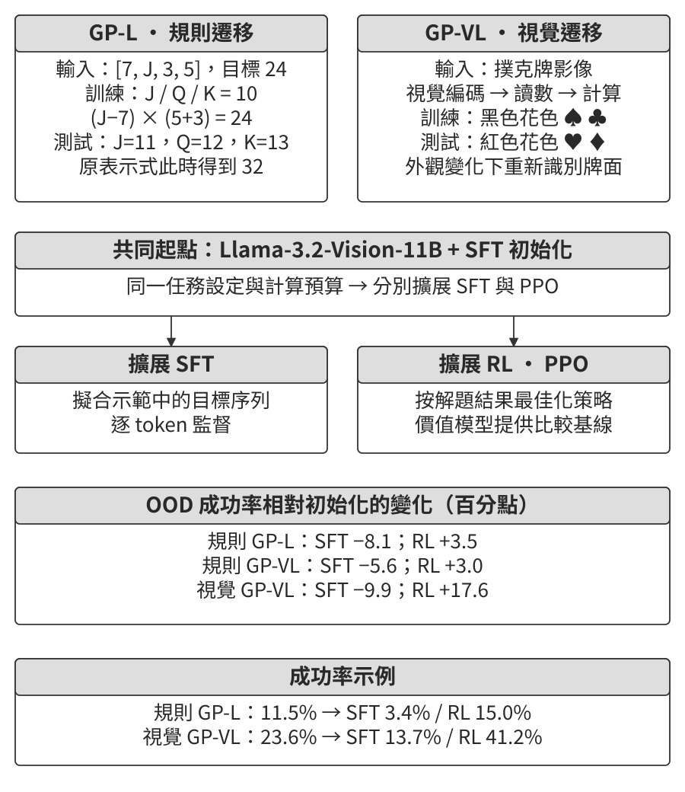
>
> **規則變體**：訓練時 J/Q/K 都計為 10，測試時分別計為 11/12/13。測試集因此包含訓練中未見的數字組合，可以檢查模型能否按新規則使用 11、12、13 計算。**視覺變體**：訓練用黑色花色（♠♣），測試用紅色花色（♥♦），檢查模型能否適應牌面外觀的變化。
>
> 實驗從 Llama-3.2-Vision-11B 出發，先用 SFT 建立基本指令遵循能力，再分為繼續 SFT 和 RL 兩條訓練分支，在相同計算預算下比較。RL 分支採用帶價值網路的 PPO。兩條分支都用 J/Q/K=10 的規則訓練，隨後在分布內（ID）與分布外（OOD）測試集上評估。
>
> 以 `[7, J, 3, 5]` 為例，J=10 時可以用 `(J−7)×(5+3)=24`；J 改為 11 後，這個表示式得到 32，需要換成 `(11−5)×(7−3)=24`。同一組牌面因此要求模型讀取目前規則，並重新組織計算。
>
> 兩種訓練方法在分布外測試中出現了明顯差異。**規則 OOD**：GP-L 上，RL 的成功率從 11.5% 升至 15.0%，增加 3.5 個百分點；SFT 從 11.5% 降至 3.4%，減少 8.1 個百分點。GP-VL 上，RL 增加 3.0 個百分點，SFT 減少 5.6 個百分點。**視覺 OOD**：GP-VL 上，RL 從 23.6% 升至 41.2%，增加 17.6 個百分點；SFT 從 23.6% 降至 13.7%，減少 9.9 個百分點。
>
> 進一步檢查卡牌識別結果，可以把最終答題表現與視覺感知連結起來：RL 分支的識別準確率隨任務成功率一起提高，SFT 分支的識別準確率則有所下降。研究將這一差異與訓練目標連結起來：逐 token 擬合可能強化示範中的文字模式，結果獎勵則持續要求模型正確讀取牌面並完成計算。感知準確率提供了分析這一機制的中間指標。
>
> 先做 SFT 的原因，也可以從輸出格式理解。實驗中的 Llama-3.2-Vision-11B 基礎模型無法穩定生成要求的結構化輸出，驗證器無法據此計算任務獎勵，直接進行端到端 RL 的嘗試因而失敗。SFT 先建立可解析、可評分的輸出，後續 RL 才能利用任務回饋。前文的 DeepSeek-R1-Zero 則用本來就能生成可評分回答的基礎模型起步，直接進入 RL。
>
> 模型能從驗證器的回饋中學到多少？論文圖 10 單獨比較了純文字卡牌任務（GP-L）。研究者設定了 1、3、5、10 次驗證迭代，分別訓練和評估 RL 模型。在相同訓練計算預算下，允許 10 次驗證的一組在新規則上的成功率比本組訓練起點提高了 5.99 個百分點，只驗證 1 次的一組提高了 0.48 個百分點。
>
> 為什麼在這個實驗的分布偏移下 SFT 表現下降，而 RL 表現更好？一種與觀察相符的解釋是：有限的 SFT 資料強化了「遇到 J/Q/K 就當 10 用」的固定模式；測試時 J=11，模型仍按 10 計算。結果導向的 RL 分支則更可能強化「重新計算直到得到正確答案」的策略，因而在 J 變成 11 時仍能應用。
>
> GeneralPoints 的規則變化與花色變化，讓我們可以分別觀察模型是否學會按新條件計算、是否正確讀取新的視覺輸入。在這裡的模型、訓練資料和測試預算下，繼續做 SFT 的分支在分布外測試中退步，而接上 RL 的分支有所提高。若要把結論用到自己的任務上，不妨先問：學生是否已經掌握輸出格式？新測試究竟換了規則、換了輸入外觀，還是兩者都換了？分開做對照，才能知道應補示範、改善感知，還是增加有結果回饋的探索。

## RL 演算法：從 16 次 rollout 到一次參數更新

**GRPO（Group Relative Policy Optimization）**由 DeepSeek 提出，透過同一問題下多次嘗試的相對表現構造學習訊號。以一個 SWE-bench 風格的程式碼修復任務為例：Python 專案的 `parser.py` 在空輸入時觸發 `IndexError`，Agent 需要修復實作並保持測試檔案不變。一次訓練迭代可以分為四步。

**第一步：讓策略模型重複嘗試。** 策略模型就是正在訓練的語言模型。系統將相同的初始程式碼和問題描述放入 16 個隔離沙箱，讓模型獨立完成 16 次任務。每次從閱讀程式碼開始，經過修改、測試，直到提交結果；這一整條互動軌跡稱為一次 **rollout**。隨機取樣使相同起點產生不同路徑：有的補齊邊界檢查，有的僅捕獲異常，有的改錯檔案，也有的試圖修改測試。

**第二步：計算獎勵。** 每條 rollout 結束後，驗證器在乾淨環境中應用補丁並執行測試。假設 16 次嘗試中有 4 次通過全部測試且沒有修改測試檔案，另外 12 次失敗，那麼通過的 4 條得到獎勵 1，其餘 12 條得到獎勵 0。圖8-13 把這 16 條軌跡的判分放在同一張表裡。這類程式碼任務可以直接用測試和規則計算獎勵。對於可讀性、解釋品質等較難寫成測試的目標，還可以結合人工評價或獎勵模型。

**第三步：計算相對優勢。** 獎勵只說明單條軌跡成功或失敗，**相對優勢**則說明它相對於同組其他嘗試有多好。這一組的平均成功率是 4/16：通過測試的 4 條高於組內平均，得到正優勢；失敗的 12 條低於平均，得到負優勢。若按組內標準差歸一化，獎勵均值為 0.25、標準差約為 0.433，成功軌跡的優勢約為 1.73，失敗軌跡約為 −0.58。GRPO 用這類組內比較構造學習訊號。若 16 條獎勵完全一樣，每條減去組均值都得到零。在分母加上很小的穩定項即可避免除以零；歸一化以後，這一組的結果獎勵仍然無法指示訓練應偏向哪條軌跡。此時可以檢查路徑約束、過程獎勵或部分進展能否區分同組軌跡。例如，都沒修好程式碼的兩次嘗試中，只有一次通過了原來失敗的邊界測試。只要這個中間結果可以獨立驗證，就多了一條可能用於學習的線索。

**第四步：用梯度下降更新策略。** 訓練程式把相對優勢轉成訓練損失，計算梯度，再由最佳化器（如 AdamW、Muon）執行梯度下降，提高正優勢軌跡中模型所做選擇的機率，降低負優勢軌跡中選擇的機率。訓練在許多任務和 rollout 上反覆調整這些選擇的機率。最佳化逐漸奏效後，遇到類似錯誤時，「先重現問題、檢查邊界條件、修改實作並執行測試」會更容易出現，「掩蓋異常、改測試、沒有驗證就提交」會更少出現。

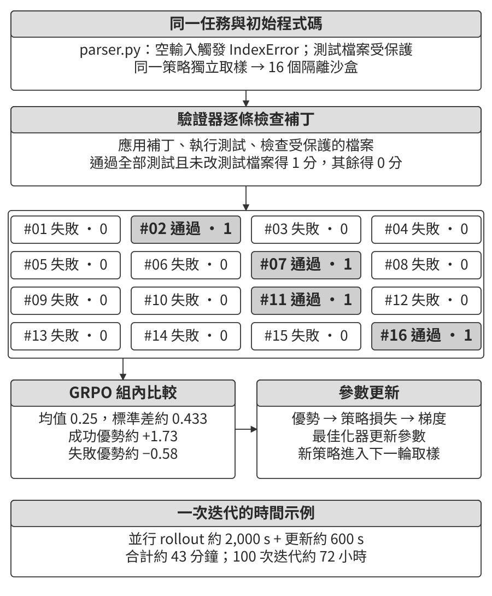

圖8-13 中，同一道題取樣 16 次，算幾次**訓練迭代（step）**？按本節的計數，這 16 條 rollout 屬於同一批。第 $k$ 輪用目前策略取樣，算出獎勵、優勢和梯度，更新一次策略；第 $k+1$ 輪才用新參數重新取樣。訓練 100 steps，說的是這樣的迭代約做 100 輪。

可以據此估算訓練時間。一次複雜任務可能包含數十輪工具呼叫；同步訓練等待整批結果時，16 條並行軌跡中最慢的一條決定取樣階段何時結束。假設它耗時約 2,000 秒，梯度計算與最佳化器更新再用 600 秒，一次 step 就需要約 $2{,}000+600=2{,}600$ 秒，即 43 分鐘。按相同耗時連續訓練 100 steps，約需 72 小時。

PPO 與 GRPO 都遵循這個閉環，區別主要在「拿誰來比較」。GRPO 直接比較同一問題的多條 rollout，不需要額外的價值模型；PPO 會訓練一個價值模型，估計在軌跡的每一步「通常能做到多好」，再判斷目前動作是否比這個預期更好，從而提供逐步信用分配所需的基線。兩者都透過裁剪代理目標等機制抑制過大的更新。DPO 則不同：它直接學習事先收集好的「較好回答—較差回答」偏好對，不讓目前策略線上生成這組 rollout。

本章的案例採用了不同訓練配方：AdaptThink 使用自定義約束目標；GeneralPoints、V-IRL 與 ReTool 使用 PPO，其中前兩者的價值模型參與優勢估計；SimpleVLA-RL 與 RLVP 使用 GRPO。

假設甲、乙兩題各試四次，甲題全對，乙題全錯。甲題的四個獎勵都是 1，乙題的四個獎勵都是 0。分別減去組內均值，兩組的優勢都變成了 0。可要是還有算力再試幾次，花在哪道題上更有希望得到有用的訓練樣本？

Never Give Up 把這個選擇放進了取樣過程。甲題全對，這一組就跳過；乙題全錯，則以一定機率追加一組。假設第二組終於有一次答對，訓練時便把兩組共八條回答放在一起：一個正確解和七個錯誤解，同一道題上有了高低不同的獎勵。非同步取樣讓其他題照常推進，無須等乙題出結果。[^ch8-ngu]

[^ch8-ngu]: Michael Noukhovitch 等，*Learning to Solve Hard Problems in RL for LLMs by Never Giving Up*，2026 年。文中的追加取樣用於訓練；已做對的題仍可在後續訓練中再次抽到。

### 為什麼 LLM RL 通常優先 On-Policy

**Online（線上）**與 **On-policy（在軌）**描述兩個不同方面。線上訓練在執行過程中持續與環境互動並產生資料；在軌訓練關注資料來源，要求生成軌跡的行為策略 $\mu$ 與待最佳化的策略 $\pi_\theta$ 一致或足夠接近。非同步叢集可以持續線上取樣，但 worker 若落後幾個檢查點，回傳的資料就帶有策略陳舊度，形成 off-policy（離軌）成分。

筆者建議先用接近在軌的訓練建立穩定基線，再為提高吞吐量引入非同步取樣或舊資料複用。本章的 PPO/GRPO 配方通常在每個 step 開始時用最新策略取樣。PPO 隨後會對同一批資料做多輪小批次更新，目前策略逐漸偏離生成資料的 `old_policy`。機率比衡量這種變化，裁剪目標則抑制過大的更新。

策略梯度的目標與目前策略 $\pi_\theta$ 下的期望獎勵有關。使用行為策略 $\mu$ 取樣的資料時，可以先計算同一狀態下的動作機率比，再據此構造重要性修正：

$$
\rho_t=\frac{\pi_\theta(a_t\mid s_t)}{\mu(a_t\mid s_t)}
=\exp\left(\log\pi_\theta(a_t\mid s_t)-\log\mu(a_t\mid s_t)\right).
$$

假設在同一段前綴之後，取樣策略選中某個 token 的機率是 0.2，而目前策略給它的機率是 0.3，那麼這一步的機率比就是 1.5。它在舊樣本中出現得偏少，按目前策略估算時，這類樣本的權重就相應提高。若取樣和訓練使用相同的策略，參數更新前每一步的機率比都是 1。

複用舊軌跡可以讓取樣與訓練非同步進行，提高吞吐量。但兩種策略差得越遠，少數樣本就越可能取得很大的權重。給整條軌跡重新加權時，各步機率比還要連乘。PPO 在每個動作的代理目標中裁掉一部分額外收益，能減弱極端機率比的影響；舊樣本從未到過的狀態，則要靠新取樣才能看到。這也是筆者傾向於使用新鮮軌跡的原因。[^ch8-32]

#### 訓練與推理的數值差異

大規模 LLM 強化學習通常用 vLLM、SGLang 等推理引擎取樣，再用 FSDP、Megatron 等訓練系統計算對數機率和梯度。兩側即使載入相同權重，也可能因浮點精度、歸約順序、張量並行、批大小、KV Cache 和融合 kernel 不同，為同一 token 算出略有差異的對數機率。此時，參數尚未更新，$\rho_t$ 就已偏離 1，訓練與取樣之間出現數值層面的策略差異。受控實驗發現，微小的 token 級差異也可能導致訓練崩潰。[^ch8-33]

取樣分布一變，即使兩個動作的獎勵完全相同，樸素的策略梯度也可能偏向其中一個。假設取樣時 A、B 各有一半機會，訓練時模型選 A 的機率已變為 0.8。對控制 A 的 logit 來說，選中 A 時，對數機率的梯度是 $1-0.8=0.2$；選中 B 時則是 $0-0.8=-0.8$。若兩個動作都得 1 分，按取樣時的機率取平均，梯度就是 $-0.3$。兩種選擇明明得分相同，更新卻會壓低 A 的機率。

Score centering 對同一前綴下的對數機率梯度減去它在取樣分布下的均值。上例中減去 $-0.3$ 後，兩項分別變成 $0.5$ 和 $-0.5$，同樣的獎勵產生的平均更新恰好為零。前面 GRPO 對一組回答的獎勵減去均值；這裡被居中的是梯度。[^ch8-sc]

[^ch8-sc]: Martin Marek、Max Ryabinin，*Score Centering Stabilizes Off-policy Reinforcement Learning*，2026。取樣策略落後太遠時，也可以用 KL 正則約束訓練策略與行為策略之間的距離（arXiv:2611.21791）。

訓練端與取樣端的數值誤差還會沿長序列放大：**對數機率誤差 → 機率比偏差 → 長前綴累積 → 裁剪與優勢加權變化 → 梯度和有效樣本數變化**。例如，4,000 個 token 的對數機率比若都帶有同方向的 $10^{-3}$ 偏差，算出的軌跡級機率比就會是真值的 $e^{4000\times0.001}=e^4\approx54.6$ 倍。

早期機率變化還可能改變取樣結果，使後續狀態沿另一條路徑發展。訓練中可觀察到的訊號包括重要性比率尖峰、裁剪比例升高、梯度或回應長度突變，以及獎勵和熵下降。批大小改變歸約過程時，同一輸入的數值結果也可能變化，即批次不變性（batch invariance）受到破壞。相關研究觀察到了由此產生的隱式離軌效應，並透過對齊取樣與訓練計算，或顯式修正策略差異，改善穩定性。[^ch8-34]

因此，筆者把取樣與訓練的數值一致性列為訓練啟動前的核心檢查，並與獎勵曲線一起持續監控。可以沿著「測量差異—對齊配置—修正偏差—控制陳舊度」四步處理：

- 在**任何參數更新之前**，用同一批軌跡比較取樣端（sampler）與訓練端（trainer）給出的 token 對數機率，監控 $\rho_t$ 的均值、分位數、最大值、近似 KL 和被裁剪比例；這是最直接的 on-policy 單元測試。
- 同步權重時，一併對齊 LoRA 適配器、分詞器、對話範本、模型版本和位置編碼配置。rollout 應儲存取樣策略在生成時給出的對數機率，後續據此計算機率比。
- 儘可能對齊取樣與訓練的精度、並行佈局和關鍵計算 kernel；若不能做到，就把差異明確視作 off-policy，採用重要性修正並監控有效樣本數，並結合裁剪比例判斷修正效果。
- 及時用更新後的策略重新取樣，限制每批資料上的更新輪數，以及非同步取樣落後於訓練的檢查點數量。

## RL 環境：從評估到模擬

Agent 的 RL 訓練需要反覆執行任務。一次程式碼修復可以在隔離副本裡重試，一次付款則會改變真實帳戶的狀態。訓練環境要提供可重設的初始狀態、可並行的任務副本和可驗證的結果，讓模型在受控條件下探索不同路徑。第七章已經介紹評估環境；用於訓練時，還需考慮長時間執行、動作副作用以及大量互動的成本。筆者會先為環境建設分配人力和預算，再安排大規模訓練。實現真實回饋、狀態重設與並行隔離，常常比接入 PPO 或 GRPO 更耗費工程資源，環境建設成本也可能超過訓練本身。

### 環境：模型練習的場地

環境根據動作更新狀態，並把新的觀測回傳給模型。建構環境時，可以從三個問題入手。

- **互動是否接近部署場景？** 客服模擬器需要覆蓋使用者補充資訊、改變訴求和表達含糊等情況；工具模擬器需要回傳生產中常見的錯誤和延遲。模型透過這些回饋學習應對實際問題。過於單一的回饋會讓策略依賴模擬中的固定套路。
- **任務能否穩定重試和並行？** 每條 rollout 都需要獨立的訂單、檔案或帳戶狀態，結束後能夠清理並恢復。ReTool 的程式碼直譯器沙盒與 AWorld 的 MCP 沙盒都承擔這類職責。對有速率限制、費用或寫入副作用的真實 API，可以按任務需要使用沙盒帳戶、重播資料或模擬介面。
- **結果如何判定？** 環境狀態是獎勵計算的重要依據。例如，退款任務可以檢查金額、訂單狀態和授權條件；程式碼任務可以執行測試。後文將專門討論獎勵設計。

**在動手調演算法之前，筆者建議先檢查：模擬環境是否足夠接近實際任務？這比選 PPO 還是 GRPO 更重要。** 保真度、可重設性和驗證能力共同決定模型能從互動中學到什麼。先用少量任務走通這三個環節，再擴大訓練規模，通常更容易定位問題。

### 用模型模擬工具與環境

搜尋結果、使用者對話和複雜業務狀態都可以藉助模型合成。模型模擬器接收 Agent 的動作，生成下一步回饋，降低對即時外部服務的依賴。這種做法可以從單個工具擴展到整個任務環境。

**第一個層次：合成工具回傳值。** ZeroSearch[^ch8-13]讓 LLM 扮演搜尋引擎：學生發出查詢，模擬器生成檢索結果。這樣可以減少訓練對真實搜尋 API 的費用、速率限制和結果波動的依賴。它還採用課程式安排，初期回傳品質較高、相關性較強的文件，隨後逐步增加雜訊，讓學生練習從不完善的材料中提取有用資訊。研究中的模型在模擬搜尋環境中完成訓練後，接入真實搜尋引擎仍取得了良好表現。

**第二個層次：模擬環境的狀態轉移。** DreamGym[^ch8-14]將環境動態蒸餾到一個推理式經驗模型中。模型讀取目前狀態和 Agent 的動作，推導下一狀態與回饋，批次生成用於線上 RL 的互動軌跡，從而減少對真實環境的存取。客服與銷售任務還可以讓 LLM 扮演使用者，模擬追問、補充資訊和訴求變化。τ-bench 系列採用了使用者模擬器；類似的互動框架也可以用於訓練，分別承擔練習和評估任務。

模型模擬器也需要校準。客服模擬器若總能準確理解含糊問題，策略就缺少練習澄清的機會；搜尋模擬器若總回傳正確文件，策略就缺少識別雜訊的經驗。訓練還可能強化那些利用模擬器評分缺陷的行為。筆者建議採用混合方式：用模型模擬承擔大量互動，再定期用真實環境中的任務檢查策略表現，並把發現的差異回饋到模擬器中。這樣形成「合成互動—真實任務評估—修正模擬器」的迭代過程。

怎樣知道模擬器真的能教會工具使用？可以做一個小測試：在同一份初始訂單上，先查詢，再提交修改，再次查詢，檢查回傳的訂單欄位是否隨動作發生預期變化。隨後重設環境，確認又能讀到原始值。只會生成一段聽起來合理的「已修改」，卻無法在下一輪查出變化的環境，會獎勵會說話的策略，即使它一直沒有改變訂單。

### 環境、任務分布與評估隔離

訓練環境決定模型能夠經歷什麼。可重設的狀態讓重試成為可能，隔離副本讓任務可以並行，明確的狀態與驗證規則讓結果可以重現和計分。任務可以沿用前文的資料合成方法：從真實業務日誌提取任務藍圖，去除身份資訊，再生成虛構的人物、訂單、檔案與初始狀態。

訓練與評估可以複用任務生成器和驗證程式碼，具體任務則應劃分為獨立集合。參考 SWE-Gym、τ²-bench 和 AndroidWorld 的環境設計[^ch8-28]，驗收測試、評分所需的隱藏狀態與參考解法儲存在驗證器一側，Agent 透過任務約定的介面取得觀測。擴大取樣前，先用少量 rollout 檢查任務能否完成、驗證器能否區分有效與無效結果。及早發現評分偏差，可以減少策略利用驗證漏洞的機會。

因此，環境工程的順序應是：**任務藍圖 → 可重設環境 → 結果驗證 → 訓練/評估隔離 → 真實互動校準**。前文的資料合成從這些環境中篩選有效軌跡，形成 SFT 示範。進入 RL 後，目前策略繼續在環境中試錯，探索示範之外的路徑。

驗證也要納入吞吐預算。Lean kernel、測試執行器和容器執行會消耗 CPU 與記憶體。當 GPU 生成速度超過驗證速度時，任務便會在驗證佇列中積壓。此時應增加驗證器 worker、縮短驗證延遲，或調整生成與驗證的資源配比[^ch8-9]。

## 從單輪到多輪：任務場景與信用分配

### 多輪任務的核心挑戰

圖8-14 左邊是算 24 點。模型可以在回答裡推算好幾步，但這幾步都用題目給定的四張牌，中途沒有新的環境觀測。右邊是街景導航。走到路口選擇左轉以後，才看得見轉過去的那條街。下一步怎麼走，要根據眼前的路牌重新判斷。第一章和第四章講過的 ReAct 就能組織這種互動：模型選擇行動，工具或環境執行，新的觀測進入下一輪決策。

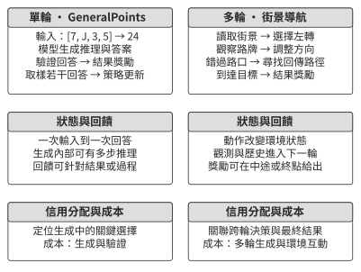

圖8-15 中，Agent 在第 3 步錯過路口，第 4 步發現走偏，掉頭返回，第 5 步到達目標。終點獎勵肯定了整趟導航，卻沒有區分走錯路和及時掉頭。下次遇到這個路口，我們希望它直接走對；萬一又走錯，仍應鼓勵它掉頭。訓練中要估計先前各步對最終收益的作用，這個問題叫作**信用分配（Credit Assignment）**。價值和優勢估計可以利用後來的回報；能夠可靠檢查中間動作時，還可以加入過程獎勵。第 4 步掉頭在過程獎勵中得 0 分，仍然有助於走到終點。估計這一步的價值時，也要計入後來的回報。

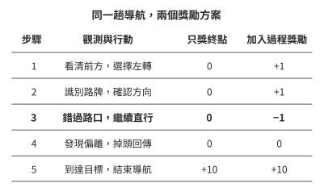

同樣的問題也會發生在客服通話裡。例如，使用者在第 10 輪給出了好評。第 2 輪問清爭議的是哪筆收費，第 7 輪解釋費用，兩步都可能有幫助。只憑最後一次好評，還分不出各自起了多大作用。下面兩個實驗分別討論訓練者能逐步檢查導航動作，以及只能從任務結果判斷機器人是否成功的情形。

> **實驗 8-12 ★★★：V-IRL-VL——多輪視覺導航**
>
> 在 V-IRL[^ch8-24] 中，Agent 要根據眼前的街景一步步找到目的地。訓練用的是紐約的路線，測試換到其他城市，既改變指路的說法，也改變畫面中的街景。在規則變化和視覺變化這兩類分布外測試中，RL 的表現都明顯好於 SFT。實驗使用帶價值網路的 PPO。每走一步就給回饋，有助於分辨一條長路線中哪些決定值得保留。

> **實驗 8-13 ★★★：SimpleVLA-RL——結果獎勵下的開放探索 `[延伸實驗]`**
>
> SimpleVLA-RL 在 LIBERO 機器人任務中採用成功／失敗結果獎勵。每個任務用一條示範軌跡進行 SFT 冷啟動，隨後透過 RL 將成功率從 17.3% 提高到 91.7%，並產生示範中未出現的「推切」動作。把這個結果與街景導航對照起來看：如果能可靠地判定中途哪一步走錯了，就可以當場給回饋，加快學習。如果還不知道完成任務有哪幾種走法，先按結果給獎勵，可以給模型留下嘗試其他路徑的餘地。過早把人類示範中的動作順序寫成獎勵要求，就可能壓低「推切」這類新策略的得分。

### 工具呼叫：在互動中學習使用外部能力

接入外部工具後，模型可以選擇搜尋、執行程式碼、修改檔案、查詢資料庫，或按任務需要組合多個 API。Harness 負責校驗與排程呼叫，工具在環境中執行並回傳觀測。圖8-16 把一次任務中的決策與任務結束後的訓練分開。沿右邊的箭頭，工具結果回到目前任務，模型用它決定下一步。往下讀，任務結束後訓練程式才用整條軌跡計算獎勵、更新參數，下一輪取樣用上新策略。一次任務要連續呼叫多個工具時，前一次回傳的結果會影響後一次呼叫的參數。

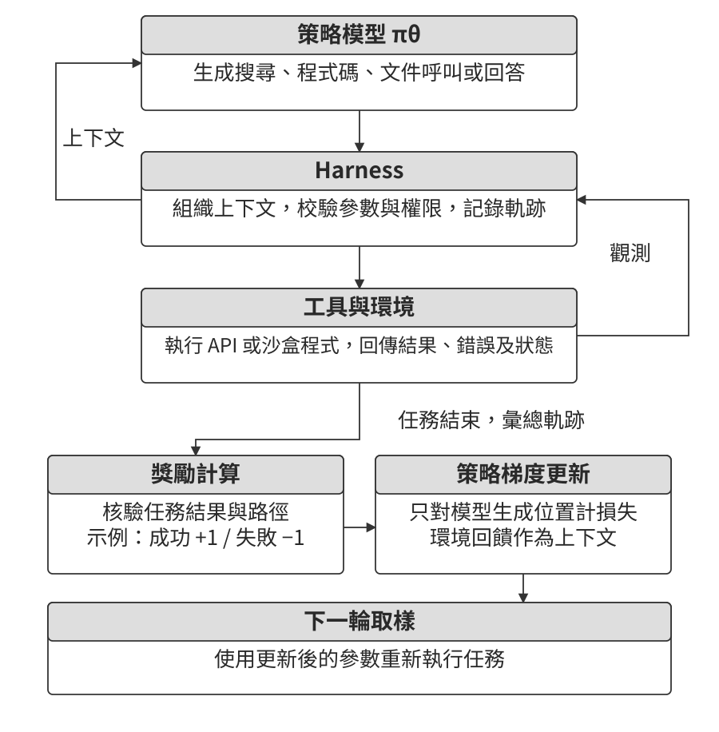

Search-R1[^ch8-25]訓練模型決定何時搜尋、提交什麼查詢，並結合結果繼續推理。ReTool 將程式碼直譯器接入同一類迴圈，模型學習安排程式碼執行、理解回傳值，並根據報錯修正。AWorld-train 擴展到 MCP 多工具沙盒，模型要選擇工具、處理呼叫之間的依賴，訓練系統還得能重設環境、重放軌跡。

工具軌跡需要區分模型生成的 token 與環境回傳的 token。計算策略損失時，只對模型生成的推理、呼叫參數和回答等動作計入損失，遮蔽環境回饋對應的位置。回饋仍作為上下文參與後續計算，幫助模型判斷下一步該做什麼。例如，直譯器回傳一個報錯，訓練所要強化的是模型隨後如何修正程式碼。如果把報錯文字也計入策略損失，更新就會混入「生成環境輸出」的目標，偏離模型實際負責的決策。

> **實驗 8-14 ★★★：ReTool——程式碼直譯器增強數學解題**
>
> 圖8-17 用一元二次方程展示文字推理、程式碼生成和直譯器回饋如何交替進行。
>
> 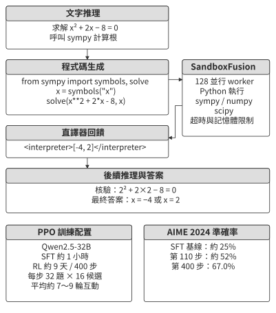
>
> ReTool 在 SFT 預熱後，用交織的文字思考、程式碼執行和直譯器回饋進行 PPO 訓練。模型逐漸學會什麼時候值得執行程式碼，以及報錯後該怎樣修改。這裡用的是 DAPO-Math-17k 的訓練資料，更新策略用的仍是標準 PPO[^ch8-26][^ch8-27]。
>
> 經過訓練，模型在 AIME 2024 上的答題準確率從約 25% 升至 67.0%。相比純文字 RL，程式碼回饋讓模型更快學會精確計算和糾錯。

> **實驗 8-15 ★★★：AWorld-train——在沙盒中學習使用工具**
>
> 沿圖8-18 的上半部走一圈，模型收到一次工具呼叫的結果，還可以接著嘗試。再沿下半部走一圈：這一批任務已經結束，訓練程式拿到帶獎勵的軌跡，更新參數，下一批任務才會用上新策略。
>
> 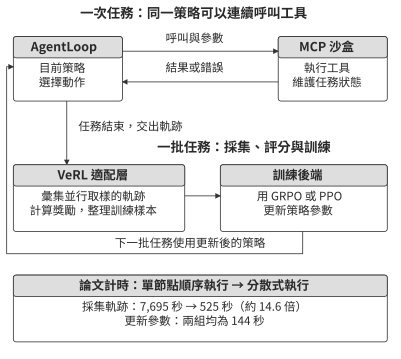
>
> GAIA 環境有 26 個 MCP 伺服器、126 個工具函式，可以用 Playwright 操作網頁，提取 PDF、Word 和投影片中的內容，轉寫音訊、識別文字，或在 E2B 沙盒中執行程式碼。Excel 工具提供包括公式、圖表和樞紐分析表在內的 29 項操作，知識檢索還可存取 Wikipedia、arXiv 和 Wayback。重設沙盒後，可以從同一狀態重新嘗試，也可以重放先前的軌跡。
>
> 圖中計時取自論文的採集對照。配套實驗另給出一套 4B 模型的訓練配置：Qwen3-4B-Thinking-2507、8 張 A100、上下文上限 131K、最多 32 輪互動，批大小 32，每題取樣 16 條軌跡，用 GRPO 更新，學習率為 1e−6。

工具回傳了結果，訓練程式該獎勵哪一步？一次成功呼叫只能說明工具執行成功。要判斷這一步是否推進了任務，還得用驗證器檢查它造成的變化，再決定給模型什麼獎勵。

## 獎勵設計：如何把任務目標變成學習訊號

設想兩條退款軌跡最後返還了相同的金額，其中一條跳過了必需的身份核驗。若只讀取最終餘額，它們會得到同一分數。為了把使用者委託的完整要求變成學習訊號，先確定誰能核實結果、哪一步能取得證據、需要向模型傳回哪些資訊，再檢查路徑上的權限和流程約束能否單獨驗證。

### 獎勵來自哪裡：規則、人類偏好與模型評判

對能夠自動判定的任務，筆者優先採用**基於可驗證獎勵的強化學習（RLVR）**，將驗收要求直接寫成程式。數學題可以核對答案，程式碼任務可以執行測試，退款任務可以檢查資料庫中的金額和訂單狀態。通過記為 1、失敗記為 0，就能得到最簡單的結果獎勵。規則明確、執行可重現，便於定位評分差異；驗證器的覆蓋範圍則決定了訓練究竟在最佳化哪些要求。

**人類回饋強化學習（RLHF）**把人的偏好轉成訓練訊號。InstructGPT[^ch8-4]先收集人工對回答的比較，訓練獎勵模型，再用 PPO 最佳化策略。獎勵模型學習的是有限樣本中的偏好，持續追求更高的模型評分可能放大它的偏差[^ch8-5]。訓練中常加入相對於 SFT 參考模型的 KL 正則，控制策略偏移。DPO[^ch8-6]則直接利用「較好回答—較差回答」的偏好對最佳化策略，省去單獨訓練獎勵模型的步驟。

開放式任務可以讓模型給出評價理由和分數。**生成式獎勵模型（GRM）**生成的診斷，還能用於篩選示範、構造偏好對或指導後續修改。DeepSeek-GRM[^ch8-23]根據任務生成評價原則，再據此給出批評和評分；它透過線上 RL 改善評價行為，並用多次取樣及輔助獎勵模型彙總判斷。

評價指標與任務目標之間的差距，也會影響模型行為。**Reward hacking** 指策略利用評分規則或實作中的缺陷獲得高分。長程 Agent 中還有一類被稱為 **reward seeking** 的現象：模型按自己推測的評分方式行動，例如自行選擇一個容易通過的檢查，檢查通過後便結束任務[^ch8-29]。這個例子提示我們，驗收條件應從使用者目標出發，並覆蓋真實交付物；僅檢查模型自行挑選的指標，容易遺漏尚未完成的要求。

設計退款任務的獎勵時，先讓兩條人工寫出的軌跡經過驗證器。甲查明訂單、呼叫退款介面、向使用者複述回執；乙只說「退款已完成」。如果兩者得分相同，就先查評分器究竟讀了最終回覆、介面回執還是訂單狀態。這個很小的反例足以暴露代理指標的問題，省去用整批訓練才發現模型學會了提前報喜的代價。

### 獎勵在什麼時候給：結果與過程

**結果獎勵**在一條 episode 結束後評價任務表現；採用模型進行結果評價時，這類模型稱為 **ORM（Outcome Reward Model）**。SimpleVLA-RL 的成功/失敗獎勵讓策略圍繞最終目標探索不同動作序列。這樣的訊號容易定義，但一條長軌跡失敗後，模型還需要透過更多嘗試區分哪些動作導致了失敗。這是稀疏回饋影響樣本效率的一個原因[^ch8-8]。

以 Coding Agent 過早結束為例：模型提交完成聲明後，Harness 在隔離工作區執行受保護的驗收測試。測試讀取真實檔案和環境狀態，通過給正獎勵，失敗給負獎勵。這樣，完成聲明會觸發外部驗證，任務結果由交付物決定。評估時分別準備兩組任務：一組仍有工作待完成，用於測量過早結束率；另一組已經完成，用於檢查模型能否及時收尾。

**過程獎勵**在中間步驟提供回饋，例如評價身份核驗、參數選擇、導航動作或推理步驟。用於評價過程的模型稱為 **PRM（Process Reward Model）**。OpenAI 的《Let's Verify Step by Step》[^ch8-7]研究了數學推理中的逐步驗證。過程訊號可以幫助模型定位錯誤，也會增加標註與驗證成本。若把某一種解題順序當作唯一正確路徑，還會壓低其他有效策略的獎勵。筆者因此只為真正可核驗的中間事件加入過程訊號，讓模型繼續探索多種有效解法。V-IRL-VL（實驗 8-12）使用逐步導航回饋，SimpleVLA-RL（實驗 8-13）使用終點獎勵，展示了兩種任務對回饋粒度的不同選擇。

實踐中可以先建立結果獎勵基線，再為身份核驗完成、測試通過等中間事件增加過程訊號。有限長度的多輪任務可以取折扣因子 $\gamma=1$，使終點獎勵向前傳播時保持相同權重。PPO 透過價值估計和優勢計算把回饋關聯到各步動作；採用軌跡級優勢的 GRPO，通常用同一個優勢權重計算該軌跡各生成 token 的策略損失。

### 獎勵需要表達多少資訊：標量、向量與生成式診斷

獎勵何時出現決定了回饋的密度；獎勵包含什麼內容決定了表示形式。一個標量概括總體表現；「簡短理由＋分數」的半標量形式補充評分依據；向量分別表達準確性、完整性、成本等維度；生成式診斷則具體說明問題及修改方向，也可以透過多次取樣彙總。

- 有確定答案或驗收測試時，可以從二元標量開始。
- 有多個品質目標時，可以分別評分，再根據業務要求加權或設定約束。
- 評價需要結合上下文解釋時，可以生成診斷，並用事實核驗和人工抽檢校準。

例如，一次客服任務可以同時記錄解決情況、對話輪數和身份核驗是否完成。三個維度分別對應效果、成本和流程要求。將它們用於訓練前，應先檢查評分是否穩定，以及它們能否區分同組軌跡的行為。筆者會從少量可靠指標起步，逐項驗證後再增加維度。每個未經驗證的評分項，都可能讓模型沿著新的代理指標最佳化，卻沒有改善真實任務。

### 路徑約束與 RLVP

完成任務的過程中還可能存在獨立的行為要求：按營業時間聯絡使用者、完成身份核驗、保持受保護檔案不變。RLVP（Reinforcement Learning with Verified Penalty）[^ch8-9]把結果獎勵與可驗證的路徑懲罰結合起來，原則是**獎勵結果，懲罰路徑**。路徑規則由環境中的可觀測動作觸發，交付完整性則繼續由任務驗收檢查。

兩次修復都通過了驗收，其中一次卻直接覆蓋了本應先讀取的檔案。檢查工具記錄就能定位這個違規動作；要判斷前面每一步對最終成功有多大貢獻，則要困難得多。最簡單的做法是給整條軌跡打一個分數 $R=O+\beta\Phi$：$O$ 是任務得分，$\Phi$ 彙總違規扣分或可驗證的進展，$\beta$ 決定兩者的相對權重。這樣可以區分兩次修復，但同一條軌跡裡的每個動作都分到了同一個訊號。

如果知道哪一輪違規，還可以把扣分留給那一輪。看配套實作的兩條測試軌跡：甲完成了任務，但第二輪違規；乙沒有完成任務，兩輪都合規。兩條軌跡的結果分分別為 1 和 0，減去組均值後得到 +0.5 和 −0.5。每條軌跡有兩輪動作，每輪各佔 10 個動作 token。按實作中的 `c2` 配置，兩種訊號分開計數：

```python
outcome_weight = (1 - 0.5) / 40  # 結果訊號分攤到這批的全部 40 個動作 token
penalty_weight = -0.3 / 10       # 違規扣分只分攤到甲第二輪的 10 個動作 token
first_turn = outcome_weight
second_turn = outcome_weight + penalty_weight
```

甲的第一輪，每個動作 token 分到的權重是 +0.0125；第二輪則是 −0.0175。於是，同一次成功修復中的兩個動作可以得到方向相反的訓練訊號。這樣的權重進入策略損失後，最佳化器才據此更新參數。換成客服任務，只要工具記錄能定位到哪一輪跳過了授權檢查，也可以用同樣的方式分配扣分。

路徑訊號的作用可以從組內差異理解。若一組 GRPO 軌跡的結果獎勵相同，基於該獎勵計算的優勢就為零；如果其中的違規次數不同，路徑懲罰便能提供新的比較依據。部分進展獎勵也遵循同樣的條件：模型至少要取樣到不同程度的進展，才能產生區分作用。

設計路徑獎勵時，可以遵循四條規則：懲罰明確的違規動作；保留任務結果獎勵；為受約束的行為提供可達的合規路徑；使用可重複執行的驗證規則。例如，單獨懲罰每次操作會鼓勵模型停在原地，保留任務成功獎勵才能同時推動它完成工作。基礎模型難以生成合規路徑時，可以先用少量示範建立起點，再透過訓練逐步降低對路徑塑形的依賴。

> **實驗 8-16 ★★★：RLVP——獎勵結果、懲罰路徑**
>
> 實驗在 GRPO 中加入結果獎勵 $O$ 與路徑訊號 $\Phi$，並與純結果獎勵比較。TerminalBench 代理任務上的違規次數由 3.71 降至 0.66，成功率基本持平；miniF2F 代理任務中，加入可達的部分進展獎勵後，達到 0.9 成功率所需的迭代從 7.0 降至 4.4。
>
> 軟體修復任務還展示了訊號可達性的作用：當所有 rollout 都無法通過任何測試時，按通過測試數計算的進展獎勵始終相同，無法增加組內差異。

平均違規次數降到了 0.66，說明模型更常選擇合規路徑，仍然偶爾會違規。對於必須遵守的限制，執行工具時還要檢查權限。

## 蒸餾：提升樣本效率

一次 Agent rollout 往往包含多輪模型生成和工具執行。提高**樣本效率**，就是用更少的環境互動達到目標表現。訓練步數、GPU 時間和環境呼叫量分別反映不同成本，需要結合任務一起看。例如，本章 ReTool 案例中的 SFT 訓練約需 1 小時，RL 約需 9 天；其中反覆取樣和執行工具佔用了大量資源。

採用終點獎勵時，一整條軌跡可能只得到一個成敗分數。假設業務工具已經提示「需要信用卡後四位」，Agent 卻遺漏了這一資訊，最終得到獎勵 0。訓練還需要從多次嘗試中分辨，失敗究竟來自缺少欄位、工具參數錯誤，還是後續操作失誤。如果教師能在這條軌跡上逐步提供監督，同一次環境互動就能產生更細的學習訊號。

### 在軌蒸餾：讓一次 rollout 產生密集監督

**在軌蒸餾（On-Policy Distillation）**由學生生成軌跡，教師在學生實際生成的前綴上提供監督。Thinking Machines Lab 在 2025 年的研究中系統展示了這種訓練方式[^ch8-10]。理解三類方法時，可以把「誰產生訓練狀態」和「誰提供學習訊號」分開看：

| 方法 | 軌跡或狀態由誰產生 | 主要學習訊號 |
| --- | --- | --- |
| SFT／離軌蒸餾 | 人類或教師示範 | 目標答案的逐 token 監督 |
| On-policy RL | 目前學生 | 結果或過程獎勵 |
| On-policy Distillation | 目前學生 | 教師對學生前綴的逐 token 機率評價 |

例如，教師示範總是先查詢訂單再申請退款，學生卻可能先發起退款，收到「缺少訂單編號」的報錯。在軌蒸餾會讓教師評價學生已經走到的這個狀態，指導它如何補查資訊。這樣，訓練能夠覆蓋學生自己的錯誤及恢復路徑。

一種實作方式是在學生生成的前綴上，最小化學生與教師之間的反向 KL：

$$
D_{\mathrm{KL}}(\pi_\theta\Vert\pi_T)
=\mathbb{E}_{a\sim\pi_\theta(\cdot\mid h)}
\left[\log\pi_\theta(a\mid h)-\log\pi_T(a\mid h)\right],
$$

其中，$h$ 是目前前綴，$a$ 是下一個 token，$\pi_\theta$ 和 $\pi_T$ 分別表示學生與教師的分布。教師認為更合適的 token 會得到更有利的訓練訊號。實作時可以比較完整分布，也可以查詢教師對學生已取樣 token 的對數機率，構造逐 token 的最佳化訊號。

以「先查詢 API，再解析回傳值」為例，假設某個位置的候選「查詢」和「呼叫」各對應一個 token，教師給它們的機率分別為 80% 和 15%，其他候選合計 5%。這就提供了比最終成敗更細的選擇依據。若一條軌跡包含 $T$ 個模型生成的 token，就可以在約 $T$ 個位置獲得監督；工具回傳內容仍作為上下文使用，並在策略損失中遮蔽。

下面用完整分布對齊的形式表示這個過程：

```python
trajectory = rollout(student, task)
loss = 0
for prefix in model_generated_positions(trajectory):
    target = stop_gradient(teacher.distribution(prefix))
    loss += KL(student.distribution(prefix), target)
update_student(loss)
```

學生負責探索，教師在多個位置提供監督，新增成本主要來自教師推理。環境互動昂貴、教師又能可靠指導學生時，筆者會優先比較在軌蒸餾，讓每次環境呼叫產生更多有效的學習訊號。對於目標語言、領域知識或基本動作掌握不足的學生，可以先用 Mid-training 和示範訓練建立有效起點，再進入在軌蒸餾。

取樣與訓練的一致性同樣重要：取樣引擎按策略 $\mu$ 產生軌跡，訓練引擎按 $\pi_\theta$ 計算損失，兩者的差異會改變訓練狀態的分布。

Thinking Machines Lab 的數學任務對照展示了約一個數量級的訓練效率收益。在多輪 Agent 中，可以沿用這種比較方式，同時記錄任務成功率、環境呼叫量和教師計算成本。學生在環境中遇到的狀態、教師能否給出可靠回饋，共同決定收益。

筆者和合作者也曾在「時間感」任務中比較 DPO、四種 RL 配方與在軌蒸餾[^ch8-11]。前幾類配方分別遇到了獎勵稀疏、目標錯位、rollout 形狀不匹配和策略崩潰等問題。改用凍結的 Qwen3-32B 教師，在學生自己的多輪軌跡上逐 token 對齊後，訓練平滑收斂，四種條件下的通過率比同源 SFT 基線高出 23～47 個百分點。這段經歷讓筆者更看重每次互動提供的訊號密度。同一次互動中的中間決策都能參與學習，已有軌跡的價值就能得到更充分的利用。

如果數學教師擅長推理，程式碼教師擅長修程式，怎樣讓一個學生學到兩者的長處？多教師在軌蒸餾（MOPD）沿用上面的訓練過程，只把固定教師換成按題目領域選擇的教師。學生做程式碼題時，即使寫到一半走了彎路，也把自己已經寫出的前綴交給程式碼教師，取得下一步的機率分布；輪到數學題，則由數學教師在學生的解題過程中給出指導。各領域可以先獨立訓練教師，在蒸餾階段固定教師的參數。部署時只需執行一個學生。[^ch8-mopd]

這裡有兩個實際條件。第一，按上式計算逐 token 的 KL，需要能在學生給定的前綴上取得可對齊的教師機率。手裡只有幾份教師寫好的完整答案，可以拿來做 SFT，卻不足以算出這個損失。第二，驗收時要把各領域的成績拆開看。學生數學成績上升、程式碼成績下降時，一個上升的總平均數容易掩蓋後者的退步。

[^ch8-mopd]: Wenhan Ma 等，*MOPD: Multi-Teacher On-Policy Distillation for Capability Integration in LLM Post-Training*，2026 年。論文採用按領域訓練的教師，在學生自己的軌跡上蒸餾。

### 在軌自蒸餾：用額外上下文構造教師

如果團隊只有一個擅長本領域的模型，誰來當教師？可以把同一道題交給它兩次。第一次按部署條件給出使用者問題；第二次再給標準答案、專家示範或領域文件。第二次作答時多出的資訊，可以用來指導第一次條件下的學生。

**在軌自蒸餾（On-Policy Self-Distillation，OPSD）**[^ch8-15]讓同一個模型承擔兩個角色：學生只看到任務輸入，教師額外看到標準答案或已經驗證的解答。學生生成軌跡後，教師結合這些特權資訊評價各個前綴，再把監督傳回學生。

例如，學生正在解一道數學題，教師已經知道正確答案。教師可以據此評價學生目前的推理方向，學生則學習在僅有題目的條件下改進自己的生成。下面的虛擬碼展示額外上下文與梯度隔離的位置：

```python
trajectory = rollout(model, task_without_answer)
loss = 0
for prefix in model_generated_positions(trajectory):
    privileged_prefix = add_verified_answer(prefix)
    target = stop_gradient(model.distribution(privileged_prefix))
    loss += KL(model.distribution(prefix), target)
update(model, loss)
```

特權資訊只進入訓練時的教師分支，學生輸入和評估輸入保持與部署時一致。可以沿虛擬碼檢查兩條資訊通路：標準答案只進入構造教師前綴的那一行，部署時學生不會看到它；教師輸出經停止梯度處理，所以這一步只有學生分支按兩種分布的差異更新參數。下一輪使用更新後的模型時，教師的判斷也可能隨之改變。這樣，同一個模型可以利用訓練側更充分的資訊，為自己的實際生成提供監督。

特權資訊還可以來自人工示範或經過篩選的領域文件。選擇時應檢查它能否改善教師的判斷：拿到資訊後的教師越能識別學生的錯誤，蒸餾訊號就越有用。訓練過程中還要用事先留作測試的樣本檢查原有能力和生成風格；Purified OPSD 等研究進一步透過正則約束幫助模型保持原有推理風格[^ch8-16]。

## 從問題案例到後訓練

第七章把生產問題整理成可重現的任務、失敗歸因和評價標準。這些材料也可以用於後訓練：完整任務提供互動環境，出錯前的軌跡前綴提供決策上下文，驗證器負責檢查新生成的行為。表 8-5 列出了它們與訓練方法的對應關係。

表8-5 第七章評估材料與後訓練用法

| 第七章的材料 | 第八章的訓練用法 |
| --- | --- |
| 端到端任務及驗證器 | RL 取樣任務、可驗證獎勵、拒絕取樣的任務池 |
| 軌跡前綴及後續行為 | DPO 偏好對、SFT 決策示範、在軌蒸餾的教師輸入 |
| 失敗位置與錯誤類別 | 過程評價標籤、可驗證的路徑懲罰規則 |
| Rubric 各項得分與人工標註的標準答案 | 多維獎勵、生成式獎勵模型的訓練與校準 |

歷史前綴可以作為續接任務的起點。用於在軌蒸餾時，先由目前學生從這個起點繼續生成，再讓教師評價學生實際產生的前綴；需要執行工具時，同時恢復對應的環境狀態。這樣就把第七章的局部決策評估接到了本章的取樣與訓練流程中。

用於訓練的任務要與留出評估任務分開。兩側可以共享介面和驗證邏輯，分別使用獨立的任務實例；需要考察跨任務泛化時，還可以按任務範本或業務類型劃分。下面用三個例子說明如何完成這一步轉換。

### 案例 1：Coding Agent 過早結束

Agent 尚未執行測試便宣稱完成，只改完三個需求中的兩個便提交，或遇到幾次失敗便放棄，都屬於過早結束。生產中可以從使用者糾正、點踩和軌跡審查中收集這些案例。例如，使用者指出「你還沒有跑測試」，可以沿著軌跡檢查當時的任務狀態、已有驗證證據和模型的完成聲明。

分析原因時，先把軌跡停在模型即將說「做完了」的那一刻，再往前看它有沒有漏讀要求、改錯程式碼。由此得到兩類訓練材料：完整任務用於訓練模型完成工作，決策前綴用於訓練它根據證據選擇繼續執行或結束。

**完整任務可以接入結果獎勵。** 在模型提交結果時執行受保護的驗收測試，通過給 +1，失敗給 −1。測試覆蓋真實交付物，模型可以透過正常開發測試獲得回饋，最終驗收由訓練環境執行。

**決策前綴可以構造偏好對。** 同一個上下文中，不受偏好的樣本（`rejected`）是缺乏證據的完成聲明，受偏好的樣本（`chosen`）則繼續執行必要測試、核對缺失要求並完成剩餘工作。可以讓教師寫出幾種後續做法，再用驗證器篩出適合作為示範的做法。樣本不足時，改變任務類型、缺失驗證項和完成措辭，擴展成數百條偏好對。隨後用 LoRA 進行 DPO，並混入適量通用任務，保持行為覆蓋。

**評估同時檢查未完成任務與已完成任務。** 一組任務只做完了一部分，用來觀察模型會不會繼續做；另一組已經辦妥，看它能不能及時收尾。同時抽查通用工具呼叫與其他任務，觀察定向訓練是否影響已有能力。只降低過早結束率，模型可能每次都選擇繼續驗證，連已經完成的工作也遲遲不收尾。這時，在已經辦妥的那組任務上，就會看到多餘的工具呼叫和等待。

> **實驗 8-17 ★★：從「過早結束」問題案例到 DPO 修復**
>
> 實驗把「失敗歸因—決策前綴—偏好對—LoRA 訓練—留出評估」連成一條流程，使用 7B 模型進行訓練。
>
> 資料包含 24 條寫實問題案例，覆蓋未跑測試便宣稱完成、多目標只完成一部分、驗收條件未滿足、遇錯放棄四類情況，並包含刪除失敗測試的獎勵作弊變體。另外留出 12 道尚有工作要做的題和 8 道已經辦完的題，只用於評估。
>
> 先看一道留出題。訊息佇列的消費者斷線重連後會丟訊息，助手修改了重連程式碼，工具只回報「檔案已修改」。此刻該宣布修好，還是繼續驗證？實驗給定兩段候選回覆，比較模型給哪一段打分更高。訓練前，模型在 12 道未完成任務裡選對 3 道（25.0%）；訓練後選對 11 道（91.7%）。另有 8 道確實已經完成的任務，訓練前後都選對了 8 道。
>
> 把候選回覆拿走，讓模型自己寫下一步，結果就不同了。按實驗的文字分類規則，未完成任務裡過早宣布完成的從 1/12 降到 0/12；已完成任務裡明確收尾的也從 6/8 降到 0/8。只看第一組，很容易以為問題已經修好。第二組卻提醒我們，模型在兩段現成的回覆中認得何時該停，自己寫回覆時仍可能一味要求再查。回到丟訊息的例子，還要讓助手實際執行一次斷線重連測試，檢查重連後能否收到訊息。說出「繼續驗證」和拿到驗證結果，是兩步。

### 案例 2：中文引號

「把中文文章中的直引號改成彎引號」需要先確定編輯範圍。中文自然語言中的引用可以使用 `“”`，巢狀引用按中文標點規則處理；英文原文、字串字面量、JSON、路徑和識別碼中的引號則承擔各自的語法功能。訓練目標是讓模型識別這些範圍，並完成最小編輯。

可以先把規則寫成 Skill，再據此生成輸入與目標文字。正例包括中文段落、巢狀引用和中文註釋；保護樣本包括英文引文、字串和字元字面量、JSON、行內程式碼及程式碼塊。對於程式碼中的中文註釋，應同時識別註釋邊界與引用範圍；無法確定範圍的片段保留原文。把這些情況組合在同一篇文件中，才能練習真實編輯時的範圍判斷。

> **實驗 8-18 ★★：作用域敏感的中文彎引號 SFT**
>
> 實驗使用 Qwen3-8B，以 bf16 進行 LoRA SFT，訓練 2 個 epoch，共 256 次更新。訓練目標是轉換中文自然語言中的引用，同時保留程式碼和結構化資料中的語法引號。
>
> 資料按 16 類片段、10 種文章體裁和 9 種程式語言組合，生成 1,024 條訓練樣本、256 條留出樣本和 256 條邊界樣本。每條樣本儲存原文與目標文字，覆蓋需要轉換的引用、需要保護的字串，以及二者巢狀的情況。
>
> 訓練後的留出集精確匹配率為 96.9%，邊界集為 97.7%，受保護區域保持率為 100%。
>
> 同一套作用域規則用於生成標籤和檢查輸出。模型學習判斷編輯範圍，解析器和語法檢查負責驗證修改後的文件結構。這樣可以把文字編輯品質與格式正確性分別檢查。

### 案例 3：編輯檔案經常失敗

第五章介紹過 `edit_file(path, old_string, new_string)` 這類工具。模型需要把原文抄寫到 `old_string`，工具再做精確匹配。空格、換行、反斜槓或 Unicode 字元出現差異，都可能導致匹配失敗。

先沿著資訊傳遞鏈逐段比較：**檔案原始位元組 → 工具回傳 → Harness 序列化 → 模型上下文 → 模型 token 輸出 → 解碼字串 → 呼叫參數解析 → 工具匹配**。讀取環節改變了位元組，就修復工具；跳脫或上下文拼裝改變了內容，就修復 Harness；編碼再解碼出現變化，則檢查 tokenizer。若模型輸入保持完整，而差異首先出現在模型生成處，就可以把該案例用於精確複製能力的後訓練。

訓練資料可以包含三類任務：逐字複述指定內容；從多個相似、等長的字串中選擇完全一致的一項；把原文寫入工具呼叫的 `old_string` 欄位。樣本加入空格、真實換行、反斜槓和不同 Unicode 表示，覆蓋實際編輯中的易錯位置。

> **實驗 8-19 ★★：特殊字串的精確複製 SFT**
>
> 實驗以 Qwen3-8B 為基座，使用 bf16 LoRA 訓練 2 個 epoch，把提示詞排除在損失計算之外。直接複述題用目標字串作為示範，工具參數題用只含 `old_string` 的完整 JSON 作為示範，連欄位名、引號和括號都計入逐 token 監督。實驗還單獨測試 tokenizer 的編碼—解碼一致性。
>
> 模型留出集的逐位元組精確匹配率從 37.5% 提高到 78.9%，獨立邊界集為 80.1%；兩組平均首次位元組分歧位置分別為 54.0 和 54.2。另用留出與邊界共 512 條探針比較三個 tokenizer，其中 Qwen3 與 Qwen2.5 的無損往返率均為 80.1%。
>
> 微調後多答對了 106 題，原先答對的題還都對嗎？把同一道題的兩份答案放在一起看，有 107 題由錯變對，也有一題由對變錯。留出集第一題要求交回一個 JSON 物件。基礎模型抄對了 `old_string`，卻多交了檔案路徑等欄位；微調後只交回題目要求的欄位，才拿到這一分。退步的那題（`eval-095`）要求原樣複述兩行文字，微調後的答案把兩行連在一起，漏掉了中間的換行符。

把這三個案例各寫成一張診斷卡：保留失敗之前模型真正看得到的輸入，寫出至少一個可接受動作，再寫出一個「表面相似卻不應照做」的對照。例如，編輯有衝突時應重讀檔案，而檔案未變且修改已驗證時允許結束。用前者訓練、再用從未參與訓練的同類與對照任務驗收，才能檢查模型學會的是條件判斷，還是無論遇到什麼都多做一步。

## 後訓練實踐要點

後訓練方案要從待解決的問題出發。領域知識不足、輸出協定不穩定、行動選擇欠佳，分別需要不同的資料與回饋。筆者更看重資料和環境的品質：它們決定模型能接觸哪些問題、得到什麼訊號，再由訓練演算法把訊號轉化為參數更新。

落實到專案中，可以按下面的順序檢查。

1. **確定知識與能力的存放位置。** 穩定領域語料可以用於 Mid-training，示範可以教會模型如何回答和行動；需要及時更新、引用、權限控制或刪除的事實，適合透過 RAG 管理。
2. **檢查輸出能否被評分。** 在少量任務上測量 JSON 解析率、參數完整性和工具呼叫成功率。格式錯誤頻繁時，先用 SFT 或約束解碼改善，再擴大 RL 取樣。
3. **檢查有效上下文長度。** 模型能夠接收 128K token 後，還要檢查它在這一長度下能否完成檢索、推理和規劃。筆者會用「能力 × 長度」矩陣逐級驗收，再擴大視窗，並混入短樣本和前序階段資料，保持短程能力。
4. **檢查有效軌跡的取樣機率。** 聯合觀察 `pass@k`、部分進展和組內獎勵差異。成功樣本極少時，可以透過 Mid-training、SFT、蒸餾或課程任務建立更好的起點；部分獎勵應對應目前策略能夠到達的進展。
5. **讓獎勵覆蓋任務目標。** 如果僅按回覆長度給分，模型就可能增加冗長內容。把驗收要求落實為測試、狀態檢查和經過校準的評價標準，再檢查高分軌跡的實際品質。
6. **校準環境回饋。** 對比模擬與部署中的使用者表達、工具錯誤和狀態變化，將差異補入訓練任務。建構穩定環境的成本也應計入訓練預算。
7. **用留出任務監控泛化與遺忘。** 同時觀察目標能力和原有通用能力。訓練指標繼續改善而留出表現下降時，調整資料配比、訓練輪數或正則，並依據驗證結果選擇檢查點。
8. **觀察價值估計與探索。** PPO 的價值誤差會影響優勢計算；取樣溫度和隨機性會影響候選路徑的多樣性。將獎勵波動、價值誤差、輸出熵和軌跡差異一起看，有助於判斷訓練為何停滯。
9. **測量取樣與訓練的數值一致性。** 更新前比較兩側的 log probability，監控機率比、近似 KL、裁剪比例和策略陳舊度，並對齊權重、範本和計算配置。
10. **按整條鏈路估算成本。** RL 成本包括模型生成、工具執行、驗證、參數更新和等待。ReTool 的時間對照說明，取樣可能使訓練週期大幅增長。若 SFT 已達到目標表現，可以把資源優先用於補充資料和部署評估。
11. **檢查每類資料的監督品質。** Mid-training 語料中的錯誤關聯、SFT 示範中的雜訊、RL 驗證器的偏差，都會進入訓練訊號。先抽查小批資料與軌跡，再擴大規模。

這些檢查可以組成一次低成本的試訓練：少量領域語料檢驗知識收益與遺忘，少量示範檢驗行為是否可學，一小批 rollout 檢驗獎勵差異和執行成本。試訓練給出下一步的投入依據。

**後訓練還可以與 RAG 和上下文學習配合。** 假設你在做轉帳助理。可以先給模型看幾段示範對話，讓它試著給使用者講清核准流程；示例越多，每次讀入的時間和費用也可能越高。政策改了，就從知識庫檢索目前條款，回答時附上出處。到了提交轉帳這一步，即使核准限額多年不變，也應由程式核對金額和授權。決定用哪種方法，除了看資訊多久變一次，還要看判斷依據能否寫成規則。自然的語氣、醫學影像中的形態就很難用規則列全，學習這類模式往往要靠參數訓練。

一個系統可以先用上下文驗證策略，用 RAG 提供證據，用程式執行硬約束，再透過 Mid-training、SFT 和 RL 改善模型能力。模型達到目標後，還可以用蒸餾把行為遷移到更小的模型，降低部署成本。

怎樣驗收「模型從回饋中學會了判斷」？筆者在波多的演講中把讓模型在權重中持續學習判斷、同時保留舊能力列為開放問題。記住使用者更正後的餘額，考的是事實記憶。要看模型學會了怎樣判斷，可以換個場景再問。

例如，訓練材料涉及使用者出差時接受略超預算的機票。測試時換成陌生的飯店和新的金額，讓一題保留趕赴會議的時間約束，另一題明確給出家庭度假且預算緊張的條件。兩題都給出當時可獲得的備選項，預先寫明哪些動作和說明可以接受。兩題若一律加價或一律追問，都提示模型可能只記住了表面動作。隨後重播舊版已經能辦好的任務，例如嚴格遵守使用者明確規定的報銷上限。

## 本章小結

遇到一道模型做不對的題，先讓它多試幾次，看看失敗在哪裡。合理取樣後，`pass@k` 仍接近零，可以先查領域知識或基礎能力是否不足，再決定是否用 Mid-training 補充語料。若長文件讀不全，就逐級增加訓練長度，並用短任務檢查原有能力。模型偶爾能答對，卻常把工具參數寫成無法解析的格式，值得先用 SFT 示範。等它能生成多種可執行的軌跡，而且獎勵能分出高下，RL 才有機會提高好策略被選中的機率。

**筆者會優先投入資料和環境。** GeneralPoints 的規則和視覺遷移實驗中，有限示範下訓練的 SFT 模型容易過擬合，RL 分支在分布外任務上表現更好。換一批示範或換一種驗證方式，這個比較就要重做。到了 ReTool、V-IRL 和 SimpleVLA-RL 這類多輪任務，還得決定工具執行、導航或動作控制中哪些事件值得給回饋。真實環境用不起時，可以模擬工具回傳和狀態轉移，但要回到真實任務檢查模型是否學會了利用模擬器的偏差。有些任務只要補齊基礎知識和示範，就已經達到了交付要求。

**筆者認為，目前 Agent RL 的主要瓶頸是樣本效率與分布一致性。** 既然一次工具互動代價很高，能否從中多學一點？在軌蒸餾讓教師在學生實際走到的位置給出逐 token 的指導；RLVP 則利用可以核查的中間事件補充終點獎勵。另一方面，取樣所用的策略若已經落後於訓練版本，或取樣端和訓練端對同一段輸出算出的機率有明顯差異，就要先查這種差異，再解釋獎勵曲線。

過早收尾、改錯編輯範圍和無法精確複製字串，都可以從一次失敗追到具體的訓練樣本。修好這一題以後，還要用獨立樣本和原先能做對的任務迴歸驗證。遇到下一批失敗，哪些值得再訓一次模型，哪些只需更新知識、指令或程式？這正是下一章要解決的選擇。

[^ch8-ppo-method]: Schulman 等，*Proximal Policy Optimization Algorithms*，2017，arXiv:1707.06347。

[^ch8-1]: Schulman, John and Thinking Machines Lab, 「LoRA Without Regret」, 2025.
[^ch8-2]: 姚順雨（Shunyu Yao），「The Second Half」，2025 年 4 月 10 日。
[^ch8-3]: Chu, Tianzhe et al., 「SFT Memorizes, RL Generalizes: A Comparative Study of Foundation Model Post-training」, 2025. arXiv:2501.17161.
[^ch8-4]: Ouyang, Long et al., 「Training Language Models to Follow Instructions with Human Feedback」, OpenAI, 2022.
[^ch8-5]: Gao, Leo, John Schulman, and Jacob Hilton, 「Scaling Laws for Reward Model Overoptimization」, OpenAI, 2023.
[^ch8-6]: Rafailov, Rafael et al., 「Direct Preference Optimization: Your Language Model is Secretly a Reward Model」, 2023.
[^ch8-7]: Lightman, Hunter et al., 「Let's Verify Step by Step」, OpenAI, 2023.
[^ch8-8]: Silver, David and Richard S. Sutton, 「Welcome to the Era of Experience」, 2025.
[^ch8-9]: Li, Bojie, and Noah Shi, 「RLVP: Penalize the Path, Reward the Outcome」, 2026. arXiv:2607.07435.
[^ch8-10]: Thinking Machines Lab, 「On-Policy Distillation」, 2025.
[^ch8-11]: Li, Bojie, and Noah Shi, 「Agents That Sense Physical Time: Urgency, Persistence, and Vigilance as Missing Controls for LLM Agents」, 2026.
[^ch8-12]: Kulikov, Ilia, et al. *Autodata: An Agentic Data Scientist to Create High Quality Synthetic Data.* arXiv:2606.25996, 2026.
[^ch8-13]: Sun, Hao, et al. 「ZeroSearch: Incentivize the Search Capability of LLMs without Searching」, 2025. arXiv:2505.04588.
[^ch8-14]: 「DreamGym: Scaling Agent Learning via Experience Synthesis」, 2025. arXiv:2511.03773.
[^ch8-15]: Zhao, Siyan, et al. 「Self-Distilled Reasoner: On-Policy Self-Distillation for Large Language Models」, 2026. arXiv:2601.18734.
[^ch8-16]: Shen, Ziqi, et al. 「Purified OPSD: On-Policy Self-Distillation Without Losing How to Think」, 2026. arXiv:2607.02234.
[^ch8-17]: Tan, Zelin, et al. 「SKT: Skill-Use Training at Scale via Verified Synthetic Data Generation」, 2026. arXiv:2608.02287.
[^ch8-18]: Wei, Yifan, et al. 「Towards Compositional Generalization of LLMs via Skill Taxonomy Guided Data Synthesis」, 2026. arXiv:2601.03676.
[^ch8-19]: Zhu, Kaijie, et al. 「TermiGen: High-Fidelity Environment and Robust Trajectory Synthesis for Terminal Agents」, 2026. arXiv:2602.07274.
[^ch8-20]: Hua, Zhanbo, et al. 「CLI-Universe: Towards Verifiable Task Synthesis Engine for Terminal Agents」, 2026. arXiv:2606.22883.
[^ch8-21]: Kim, Moo Jin et al., 「OpenVLA: An Open-Source Vision-Language-Action Model」, 2024. arXiv:2406.09246.
[^ch8-23]: Liu, Zijun et al., 「Inference-Time Scaling for Generalist Reward Modeling」, 2025. arXiv:2504.02495.
[^ch8-24]: Yang, Jihan et al., 「V-IRL: Grounding Virtual Intelligence in Real Life」, 2024. arXiv:2402.03310.
[^ch8-25]: Jin, Bowen et al., 「Search-R1: Training LLMs to Reason and Leverage Search Engines with Reinforcement Learning」, 2025. arXiv:2503.09516.
[^ch8-26]: Feng, Jiazhan et al., 「ReTool: Reinforcement Learning for Strategic Tool Use in LLMs」, 2025. arXiv:2504.11536.
[^ch8-27]: Yu, Qiying et al., 「DAPO: An Open-Source LLM Reinforcement Learning System at Scale」, 2025. arXiv:2503.14476.
[^ch8-28]: Pan, Jiayi et al., 「Training Software Engineering Agents and Verifiers with SWE-Gym」, 2024. arXiv:2412.21139；Barres, Victor et al., 「$\tau^2$-Bench: Evaluating Conversational Agents in a Dual-Control Environment」, 2025. arXiv:2506.07982；Rawles, Christopher et al., 「AndroidWorld: A Dynamic Benchmarking Environment for Autonomous Agents」, 2024. arXiv:2405.14573.
[^ch8-29]: storm, 「長程智能體自我檢查與早停行為：Reward Seeking 現象及其緩解措施」，青稞社區，2026 年 8 月 6 日。
[^ch8-30]: Gururangan, Suchin et al., 「Don't Stop Pretraining: Adapt Language Models to Domains and Tasks」, ACL, 2020.
[^ch8-31]: Jiang, Zhengbao et al., 「Instruction-tuned Language Models are Better Knowledge Learners」, ACL, 2024.
[^ch8-32]: Zheng, Chujie et al., 「Stabilizing Reinforcement Learning with LLMs: Formulation and Practices」, 2025. arXiv:2512.01374.
[^ch8-33]: Zhong, Tianle et al., 「Diagnosing Training Inference Mismatch in LLM Reinforcement Learning」, 2026. arXiv:2605.14220.
[^ch8-34]: He, Horace and Thinking Machines Lab, 「Defeating Nondeterminism in LLM Inference」, 2025.

[^ch8-speech-conditioning]: Orpheus-TTS 的說明包含表達標記和文字—語音上下文條件；Sesame CSM 的介面使用文字、說話人及音訊片段生成後續語音。

## 思考題

1. ★★ 一次定向微調改善了目標任務，卻降低了通用工具呼叫能力。你會如何設計檢查原有能力的測試集、調整資料配比和訓練量，並比較全參微調與 LoRA 的效果？
2. ★★ 某項領域能力既可以透過參數訓練學習，也可以透過上下文示例和知識檢索來提供。你會依據哪些因素選擇方案？
3. ★★ 分別蒸餾直接回答的 Chat 模型、生成推理過程的 Reasoning 模型，以及多輪使用工具的 Agentic 模型，需要哪些訓練材料和驗證方法？
4. ★★★ 客服 Agent 用 10 輪互動完成任務，最終獲得成功獎勵。你會如何把這一訊號關聯到中間決策？哪些步驟適合增加過程獎勵？
5. ★★★ 你有 10,000 美元預算提升客服 Agent 的表現。如何安排評估、上下文與知識、Prompt／Skills、程式約束和參數訓練的投入？
6. ★★★ 任務缺少明確獎勵，環境互動又很昂貴。可以從哪些來源獲得學習訊號？你會如何驗證這些訊號確實改善了任務表現？
7. ★★ 為每位使用者或每家公司訓練專屬 LoRA，適合承載哪些個性化能力？哪些資訊更適合保留在外部知識庫中？
8. ★★★ 結合 Weak-to-Strong Generalization 的研究思路，小模型能否為更強的 Agent 提供有用監督？請分別考慮局部驗證、偏好標籤和額外上下文，並設計檢查監督偏差的方法。
9. ★★ 一條軌跡的中間步驟大多正確卻最終失敗，另一條軌跡得到正確結果但違反了流程約束。如何結合過程和結果評價這兩條軌跡？
10. ★★★ SWE-bench、τ²-bench 和 AndroidWorld 的環境與驗證器可以用於訓練。如何劃分任務實例和範本，使訓練材料得到利用，同時保留獨立評估？
11. ★★★ 目標任務的 pass@1 很低。怎樣結合 pass@k、格式解析率、部分進展率和失敗歸因，決定採用 Mid-training、SFT 或 RL？
12. ★★★ 一批 rollout 中只有少數超長回應尚未結束，其餘任務已完成。如何提高訓練叢集利用率，同時控制非同步取樣帶來的策略陳舊度？
13. ★★★ 使用模型模擬搜尋引擎或使用者時，哪些模擬偏差可能誤導 Agent？如何用任務狀態和真實互動校準訓練？
