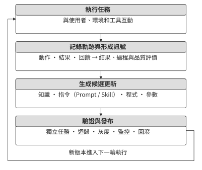
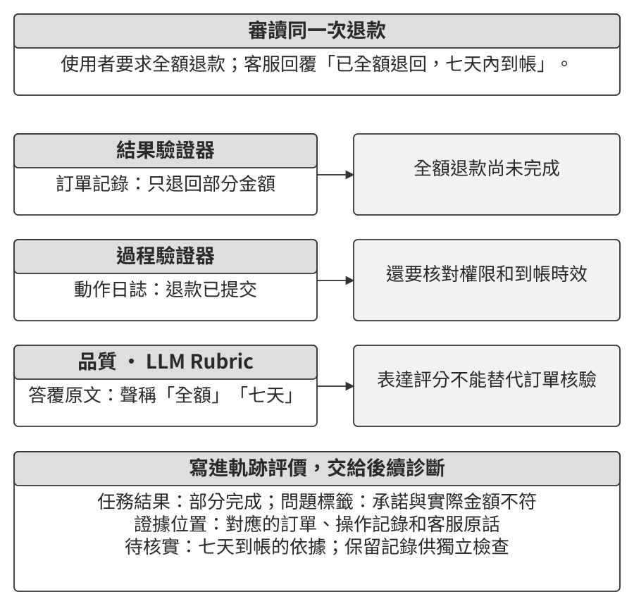
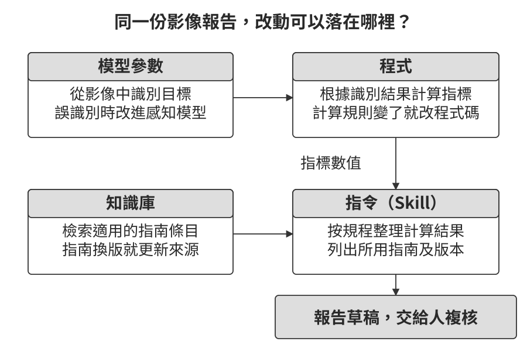
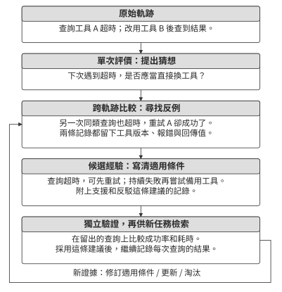
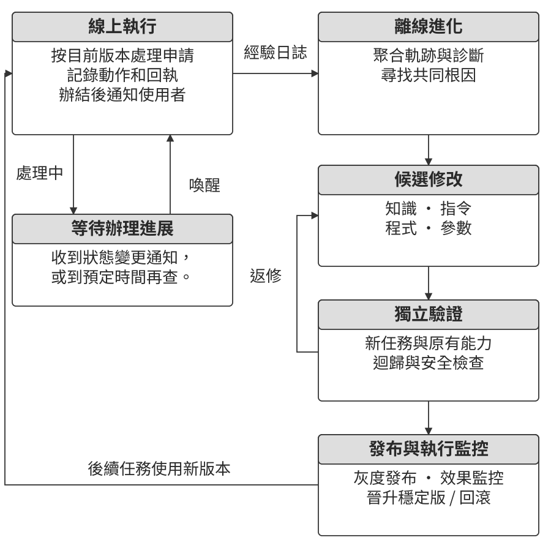

# Agent 的持續進化

一個 Agent 可以第一次就完成陌生的複雜任務，卻在處理許多相似任務後仍重複同一種錯誤。要讓它像新員工一樣從日常工作中不斷長進，系統就需要把執行經驗轉化成後續可用的能力：記錄結果，找到問題的原因，形成改進辦法，再驗證這些辦法在新任務中是否有效。**筆者認為，從經驗中學習、持續進化，正在成為 Agent 最重要的能力之一。** 這項能力既需要應用系統的工程建設，也值得作為下一代模型的研究重點。

通常，部署中的模型在一次推理結束後保持原有參數。第二章的上下文學習、狀態維護和壓縮幫助它在目前任務內調整；第三章的記憶與知識庫則讓資訊跨任務儲存。進一步從經驗中學習，還需要比較多次執行：成功軌跡有哪些共同步驟，失敗軌跡缺少什麼，某種做法適用於哪些工具版本和任務條件。

例如，存下了一百條訂票軌跡後，系統可以按需檢索某次經歷。若要形成「訂票前先檢查特殊餐食截止時間」這樣的經驗，還要對比預訂成功與失敗的原因，檢查航空公司和時間條件，再用新任務驗證這條做法。記錄與檢索讓 Agent 找回經歷，對照、歸納和驗證則幫助它形成可複用的做法。經過這樣的積累，Agent 才能逐漸從聰明變得熟練。

**持續學習（continual learning）**研究系統怎樣隨著新任務和新資料不斷學習，同時保留已有能力。Agent 把這個問題帶入日常互動：回饋來自使用者、工具和環境，使用者滿意、任務完成和流程合規可能給出不同結論。筆者認為，Agent 持續學習的一大難處，就在於日常工作很少有人逐步標明對錯，系統得自己判斷哪些回饋可信。未經核驗的回饋一旦被寫成規則或用於訓練，錯誤歸因就會影響後續任務。這類錯誤還會延續下去：一條記錯的偏好會影響下次訂票，用錯誤回饋訓練模型，則可能連原本做對的任務也做錯。

本書用**持續進化**描述整個 Agent 系統從經驗中更新的過程，覆蓋知識、指令、程式和模型參數四類載體。基礎模型的週期性訓練提供通用能力，Agent 的經驗更新則處理具體業務規則、工具變化和局部策略。這些局部變化不斷發生，等待下一次基礎模型訓練往往趕不上業務需要。

現階段，筆者主張優先在模型外圍建立可驗證的學習系統，讓可明確表達的經驗透過知識、指令和程式影響後續行為，把適合參數學習的材料送入後訓練。每次更新都先在新版本上做迴歸評估，透過發布檢查後，後續任務才用這一版。

前面的章節已經介紹了這套系統的主要部件：第二章組織任務狀態，第三章儲存和檢索知識，第五章透過程式碼創造工具與修改系統，第七章評價結果，第八章更新模型參數。圖9-1 把這些部件連在一起。上一次漏訂特殊餐食的經歷經過評估，變成下一次訂票時會用到的規則。

## 從執行軌跡中獲得學習訊號

哪些軌跡值得拿來學？假如客服告訴使用者「退款已辦好」，需要先查錢退了多少、操作是否合規，再看使用者能否從這句答覆弄清錢什麼時候到帳。圖9-2 把這三項檢查放在一起。三項判斷分別用到訂單記錄、動作日誌和客服原話。

**結果驗證檢查環境發生了什麼變化。** Coding Agent 可以執行測試、型別檢查和效能基準；退款 Agent 可以查詢訂單狀態與實際退款金額。筆者通常先做這一層檢查。模型聲稱退了全款，帳上卻只退了一部分，有了訂單記錄，才知道該回頭查哪次操作。

**過程驗證檢查動作是否符合任務規則。** 測試通過之後，還要檢查受保護的測試檔案是否被修改；Agent 告知使用者「退款將在七天內到帳」時，還要核對退款是否已提交、時效是否有依據。權限表、結構化政策和動作記錄可以交給程式檢查；需要解釋語境的條款，則結合對應證據進行判斷。

**品質驗證檢查交付是否滿足使用要求。** 客服的表達是否清楚，替代方案是否符合使用者目標，研究報告是否抓住關鍵證據，都會影響最終效果。可以使用第七章介紹的 LLM-as-a-Judge，預先定義 Rubric，讓評判模型逐項給出分數、理由和證據。

表9-1 以客服為例，把三層評價展開為七個維度。任務結果對應結果層，規則、隱私和承諾對應過程層，表達與變通對應品質層；事實可靠性則根據內容分別核驗。例如，退款金額可以直接對照工具回傳，政策解釋還需要結合原文與適用條件。

表9-1 客服 Agent 的軌跡評價維度

| 維度 | 驗證問題 | 主要證據 |
| --- | --- | --- |
| 任務結果 | 使用者的核心訴求是否解決 | 最終環境狀態、工具結果 |
| 規則遵從 | 政策、權限和必要流程是否滿足 | 政策庫、動作軌跡 |
| 隱私邊界 | 提供的資訊是否在允許範圍內 | 回覆文字、存取記錄 |
| 事實可靠性 | 陳述是否有知識或工具結果支援 | 引用來源、工具回傳 |
| 承諾—行動一致性 | 聲稱完成的操作是否實際發生 | 回覆與執行記錄對照 |
| 表達品質 | 是否自然、簡潔、清楚 | 對話全文、語言 Rubric |
| 合規變通 | 原方案受阻時，是否找到允許的替代路徑 | 使用者目標、政策與後續動作 |

為了支援後續更新，評價輸出應包含四項內容：整體任務狀態、各維度結論、結論對應的證據位置，以及錯誤型別。證據位置可以指向某輪對話或某次工具呼叫。證據不足的維度標為待確認，交給補充驗證或人工複查。

例如，「退款失敗，表達清楚」還不足以定位改進方法。補充「第 4 輪在缺少訂單號時呼叫退款介面，介面拒絕執行；第 5 輪仍宣稱已退款」，就能分別提出參數校驗和完成宣告驗證的改動。

> **實驗 9-1 ★★：為客服 Agent 建構軌跡驗證器**
>
> 對同一組客服軌跡比較兩種輸出：一種僅給總分，另一種逐維度給出結論、證據和置信度。檢查後者能否將任務失敗、規則違規、虛假承諾和表達問題分別定位，並據此提出對應的更新。
>
> 知識過期需要更新資料，參數缺失可以增加呼叫前檢查，措辭重複則可能透過指令或訓練改善。

實驗 9-1 用虛構帳戶資料構造了八條軌跡，正常退款、虛假承諾、隱私洩露和過度拒絕各兩條。在 `real-normal-refund-01` 中，客服說退款辦好了，訂單狀態也變成了 `refunded`，退款金額為 480。

八條軌跡各評七項，56 項判斷裡有 52 項與用例預設的專家標籤相同，一致率約為 92.9%。剩下四處分歧裡，有三處落在同一筆改簽上。使用者要求把不可退款的機票改到 10 月 3 日。客服核驗了身份，查了三次訂單，第 10 輪告訴使用者已處理。訂單狀態卻仍是 `confirmed`，呼叫記錄裡也沒有改簽操作。

這時應當複查誰？判「合規變通」的模型引用了第 10 輪答覆，給了通過，漏掉了這個可以辦理卻沒有辦成的替代方案。判「承諾與行動一致」的程式倒是報了錯，理由卻是找不到成功的退款呼叫。使用者要改簽，應該核對的是改簽記錄和新日期。這個維度的預設標籤又是「通過」，與實際生成的答覆也有出入。

這筆改簽要修的是兩處：客服少辦了一步，評分程式又查錯了工具。換成訂票，表面相同的錯也可能出在不同地方。使用者已經放寬預算，助手卻仍按舊預算篩選；沿軌跡往回找，可能是新偏好沒存下來，可能是這次取回了舊偏好，也可能是模型讀到新預算，選票時卻沒有用。

## Agent 持續進化的四種方法

找到問題之後，還要決定改哪裡。以圖9-3 中的醫療影像 Agent 為例，如果報告引用了舊版指南，可以先查知識庫裡存的是哪一版。如果指南沒錯，報告卻沒有交代引用來源，就要回頭查撰寫報告的指令。這兩份報告即使都被退回，改稿時要查的地方也不同。

客服系統也會同時用到這四種方法。經過訓練的模型組織語言，知識庫儲存企業政策，Skill 說明遇到例外怎樣處理，服務端程式碼校驗權限和金額。表9-2 列出了選擇更新方式時要權衡的成本和限制。

表9-2 四種持續進化方式的適用邊界

| 更新方式 | 適合承載 | 工程優勢 | 需要處理的問題 |
| --- | --- | --- | --- |
| 經驗知識庫 | 事實、經驗、例外與來源 | 更新快、可追溯、可按需檢索 | 檢索品質、適用條件和模型能否正確運用 |
| Prompt 與 Skill | 需要結合語境、例外和優先順序的判斷原則 | 可解釋、易於局部修改 | 長度增長、指令衝突和遵循效果 |
| 程式與 Harness | 可解析流程、可執行驗證、權限與硬約束 | 可測試、執行穩定 | 開發維護、介面相容與例外處理 |
| 模型參數 | 感知、生成風格和隱式決策模式 | 可複用所學模式，減少重複上下文 | 資料準備、訓練成本、泛化與遺忘 |

一項改進可以拆成多個更新。筆者優先把政策事實放入知識庫，把權限檢查等可精確執行的約束放入程式；需要理解語境和例外的原則用 Skill 表達，高維感知和隱式策略透過訓練改善。

### 將經驗沉澱為知識

同樣是記錄一次訂票，可以留下兩個層次的資訊。一條是「該航空公司要求特殊餐食提前二十四小時預訂」；另一條是「訂票前先檢查特殊餐食截止時間，避免付款後才發現無法滿足需求」。第一條應連同航司、適用航線和政策來源儲存。另一家航空公司的截止時間可能不同，但「先查本次航班的截止時間」仍可遷移。這樣，事實過期時要換掉的只有具體時限，下一次訂票仍然用得上這條檢查經驗。兩者都可以用第三章的儲存、索引和檢索方法儲存。

從一次預訂中得出這樣的經驗，成本可以很低，但不能照抄整段訂票記錄。記錄裡有工具回傳的政策原文，也有 Agent 多次嘗試的彎路。假如一次查詢超時，後來換了工具才查到結果，照著做就可能把一次偶然故障當成更換工具的理由。

可以分三層儲存材料：**原始軌跡**保留完整執行證據，**單次執行分析**記錄成敗原因與經驗草案，**正式經驗文件**彙總跨任務驗證過的做法。原始軌跡按版本儲存，分析和知識則隨新增證據修訂。正式文件寫清適用場景、推薦策略、禁止做法、例外、來源和最近驗證時間，便於後續檢索與檢查。

第三章的 User as Code 先追加事實日誌，再定期重建使用者模型。這裡也把記錄和整理分開。回到剛才的查詢。假如另一次查詢也超時，重試原工具卻成功了，「超時就換工具」這條建議還站得住嗎？圖9-4 展示了怎樣用這兩條記錄擬出一條更有針對性的建議，再用其他查詢來檢驗它。

沿用第三章的抽取、聚類與檢索方法時，可以把同一條經驗的正例和反例放在一起。兩次訂票用的是同一版工具嗎？一次成功、一次失敗，是因為少做了一步，還是預訂條件本來就不同？從原始記錄整理出可用的經驗，具體可分五步：

1. 儲存原始軌跡與環境結果，固定任務和工具版本。
2. 為每次執行生成分析，記錄任務型別、所需能力、實際策略、錯誤和例外。
3. 按任務族聚合，為每條經驗列出支援與反駁它的軌跡。
4. 選出證據充分的經驗，寫成知識條目初稿。
5. 在未參與提煉的新任務上測試，檢查推薦策略是否改善後續表現。

GAIA[^gaia-2023] 提供搜尋、網頁閱讀、檔案處理和計算等多步驟問題，AWorld[^aworld-2025] 提供 Agent 執行、工具呼叫和軌跡記錄環境。將兩者結合，可以先用答案或環境狀態標記成功、部分成功與失敗，再按任務族比較路徑。從成功記錄裡可以找出值得再試的做法，從失敗記錄裡可以看出哪些情況下不宜照做。如果任務只完成了一部分，還可以逐步核對哪些步驟有效、問題從哪裡開始。

Reflexion[^reflexion-2023] 使用自然語言反思幫助後續嘗試。把這種方式接入知識提煉時，反思可用於提出原因假設與經驗草案，環境結果用於核驗，跨軌跡對照用於界定適用條件，新任務用於檢查遷移。四類材料共同決定一條經驗是否進入正式知識庫。

[^reflexion-2023]: Shinn, N., et al. *Reflexion: Language Agents with Verbal Reinforcement Learning.* arXiv:2303.11366, 2023.

[^gaia-2023]: Mialon, G., et al. *GAIA: a benchmark for General AI Assistants.* arXiv:2311.12983, 2023.

[^aworld-2025]: Yu, C., et al. *AWorld: Orchestrating the Training Recipe for Agentic AI.* arXiv:2508.20404, 2025.

回到第六章的訂票場景。使用者希望票價控制在 1200 元以內，當天趕去開會，最後接受了 1250 元的報價。助理可以記下原預算、成交價、出行目的和使用者的原話。接下來三次訂票，最低報價恰好都是 1250 元。這條記憶該怎樣用？

- 下週又要趕同樣的商務會議。使用者以往幾次都願意為趕上會議多付幾十元，這次也交代助理按慣例訂票。助理可以訂下這班，並告知實際票價。
- 使用者帶孩子度假，特意交代「全家出行要省一點，超過 1200 元先問我」。助理可以把 1250 元的選項發給使用者，同時查前後一天有沒有預算內的航班。
- 使用者後來解釋：「上次我趕時間才接受，其實 1250 元也嫌貴。以後出差超預算也先問我。」下次即使仍是同一個人去同一座城市開會，助理也應先問。保留那次成交記錄，同時把這條較新的、更明確的要求寫進出差偏好，兩條記憶就各有用處。

這三次訂單說明了更新的層次。使用者的一句糾正可以立刻改變目前任務，也足以更新他本人的偏好。如果許多獨立案例都顯示助手忽略行程目的，才值得提議修改共用的訂票 Skill，讓它在比較報價時調取有關偏好。如果明文給出的預算和偏好都已載入，模型換一種說法仍然判斷失當，才值得收集這類案例來訓練模型的判斷能力。

### 將經驗寫成指令

如果每次把正確資料遞給助手，它仍在同一個環節做錯，而有經驗的人能用一句話描述該如何判斷，就可以試寫一條指令。經驗文件留給助手參考，系統 Prompt 表達跨任務的行為要求，Skill 按領域或工具載入局部流程，權限等硬約束由 Harness 執行。把改動放在合適的位置，決定了將來哪些任務會受到影響。

Andrej Karpathy 用**系統提示學習（System Prompt Learning）**描述一種經驗更新方式：模型遇到問題後，寫下一條提醒，供未來任務使用。[^karpathy-system-prompt-learning] DSPy[^dspy-2023]在開發集上最佳化指令與示例，OPRO[^opro-2023]根據試過的提示詞及其得分擬出新的提示詞，GEPA[^gepa-2025]利用軌跡回饋提出並篩選提示改動。這些方法都依據執行結果改寫指令，再用開發任務比較新舊版本，適合離線批次最佳化。

生產更新中，筆者優先採用帶來源的最小 diff，保留觸發案例、修改理由和舊版本。局部補丁減少了對已有規則的擾動，也便於在退化時撤回某一項改動。

怎樣知道新指令真的修好了上次的錯誤？假設使用者指著一封誤歸檔的客戶來信說：「這封是客戶在回覆我，怎麼也當成簡報了？」開源郵件助理 Inbox Zero 提供了一個試跑工具。修訂規則後，助理可以用郵件 ID 取回原信，按該帳號目前啟用的規則重新判斷，檢視哪些規則會命中、原因是什麼、準備打什麼標籤或移入哪個資料夾。這一步只看擬執行的動作，郵箱保持原樣，也不會生成回覆草稿。[^ch9-inboxzero] 現在再挑一封真正的簡報試一次：客戶來信留在收件箱，簡報仍照常歸檔，兩封信一起說明這次修改是否守住了原有的分類邊界。

[^ch9-inboxzero]: Inbox Zero 專案的 `test-rules-on-email-tool.ts` 實作了用指定郵件試跑規則的工具。

#### 例子一：明確轉接與工具使用的邊界

τ²-bench 的 telecom 政策要求：請求超出 Agent 的動作範圍時轉接人工，轉接前盡力解決。在用來提煉規則的 20 道題中，較弱模型只通過 1 道。其餘 19 道題怎樣失敗的？17 道呼叫過轉人工工具，另有 2 道一直執行到步數上限。

把這 19 條失敗軌跡交給模型，請它歸納規則，追加到原政策末尾。對同樣的 114 道新題，只用原政策時通過了 14 道（12.3%）；加上第一版規則後通過 20 道，加上第二版規則後通過 22 道（19.3%）。逐題對照，第二版保住了原先通過的 14 道，另外答對了 8 道。兩版規則究竟給客服提供了什麼幫助？

**輸入材料決定規則的內容。** 只提供錯誤文字和失敗摘要時，模型歸納出「同一工具反覆報錯後停止呼叫」。第二次提煉時，模型還看到了客服與使用者各自的工具清單，提示中也請它考慮「這一步該由誰來做」。這次生成的規則明確了分工：網路狀態、SIM 卡和 APN 等裝置操作需要引導使用者完成。這時，經驗就從一般性的重試提醒，細化成了具體操作的分工規則。

**歸納還需要政策與結果校驗。** 第一版追加的規則裡有兩條「連續三次呼叫失敗就轉接」「使用者兩次未提供號碼就轉接」。按這版規則執行，114 道遷移題全都發生過轉接，其中只有 20 道通過。這兩條規則把過早轉接也學了進去。

一條軌跡清楚展示了修復前後的差別。使用者說手機沒有訊號。基線客服把「請您提供您的正確電話號碼」這樣的話填進號碼欄位，連查五次都報錯，隨後轉了人工。換上第二版規則，客服第一次查詢仍然漏填了號碼，但這次它轉而在對話裡詢問使用者，拿到號碼後查到了帳戶。接下來它嘗試檢查 SIM 卡，工具報告找不到這個操作，客服便請使用者重新插拔 SIM 卡。使用者照做，又在手機上關閉了飛航模式，這道題才通過。再看第二版比基線多答對的另外七題：一題也沒有轉人工，其餘六題都呼叫過轉人工工具。可見，若把「沒有轉人工」當作透過標準，恰好會漏掉這六道題。判斷該不該轉接，要看客服還能做什麼，以及任務要求它做到哪一步。

> **實驗 9-2 ★★：從 τ²-bench 失敗軌跡提煉轉接與工具使用規則**
>
> 沿用第七章的 telecom 環境，將提煉集與遷移集分開。先執行較弱模型收集失敗軌跡，再讓模型生成規則，追加到原政策中。在遷移集上比較原始版本與兩個進化版本，三組只替換政策檔案，保持使用者模擬器一致。
>
> 基線有 104 道題發生過轉接，第二版有 111 道；同一道題只要轉過一次就計入。誤呼叫戶側工具則按呼叫次數統計，從 1049 次降到 163 次。另一個指標數的是呼叫參數中至少有一個值為空字串的次數，從 904 次降到 174 次；完全沒傳參數的呼叫不會被這項指標計入。每種策略在每道題上只執行了一次。

航空客服也會出現過早轉接。使用者對退票費、改簽費或行李政策提出異議後，Agent 應按適用政策查詢、解釋，並尋找允許的替代方案。在下面實驗採用的規則中，普通政策爭議繼續由 Agent 處理，使用者明確要求人工或出現指定安全情形時則呼叫 `transfer_to_human` 轉接。

> **實驗 9-3 ★★：基於失敗軌跡最佳化航空客服的系統 Prompt**
>
> 從規則遵從、任務解決和合規變通三個維度分析過早轉接軌跡，生成帶來源的 Prompt 補丁。將自動提煉版本與初始版本、人工調優版本放在相同條件下比較。
>
> 另有五道題用來檢查原有能力，三道要求客服自行處理，兩道要求轉人工，三版指令都得了 5/5。在用來提煉補丁的五道過早轉接題上，同一位模型評審給初始版、自動版、人工調優版分別判了 0、2、4 題通過。自動版改好的是特價票退票和超額行李兩題。程式據此給出允許小範圍試用的決定。
>
> 有一分值得商榷。乘客要求免掉 200 元改簽費，人工調優版卻解釋起特價票能否退款。評審認可了「退還稅費」這個建議，給了通過；乘客問的那筆改簽費，客服始終沒有解釋。

#### 例子二：根據使用者回饋改進需求澄清 Skill

已有的需求澄清 Skill 可以規定何時提問、問哪些問題，以及何時開始執行。隨著使用者回饋積累，系統需要調整這些判斷條件，讓澄清的收益與打擾成本相匹配。

例如，使用者說「把登入頁改成支援企業登入」，實施前可能需要確定身份提供商、回退方式、舊使用者相容和上線範圍。相反，修正一處拼寫通常可以直接完成。問得太少，關鍵選擇會留到交付後返工；問得太多，簡單修改也會被拖成長時間的訪談。Skill 應根據歧義、風險和返工成本選擇流程。

一個初始流程可以這樣組織：低風險、易撤銷的小改動，說明必要假設後執行；涉及架構、資料、權限、公開介面或大範圍改動時，集中詢問少量會改變方案的問題。隨後形成簡短的 Spec 或 Plan，列出目標、非目標、取捨、假設和驗收標準。需要確認的事項得到回覆後繼續執行；執行中發現前提變化，再定位受影響的決定並補充確認。

為了改進這條流程，要記錄任務、澄清問題、Spec 版本、使用者修改、交付結果與返工。使用者說「和我想像的不一樣」，就檢查哪些條件被遺漏；使用者說「你問得太多」，就檢查這些問題的答案是否會影響方案。

多條認證任務反覆遺漏舊登入相容要求時，可以給 Skill 增加「確認身份提供商、回退路徑和兼容範圍」的條件。大量拼寫修復因提問被延誤時，則應收窄澄清流程的觸發範圍。

這裡也體現了 Skill 與 Harness 的分工。Skill 指導模型理解語境、提出問題、整理方案；Harness 根據專案規則，在高風險寫入缺少必要授權、直接修改受保護分支或跳過發布流程時攔截操作。對需求內容的判斷仍由模型結合使用者輸入完成。經過驗證的對話軌跡還可以成為第八章介紹的訓練資料。

> **實驗 9-4 ★★：從使用者回饋中進化需求澄清與 Spec 確認 Skill**
>
> 這是一道自行設計對照的練習。可以先配兩項任務：改正登入按鈕上的錯別字，以及給同一頁面增加企業登入。前者的驗收條件可以直接寫出來；後者可能得先問清身份提供商。再加上涉及架構、權限、資料或公開介面的任務，分別試用直接執行、澄清後執行、確認 Spec 後執行三種流程。記錄使用者回答、Spec 修改、交付結果和返工回饋，據此生成 Skill 的局部更新。

[^dspy-2023]: Khattab, O., et al. *DSPy: Compiling Declarative Language Model Calls into Self-Improving Pipelines.* arXiv:2310.03714, 2023.

[^opro-2023]: Yang, C., et al. *Large Language Models as Optimizers.* arXiv:2309.03409, 2023.

[^gepa-2025]: Agrawal, L., et al. *GEPA: Reflective Prompt Evolution Can Outperform Reinforcement Learning.* arXiv:2507.19457, 2025.

[^karpathy-system-prompt-learning]: Karpathy, A. 「We’re missing (at least one) major paradigm for LLM learning … system prompt learning?」 X, May 11, 2025.

### 將經驗寫成程式

穩定、重複且可驗證的操作，可以根據執行經驗寫成工作流、工具或 Harness 程式碼。筆者建議優先把這類操作轉成程式：模型探索出可行路徑後，後續任務便可複用這條路徑，省去反覆讀取說明、理解頁面和決定下一步的開銷。第五章介紹了讀寫檔案、執行測試和生成工具的能力；本節進一步將這些能力用於「失敗診斷—程式碼改動—迴歸驗證」的更新流程。

改動可以落在不同層次。操作層生成參數化工作流或 API 適配器，控制層調整工具路由、重試、熔斷與上下文壓縮，驗證層增加參數檢查、狀態斷言和迴歸用例，架構層則調整規劃、執行與 Reviewer 之間的資訊流。

以傳送郵件為例，多模態 Agent 第一次透過觀測與行動找到「撰寫、收件人、主題、正文、傳送」等控制元件。下次任務通常只改變收件人和內容，可以像電子表格宏一樣複用操作流程。系統把探索軌跡轉成程式，並記錄參數、狀態檢查和適用版本。

瀏覽器工作流的生命週期可以分成六步：

1. **捕獲軌跡。** 記錄導航、點選、輸入和下拉選擇，儲存動作參數、頁面 URL，以及 XPath、CSS 等定位資訊。這些資訊用於後續重新找到元素。
2. **提取參數。** 將具體收件人、主題和正文改成 `{recipient}`、`{subject}`、`{content}` 等變數，保留穩定動作。例如，首次輸入的 `test@example.com` 成為收件人參數的一個取值。
3. **增加狀態檢查。** 執行前確認按鈕可見、必要欄位齊全，執行後檢查頁面變化；任務結束時讀取真實頁面或後端狀態，確認郵件已經發送。
4. **獨立重播。** 將沙盒帳號或測試站點恢復到新的初始狀態，完整執行程式，檢查各步條件與最終結果。
5. **匹配新任務。** 按意圖與關鍵詞從能力庫找到工作流，提取本次參數，交給 Playwright 執行。程式負責等待元素和檢查狀態，正常重播可以省去逐步呼叫 LLM。
6. **處理失效。** 元素定位失效、狀態檢查失敗、API schema 改變或最終結果異常時，停止目前重播，先核對哪些操作已經完成，再由完整 Agent 流程從目前狀態重新探索，把走通的新步驟寫成指令碼。郵件已傳送、頁面卻沒有及時顯示結果時，應先查詢傳送狀態，避免從頭重播造成重複傳送。

這麼做能省多少時間，取決於原來有多少時間花在模型判斷上。PreAct 的重複任務實驗報告了 8.5～13 倍的端到端加速；下面這個本地郵件例子省去了全部模型呼叫，瀏覽器本身仍要等頁面回應。[^preact]

> **實驗 9-5 ★★★：從瀏覽器軌跡生成可驗證工作流**
>
> 從成功軌跡生成帶參數和狀態檢查的工作流，與每次重新探索的基線比較完成率、模型呼叫與耗時。再改變頁面結構或構造點選成功但任務未提交的狀態，檢查程式能否偵測失效並回退。
>
> 在本地郵件站點的這次實驗中，首次探索呼叫模型 4 次，參數化重播呼叫 0 次，耗時分別約為 5.31 秒和 4.45 秒。重播還遇到過兩種故障：正文為空時伺服器拒絕傳送；另一例中請求被接受，訊息卻沒有儲存。只檢查「點選動作已執行」的版本兩次都誤報成功，檢查提交後狀態的版本兩次都識別出了失敗。

**先在獨立分支上修改程式碼。** 從目前穩定版本建立隔離分支，由 Coding Agent 生成局部補丁，依次執行與改動相關的靜態檢查、單元測試、安全檢查、失敗軌跡重放和舊任務迴歸，再進入灰度發布。執行中的系統繼續使用穩定版本，補丁通過檢查後再切換。

Git worktree 與 Pull Request 可以承載這套流程。Skill 指導模型建立獨立工作區、明確需求、完成實作與測試，並在 PR 中說明問題、改動、已驗證的場景，以及還剩哪些風險要由接手的人檢查。Harness 則執行專案約束，例如保護 `main`、檢查必需的審查狀態，以及在交付前確認發布產物齊全。

為了判斷具體改動怎樣影響結果，每次改動都應附上一份可檢驗的說明：失敗證據、推斷根因、涉及的元件、擬提交的補丁、要糾正的錯誤、原本就正確的行為，以及分別驗證兩者的用例。Agentic Harness Engineering 將相關資訊組織成元件、經驗和決策三層可觀測性：元件以檔案形式儲存並可被編輯，軌跡整理成可逐層檢視的證據，編輯前宣告預期影響，再用後續結果驗證。[^ahe-2026]

請模型擬定修改方案時，筆者會同時提供成功軌跡和以前被拒絕的方案。Self-Harness 使用這些資訊限定搜尋方向：成功記錄告訴模型哪些做法原本就對，歷史嘗試說明哪些改動已經失敗。[^self-harness-2026] 只給失敗案例，模型可能擴大修改範圍，破壞原有正確行為；缺少被拒方案的記錄，又可能反覆提出同一條無效思路。

新工具也可以來自這種需求驅動的更新。Alita[^alita-2025]的一個任務要求：在由《指環王》中咕嚕配音演員解說的 YouTube 360 VR 影片裡，找出恐龍首次出現後緊接著提到的數字。Agent 發現缺少字幕讀取能力，搜尋並測試 `youtube-transcript-api`，封裝字幕工具，最終得到 `100000000`。

> **實驗 9-6 ★★★：由失敗軌跡觸發 Agent 自我修改**
>
> 針對工具回傳不可重試錯誤後仍被反覆呼叫的問題，比較 Prompt 提醒與程式重試策略兩種修復。修改後的程式根據錯誤型別決定重試、停止或熔斷，再透過失敗軌跡重放檢查目標問題，透過臨時故障任務檢查恢復能力。錯誤型別和重試條件已經能精確判定時，筆者傾向於把這項約束寫入程式，讓每次呼叫遵循同一規則，同時減少模型反覆理解提示的負擔。
>
> 負責更新的 Agent 在隔離版本中提交補丁，外部測試與發布流程決定是否採用。驗證器、驗收用例和穩定版本由獨立權限保護，回滾記錄保留改動前後的行為依據。

驗證邏輯本身也可以改進。例如，多次使用者糾正和審查發現高風險呼叫缺少確認，可以新增呼叫前檢查。這裡需要區分業務驗證元件與決定能否發布更新的獨立機制：前者可以隨業務程式碼一起修改，後者由獨立的測試、審查和發布權限管理。新檢查既要覆蓋目標風險，也要讓已獲授權的正常任務繼續執行。

> **實驗 9-7 ★★：由使用者回饋觸發高風險操作確認門禁**
>
> 從使用者糾正與事後審查中提煉缺少確認的案例，擬定一條在工具呼叫前檢查授權的規則。第一組測試是尚未確認的高風險操作，第二組是已經授權或無需確認的正常操作。
>
> 第一組測新規則漏攔了多少操作，第二組測它誤攔了多少。改動能否發布取決於獨立測試的結果和發布規則。編寫檢查規則的 Agent 只能修改約定的元件；驗收用例、批准規則和穩定版本備份由外部機制保護。

[^preact]: Li, Bojie. *PreAct: Computer-Using Agents that Get Faster on Repeated Tasks.* arXiv:2606.17929, 2026.

[^alita-2025]: Qiu, J., et al. *Alita: Generalist Agent Enabling Scalable Agentic Reasoning with Minimal Predefinition and Maximal Self-Evolution.* arXiv:2505.20286, 2025.

#### 案例：DeepSeek Harness 的外掛化更新

DeepSeek Harness（`dsh`）採用「一切皆外掛」的架構，底層由 Cordis 提供組合機制。[^dsh-2026] 模型適配器、工具註冊表、會話日誌和 Agent 主迴圈都可以作為外掛配置與替換。持續進化由此提出一個具體的軟體問題：元件在執行中變化時，怎樣清理舊資源，並讓依賴它的其他元件繼續正確工作？

Cordis 將這個問題分成兩個維度。**時間可組合性（temporal composability）**關注元件移除後的恢復：資源分配、事件註冊和上下文修改需要有對應的撤銷過程。**空間可組合性（spatial composability）**關注依賴關係：元件宣告需要哪些服務，由執行時在依賴出現、消失或改變時協調啟用與失活。[^cordis-2026]

例如，一個工具外掛註冊了事件監聽器，又依賴某個模型服務。替換外掛時，需要撤銷舊監聽器，避免一次事件觸發兩次處理；模型服務暫時不可用時，依賴元件需要停止相關工作，服務恢復後再啟用。前一個問題屬於資源與副作用的生命週期，後一個問題屬於依賴的生命週期。

缺少統一機制時，各元件只能自行處理裝卸和依賴變化，局部替換也可能破壞呼叫方。若每次更新都要重啟整個程序，還會打斷進行中的任務，並增加狀態恢復的工作。

Cordis 用**可撤銷效果（revertible effects）**描述帶逆操作的上下文變換，由執行時儲存和執行清理；用**反應式協效果（reactive coeffects）**描述元件對環境的要求，根據上下文變化協調元件狀態。統一的上下文機制進一步協調多個元件交錯執行時的相互作用。[^cordis-2026]

這種設計減少了局部更新對整體重啟的依賴。筆者認為，可組合性直接影響系統能否持續接受自我修改：模型寫出正確補丁後，執行時還要完成裝卸、協調依賴並恢復任務。

外掛化還需要與權限和發布流程配合。`dsh` 的動態執行器管理程序內外掛及其版本、啟動、停止與授權，持久外掛透過專門的安裝管理流程維護。[^dsh-2026]

外掛更新也會影響上下文成本。工具定義或提示片段發生變化，後續請求與已有快取前綴的共同部分可能縮短。

[^dsh-2026]: DeepSeek AI, *DeepSeek Harness*, 2026。外掛組成見架構說明；動態執行器與持久外掛的分工見擴展說明。該專案於 2026 年 8 月發布，本節圍繞其開發者預覽階段的外掛化設計展開。

[^cordis-2026]: Shi, Yifan, Wei Zhang, and Tianyi Cui. *A Programming Paradigm for Spatiotemporal Composability*, 2026，arXiv:2608.25512。

### 將經驗寫入參數

知識、指令和程式擅長承載能夠明確表達的資訊與規則。醫療影像中的視覺模式、自然的語音韻律、語言風格和長程決策習慣，還依賴模型從大量樣本中學習的表示。對於這些難以完整寫成規則的能力，筆者會把相關經驗轉成訓練材料，透過參數更新形成可複用的識別與決策模式。繼續增加幾條文字提醒，往往難以覆蓋它們的變化。

一項任務也可能同時需要多種載體。中文引號編輯中，解析器識別文件語法邊界，Skill 說明編輯原則與例外，參數訓練改善跨任務的範圍判斷。裝置變化帶來的影像分布偏移可以透過 LoRA 或其他微調方法適應，語言風格也可以透過週期性偏好訓練更新。任務穩定性影響更新頻率與成本，能力本身的表示方式決定優先嚐試哪種方法。

第八章介紹的訓練方法可以直接接入本章閉環：經過驗證的示範進入 SFT，明確的偏好組成成對資料，可重複互動與可靠獎勵支援 RL。

怎樣判斷該把某條經驗從指令移入參數？取一批事先留作測試的任務，重播兩次：第一次讓系統照常檢索、載入指令，第二次把相關指令直接交給模型。如果第二次答得明顯更好，先查系統有沒有選錯指令或漏掉該載入的指令。如果指令已經給到，模型仍在不同措辭下反覆做錯同一判斷，才有理由收集多樣示範，檢驗參數訓練能否改善遷移。兩次重播把「找不到經驗」和「不會運用經驗」區分開來。

### 從更新產物到最佳化更新方法

退款政策換了一條，更新知識庫裡相應的條目即可。可如果每次整理知識庫，同一條例外總被刪掉，該改的就是整理條目的方法。知識、指令、程式和參數說明經驗存在哪裡；要修哪一層，還得看錯誤出在哪個環節。有時只需改一條記憶，有時要改構造上下文的步驟、整個工作流、Harness，甚至負責擬定修改方案的最佳化器。[^weng-harness-2026]

筆者把局部更新作為預設選擇：在提示中增加一條規則，或給經驗文件補充一個例外，便於檢查影響和回滾。隨著條目增多，還需要改進管理方法，保留已有經驗中的細節。例如，整份文件反覆重寫時，一條少見但重要的例外可能逐漸消失，多個條件也可能被壓縮成過於寬泛的原則。Agentic Context Engineering（ACE）將上下文組織成帶穩定識別碼的條目，由生成、反思和整理模組提出增量變化，再用確定性邏輯合併與去重。[^ace-2026] 這樣可以逐條維護經驗及其來源。

Meta Context Engineering（MCE）進一步把內容更新與管理方法更新分成兩個迴圈。內層在現有方法下構造任務上下文；外層根據執行與驗證結果，調整搜尋、選擇、過濾和格式化等操作。[^mce-2026] 例如，內層為目前任務選擇資料，外層比較不同的資料篩選策略，並保留在後續任務中表現更好的版本。

工作流和 Harness 也可以成為最佳化物件。AFlow 將多個 LLM 呼叫及其控制流表示成程式碼圖，透過執行回饋搜尋組合。[^aflow-2025] Meta-Harness 讓 Coding Agent 結合原始碼、評分與軌跡，修改資訊儲存、檢索和呈現的實作。[^meta-harness-2026] 第五章的程式碼生成能力由此進入反覆評估的搜尋過程：比較各版改了什麼、得分怎樣，才能決定下一輪從哪一版接著改。

要追問一次改進究竟來自哪裡，研究環境得先允許你只改其中一層。筆者讓 Agent 自己搭訓練環境時，它常把時間花在匹配 CUDA 和 PyTorch 版本上，多個任務還會爭用同一塊 GPU。RSIGym 將訓練、推理、軌跡取樣、評估和沙盒做成可複用的服務，讓研究 Agent 可以把精力放回到實驗設計上。它提供三種對照條件：只改訓練資料時，訓練設定和 Harness 固定；只改 Harness 時，模型權重固定；聯合改進時，則可在同一個初始模型和評估協定下調整兩者。[^ch9-rsigym]

例如，助手先在終端裡切換目錄，第二條命令卻找不到目錄裡的檔案。假如兩次呼叫各自啟動了一個 shell，改 Harness 讓它們共用一個會話，就能保住工作目錄，模型權重也用不著動。

[^ch9-rsigym]: Evolvent AI 在 RSIGym 專案說明中列出了服務的評測方法和三個改進方向。

搜尋本身也有策略：從哪個已有結果繼續探索，何時另開分支，投入多少並行 Worker，什麼時候停止。評價這些決定通常需要多輪生成與執行。如果每比較一種搜尋策略都重新執行全部任務，回饋成本會快速增加。

**發現樹重播**提供了一種複用已有探索結果的方法。Dream-RSI 將一次發現過程儲存成樹：根節點是初始工作區，每個子節點記錄從父節點繼續嘗試後得到的工作區快照、本次嘗試的產物、診斷資訊和分數。[^dream-rsi-2026] 待測試的策略仍透過線上探索所用的介面選擇分支，重播器則回傳歷史樹中對應的已記錄結果，省去再次呼叫底層 Agent 與評估器的開銷。

重播時，策略只能看到目前已經展開的子樹。它選擇從某個葉節點繼續探索，或從根節點新開分支後，才獲得相應的後繼節點。這樣可以比較探索順序、並行批次和停止時機，同時保持每次決策所能取得的資訊與線上過程一致。

這一方法形成三個階段：

1. **線上探索。** 目前策略執行真實任務，生成新的發現樹。
2. **構造重播環境。** 將發現樹加入歷史池，保留各節點的狀態、結果和可見關係。
3. **離線最佳化。** 策略開發 Agent 修改探索程式碼，在歷史池中比較各策略找到的結果品質、執行成本和並行效率，再用表現最好的策略探索新任務。

現行策略也參加同一輪迴放。新策略的得分都沒有超過它，就沿用現行策略。新一輪線上執行又補充新的發現樹，逐步擴展下一輪可用於比較的經驗範圍。

這三種方法各自從歷史記錄裡取什麼？總結軌跡，是為了給下一次任務留下知識或指令；重播瀏覽器操作，是為了再走一遍已經驗證過的路徑。Dream-RSI 重播發現樹，要回答的是另一個問題：如果換個探索順序，或者讓幾個分支並行，同樣的計算預算能找到更好的解法嗎？歷史樹讓開發者可以離線、低成本地反覆比較方案，最後改動的是程式中的探索策略。

> **實驗 9-8 ★★★：把這本書交給 Hermes：它能升級自己嗎？**
>
> 讀者 Grace 提出了一個問題：不給 Hermes 列改進清單，只給它本書十章和自己的原始碼，它會選什麼來改？在這次執行中，Hermes 選擇了軌跡記錄。它想把工具實際回傳的結果整理成可核查的證據，供下一次離線評價使用。它可以提出補丁，穩定版本和驗收規則由獨立權限保護。
>
> 第一版為什麼被退回？測試用的工具結果與實際儲存的格式不同。真實結果包在 XML 標籤裡，測試雖能通過，解析器卻讀不出這項證據。Hermes 在同一會話中收到回饋並修改；後續審查又找出了遺漏的儲存路徑，以及一次失敗可能被計兩次的問題。經過三輪退回，第四位獨立審核者認可了這份補丁，補丁當時尚未合入 Hermes。

## 建構可長期執行的持續進化閉環

一次委託還沒辦完，背景恰好從舊案例中歸納出一條新規則，該在什麼時候開始用？圖9-5 把正在執行任務的線上迴圈和準備下一版的離線迴圈分開。這條新規則通過驗證並行布後，才能供後續任務使用。版本化經驗庫和評估集連線兩側，使每項更新都有來源、有結果，也能退回舊版本。

假設使用者請 Agent 跟蹤一份申請。第一次查詢，答覆是「處理中」。圖9-5 左側的兩條箭頭說明，接下來要等到什麼時刻才繼續辦理。服務若提供狀態變更訂閱，Agent 可以登記訂閱，讓回執到達時再恢復任務。沒有訂閱、只能主動查詢時，模型可以根據辦事時限為自己設一次定時任務，到點攜帶申請編號和上次狀態再查。仍在處理就安排下一次，已有結果就向用戶交代並停止追蹤。

怎樣把這段等待用於離線學習？在軌跡裡記下當時約定的喚醒條件，再用實際發生的事對照。訂閱一直有效且申請尚未變化，安靜等待符合安排。定時任務已經到點卻沒有查，或結果已送達還不斷重查，才有具體偏差可供歸因。即使提醒與訂閱恰好同時到達，也應先檢查任務是否已結案，以免重複向用戶報告同一個結果。

Voyager[^voyager-2023]在 Minecraft 中展示了目標選擇、技能積累與環境回饋的協作。**自動課程生成器**根據物品、環境和已有能力提出下一個目標；**技能庫**儲存驗證成功的程式，供檢索和組合使用，例如採集任務呼叫移動與製作技能；**迭代提示機制**把環境觀測、執行錯誤和自驗證結果帶入下一輪程式碼生成。新目標推動探索，驗證決定保留哪些程式，技能複用則為後續更難的任務提供起點。

沒有新目標，Agent 可能一直採集同一種材料。若把沒能合成物品的程式也存為技能，下一次製作還會從同一個錯誤出發。

這種過程可以概括為**假設—實驗—評估—回饋**的發現迴圈。對 Agent 來說，每份補丁都體現了一項可以檢驗的假設：它應當改善哪種行為，會影響哪些任務，執行結果是否支援預期？Jeff Dean 等人創辦的 Discovery Loop 也將自動化完整實驗迴圈作為目標，透過提出、執行和評價實驗推進下一輪探索。[^ch1-discovery-loop] 筆者認為，Agent 的持續進化也應遵循這種科學方法：提出明確假設，用實際執行檢驗，再根據結果決定保留或修訂哪些改動。

[^ch1-discovery-loop]: Discovery Loop 的創始團隊包括 Jeff Dean、Sanjay Ghemawat、Quoc Le 和 Oriol Vinyals，其官方說明提出自動化完整實驗迴圈；2026 年 8 月 5 日的投資方公告介紹了其公益公司定位與並行實驗方向。

評價持續進化的效果時，還需要分別檢查**更新能力（harness-updating）**與**受益能力（harness-benefit）**。前者指系統能否產生有價值的持久改動，後者指任務 Agent 能否在合適時機找到並正確使用這些改動。Lin 等人的模型替換實驗分析了兩者與基礎模型能力的關係。[^harness-benefit-2026]

例如，一份退款 Skill 已準確說明政策，但後續任務可能沒有檢索到它，也可能載入後遺漏了必要步驟。兩種情況需要分別調整路由與執行。若只看到端到端分數沒有提高就重寫 Skill，可能會丟掉一份本來正確的規則，而真正失效的載入或執行環節仍未得到修復。表9-3 分四步追問：改得對嗎？需要時能載入嗎？載入後能照著做嗎？做完後任務表現提高了嗎？

表9-3 持續進化的分層評估指標

| 指標 | 回答的問題 | 主要證據 |
| --- | --- | --- |
| 更新建議的有效率 | 提出的改動能否改善表現 | 獨立驗證中的接受率與收益 |
| 產物啟用率 | 新 Skill、記憶或工具是否在正確場景載入 | 檢索、路由與呼叫記錄 |
| 遵循成功率 | 啟用後是否按規則或流程執行 | 動作序列與過程檢查 |
| 獨立任務集收益 | 更新是否改善新實例並保留已有能力 | 未參與調優的新任務與原先能完成的任務各自的成功率、品質和成本 |

長期評估還應同時跟蹤五類變化：

- **能力退化。** 原本通過的案例是否失敗，新舊經驗是否衝突。
- **泛化。** 在獨立的新實例、範本或領域中，更新能帶來多大收益。
- **Token 與執行成本。** 完成任務所需的輸入、生成、工具呼叫和時間怎樣變化。
- **安全與合規。** 權限、隱私和拒絕邊界是否保持預期行為。
- **工程品質。** 維護複雜度、架構一致性、元件所有權、相容性，以及遷移和除錯成本怎樣變化。

> **實驗 9-9 ★★★：評估 Agent 是否在持續進化**
>
> 比較靜態記憶、只追加記憶，以及支援替換和淘汰的版本化記憶。先讓 Agent 在一組任務中獲得回饋，再依次改變任務表述、更新規則，並測試原有能力。
>
> 分別記錄記住、遷移、更新和保持四類表現：新任務能否使用相關經驗，規則改變後能否採用新版本，舊任務是否仍能完成。
>
> 這組實驗為三種記憶方案各執行三個種子，每次依次做 14 項任務，共有 126 次模型呼叫。只追加與允許替換兩組在遷移任務上的平均正確率都為 100%。只看這一欄，會以為兩種做法沒有區別。行李額度從 20 千克改成 23 千克時，第一次問新額度，兩組都答錯。允許替換的一組在收到這次回饋後改寫了規則，第二次回答 23 千克；只追加的一組仍回答 20 千克。因此前一組在兩個變更題上只答對了一半，隨後檢查新規則是否取代舊規則時卻能達到 100%，只追加組的替換正確率為 0。退款和身份核驗沿用舊規，兩組的舊能力保持率均為 100%。

### 開放式任務中的證據與評價

程式碼測試、工具結果和業務狀態能夠較快地提供回饋。科研、戰略規劃和產品設計往往需要更長時間才能看出效果，還要判斷問題價值、方案品質和可維護性。一條流水線可以順利完成檢索、編碼和寫作，最終成果仍可能沒有回答值得研究的問題，或者缺少有效基線與新證據。設計進化閉環時，筆者會優先改進證據與監督結構，把流程完成情況與這些長期目標分別評價。

Trehan 與 Chopra 記錄了四次從研究想法走向論文的自動科研嘗試，其中三次在實作或評估階段失敗，一次完成整條流水線。[^llm-scientists-2026] 這些案例暴露了三類具體問題：**實作漂移**使程式碼逐漸偏離原始假設；**過早解釋結果**使雜訊被當作發現，而失敗和陰性結果沒有得到同等關注；**研究判斷不足**則表現為基線選擇、異常追蹤和停止時機缺少依據。

可以從四個方面改善這類任務的證據與監督結構。

- **將結論關聯到來源。** 分別記錄引用、數字、方法和推斷的證據。ScientistOne 的 Chain-of-Evidence 設計將宣告連線到可審查來源，便於從文稿追蹤到實驗或材料。[^scientistone-2026]
- **保留負面結果。** 將失敗實驗、被拒方案和停止原因一並存檔。只留下最終成功的方案，後續搜尋就看不到哪些路徑已經被否定，容易反覆付出同樣的試錯成本。
- **同時探索不同思路。** 除目前高分方案外，保留若干暫時低分但思路不同的分支，比較它們在不同評價條件下的表現。這樣，即便一種答題範本很容易得高分，團隊仍有機會檢驗其他思路。
- **明確人的研究職責。** 人參與問題定義、評價標準審查、反常結果解釋和停止決策，與 Agent 的實作、執行和資料組織形成分工。

筆者寫《深入理解 AI Infra》時，就遇到過工作做完了、稿子仍講不清楚的情況。早先直接交給助手一份提綱，它能寫滿一章，卻缺少值得解釋的細節。後來先讓它查論文與晶片的官方規格，從模型架構中讀出矩陣形狀，按這些輸入編寫效能計算工具，再一起調整提綱。這樣審稿就有了兩個著力點：遇到一個性能數字，可以順著配置找到輸入，重跑計算；遇到一段架構解釋，則要問，這個數字能不能幫助讀者理解作者為什麼選擇這項設計？即使算式完全正確，選錯比較物件的一段文字仍要重寫。前一類回饋可以變成自動檢查，後一類要保留作者的批註，讓下一稿有具體的判斷依據。[^ch9-infra-writing]

[^ch9-infra-writing]: 《深入理解 AI Infra》的配套專案 ai-infra-book 在 `calculations/` 目錄下儲存了計算工具、配置和測試。

例如，一個寫作助手根據讀者意見縮短了開篇。評估者可以在同一份稿件、相同篇幅要求下，將新舊兩版匿名交給目標讀者，請他們各自複述核心問題，並標出支援其理解的段落。如果讀新版的那組說不清作者為什麼提出這個問題，兩組標出的段落就有助於定位刪掉的關鍵前提。

### 持續進化的安全邊界

長期能力會在後續任務中反覆使用，因此每次更新都要明確三個問題：改動的依據來自哪裡，新版本怎樣測試，誰有權批准發布。網頁中的錯誤指令若進入經驗庫，會影響多個會話；外部依賴若進入常用工具，會擴大影響範圍；驗證器的缺陷則會影響一系列更新的判斷。可以沿著資訊、版本和權限建立三道邊界。

第一道邊界是**證據與指令隔離**。網頁、郵件、工具輸出及其摘要都作為待核實的材料處理。系統按固定結構提取主張、原文位置和採集時間，保留來源與原文，讓審核者能夠追溯每條經驗。摘要與模型置信度幫助整理材料，但改寫後的文字仍可能保留原始材料中的錯誤主張或惡意指令。發布依據因此要來自結構校驗、允許列表、來源檢查和獨立審查。Agent 透過帶版本記錄的變更請求提交新寫或修改過的 Skill，由審核者對照證據檢查內容與行為，高風險更新再經過人工批准。

第二道邊界是**把測試環境與生產環境分開**。新寫的知識條目、改過的提示詞和 Skill，以及新程式和模型參數，都先放在測試環境裡。程式碼與外部依賴在受限沙盒中接受權限檢查、供應鏈掃描和行為測試，再與穩定版本進行迴歸比較。透過發布門檻的版本才逐步接入真實任務，穩定版本繼續保留，供異常時回滾。

第三道邊界是**更新權限與批准權限分離**。業務 Agent 可以提出知識、工具、Skill 和業務驗證元件的改動。批准這些改動的測試集、發布門檻、權限配置、稽核日誌和穩定版本備份由獨立控制面維護。業務 Agent 即使修改了自己的驗證程式，也沒有權限放寬發布標準或批准這次上線。如果業務 Agent 也能修改測試，它就可能透過放寬閾值或刪除失敗用例取得更高分，卻沒有改善實際能力。

### 睡眠學習：整合、遺忘與能力保鮮

「睡眠學習」借用睡眠中整理經驗的比喻，描述 Agent 的離線整合過程。線上執行時，Agent 完成目前任務並追加原始證據；背景學習程序在空閒期或滿足觸發條件後，集中讀取新經歷，比較新舊結論、合併重複項、處理衝突，再把需要改的地方寫成補丁，執行迴歸測試。筆者建議將採集與整理分開：一次偶發成功、網路故障或未經核驗的輸入，先保留為待分析證據；積累同類軌跡後再決定是否更新。批次處理既便於識別穩定模式，也能利用空閒算力和適合整理任務的低成本模型。

一個典型週期包含五步：

1. **觸發。** 到了預定時間，或新增軌跡數量、儲存佔用、錯誤頻率達到門檻，先把整理任務排進佇列。開始前再看有沒有更要緊的線上任務正等著用同一批資源；如果有，就讓整理稍後再做。
2. **檢查現有能力。** 讀取正式知識、Prompt、Skill 目錄及其版本，確認已有能力和各元件的修改權限。
3. **採集與整合。** 從近期已評價的軌跡中提取新訊號，合併重複內容，標記衝突與適用條件，生成局部補丁。
4. **驗證與審批。** 讓新舊版本分別處理三類任務：與原案例相似的新任務、舊版已經做對的任務，以及涉及安全限制的任務。高風險改動由人審批。
5. **修剪與索引。** 更新檢索索引，為過期內容設定狀態，將低價值內容歸檔或刪除，並儲存來源和可恢復的版本。

Claude Code 為專案維護一個簡短的記憶索引 `MEMORY.md` 和按主題拆分的詳細檔案。會話開始時按長度上限載入索引開頭的內容，需要細節時再讀取主題檔案。索引接近容量上限後，將細節移到相應主題，並合並重復條目，能讓有限的上下文持續容納最有用的資訊。其自動記憶主要隨會話工作積累，體現了分層載入與主動整理的配合。[^claude-code-memory]

Hermes 將長期資訊分成幾種載體：記錄環境與約定的 `MEMORY.md`、儲存使用者偏好的 `USER.md`（兩份檔案各有容量上限）、基於 SQLite/FTS5 的歷史會話檢索、按需載入的 Skill，以及可選的外部記憶服務。歷史檢索回傳原始訊息，使後續分析保留可追溯的依據。包含複雜工具操作、錯誤恢復或使用者糾正的任務，可以為 Skill 回顧提供材料；寫入是否需要審批由執行配置控制。獨立的 Curator 管理 Skill 的使用、陳舊和歸檔狀態：固定規則負責修剪失效內容，可選的模型合併負責重寫與去重。內容合併前儲存快照，歸檔內容也可恢復，便於撤銷不合適的整理。[^hermes-memory]

隨著經驗積累，維護工作會逐漸從「增加內容」擴展到「保持內容有效」。重複文件會干擾檢索，互相沖突的規則會增加決策負擔，多次參數更新也可能削弱原有能力。因此，筆者把合併、淘汰和重新驗證視為持續進化的常規工作。只追加經驗，會讓檢索與指令遵循的負擔一起增長，逐漸抵消學習收益。離線整理可以具體落實為六項工作：

- 合併重複經驗，保留各自的來源和版本關係。
- 將領域內的局部規則移入相應 Skill，讓全域 Prompt 集中表達共同要求。
- 整理 Prompt 與 Skill 的結構，使觸發條件、步驟和完成標準容易查詢。
- 重新驗證長期未使用的工具，更新介面與依賴資訊。
- 將已被新證據推翻的知識移出預設檢索範圍，並保留必要的歷史記錄。
- 根據迴歸結果維護參數版本；需要清理累積影響時，從原始基座重新訓練 LoRA，並與現有版本比較。

[^claude-code-memory]: Anthropic, 「How Claude remembers your project」, 2026.

[^hermes-memory]: Nous Research, *Hermes Agent Documentation: Persistent Memory, Skills System, and Curator*, 2026.

[^voyager-2023]: Wang, G., et al. *Voyager: An Open-Ended Embodied Agent with Large Language Models.* arXiv:2305.16291, 2023.

[^weng-harness-2026]: Weng, Lilian. 「Harness Engineering for Self-Improvement.」 *Lil’Log*, 2026.

[^ace-2026]: Zhang, Qizheng, et al. *Agentic Context Engineering: Evolving Contexts for Self-Improving Language Models.* ICLR 2026. arXiv:2510.04618.

[^mce-2026]: Ye, Haoran, et al. *Meta Context Engineering via Agentic Skill Evolution.* arXiv:2601.21557, 2026.

[^aflow-2025]: Zhang, Jiayi, et al. *AFlow: Automating Agentic Workflow Generation.* ICLR 2025. arXiv:2410.10762.

[^meta-harness-2026]: Lee, Yoonho, et al. *Meta-Harness: End-to-End Optimization of Model Harnesses.* arXiv:2603.28052, 2026.

[^dream-rsi-2026]: Zheng, T., et al. *Dream-RSI: Recursive Self-Improvement through Evolving Worlds.* arXiv:2609.14858, 2026.

[^ahe-2026]: Lin, Jiahang, et al. *Agentic Harness Engineering: Observability-Driven Automatic Evolution of Coding-Agent Harnesses.* arXiv:2604.25850, 2026.

[^self-harness-2026]: Zhang, Hangfan, et al. *Self-Harness: Harnesses That Improve Themselves.* arXiv:2606.09498, 2026.

[^harness-benefit-2026]: Lin, Minhua, et al. *Harness Updating Is Not Harness Benefit: Disentangling Evolution Capabilities in Self-Evolving LLM Agents.* arXiv:2605.30621, 2026.

[^llm-scientists-2026]: Trehan, Dhruv and Paras Chopra. *Why LLMs Aren't Scientists Yet: Lessons from Four Autonomous Research Attempts.* arXiv:2601.03315, 2026.

[^scientistone-2026]: Meng, et al. *ScientistOne: Towards Human-Level Autonomous Research via Chain-of-Evidence.* arXiv:2605.26340, 2026.

## 本章小結

一條失敗軌跡能告訴我們去哪裡排查。要決定改什麼，還得知道助手當時拿到了哪些事實、用了哪一版規則。缺了事實，可以補知識；知道事實卻總漏做同一步，可以把步驟寫進 Prompt 或 Skill；條件和結果都能精確描述，可以交給程式執行。只有較難用這些辦法描述的判斷，才值得進一步考慮參數訓練。筆者傾向於先試能定位影響範圍、也容易撤銷的改動。

一次對話裡的糾正怎樣成為下一版 Agent 的能力？線上執行先儲存原始記錄，離線分析再提出修改。用獨立的邊界案例檢查同類錯誤是否減少，用以前做對的題檢查舊能力是否保住。這是第一章發現迴圈裡**實驗與回饋**的用處。通過驗證的改動再發布，保留上一版供回退；定期清理過時經驗，以免新舊規則同時被檢索出來。

連「怎樣探索」也可以改。歷史發現樹記下了當時試過的分支及其結果，可以用來比較繼續深挖、改走另一支和重新分配預算的策略。被測試的策略一旦走向歷史上沒人試過的分支，重播就沒有結果可供判斷，只能另做線上實驗。任務結果越容易檢驗，這樣的修改就越適合頻繁進行。在科研和戰略規劃中，問題本身是否值得做、什麼結果算有進展，仍需人來判斷。

如果把發現問題、提出修改和審查結果分別交給不同的 Agent，新的麻煩是：審查者怎樣知道自己看到的材料正是提議者據以修改的那一版？下一章從多人翻譯一本技術書的任務講起。

## 思考題

1. ★★ 一條經驗文件有三次成功軌跡和一次失敗軌跡，失敗發生在較新的 API 版本上。怎樣區分經驗失效與適用條件變化？
2. ★★ 客服 Agent 的滿意度與規則違規率同時上升。應怎樣組合學習訊號，並設定發布時的護欄指標？
3. ★★★ 某個 Agent 經常聲稱操作已完成，工具記錄卻顯示尚未執行。怎樣根據根因選擇 Prompt、Harness 檢查或參數訓練？
4. ★★★ Agent 需要修改工具與業務驗證元件，批准自身更新的控制面由獨立模組維護。怎樣劃分兩側的權限、程式碼和測試？
5. ★★ 經驗知識庫增長後出現檢索錯誤與規則衝突。怎樣設計版本、時效、合併和淘汰機制？
6. ★★★ 請為醫療客服設計一套持續進化方案，說明模型參數、知識、Skill 和程式碼約束的分工，以及各類更新的驗證與發布流程。
7. ★★★ 某個探索策略在所有舊發現樹上得分最高，下一輪線上探索卻退化了。怎樣分析支援域偏差、隨機性和評價過擬合，並據此劃分重播世界、設定發布門檻？
