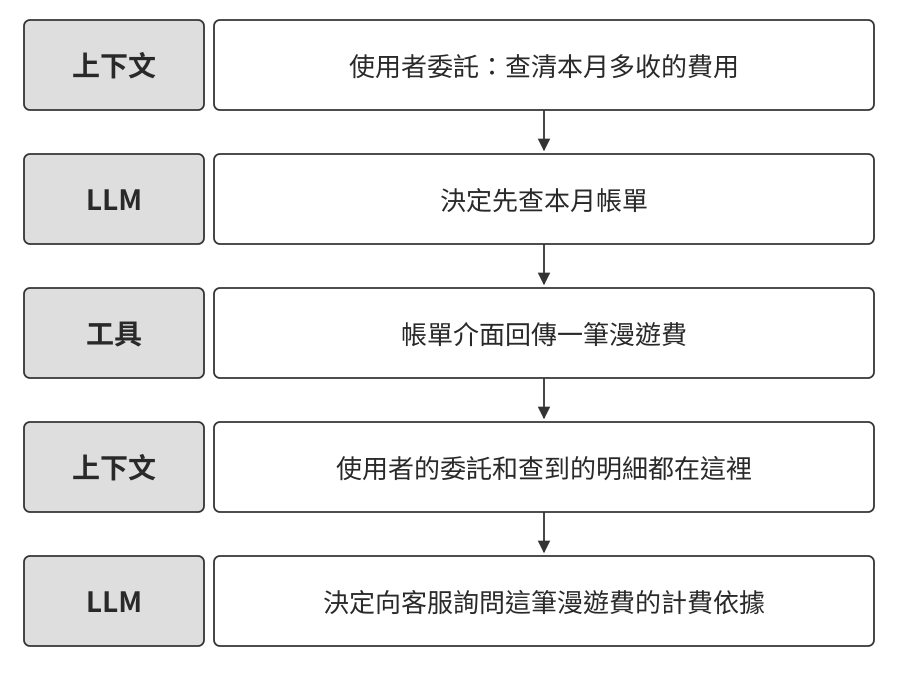
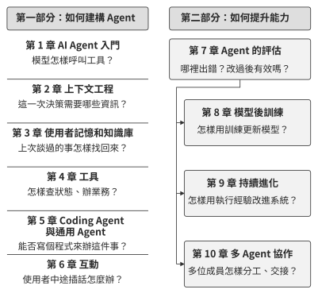

# 前言 {.unnumbered}

2025 年 8 月至 2026 年年初，筆者在圖靈開設線上影片課程《Agent 實戰營》，討論如何用可解釋、可驗證、可複用的工程方法建構 AI Agent（智慧體）。課程從執行一個 Agent 開始，接著分析它為何採用這樣的架構：每項設計解決什麼問題，需要付出什麼代價，又適合哪些任務。本書在課程講義和配套實驗的基礎上整理而成。

> **本書的形成：一次人機協作實踐**
>
> 備課時，我先把提綱講給 Pine 的語音 Agent，讓它查資料、擬初稿。這種口述式協作叫作 **whisper coding**。上完課，學員在哪一步卡住了、哪個實驗的結果出乎意料，我就回頭核查相應的例子和論證。

2025 年以來，筆者看到一個重要變化：AI 研究與產業實踐的重心，正從提升基座模型能力擴展到讓 Agent 完成真實任務。模型訓練與應用也因此更加緊密地結合起來。DeepSeek-R1 等推理模型展示了強化學習對數學、程式設計和推理能力的提升。[^preface-r1] 智慧體強化學習（Agentic Reinforcement Learning）將工具呼叫與環境互動納入訓練，讓模型學習程式設計，也學習操作圖形介面。後一類任務常稱為 Computer Use：模型根據截圖判斷頁面狀態，再透過點選、輸入或滾動完成操作。Manus、Claude Code、OpenClaw 等產品則讓使用者直接委派任務，也展示了「程式碼生成 + 檔案系統」怎樣支撐通用 Agent。

2026 年 9 月，Meta 推出 Muse。那段時間，國內外的個人 Agent 產品如雨後春筍般湧現。本書討論的許多問題，我和團隊在更早做 Pine 時就遇到了。我在 Pine AI 擔任首席科學家，和同事們一起研發了這款替消費者辦事的個人 Agent。2025 年 1 月初，Pine 已在美國上線，使用者可以請它致電商家，協商帳單、申請退款或取消訂閱。

商家在電話裡答應減免一筆費用，Pine 當場能告訴使用者的是「客服答應了」；要說「錢已經退了」，還得等帳單上出現這筆退款。辦這樣的事，我們需要讓模型記住使用者授權了什麼，知道下一步該查什麼，也能分清事情辦到了哪一步。後來業界談起 Skill、Harness 和 Loop 工程，其中好些做法，我們正是在這些電話裡摸索出來的。

- **Skill。** 我們只在任務用得著時才載入相應的提示詞。工具多了以後，我們又讓模型透過命令列呼叫工具，這樣就不必在每次請求裡列出所有工具的定義。
- **Harness。** 我們把執行環境、目前時間和使用者的工作狀態寫進狀態列，供模型決策時參考。模型有時會編造結果、調錯工具或漏掉指令，危險操作還可能超出使用者授權。為此我們給執行過程加了約束，後來在 Claude Code 裡也看到了相近的做法。
- **Loop 工程。** 模型有時事情只辦了一半就宣布完成。我們讓一個 Agent 辦事，另一個核對帳單或訂單，發現漏辦的事就交回去補辦。這就是提議者—審核者（proposer-reviewer）分工。

其他模型與 Agent 團隊在解決相似問題時，也獨立形成了相近的方法。這讓筆者更加確信，團隊遇到的許多困難，是 Agent 系統走向實際應用時共同面對的問題。除了《Agent 實戰營》，筆者在 2024—2026 年間也持續在中國科學院大學講授 Agent 實踐課程。兩門課的學員提出的問題，幫助筆者辨認哪些經驗還需要講得更清楚。本書開源發布，也希望更多研究者與工程師能夠使用、檢驗和改進這些方法。

**實踐在前，命名在後**。對開發團隊而言，這還有一層含義：當一個術語成為行業共識時，領先團隊往往已經探索了很久。要積累自己的工程優勢，就需要從真實業務中提前發現問題、嘗試解決。要做到這一點，筆者認為有兩個關鍵條件。

**第一，選擇對 Agent 能力提出足夠高要求的真實業務，並持續獲得回饋。** Pine 的一項任務可能持續數小時乃至數週，需要與多方溝通，長時間通話、填寫複雜表單、進行多輪郵件往來，同時保證數字準確、操作可控，並維護使用者利益。這類場景不斷暴露模型能力與業務要求之間的差距，促使團隊改進 Harness。如果一個產品的主要價值只是彌補某一代模型的短板，下一次模型升級就可能覆蓋這部分價值，團隊很難積累持久優勢。

**第二，建立系統的評估（Evaluation）機制。** 改過系統以後，一次帳單協商成功，可能是助手問對了問題，也可能是這次遇到的客服恰好有權減免。用同一批案例反覆比較新舊版本，能看出差異是否穩定。第七章將具體介紹怎樣設定成功標準、建構評估環境、分析失敗並檢驗改動。

在 Pine，我們從帳單減免中學到一條辦法：讓審核者去看帳單上那筆錢。把同樣的辦法用到改簽，就得看新票有沒有出。具體憑據隨業務而變，背後卻有一條共同的原則：判斷任務是否完成，要看這項行動在外界留下了什麼結果。**好的原則能夠穿越模型的迭代週期**。

## 本書的使命 {.unnumbered}

設想有人把一張手機帳單交給助手，請它聯絡電信業者協商減免。開始之前，助手要弄清是哪一筆收費有爭議；通話中，它要能聽取解釋、追問條件；結束時，它要告訴使用者客服究竟答應了什麼。助手每走一步，都要回答三個問題：這一刻助手知道什麼？它能採取哪些行動？它依據什麼選擇下一步？本書從這三個問題出發，介紹 Agent 的結構、建構方法與能力邊界。核心公式是 **Agent = LLM + 上下文 + 工具**：LLM 負責理解、規劃與決策，上下文承載目前決策所需的資訊，工具連線外部環境，用於獲取觀測或執行行動。

用一個直觀的比喻，LLM 是「大腦」，上下文是「目前決策視野」，工具是「感官和手腳」。視野中包含環境資訊、對話歷史、記憶和知識，也包含系統指令、工具定義與任務狀態。搜尋、讀取和截圖帶回資訊，點選、寫入和業務介面呼叫改變外部狀態。圖0-1 把一次帳單查詢拆開來看。第一次作決定時，模型只知道使用者對收費有疑問，第二次已經能指出要問的是哪一筆錢。



熟悉強化學習（Reinforcement Learning，RL）的讀者，還可以藉助策略、觀測和動作理解這套分工。LLM 根據上下文選擇下一步，其決策功能近似策略（Policy）；上下文承載這次決策使用的具體觀測與歷史；工具提供觀測和動作介面。觀測空間（Observation Space）描述可能獲得哪些觀測，動作空間（Action Space）描述允許採取哪些動作，兩者刻畫 Agent 與環境互動的範圍。[^preface-spaces] 第一章將透過工具呼叫實例展開這些概念，並介紹 Model 與 Harness 在生產實作中的分工。

> **延伸思考：從生命到設計實體**
>
> 工程實踐之外，Agent 也引出了關於智慧系統演化的問題。圖靈獎得主、強化學習先驅 Richard Sutton 將宇宙演化概括為塵埃、恆星、生命和「設計實體」（designed entities）四個階段。[^preface-sutton] 生物透過隨機變異和自然選擇演化，設計實體則可以由已有的智慧系統有目的地建構和改進。
>
> Agent 可以生成程式碼，建構新的 Agent，再分析執行行為、提出修改並驗證結果，逐步實作自舉（bootstrap）和持續進化。這像是一個程式設計師編寫了另一個程式設計師，後者繼續參與建構新的系統。這種理解自身、改進自身的可能性，也是筆者寫作程式碼生成和持續進化兩章時最感興趣的問題之一。

## 全書結構 {.unnumbered}

圖0-2 展示了各章的聯絡。假如使用者在電話裡臨時改口，助手卻還按舊要求辦事，可以從左欄的第六章讀起，看看助手怎樣處理使用者插話。修過以後，怎樣知道它在別的通話裡也能聽進新要求？這就要用到右欄第七章的評估方法。圖中從第七章分出的三條箭頭表示，拿到評估結果以後，可以根據失敗原因選擇不同的改進辦法。



- **第一章（AI Agent 入門）**透過產品與工具呼叫實例，介紹核心組成、執行迴圈、Harness 和編排方式，建立理解全書的概念框架。
- **第二章（上下文工程）**是全書最關鍵的一章，討論怎樣組織模型目前需要的資訊。從提示設計、按需載入講到歷史管理，並結合 KV Cache 解釋這些方法如何影響回答品質與執行成本。
- **第三章（使用者記憶和知識庫）**討論怎樣儲存並取用跨會話的資訊。從使用者記憶講到 RAG、結構化索引與知識更新，幫助讀者掌握持久知識的檢索和維護方法。
- **第四章（工具）**討論 Agent 怎樣獲取觀測、執行行動並請求協作。透過工具分類、介面設計、MCP 與執行管理，理解如何把外部能力接入系統。
- **第五章（Coding Agent 與通用 Agent）**提出通用 Agent 的一條核心架構思路：以 Coding Agent 為執行核心，以檔案系統為工作空間。先講開發流程，再透過多媒體、業務系統等案例，說明 Agent 如何編寫程式解決問題，進而創造工具、建構新的 Agent。
- **第六章（互動：觀測與動作空間的擴展）**從模態與時序兩個維度討論 Agent 的互動方式。透過非同步事件、語音、Computer Use 和機器人，理解持續觀測、快慢路徑與執行控制。
- **第七章（Agent 的評估）**回答怎樣判斷系統表現和一次改動的效果。先確定成功標準、環境與資料集，再講驗證器、評分和統計分析，最後透過分析失敗原因找到改進方向。
- **第八章（模型後訓練）**討論怎樣用資料與環境更新模型能力，主張優先投入資料品質與訓練環境。透過監督微調、強化學習和獎勵設計，解釋示範學習與探索為何帶來不同的泛化表現，以及為什麼只改演算法往往收效有限。
- **第九章（Agent 的持續進化）**討論怎樣利用執行經驗改進 Agent 的後續版本。比較知識、指令、程式和參數四類更新，再用驗證、發布與恢復流程管理長期變化。
- **第十章（多 Agent 協作）**討論多個成員何時帶來額外價值，以及怎樣分工、通訊和協調。先說明上下文和控制權如何分配，再結合案例講解協作機制、分析失敗原因，並討論 Agent 社會與經濟的可能形態。

## 如何閱讀本書 {.unnumbered}

- **從頭建構 Agent 產品**：建議通讀全書。先用第一至六章搭起能辦事的助手，再用第七章檢驗它在哪些任務上容易出錯。後面三章討論怎樣根據這些失敗改進模型、系統或成員之間的分工。
- **先建立整體認識**：依次讀第一、二、四、七章。沿著一次工具呼叫看下去：先認識 Agent 的執行迴圈，再看模型收到哪些資訊、工具實際做了什麼，最後用評估判斷結果是否符合使用者要求。第二章講到 KV Cache 時，第一次讀可以先掌握開頭的三條結論，做過實驗再回頭看底層原理。
- **重點學習模型訓練**：先用第一、二章理解 Agent 的執行方式，再結合第七章的評估方法閱讀第八章。這樣可以把訓練目標與實際任務表現聯絡起來。
- **維護已上線的 Agent**：從第七章選一批真實任務做評估。比如助手給使用者報了舊價，先查它拿到的是哪一版報價。若知識或流程過時，帶著這次失敗讀第九章；若報價和工具都已給足，改過流程後模型仍反覆選錯，再讀第八章，判斷是否值得準備訓練資料。

每章都安排了實驗和思考題。實驗採用「實驗 X-Y」編號，X 表示章號，Y 表示章內順序。星級表示難度：★ 適合入門，★★ 需要一定工程經驗，★★★ 涉及開放性問題或複雜系統設計。大部分實驗配有可執行程式碼，集中放在開源倉庫中：

> **配套程式碼倉庫**：`bojieli/ai-agent-book`

第一次做實驗，可以從「實驗 1-1：上下文的關鍵作用」開始。如果使用 Git，在終端執行：

```bash
git clone https://github.com/bojieli/ai-agent-book.git
cd ai-agent-book
```

在倉庫頁面選擇 **Code → Download ZIP** 並解壓，也能得到同樣的目錄。從第一章實驗索引（`chapter1/README.md`）找到編號 1-1，開啟 `chapter1/context/README.md`。此後遇到「實驗 X-Y」，都可以從倉庫中的 `chapterX/README.md` 查到專案和執行方法。「復現指南」提供外部專案及獲取方式，安裝命令和目錄說明集中放在 README 中。

## 前置知識 {.unnumbered}

本書面向具備基本程式設計能力、希望理解和建構 Agent 的讀者。動手做實驗會用到以下基礎。

**必需：閱讀全書的基礎**

- **Python 程式設計**：熟悉語法、常用資料結構和 pip 等包管理工具，能夠讀懂並修改實驗程式碼。書中大部分實驗以 Python 為基礎。
- **LLM 使用經驗**：使用過 ChatGPT、Claude 或類似產品，熟悉提出要求、讀取回復和繼續追問的基本過程。
- **軟體工程常識**：瞭解命令列、Git、JSON 和 REST API，能夠據此執行專案、檢查變更並閱讀介面資料。

動手做實驗時，筆者強烈建議選 Claude Code、Codex、Cursor、TRAE 中的一種。讓它幫你除錯一段程式碼，看看它讀了哪些檔案、呼叫了什麼工具。後面讀到執行迴圈和上下文管理時，就有了一次親身體驗可供對照。

**推薦：按章節補充的知識**

- **機器學習基礎（第八章）**：訓練與推理、損失函式、梯度下降和過擬合，有助於理解模型更新過程。
- **基礎數學（第二、三、七、八章）**：向量與矩陣幫助理解嵌入和注意力，機率統計幫助理解評估指標與期望獎勵。書中側重直觀解釋和實際用途。
- **Web 開發基礎（第六章）**：HTTP、WebSocket 和前後端分工，有助於理解非同步事件架構與即時語音通訊。
- **Transformer 基礎（第二、八章）**：瞭解注意力與模型結構，有助於理解上下文計算和後訓練。希望系統學習的讀者，可以閱讀《圖解大模型：生成式 AI 原理與實戰》（Jay Alammar、Maarten Grootendorst 著，李博傑譯，圖靈教育出品）。該書透過圖解講解 Transformer、預訓練與微調，與本書的工程視角相互補充。

除第八章的後訓練外，其餘章節用到的數學和機器學習知識較少，有基本程式設計經驗就可以開始閱讀。

## 致謝 {.unnumbered}

感謝圖靈的夢鴿老師和劉美英老師編輯本書，並為組織《Agent 實戰營》付出心血；感謝劉俊明老師在中國科學院大學開設 Agent 實踐課程。感謝兩門課程的學員與同學，你們的問題、實驗回饋和建議，幫助筆者不斷改進講解，也加深了筆者對這些概念的理解。

感謝 Pine AI 的所有同事。真實業務中的挑戰與團隊討論，是本書許多方法和案例的來源。你們的實踐與見解，讓這些認識得以不斷完善。

感謝 AI 業界的朋友們。在一次次交流中，你們坦誠地提出意見，分享不同的經驗和判斷，幫助筆者更深入地理解模型與 Agent。

最要感謝筆者的家人，尤其是太太孟佳穎。她始終支援本書的寫作，也為書稿提出了許多寶貴意見。

[^preface-r1]: DeepSeek-AI, *DeepSeek-R1: Incentivizing Reasoning Capability in LLMs via Reinforcement Learning*, 2025.
[^preface-spaces]: Gymnasium 文件的「Spaces」一節。
[^preface-sutton]: Richard Sutton 與 Dwarkesh Patel 的訪談，2025-09-26，「Succession to AI」部分。
