# 上下文工程

第一章把上下文比作 Agent 的“当前决策视野”：模型每次作出判断，都要依据此刻收到的信息。**上下文工程**（Context Engineering）负责选择、组织和更新这些信息，包括系统指令、工具定义、用户请求、历史消息和任务状态。Harness 每次调用模型前，都要把任务背景和最新进展整理成输入。图2-1 用具体内容展示了上下文窗口的构成。

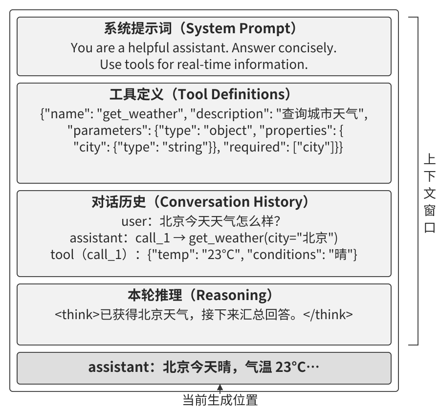

## 上下文：让模型能力用于具体任务

设想一位经验丰富的工程师刚加入团队，接到的第一个任务是“按我们的规范修改配置”。他会编程，却还不知道哪个文件才是配置的来源，哪些字段可以改，又该怎样验证。即使把整个代码库交给他，他也可能改错文件。Agent 接手陌生项目时，同样缺少这些背景。

以“帮我修复这个 bug”为例，Coding Agent 通常需要三类背景：

- **实时代码上下文**：目录结构、模块职责、核心数据结构和代码规范。例如，改动的是一份自动生成的配置文件，即使在本地生效，下次生成时也会被覆盖。知道文件由哪个模块生成，才能找到该改的地方。
- **流程规范**：Git 分支策略、提交规范、代码审查流程和 CI/CD 要求。Agent 据此安排修改、测试和提交，运行系统则按权限执行这些操作。
- **环境信息**：开发配置、测试数据库的连接方式、测试环境的部署方式和 API 密钥的管理方式。这些信息帮助它选择正确的运行环境，理解本地与测试环境的差异。

项目代码和测试数据库都在模型的上下文之外。以自动生成的配置为例，Agent 通过搜索工具读到生成脚本，才知道应该从哪里改起。**上下文的质量决定了模型能否把已有能力用到当前问题上。** **对于依赖大量背景信息的任务，能力够用的模型配上完整、准确的上下文，表现可以优于缺少必要资料的更强模型。**

**构建 AI 原生团队，首先要把关键知识文档化。** 如果当年选用某个数据库的理由只有老员工记得，业务规则变更又只在私聊里提过，那么新同事和 Agent 接手时都会遇到同一个问题：代码里看得到团队做了什么，却看不出当初为什么这样做。

**对远程协作友好的团队，往往也对 Agent 友好。** Linux 内核开发者通过邮件列表讨论补丁、交换审查意见，开发流程文档则说明怎样提交、审查和合并补丁[^ch2-linux]。新参与者读到一处出乎意料的改动，可以循着补丁找到当时的争论；Agent 查证背景时也用得上这段记录。

笔者听过翁家翌在 WhynotTV 的访谈后，把他的一个观点概括为：**人和模型都依赖 Context。** 人可以找参与过决策的同事补问一句，模型能读到哪些背景，则取决于团队留下了什么记录，以及 Harness 把哪些内容放进了这次请求。[^ch2-weng]

[^ch2-linux]: Linux 内核官方文档，How the development process works。

[^ch2-weng]: WhynotTV，《翁家翌：OpenAI，GPT，强化学习，Infra，后训练，天授，tuixue，开源，CMU，清华》，Podcast #4。

ReAct 论文用一个形式化表达描述交互历史如何参与决策[^ch2-react]。在时刻 $t$，Agent 从环境收到观测 $o_t\in\mathcal{O}$，根据策略 $\pi(a_t\mid c_t)$ 选择动作 $a_t\in\mathcal{A}$，其中上下文为：

$$
c_t=(o_1,a_1,\ldots,o_{t-1},a_{t-1},o_t)
$$

这个表达说明，**Agent 的下一步行动依赖截至当前的交互历史。** 比如，Agent 查过哪个文件、工具返回了什么错误，都会影响下一步选择。对 LLM Agent，用户输入和工具结果可以提供观测，工具调用及对外回复记录行动；系统指令和工具定义进一步说明任务规则与可用接口。

本章先采用无状态的请求方式：Harness 每轮组装消息和工具定义，再调用模型。完整消息历史便于保留任务进展；随着历史增长，可以通过检索、状态记录和压缩，把后续决策需要的信息留在窗口内。上下文布局、状态栏和压缩技术，都围绕同一个问题展开：怎样在有限的上下文里把模型这一步要用的信息放进 $c_t$？

[^ch2-react]: Yao, Shunyu, et al.，ReAct: Synergizing Reasoning and Acting in Language Models，ICLR 2023。

## Agent 如何调用大模型：理解 API 的上下文结构

先从一句问候看消息格式，再看“温哥华现在几点、天气怎样”如何引出两次工具调用。本节使用兼容 Chat Completions 的接口和本地运行的 Qwen3-0.6B，最后用 Python 把各轮请求串起来[^ch2-chat-api]。

### 示例中的四种消息角色

请求中的**消息列表**（`messages`）按顺序保存交互信息。每条消息用**角色**（`role`）标记来源和用途。本节使用四种角色：

- **system**：系统提示词。本节用它承载开发者提供的身份、行为规则和约束，放在消息列表前部。部分模型接口使用 `developer` 角色承载开发者指令。
- **user**：用户消息，保存任务、追问和补充要求。
- **assistant**：模型回复，包括文本和工具调用请求。把这些消息放回下一轮输入，模型就能读到此前的回答与操作请求。
- **tool**：工具执行结果。Harness 收到返回值后，把它写成工具消息，通过 `tool_call_id` 关联到具体调用。

工具定义通过请求顶层的 `tools` 字段传入，列出可用工具的名称、用途和参数格式。

模型根据工具定义构造调用请求。它能否执行这项操作，由 Harness 和运行环境决定。

[^ch2-chat-api]: OpenAI，Chat Completions API 参考，介绍消息角色、工具定义与调用结果字段；Qwen，Function Calling，介绍兼容服务中的工具调用与模板。

### 单轮对话：最简单的 API 调用

先看一次问答。用户问“Hello, who are you?”，Harness 把系统指令与用户问题一起发给模型，再读取回复。图2-2 展示了请求和响应的对应关系。

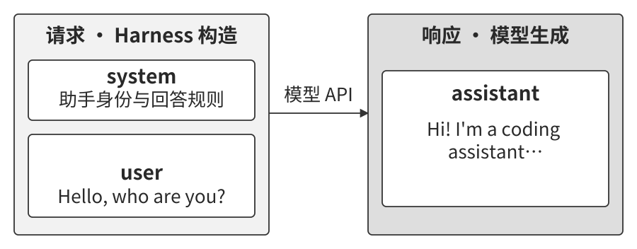

下面按本地模型的接口形式写出请求与示例回复，代码中的注释标出了各部分的来源：

```javascript
// Harness 构造请求
{
  "model": "Qwen3-0.6B",
  "messages": [
    {
      "role": "system",                           // 开发者提供的指令
      "content": "You are a helpful coding assistant. Follow user instructions."
    },
    {
      "role": "user",                              // 用户输入
      "content": "Hello, who are you?"
    }
  ]
}
```

```javascript
// API 返回响应
{
  "choices": [{
    "message": {
      "role": "assistant",                         // 模型生成
      "content": "Hi! I'm a coding assistant. I can help you write code, debug issues, and explain technical concepts. How can I help?"
    }
  }]
}
```

请求包含一条 `system` 消息和一条 `user` 消息，响应中的 `choices[0].message` 保存模型生成的 `assistant` 消息。在这里采用的无状态接口中，**Harness 负责为每次调用提供所需上下文**。下一次请求若要接着这段对话进行，就要带上相关历史。

### 带工具调用的多轮交互：Agent 的核心循环

再看一个需要工具的问题：“What's the current time and weather in Vancouver?” 要回答它，得先查到当地的时间和天气。图2-3 中，Harness 第一次调用模型，得到的是两项工具请求。它分别向时间服务和天气服务查询，把两项结果补进消息历史，再第二次调用模型，才得到给用户的答复。

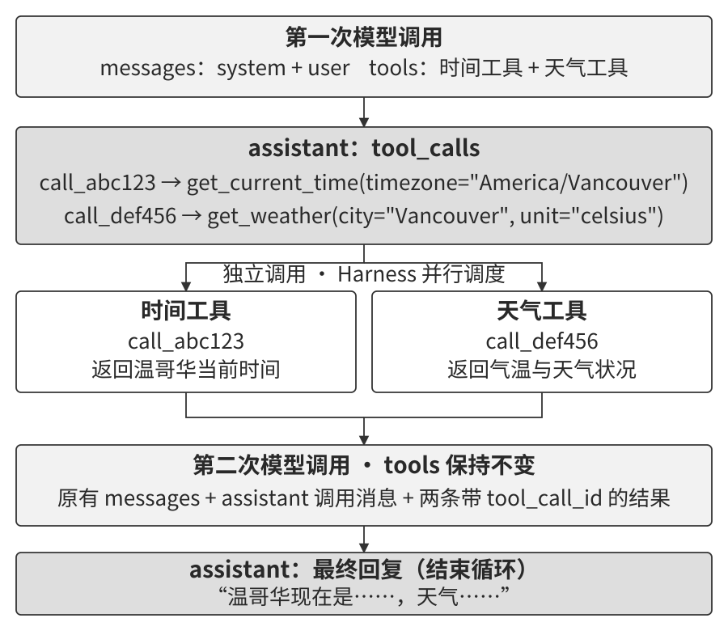

这两个工具谁先执行？时间工具需要时区，天气工具需要城市和温标。用户只说了温哥华，示例中的模型据此填入 `America/Vancouver` 和 `Vancouver`，温标选了摄氏度。查天气用不着等时间工具返回，两项查询可以同时发出。

**第一次 API 调用——Agent 框架发送初始请求：**

```javascript
// 第一次模型调用：Harness 构造请求
{
  "model": "Qwen3-0.6B",
  "messages": [
    {
      "role": "system",                           // 开发者提供的指令
      "content": "You are a helpful assistant. Use the provided tools to get real-time information when needed."
    },
    {
      "role": "user",                              // 用户输入
      "content": "What's the current time and weather in Vancouver?"
    }
  ],
  "tools": [                                       // 开发者定义的工具
    {
      "type": "function",
      "function": {
        "name": "get_current_time",
        "description": "Get the current date and time in a specific timezone",
        "parameters": {
          "type": "object",
          "properties": {
            "timezone": { "type": "string", "description": "Timezone name, e.g. America/Vancouver" }
          },
          "required": ["timezone"]
        }
      }
    },
    {
      "type": "function",
      "function": {
        "name": "get_weather",
        "description": "Get the current weather for a specific city",
        "parameters": {
          "type": "object",
          "properties": {
            "city": { "type": "string", "description": "City name" },
            "unit": { "type": "string", "enum": ["celsius", "fahrenheit"] }
          },
          "required": ["city", "unit"]
        }
      }
    }
  ]
}
```

这份 `tools` 清单由开发者预先定义，包含名称、描述和参数 schema。本例在各轮请求中提供相同的两个工具，模型读取清单与用户问题后，再选择要调用的工具并填写参数。

**模型返回两个工具调用请求：**

```javascript
// 模型返回工具调用请求
{
  "choices": [{
    "message": {
      "role": "assistant",                         // 模型生成
      "content": null,                             // 本轮没有文本回复
      "tool_calls": [                              // 请求调用两个工具
        {
          "id": "call_abc123",
          "type": "function",
          "function": {
            "name": "get_current_time",
            "arguments": "{\"timezone\": \"America/Vancouver\"}"
          }
        },
        {
          "id": "call_def456",
          "type": "function",
          "function": {
            "name": "get_weather",
            "arguments": "{\"city\": \"Vancouver\", \"unit\": \"celsius\"}"
          }
        }
      ]
    }
  }]
}
```

响应中的 `tool_calls` 包含两个请求，每个请求都有自己的 `id`、工具名称和参数。`arguments` 是 JSON 编码的字符串，执行侧需要先解析，再校验字段与取值。**模型决定调用什么、传入什么参数；Harness 负责校验和调度；工具实现负责访问时间或天气服务。**

**Agent 框架执行工具，然后发起第二次 API 调用：**

Harness 校验请求后调度两个工具，将返回值写成 `tool` 消息，再把已有历史与新增结果一起交给模型：

```javascript
// 第二次模型调用：追加工具结果
{
  "model": "Qwen3-0.6B",
  "messages": [
    {
      "role": "system",                           // 保留第一次请求中的消息
      "content": "You are a helpful assistant. Use the provided tools to get real-time information when needed."
    },
    {
      "role": "user",                              // 保留第一次请求中的消息
      "content": "What's the current time and weather in Vancouver?"
    },
    {
      "role": "assistant",                         // 保留前一轮模型的调用请求
      "content": null,
      "tool_calls": [
        { "id": "call_abc123", "type": "function", "function": { "name": "get_current_time", "arguments": "{\"timezone\": \"America/Vancouver\"}" } },
        { "id": "call_def456", "type": "function", "function": { "name": "get_weather", "arguments": "{\"city\": \"Vancouver\", \"unit\": \"celsius\"}" } }
      ]
    },
    {
      "role": "tool",                              // Harness 写入工具执行结果
      "tool_call_id": "call_abc123",
      "content": "{\"timezone\": \"America/Vancouver\", \"datetime\": \"2025-09-13T05:18:47\", \"day_of_week\": \"Saturday\"}"
    },
    {
      "role": "tool",                              // Harness 写入工具执行结果
      "tool_call_id": "call_def456",
      "content": "{\"city\": \"Vancouver\", \"temperature\": 13.2, \"unit\": \"celsius\", \"conditions\": \"clear\", \"humidity\": 93}"
    }
  ],
  "tools": [ ... ]                                 // 沿用前面的工具定义，此处省略
}
```

沿着 `call_def456` 读第二次请求：前一条 `assistant` 消息里，它是温哥华天气查询的编号；后面的 `tool` 消息用同一个编号送回了 13.2 ℃ 和晴天。即使天气先于时间返回，Harness 也能让结果和请求对上。模型在这一轮同时读到了用户原来的问题、自己发出的两项查询，以及工具查回来的数据。接下来就能回答用户了。

**模型根据工具结果生成最终回复：**

```javascript
// 模型生成最终回复
{
  "choices": [{
    "message": {
      "role": "assistant",                         // 模型生成
      "content": "It's currently 5:18 AM on Saturday, September 13, 2025 in Vancouver.\n\nWeather: 13.2°C with clear skies and 93% humidity. It's quite cool this morning - you might want to grab a jacket."
    }
  }]
}
```

第二次响应给出最终文本，`tool_calls` 为空，示例循环随之结束。这个“调用模型→执行工具→回传结果→再次调用模型”的过程，就是第一章运行循环在 API 中的具体实现。

如果用户追问“那东京呢？”，Harness 就把这条消息追加到历史末尾，再次调用模型。模型可以沿用“查询当前时间和天气”的任务背景，生成针对东京的新请求；工具返回后，再组织新的回答。

**换用 Responses API，怎样把工具结果交回去？** 上面的本地实验使用 Chat Completions 兼容接口。如果用 OpenAI 的服务开发新项目，官方推荐 Responses API。还是看温哥华的例子：应用把用户问题放入请求的 `input`，并在 `tools` 中声明时间和天气两个函数。返回的 `output` 是一组有类型的条目。若其中出现两条 `function_call`，应用就从每条里读取函数名、参数和 `call_id`，分别执行工具。[^ch2-responses-loop]

假设天气函数的调用编号是 `call_weather`。下一次请求的 `input` 就可以放入这样的回执；时间函数也要按自己的编号交回结果。

```json
{"type": "function_call_output", "call_id": "call_weather", "output": "{\"temperature\": 13.2, \"unit\": \"celsius\"}"}
```

`call_id` 把一条回执对回一次函数调用。`previous_response_id` 指向上一次模型响应，让服务接续那一轮的上下文。两个编号指的对象不同。采用这种续接方式时，本轮仍需提供要继续使用的工具和顶层 `instructions`；上次请求的顶层指令不会随响应编号自动继承。模型可能继续请求工具，应用要读下一份 `output` 再决定是否结束。第一章实验 1-3 用的是服务端托管搜索；这里的两个自定义函数由应用实际执行。

[^ch2-responses-loop]: OpenAI，迁移到 Responses API、函数调用及创建响应的参数说明。

### 用代码实现 Agent 的核心循环

循环中的两处 `messages.append` 分别保存模型的回复和工具的执行结果。时间和气温都来自温哥华；把两个调用 ID 对调，下一轮模型读到的就会是“查询时间”返回了 13.2 摄氏度。

示例通过 OpenAI Python SDK 连接兼容服务。默认地址是本机的 `http://localhost:8000/v1`，适用于已启动、无需鉴权的本地服务。这组默认值对应实验 2-1 的 vLLM 后端。若使用该实验的 Ollama 后端，把地址设为 `http://localhost:11434/v1`，并把模型名改为 `qwen3:0.6b`。连接其他服务时，按需设置环境变量 `LLM_BASE_URL` 和 `LLM_API_KEY`，并让下方的 `model` 与实际部署的名称一致。时间和天气工具暂用上一例的固定数据，以便对照消息；接入真实数据时再替换这两个工具的实现。

```python
import json
import os

from openai import OpenAI

client = OpenAI(
    base_url=os.getenv("LLM_BASE_URL", "http://localhost:8000/v1"),
    api_key=os.getenv("LLM_API_KEY", "EMPTY"),
)

# 工具定义：名称、用途和参数结构
tools = [
    {
        "type": "function",
        "function": {
            "name": "get_current_time",
            "description": "Get the current date and time in a specific timezone",
            "parameters": {
                "type": "object",
                "properties": {
                    "timezone": {"type": "string", "description": "Timezone name, e.g. America/Vancouver"}
                },
                "required": ["timezone"],
            },
        },
    },
    {
        "type": "function",
        "function": {
            "name": "get_weather",
            "description": "Get the current weather for a specific city",
            "parameters": {
                "type": "object",
                "properties": {
                    "city": {"type": "string", "description": "City name"},
                    "unit": {"type": "string", "enum": ["celsius", "fahrenheit"]},
                },
                "required": ["city", "unit"],
            },
        },
    },
]

# 示例工具使用固定数据，参数与前面的温哥华查询一致。
def execute_tool(name, arguments):
    args = json.loads(arguments)
    if name == "get_current_time" and args == {"timezone": "America/Vancouver"}:
        result = {
            "timezone": "America/Vancouver",
            "datetime": "2025-09-13T05:18:47",
            "day_of_week": "Saturday",
        }
    elif name == "get_weather" and args == {"city": "Vancouver", "unit": "celsius"}:
        result = {
            "city": "Vancouver", "temperature": 13.2,
            "unit": "celsius", "conditions": "clear", "humidity": 93,
        }
    else:
        result = {"error": "示例仅提供温哥华时间和摄氏天气数据"}
    return json.dumps(result, ensure_ascii=False)

# 初始消息：指令与用户任务
messages = [
    {"role": "system", "content": "You are a helpful assistant. Use tools to get real-time information when needed."},
    {"role": "user", "content": "What's the current time and weather in Vancouver?"},
]

# 运行循环：最多调用模型八轮
rounds = 0
while rounds < 8:
    rounds += 1
    response = client.chat.completions.create(
        model="Qwen3-0.6B", messages=messages, tools=tools
    )
    assistant_message = response.choices[0].message

    # 保存模型回复，包括本轮的调用请求
    messages.append(assistant_message.model_dump(exclude_none=True))

    # 本例在模型给出不含工具调用的回复时结束
    if not assistant_message.tool_calls:
        print(assistant_message.content)
        break

    # 逐个执行并追加结果；独立调用也可以改为并行调度
    for tool_call in assistant_message.tool_calls:
        try:
            result = execute_tool(tool_call.function.name, tool_call.function.arguments)
        except json.JSONDecodeError:
            result = json.dumps({"error": "工具参数需要有效的 JSON"})
        messages.append({
            "role": "tool",
            "tool_call_id": tool_call.id,
            "content": result,
        })
    # 下一轮使用追加了结果的消息列表
else:
    print("已达到轮数上限，任务尚未完成。")
```

假设模型在第一轮同时请求时间和天气。这里的 `for` 循环会先查时间，把结果追加到 `messages`，再查天气，追加第二条结果。两项都执行完，程序才回到 `while` 开头，发出第二次模型请求。把 `messages` 在这几步的内容展开，就能看到模型每次拿到了什么。

**初始状态（第 1 次调用前）：**
```text
messages = [
  { role: "system",  content: "You are a helpful assistant..." },     # 开发者写的
  { role: "user",    content: "What's the current time and weather in Vancouver?" },  # 用户输入
]
```

**第 1 次模型调用与工具执行完成后：**
```text
messages = [
  { role: "system",    content: "..." },
  { role: "user",      content: "What's the current time..." },
  { role: "assistant", tool_calls: [get_current_time, get_weather] },  # 模型生成的调用请求
  { role: "tool",      tool_call_id: "call_abc123", content: "{time...}" },  # 工具执行后由 Harness 写入
  { role: "tool",      tool_call_id: "call_def456", content: "{weather...}" },  # 工具执行后由 Harness 写入
]
```

**第 2 次调用后（模型返回最终回复，循环结束）：**
```text
messages = [
  { role: "system",    content: "..." },
  { role: "user",      content: "What's the current time..." },
  { role: "assistant", tool_calls: [get_current_time, get_weather] },
  { role: "tool",      tool_call_id: "call_abc123", content: "{time...}" },
  { role: "tool",      tool_call_id: "call_def456", content: "{weather...}" },
  { role: "assistant", content: "It's currently Saturday, Sep 13, 2025 in Vancouver..." },  # 最终回复
]
```

### 从 API 视角看上下文的构成

图2-4 把一次请求分为前缀和消息历史两部分。前面的温哥华查询刚发出时，历史里只有用户的提问和此前的对话。等两项查询完成，历史里就多了模型提出的工具调用和两项工具结果。

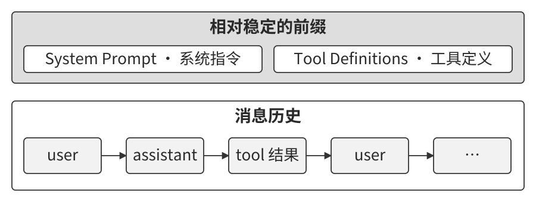

因此，连续两次请求开头相同的一段，可以一直延伸到消息历史里。下一轮调用能复用多少旧计算，取决于这段前缀有多长。

下面的 Harness 将不常变化的系统指令与工具定义放在前面，每一轮只在历史消息末尾追加当前状态。历史太长时，它先压缩旧消息，再组装请求。

```python
stable_prefix = system_message
stable_tools = core_tool_schemas
history = load_message_history(session)
status_message = make_status_message(derive_current_state(history))

if estimated_tokens(stable_prefix, stable_tools, history, status_message) > budget:
    history = compress_old_evidence(
        history,
        preserve = [decisions, constraints, failures, citations]
    )

request.messages = [stable_prefix] + history + [status_message]
request.tools = stable_tools
response = call_model(request)
```

压缩时保留决策、约束、失败和引用等后续工作需要的信息，并维护调用请求与工具结果的关联。除了长度预算，信息重复和过时也可以触发压缩，具体策略将在本章后半部分展开。

> **实验 2-1 ★：本地 LLM 服务部署与工具调用**
>
> 本实验在本地运行 Qwen3-0.6B，沿着“查询温哥华时间和天气”这一任务，观察消息如何经过模型、解析器和工具执行器。图2-5 展示了本地服务与客户端的分工：服务端加载模型、处理输入并生成回复，客户端维护消息历史，调度工具并回传结果。
>
> 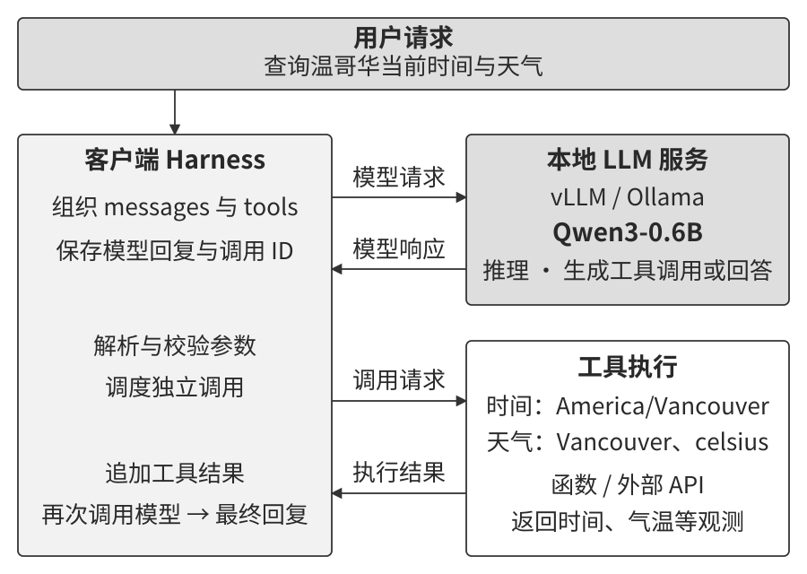
>
> **先跟踪一次完整任务。** 模型在同一轮输出中请求查询时间和气温，分别填写 `America/Vancouver`、`Vancouver` 和 `celsius` 等参数。客户端并行执行两个工具。第一份回执给出当地时间 11:11:28，第二份回执给出气温 17.9 °C。两份结果送回模型后，它把时间报到分钟，回答气温为 17.9 °C，随后结束本次循环。这次运行说明，六亿参数的模型已经能为这个任务选对两个工具、填好参数，并用返回值回答用户。
>
> **再查看原始输出与 API 字段的对应。** Qwen3 的思考模式可以生成带有 `<think>` 标记的推理内容，工具请求则使用相应的调用标记。服务端解析后，客户端可能收到单独的 `thinking` 或工具调用字段。输出中各部分的排列与保留方式由模型模板和服务协议共同决定。
>
> **接着观察流式处理。** 界面可以随着事件更新“思考中”“调用工具”和“生成回答”等状态。工具参数通常分多段到达，需要累积成完整请求；协议确认该调用结束，且参数、权限和依赖检查通过后，运行系统可以开始调度。相互独立的工具能够并行执行，也可以与后续输出处理形成流水线。
>
> **最后比较速度与缓存。** 本次在苹果芯片 Mac 上运行的记录中，工具任务的平均解码速度约为每秒 107 个 token。Token 是模型处理文本的基本单位，具体切分由分词器决定，一个词或汉字可能对应一个或多个 token。解码速度反映开始生成后的输出速率；用户等待多久，还受到首 token 延迟、推理长度和工具耗时影响。
>
> 缓存对照使用相同的长前缀，分别测试保留前缀与修改前缀开头的请求。本次五组配对中，保留前缀的请求有四组更快；两组平均首 token 延迟分别约为 1.30 秒和 1.51 秒。下一节将解释这些请求在计算上有什么区别。
>
> 这个实验也让笔者更加看好端侧 Agent：小模型已经能够在用户自己的设备上完成这样的工具调用任务。**端侧 Agent 的时代，比许多人预期的更近。**

## KV Cache 友好的上下文设计

Agent 的相邻请求通常共享大量信息：系统指令、工具定义，以及此前已经发生的交互。如果推理引擎能够复用这些内容的中间计算结果，就能把更多计算用于新增信息。**KV Cache** 保存每层注意力计算中已经得到的键（Key）和值（Value），供后续 token 使用；**Prompt Cache** 则进一步在请求之间复用符合条件的前缀缓存[^ch2-kv-basics]。

考虑一个客服 Agent：为了让模型知道当前时间，开发者在系统提示词开头加入 `Current time: {{now}}`，每次请求都更新。后面的业务规则和工具定义保持原样，实际输入会从时间戳处开始变化。对于按相同前缀复用 KV 的服务，这会使时间戳及后续部分重新计算，增加输入处理时间和费用。

把时间写成追加消息，或在需要时调用时间工具，就能保留已有前缀。两种布局提供的信息相近，触发的重算范围却不同。

可以先记住三个做法，后面的原理和实验将逐项解释它们：

1. **保持可复用的前缀稳定。** 系统指令和常用工具定义采用确定的内容与顺序。
2. **把运行中的变化追加到后部。** 时间、余额、调用次数和任务进度可以通过新消息或工具结果提供。最新状态应标明生效时点，让模型能识别哪条记录适用于当前决策。
3. **按模型协议组织消息。** 使用正确的角色、调用 ID 和工具结果格式，由相应的聊天模板生成模型输入。缓存匹配的是处理后的前缀及相关配置，消息协议还决定模型如何识别指令、用户请求和工具返回值。

在本节采用的因果注意力模型中，后续 token 的加入不会改变此前位置已经算出的状态。修改已有输入时，首个变化位置及其后面的状态需要重新计算；变化之前的前缀仍有复用机会。服务端还会根据缓存块大小、保留时间和运行配置决定实际命中范围。

[^ch2-kv-basics]: Hugging Face，How caching works，介绍逐层保存与复用 K、V 的机制。

> **实验 2-2 ★：注意力机制可视化**
>
> 先用“北京 的 天气 怎么样”理解一次注意力计算。为了便于展示，图2-6 将这句话分成四个语义单元；实际模型由分词器切分输入。处理“怎么样”这一位置时，注意力层要从已有信息中组合出当前表示。Query、Key 和 Value 分别承担查询、匹配和信息聚合的作用。
>
> | 向量 | 作用 | 在这个例子中的直观理解 |
> | --- | --- | --- |
> | **Query（查询）** | 当前位置用于匹配其他位置的向量 | “怎么样”需要从已有内容中找出相关信息 |
> | **Key（键）** | 各位置参与匹配的向量 | “北京”“天气”等位置提供可供匹配的表示 |
> | **Value（值）** | 按权重聚合的信息向量 | 将地点、天气等信息按相应比重汇入当前表示 |
>
> 可以把 Key 想象成用于检索的标签，把 Value 想象成取回的内容。模型中的这些向量都是从隐藏表示计算出来的数值，并由训练塑造其匹配方式。
>
> 一次计算分三步。首先，当前位置生成 Query；然后，它与各位置的 Key 做点积，经过缩放、因果掩码和 softmax，得到和为 1 的注意力权重；最后，用这些权重对 Value 加权求和。点积就是两组数字逐位相乘再求和，softmax 则将可见位置的分数转换成归一化权重。各位置的 Value 按对应权重参与聚合，共同形成这个注意力头的输出。
>
> 沿图2-6 的最后一行横着读：“怎么样”这个位置给“天气”的权重是 0.55。这个数要乘上“天气”所在位置的 Value，再加上另外三个位置的贡献，才得到该注意力头在“怎么样”处的输出。换到“天气”那一行时，右边为什么多了一个叉？因为计算这个位置时，序列还没走到“怎么样”。
>
> 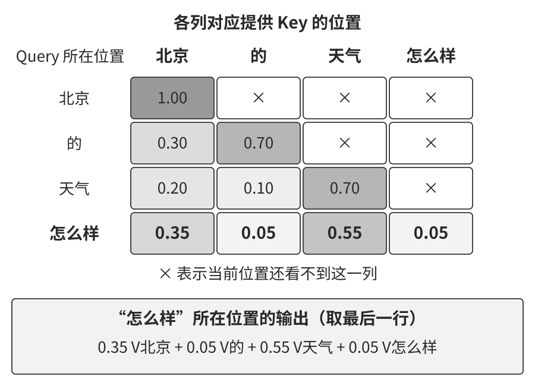
>
> 把每个位置的权重排成矩阵，就得到**注意力热力图**。每行对应一个 Query，每列对应一个 Key，颜色深浅表示权重大小。因果掩码允许当前位置读取自己和前面的位置，图中用 × 标出被屏蔽的位置，它们经过 softmax 后的权重为零。这一结构适用于输入处理和后续生成。
>
> 从这里也能看出 K、V 缓存的用途：生成继续推进时，新位置仍会读取已有位置的 Key 和 Value。保存这些向量后，新位置就可以直接用它们进行匹配与聚合，省去历史位置的重复计算。
>
> 理解了这组示意权重，再用 Qwen3-0.6B 查看模型实际计算出的注意力分布。实验分别记录短句和一段包含推理、最终回答的生成序列，比较不同层的注意力矩阵。图2-7 分别展示第 0、13、27 层：左列是九个 token 的短句，右列是计算 17 × 23 的生成序列，按输入、推理和回答标出位置范围。灰度采用对数刻度，便于同时看清较强与较弱的注意力权重。
>
> 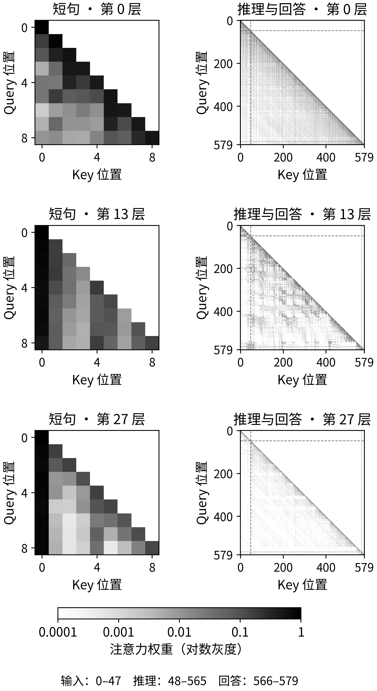
>
> 阅读时可以沿着四条线索分析：
>
> 1. **注意力储存池（Attention Sink）。** 某些层把较大权重分配给序列开头，即使开头的 token 承载的语义很少。看图2-7 左列的短句。每幅图已对同一层的各注意力头取了平均。再取矩阵第一列九个数的平均值，就能算出九个位置平均分给首个 token 多少权重。第 0、13、27 层分别为 14.7%、73.9% 和 83.2%。换到右列较长的生成序列，第 13 层的这个数值就变为 28.0%。softmax 要求各位置权重合计为 1，模型可以学出相对稳定的接收位置；StreamingLLM 对这一现象及其在流式推理中的作用作了专门研究[^ch2-attention-sinks]。
> 2. **推理区域。** 标出 `<think>` 对应的生成区间，沿这些行查看模型关注了哪些提示词、工具说明或此前推理。三角形来自因果掩码，三角形内部的深浅才反映各位置的权重差异。
> 3. **回答区域。** 再标出最终回答的生成区间，比较它对原始输入和先前推理的权重分配。这能帮助定位哪些已有信息进入了当前注意力聚合。
> 4. **位置差异。** 《Lost in the Middle》在长上下文问答和键值检索中观察到，中间位置的信息更难被有效利用[^lost-in-the-middle]。工程上可以据此优先把常驻规则放在前部，把当前目标和进度放在末尾。

[^ch2-attention-sinks]: Xiao et al.，Efficient Streaming Language Models with Attention Sinks，ICLR 2024。

[^lost-in-the-middle]: Liu et al.，Lost in the Middle: How Language Models Use Long Contexts，TACL 2024。

### 从 API 消息到模型 Token：Chat Template

前面的 API 示例是一组带角色的消息，注意力图中的输入则是一串 token。**Chat Template（聊天模板）**负责完成这次转换：为消息加入角色与边界标记，按约定组织工具说明和返回值，再交给分词器编码。对照图2-8 两栏：左边只提交了系统指令和用户提问，右边怎么又多出一个 `assistant`？那是模板为下一条回复加上的起始标记。后面讨论工具调用、推理信息的保留和缓存命中时，还会用到这些标记。

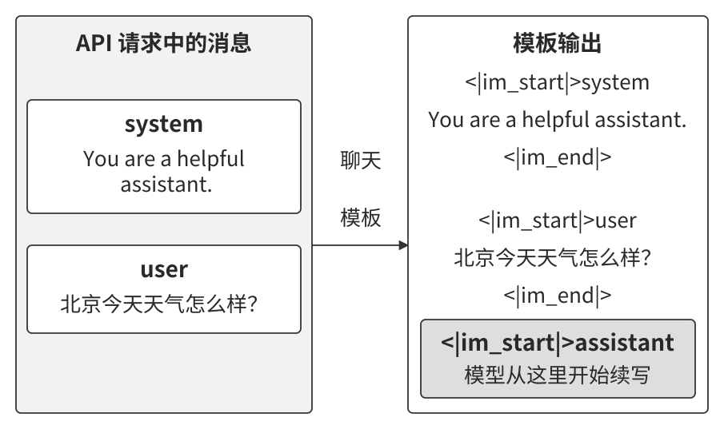

Qwen、Llama、Gemma 等模型家族各有自己的聊天模板。同一组 API 消息交给不同模型，转换出的角色和边界标记也可能不同。托管 API 通常由服务端完成转换，自行部署时则要为推理服务配置与模型匹配的模板。

假设用户发来一句“温哥华 17.9 °C”，天气工具也恰好返回相同的文字。把这两条消息分别交给 Qwen3-0.6B 的模板，会得到图2-9 中的两段输入。它们都以 `<|im_start|>user` 开头，哪一处标记表明文字来自工具？

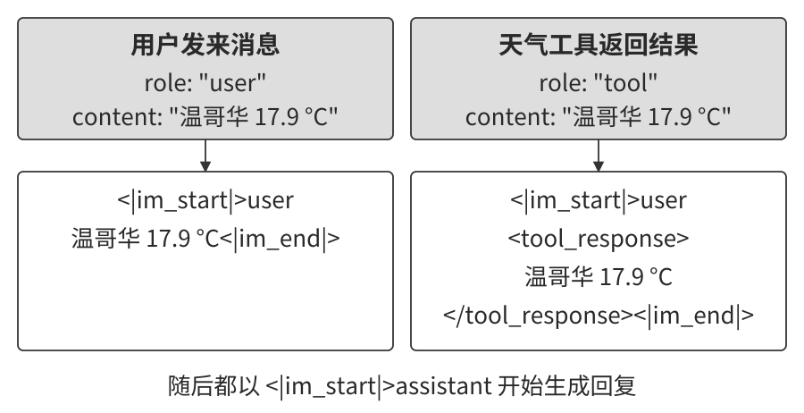

右栏多了一对 `<tool_response>` 标签。模板还按消息角色定位用户最近一次提问：在这次提问之前的轮次，只保留回答内容；在此之后，工具交互还可以带上模型的推理信息[^ch2-qwen-template]。

例如，模型查完文件后仍要继续分析。把工具结果按 `tool` 角色回传，模板就能将它识别为当前任务中的工具反馈；如果把同样的结果直接写成普通 `user` 消息，模板可能把它识别为新的查询，改变此前推理的保留范围。这就像继续做一道题时需要保留演算草稿：Harness 应保存服务要求的推理字段，并按正确的消息结构接着调用。

**从单轮推理走向长程 Agent，历史思考逐渐成为需要维护的任务状态。** 早期 DeepSeek-R1 的聊天模板会去掉历史回答中的思考部分，只保留最终回答[^ch2-r1-template]；后续 DeepSeek 的工具调用协议则要求回传推理信息。一次问答结束后，最终回答可能已经包含下一轮所需的信息；工具任务进行到一半时，“为什么查这个文件”“已经排除了哪些假设”却可能只写在中间推理中。保留这些信息，有助于下一轮接着已有思路工作。

**推理信息的回传方式由模型协议决定。** 接入时要同时处理 `content`、`tool_calls` 和服务提供的推理字段。下面几种方案体现了不同的续接规则：

- **DeepSeek 思考模式**通过 `reasoning_content` 返回推理。按照其工具调用协议，请求带有 `tools` 时，后续请求须完整回传历史推理，包括未调用工具的模型回复；缺失字段会触发 400 错误。纯聊天请求不带 `tools` 时，服务忽略回传的历史推理[^ch2-deepseek-thinking]。
- **Kimi 的思考与工具交互**同样需要在运行循环中管理推理、工具请求和结果。以 Kimi K2.5 的交错思考示例为例，模型可以在多次工具调用之间继续推理，客户端按其协议保存和回传模型消息[^ch2-kimi-thinking]。
- **GLM 的保留思考**可以通过 `thinking.clear_thinking: false` 开启，随后完整、按原顺序回传 `reasoning_content`。Coding Plan 与标准 API 的默认设置不同，客户端应明确选择所需模式[^ch2-glm-thinking]。
- **Claude 的 thinking block**需要连同签名保存。支持 preserved thinking 的模型还会检查块的来源与前缀，具体规则见后面的“缓存作为架构约束”。

这些规则影响连续工具调用，也影响中途切换模型。切换时，适配层要把工具请求、结果和任务状态转换成目标接口接受的形式，再按目标模型的规则处理推理信息。第五章的实验 5-1 将展开这种轨迹接续。

**模板还决定缓存所匹配的输入。** 同样的消息内容，经过不同模板、工具顺序或序列化方式处理，可能形成不同 token 前缀。要复用已有 KV，需要保持相关模型配置和前缀一致。

[^ch2-qwen-template]: Qwen3-0.6B 的分词器配置文件 `tokenizer_config.json` 保存了聊天模板，其中包含用户查询、推理内容与工具响应的处理逻辑。

[^ch2-r1-template]: DeepSeek-R1 官方聊天模板在普通历史回答中保留 `</think>` 之后的内容；后续工具调用的推理回传规则见 DeepSeek 的 Thinking Mode 文档。

[^ch2-deepseek-thinking]: DeepSeek，Thinking Mode。

[^ch2-kimi-thinking]: Moonshot AI，Kimi K2.5 官方仓库，Interleaved Thinking and Multi-Step Tool Call 一节。

[^ch2-glm-thinking]: Z.ai，Thinking Mode，介绍交错思考、保留思考及端点默认设置。

### KV Cache 的原理与约束

模型处理一次请求时，先对输入进行 **prefill（预填充）**，计算已有 token 的表示，再进入 **decode（解码）**，逐个生成后续 token。KV Cache 在解码过程中保存已有位置的 K、V；跨请求的前缀缓存进一步复用上一请求留下的相同前缀。

例如，Agent 到第六轮时已经累积了 2,000 个输入 token。如果服务只使用本次请求内的 KV Cache，就需要先处理这 2,000 个 token，再利用缓存继续生成。如果跨请求缓存中已有其中一段相同前缀，prefill 就能从尚未缓存的位置接续。图2-10 展示了这种跨请求复用。

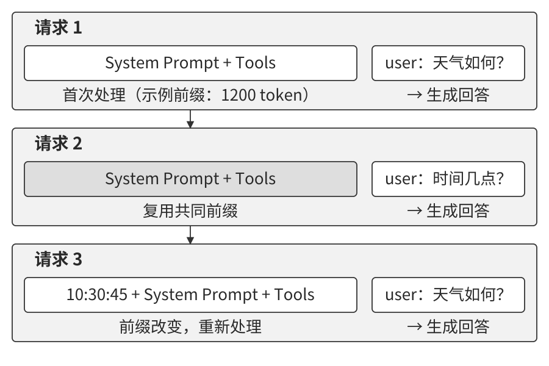

**用四个 token 跟踪缓存的增长。** 假设输入为 `[A, B, C, D]`。模型处理位置 D 时，用 D 的 Query 与 A、B、C、D 的 Key 匹配，再对它们的 Value 加权聚合。经过各层计算，D 位置的最终表示用于预测下一个 token E。此时，A 至 D 在各层的 K、V 都已保存。

采样得到 E 后，下一步把 E 送入模型，计算它在各层的 Query、Key 和 Value。E 的 Query 读取此前的缓存与当前位置的 K、V，模型再预测第六个 token；E 的 K、V 同时追加到缓存中。这样，每生成一步，都可以沿用此前的状态，只计算新输入 token 的状态。

若完全不用 KV Cache，预测 E 时要重新处理 A 至 D，预测第六个 token 时又要处理 A 至 E。仅按重复生成 K、V 的位置数计算，累计工作量会出现 $1+2+\cdots+N$ 这样的增长。使用缓存后，历史位置的逐层计算得以复用；新位置仍要读取可见的 K、V。在标准全注意力解码中，这部分读取与匹配随上下文长度线性增加，所以长上下文仍会占用更多显存和内存带宽。

**修改输入为什么会影响后续缓存？** Transformer 的各层依次处理隐藏表示，每层都有自己的 K、V。某个位置经过注意力计算后，表示中已经汇入此前位置的信息，再传给下一层。因而，第 $k$ 个 token 改变时，影响会从该位置向后、向更高层传播。

对于相同模型与计算配置，$k$ 之前的位置只依赖更早的输入，可以继续复用；从 $k$ 开始，需要重新建立受影响的状态。实际服务通常按缓存块匹配前缀，重算边界还受到块大小影响。更新越靠前，通常需要重算的输入越多。把稳定指令放在前部、把新状态追加到后部，就是在利用这一依赖关系。

> **实验 2-3 ★★：上下文管理方式的对照**
>
> 本实验让 Agent 使用文件发现、读取和搜索工具完成同一个任务，比较一种稳定追加的基线与五种上下文改动。基线保持指令和工具顺序稳定，逐轮追加模型消息和工具结果。其余各组分别改变指令、状态、工具排序或历史表达，观察缓存统计和任务过程怎样变化。
>
> **动态系统提示词**在每轮的系统指令中更新当前时间。变化之前仍可有共享前缀，从时间信息起的后续输入则需要重新匹配或计算。可以把时间作为新消息追加，或通过时间工具按需获取，让常驻业务规则继续复用。
>
> **动态用户配置**在前部消息中更新剩余调用次数或账户余额。状态本身是任务所需的信息，设计重点在于更新位置：把最新状态追加到末尾，并标明其生效时间，能够同时保留进度与前缀。后面的 Agent 状态栏将采用这种组织方式。
>
> **工具定义重排**每轮改变工具清单的顺序。名称和参数虽然相同，序列化后的 token 顺序已经变化。打开 Kimi K2.6 的运行报告，基线和重排组的 `Hit%` 都是 100%。两组真的复用了同样多的输入吗？基线三轮共输入 7,567 个 token，其中 768 个命中缓存；重排组也是三轮，7,568 个输入 token 中只有 256 个命中。用缓存 token 数除以输入 token 数，就得到 `Cache%` 一列的 10.1% 和 3.4%。另一列 `Hit%` 按有命中判定的请求计数：基线记了两次命中，重排组只记了一次，两组记下的未命中次数都是零。其余请求的命中情况，单凭这份记录无从判断。固定工具顺序可以避免前缀无故变化。
>
> **滑动窗口**只保留最近一段历史。假设按十轮交互保留，第十五轮就可能读不到第二轮取得的关键文件内容。除了缩短共享前缀，裁剪还会改变模型能获取的事实和任务进度。配套实现以最近六条历史消息为起点，并向前补齐工具结果所对应的调用请求。滑动窗口组复用了 2,224 个输入 token 中的 1,510 个，缓存占比达到六组中最高的 67.9%。再看实验 2-3 滑动窗口组的工具记录：模型三次查找文件，接着读取两个文件，却没有交付用户要求的三句话总结。
>
> **文本格式化**把带角色的历史重新写成 `USER: ...`、`ASSISTANT: ...` 等文本。这样会改变模板中的消息边界和工具结构，模型需要从正文恢复原来的关系。本次文本组仍生成了最终回复，也有缓存命中。接口提供的消息角色、调用 ID 和工具结果字段，有助于稳定传递这些关系。
>
> 程序即使重新构造消息列表，只要送出的前缀和缓存配置相同，这段前缀仍有机会复用。
>
> 如果还想知道用户少等了多久，要先看计时器在哪里停。滑动窗口组第一轮的 `ttft` 约为 2.23 秒。程序虽然把这个字段叫作 TTFT（首 token 延迟），却是在非流式请求返回整份回复时才停表。

### KV Cache 与 Prompt Cache：两个层级的缓存

可以用两个时刻区分这两层缓存。模型生成回复中的第二个 token 时，可以读取该请求中已有位置的键值状态，这用到 **KV Cache**。稍后用户追问，Harness 发来新的请求；服务要先找到此前保存的相同前缀，才可能少算这部分输入，这属于 **Prompt Cache**。前者解释同一次生成如何继续，后者还要求跨请求的保存与匹配机制。

在 API 服务中，缓存还受到最小前缀长度、块大小、有效期、模型配置和租户隔离范围影响。可复用前缀必须在相同的缓存作用域内查找。例如，Claude API 按组织与工作区隔离缓存；相同文字出现在不同隔离域时，会分别建立缓存[^ch2-prompt-cache]。

计费需要分别考虑写入和读取。一些 Claude 模型的缓存读取价为普通输入价的十分之一，首次写入则有额外费用。同一段前缀在有效期内反复使用，只需付一次写入费，后续命中的请求都按读取价计费。

[^ch2-prompt-cache]: Anthropic，Prompt caching，介绍缓存匹配、隔离、有效期和计费。

### 缓存作为架构约束

**在生产系统中，缓存已经成为一项架构约束。** 提示词怎样排列、子 Agent 从哪里开始、会话如何恢复，都会影响可以复用多少计算。**设计之初就要安排缓存边界。** 先确定哪些内容可以共享、哪些状态会变化，再组织提示词和会话结构，能减少运行中的反复重算。等到长程任务的延迟和费用已经成为问题，再调整这些结构，往往会牵动状态管理、子 Agent 和会话恢复。

**按稳定程度安排前缀。** 多个任务共享的指令与工具定义可以放在前部，随后再加入用户资料、会话状态和新观测，并按适用范围分组。例如，操作系统有 macOS/Linux 两种选择，运行模式有普通/调试两种，语言有中文/英文两种，三项独立条件最多产生 $2\times2\times2=8$ 种前缀组合。把变化较多的字段放到共享部分之后，可以增加公共前缀的复用机会。公共部分的共享范围还要遵守服务的组织、工作区和隐私边界。

**为子 Agent 选择可复用的起点。** 子 Agent 若继承父 Agent 的任务背景，可以复用双方一致的前缀，再追加自己的子任务。提示词、工具顺序、模型与相关配置共同决定可复用范围。需要独立角色或隔离上下文的子 Agent，则按其任务构造输入，再检查哪些公共部分适合共享。

**保存已经发送的内容。** 大型工具输出压缩成摘要或预览后，应保存实际送入模型的版本。会话恢复时重放这份记录，能够重建一致的消息序列；每次恢复都重新生成摘要，则可能引入新的措辞和前缀变化。更新摘要时，可以发布一个新版本，并明确之后从哪里重新建立缓存。

**保留推理还需要满足协议约束。** Claude 的 preserved thinking 为这个问题提供了具体例子。其文档将这一机制用于防蒸馏：服务检查 thinking block 的签名、生成模型及其前缀。对于 Claude Fable 5.1、Claude Opus 5.5 等支持前缀绑定的模型，块之前的顶层 `system`、`tools` 和消息共同构成校验范围；修改其中的内容，会使该块及后续 thinking block 失效[^ch2-preserved-thinking]。

例如，每轮重写系统时间、重新渲染首条消息中的环境信息、原地截短旧工具结果，都会改变后续推理块所绑定的前缀。触发校验后，API 可以返回 400 错误，也可以按 `prefix_mismatch_behavior` 的配置丢弃失效块，继续处理请求。后一种情况下，模型仍能使用保留下来的任务信息与工具结果，但失效推理不再参与本次输入。2026 年 8 月 31 日起创建的账户默认启用前缀校验，较早账户的启用方式见协议说明。

接入这类协议时，可以保持会话的顶层指令和工具集合稳定，把状态变化追加到后部。需要中途更新指令或工具时，使用该服务提供的会话内系统消息、工具变更块等接口。裁剪 thinking block 也要维持原顺序中的连续区间：可以从头部或尾部删除，或全部删除；中间留出缺口会影响后续块，已主动删除的块也应保持删除状态。

中途切换模型时，服务还会检查目标模型是否能够读取原模型的推理块。客户端应保存原始历史，让服务按兼容规则处理；若客户端自行删除，后续切回原模型时也无法恢复这些记录。

[^ch2-preserved-thinking]: Anthropic，Preserved thinking，介绍模型、前缀绑定、失效处理及推理块裁剪规则；会话内更新接口见Mid-conversation system messages and tool changes。

### 研究延伸：可编辑、可组合的 KV Cache

> 前面的设计都通过匹配前缀复用计算。笔者还希望进一步探索：能否直接编辑、组合 KV 中已经保存的信息，让缓存适应上下文的变化？笔者在《Models Take Notes at Prefill》中把这种信息比作模型的“笔记”[^ch2-2]：prefill 经过多层注意力计算后，一个字段的影响已经进入后续位置的表示。例如，“用户所在城市：北京”可能影响后续地点判断；只替换这个字段自身的 K、V，后续状态仍可能保留旧城市所导出的结论。
>
> 论文通过干预区分了字段自身的 KV 与后续状态的作用。在所测决策中，字段自身 KV 的直接贡献低于 1%，主要影响保存在下游表示中。围绕这些下游留下的“笔记”，可以探索两种利用缓存的方法。
>
> **编辑（Editing）**通过显式更正信息推动后续计算更新已有判断。论文还发现，在所测的 8B 模型任务中，存在显式思维链时，单独编辑字段也能恢复目标决策，计算开销约为完整重算的 1%；缺少这一推理过程时，旧的下游状态可能继续影响决策，使字段修改难以生效。
>
> **组合（Composition）**把预先计算的技能缓存接入新的上下文。对于采用旋转位置编码（RoPE）的模型，需要先调整缓存中的位置表示，再进行拼接。可以把它想象成给一页已有笔记重新编号，接到另一份材料后面。论文比较了十二个模型，拼接与完整重算的输出 logits 余弦相似度为 0.90–0.999；缓存重定位与拼接本身可以按长度线性处理，减少整段上下文的注意力重算。
>
> 追加更正信息还可以与现有前缀缓存配合。在论文的 vLLM 在线基准中，这种组合保留了约 98.5% 的前缀缓存命中率，p90 首 token 延迟约为基线的 1/398 至 1/53。
>
> **笔者看好这条研究路线，因为它有望让上下文更新保留更多已有计算。** Agent 经常更新记忆字段、加入状态或替换工具定义；如果相关状态能像笔记一样修正和拼接，维护长上下文的代价就有机会显著降低。

[^ch2-2]: Li, Bojie，Models Take Notes at Prefill: KV Cache Can Be Editable and Composable，2026。编辑、组合与在线缓存实验采用不同任务和指标，具体设置见论文。

### 从缓存机制到上下文内容的设计

理解了缓存如何复用计算，接下来就要决定每轮输入放什么，以及这些内容怎样更新。后面的内容分为三部分：

- **提示工程与 Agent Skills**：先设计系统指令和工具定义，说明目标、规则与操作方式；再通过渐进式披露按需加载领域知识。提示注入防护则关注外部内容进入上下文时的来源与指令边界。
- **Agent 状态栏**：把任务进度、环境观测摘要和调用计数等状态提供给模型，减少从长历史中重新推导的开销。它像手机上的时间、电量和网络状态，让当前运行情况保持可见。
- **上下文压缩**：在历史增长时保留后续决策需要的信息，决定何时压缩、怎样组织摘要，以及如何处理缓存重算与任务接续。

## 提示工程：优化系统提示词

提示工程通过指令、流程和示例，引导模型完成具体任务。本节重点讨论**系统提示词（System Prompt）**：它像一份员工手册，说明 Agent 的身份、目标、行为规则和工作流程。在本章的 API 示例中，这些内容通过 `system` 消息提供。

### 语气与风格：怎样面向用户表达

语气要求应落实到具体表达。例如，简短问答可以要求“You MUST answer concisely with fewer than 4 lines”，即用少于四行的文字回答。任务受阻时，可以要求“keep your response to 1–2 sentences”，用一两句话说明当前状态与下一步，让用户直接看到需要处理的事项。

“NEVER do X”这类大写强调可以用于突出关键要求。更重要的是说明要求适用于什么情况，以及应采取什么行动。

### 结构化提示：组织层次与内容边界

标题、列表和标签可以帮助组织较长的提示词。Markdown 标题适合表示章节和步骤，XML 风格标签适合划分不同用途的内容块，例如用 `<working_directory>` 包裹工作目录信息。标签名应直接说明内容用途，让模型容易识别各块之间的关系。

同一份提示词可以组合两种写法：

```text
# 工具使用规范

## 文件操作
<file_operation>
- 读取文件前检查路径是否存在
- 修改已有文件前保存备份
</file_operation>

## 网络请求
<network_request>
- 超时时间设置为 30 秒
- 短暂故障最多重试 3 次
- 有外部副作用的请求，重试前先确认执行状态
</network_request>
```

Markdown 提供便于阅读的层次，`<file_operation>` 和 `<network_request>` 划分规则的适用范围。例如，“最多重试 3 次”只适用于网络请求，修改文件时遵循的是上一组备份规则。

### 用流程组织规则

**任务有明确阶段时，优先按流程组织提示词。** 以退款为例，先找到订单，才能按退款政策判断这笔钱能不能退。查不到订单，就请用户补充订单号等信息；订单符合条件，再发起退款。将同样的规则散放在一份上百条的清单里，每一步都需要重新找出适用条目。把输入条件、处理顺序和异常出口写在对应阶段，模型就有依据判断当前走到哪里、下一步应做什么。

下面以文件处理为例，把检查、分类、预处理、执行和验证串成一份标准操作流程（SOP）：

```text
文件处理流程

步骤 1：检查
  确认文件存在且可以访问
  文件不存在 → 记录错误，停止处理
  ↓
步骤 2：分类
  结合扩展名与文件内容确定类型
  ↓
步骤 3：预处理
  配置文件 → 先备份
  大文件（>1 MB）→ 使用流式处理
  ↓
步骤 4：执行
  按文件类型执行相应处理
  ↓
步骤 5：验证
  检查处理后文件的完整性
```

每一步都给出一个局部目标，相关规则放在该步骤下。文件不存在时，在检查阶段退出；配置文件需要修改时，在预处理阶段保存备份。执行进度则由消息历史或状态记录提供给模型。

### 业务规则细化：把产品约定写清楚

同一份订单资料，究竟归入哪类请求、适用哪种服务、该收多少费用，首先是产品与运营需要明确的业务约定。工程实现再分工：提示词告诉模型应取得哪些字段、向哪项服务查询；工具和业务系统执行确定性的计费与约束。

以替用户打电话降低订阅费用或申请退款的 Agent 为例，团队希望通过“办不成就退款”降低尝试门槛，同时为特殊任务设置明确的收费方式。可以设计三类计费：

- **按节省金额提成**：通过谈判降低现有账单，按实际节省金额的一定比例收费，例如 20%。
- **按服务收取固定费用**：餐厅预订等服务型任务，按任务类型或复杂度收费。
- **困难任务预收款**：对符合特定条件的困难任务，提前说明预收费用与不退款条款，由用户确认后接单。

写成“根据任务情况选择合适的计费类型”，仍会留下分类歧义。“帮我退掉上个月买的衣服”涉及拿回已付款项，“帮我取消 Netflix 订阅”涉及停止未来付费。这两种结果都可能被宽泛地理解为省钱，但团队可以将提成限定为谈判降低现有账单，退款与取消服务统一采用固定费用。

相应提示词可以直接写出类别边界：“NEVER use percentage_based_one_time for refunds and service cancellations. Use fixed_fee instead.” 即退款和取消服务使用 `fixed_fee`，谈判降低现有账单才适用提成模式。

团队还要估计这件事有多大把握办成。商家接受哪些申请、这个用户是否符合条件、账单上收了什么钱、过去同类委托办得怎样，都会影响接单方式。若规则采用“高于 60% 进入可退款模式、低于 30% 不接单”的阈值，就还要写清中间区间及边界值的处理方式。

金额计算要明确单位、基数与舍入顺序。例如，电话费用按每分钟 0.05 美元累计，汇总后四舍五入到整数美元；节省金额以现有账单为基准。若当前账单为 150 美元，商家可能明年涨到 180 美元，维持当前价格所避免的潜在涨幅，应按预先约定的口径处理，不能自动计入降低现有账单的节省金额。

笔者的建议是，**由产品负责人主导业务规则的设计**，结合线上数据、用户反馈和运营经验维护这些定义；工程师再将其落实到提示词、工具参数、计费逻辑和验证规则中。

### Few-shot 示例：用例子说明期望行为

当输出要求难以用几条规则表达时，**优先给出两三个高质量示例，比继续堆叠抽象说明更直接。** 这种做法称为**少样本示例（few-shot examples）**。特定文案风格、结构化报告和客服语气，都适合用输入与期望输出成对展示。模型在当前上下文中利用这些例子识别模式，再用于新请求。

示例可以放在系统提示词中，作为多次请求共享的内容；也可以组织成示范用的 `user`／`assistant` 消息，在会话开始时加载。**重复处理同一类任务时，笔者优先采用经过筛选的固定示例集。** 固定示例也能保持前缀稳定。任务差异较大、固定示例无法覆盖时，再考虑按任务检索。采用动态选择时，可以先保留共同指令，再在后部加入选中的示例。

沿用前面的计费规则，两个示例就能讲清容易混淆的边界。用户请助手把月费从 80 美元谈到 60 美元，可以按节省金额提成；用户请助手停订每月 80 美元的服务，则按取消服务收固定费用。

### 工具定义的设计

工具定义是 Agent 的操作手册。模型要从名称和描述中判断何时调用工具，再依据参数结构填写请求。清楚的定义应当让模型知道工具能完成什么、需要哪些输入、会返回什么，以及调用前应满足哪些条件。

这些信息可以写得很具体。例如，搜索工具可以要求“查找文件内容时使用专用搜索工具”；时间工具可以给出 `timezone: "America/New_York"`，展示参数的实际写法；读取工具可以提示“相互独立的读取可批量调用”；编辑工具则应说明“先读取目标文件，再根据当前内容编辑”。这四类说明分别交代使用边界、参数格式、执行效率和前置依赖。第四章将结合更多例子讨论工具接口的设计。

工具较少时，可以随请求提供完整的 `tools` 定义，并在后续轮次保持名称、内容和排列稳定。工具增多后，完整定义会占用大量上下文，还会增加模型区分相近工具的负担。此时可以采用**按需加载**：先让模型知道有哪些能力，需要时再检索并加载相关工具的完整 schema。下文的 Skills 也会采用这种先提供目录、再加载细节的组织方式。

OpenAI Responses API 用 `defer_loading: true` 标记延迟加载的工具。在客户端管理的工具搜索流程中，模型发出 `tool_search_call`，客户端通过 `tool_search_output` 返回选中的工具定义；常用工具也可以直接提供，与延迟加载的工具一起使用[^ch2-toolsearch-oai]。Claude Code 在支持工具搜索的模型和服务配置下，默认按需加载 MCP 工具：会话开始时提供工具名称和服务器说明，搜索后再加载完整定义。它也提供阈值模式，在工具定义达到指定的上下文占比后启用延迟加载[^ch2-toolsearch-cc]。Codex 的 Apps／Connectors 工具发现模板则采用 BM25 检索工具元数据，并将匹配工具提供给下一次模型调用[^ch2-toolsearch-codex]。

按需加载还需要与前缀缓存配合。对于支持在会话中追加工具定义的接口，已有内容保持原位，新定义随发现结果加入后续上下文。因果注意力中，每个 token 的 K、V 只依赖自身及其之前的内容，因此末尾新增内容可以保留此前前缀的复用条件。后续轮次继续在这段历史之后追加消息，已经加载的定义也保留在原来的位置。有些接口会把新工具加入请求开头的 `tools` 集合。这样一来，排在新定义后面的历史消息虽然原封未动，也要重新计算。

[^ch2-toolsearch-oai]: OpenAI，Tool search，Responses API 文档。
[^ch2-toolsearch-cc]: Anthropic，Scale with MCP tool search，Claude Code 文档。
[^ch2-toolsearch-codex]: OpenAI Codex，Apps／Connectors 工具发现模板。

> **实验 2-4 ★★：提示工程的消融实验**
>
> 一份提示词中，语气、信息组织和工具说明分别起什么作用？本实验借助 τ-bench 的航空客服任务做对照。τ-bench 通过用户模拟、业务工具和规则构造交互场景，并检查任务结束后的目标状态；航空和零售是其中的两个任务领域[^ch2-tau-bench]。
>
> 本次使用 Kimi K3 作为执行模型和用户模拟模型，对同一组十个航空客服任务运行六种配置。基线保留结构化规则、完整工具描述和专业中立语气；其余配置分别调整语气、打乱规则组织、移除工具描述，并增加一组叠加改动。
>
> **语气对照**保留任务规则，改变表达方式。Trump 风格采用夸张、自信的修辞，例如“我会给你订到史上最棒的航班”；Casual 风格采用轻松口吻和表情符号。
>
> **信息组织对照**保留规则内容，打乱标题和排列。
>
> **工具描述对照**保留名称、函数签名和参数结构，移除描述文本。工具名称和 schema 本身也传递信息，移除描述后的表现取决于剩余信息是否足以支持当前任务。
>
> 本次十项任务中，基线通过七项，Trump 与 Casual 语气分别通过六项和九项，打乱组织通过八项，移除描述通过九项，叠加改动通过八项。

[^ch2-tau-bench]: Yao et al.，τ-bench: A Benchmark for Tool-Agent-User Interaction in Real-World Domains，2024。

### 提示注入：上下文安全的核心威胁

Agent 为完成任务，需要读取网页、邮件、文档和工具返回值。这些内容也可能夹带试图改变任务目标的指令。**提示注入**（Prompt Injection）利用指令与待处理材料共同进入模型上下文这一特点，诱导模型把低信任来源的内容当作行动依据。例如，用户要求总结网页，网页却要求 Agent 改做一项与总结无关的操作。系统需要保留用户的任务目标，并把网页中的要求作为待分析的内容处理。

工具调用会把这种偏离传递到外部环境。错误摘要可能误导用户，未经授权的文件修改、邮件发送和数据披露则会直接改变系统状态。分析风险时，可以沿着“内容入口—上下文组织—调用决策—实际执行”逐层检查：外部内容经什么工具进入，来源信息是否保留，模型请求了什么操作，执行层是否允许该操作[^ch2-injection-defense]。

上下文组织首先要保存来源与权限边界：

- **来源标记**。外部材料进入上下文时，保留网页、邮件或文档的来源，并用清晰的边界包裹内容。例如，`<external_content source="webpage">...</external_content>` 说明其中保存的是网页材料。标记及其属性由 Harness 生成，外部文本放在受控的数据区内。
- **结构化角色**。系统规则、用户请求和工具结果按接口约定分别传递。工具结果与调用 ID 对应，便于追溯内容从何而来。摘要或转交给另一个 Agent 时，也应保留这层来源关系。
- **输入检查**。对偏离任务的指令性内容进行检测，对解析过程带入的无关内容做清理。检查结果可供模型和执行层使用；授权判断仍根据用户请求及系统权限作出。

Skills 与运行时状态同样需要管理来源。安装第三方 Skill 时，应检查它的指令、引用文档和捆绑脚本，确认它要求的操作与用途一致。状态栏中的任务进度、权限和计数应由运行时维护；从网页中提取的事实仍保留外部来源标签。这样，信息经过摘要、转存或重新加载后，系统仍能识别其原来的信任边界。

执行层负责落实这些边界：工具访问范围由权限控制，文件与进程活动由沙盒约束，高风险操作按规则确认。即使模型提出了越权调用，Harness 和环境也应在执行前拦截。第四、五章将展开这些机制，第三章则讨论检索内容与长期记忆中的来源管理。

[^ch2-injection-defense]: Anthropic，How we contain Claude across products。

> **实验 2-5 ★★：提示注入攻防实验**
>
> 本实验检查外部内容进入上下文后，系统如何保持任务目标与操作权限。实验在隔离工作区中使用合成数据，网页读取、文件写入和邮件输出均有可检查的记录。
>
> 三类场景分别覆盖直接请求、网页内容和跨会话记忆。直接请求场景检查模型是否遵守合成受保护信息的输出规则；网页场景检查总结任务是否引发未经授权的写入；记忆场景检查外部材料转为记忆后，是否影响新会话中的操作。
>
> 四组配置逐层加入防御：基线包含基本的信息保护与操作确认规则；第二组增加来源与指令边界的提示；第三组进一步标记外部内容的来源；第四组增加运行时授权检查，对文件写入和邮件发送执行权限校验。
>
> 本次 Kimi K3 运行覆盖三类场景与四组配置，每种组合重复五次，共六十次，均未达到预设的攻击目标。

## 动态提示词与 Agent Skills

同时支持退款、改代码和整理文档的 Agent，如果每轮请求都附上三套完整手册，处理一笔退款时就要为无关的代码规范和排版规则占用窗口。哪些说明应当每次都带，哪些可以等模型选定任务才加载？这个问题引出了动态提示词与 Skills。

办理退款时，模型可以先从目录里找到退款手册，读完这一本，再决定要不要查它引用的特殊票价表。图2-11 把同一种做法用于制作演示文稿：模型从目录里选中 PPTX，读到新建文稿的流程后，才去查 HTML 转换指南。若任务是编辑已有的文稿，则可以沿另一条路径查 XML 参考。

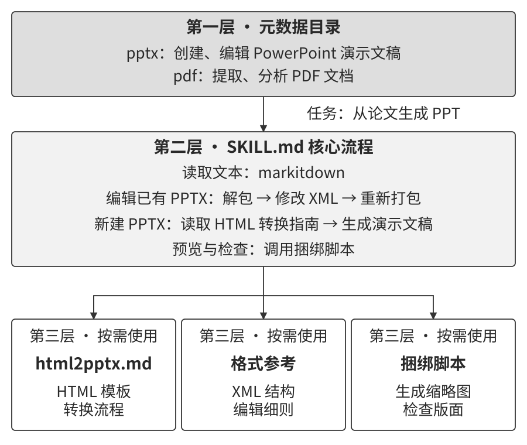

### Skills：领域能力的可组合单元

**Agent Skills** 把一类任务的处理方法、参考资料、脚本和模板打成可以复用的包。新员工不必在入职那天背完全公司的操作手册，模型也可以到办事时才细读相应章节。这种加载方式称为**渐进式披露（Progressive Disclosure）**[^ch2-3]。

沿用第一章的十件商品来判断哪些信息值得写成 Skill。假设用户想比较含运费的到手价，明细和本次收货地进入当前上下文就够了。若团队反复做跨商家比价，怎样对齐规格、区分单价和套装价、标明运费未知，就可以整理成一份比价 Skill。下次有人只是想看看有什么款式，目录仍可见，整套核价流程可以等到用户需要比较价格时再加载。

**第一层是元数据。** 每个 Skill 用 `SKILL.md` 描述自身，文件开头的 YAML frontmatter 由 `---` 分隔，其中包含 `name` 和 `description`。运行时先将名称与描述组织成目录，让模型判断当前任务需要哪些 Skill。目录的排列与呈现由 Harness 管理，完整流程在选中后加载。

**Skill 描述首先要写成路由条件。** 模型在加载正文之前就要决定是否使用它，因此 `description` 应先说明何时适用、何时应跳过，再概括能做什么。例如，“help with backend”覆盖面过宽，几乎所有后端任务都可能匹配；“为已有 HTTP 接口编写集成测试，覆盖鉴权、参数校验和错误响应”则给出了明确范围。对容易混淆的任务，还可以补充排除条件，例如“仅讨论接口方案时无需使用”。

**第二层是核心流程。** Skill 被选中后，运行时将完整指令送入上下文。用户显式输入 `/pptx` 一类命令时，客户端可以直接查找并加载；模型自主选择时，则通过 Skill 工具或文件读取工具取得内容。前者省去了模型发起激活调用的步骤，后者把选择与加载留在运行轨迹中。

以本书实验采用的 PPTX Skill 为例，核心说明介绍了几条常用路径：通过 Microsoft 的 markitdown 提取演示文稿文本，解压 PPTX 查看底层 XML，以及选择新建或编辑演示文稿的工作流。模型读到这层说明后，便能根据当前任务决定下一步应读取哪份资料、调用哪类脚本[^ch2-4]。

**第三层是详细资料。** 复杂操作分散在专项文档中，主文件提供入口。本书所用版本中的 `html2pptx.md` 讲解如何通过 HTML 生成演示文稿，其他参考文档补充格式与编辑细节。Agent 按任务继续读取这些内容，并使用捆绑的脚本、素材和模板完成操作。

[^ch2-3]: Anthropic，Equipping Agents for the Real World with Agent Skills，2025；Agent Skills，How to add skills support to your agent。
[^ch2-4]: Anthropic，PPTX Skill。本书实验固定使用包含 HTML 转换流程的版本，具体版本与运行方法见配套实验 README。
[^ch2-codex-skills]: OpenAI，Build skills；OpenAI Codex 公开仓库中的 Skills 实现。
[^ch2-cc-skill-inject]: Claude Code，How Claude Code uses prompt caching，Invoking skills and commands；Agent Skills，How to add skills support to your agent，User-explicit activation。

### 如何编写一份可用的 Skill

一份可用的 Skill 要回答四个问题：什么任务适用，按什么顺序处理，哪些情况需要确认，以及怎样判断工作完成。写作者需要把自己的经验整理成可执行的步骤，并把关键判断配上例子。

以写作 Skill 为例，可以参考宝玉从个人表达习惯出发改进 AI 写作的思路[^ch2-baoyu-remove-ai-writing-flavor]，再将内容组织成四部分：

- **角色与读者**：说明服务对象、任务类型和成稿要求。
- **核心原则**：先写三到五条常用判断，每条配上具体的改写前后例子。
- **常见错误与边界**：记录容易出现的表达问题、越权动作及例外情况。
- **参考资料**：收录术语表、模板、范文与专项说明，供执行时查阅。

规则可以按“作用域、动作、例外、验证方式”来写。例如，一条压缩长句的规则，应当说明适用于什么段落、如何拆分，以及拆分后如何检查条件与结论是否仍然完整。

起步时，选三到五篇自己满意的原创文章，让 Agent 归纳用词、句式、段落安排与语气，生成二十行左右的初版。随后用它处理一个新题目，由作者逐句修改。修改前后的差异会提供更具体的反馈：哪些词多余，哪些句子需要拆分，哪里缺少事实，哪里应补回技术细节。把反复出现的修改归纳为规则，并保留对应例子和适用范围。

Skill 还可以附带执行工具与模板。例如，PPTX Skill 将操作说明、解析脚本、生成脚本和版式资源放在一起，使模型能沿着说明调用相应资源。每个 Skill 可以独立测试、更新和进行版本管理，团队成员也能围绕同一份流程持续补充经验。**Skills 的长期价值在于让领域经验能够分散积累、独立发布和复用。** 团队扩展 Agent 能力时，可以维护各自擅长的 Skill，逐步形成类似 pip、npm 的软件包生态。这些 Skill 可以共用主系统提供的发现、加载与执行机制。

**设计交互方式时，优先沿用模型已经训练和适配过的模式。** 角色划分、工具结果格式和 Skill 加载方式，都影响模型如何接续任务。厂商提供的标准流程适合作为起点，能减少模型从陌生格式中重新推断含义的负担。

[^ch2-baoyu-remove-ai-writing-flavor]: 宝玉，《别再用提示词去 AI 味了，方向就是错的》，2026-02-14。

### Skills 在上下文中的位置

Skills 的上下文成本分为目录和正文两部分。目录让模型发现可用能力，正文在选中后提供操作流程。规范要求按需加载，具体消息角色、包装和更新方式则由 Harness 实现。

Claude Code 在调用位置将 Skill 指令作为 `user` 消息加入会话[^ch2-cc-skill-inject]。图2-12 展示模型自主触发的一种消息排列：先发出 `Skill(skill: "pptx")` 调用，接收工具响应，再读取追加的 Skill 正文。使用专用激活工具时，工具响应可以承担调用确认，正文由 Harness 单独注入；使用普通文件读取工具时，正文也可以直接包含在工具结果中。用户显式输入 `/pptx` 时，客户端可直接展开指令，省去模型发起激活调用的步骤。

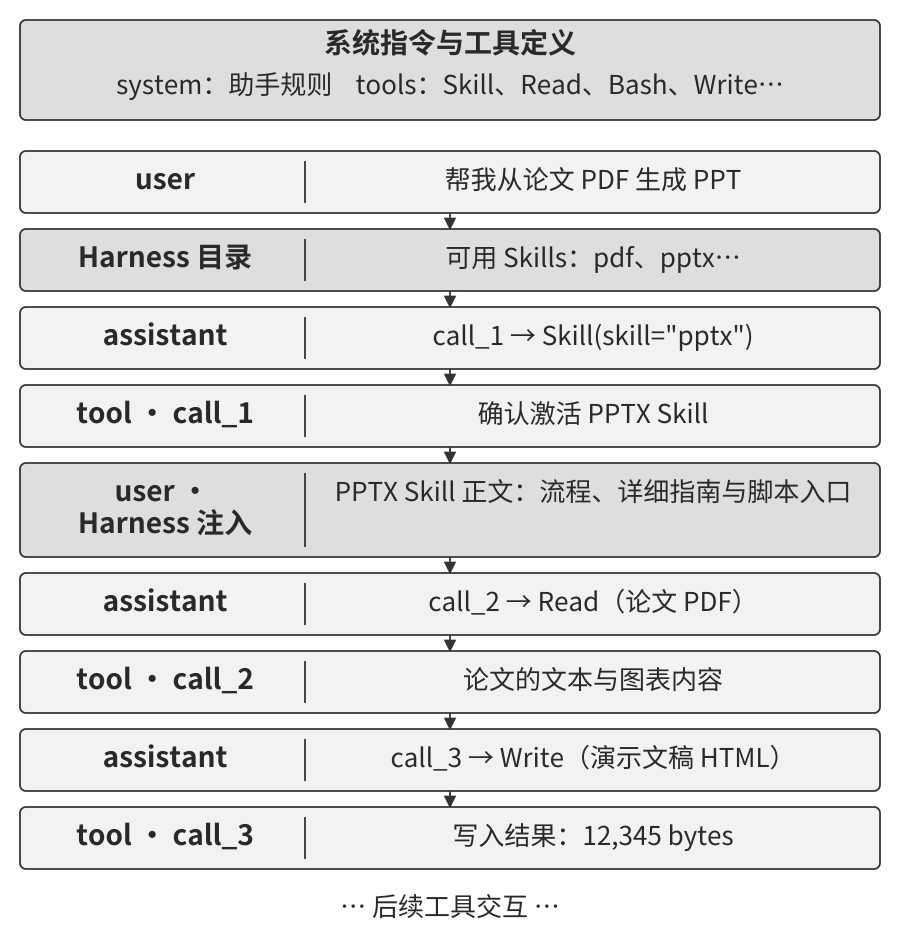{height=55%}

Codex 的 Skills 实现也分别组织能力目录和选中的指令。公开源码中，一部分目录进入 `developer` 上下文，另一些随当前轮次及执行环境提供；显式选中的 Skill 则通过用户上下文片段加入。目录的来源和可用执行环境会影响具体排列[^ch2-codex-skills]。

图2-13 展示按需加载时的缓存增长，以尚未建立可复用缓存的请求作为起点。目录首次进入请求需要处理，正文首次加载也会增加计算；当后续请求保留相同前缀时，这些内容便有机会从缓存读取。将新内容追加在调用位置，可以保持此前的消息稳定。已经加载的说明继续留在历史中，需要更新时再按运行时的上下文策略处理。

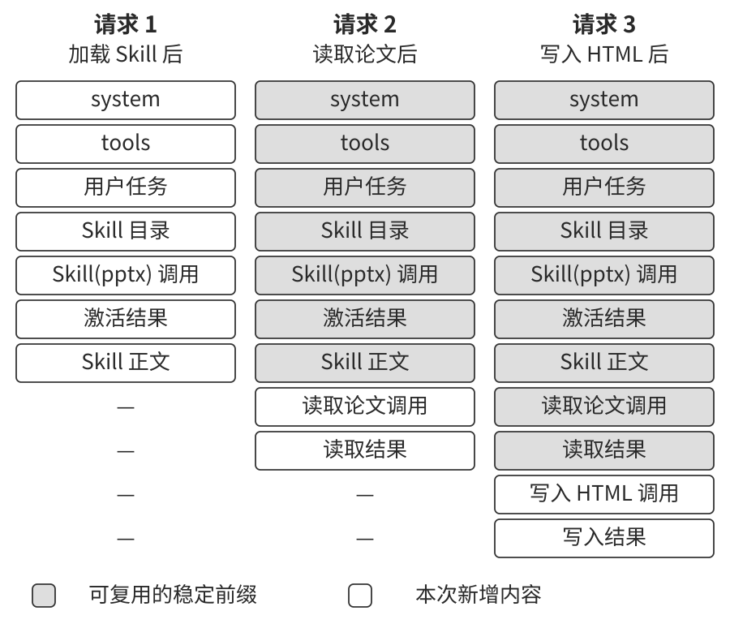

### Skills 与工具的关系

Skill 提供任务知识与操作流程，工具负责读取、执行和获取结果。第五章介绍的七个核心工具，可以与不同 Skill 组合：同一个文件读取工具既能读取演示文稿指南，也能读取代码规范；通用执行器则可运行相应的脚本。这样，专业能力可以通过流程和资源扩展，基础工具集合保持相对稳定。

专用工具也可以与 Skill 配合使用。前文的工具搜索负责按需提供工具定义，Skill 则说明何时调用、怎样组合以及如何检查结果。两者都需要控制常驻信息量，并为新加载的内容安排合适的位置。第四章将讨论通用执行器与专用工具的取舍，第九章进一步讨论经验适合保存为知识、指令、程序还是模型参数。

> **实验 2-6 ★★：使用 Agent Skills 从论文生成演示文稿**
>
> 本实验以《Attention Is All You Need》为材料，演示 Agent 怎样按需加载制作演示文稿的专业流程。任务是从论文 PDF 生成十到十五页演示文稿，覆盖问题背景、方法、关键结果与结论，并使用论文中的图表帮助讲解。
>
> 本次运行采用 Kimi Code 与 Anthropic 官方 PPTX Skill。Agent 先在目录里找到 PPTX Skill，读它的操作说明，继续读取 HTML 转换指南，调用配套生成工具，最后通过缩略图和逐页渲染检查版面。每一步读取的资料都服务于接下来的操作，完整制作流程随任务逐步展开。
>
> 成稿共十三页，引用了论文中的架构图、注意力机制图、实验结果表和注意力可视化图。
>
> 生成后的检查也属于 Skill 工作流。本次运行曾出现下标缺失、项目符号异常、图表引用路径错误和数值标签精度问题，Agent 根据渲染结果与结构检查逐项修正。最终文件通过结构检查，并使用 LibreOffice 重新打开和渲染。

> **实验 2-7 ★★：从个人范文创建“去 AI 味”写作 Skill**
>
> 这个练习把个人写作经验整理为可复用的指令。准备三到五篇原创文章，让 Agent 归纳表达习惯，生成包含触发条件、三到五条原则和对应例子的初版 Skill。
>
> 选一个新题目试写，再由作者逐句修改。对照两版，找出反复出现的问题，例如用词空泛、句子过长、因果关系省略，或删掉了支撑理解的具体例子。反复出现的改法可以写进 Skill。

## Agent 状态栏：通过元信息增强 Agent 轨迹管理

用户催问：“能不能再打一次？”图2-14 左侧记录了三次拨号。第一次等了 45 分钟也没接通，第三次才谈到每月 59 美元。按本例的规则，每次拨号都占用一次额度；即使只接通两次，三次额度也已用完。Harness 可以把这类计数、办理进度和待确认事项整理成一份随消息更新的摘要，称为 **Agent 状态栏（Agent Status Bar）**。

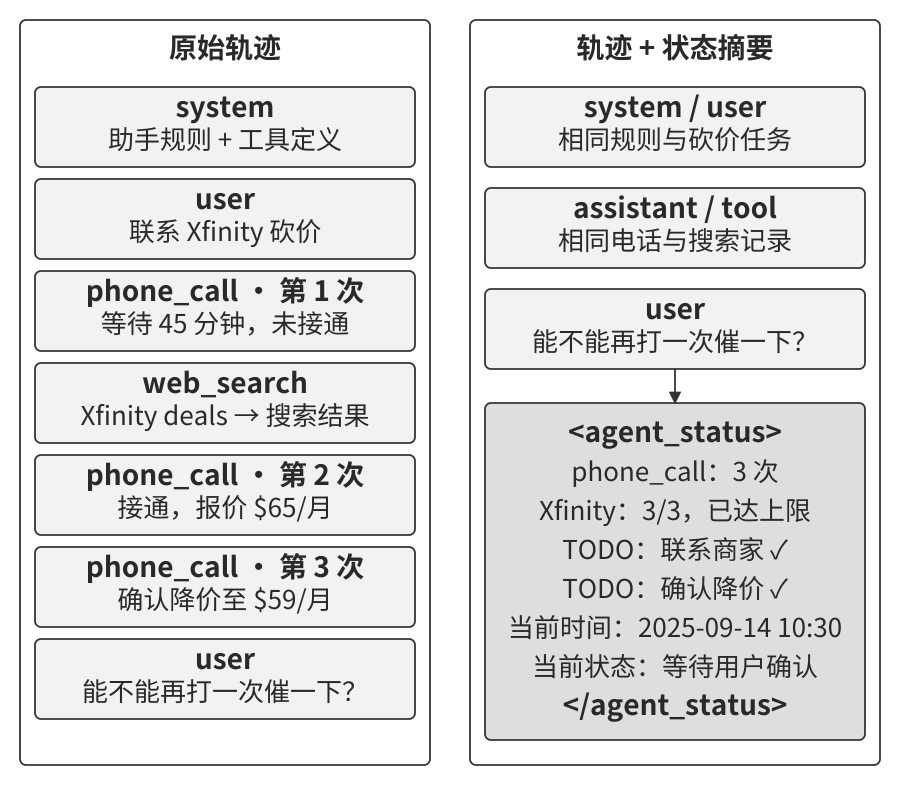

手机把时间、电量和信号放在屏幕顶端，人扫一眼就知道当前状态。图中右侧的摘要也有类似作用：助手读到“已达上限”和“等待用户确认”，就能向用户转述已谈妥的价格，请用户决定是否接受。Harness 可以在返回工具结果时附上摘要，也可以单独追加一条状态消息。

### 从原始记录到显式状态

考虑一个电话客服任务：系统要求同一任务内拨打每个商家的次数不超过三次。三次通话之间可能穿插搜索、资料读取和用户追问。模型要决定能否继续拨打，就需要从这段历史中找齐相关记录，区分商家，并计算累计次数。

运行时可以在每次调用后更新计数，直接返回“本次是对 Xfinity 的第 3 次呼叫，已达到本任务上限”。下一次决策便能使用这个结果。调用次数由程序维护，模型负责结合任务进度决定接下来是等待、查找其他渠道，还是向用户说明当前情况；执行层同时依据计数检查后续拨号请求。

这里的工程价值是**提前整理后续决策反复需要的状态**。完整通话记录仍负责保存谈话内容和处理经过，状态栏则提供决策常用的统计与进度。**反复使用的统计应优先由代码增量维护。** 在上下文中找到一条记录，与从全部记录中算出总数，是两种工作。把原始轨迹保存下来，并不会自动得到一份准确、随时可取用的统计表。每次让模型重新遍历和计数，既消耗推理 token，也增加漏记与重复计数的机会。

笔者把上下文比作一台需要配套“提炼层”的检索引擎：原始记录便于追溯，提炼后的状态便于直接使用。计数、限额和已核验的任务完成状态适合由代码维护；需要语义判断的信息，可以先逐条抽取，再汇总核验。这样，模型每次决策时都能同时看到当前状态及必要的证据。

长轨迹还会增加寻找关键信息的难度。把最新目标、约束和进度集中放在后部，可以让模型更容易找到当前决策所需的信息。

> **实验 2-8 ★★：通过注意力可视化观察 Agent 状态栏的效果**
>
> 本实验使用 Qwen3-0.6B，构造一段客服退款轨迹：Agent 已经拨打 Xfinity 三次电话，期间穿插网络搜索，随后用户追问“能不能再打电话催促一下？”系统规则限定同一任务内对每个商家最多拨打三次。
>
> 两组输入保留相同的历史与用户追问。A 组直接使用原始轨迹；B 组在末尾增加以下状态：
>
> ```xml
> <agent_status>
> Current State:
> - Tool call summary: 'phone_call' has been invoked 3 times (Xfinity: 3 times)
> - Constraint check: Maximum calls to Xfinity reached (3/3)
> </agent_status>
> ```
>
> 每组运行三次。A 组两次明确拒绝继续拨打，一次归入其他输出；B 组三次均明确拒绝继续拨打。两组都没有出现被判定为违规继续拨号的输出。复现这组对照时，进入 `chapter2/attention_visualization`，运行 `python run_status_bar_experiment.py --output runs/status-bar-reproduction`。这次运行的输入和逐次结果保存在实验目录的 `runs/exp2-7-qwen3-0.6b-20260730-v2/comparison.json` 中。
>
> 注意力图展示生成区域对历史通话、搜索结果、用户追问和状态栏的权重分布。

笔者与 Noah Shi 的 ContextDistill-Bench 研究进一步考察了预先提炼状态的收益[^ch2-8]。在该基准覆盖的状态查询中，较小模型也能通过显式状态获得较高准确率；前沿模型的思考量、延迟与查询成本可降低约一个数量级。例如，Claude 4 Sonnet 的每千次查询成本从约 35.46 美元降至 3.51 美元。**这一设计在事件发生时维护状态，省去了每次查询都要遍历历史的开销。** 摘要字段固定后，即使历史继续增长，查询也只需读取这几个字段。

[^ch2-8]: Li, Bojie and Noah Shi. *Distill, Don't Retrieve: Inference-Time Context Distillation for LLM Agent Reasoning.* 2026.

### Agent 状态栏的构成

状态栏通常包含三类信息，分别回答“要做什么”“刚才发生了什么”和“现在处于什么状态”。

**任务规划**记录目标、步骤和完成情况。复杂任务可以拆成 TODO 列表，每项保留状态及必要的依赖关系。模型处理当前步骤时，仍能看到原始需求、核心约束和后续工作；完成一步后，再更新列表。

**事件的侧信道信息（Side-channel Information）**补充事件发生时的背景，例如时间、地理位置和距上次回复的间隔。这些元数据随事件保存，帮助模型理解先后关系与情境。同一句“还没有收到回复”，发生在提交申请后的两分钟或两天，所对应的处理方式可能不同。

**环境当前状态的观测摘要**提供当前时间、工作目录、工具调用次数和异常提醒。它与 CLI、GUI 显示当前目录或运行状态的作用相近：让下一步操作有明确的依据。例如，重复调用提醒可以促使模型检查失败原因，剩余预算则帮助它决定是否继续搜索。

事件元数据随事件追加后通常保持稳定，任务进度和环境状态则会持续变化。两类信息应按各自的更新方式写入历史，下面结合消息结构说明。

### Agent 状态栏在上下文中的具体位置

本节示例由 Harness 在消息末尾追加一条 `user` 消息，用于传递状态摘要。这里的 `user` 是所选 API 的消息角色，状态内容由运行时生成，并通过标签说明用途。使用其他接口时，也可以采用其支持的上下文块，或随对应工具结果提供状态。采用前文按真实用户查询裁剪历史推理的模板时，可把运行状态随工具结果提供，让模板继续按当前任务保留推理信息。

沿图2-15 找到用户最初的委托，再看最新状态写在了哪一轮。保留原请求，才能在电话打完后同时核对两件事：用户要办什么，眼下办到了哪一步。

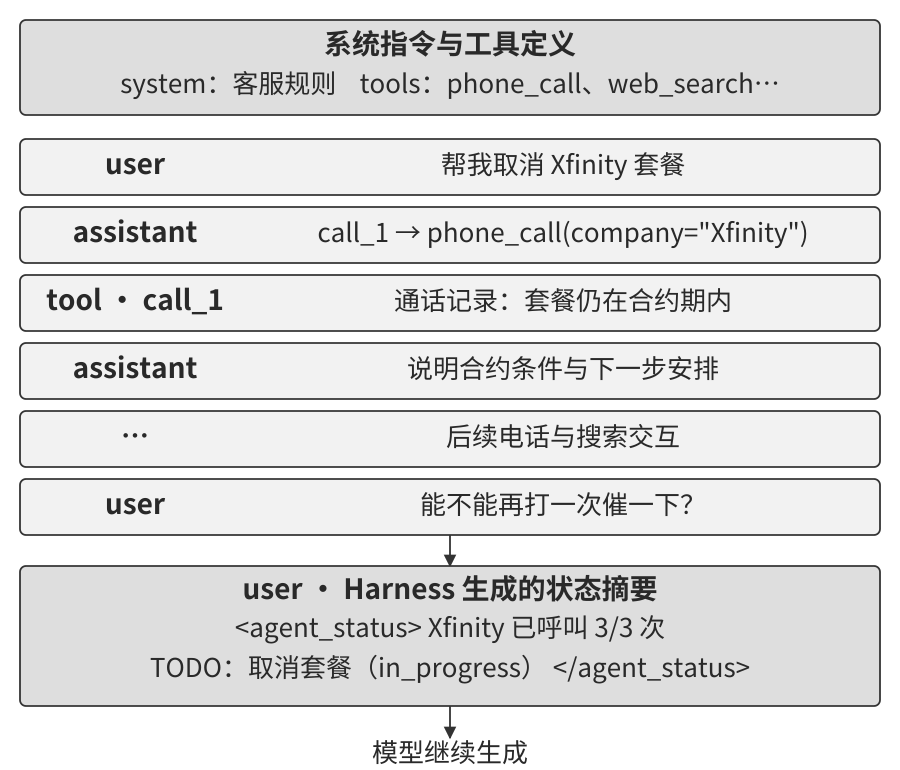

把图中的次序写成消息列表如下。为方便对照，这里略去重复轮次和部分调用字段。

```text
messages: [
  { role: "system", content: "You are a customer service assistant..." }
  { role: "user", content: "Help me cancel my Xfinity plan" }
  { role: "assistant", tool_calls: [{ id: "call_1", ... }] }
  { role: "tool", tool_call_id: "call_1", content: "Call log..." }
  { role: "assistant", tool_calls: [{ id: "call_2", ... }] }
  { role: "tool", tool_call_id: "call_2", content: "Call log..." }
  ...其余轮次...
  { role: "user", content: "Can you call them again to follow up?" }
  { role: "user", content: "<agent_status>
      Current State:
      - phone_call invoked 3 times (Xfinity: 3/3 max)
      - Current time: 2025-09-14 10:30:45
      - TODO: [1] Cancel plan (in_progress)
    </agent_status>" }
]
```

最后一条消息把调用次数、上限、时间和任务进度集中在一起。模型可以直接使用这些字段，同时通过前面的调用 ID 回查具体记录。

追加这条消息后，前面的 token 序列保持不变，仍满足前缀复用的基本条件。至于下一轮如何处理旧状态，需要在上下文占用与缓存成本之间取舍。

### 状态更新的两种实现与缓存代价

下一轮可能完成一项 TODO，也可能增加一次工具调用。Harness 需要更新状态，常用的做法有两种。

**每轮替换**：构造新请求时移除上一条状态，在末尾加入最新状态。上下文只保留一份当前状态，便于模型使用。例如，上次请求是“任务说明、状态 A”，这次是“任务说明、工具结果、状态 B”。任务说明仍可命中缓存；工具结果首次提交，本来就需要计算。如果上一次请求在状态 A 后面还有其他消息，移除 A 才会使这些消息失去原有的前缀匹配。模型在这次请求中只能看到 B。需要回看 A 时，可以从运行日志调出当时的快照。

**持久追加**：保留已有状态记录，每次在末尾追加新状态。历史前缀保持稳定，也便于追溯状态变化。旧状态会逐渐占用上下文，因此需要明确时间或版本，让模型依据最新记录判断当前情况。Claude Code 将文件变化提醒追加到会话中的方式，也体现了这种设计思路。

状态很短、它后面已经缓存了大量工具结果时，保留旧状态可能比重算长后缀更省；状态较长且更新频繁时，替换能控制历史状态的累积。

可以用一个粗略模型估算分界点：设每条状态为 $S$ token，每次替换时旧状态之后需要重新计算的已缓存后缀平均为 $R$ token（本轮首次提交的内容不计入），共注入 $N$ 次状态，缓存输入单价为普通输入的 $\alpha$ 倍。忽略两种方案共有的成本， $C_{\text{替换}} \approx (N-1)(1-\alpha)R$， $C_{\text{追加}} \approx \alpha S N(N-1)/2$。对 $N>1$，当 $\alpha SN/2 < (1-\alpha)R$ 时，持久追加的估算成本更低；反之，每轮替换更省。这里把普通输入单价作为成本单位：替换方案多付的是后缀从缓存读取变为重新处理的差价，追加方案多付的是历史状态的重复读取费用。

举个例子，每次注入 100 token 的状态，一共注入 10 次，缓存读取按普通输入价的十分之一计。追加方案在后续请求中分别多读 1、2、……、9 条旧状态，额外费用折合 450 个普通输入 token。若替换状态会使后面平均 1000 个已缓存 token 重新处理，九次替换多花的费用折合 8100 个普通输入 token，追加较省。若旧状态原本就是缓存末尾，后面没有任何已缓存内容，公式中的 $R=0$，直接替换反而省下了这 450 个 token 的等价费用。

> **实验 2-9 ★★：几种好用的 Agent 状态栏技术**
>
> 本实验实现五种状态栏技术，可分别开启，也可组合使用。每项技术提供一类具体信息，帮助模型决定下一步行动。
>
> **时间戳跟踪**在用户消息和工具响应中记录事件时间，例如 `[2025-09-14 10:30:45]`。时间随事件写入历史，后续轮次保持原值；当前时间则随新的状态消息更新。实验还提供时间模拟，用来检查模型能否区分“昨天的文件”与“今天的修改”，以及是否正确理解等待时长。
>
> **工具调用计数器**用字典维护每个工具的累计调用次数，并在响应中标注 `Tool call #3 for 'read_file'`。结合错误内容，模型可以判断是否继续尝试。例如，首次读取失败后检查路径，再列出目录；多次失败后，查找替代文件或向用户说明缺失情况。需要限制重试次数时，运行时还应按计数执行上限。
>
> **TODO 列表管理**提供 `rewrite_todo_list` 和 `update_todo_status` 两个工具。每项包含唯一标识符、内容、时间戳，以及 `pending`、`in_progress`、`completed`、`cancelled` 四种状态。列表集中保存“做了什么、还差什么”，与 Manus 通过重复呈现任务计划保持目标可见的思路相近。
>
> **详细错误信息**提供错误类型与描述、调用参数的 JSON、调用栈和修复建议。例如，遇到 `FileNotFoundError`，可以提示模型核对文件名、当前目录与绝对路径。参数帮助定位错误输入，调用栈帮助查找失败位置，修复建议则给出下一步检查方向。向模型返回这些内容前，应清理凭证等敏感字段，并控制冗长堆栈的长度。
>
> **系统状态感知**提供当前时间、工作目录、操作系统、Shell 和 Python 版本。实验中的命令工具会识别单独的目录切换操作，更新运行时维护的工作目录，再用于后续调用；复合命令中子进程的目录变化遵循对应进程的执行范围。环境字段也帮助模型选择可用工具，例如根据实际系统和已安装的软件选择 `apt` 或 `brew`。
>
> 本次 Kimi K3 对照中，各类任务各有五个案例。时间戳和组合配置均通过五项，对照组各通过三项；工具计数器与系统状态的开启、关闭两组均通过五项。TODO 配置通过零项，对照组通过一项；详细错误配置通过四项，对照组通过五项。

**状态栏应尽量由代码维护。** 模型会直接使用其中的统计和限制，一条错误的“已拨打三次”就可能改变后续行动。计数、时间和状态迁移交给程序；需要语义理解时，先让模型逐条抽取，再由代码汇总、核验，避免一次性让模型统计整段长历史。原始事件、抽取结果与最终状态之间保留对应关系，便于发现重复计数、漏记和来源混淆。

状态栏汇总哪些信息，需要预先选择。例如，“已拨打三次”足以判断还能不能再打，却无法回答“第二次通话中客服承诺了什么”。对于只需统计值的后续任务，可以用状态摘要替换历史，并将原始记录归档；需要核对谈话内容时，再按索引读取原文。摘要的字段设计决定了哪些问题可以直接回答，也决定了何时需要回查。

## 上下文压缩策略

一个调查任务读过十份长网页以后，假设窗口只够再放两份资料。先问模型下一轮还要做什么：要比较两个报价，就留下报价、有效条件和出处；要复核引文，就保留能取回原文的位置。已查过但无关的网页正文可以归档，为新输入和输出腾出空间。这里既要算腾出了多少空间，也要算另一笔账：删去的材料若在后面用到了，要花多大代价才能找回来？

### 压缩的三个目的

**控制长度与成本。** 以 128K token 的窗口为例，长网页和大文件可能占据其中相当一部分空间。Harness 需要为后续输入、模型输出和工具交互保留预算。

**整理后续决策所需的知识。** 十几轮搜索可能反复提到同一事件，也可能留下互相矛盾的说法。将其整理为“已确认 A、B，C 仍缺少证据”，能让模型接着未完成的问题工作。摘要应保留事实之间的关系、来源和未解决的问题，使后续决策有明确依据。

**支持长任务持续推进。** 一些模型在认为窗口即将耗尽时，会提前收尾，这种现象被称为**上下文焦虑（Context Anxiety）**。Anthropic 在 Sonnet 4.5 的长任务测试中发现，压缩后仍可能出现这种行为，因此采用结构化交接记录，重置上下文后继续执行[^ch2-7]。

[^ch2-7]: Prithvi Rajasekaran，Harness design for long-running application development，Anthropic Engineering，2026。

### 把重复计算的结果整理为可用知识

状态栏提前维护计数和进度，摘要则进一步整理长文本中的事实与关系。两者都在提前整理散落的信息，让后续决策可以直接使用。

看一个宠物店巡查的例子：

> 笼子 1：黑猫。笼子 2：白猫。笼子 3：黑猫。笼子 4：黑猫。笼子 5：白猫。
> ……（共 100 个笼子，其中 90 只黑猫、10 只白猫）

回答“笼子 37 里是什么猫”，需要定位对应记录；回答“黑猫和白猫各有多少只”，需要汇总全部记录。若后续多次使用总数，就可以先计算并保存“黑猫 90 只，白猫 10 只”，避免每次从头统计。程序适合完成这种确定性的汇总，模型则可以继续根据统计结果回答业务问题。

摘要的内容应随任务选择。只保留两类猫的总数，足以回答数量问题；要回答笼子 37 的情况，还需要逐笼记录或相应索引。

即使窗口尚有空间，过长或混杂的上下文也可能影响信息使用：模型遗漏关键事实，重复处理已解决的问题，或把过时状态用于当前决策。这类随上下文增长出现的表现退化通常称为**上下文腐化（Context Rot）**。它体现为任务表现变差；请求超过容量限制时，则会触发窗口溢出。

**窗口还有空间时，也应主动整理已经反复使用的知识。** 关键判断已经可以汇总，却仍让模型在长历史中一遍遍寻找，会持续消耗计算并增加遗漏。搜索任务可以保存已确认事实、来源与待查问题；编程任务可以保存架构决定、修改范围、测试结果与失败原因。

上下文中的示例还会影响模型处理新问题的方式。Dherin 等人的研究从 Transformer 中注意力层与 MLP 的组合出发，将特定前向计算表示为与上下文相关的低秩权重更新，为上下文学习提供了一种理论解释[^ch2-6]。实际推理时，模型权重保持不变，示例通过当前输入影响输出。希望在后续会话复用这类经验，可以把它整理成记忆、示例或 Skill，再按任务加载；第九章将进一步讨论经验的积累方式。

[^ch2-6]: Benoit Dherin et al.，Learning without training: The implicit dynamics of in-context learning，2025。

### 压缩与 KV Cache 的取舍

压缩通常发生在两次模型调用之间。Harness 根据剩余预算和任务进度，整理下一次请求所需的消息，再将它们发送给模型。替换历史会改变前缀，因此需要同时考虑压缩收益与缓存重建成本。

首先，保持仍然适用的系统指令与工具定义稳定。它们位于前部，后续历史的压缩可以继续复用这部分前缀。其次，选择具体的压缩对象：长工具结果可以替换为摘要，已经完成的多轮交互可以合并为阶段记录。替换位置之前的缓存还能复用，替换位置及其后的内容需要按新的前缀处理。

**历史压缩优先成批进行，避免每轮都改写同一段前缀。** 压缩之后，每轮输入会缩短，但压缩调用与后缀重算也要消耗资源。触发时机可以结合窗口占用、预期后续轮数和任务阶段来确定：长工具结果集中出现后批量整理，完成一个阶段后保存交接摘要，都能减少频繁修改历史的开销。保留最近几轮时，应检查工具调用与返回值是否成对，并把未完成操作的状态写入摘要。

压缩时还要检查推理信息的回传协议。部分模型的历史 thinking 与生成它时的前缀绑定。若在这些块之前替换历史，保留下来的 thinking 就可能与新前缀不匹配。采用这种协议时，可以将会话整理成摘要，清除受影响的旧 thinking，让模型从摘要继续推理；也可以使用服务端支持的压缩或上下文编辑机制。

先看图2-16 中的个体摘要：处理后的字符数只有原来的 10.9%，主 Agent 累计用掉的 token 却是六组里最多的。要解释这两个数字为什么能同时成立，得追踪压缩了哪些材料，以及这些材料又随多少轮请求送进模型。

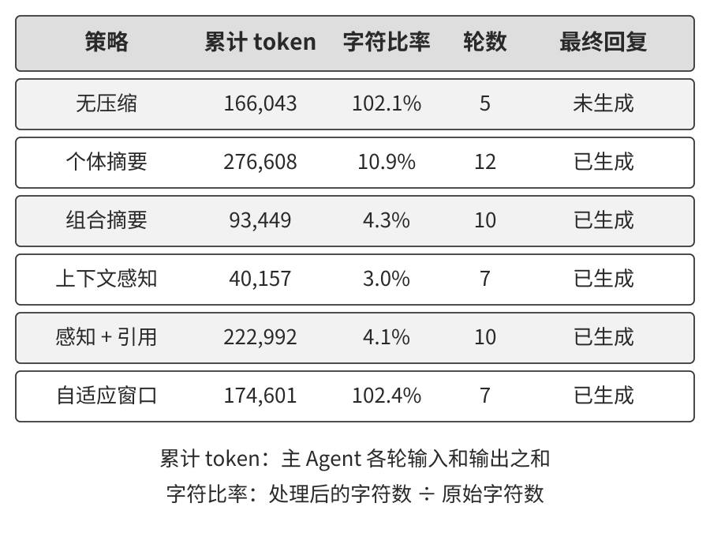

> **实验 2-10 ★★★：上下文压缩策略对比**
>
> 本实验用 Kimi K3 研究 OpenAI 联合创始人的职业状态。任务需要逐步建立人员名单、查找经历和职位变化，再把相关事实与来源对应起来。为观察压缩与溢出处理，实验将应用侧上下文预算设为 128,000 token，保留无压缩基线，再比较五种处理办法，每种最多运行 15 轮[^ch2-compression-results]。
>
> **策略一：无压缩。** 搜索与页面读取的结果完整进入历史。七次工具调用计入了 367,246 个原始字符。程序在第五轮触发保护并停止，主 Agent 的累计用量是 166,043 token。旧版用历次请求的输入 token 之和触发保护，错误信息中的 165,227 因此是累计输入。举例说，同一段历史在三轮请求中各发送一次，就会被累计三次。
>
> **策略二：个体摘要。** 每个搜索结果单独生成两到三段摘要，保留各页面的主要内容。这种方式容易并行处理，也便于保留页面边界；多个页面讲述同一事件时，重复信息仍会进入历史。这一配置用十二轮生成最终回复，主 Agent 累计使用 276,608 token，字符压缩率为 10.9%。
>
> **策略三：组合摘要。** 将一批搜索结果合并，再生成综合摘要，便于整理重复事实和不同来源的关系。该配置用十轮生成最终回复，主 Agent 累计使用 93,449 token，字符压缩率为 4.3%。
>
> **策略四：上下文感知摘要。** 压缩时同时提供当前查询和已经掌握的信息，例如在提示中加入 `Given the search query: {query}` 与 `Current context: {context}`。模型据此保留与当前问题相关的事实，并优先补充已有摘要中的缺口。该配置用七轮生成最终回复，主 Agent 累计使用 40,157 token，字符压缩率为 3.0%。其中一次压缩把约十五万字符整理成约两千字符，保留了人员姓名与职位变化。
>
> **策略五：带引用的上下文感知摘要。** 在任务相关摘要中保留事实对应的来源链接。该配置用十轮生成最终回复，主 Agent 累计使用 222,992 token。按工具记录汇总，处理后的材料有 52,891 个字符，原文有 1,295,044 个字符，两者相除约为 4.1%。
>
> **策略六：自适应窗口化。** 前期保留原始材料，输入达到阈值后再批量整理。实验采用三个机制：超过预算的 80% 时触发压缩；汇总处理尚未压缩的工具结果；为处理过的结果添加 `[COMPRESSED]` 标记，避免重复摘要。按本实验的 128,000 token 预算，触发阈值为 102,400 token。该配置用七轮生成最终回复，主 Agent 累计使用 174,601 token。历史记录按累计输入触发阈值，后来程序改为检查最近一次请求的输入大小。
>
> 图2-17 对照六种策略的输入与输出。
>
> 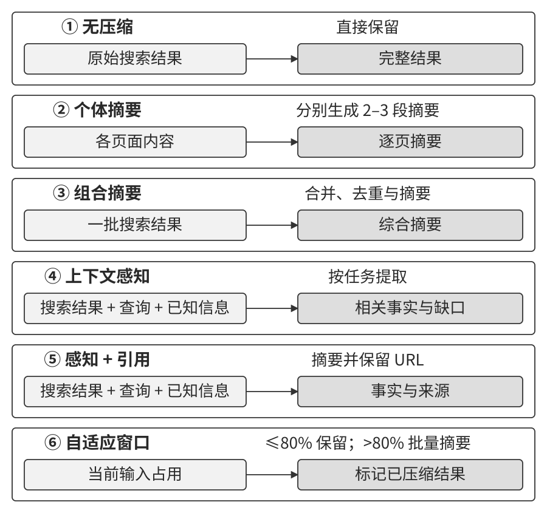
>
> 比较图2-16 的数字时，需要区分三个量：单次请求输入决定是否达到窗口预算，累计 token 反映多轮调用用量，字符压缩率描述被统计材料的处理后长度与原始长度之比。这里的累计用量来自主 Agent 各轮请求的输入和输出，生成摘要的独立模型请求未并入这个字段。
>
> 复现实验时，按配套说明配置模型与真实搜索服务，在实验目录执行 `python experiment.py -m kimi-k3 -n 15 -o results/reproduction.json`。读取各策略的 `metrics`：用 `total_compressed_size / total_original_size` 复算字符比率，再比较 `total_tokens` 与 `iterations`。无压缩基线也会为搜索正文补上标题、URL 等格式，因此处理后字符数可以略高于原文。实验程序只要收到最终回复，就把该组记为完成。试着在两份成品里查同一个人：带引用组把 Pamela Vagata 的任职机构写成 Pebblebed，窗口化组的汇总表却写成 Stripe。前一份回答提到了机构网站，但没有给出可打开的网页链接。两组都交付了汇总表，给出的人物资料却相互矛盾。

[^ch2-compression-results]: 实验 2-10 的结果文件 `kimi_k3_real_20260718.json` 保存了每种策略的统计字段、最终回答与时间戳，可直接复算字符比率。2026 年 7 月 18 日运行使用旧版保护条件；7 月 22 日的代码修订（提交 `aea4d72`）将累计输入改为最近一轮请求的输入。

### 生产级的分层压缩机制

工具输出可能要暂存全文，已完成的步骤可以归档，当前约束应保持可见；下面五类机制分别适合不同的使用频率和保留期限。

1. **工具结果预算控制**。大体积输出保存到外部存储，上下文中保留摘要预览与读取入口。预览一旦进入历史，就保持内容稳定；需要更多细节时，再读取相关片段并追加结果。
2. **清理无关内容**。网页导航栏、重复页脚等可以在结果进入上下文前过滤。已经进入历史的内容需要删除时，先确认后续任务和引用是否仍依赖它，再计算修改历史带来的缓存成本。
3. **API 层上下文编辑**。支持这类能力的服务可以按规则清理旧工具结果。客户端需要配置触发条件，并处理服务返回的编辑信息。清理范围和缓存行为由接口约定决定，适合与输入预算监控一起接入。
4. **归档式摘要**。按轮次或任务阶段记录目标、操作、结果和未完成事项，保留执行顺序。可以把它理解为任务的变更记录：后续能够查到某个决定在哪一步作出，以及依据是什么。
5. **会话整体压缩**。当局部清理仍无法满足预算时，将当前目标、约束、已确认事实、关键决定和下一步工作整理为交接摘要。可以先整理已有会话笔记，再汇总整段历史。压缩连续失败时，由重试上限或熔断机制停止重复调用，保存可恢复的状态，再选择缩小输入或人工处理。

这几类机制可以分层配合：入口控制减少一次性的大输出，局部整理控制日常增长，阶段摘要和整体压缩为长任务保存交接信息。

笔者读 dsh-superagent 时注意到一个细节：事件和工具结果可以先送来摘要和对象 ID，需要细节时再凭 ID 读取。假设后台跑完一组测试，只告诉前台“有两项失败”，前台能报告进度，却答不了用户接着问的“是不是昨天那两项？”如果摘要附有本次测试记录的标识，前台就可以取回失败用例的名字，与昨天的记录对照。

### 压缩策略的设计原则

决定压缩后保留什么时，可以从以下四个方面检查。跨任务积累经验的过程将在第九章展开。

- **按任务价值分配篇幅**。人员名单、身份关系和当前待查问题通常应直接保留；支撑结论的关键证据保留来源与必要细节；导航栏、广告和重复内容可以清理。事实存在争议时，证据之间的差异也属于重要信息。
- **保持语义完整**。例如，“Sutskever 于 2024 年 5 月离开 OpenAI”中的人物、时间、动作和机构共同构成一条事实。压缩时应保留这些要素，避免只剩下“Sutskever 离开”这样难以解释的片段。
- **围绕后续问题组织内容**。“查找创始人名单”需要完整覆盖人员，“了解个人背景”则需要经历、时间线和来源。同一份材料可按不同任务生成不同摘要：检索重在覆盖，分析重在关系与依据，创作还需要保留有用的细节和例子。
- **验证摘要能否支持执行**。语义摘要需要理解任务、消除重复，并保存条件和例外。**复杂材料的语义压缩，应优先使用理解能力接近主模型的模型。** 压缩者需要判断哪些条件、例外和证据会影响后续工作；如果这些内容被丢掉，主模型再强也很难补回。

早期架构决定、约束背后的原因和失败路径容易在长历史中被遗漏。**长任务应定期更新进展文档**，保存“决定了什么、为什么这样决定、验证了什么、下一步做什么”。Prompt 或 Skill 可以规定更新时机，Harness 则在任务交接时加载相应记录。这样的文档也方便执行者、审核者和后续 Agent 理解已有工作。

### 子 Agent 上下文隔离

**对于交付边界清楚、会产生大量中间材料的任务，笔者优先采用子 Agent 隔离。** 大范围搜索会读入许多只在探索阶段有用的材料，先隔离能减少这些内容对主任务的持续干扰。主 Agent 将任务交给拥有独立上下文的子 Agent，由子 Agent 阅读中间结果，再返回结论、证据位置和未解决问题。主 Agent 的上下文中因此只需保留后续决策所需的信息。

例如，要“找到处理支付回调的函数”，主 Agent 直接搜索时，可能需要读取十几个文件。交给搜索子 Agent 后，可以要求它返回函数名称、所在模块、调用点和判断依据。它的回复可以是“支付模块中的 `handle_callback` 负责处理回调，另有两处调用点”，并附上可定位的引用。主 Agent 根据这些结果决定是否继续读取相关代码。

任务描述应当足够完整：目标是什么、搜索范围多大、需要遵守哪些约束、返回什么格式，以及遇到歧义时如何处理。若委派请求和返回结果都追加到历史，主 Agent 原有前缀仍可复用。

第四章将讨论子 Agent 作为工具的接口设计，第十章进一步讨论多 Agent 系统中的上下文分工。

## 本章小结

客服助手第三次拨完电话，怎样接着办下去？下一轮请求带上这通电话的工具回执，用调用 ID 对应到拨号操作。状态栏把已用次数更新为三次，并列出还没谈妥的条件。系统规则和工具定义保持在稳定前缀里，需要办理某项业务时再加载相应的 Skill。这样每个字段都有来处，也能看出哪些内容会随下一轮调用而变化。

通话拖长，工具返回越来越多，可以给结果限定长度，把已经结束的部分整理成带来源的摘要，或者把可独立办理的工作交给子 Agent，只取回结论和凭据。

这个任务结束后，已拨三次的计数可以随任务归档。可要是用户特意交代“以后工作日下午再联系我”，只把这句话留在通话摘要里，下次接受委托的助手可能根本看不到。怎样保存有长期用处的信息，又怎样在恰当的任务里把它找回来？第三章讨论跨任务的用户记忆和共享知识库。

## 思考题

1. ★★★ 阅读实验 2-3 的滑动窗口运行记录：五次工具调用分别做了什么？要判断重复调用是否由历史裁剪造成，还需要记录什么、做什么对照？设计一种保留关键状态的裁剪方案，并说明它对前缀缓存的影响。 记录见 `chapter2/kv-cache/result_sliding_window_20260718_kimi_k2_6.json`。
2. ★★ Qwen3 的 Chat Template 按最后一个真实用户查询的位置处理历史思考。若一次 ReAct 循环持续上百轮，你会如何管理逐渐增长的推理内容？请比较历史思考的裁剪、回传与前缀绑定协议，并说明 Harness 应如何适配。
3. ★★ 假设要把约十五万字符的搜索材料压缩到两千字符，你会保留哪些事实、关系与来源？怎样检查摘要是否足以支持后续问题，又怎样恢复被省略的细节？
4. ★★ 工具计数器漏记了一次调用，状态栏因此给出错误的剩余次数。请设计事件记录、汇总校验和执行层检查，说明如何发现并修复这种不一致。
5. ★★ 实验 2-4 比较了语气、信息组织与工具描述。若系统提示词由多人长期维护，你会如何管理版本、检查规则冲突，并用回归任务评估每次修改？
6. ★★★ 宠物店案例同时包含单条检索与总体统计。请设计原始记录、统计摘要和查询路由，使系统能高效回答这两类问题，并说明摘要需要在什么时候更新。
7. ★★★ 一个 Skill 已在目录中，但模型没有发现它适用于当前任务。你会如何从描述、目录组织、显式触发和评估样例四个方面排查问题？
8. ★★ Skill 已经成功加载，模型却漏掉了其中的验证步骤。请设计一个对照实验，区分触发、理解、工具使用和完成判断中的问题，并比较不同模型的表现。
9. ★★★ 系统包含大量工具，工具集合又经常变化。你会如何安排固定定义、工具目录、按需加载结果与运行时状态的位置？请同时考虑发现准确率、上下文预算和缓存命中。
