# 交互：观测与动作空间的扩展

**底层模型固定时，重新组织或扩展观测与动作接口，往往是提升 Agent 任务表现最有效的工程手段之一。** 前几章里，Agent 通常等用户说完，再查资料、调工具、给出答复。它在等工具结果的时候，用户和外部环境却还在变化。

用户委托助理改签机票。助理正向客服查询航班时，用户又发来“我还有一件行李要托运”；客服还在说话，屏幕上显示的票价也可能变。助理需要及时问清票价是否包含托运行李，也得留意刚才的报价是否还有效。这里有两个设计问题：助理能从哪些渠道得知变化，又能在什么时候作出反应？本章先讨论异步到达的邮件和工具结果，再看连续语音、屏幕变化和机器人的动作反馈。

## 模态与触发时机的扩展

**模态**描述信息与行动的形式。Agent 可以读取文本、听取声音、查看屏幕和接收力矩信号，也可以输出文字、合成语音、点击界面或驱动关节。

**触发时机**关注信息何时到达、行动何时开始，以及系统何时作出响应。信息可以由 Agent 主动查询，也可以由外部服务推送；工具可以立即返回结果，也可以先启动任务，稍后报告完成。新事件到达时，系统还需要判断是否打断当前工作，以及如何恢复被中断的任务。

| 维度 | 信息获取与观测接口 | 行动与执行接口 |
|---|---|---|
| 内容组织（第二至五章） | 上下文、记忆与知识库组织决策信息 | 工具与代码表达可执行操作 |
| 模态（本章） | 语音、屏幕、物理传感器 | 说话、点击、关节运动 |
| 时机（本章） | 主动查询、事件推送、连续输入 | 跨回合执行、取消、抢占与恢复 |

上下文承载某次决策所需的信息，观测空间描述系统可能接收的信息范围；工具提供具体接口，动作空间描述系统允许执行的动作范围。扩展接口时，这些范围仍受设备能力、参数、权限和运行环境约束。

许多工具调用接口按轮次组织消息：模型提出调用，系统补入工具结果，再发起下一轮推理。事件驱动系统需要在这套协议上管理外部变化。接口支持原生异步时，可以在工具挂起期间接收新要求，并在结果返回后继续处理；采用同步接口时，则由 Harness 使用队列、任务句柄和调度机制组织交互。后文分别讨论两条实现路线。

不同场景的反馈节奏相差很大。下表列出常见的时间尺度。

| 常见尺度 | 场景 | 观测侧的变化 | 动作侧的处理 |
|---|---|---|---|
| 秒至天 | 异步与事件驱动 | 外部事件唤醒 Agent | 先启动任务，后续事件报告进展与完成 |
| 数十毫秒至秒 | 语音 | 连续接收音频 | 流式输出，处理插话与停止播放 |
| 亚秒至秒 | Computer Use | 屏幕持续变化 | 操作后重新获取界面状态 |
| 毫秒级控制周期 | 机器人底层控制 | 传感器持续反馈 | 执行短段动作，响应控制与停止信号 |

## 异步与事件驱动：当世界主动找上门

第四章介绍了感知、执行和协作工具，本节接着讨论事件触发与用户沟通工具。事件触发工具把环境变化送入 Agent，沟通工具则让 Agent 在任务推进过程中联系用户。Harness 将这些输入输出与正在运行的任务关联起来，形成持续工作的事件循环。

### 为什么需要异步

同步调用需要等待结果返回，调用方才能继续当前流程。异步调用则先返回任务句柄（用于查询和管理任务的标识），或约定稍后通知完成，让调用方在等待期间处理其他工作。系统可以据此组织多个进行中的任务，再根据资源和依赖决定哪些操作能够并行执行。

可以把 Agent 想成一位管理邮件、电话和来访事项的秘书：等待对方回信时继续整理材料，紧急电话到达时暂存当前进度，通话结束后再恢复原任务。对应到工程实现，需要处理三件事：

- **长任务与交互分离。** 文件分析、电话或构建任务在后台推进，用户仍可以查询进展、补充要求。
- **事件优先级。** 紧急停止及时进入控制流程，常规更新进入队列，独立查询可以交给并行会话。
- **中断与恢复。** 保存任务状态，记录已经发生的操作，恢复时重新检查仍然有效的条件。

Claude Duet 的研究预览给了一个例子：用户下午两点要开会，想提前拿到对方公司的简报。他可以留一条语音消息，然后关掉应用。准备工作在云端继续，用户随时可以打开任务页看进度；需要他补充信息或简报做好时，助理再回到主对话通知他。这里，用户离开后任务仍能推进，说的是异步执行。后文要讲的全双工通话还有另一项要求：一方开口时，仍然能听见对方插话。[^ch6-duet]

模型 API 对消息的先后顺序也有约定。有些接口要求工具调用与结果完整配对后才接受下一轮请求，有些允许挂起工具并接收后续更新。应用中的异步函数负责安排等待与执行，模型协议则规定何时可以提交消息。

在图6-1 中，新消息和工具结果都可以进入队列，但它们怎样到达队列，取决于来源。服务支持推送，状态一变就能发来通知；服务只提供查询接口，适配器就要定期去查，发现变化后生成事件。定时器到期也可以产生事件。事件循环再把这些输入交给 Agent。

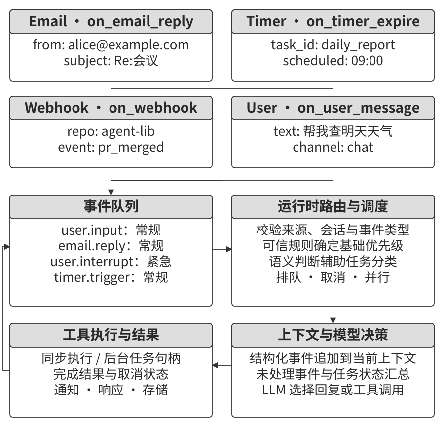

### OpenClaw 的事件驱动机制实现

OpenClaw 通过 Gateway 接入消息渠道，并将事件路由到 Agent 运行时。它的自动化机制包括内部 Hooks、定时调度、Heartbeat 和外部 Webhook 等入口[^ch6-automation]。这些机制可以按触发条件理解：

- **Hooks（事件钩子）**响应框架内部事件，例如会话创建、重置或运行生命周期变化。
- **Cron（定时调度）**按指定时间或周期执行工作。例如 `0 9 * * 5` 表示在所配置时区的每周五上午 9 点触发。
- **Heartbeat（心跳）**周期性唤醒 Agent，检查需要关注的事项。
- **Webhook（外部回调）**接收外部服务提交的事件，经认证与路由后触发处理。

周报适合按时运行，持续关注的待办可以周期检查，新邮件和服务回调则可以通过推送缩短发现时延。

**PineClaw 的通话事件。** Pine AI 代替用户拨打电话，处理账单协商、订阅取消和保险理赔等事务。PineClaw 将这类电话任务接入 OpenClaw。通话通常持续一段时间，其间可能需要用户介入：

- **身份验证。** 客服要求账户持有人完成验证，例如输入安全码或一次性密码。
- **三方通话。** 客服要求直接与账户持有人交谈，需要及时通知用户接听。
- **决策确认。** 客服提出替代方案时，前台结合这次委托和用户以往的偏好判断能否接受。需要用户拿主意时，就把具体选项发给用户，同时继续与客服核对其他条件。

例如，客服需要账户持有人加入三方通话。通知越早送到，双方在电话里空等的时间就越短。PineClaw 案例采用 Channel 机制，在 Gateway 与 Pine API 之间连接通话事件：电话接通、需要用户输入和通话结束分别进入事件流，Agent 据此更新任务并通知用户。

**笔者认为，要让主动服务来得及时，最好由事件源在状态改变时通知 Agent。** 通知经通道送达后，Harness 找到对应任务，检查是否重复、是否过期，模型再决定下一步。如果需要用户验证身份，界面应打开受信任的认证入口，验证结果随后作为新事件送回原任务。

### 事件触发工具

若把“客户回信后提醒我”交给助理，它怎样在明天恰好醒来？先查邮箱能否在来信时推送事件；只能主动查询的系统，则需要记住下次检查时间。以下三个示意接口把这些等待条件交给运行时保存，模型可以结束当前一轮工作。

**定时器（`set_timer`）**用于按约定的时间唤醒一项任务。一次性定时器适合“下周一上午 10 点致电银行查询房贷进展”；循环定时器适合每小时检查一次服务健康状况。发送邮件后等待回复、遇到非工作时间后重新拨号，也可以用定时器安排。接口需要保存时区、触发条件和任务标识，并提供取消或修改入口。外部服务只支持查询时，定时任务还可以承担进展轮询。

**后台任务监控（`monitor_shell`）**用于把长时间运行的命令转化为进展事件。启动时返回任务标识，运行时按新增输出、关键词或状态变化通知，结束时报告退出状态与结果。

让模型反复查询进度，即使状态没有变化也要消耗模型调用；只等待结束通知，又可能错过中途故障。因此，笔者建议把监控交给运行时，只在有用的进展、错误或停滞出现时唤醒模型。这样既能在构建期间继续沟通，也能及时介入异常。监控规则可设置过滤、合并和频率限制，避免每行日志都引发一次模型调用。

例如，模型给待处理的工单订阅状态更新后，就可以结束这轮推理，等通知带着工单号唤醒它。若对方只提供查询入口，模型可以自己给下次检查设个定时任务。到时查到“仍在处理”，就再约一次；查到工单已办结，就取消后续检查。两种做法都由运行时负责等待，模型只在收到通知或定时器到期时再作判断。

**外部事件通道（`connect_channel`）**用于订阅邮件、即时消息或 API 回调。通道适配器验证来源，把服务自己的标识映射为线程与关联对象，再提交统一格式的事件；后文“接入层”一节展开。PineClaw 的电话状态通知属于这一类。

三类工具都需要明确触发条件、过滤规则和事件载荷。载荷应包含事件标识、发生时间、来源、相关任务及必要内容，让 Agent 能判断事件是否仍然有效，以及下一步需要哪些信息。

### 用户沟通工具

回到改签任务。向客服发问、给用户发一条可以直接回答的确认消息、在任务记录里记下“正在等回复”，会写到三个不同的地方。用户可以暂时离开，等需要补充条件、确认决定或接收结果时再回来。

会话界面可以展示最终回复、工具进度和执行结果；沟通工具则明确指定收件人、渠道、消息内容及附件。模型决定需要表达什么，Harness 检查目标和权限，消息服务完成投递。运行时也可以把最终回复自动路由到原会话。两种方式可以配合使用。

OpenClaw 的多渠道交互使用户能够像联系秘书一样发送消息、等待进展和接收提醒。这种“活人感”来自持续的任务状态与及时沟通。用户可以在熟悉的渠道继续任务，Agent 则需要保持身份、会话和消息关联的一致。

沟通内容也可以随任务变化：简短进展使用文字，复杂结果附带图片或文件，待填写的信息采用结构化卡片，交互式成果采用第五章介绍的生成式 UI。渠道支持投递或已读回执时，系统保存相应状态；失败重试、重复消息和跨渠道同步也进入投递记录。

**多渠道通知与用户召回。**

即时通讯、短信、邮件、电话和应用推送，各自适合不同的紧急程度与内容形式。Agent 可以结合紧急程度、用户偏好、当前状态和消息长度选择渠道。需要立即确认的通话事件采用及时提醒，完整报告可以通过邮件或应用链接交付。

笔者曾让助手盯 ATC 会议的酒店房价。每天同一时间，助手都会发来消息，说房价还没降到目标价。有一次房价短暂下跌，捕捉到这个窗口的却是笔者自己写的脚本。短暂的低价可能出现在两次查询之间。即使助手及时查到了，消息送晚了，用户也可能错过预订。没有降价的日子，定时查询仍可照常运行，用户无需每天读一条内容相同的消息。第七章会用一段五分钟的降价窗口来检验这种提醒。

长任务完成时，通知把用户带回成果页面；每日总结与周报则按约定节奏发送。多渠道策略还应设置去重、静默时段和升级条件，例如首次提醒未获回应后，是否改用另一渠道。通知记录与任务状态关联，便于用户从收到的消息继续处理。

### 虚拟身份与隔离执行环境

第四章借《Her》中的 Samantha 说明通用助理如何通过工具进入数字世界。实现这类助理，需要明确它以什么身份工作、可以访问哪些资源。**笔者倾向于为通用助理配置独立的虚拟身份。** 专属的办公邮箱、电话号码、存储空间和计算环境，让 Agent 像拥有自己办公账号的秘书一样，以明确的代理身份代表用户处理事务。独立身份把助理的日常工作与用户的个人账号分开，便于单独授权、审计和撤销；发生误操作时，也更容易限制影响范围。必须访问用户账户的任务，则通过限定范围的授权获得所需权限。

电话号码归谁，决定了对方回电时谁能接着办。Manus 的 Cue 为助理提供独立号码，可以接听来电，再把通话摘要留给用户。假如商家接受助理留下的回拨号码，客服来电时就能直接找到先前经办的助理。[^ch6-cue]

以费用减免为例，助理可以用授权代表的身份联系商家。若客服要求本人做口头验证，可请用户加入三方通话，完成验证后由助理接续沟通。若商家将回拨用户，先把案件号、已谈妥的事项和需要核实的问题交给用户。向用户报告时，也要说清楚手中的证据：客服已口头答应减免，就记录这项承诺；后续查到账单更新，再报告费用已实际减免。

笔者在北京补办美国银行的信用卡时，Pine 联系银行，安排了加急补卡，并争取到免收 15 美元加急费。通话结束时，助理已经可以报告银行受理了什么、同意免去哪笔费用。过几天用户若问“新卡到哪儿了”，就需要再查物流或请收件人确认。

虚拟电脑和虚拟手机提供持续运行的操作环境。虚拟机可以运行桌面系统，容器适合隔离进程与依赖，Android 模拟器承载移动应用。它们支持后台运行，也能减少自动操作对用户当前工作的干扰。隔离范围由网络、挂载、凭证和运行权限共同决定；这些配置同时影响 Agent 能够接触的数据与外部系统。

假设你希望下班关机后由腾讯 WorkBuddy 企业版生成周报，而本周的销售表只存在办公电脑上。选择本地任务，助理可以读这张表，但电脑必须开机，客户端也要在线。选择云端任务，助理可以在你关机后继续工作，前提是先把允许用于周报的数据上传到任务，或放入云端任务能访问的资料库。如果销售表必须留在本机，就应安排在电脑在线时处理。

网页和移动应用还可能要求身份验证、验证码或人工确认。接入时优先使用服务提供的 API 与授权方式；需要图形界面认证时，可以通过 VNC/RDP 远程桌面让用户亲自登录，并在认证期间暂停自动操作。用户完成后，系统检查会话状态，再恢复任务。令牌与会话按有效期保存，撤销授权或任务结束后按策略清理。

Agent 与虚拟环境之间可以通过**共享文件系统**交换数据。例如，用户上传 CSV，虚拟电脑读取文件、执行分析并将图表写回共享存储；运行时将图表的文件位置交给 Agent，再向用户提供可访问的下载入口。大文件内容保留在存储中，模型按需读取摘要或片段。

[^ch6-dsh-threads]: DeepSeek，dsh-superagent 原型的领域模型和授权与订阅规则。
[^ch6-dsh-sessions]: DeepSeek，dsh-superagent 原型，版本 `8c32a9d`。两类会话的职责见 `docs/004-prompts.md`，执行会话与工作目录见 `docs/003-execution.md`，送入主会话的消息格式见 `docs/007-architecture.md`。
[^ch6-duet]: Anthropic，*Get started with Claude Duet*，介绍会前简报、任务页和主对话通知。
[^ch6-cue]: Manus，*Introducing Manus 2.0*，介绍 Cue 的独立电话号码、来电接听和通话摘要。
[^ch6-automation]: OpenClaw，Automation，介绍内部 Hooks、定时调度、Heartbeat 与外部 Webhook 等自动化入口。

### 接入层：多种来源，一种事件

一家网店的客服 Agent 处理一笔退款：顾客在 App 的客服对话里提出申请；金额超出 Agent 的权限，它在企业微信售后群里请主管确认；支付服务退款成功后发来 Webhook；订单系统随后在 Kafka 上发布状态变更。四条消息说的是同一笔订单，到达方式各不相同。来源一多，每条链路各自处理重试、去重和顺序，运行时就会被这些差异拆散。**接入层统一事件进入系统之后的形态，保留各来源到达之前的能力差异。** 图6-2 展示了这种分层。

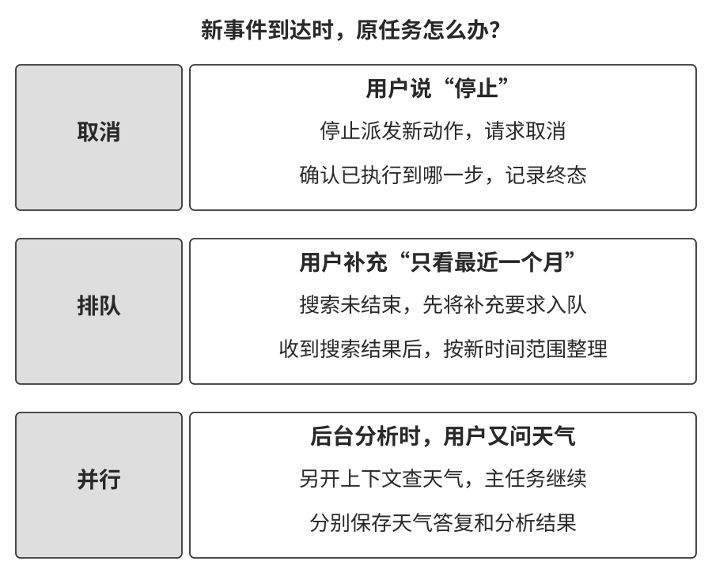

常见来源有四类。**对话渠道**包括产品自己的对话界面，企业微信、飞书、Slack 等即时通讯，以及邮件，Agent 可以回到原处答复。**回调**是外部服务在状态变化时调用的 HTTP 接口，通常带签名，只送来通知；投递失败后有的服务自动重试，GitHub 则要手动或通过 API 重新投递。**消息总线**如 SQS、Kafka，承载内部服务的业务事件，有明确的确认与保留语义。**定时器、轮询和内部事件**由系统自己产生，写入同一份日志即可。下表比较前三类。[^ch6-ingress-mq][^ch6-ingress-callback]

| | App 对话 | 企业微信 / 飞书 | 邮件 | Webhook | SQS | Kafka |
|---|---|---|---|---|---|---|
| 到达方式 | 长连接 | 回调或长连接 | 推送或轮询 | 回调 | 消费者拉取 | 消费者拉取 |
| 有序范围 | 对话内 | 多数事件不保证 | 不保证 | 不保证 | 标准队列不保证，FIFO 按消息组 | 分区内 |
| 原生去重依据 | 客户端消息 ID | 消息 ID、事件 ID | Message-ID | 投递 ID | 消息 ID；FIFO 另有 `MessageDeduplicationId` | 主题、分区与位点 |
| 能否重放 | 依赖自己的记录 | 回调本身不能重放，飞书可用历史消息接口补拉 | 可重读邮箱 | 依服务而定 | 删除后不能 | 保留期内可以 |
| 确认方式 | 客户端回执 | 时限内返回成功 | 自行记录读取位置 | 时限内返回 2xx | 删除消息 | 提交位点 |
| 回复路径 | 原对话 | 原对话 | 回信 | 无 | 无 | 无 |

**统一信封。**

适配器把原始消息转换为统一格式的**信封**（envelope）。信封只记录到达时就能确定的事实；优先级与处理期限由路由规则补充，客户等级、订单状态由业务系统补充，处理状态另行保存。顾客的退款申请可以写成这样：

```json
{
  "id": "evt_7f3a",
  "source": {"type": "app_chat", "sender": "user:u_5521", "verified": true},
  "dedupe_key": "app:msg:msg_1029",
  "thread": "app:conv:conv_88",
  "kind": "message",
  "correlation": ["order:12345"],
  "content": {"type": "text", "text": "这个订单我想退款"},
  "raw_ref": "raw/2026-11-23/app/msg_1029.json",
  "reply": {"via": "app_chat", "target": "app:conv:conv_88"},
  "occurred_at": "2026-11-23T14:02:09+08:00",
  "expires_at": null
}
```

- `source`：来源类型和经过验证的发送者。“已验证”由适配器依据签名、令牌或渠道账号判断，正文里的自我介绍不算；运行时按这一项判断权限。
- `dedupe_key`：去重键，什么算重复由来源的语义决定。投递 ID、消息 ID、分区与位点标识同一次投递，挡住传输层的重投；业务消息若带幂等键（idempotency key），例如退款单号加状态，适配器把它取出来，才能挡住业务上的重复。用户对话相反：顾客两次说“退款”是两条消息，只按客户端消息 ID 去重。
- `raw_ref`：原样保存的原始载荷，排查适配器错误时只能依靠它。
- `reply`：经由哪个出站适配器、发往哪个目标。支付回调没有回复路径，这一项为空。
- `occurred_at` 是来源给出的发生时间；`expires_at` 是有效期，报价、验证码这类事件才填。

**线程与关联。**

顾客先说“退款”，紧接着补充“算了，换货吧”，两条消息的顺序不能颠倒；另一位顾客的消息与它们无关，可以并行处理。**接入层只在线程内承诺顺序。** 适配器把来源自己的顺序单元映射为 `thread`：App 的一段对话、SQS FIFO 的消息组（`MessageGroupId`）、Kafka 的分区键、GitHub 回调里的 Issue 或 PR 编号。来源不保证顺序时，运行时靠 `occurred_at` 或来源给出的版本号识别迟到的旧状态，例如在“退款成功”之后才到的“退款处理中”。

这笔退款的四条消息分属四条线程。合并成一条的代价不小：售后群里一条无关讨论也要排在顾客消息后面，线程标识又往往兼作分区键，事后修改要迁移数据。**关联关系另设字段表达，不改写线程。** `correlation` 列出事件涉及的业务对象，任务按关联对象订阅相关线程。

**确认时机与进度分离。**

**适配器应当在事件写入接入日志之后确认来源，而不是等 Agent 处理完再确认。** 飞书的事件回调要求 3 秒内响应，企业微信是 5 秒，超时就重新推送；SQS 的消息若在可见性超时内没有删除，会被再取一次。等处理完再确认，一次稍长的模型调用就会招来重复投递。先写日志再确认，各来源的投递保证就收敛为一句话：**每个事件至少进入接入日志一次（at-least-once）**，重投的那一次由去重键挡掉。

接入日志相当于收件箱（inbox），沿用第一章的只增不改原则，按线程分区。以 Kafka 作接入日志时，去重需另设唯一约束存储或在消费端按去重键过滤：Kafka 不能按应用给的键拒绝写入，它的幂等生产者只覆盖生产者自身的重试。

系统要分开保存三种进度：

| 进度 | 记录内容 | 由谁维护 |
|---|---|---|
| 来源进度 | Kafka 位点、SQS 接收句柄、邮箱读取位置 | 适配器 |
| 分派进度 | 日志中的事件已交给哪些任务 | 路由 |
| 任务状态 | 处理到哪一步、回复是否已经发出 | 运行时 |

把位点当作任务进度，重放日志时已经发出的回复会再发一次；分开之后，重放只影响分派进度。出站方向对应发件箱（outbox）：发送前记下发送意图和幂等键，收到渠道回执再标记完成；重启后怎样核对，见后文“从邮件事件建立基本循环”。

**时效、合并与背压。**

同一条线程上每秒涌来上百个事件时，不该逐条交给模型。路由在分派前处理积压：

- **时效。** 报价、验证码、已恢复的告警过了时间就失去意义。过了 `expires_at` 的事件只记入轨迹，不再唤醒模型。
- **合并。** `kind` 区分两类事件。状态型事件描述某个对象的当前值，如支付回调里的退款状态、Kafka 上的订单状态，同一线程积压多条时只把最新一条交给模型，中间值留在日志里。消息型事件是某人说的一句话或下的一个指令，如顾客消息、主管的点击，可以成批交给模型，不能丢弃。
- **背压。** 拉取型来源可以放慢拉取，积压留在来源。推送型来源无法让对方暂停，适配器照常写日志、确认，积压转到接入日志，由前两条规则消化。

**一笔退款走完四个来源。**

1. 顾客在 App 对话里提出退款。适配器以客户端消息 ID 去重，写入日志，再回执客户端；路由按 `order:12345` 创建退款任务，任务订阅这条对话线程。
2. 金额超出权限，Agent 在企业微信售后群发出确认卡片，卡片标识记入任务。主管点击“同意”，适配器写入日志后返回成功，并按卡片标识补上关联对象。
3. Agent 调用退款接口后，支付服务两次回调“退款成功”，投递 ID 相同，第二次被去重。
4. 订单系统在 Kafka 发布“订单已退款”，和回调说的是同一件事。两个适配器若都从载荷里取出退款单号加状态作去重键，这条事件在接入时就被挡下；若分别按投递 ID、分区与位点去重，两条都进入日志，运行时发现任务里退款已经确认，只把它记入轨迹。
5. 回调和 Kafka 事件都没有回复路径。运行时用第 1 步那条对话线程的 `reply`，经 App 出站适配器通知顾客。

第 4 步是接入层去重的边界：能挡住哪些重复，取决于适配器声明了什么去重键；没挡住的，靠任务状态判断。事件分派到任务后，接在已有会话后面还是另开会话，属于上下文管理：跨会话的信息靠第三章的记忆传递，上下文能否共享见第十章。

[^ch6-ingress-mq]: Amazon Web Services，“Amazon SQS standard queues”；“Amazon SQS visibility timeout”；“Using the message deduplication ID in Amazon SQS”；“Using the message group ID with Amazon SQS FIFO Queues”。Apache Kafka 4.4 文档，“Design”中的“Consumer Position”与“Message Delivery Semantics”。核对日期：2026-11-24。
[^ch6-ingress-callback]: 飞书开放平台，“事件概述”；“获取会话历史消息”。企业微信开发者中心，“接收消息与事件”下的“概述”。GitHub Docs，“Best practices for using webhooks”；“Handling failed webhook deliveries”。核对日期：2026-11-24。

### 事件处理机制

用户消息、工具结果、定时器和协作请求可能同时进入一个 Agent。运行时需要保存这些事件，确定处理顺序，再将相关信息交给模型。**事件循环**（event loop）负责持续推进这个过程：从队列取出事件，更新任务状态，组织模型请求，调度工具，随后等待新的输入或完成通知。Go 程序通过 goroutine、channel 和 `select` 组织多路消息，也采用类似的思路。

以 dsh-superagent 原型为例，同一 GitHub 项目里，一个 Issue 下的讨论和一个拉取请求（PR）下的讨论分属两个会话线程（Thread）。系统需要判断是否接手新工作时，会读入线程状态，让模型求值（Eval）。同一线程同时最多进行一次求值，但可以有多张工单（Ticket）订阅它。假设修复缺陷和补充文档的两张工单都订阅了同一个 PR，审阅者在 PR 下留言，两张工单都会收到这条消息作为上下文。如果随后有人在 Issue 下补充了复现条件，这条消息会送达订阅该 Issue 的工单。消息送到了谁，取决于线程和订阅关系。收到消息后能做哪些事，仍由各工单原有的授权决定。[^ch6-dsh-threads]

dsh-superagent 还把“跟人打交道”和“干活”交给了不同的会话。主会话（Main Session）只负责接单、回话和写授权，不读代码，也不停下来等结果；每张工单有自己的执行会话（Executor Session），在单独的工作目录里改代码、跑测试。执行会话修好了、卡住了或者要问人，才给主会话发一条消息，附上摘要和读取地址，也就是第二章说的“摘要加对象 ID”。这样主会话总腾得出手接下一个请求，向人提问、发通知、叫停也都经过它，承诺只从一个口子发出。后文语音部分的快慢模型，是这种分工在实时通话里的样子。[^ch6-dsh-sessions]

同步模型接口通常在一次生成结束或工具结果补齐后接收下一批消息。这里可以设置**安全点**：运行时先记录已完成的消息、仍在运行的调用和当前任务进度，再切换到新的处理步骤。原生异步接口则提供运行期间接收更新的协议，具体接续时机由接口与运行时共同安排。

取消同样需要执行器配合。模型停止生成后，后台工具可能仍在运行；执行器需要接收取消信号，并报告实际状态，类似 Go 任务检查 `ctx.Done()` 后执行清理。已经完成的写入、发送或付款，应通过对应的业务流程处理撤销或补偿。

**三种处理策略。**

图6-3 比较了新事件到达时的三种选择。让它排队，响应时间取决于何时遇到下一个安全点；取消当前任务，要确认哪些操作已经完成、从哪里可以恢复；另开一个循环，则要检查两项任务会不会争用同一份资源。


**取消式处理（Cancellation-Based）**适合用户停止指令或需要立即处理的控制事件。运行时先停止继续派发相关操作，向正在生成的请求和可取消的工具发送停止信号，再保存已完成消息、工具状态与取消回执。新事件随后进入决策上下文。例如，用户说“停！我说错了”，系统先限制后续执行，再结合当前实际状态重新确认任务。尚未处理的队列项保留标识与状态，按关联范围重新排序。

**队列式处理（Queued）**适合常规补充信息和进展更新。事件进入队列，在下一安全点与工具结果一起交给模型。例如，搜索期间用户补充“只看最近一个月的结果”，搜索返回后，模型同时读取结果与新条件，再决定筛选或重查。

**并行处理（Parallel）**适合与主任务独立、需要及时回复的请求。例如，大批量数据分析期间，用户询问天气，系统可以建立独立会话完成查询。

**紧急度与路由。**

事件类型提供初步线索：`user.interrupt`、可信监督指令和系统告警可以进入高优先级通道；`user.input`、`agent.input`、`tool.result` 与 `timer.trigger` 再结合内容和任务状态判断。发送者在正文中自称“紧急”时，系统仍按验证过的身份与规则确定权限。

对于需要理解消息含义的路由判断，笔者建议使用轻量级分类模型：“马上停下来”对应取消，“今天天气怎么样”可能适合并行，“报告请用中文”通常进入当前任务的补充队列。明确的停止入口由运行时直接处理，语义分类用于其余需要理解的消息。

通用模型也能给消息打标签，但即使只输出“需要处理”四个字，模型仍要读入任务说明和消息内容。每条新消息都这样判断一次，调用费用会随消息量增长，真正紧急的消息也得等模型给出标签才能往下走。TypeSafe 的 Jev 专门处理这类选项预先给定的判断任务。给它一条消息和当前任务状态，它就能以较低的成本和延迟，并行给出各个选项的概率。[^ch6-jev]

第一章讨论的观测空间稀疏化，在这里决定了哪些消息会触发一次新的推理。以飞书消息和 GitHub Issue 评论为例，程序可以先按事件编号过滤重复通知，再让 Jev 判断新消息是补充已有任务，还是提出了需要主模型处理的新请求。读到“补充昨天说的复现步骤”，模型只需判断这是一条补充说明。至于补充的是哪条 Issue，程序直接读取评论自带的编号即可。

即使模型给出很高的概率，也可能高估自己的把握。例如，100 条消息都以约 90% 的概率被判为“补充已有任务”，实际上只有 60 条属于这类。自动把这批消息并入已有任务，就会错过另外 40 条消息本来的用途。

[^ch6-jev]: TypeSafe 在 Jev 的发布说明中介绍了预定义输出、并行返回概率，以及以决策校准为目标的训练方法 RLCD。

### 从邮件事件建立基本循环

假设处理新邮件的进程突然重启。邮件标识能帮它找回原文，却不能告诉它上一封回复有没有发出去。从入队、读邮件、调用工具，到更新邮箱或通知用户，最好把每次写操作和返回的回执记在同一封邮件名下。重启后若发现发出了请求却没有回执，就先核实邮箱里的实际状态，再决定是否重发。

> **实验 6-1 ★★★：事件驱动的邮件处理 Agent**
>
> 本实验以测试邮箱为入口，练习事件注册、队列和任务处理。先将新邮件整理为结构化事件，按到达顺序处理；再接入邮件历史、附件读取、知识查询和通知等工具。沿图6-4 追踪一次会议邀请：在事件循环里找出日历冲突检查和拟稿两步，再到持久层找这封邮件的处理记录。
>
> 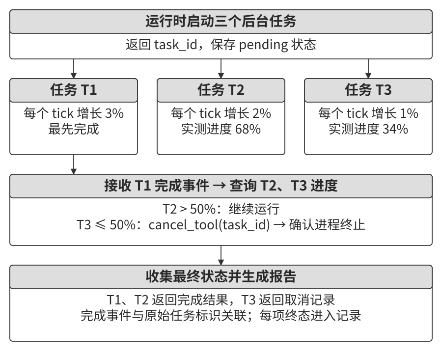
>
> 同一队列可以扩展多种来源：邮件到达、IM 或短信消息、GitHub PR 与 Issue 更新、定时器、外部 Webhook，以及用户离线、进程超时和资源告警等内部事件。每个适配器负责验证来源并补充关联信息，处理结果按事件标识回写。
>
> 验收使用三封测试邮件：会议邀请触发日历冲突检查，并生成接受或拒绝草稿；客户投诉触发关键信息提取、高优先级标记和用户通知；营销邮件按规则归档。
>
> 当前配套记录完成了接口文档核对与认证探测，测试邮箱接入仍待有效凭据。
>
> **扩展（选做）：多来源接入与故障注入。** 在测试邮箱之外，再接一个本地 Webhook 端点和一条 SQS 队列（可用本地模拟）。每个适配器验证来源、生成信封，写入接入日志后再确认来源；运行时从日志读取事件，按线程顺序处理。然后注入三类故障：
>
> 1. **重复投递。** Webhook 端点以同一投递 ID 收到两次请求，日志中只出现一个事件。
> 2. **确认前崩溃。** 适配器写入日志后、删除 SQS 消息前被终止；消息重新可见并再次读取后，日志中仍只有一个事件。
> 3. **回执前崩溃。** 运行时发出回复后、记录回执前被终止，重启后从日志重放。渠道支持幂等键，或者能查到已发送的消息时（例如邮箱的已发送记录），同一封回复不重复发送；两样都没有的渠道，只能把这封回复标为待人工确认。
>
> 三类故障都应在日志中留下记录：哪次投递被去重、哪条消息被重新读取、哪封回复经过核实后没有重发。
>
> 这一扩展的配套代码可以离线运行，不需要 API Key。测试邮箱和 SQS 队列都用本地文件模拟，与上面等待凭据的真实邮箱分开；模拟队列保留了可见性超时、接收句柄和消息组内的顺序。崩溃由父进程在指定位置直接终止子进程。回复渠道各演示一种：邮件查已发送记录，App 对话用幂等键，短信两样都没有。复现时进入 `chapter6/agent-with-event-trigger`，运行 `python multisource_demo.py`，终端会逐项打印三类故障留下的日志记录。配套运行记录中，三类故障的检查全部通过。
>

邮件队列建立了顺序处理的基础。接下来加入长时间运行的工具，讨论等待期间如何接收新要求、取消任务和恢复工作。

### 不支持原生异步时的兼容方案

假设 Agent 正在起草邮件，已经调用 `search_contacts` 查找联系人。结果尚未返回时，用户要求“等一下，先查明天的天气”。如果当前模型接口要求每个工具调用先配齐结果，Harness 就需要将后台状态转换成接口接受的消息序列。

**在同步消息格式中表达后台状态。**

**兼容同步接口时，应尽量保留正常调用与真实结果的配对，只在中途切换任务时补入状态响应。** 过早为每次调用填写“仍在运行”，会使轨迹充满未完成状态，增加模型追踪真实结果的负担。具体可以遵循五条规则：

1. **记录完整调用。** 将 API 已完成的 assistant 消息和工具调用项写入轨迹，保留调用标识。服务端推理状态按提供商规定的续接方式保存。
2. **记录真实完成。** 工具完成后写入实际结果、任务标识和执行状态；执行期间，任务管理器持续保存未完成状态。
3. **在切换时报告当前状态。** 对允许此类结果载荷的接口，可以为待完成调用返回明确的状态信息，例如“任务仍在后台运行，结果尚未产生”，随后追加用户事件。状态响应中的任务标识连接后续完成通知。
4. **整理中断后的消息。** 缺少中途续接能力时，取消未完成的生成，保留已确认完成的消息和工具状态，再提交新请求。未完成输出按接口规定处理，避免把半截参数当作可执行调用。
5. **批量接收常规事件。** 补充信息进入队列，在当前周期结束或指定安全点统一提交，并记录哪些事件已经处理。

在联系人查询例子中，完整调用先写入轨迹；用户切换任务时，Harness 补入查询仍在运行的状态响应，再提交天气请求。联系人结果稍后到达，以带来源和任务标识的新事件进入上下文，Agent 随后继续起草邮件。原调用已经获得状态响应时，后续结果采用适配器约定的事件形式，保持调用与结果的配对关系。

状态响应只说明当前执行进度。依赖联系人数据的步骤必须等真实结果到达后继续。任务管理器可以保存 `running`、`completed`、`cancelled`、`failed` 等状态，并在发送回复或执行后续工具前检查依赖是否满足。

**用任务句柄设计异步工具。**

对于新设计的长任务工具，笔者优先把“启动”定义为一次完整操作，立即返回真实的任务句柄。模型据此区分“已经启动”和“已经完成”，后续查询、取消和结果事件也有统一的关联依据。例如，`initiate_phone_call` 发起电话任务，返回任务标识与“正在拨号”的状态；`phone_call_connected`、`phone_call_ended` 分别报告接通和结束。

工具说明应写清楚：“本工具启动电话任务，成功后返回任务 ID。你可以继续处理其他事项；通话进展和结束结果通过单独事件返回。”工具名说明这是启动操作，返回结构与后续事件则说明任务如何推进和结束。系统再提供按任务 ID 查询、取消和恢复的接口，使模型能够知道当前还能做什么。

**逐项处理批量事件。**

多个事件一次进入上下文时，模型可能只回应最后一条，遗漏前面已经提出的要求。运行时应保留各自的处理状态，让尚未回应的条件继续可见。提示词可以要求模型逐项检查，状态栏则列出尚未处理的信息：

```text
[未处理事件 1/4] database_query 结果：……
[未处理事件 2/4] 用户补充：只看北京地区的数据
[未处理事件 3/4] 系统提醒：报告截止时间还有 30 分钟
[未处理事件 4/4] 用户询问：进度如何？
```

批次摘要可以提示“1 个工具结果、2 条用户消息、1 个系统提醒”。运行时进一步将事件与任务约束关联：地区条件更新查询范围，截止时间影响调度，进度询问需要回复。处理后记录完成、等待或需澄清的状态，下一轮继续保留未解决项。

同一任务编号把启动、进度报告和最后的执行结果串在一起。如果中途有人要求停止，就要再查这个编号下有没有取消回执。

> **实验 6-2 ★★★：带并行执行和打断能力的异步 Agent**
>
> 本实验先验证异步运行时，再接入模型检查决策。配套运行记录用真实操作系统子进程完成四个场景，事件调度和报告由确定性脚本驱动。
>
> 1. **后台执行与即时响应。** 启动持续数秒的分析进程，立即返回任务标识；等待期间回答当前时间，完成后接收分析结果。
> 2. **队列与批处理。** 长任务期间依次补充“用日语回复”和“整理成网页”，任务完成后将结果与两条要求作为一个批次处理。脚本生成日语 HTML。
> 3. **取消与恢复。** 演示收到“停止分析”时，会打断仍在生成的模型回合，并要求所有运行中的后台任务停止。这次由脚本发出打断，当时只有一个分析进程 T1。第 0.803 秒，打断事件记下 T1 的进度为 18%；到第 0.806 秒，系统才记下它的退出码 −15。紧接着启动的 T2 是一项新任务。第 4.436 秒收到的是 T2 的结果，T1 没有触发完成回调。
> 4. **并行任务与进度决策。** 同时启动三个分析进程，每个逻辑时间步分别推进 3%、2%、1%。在本实验的并行进度记录里，最快的 T1 完成时，查询回执显示 T2 已到 68%，T3 到了 34%。沿图6-5 看，进度不超过 50% 的任务会被取消。脚本只取消了 T3，最后收到了 T1 和 T2 的结果。这说明同一个运行时既能响应整批停止，也能保留仍有用的并行工作。
>
> 
>

### 模型原生异步：GPT-6 Astra

前面的方案由 Harness 适配同步消息格式。原生异步接口则直接允许模型在工具尚未返回时继续处理独立工作，并在后续接收结果。截至 2026 年 9 月，GPT-6 Astra 已提供异步工具调用（Async tool calling）与回合中途引导（Mid-turn steering），分别处理工具等待和用户更新。图6-6 对照了同步接口适配与原生异步的消息流程。[^ch6-22][^ch6-23]

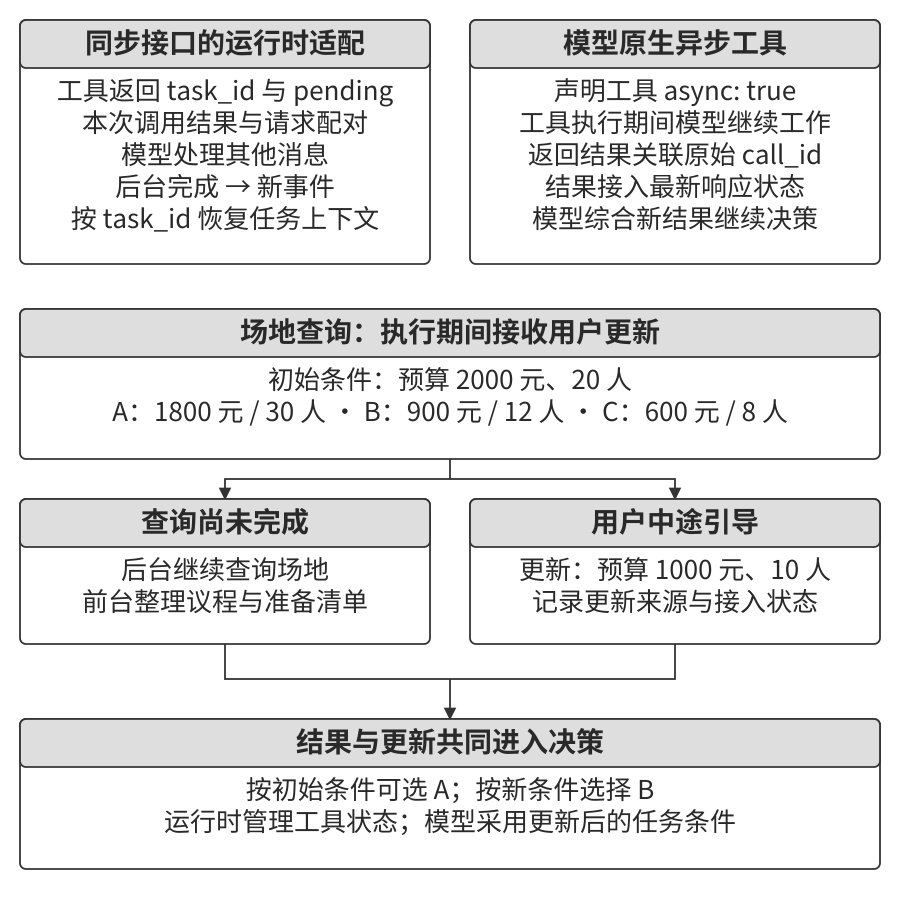

**等待工具时继续独立工作。** 例如，Agent 发起会议场地查询后，可以先整理议程与准备清单；查询返回后，再比较价格和容量。工具定义中的 `async: true` 声明异步能力，应用收到完整调用项后启动执行，并保存调用标识 `call_id`。结果到达时，应用按原标识归还结果，接续最新的响应状态。模型安排后续工作，Harness 管理调用关联与任务生命周期。[^ch6-22]

**在任务进行中接收新要求。** 用户可以在模型思考或组织回答时补充“预算降为 1000”“参会人数改为 10”。应用通过同一连接发送引导事件，服务端确认接收后，按当前响应状态继续处理。断线重连后，应用可根据保存的事件与响应状态恢复任务。[^ch6-23]

这两项能力可以组合使用：场地查询继续运行，用户的新要求进入后续决策，查询结果返回后再完成选择。执行器同时维护后台任务的真实状态。需要停止查询或取消预订时，Harness 调用相应接口并检查回执；已经完成的业务操作进入撤销或补偿流程。

模型与接口已经支持原生异步时，笔者优先使用原生协议，让工具挂起、用户更新和响应接续按接口约定流转。同步兼容层主要服务于现有模型和旧接口；模型升级后，可以逐步移除仅用于补齐消息配对的兼容逻辑，把工程投入集中到任务状态、取消与恢复。

### 可靠处理异步任务

可靠的异步交互需要同时检查消息、任务与执行状态。

1. **结果归属。** 延迟结果携带原调用标识，应用将它映射到对应任务；依赖该结果的决策在数据到达后继续。
2. **恢复与取消。** 用户改变要求后，系统保留仍然有效的工作，更新后续步骤，并明确哪些后台任务继续运行、哪些已经停止。
3. **多条要求。** 预算、人数、地区和截止时间分别进入任务状态，最终结果逐项检查这些条件。

> **实验 6-3 ★★★：模型原生异步与回合中途引导**
>
> 本实验让 Agent 为模拟会议选择满足预算与人数要求的最便宜场地。初始预算为 2000，人数为 20；查询工具等 8 秒才返回三个场地的报价和容量。
>
> | 场地 | 价格 | 容量 |
> |---|---:|---:|
> | A | 1800 | 30 |
> | B | 900 | 12 |
> | C | 600 | 8 |
>
> 初始条件下应选 A。引导组在任务进行中收到两条更新：预算改为 1000，人数改为 10，此时应选 B。工具同时返回一个新生成的回执，最终答案需要引用它，以便检查模型是否使用了实际到达的结果。
>
> 实验包含五组，每组三次：同步工具、原生异步工具、推理期间引导、异步工具等待期间引导，以及不支持引导能力的模型对照。前两组比较等待期间能否输出独立准备清单；两种引导组检查预算与人数是否同时生效；能力对照检查接口是否明确报告不支持。
>
> 保存的运行记录中，异步工具组在等待期间完成了独立清单，两种引导组均按新条件选择 B。带工具的运行均只执行一次查询，并将实际结果归还给原调用；对照模型的接口则明确回复，它不支持在一轮生成中途接收新要求。同步与异步组的总耗时接近，主要差别体现在等待期间能否推进其他工作。
>
> 如果模型只记住人数改成 10，仍按旧预算 2000 来选，会选哪里？A 和 B 都坐得下，最便宜的仍是 B。因此选对场地还看不出预算是否更新。
>
> 人数改了，已经发出的查询要不要重做？本实验的工具没有筛选参数，返回全部三个场地。助手可以复用正在路上的结果，等它回来再按 10 人、预算 1000 筛选。如果工具只返回容纳 20 人以上的场地，旧结果就只有 A，能容纳 12 人的 B 根本不在里面。这时只在旧列表里把人数改成 10，还是会漏选 B。如果原来的查询已经把 B 筛掉了，就得再查一次。

异步机制使外部变化能够在任务推进中进入系统。语音、屏幕和机器人交互进一步缩短了反馈周期：系统需要连续接收输入，并在合适的时机调整输出和行动。

## 语音：最自然的人机接口

语音让用户在双手或视线忙于其他工作时，仍能向 Agent 说明需求、补充条件和确认结果。语音输入法将口述转换为文字，语音 Agent 则进一步管理对话、工具调用与回复播放，两者都可以支持前言介绍的 whisper coding。

本节讨论两种用途：用户直接与 Agent 对话，以及 Agent 代表用户与外部人员沟通。前者关注识别、响应和插话，后者还需要在通话过程中完成身份确认、业务查询与决策。

### 交互时序：从级联到全双工

OpenAI 在 GPT-Live 的介绍中回顾了级联、轮次式音频模型和全双工三类语音交互[^ch6-12]。这条演进路线逐步将“何时开口、何时继续听”交给模型持续判断。级联系统主要由端点逻辑安排交接，全双工模型则可以结合连续声音和对话状态处理重叠、停顿与插话。

| 范式 | 核心结构 | 便于实现的能力 | 主要设计问题 |
|---|---|---|---|
| 级联 | VAD、ASR、LLM、TTS 分工 | 独立替换模块，逐段检查输入输出 | 模块间延迟，转录中遗漏的声学信息 |
| 轮次式端到端音频模型 | 模型直接接收与生成音频 | 利用语调、情绪等信息组织回复 | 发言结束判断、轮次切换与响应时机 |
| 全双工 | 持续接收音频并生成输出 | 重叠说话、附和、插话与连续交互 | 连续状态、输出控制和交互评估 |

模型是否直接处理音频、输入输出是否流式、能否同时听说，是可以分别检查的能力。级联系统也可以加入流式模块与打断控制；端到端模型的交互节奏则取决于具体设计。

[^ch6-12]: OpenAI，*Introducing GPT-Live*，2026-07-08，介绍级联、轮次式音频模型与全双工交互。

### 范式一 · 级联流水线（Cascading）

级联系统把语音对话拆成几个模块。语音活动检测（VAD）识别音频中的语音区间，端点逻辑判断何时提交这一段；自动语音识别（ASR）将音频转成文字；LLM 理解请求并生成回复；语音合成（TTS）再把回复变成可播放的音频。图6-7 展示了按顺序执行的基本结构。

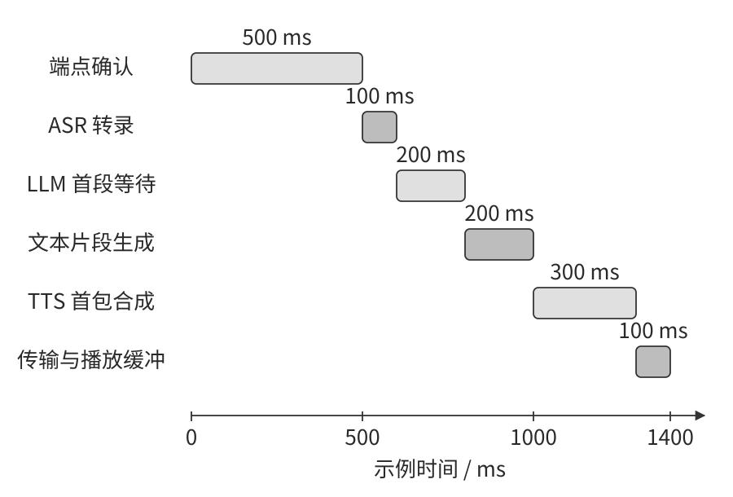

声学 VAD 找出有人说话的区间，后续识别可以跳过长段静音。可是，同样一次停顿，发生在“我想订……”后面和“周四上午有没有票？”后面，含义不同。语义 VAD（语义端点检测）可以在前一种情况下继续收音，到后一种情况才把话交给对话模型。这就是语音观测在时间上的稀疏化：一段连续的声音，只在少数几个时刻触发推理。至于要不要开口，由听到这句话的模型决定；它还可以继续听，或先查航班。

| 模块 | 作用 | 常见等待或错误来源 |
|---|---|---|
| VAD 与端点逻辑 | 检测语音，决定提交时机 | 静音阈值、噪声与中途停顿 |
| ASR | 将音频转换为文字 | 解码耗时、人名与专有名词识别 |
| LLM | 理解、推理与生成回复 | 请求排队、首段回复生成 |
| TTS 与播放 | 合成音频并送达扬声器 | 首包合成、网络传输与播放缓冲 |

在完全串行的实现中，用户说完后还要依次等待端点确认、转录、回复生成和首段音频。图6-8 的例子里，用户听到第一声回复时已经过了 1.4 秒，其中最长的一段是等系统确认用户说完了（500 毫秒）。即使转录从 100 毫秒缩短到 50 毫秒，用户也只少等 50 毫秒。

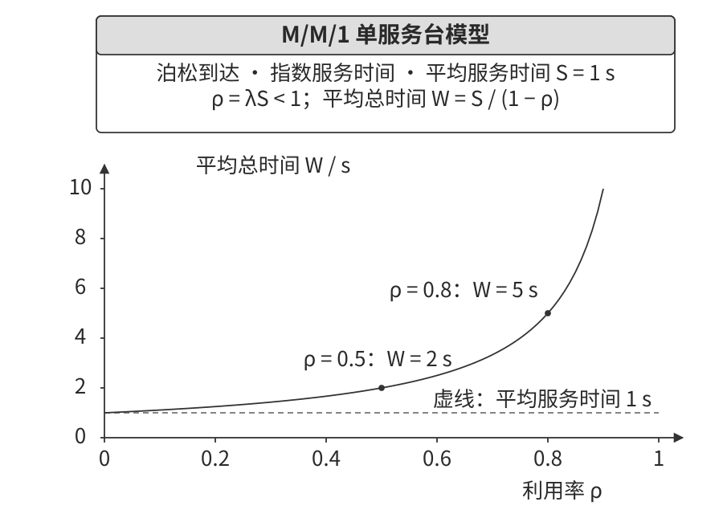

服务负载还会带来排队等待。图6-9 采用 M/M/1 单服务台模型说明这种关系：到达服从泊松过程、服务时间服从指数分布，平均服务时间为 $S$，利用率为 $\rho<1$ 时，包含服务与排队的平均总时间为 $W=S/(1-\rho)$。取 $S=1$ 秒，利用率从 0.5 增至 0.8，平均总时间就从 2 秒增至 5 秒。其中服务本身平均仍占 1 秒，多出的 3 秒都花在排队上。当请求接近处理容量，短时流量波动会形成积压。

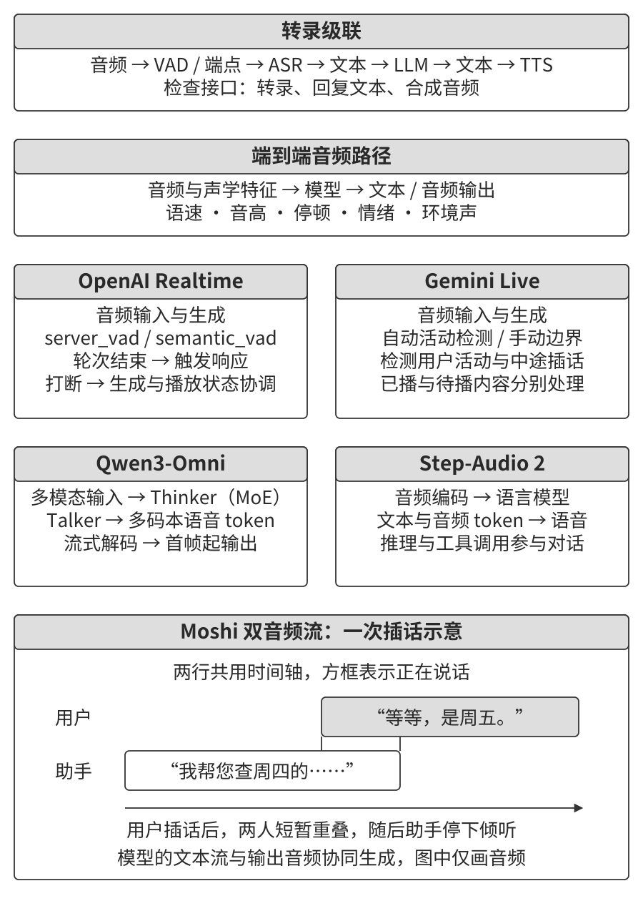

> **实验 6-4 ★：构建传统语音 Agent**
>
> 假设助手正在播报周四的航班，你开口纠正：“等等，我想订周五的。”浏览器通过 WebSocket 把麦克风音频送到后端。Silero VAD 一检测到你开口，后端就发出 `speech_start`，浏览器随即停止播放，清空排队的旧音频。这时助手还不知道你改了哪一天。等你说完、静音超过默认的 500 毫秒，后端才发出 `speech_end`，把这段语音交给本地 Whisper tiny 转写。
>
> Doubao 开始返回文字，离用户听见回答还有多久？一轮录音回放的记录里，转写用了 2.710 秒。Doubao 在请求发出后 0.749 秒返回第一个 token，到 0.792 秒才返回完整答复。回放程序等文字收齐，才交给 Fish S1 合成；又过了 2.819 秒，后端收到第一批音频。从端点判定后算起，把这三段串行耗时相加，约为 **6.321 秒**。归档报告写的是 6.279 秒，它用首个 token 的时间代替了生成整段答复的时间。
>
> 这 6.321 秒只覆盖后端处理。用户先要等静音检测认定一句话已经说完，最后还要等音频传到浏览器开始播放。

#### 从串行到流式感知

串行方案便于逐段检查，也暴露出三个问题。等待静音会增加端点延迟；转录文本可能遗漏语气、情绪和环境声；按停顿切分音频时，邮箱、人名或专有名词可能失去完整上下文。对于已经采用级联架构的系统，笔者建议先做流式改造：让各阶段尽早提供增量结果，把识别、推理与播放重叠起来，同时维护已经确认和仍可能修改的部分。这样能够复用现有模块，并逐步定位等待时间来自哪里。

- **ASR 边听边转。** 持续接收音频，输出临时转录；后续音频到达后修订不稳定部分，在端点确认时给出最终文本。
- **LLM 推测执行。** 使用临时转录提前准备回复。最终文本确认后，检查输入是否一致以及已有工作是否仍适用，再决定保留、调整或重新生成。对外发送和业务写入等操作等待所需条件确认后执行。
- **LLM 分段输出。** 一段适合播报的文本完成后即交给 TTS，分段时保留句意、标点和语调线索。
- **TTS 增量合成。** 音频块逐步返回，使后续文本生成、合成和播放能够重叠。发生插话时，同时处理生成任务和播放缓冲中尚未播出的内容。

Whisper 的常规转录实现按音频窗口编码和解码[^ch6-whisper]。在外部切块或反复提交累积前缀，可以构建增量转录流程；持续状态复用、重复编码成本和历史文本修订，需要由具体实现管理。原生流式识别模型则在架构与训练中直接处理连续输入。

基于音频语言模型的感知系统还可以联合输出文本与声学事件。历史音频、转录和词汇提示帮助识别人名、品牌及专有名词，保留多少历史则取决于上下文与缓存设计。针对“用户是否说完”，模型可以结合语义完整性与静音作判断。在“我想订……”的停顿处，实时系统只听见了这三个字，还无从知道后面会接上日期。

除转录外，接口还可以约定以下事件：`speak_start`、`speak_end` 表示说话起止，`interrupt` 表示打断，`emotion` 描述情感状态，`laugh`、`sigh`、`noise` 记录笑声、叹息和环境声。这些事件可连同文字和时间戳一起送给 Agent。

> **实验 6-5 ★：使用 Qwen2-Audio 模拟流式语音感知**
>
> 本实验逐步扩大音频前缀，每次将从开头到当前时刻的音频重新送入 Qwen2-Audio，观察转录与声学事件随输入变化的过程。对照路径采用 600 毫秒静音端点与 Whisper。测试包含正常语音、插入 900 毫秒停顿的长句，以及混入粉红噪声的语音。
>
> 本次本地量化模型运行保留了 13 次前缀推理，单次约需 8—11 秒。中途停顿触发了对照路径的分段；音频模型检出了噪声，也误报了咳嗽和笑声。

[^ch6-whisper]: OpenAI，Whisper，介绍音频窗口转录与模型实现。

### 范式二 · 端到端全模态模型（Omni）

端到端音频模型直接接收声音，结合语言与声学信息生成回复，并通过音频输出分支合成语音。直接处理音频可以利用语速、音高、停顿和环境声；先转录再回答则便于检查中间文本、独立替换模块。

这些声学特征会影响理解。例如，同一句“请在午饭前发来报告”，急促和缓慢的说法会给听者不同的感受。输出时，模型也可以通过停顿、重音和语调组织意思。

直接处理音频的系统也可以等用户说完再回答。比如用户报电话号码时停了一下，系统仍要判断这一串数字是否报完。端点检测决定何时回应；如果对方在播报途中插话，系统还得协调模型生成和扬声器播放。[^ch6-audio-architectures]

> **实验 6-6 ★★：本地运行 MiniCPM-o 4.5，对比端到端与自级联**
>
> 本实验固定同一个 MiniCPM-o 4.5 模型，关闭思考模式，比较两条路径：直接从音频回答问题，以及先由模型转录、再只根据转录回答。输入包含两道口述算术题和两条文字相同、语速不同的语音。
>
> 两条路径各答对三题，错误出现在不同位置。直接音频路径把一道题中的 twelve boxes 听成 8，导致计算错误；转录路径正确保留了 12。语速题中，两条音频都说“Please send the report before lunch.”，转录后的文字完全相同，快慢信息随之丢失；直接音频路径则正确区分了两种语速。
>
> 实验另生成了一段 24 kHz 语音，连接输入理解与音频输出。

### 范式三 · 全双工交互模型

全双工系统一边说一边听，最容易被人察觉的改善是交谈时的活人感。试读一句“想订周三……不，周四的票”：中间的停顿容得下这次自我修正；如果助理已开始报周三的航班，听见“不，周四”就应停下来。另一种时机是，对方还在解释行程，一声轻短的附和可以让他知道助理在听。持续接收音频，才有条件在发言、倾听、停顿和调用工具之间做这些选择。同声传译同样需要输入和输出重叠。

Kyutai 在 2024 年发布的 **Moshi** 分别建模用户和模型的音频流，通过并行流表示重叠说话与打断[^ch6-moshi]。把这些时间关系保留在输入中，模型就能学习何时回应、何时继续倾听。

Thinking Machines Lab 的交互模型把连续输入和输出切成等长的短块，每块覆盖 200 毫秒，称为一个微轮次（micro-turn）[^ch6-14]。沿图6-10 的时间轴看第二格：助手还在说“四”，耳边已经传来用户纠正日期的“不”。到第三格，助手停下来，仍在听用户把“周五”说完。

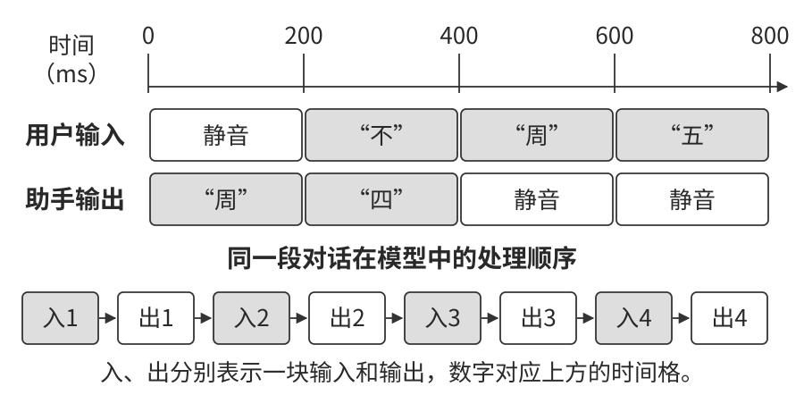

再读图的下半部。通话双方听到的是两路可以重叠的声音，模型却可以沿一条序列交替处理输入块、生成输出块。静音也占一格，助手因而可以先听一会儿再开口。图中的 200 毫秒是这项实现的分块长度；从用户插话到扬声器真正停下，还要计入处理和播放缓冲的耗时。

[^ch6-moshi]: Kyutai，*Moshi: a speech-text foundation model for real-time dialogue*，2024，介绍用户与模型的并行音频流。
[^ch6-14]: Thinking Machines Lab，*Interaction Models: A Scalable Approach to Human-AI Collaboration*，介绍微轮次、多流交互与后台任务委派。

### 认知时序：实时交互与深度思考

在 Pine 的客服通话里，客服说到半句，助理有时该等，有时该轻轻应一声；自己正在说话时，也得听见对方插进来的更正。这正是笔者看好 Moshi 这条路线的原因：时机掌握得好，对方才觉得电话这头真有人在听。遇到要查资料的请求，还得算另一笔时间账：从听懂问题到报出查到的答案，中间要转几次手？

假设客服问“您想查的是周四上午那班吗？”若前台语音模型把查询交给后台推理模型，前台要先说清查哪班，后台据此调用工具、读回结果，再把消息交给前台。前台还要看客服刚才有没有补充条件，才知道这条结果该怎么说。在等候时间较长的任务里，这样分工有一个实在的好处：查票期间，前台仍听得见人说话。但哪怕工具本身很快，交接和返回也各要花时间。不带语音的系统也这样分工，前文“事件处理机制”一节讲过 dsh-superagent 的做法。

**快模型能自己调工具吗？** GPT-Live-1 的前台没有直接调用业务函数的接口。遇到要查票的任务，它可以委派给后台 Agent，由后台调用工具。这样设计，全双工模型可以专注于何时听、何时说，工具选择和参数生成留给后台。OpenAI Realtime 的 GPT-Realtime 支持前台发起函数调用；豆包实时语音模型 3.0（Seeduplex）在纯端到端模式下也支持这种用法，混合编排时则由外挂语言模型调用。查一班飞机还有没有座位时，前台听清日期和航班号就能请求查询，由运行时执行，省去向慢模型交代任务、等它转述结果的往返。如果库存接口就在本地，简单查询的等待时间可以很短；碰上要比较多种改签方案的任务，仍可交给后台慢慢算。[^ch6-voice-tools]

因此，笔者也看好另一种组合：用语义端点检测决定何时让多模态模型听一段话，由这个模型选择继续听、直接查票，或者把要说的话交给流式语音合成。假如已经播报周三的航班，对方插话改成周四，系统要能停下正在播放的声音，模型也要据此改口。这种组合的吸引力在于，听懂日期的模型可以直接发起查询。

快模型说一句“我查一下”，可以让客服知道助理听清了要求。什么时候能报出票价，则取决于查询和推理怎样与通话配合。图6-11 展示了三种安排：先回应再深入回答、前台持续交互并接收后台建议，以及构思与表达按片段并行推进。

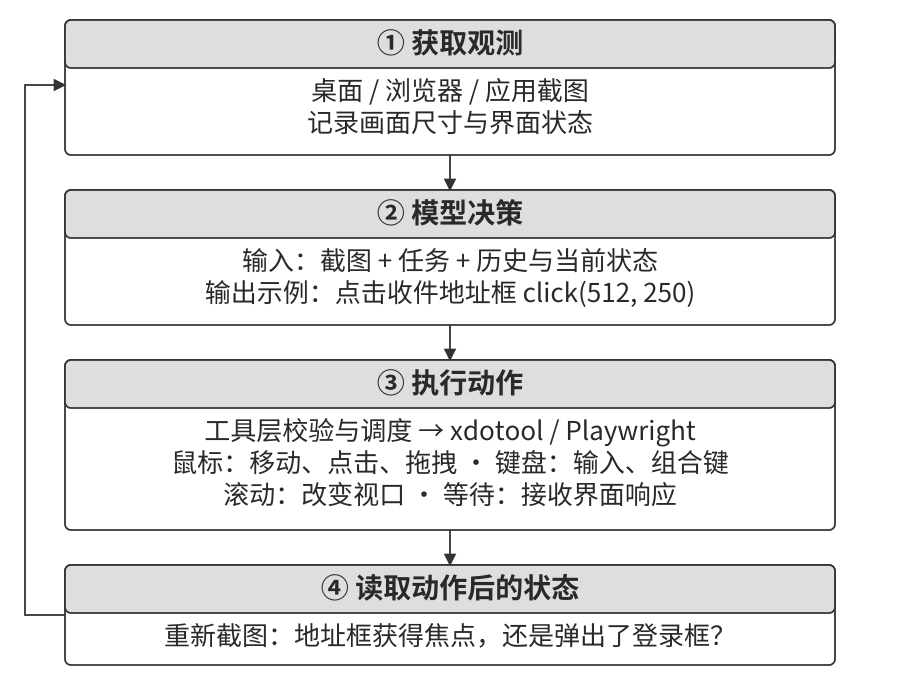

#### 方案一：快思考回应，慢思考回答

快模型先给出简短回应，慢模型在后台完成分析，再补充详细答案。这种设计可以尽早确认收到请求，但需要管理两次回答的一致性。例如，快模型先建议购买某个套餐，慢模型随后发现套餐缺少关键功能，前后建议就会冲突。冲突的根源在于两侧独立作答，判断依据和推理进度可能不同。快模型说出口的建议已经进入用户的判断，用户甚至可能据此行动；慢模型随后纠正，还需要解释变化并处理已经产生的影响。

因此，前台应区分任务确认与业务结论。“我来核对套餐是否包含这项功能”可以立即表达，购买建议则等待必要的查询与分析。后台结果返回时，系统将它与已说出的内容对照，再组织后续回复。简单问题还可以直接由快模型完成，减少重复处理。

#### 方案二：快思考交互，慢思考提醒

语音和屏幕也能分工。口头说“这月账单多了 15 欧元漫游费”，用户一下就能听懂重点；把原金额、现价和争议明细留在屏幕上，用户可以按自己的速度核对。确认一个具体操作可以点选，敏感信息则让用户在商家认可的输入界面自行填写。前台只需要接收“验证已完成”这样的状态，就能自然接回对话。

假设旅客请 Pine 订周四上午去上海的机票，预算 1200 元，中午前要赶到会场。Pine 一边跟航空客服通话，一边给后台“递纸条”：“如果上午十点到虹桥，从机场到会场来得及吗？”客服查过余票，告诉 Pine：“十点到虹桥的那班卖完了。还有一班十点半到浦东，票价 1250 元。”如果后台只能看见前台递来的纸条，它还在算从虹桥出发的路程。前台得再交代一句：“改算浦东，十点半落地，会场和到场时间不变。”

另一种做法是把通话记录也按顺序同步给后台。后台已经从通话记录里读到了客服报出的机场和落地时间，前台只要说“算一下这班来不来得及”，就能委派同一项任务。同步记录时要标明谁说了什么；前台被打断、还没播出的半句话，也要和已经说出口的内容区分开。后台查完，只需告诉前台预计几点能到会场、时间有多紧。沿途查过哪些路线、地图接口返回了哪些字段，可以留在后台备查。由前台拿着结果继续跟客服谈。

第一章那位商务旅客希望票价控制在 1200 元以内。以往出差时他愿意为合适的航班多花一点，这次也没有另定上限。听到最低价是 1250 元，助理可以替他订下。换成一向精打细算的用户带家人出游，这 50 元要先问。前台于是要同时照顾两段对话：

- 发给用户：“这班最低 1250 元，比预算多 50 元。你愿意订吗？”
- 接着问客服：“这班能帮我保价一会儿吗？同一天晚一点走，有没有 1200 元以内的？”客服查票时，前台还可以问清行李额和退改条件。

这样，用户回来时能看到几个选项，客服也知道接下来要查什么。如果用户后来解释“上次是赶着开会，以后出差超预算也先问我”，下次就要按这条新要求办。

等本人验证时，谈话的节奏又不一样。客服说验证码已经发出，前台可以答：“好，请稍等，我请旅客看一下手机。”如果旅客回消息说还没收到，再问客服短信发到了哪个尾号、多久可以重发。旅客在商家指定的渠道完成验证后，前台就能接着办。在这样的通话里，多等一会儿、晚一点出票，都比催用户当场作决定更合适。

这时，后台发来“原报价已更新”。前台先向客服核实新价格，再告诉用户。如果用户恰在此时回复“可以订”，这句回复对应的是此前发给他的 1250 元报价。前台要根据新的价格和已有授权判断是否需要再次确认。后台只提供信息，始终由前台跟客服交谈、作出承诺。给消息带上航班、价格适用条件和时间，前台才能识别哪一份报价已过期。

同一条后台消息“价格有变，请核实”，到达的时机也会影响前台怎么接话。如果客服刚说“最低票价是……”，前台可以先听完金额。如果客服已报完价，正等答复，此时适合追问新价。如果旅客刚在电话里插话说“等等，我改一下日期”，先听清新日期，再决定还要不要核实原航班。同一句“好的”，说在客服介绍条款时可能只是表示在听，说在“我现在帮您出票？”之后就可能被听成同意购买。只看转写文本，会漏掉这样的差别。

#### 方案三：构思与表达协同推进

Step-Audio 系列提供了两个相关例子。**模态锚定推理蒸馏（MGRD）**关注推理所依据的信息：围绕音高、节奏、语调等声学特征构造和筛选推理数据，通过迭代蒸馏改进音频理解。Step-Audio R1 在强化学习阶段给音频题分两项计分：答对得 0.8 分，给出推理过程再得 0.2 分。后者鼓励模型写出依据；推理有没有用到录音里的声学线索，则要在前面的样本筛选中检查。[^ch6-mgrd]

**Mind-Paced Speaking（MPS）**关注推理与表达的时序，采用构思模块（Formulation Brain）和表达模块（Articulation Brain），让构思过程指导语音生成。Step-Audio R1.1 的实时方案采用了这一方法。[^ch6-mps]

两个模块按进度交换信息：构思持续推进，表达根据已经可用的内容与此前输出组织语音。这样可以让部分表达与后续推理重叠，同时保持对已说内容的追踪。

[^ch6-mgrd]: StepFun，*Step-Audio-R1 Technical Report*，介绍模态锚定推理蒸馏。
[^ch6-mps]: StepFun，*Mind-Paced Speaking: A Dual-Brain Approach to Real-Time Reasoning in Spoken Language Models* 与 Step-Audio-R1.1 模型卡，介绍构思、表达两个模块及其在实时系统中的应用。

#### 模块分工与升级方式

**笔者看重快慢分工的一项工程优势：交互能力与推理能力可以分别演进。** 更强的推理模型发布后，系统可以替换后台。这样，后台能够跟上推理模型的进步，前台也能持续改善倾听、回应与插话体验。前台需要理解任务和用户的补充信息，后台则专注于较长的推理、规划与执行。

**在推理模型快速迭代、团队又需要持续升级业务能力时，笔者优先选择可替换的快慢分工。** 这种分工省去了每次升级推理模型都重新训练整套语音系统的负担。需要让中间推理更直接地控制表达、且有相应训练资源时，再采用更紧密的协同方案。

Pine AI 的语音 Agent 采用前台快思考与后台慢思考配合的架构。其公开文章报告了在 τ²-bench 语音赛道取得榜首的结果，并介绍了持续通话、业务推理与工具操作的组合方式[^ch6-17]。

理解这些组合时，可以区分三个设计维度：**音频通路**决定模型直接处理声音还是通过转录交接；**听说时序**决定输入输出按轮次还是并行推进；**认知分工**决定实时交互与深度推理如何共享状态、交换结果。系统可以直接处理音频并保持全双工，同时把复杂任务交给独立的后台模型。Thinking Machines Lab 的交互模型和 GPT-Live 都展示了这类组合。

[^ch6-17]: Pine AI，*The Most Natural Human-Computer Interface Is Your Voice*，介绍快慢思考架构及其报告的语音任务评测结果。该报告将榜单称为 τ²-bench voice。

### 更像人的语音合成

停顿、语速和重音帮助听者理解句子结构与说话意图。例如，报电话号码时需要适当分组，解释复杂条款时可以放慢速度，等待查询结果时可以先说明正在处理什么。在笔者看来，适当的停顿与节奏变化能让语音更自然，也能让用户听出任务正在怎样推进。语音控制可以围绕这些具体用途设计。

主 LLM 可以在文本中加入控制标记，如 `[THINKING]`、`[EMO:happy]` 和 `[SPEED:0.8x]`。执行层解析标记，将文本分成语音与停顿片段，再映射到合成接口支持的情绪、风格或参考音。标记的含义由应用定义：`0.8x` 可以映射为慢速档；停顿可以由播放器插入，笑声、叹息则通过支持的声音标记或生成能力表达。

参考音方案将同一说话人的不同表达方式组织成库。每段文本选择匹配的情绪、语速与风格，合成后再按顺序拼接。控制状态需要规定作用范围，例如情绪持续到下一次修改，停顿只在当前位置生效。

> **实验 6-7 ★★：基于 Fish Audio 的控制标记驱动 TTS**
>
> 本实验用 Fish Audio S1 建立 24 条参考音组成的语音库：四种情绪、三档语速与两种风格组合。解析器把带标记的回复转换成语音片段和静音片段，执行层为每段选择参考音并完成合成。
>
> 比较三种配置：无控制标记、单一参考音和多参考音。保持回复内容一致，检查标记是否路由到预期配置，再听取停顿、情绪和音色变化。
>
> 保存的听测采用音频理解模型，对三种配置轮换呈现顺序，评价自然度、情绪匹配、思考停顿、音色一致性和客服感。多参考组的综合评分最高，单参考组低于无标记组。

## Computer Use：GUI 自动化 Agent

假设你请 Agent 修改网页上的收件地址。它要先找到地址栏，输入新地址，再根据回显确认保存结果。若在点击前弹出登录框，上一张截图中的按钮即使坐标没变，这一击的对象也已经变了。Computer Use 通过屏幕、鼠标和键盘操作浏览器、表格或系统设置，核心功课便是让每个动作跟得上眼前的界面。

沿着图6-12 的**感知—思考—行动**循环，看模型准备输入新地址之前要确认什么。它根据截图和任务进度选定点击位置，Harness 检查参数与权限，再交给执行层。点击成功只表示这一击已经发出。下一张截图里，输入焦点落在哪里，才决定接下来能否安全地输入地址。


助手填好地址后，该怎样告诉执行器它要点哪个“保存”按钮？屏幕坐标和元素编号都可以指认目标，对模型和工具的要求却不同。

### 动作空间设计

图6-13 中，Anthropic 的 Computer Use 参考实现提供图形界面、命令执行和文件编辑三类工具。仅看图形界面这一类，数据就有两个去向：点击动作发给执行端，点击后的截图送回模型，作为下一轮决策的观测。原生 API 规定了工具格式；若换用其他模型，适配层要把截图、动作请求和执行结果转成相应接口能接收的消息。[^ch6-computer-tools]

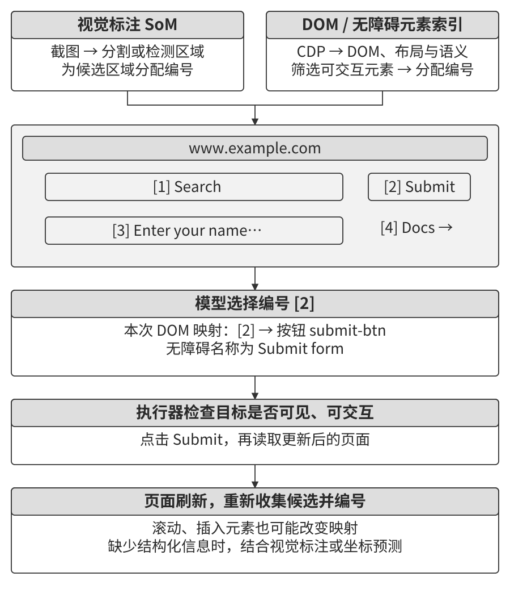

**GUI 操作工具。** 鼠标动作包括移动、左键／右键／中键点击、双击、三击和拖拽；更细的接口可以分别表达按下与松开。滚动需要方向和幅度，部分实现还支持修饰键。键盘接口提供文本输入、组合键和按住按键。截图与光标位置用于获取状态，等待接口则给页面加载或动画留出时间。工具版本决定具体动作集合，Harness 根据所用接口校验参数。

**命令执行工具。** 持久终端可以跨调用保留工作目录和环境状态。例如，一次调用切换目录后，下一次调用继续在该目录运行。参考实现可以用哨兵字符串识别命令完成，并设置超时；超时后的进程状态仍需执行器检查。

**文件编辑工具。** 字符串替换接口通过原文定位修改范围，也可以提供查看、创建、插入和撤销。执行前检查匹配位置与次数，执行后检查差异；文件在两次调用间变化时，先重新读取相关内容。第五章介绍的编辑策略可以在这里复用。

> **实验 6-8 ★：运行 Anthropic Computer Use 参考实现**
>
> 本实验使用官方容器示例提供的 Ubuntu 桌面、浏览器与工具执行层。用户输入任务后，模型读取截图并返回动作，执行层操作桌面，再把新截图交回模型。
>
> 配套任务查询旧金山天气。保存的轨迹先访问 Google，遇到验证码后，根据运行中的恢复指令转向可公开读取的 Open-Meteo 数据，最终报告温度与天气状况。记录包含 15 次桌面动作和对应截图，可以逐轮检查点击、按键、文字输入与等待如何改变页面。
>
> 开放模型驱动浏览器的路径见实验 6-9。

### 视觉定位（Grounding）

让模型点击搜索框，可以把问题出成两种形式。一种是给它看截图，让它报出点击坐标。另一种是给候选目标编号，让它选出搜索框；编号既可以标在截图里的候选区域上，也可以来自浏览器提供的元素列表。下面分别介绍这三条路线。选编号时，执行层负责把编号还原为实际目标；直接报坐标时，模型还得估计目标的位置，对定位训练和屏幕分辨率的适配要求更高。

**Set-of-Mark：视觉标注。**

Set-of-Mark（SoM）在图像上叠加可引用的编号，将视觉区域与模型输出连接起来。原始工作采用分割等方法生成候选区域，例如使用 SAM、SEEM 获取区域，再放置标记。模型选择编号后，执行层根据对应区域确定操作位置。这个方法可以用于缺少 DOM 的桌面软件或游戏界面，要点的控件得落在有编号的区域里，模型还得看清它对应哪个编号。[^ch6-som]

**结构化元素索引。**

浏览器还能提供另一类线索。文档对象模型（DOM）描述页面有哪些元素及其层次，布局信息给出元素的显示位置，无障碍树（accessibility tree）则保留辅助技术所需的角色与可访问名称。例如，一个只有放大镜图标的按钮，页面若提供了“搜索”这个可访问名称，Agent 就有机会按角色和名称找到它。以 browser-use 一类方案为例，系统可以通过 Chrome DevTools Protocol（CDP）等浏览器调试接口获取元素信息，识别输入框、按钮和链接，再给当前页面上这些可操作的元素编号。图6-14 中，模型选中了页面右上角的 [2]。这个编号怎样变成对 Submit 按钮的一次点击？

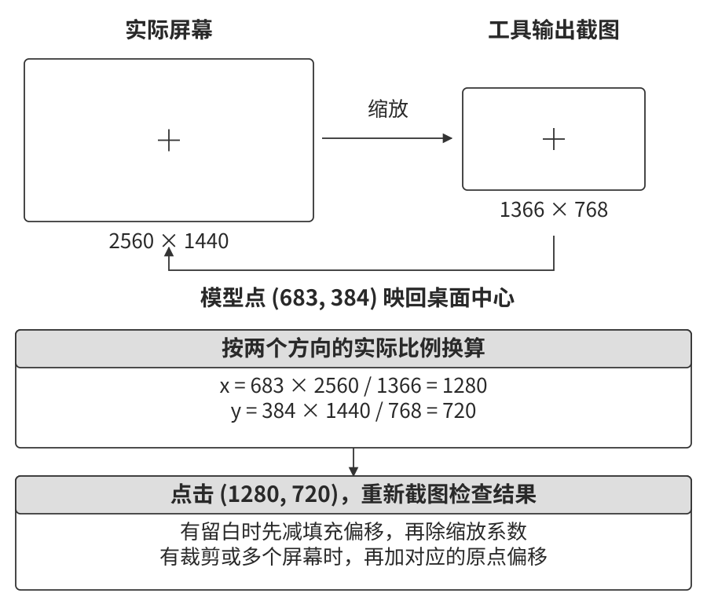

处理过程可以分成四步：读取 DOM、布局与可用的无障碍信息；筛选可交互元素；建立当前页面的编号映射；将元素描述与必要的标注截图交给模型。例如，模型可能看到下面四个带编号的元素：

```text
截图中标有 [1]、[2]、[3]、[4]

[1] <input type="text" placeholder="Search" aria-label="Search" />
[2] <button id="submit-btn" aria-label="Submit form" />
[3] <input type="text" placeholder="Enter your name" value="" />
[4] <a href="/docs" aria-label="Documentation" />
```

模型选择编号后，执行层解析成元素引用或坐标，检查目标是否仍可见、可交互，再完成操作。页面刷新、滚动或动态插入元素后，需要更新映射，避免使用过期编号。结构化索引能够利用标签、角色和文本，Canvas、遮挡或不完整的语义标注则需要结合截图判断。列出的元素越多，截图越大，送进上下文的信息也就越多。

**直接预测坐标。**

坐标路线让模型从截图和目标描述直接输出位置，例如将“点击提交按钮”映射到某个点。SeeClick 等 GUI 定位研究以及 Claude 的 Computer Use 都采用了坐标输出。执行层负责将图像坐标转换到实际桌面坐标。

截图缩放后，两套坐标需要采用同一变换。以 2560×1440 的桌面为例，若发送给模型的图片为 1366×768，则模型给出的 (683, 384) 对应：

$$
x = 683 \times \frac{2560}{1366} = 1280,\qquad
y = 384 \times \frac{1440}{768} = 720
$$

图6-15 中两种尺寸的宽高比接近。如果截图为了保持比例而加了黑边，模型给出的坐标就包含留白；换回原屏幕坐标前，要先减去相应的填充偏移，再按缩放系数换算。裁剪、显示缩放与多显示器原点同样会改变映射，工具层应保存实际变换参数。

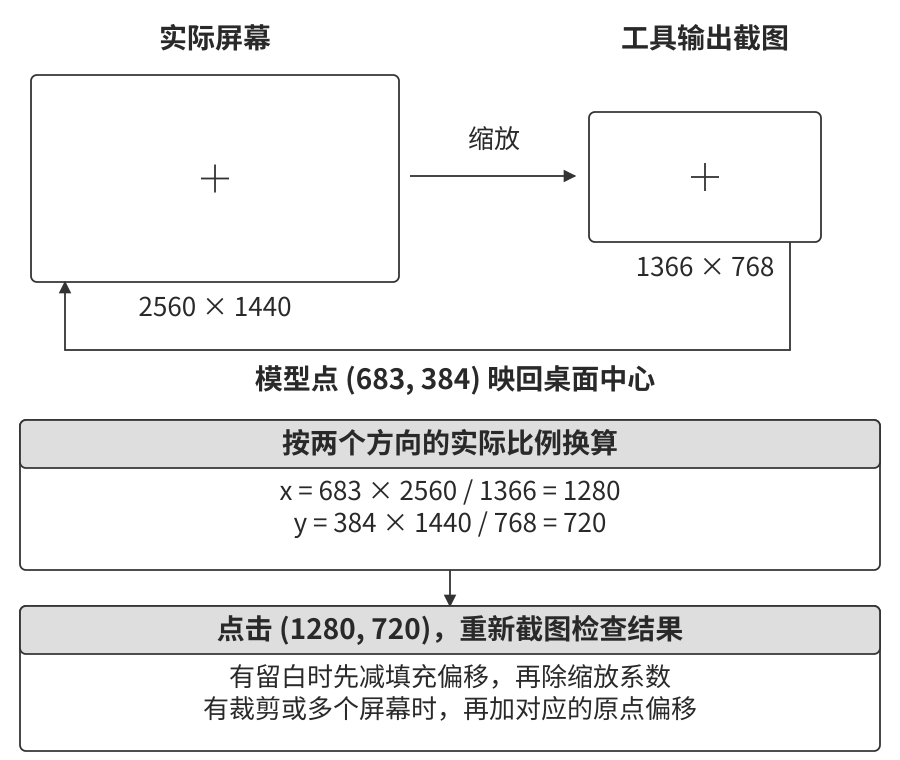

参考实现曾使用 XGA（1024×768）、WXGA（1280×800）和 FWXGA（1366×768）等目标尺寸。强行改变宽高比会使控件形状变形；使用错误的反向映射则会把正确预测落到错误位置。[^ch6-computer-tools]

**结构化信息完整时，笔者优先采用 DOM 或无障碍树索引。** 元素的名称、角色与引用可以直接参与定位，减少模型临时估计像素位置的工作。缺少结构时，通用视觉模型可以先配合 SoM，让模型从标好的区域中选一个；已经接受 GUI 定位训练的模型则可直接预测坐标，省去单独标注。

> **实验 6-9 ★：使用 browser-use 实现自动浏览器操作**
>
> 本实验用 Qwen3-VL 32B Instruct 驱动 browser-use，通过浏览器状态、元素信息和截图生成动作。任务是查询旧金山天气：定位搜索框，输入“San Francisco weather today”，提交查询，再提取温度和天气状况。
>
> 实验 6-9 的代码与运行说明提供两条入口。有 OpenRouter 密钥时，可用托管的视觉模型；已有 vLLM、SGLang 等兼容服务时，可将 `OPEN_MODEL_BASE_URL` 和 `OPEN_MODEL_MODEL` 指向自己的端点与模型，并按服务要求设置密钥。两条路线都先在实验目录运行 `python main.py --dry-run`，查看配置，再按说明启动实际查询。
>
> 保存的运行完成了 16 步交互，并保留 15 张截图。Google 出现验证码后，任务改用 weather.com 获取结果。

[^ch6-computer-tools]: Anthropic，Computer Use 工具文档与参考实现，介绍版本化动作接口、执行层与截图处理。
[^ch6-som]: Microsoft，*Set-of-Mark Prompting*，2023；browser-use 的 DOM 服务实现提供结构化元素处理示例。

### 能看动画、能听声音的 Computer Use Agent

页面只在保存后短暂显示“同步失败”，两张相隔数秒的截图却都显示同一张表单。重看这两张图，模型很可能无法还原中间发生过什么。视频、动画、短暂通知和会议语音也有这个问题。**对于持续变化的界面，笔者主张把观测接口作为重点改进对象。** 要根据变化决定下一步，就需要把动作之间出现过的事件或画面也保存下来。

笔者与合作者提出的 **Agent–Computer Observation Interface（AOI，Agent—电脑观测接口）**，将连续屏幕与音频转换为模型可以接收的图像和文字[^ch6-9]。接口包含三个组件：

- **动作间关键帧采集。** 在主循环运行期间监测画面变化，通过像素差异或轻量视觉模型筛选候选帧，再把有用画面交给下一次决策。
- **音量门控转写。** 检测到声音后调用语音识别，将转录与时间信息加入观测记录，帮助 Agent 使用会议内容或口头指令。
- **持久画面描述。** 将关键画面概括为文字；原图移出上下文后，文字仍保存发生过的变化，供后续步骤引用。

例如，视频中展示了一次菜单操作，模型收到中间画面和对应描述后，可以在播放结束后继续参考该步骤。论文的消融结果显示，持久文字描述对收益尤其关键，关键帧的精细选择贡献较小；部分模型加入过多图像后反而退化。

回到刚才保存表单的例子。即使关键帧拍到了“同步失败”，原图一旦移出上下文，模型就只能依靠留下的描述。“页面出现通知”可能意味着保存成功，也可能意味着失败；“同步失败，地址未保存”才保留了决定下一步的线索。

[^ch6-9]: Bojie Li、Noah Shi，*Agent-Computer Observation Interfaces Enable Dynamic Computer Use*，2026，介绍 AOI 及其组件消融。

### Computer Use 的世界模型

及时获得观测之后，Agent 还需要选择动作并等待执行。OSWorld-Human 研究将 Agent 的操作效率与人类轨迹对照，分析了冗余步骤和模型调用等耗时来源[^ch6-osworld-human]。

世界模型为规划提供动作后果的预测。桌面状态可以包含窗口、焦点、滚动位置、输入内容和加载进度；权限、网络结果等信息则需要通过相应接口补充。模型根据当前可用状态与候选动作，预测下一状态：

```text
当前状态 + click / type / scroll / wait → 预测的下一状态
```

人操作电脑时，往往在点击之前已经预想下一步；界面符合预期就继续，出现意外才停下来检查。世界模型可以为 Agent 提供类似的推测执行依据：规划器提前比较候选动作，在页面加载期间准备后续步骤，待真实状态确认后继续执行，减少每次点击后都从头规划的等待。例如，在 VS Code 中新建 Python 文件并写入 hello world，预期变化包括文件树出现新文件、编辑区包含代码、保存状态更新。执行后检查这些变化，符合预期就继续，出现偏差则重新定位与规划。

删除文件等操作还需要独立的执行条件：目标是否正确、是否允许删除、能否恢复，以及是否需要用户确认。预测帮助理解可能的结果，实际权限与业务条件由执行层检查。

**Photon-1 的潜在状态预测。** Induction Labs 在 2026 年 7 月介绍了 Photon-1：将视频帧编码为离散潜在 token，通过预测后续 token 学习状态变化。公司披露其预训练约使用 3 万 H200 GPU 小时。状态预测在潜在 token 中完成，辅助图像生成器负责将它们还原为可查看的画面，供人检查预测。规划与动作生成可以直接利用内部表示，省去每一步都生成完整截图的开销。[^ch6-20]

该方案进一步通过微调学习指令与动作格式：先预测希望到达的状态，再生成通向该状态的操作，并在虚拟机中通过在线训练改进任务表现。动作条件微调则用于预测给定操作后的桌面变化。这两种用途分别连接规划与模拟，展示了状态表示如何参与 Computer Use。

[^ch6-osworld-human]: Reyna Abhyankar 等，*OSWorld-Human: Benchmarking the Efficiency of Computer-Use Agents*，分析任务轨迹与时间开销。
[^ch6-20]: David Li、Jonathan Li，*Scaling Video Pretraining with Imagination Models*，Induction Labs，2026-07-23，介绍 Photon-1 的预训练、动作学习与状态模拟。
[^ch6-21]: Google DeepMind，*Genie 3: A new frontier for world models*，2025-08-05；Zachary Lin 等，*Cosmos World Foundation Model Platform for Physical AI*，2025。

### 移动端：技术接口与生态协作

移动端继续使用观测—决策—行动循环，动作则更多表现为触摸手势。同一个坐标可以表示单击位置、长按位置或滑动起点，因此接口还需要手势类型、持续时间和路径。屏幕旋转、软键盘弹出和系统弹窗也会改变可操作区域。

Android 的 `AccessibilityService` 可以在获准范围内读取界面信息并执行相应动作，手势接口还需要声明对应能力[^ch6-android]。截图、无障碍树和系统自动化接口可以配合使用，具体可用范围由操作系统、应用实现和授权决定。第七章介绍的 AndroidWorld 等基准，在真实应用任务中检查这些动作能否产生预期结果。

**笔者认为，移动端落地的生态壁垒往往比技术问题更难处理。** 平台需要确定哪些操作可以交给代理，账户、支付和数据如何授权，以及出错后如何追踪责任。这些约定会直接影响 Agent 可以完成的任务范围。

其中一个结构性的利益冲突来自流量与注意力。许多应用依靠广告展示、内容推荐和交易入口获得收入；用户委托 Agent 直接完成查询或购买后，页面浏览路径可能缩短，推荐与广告获得的注意力也会变化。对于依靠这些环节变现的平台，代理操作会触及原有的收入来源。平台因而需要重新考虑接口开放、商业分成和代理身份管理。

[^ch6-android]: Android Developers，AccessibilityService，介绍界面访问、动作与手势能力。

## 机器人操作：以 XLeRobot 整理桌面为例

把红色杯子放进托盘，把黄色废纸放进垃圾盒，最后确认桌面已经整理好——这个任务把感知、规划和控制连在了一起。夹爪接近杯子时，摄像头中的位置会变化；杯子被夹起后，手臂需要避开桌上的其他物体；纸张第一次没有夹住，系统还要发现失败并重新尝试。每个动作都会改变下一次决策的条件。

本节沿着这个任务安排五个实验。实验 6-10 和 6-12 给出真机遥操作与自主操作的实践设计；实验 6-11、6-13 和 6-14 使用本地模拟，分别研究控制基线、失败恢复和视觉条件变化。

同一台机器人可以由人持续看着摄像头操纵，也可以由模型读取画面、选择技能，再交给控制系统执行。保持任务和硬件不变，就可以从四个问题分析两种方式的差别：人想完成什么，接下来先做哪个子任务，当前技能输出哪些动作，以及动作之后的环境是否符合计划。长程规划安排杯子与废纸的处理顺序，VLA 策略或预先定义的动作原语负责抓取和放置，世界模型帮助估计动作后果，仿真到现实的迁移则处理画面、接触和执行器特性的变化。

### 硬件与算法的分工

自主整理桌面失败时，可以先用遥操作检查硬件能否完成任务。保持摄像头、机械臂、夹爪、桌面布置和验收条件不变，让操作者接管感知与控制闭环。如果人在多轮操作中都能稳定完成，而自主系统反复失败，就说明这套硬件已经能够完成当前任务，瓶颈主要落在自主控制的算法与反馈上。此时应优先排查物体定位、技能选择、动作时机和失败恢复，让自主系统学会遥操作中有效的修正方法。

XLeRobot 支持用键盘、Xbox 手柄和 Switch Joy-Con 遥操作，VR 操作可以先在模拟环境中体验。[^ch6-1] 夹爪接近杯子时，操作者会减速；杯子一滑，就得修正抓取点。夹爪没夹住纸张，要再看一次；物体归位，也要看一眼确认。这些根据观测作出的修正都值得记录在演示数据里。以后由机器人自主操作时，同样要能发现滑动和漏抓。

> **实验 6-10 ★：真机遥操作 XLeRobot 整理桌面**
>
> 在完成标定、限位和急停检查的 XLeRobot 工作区中，放置红色杯子、托盘、黄色废纸和垃圾盒。通过一种已校准的遥操作方式执行固定任务：“把红色杯子放进托盘，把黄色废纸放进垃圾盒，最后确认桌面状态。”重复多轮，记录摄像头画面、操作者输入、机械臂状态、动作时间、抓取失败和重试次数。
>
> 每轮结束时，确认杯子位于托盘内、废纸位于垃圾盒内，机械臂回到安全姿态，并检查全程的碰撞、越界和人工干预记录。把失败发生在哪一步、操作者如何恢复与最终结果放在一起分析，就能形成自主控制的对照基线。

模拟实验则便于重复改变物体数量和初始位置，单独考察已知状态下的控制过程。二维桌面模型可以把接近物体、搬运到目标、处理下一个物体表示为三个阶段，以完成步数和路径长度描述控制开销。

> **实验 6-11 ★：在模拟器中建立同任务的理想控制基线**
>
> 在二维桌面中随机生成物体位置与目标位置，让控制器直接读取坐标，依次接近物体、移动到对应目标，再处理下一个物体。改变初始位置和物体数量，比较成功率、完成步数与路径长度。
>
> 先跟踪一个物体的完整轨迹：控制器到达物体后进入搬运阶段，到达目标后才能累计完成数量。接着增加物体数量，检查每个物体都经过这两个到达条件。配套的二维模拟在五个随机种子下分别摆放 1、2、3、4 个物体，每种组合运行 512 回合，合计 10,240 回合全部完成。控制器可以直接读取坐标，移动物体也不依赖真实夹爪。

### 机器人控制的基本结构

整理一次桌面可能需要几分钟，关节控制却要持续、及时地更新。系统可以按时间尺度分工，让高层规划安排任务顺序，让技能策略生成运动，再由底层控制器跟踪执行：

| 层级 | 核心问题 | 输出 | 时间尺度与配置示例 |
| --- | --- | --- | --- |
| 任务目标 | 人想完成什么 | “把杯子和废纸归位” | 分钟级任务 |
| 长程规划 | 先做什么、后做什么 | 先处理杯子，再处理废纸，最后检查 | 秒到分钟 |
| 基本技能 | 当前要完成哪个状态变化 | `pick(red_cup)`、`place(red_cup, tray)` | 一次技能可持续数秒，如 1—3 秒 |
| VLA / 技能策略 | 当前技能具体怎么动 | 夹爪动作、末端位姿或一段关节轨迹 | 可按 1—10 Hz 推理配置 |
| 底层控制与安全层 | 如何稳定、及时地执行 | 关节或末端控制量、限速与急停 | 控制器可按数十至上千 Hz 配置 |

规划器可以采用规则程序、VLM 或优化器，VLA 也可以承担部分技能选择。**笔者的建议是把任务顺序与眼前动作分开处理。** 高层推理需要时间组织计划，底层控制需要及时响应位置与受力变化；让两者按各自合适的节奏运行，才能兼顾规划与控制。

本节为高层模型提供 `observe_scene`、`pick`、`place`、`verify_state` 和 `stop` 五类工具，分别用于观测、抓取、放置、检查和停止。Harness 检查参数、工作区和当前状态，执行器将通过检查的技能转换为机械臂动作，并处理限速与超时。关节角和连续轨迹由技能策略及控制器生成，模型选择技能与实际运动之间由此形成清楚的接口。

### 长程规划与任务分解

用户说“把桌面整理干净”时，规划器先识别物体及其目标区域，确定处理顺序，并为每一步写清楚开始条件、完成条件和动作限制。例如，整理顺序可以是：

```text
处理红色杯子 → 清理黄色纸张 → 检查桌面
```

“处理红色杯子”继续拆成两个动作和一次检查：

```text
pick(red_cup) → place(red_cup, tray) → verify_state()
```

以“拿起杯子并放到托盘”为例，机械臂运行完抓取程序，只说明这段程序结束。下一步抬升之前，还要通过夹爪反馈或新图像判断杯子是否真的拿住了。如果抓空了，就重新定位杯子；若有人移走了托盘，已成功的抓取仍然有效，只需重规划放置动作。让每个技能对应一个可以检查的状态变化，限定动作与时长，再返回执行状态和新观测，规划器就能从实际出错的那一步恢复。

> **实验 6-12 ★★：使用 Gemini Robotics-ER 1.5 驱动 XLeRobot 自主整理桌面**
>
> 沿用实验 6-10 的硬件、桌面布置、任务与验收条件，由具身推理模型负责观测和规划。参考 RoboCrew 的编排方式，为本任务设计五个工具：`observe_scene`、`pick`、`place`、`verify_state` 和 `stop`。[^ch6-2]
>
> 模型先读取桌面观测、决定处理顺序，再调用经过标定的抓取和放置技能。每完成一个技能，就获取新观测并检查后置条件；失败后根据当前状态选择重试或停止。运行系统在收到急停信号、检测到越界或无法确认关键状态时直接停止执行，模型也可以通过 `stop` 主动结束任务。
>
> 最终由新的环境观测确认杯子位于托盘内、废纸位于垃圾盒内、机械臂回到安全姿态，并核对碰撞和越界记录。操作者负责启动、急停和现场监护，将中途接管单独记录。

实验 6-12 说明了怎样接入真机动作、怎样验收整理结果，配套记录中还没有这项任务的真机试验。下面先在模拟环境中比较三种办法：按计划开环执行、每做一步就检查结果，以及先预测动作的后果。任务目标和五类工具保持一致，故障也可以重复触发，便于观察三种办法遇到同一次失误时各会怎样处理。

### VLA 控制

VLA 是 Vision-Language-Action 的缩写，即视觉—语言—动作模型。它根据当前画面、任务指令以及可用的机器人状态，生成接下来要执行的动作：

```text
当前观测 + 技能指令 → 动作或动作序列
```

在整理桌面的例子中，高层规划器提交 `pick(red_cup)`，技能策略根据画面决定从哪个方向接近杯子、何时闭合夹爪，以及沿什么轨迹抬起手臂。执行完这一段运动后，系统重新获取桌面观测，确认杯子已经被夹住，再进入 `place(red_cup, tray)`。工具接口约定期望的状态变化，VLA 则学习通过连续动作实现这一变化。

动作可以采用不同的表示方式。RT-2 和原始 OpenVLA 将动作各维度的数值量化为离散 token，沿用语言模型的生成方式输出；π₀ 使用流匹配生成连续动作块。前者便于复用自回归生成框架，后者直接建模一段连续动作的分布。[^ch6-15]

模型推理与执行器控制通常采用不同的更新频率。动作分块（action chunking）让模型一次生成一小段未来动作，由控制线程按较高频率执行。进一步将推理与执行重叠，系统就能在执行当前动作块时准备下一块，减少等待。动作块的衔接还需要处理轨迹连续性与观测时效：如果手臂伸向杯子时杯子被碰动，剩余动作仍可能指向旧位置。缩短每次实际执行的片段、用新观测滚动更新，或在检测到异常时中断动作，都可以提高响应速度；这些选择也会增加推理与调度开销。

### VLA 的数据与部署条件

要把“抓起杯子”稳定地变成动作，需要同时处理以下几类差异：

- **训练数据的覆盖范围**：可用的机器人动作演示远少于互联网文字和图像，知道“杯子”是什么，还需要实际抓取经验来判断如何施力。演示需要覆盖杯子的材质、形状、摆放姿态和摩擦条件。同样的抓取方向，在陶瓷杯和柔软纸杯上可能产生不同结果。
- **动作与后果的学习目标**：行为克隆主要学习示范者在当前条件下会采取什么动作。若要比较多个动作的后果，可以增加状态预测或动作结果评价。
- **机器人本体与接口**：自由度、坐标系、夹爪结构和执行器延迟决定动作如何落到硬件上。迁移策略时，需要匹配动作表示、标定参数和控制周期。
- **观测的时效**：动作块执行期间，物体可能移动、被遮挡或碰倒。系统需要规定何时获取新观测，以及何时用它更新剩余动作。

这些条件把视觉识别、技能控制与环境变化联系起来。杯子中的液体会影响搬运速度，桌边的电源线会改变可行路径，纸张与桌面的接触会影响夹取方式。规划器若能提前比较这些后果，就能为技能选择提供更多依据。

### 世界模型

在机器人规划中，可以把动作条件世界模型理解为“动作结果预测器”：给定当前状态与候选动作，它估计接下来会发生什么。

```text
当前状态 + 候选动作
    → 预测下一状态或未来片段
    → 比较候选结果
    → 选择动作、重新规划或停止
```

这个过程包含三项工作：表示当前状态，预测动作导致的状态变化，再让规划器或控制器据此选择动作。状态可以是物体位置、是否被夹住等结构化变量，也可以是从图像中提取的内部表示。V-JEPA 2 先从视频中学习状态表示与预测，进一步训练的 V-JEPA 2-AC 引入动作条件，用于机器人规划。将动作与未来观测联系起来，也是世界—动作模型（World-Action Model）的一类建模思路。[^ch6-16]

世界模型可以在三个阶段帮助机器人：动手前分别预测抓取、推动或等待会带来什么结果；执行时对照预测与实际观测，发现偏差后调整动作或重新规划；训练时利用视频、仿真数据和失败轨迹学习状态变化，减少真机试错。

假设黄色废纸被红色杯子部分遮住，规划器可以比较“先抓纸”“先移开杯子”和“换一个抓取方向”。笔者会优先让世界模型预测这些与任务直接相关、可以检查的状态变化。能判断纸张是否更容易被夹住、杯子是否容易被碰倒，就可以为候选动作排序。模型采用的状态表示与训练目标应围绕这些判断设计。若模型生成未来画面，笔者会优先检查画面能否准确反映这些动作后果，再考虑增加视觉细节；图像逼真度的价值，最终要体现在规划和控制的改进上。执行之后，系统再根据摄像头和机器人状态检查实际结果，决定继续、重试或更换方案。

预测范围越长，误差越容易累积。实践中可以先预测短期后果，执行一小段，再用新观测重新规划，并把预测的不确定性纳入选择。生成式世界模型还可以提供交互式仿真与可视化场景；用于控制时，需要进一步检验动作条件、接触规律和预测误差。硬件限位、急停和实时控制继续由执行系统承担。[^ch6-21]

> **实验 6-13 ★★：在模拟器中比较三种自主整理桌面的闭环**
>
> 用结构化状态表示红色杯子与黄色废纸：每个物体处于“在桌面上”“已拿起”或“已放置”三个阶段，目标区域记录是否可用。模拟器提供观测、抓取、放置、检查和停止五类工具，并在抓取废纸时注入至多一次瞬时失败。
>
> 比较三种控制方式。**开环执行**按固定顺序完成四个动作。**逐步检查**读取每次动作后的状态，失败后重新获取观测，再选择当前可执行的步骤。**预测式执行**用一个小型神经网络学习“状态与动作到下一状态”的映射，根据预测的归位进度为可执行动作排序。
>
> 比较任务完成情况、工具调用次数和失败恢复过程。例如，废纸抓取失败后仍留在桌面上，直接执行放置会因没有拿起物体而失败；读取状态后重试抓取，才能继续放置。两种反馈策略在结束时调用 `verify_state` 检查归位状态。
>
> 先看没有注入故障的回合，三种策略都能完成。把故障注入概率调到 50%，每种策略都在三个种子上运行 384 回合（每个种子 128 回合）。开环仍然每回合调用 4 次工具，只有 205 回合完成。逐步检查和预测式执行都完成了全部 384 回合，平均都调用约 6.93 次。多花的调用让控制器能够发现抓空并恢复。在这项只注入一次可恢复故障的任务里，预测下一状态没有比直接检查再多挽回一个回合。

### 从仿真环境到真实机器人

从模拟桌面走向真实机器人，需要逐项处理环境差异。画面方面，同一个杯子和托盘会出现在不同背景、光照、相机位置与遮挡关系中；运动方面，摩擦、传感器噪声和执行器延迟会影响轨迹及抓取。

域随机化的做法，是在训练时改变背景、物体外观、光照或噪声，让模型在多种条件下完成相同的判断。实验 6-14 只取其中一个环节来研究：看到物体和目标区域后，应该向哪边移动？

> **实验 6-14 ★★★：同一桌面任务的 RGB 跨环境测试**
>
> 用圆形表示物体、方框表示目标区域，生成 RGB 桌面图像。模型根据二者的相对位置，输出左、右、上、下四个移动方向之一；当两个位置足够接近时，输出实验定义的 `grasp` 标签。这个标签表示二维位置满足接近条件。
>
> 训练四组结构相同的视觉策略：固定视觉条件、主要改变背景、主要改变物体外观，以及组合多种变化。将各组策略分别用于原始条件和包含新颜色、纹理、亮度与噪声的测试图像，比较方向判断准确率，并查看判断出错的图像。
>
> 每个测试域、每个种子都有 1,024 张合成图像。先比较三个种子的平均准确率：固定视觉条件训练的策略在原域为 93.03%，换到带新纹理和噪声的目标域（`target_realistic`）降到 54.82%；组合多种变化训练的策略，原域为 87.50%，在同一目标域却达到 76.11%。再看只随机化背景的一组，它在这个目标域只有 36.88%。[^ch6-6]

## 本章小结

回到开头的改签电话。后台查询航班时，用户补充了行李要求。哪怕查询结果比用户消息晚到，也可能回答的是旧问题。事件队列要保留消息来源、任务标识和先后关系，前台才能按优先级接住新要求，判断原查询可以继续、应该取消，还是要换条件重查。这是**时机**问题，光把请求换成语音并不能解决。

语音又多了一层要求。一边播报价，一边还要能听见用户插话；一旦改了日期，就该停掉过时的播报。级联和端到端描述声音怎样经过识别、推理和生成，全双工描述用户与助理能否同时听说。

换成屏幕或机械臂，同一个问题仍在，只是**观测和动作的形式**变了。按钮坐标取自上一张截图，页面刷新后就要重新定位；机械臂可以一次预测一小段连续动作，让关节运动更平滑，但动作段越长，执行中途应对变化也越困难。高层规划、技能和底层控制以不同时间尺度工作，最终有没有把杯子放进托盘，还得再看一次桌面。把这些交互写在一起，可以看出它们共有的次序：

```text
获取观测
  → 判断当前状态与执行时机
  → 选择回复或动作
  → 执行并取得环境反馈
  → 继续、修正、重试、停止或重新规划
```

这条流程可以帮助定位故障。若用户一插话，旧报价还在继续播，就检查谁负责唤醒前台、能否抢占播放，以及取消信号到了哪个安全点；若停得及时，却仍报出旧日期，则要沿着前后台的交接去查查询结果。改好后，怎样证明它在更多通电话里都能做对？从这里开始，全书转入能力改进。第七章先讲怎样设计任务、记录失败并比较改动，后训练、持续进化与多 Agent 协作都要用到这套评估方法。

[^ch6-1]: XLeRobot，Teleop 文档。
[^ch6-2]: Google DeepMind，*Gemini Robotics-ER 1.5*。XLeRobot，LLM Agent 控制。XLeRobot 上游示例展示模型与工具调用的编排方式；本节保持同一编排原则，但把动作工具限定为经过标定的桌面抓取、放置、检查和停止原语。
[^ch6-6]: LeRobot，Sim2Real 教程。
[^ch6-15]: Moo Jin Kim 等，*OpenVLA: An Open-Source Vision-Language-Action Model*，arXiv:2406.09246，2024。另见 RT-2 项目说明及 Physical Intelligence 的 *Our First Generalist Policy*。
[^ch6-16]: Meta AI，*Introducing the V-JEPA 2 world model and new benchmarks for physical reasoning*，2025 年 6 月 11 日。技术报告编号为 arXiv:2506.09985。
[^ch6-22]: OpenAI，“Async tool calling”；“Using GPT-6 Astra”，核对日期：2026-09-05。
[^ch6-23]: OpenAI，“Mid-turn steering”，核对日期：2026-09-05。

[^ch6-audio-architectures]: OpenAI，*Voice activity detection*，介绍按声音活动与语义判断轮次边界的两种做法。
[^ch6-voice-tools]: OpenAI 的 GPT-Live-1 与 GPT-Realtime 模型说明分别介绍后台委派和函数调用。豆包实时语音模型 3.0 的接入方式见火山引擎《Function Calling》。

## 思考题

1. ★★ 异步 Agent 收到新事件时，需要判断它与当前任务的优先关系。如果这个判断涉及语义理解，例如识别用户是在补充条件还是要求立即停止，应如何分配规则引擎与 LLM 的职责？请比较响应时间、费用和误判后果。
2. ★★ 事件队列积压了 20 个事件：10 个工具结果、5 条用户消息和 5 个系统提醒。你会如何组织它们的顺序、格式和处理状态，使模型能够追踪任务依赖并回应重要变化？
3. ★★★ Agent 可以使用专属邮箱和电话号码，也可以在授权后操作用户的个人账号。请结合后台运行、对方的身份核验要求、权限范围与审计，讨论两种身份方式各自适用的场景。
4. ★★ 端到端语音模型直接处理音频，中间环节的错误较难从外部定位。如何设计观测与对照实验，区分感知错误、推理错误和表达错误？
5. ★ Step-Audio R1.1 的 MPS 让构思与表达协同推进。系统应如何使用停顿、进展说明和分段表达？后续推理改变了已说出的结论时，应怎样处理？
6. ★★ SoM 的视觉区域标注与 DOM 元素索引都让模型能用一个编号指明要操作哪里。遇到非标准控件、遮挡或动态变化时，如何组合重新标注、坐标预测和操作后检查？
7. ★★ 遥操作数据的质量受操作者技能影响。抖动、绕路、停顿和抓取失败会怎样影响 VLA 训练？如何筛选数据，同时保留有价值的失败恢复过程？
8. ★★★ 语音、Computer Use 和机器人都可以采用统一模型、模块化级联或前台交互与后台推理分工。面向未来五年，你倾向于怎样组合这些路线？请结合延迟、可观测性、升级成本与任务风险说明判断。
9. ★★ 标准 Web 页面可以提供 DOM 或无障碍信息，Canvas、WebGL 与自绘控件往往依赖视觉定位。同时维护结构化与视觉两条路径，会增加哪些成本，又能获得哪些收益？
10. ★★ 动作分块让 VLA 一次生成一段未来动作。若执行期间物体被移动，怎样协调分块长度、重新观测、后台推理和动作中断，兼顾执行效率与响应速度？
11. ★★★ 快速交互需要及时行动。请分别以语音回复、网页提交和机器人抓取为例，设计动作分级、状态确认与停止机制，使响应速度与任务后果相匹配。
12. ★★★ 选择唤醒、安全点、取消、抢占或快慢分工中的一个原语，比较它在事件驱动任务与机器人动作分块中的实现。环境变化速度、动作可逆性和观测成本怎样影响设计？
13. ★★ 同一笔订单的顾客聊天、审批讨论和支付回调，是否应当归入同一条线程？请从处理顺序、并行度、分区键迁移和权限隔离四个方面，比较合并线程与按关联对象订阅两种做法。
